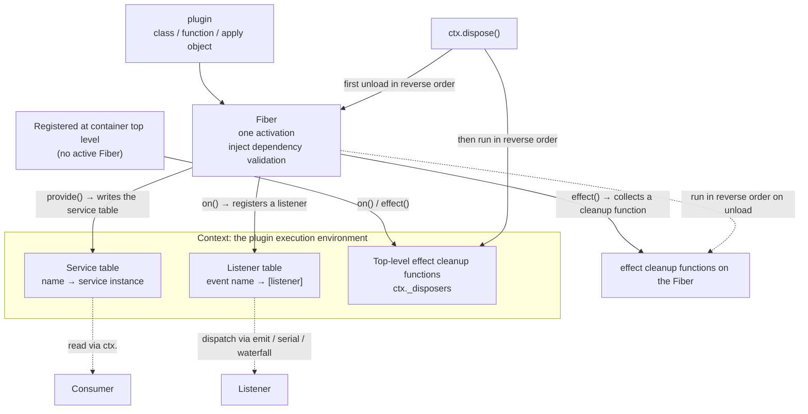

# Chapter 1: The Cordis Container Kernel (Everything Is a Plugin)

> At the gate, no one is asked where they come from; once inside, everyone is a plugin.

## Questions this chapter answers

- How is a plugin container assembled? — How are context, services, reversible registration, and event dispatch unified under a single `Context`?
- What are a context (`Context`) and a service (`Service`)? How does a capability go from being a "global variable" to a "service registered in the container"?
- What is reversible registration (`effect` / `Fiber`)? How does registration become revocable and rollback-able?
- What is event dispatch (`on` / `emit` / `serial` / `waterfall`)? How can services collaborate without knowing each other?

What this book delivers is a harness for assembling AI agents on top of **Cordis** — that is, DeepSeek Harness (abbreviated **dsh** in the repository and on the command line): `agent = model + harness`. The model provides reasoning ability; the harness provides the framework that organizes those abilities. The foundation of that framework is the subject of this chapter — the **Cordis plugin container kernel**.

Cordis's worldview fits in one sentence, which is also this chapter's opening epigraph: **everything is a plugin**. The container does not care whether what is being installed is a "model adapter", a "session log", or a "prompt template" — they are all treated as plugins: registered into the container, declaring dependencies, reversibly unloadable, and collaborating through events.

This chapter only builds the container; no business logic. What does it look like when it runs? `ch01/code/hello.py` is only 41 lines, and running it prints three lines — the output and its line-by-line reading are in §8, once all the mechanisms have been covered.

Those three lines correspond to three core assertions about the container: **capabilities are services** (no global variables), **registrations are effects** (rollback-able), and **interactions are events** (callers and listeners don't know each other). As for where the dependencies come from — the full implementation of the container kernel lives in `vendor/cordis/src/` (vendored from the Cordis kernel; the package name in this repository is `@deepseek-ai/cordis`, and the upstream published name is `cordis`); this chapter reimplements its minimal subset in pure Python in `ch01/code/cordis.py`, and the one-to-one correspondence between symbols and source locations is in §9 "Source mapping". All source line numbers in this book are based on upstream HEAD `8bd0733` (dsh-v0.2.2-alpha.3).

This chapter only delivers the container kernel; installing the session, the prompt, and the conversation loop into this container and running the closed loop of "one message in, one reply out" is the job of the next chapter, "The Minimal agent-loop Closed Loop".

## 1. The Plight Without a Container

Before introducing Cordis, let's look at how broken a multi-agent system without a container gets.

### 1.1 A runnable counterexample: a shared global message list

Save as `ch01/code/bad_example.py` and run directly with `python3 bad_example.py` (standard library only):

```python
"""第 1 章反面示例：没有容器时会发生什么。

两个 agent 共享一个全局消息列表、硬编码的"模型调用"，
彼此的对话历史互相污染。运行：python3 bad_example.py
"""
messages = []  # 全局消息列表：所有 agent 共享


def ask(agent, question):
    messages.append({"role": "user", "content": question})
    reply = f"{agent} 收到: " + "".join(m["content"] for m in messages)
    messages.append({"role": "assistant", "content": reply})
    print(f"[{agent}] {reply}")


ask("客服 agent", "怎么改签车票？")
ask("导购 agent", "推荐一款机械键盘")
```

Actual output:

```text
[客服 agent] 客服 agent 收到: 怎么改签车票？
[导购 agent] 导购 agent 收到: 怎么改签车票？客服 agent 收到: 怎么改签车票？推荐一款机械键盘
```

The second line is the accident scene: mixed into what the shopping agent "received" are the support agent's question and reply — the global list is shared by all agents, and whoever writes to it contaminates everyone.

### 1.2 The root of the problem: capabilities, dependencies, lifecycle, and collaboration are all unmanaged

This example is only a dozen lines, yet it exposes three problems that inevitably appear without a container; a fourth emerges when we try to solve the first three:

1. **Capabilities are global variables**. `messages` sits in the global scope: anyone can write to it, no one is responsible for it. In a real system, model adapters, session logs, and prompt templates all become module-level singletons like this — who provides them, who consumes them, and when they get cleaned up all rely on tacit agreement.
2. **Dependencies are invisible**. `ask` implicitly depends on `messages`, but this dependency appears in no declaration; a missing dependency or a wrong order only surfaces as a runtime error.
3. **No lifecycle**. When you want to "cleanly unload an agent", there is nowhere to start — the global state is still there, and no one can say which resources should be reclaimed.
4. **Services need to collaborate** (this is the new problem that emerges after the first three are solved). Once capabilities no longer hang off the global scope but become mutually isolated **services**, services still need to call each other — and if they call each other directly, the "who knows whom" coupling is reintroduced.

This chapter solves this problem chain layer by layer; each step corresponds to a set of container mechanisms:

| Problem | Mechanism | In one sentence |
|------|------|--------|
| ① Capabilities are global variables | `Context` + `Service` | Capabilities become services registered in the container (§4) |
| ② Dependencies are invisible | `plugin` + `inject` | Dependencies become declarations, validated at load time (§5) |
| ③ No lifecycle | `effect` + `Fiber` | Registrations become reversible effects, reclaimed LIFO (last in, first out: later registrations are cleaned up first) (§6) |
| ④ Services need to collaborate | `on`/`emit`/`serial`/`waterfall` | All interactions are events (§7) |

Before unpacking them one by one, let's first see what the minimal closed loop looks like with the container installed (§2), then give an overview diagram of the container structure (§3).

## 2. The Minimal Runnable Closed Loop: hello.py (the simplest example first)

Before dissecting the mechanisms piece by piece, let's state three assertions first, then verify them with a minimal example.

### 2.1 Three assertions

Cordis's worldview can be condensed into three assertions:

**Assertion 1: Every capability is a service.** Model calls, session storage, prompt assembly — all of them are services registered on the container, read via `ctx.<name>`. No module-level singletons, no global state.

**Assertion 2: Every registration is a plugin.** A service is not simply `new`-ed up and done; it is registered into the container through a plugin. Plugins come in three shapes (function / class / apply object), and the container loads them uniformly. The act of registration itself is an "effect": trackable and rollback-able.

**Assertion 3: Every interaction is an event.** Services don't call each other directly; they communicate through events. The caller only `emit`s; the listener only recognizes the event name; no one needs to know who the other party is.

### 2.2 The minimal example: three assertions in one file

Compress the three assertions of 2.1 into one file. Save as `ch01/code/hello.py`; `cordis.py` is the teaching-version container implemented in this chapter, already in place in the same directory, and `python3 hello.py` runs directly (see §4–§7 for the piece-by-piece breakdown of the implementation):

```python
"""第 1 章 §2.2 最小例子：一个文件装下三条论断。

运行：python3 hello.py（与 cordis.py 同目录，仅标准库）。
"""
from cordis import Context, Service, ServiceNotFoundError

ctx = Context()  # 创建容器：内部有一张服务表和一张监听器表，后面的能力都注册到这里

# 为 "greet" 事件登记一个监听器：此后任何人 emit("greet", name)，这个 lambda 都会被调用。
# 监听器只认事件名，不知道是谁在 emit。
ctx.on("greet", lambda name: print(f"[event] hello, {name}"))


# 定义一个能力 Greeter：提供 greet 方法，打招呼并发出一个事件。
class Greeter(Service):
    def __init__(self, ctx, config=None):
        # 构造即注册：Service.__init__ 内部调 ctx.provide("greeting", self)，
        # 把这个实例写进服务表，此后 ctx.greeting 就指向它。
        super().__init__(ctx, "greeting")

    def greet(self, name):
        # 发出事件：容器会依次调用所有登记在 "greet" 上的监听器。
        # greet 不知道谁在监听——调用方和监听器只认事件名，互不认识（论断三）。
        self.ctx.emit("greet", name)
        return f"hello, {name}"


# 把 Greeter 作为插件注册进容器：容器负责实例化 Greeter(ctx, config)，
# 并把这次登记记为一笔「效应」——卸载时可以回滚（论断二）。
ctx.plugin(Greeter)

# 使用能力：按名字 "greeting" 从服务表里查出服务，调用它的 greet 方法，
# 全程没有全局变量（论断一）。
print(ctx.greeting.greet("cordis"))

# 注册是效应：dispose 按注册逆序回滚，把服务从服务表移除。
ctx.dispose()
try:
    ctx.greeting  # 再读一次：服务已被回滚，抛 ServiceNotFoundError
except ServiceNotFoundError:
    print("dispose 之后：ctx.greeting 已被回滚")
```

Run output:

```text
[event] hello, cordis
hello, cordis
dispose 之后：ctx.greeting 已被回滚
```

(Which assertion each of the three lines belongs to, and which mechanism produces it, is mapped in a table in §8 — by then the mechanisms of §4–§7 have all been unpacked. For now just note that the four steps in the file — `ctx.on(...)`, `ctx.plugin(...)`, `emit(...)`, `dispose()` — each exercise one mechanism still to come.)

Two more notes on pitfalls beginners often hit: registration always goes through explicit `provide()` (that is exactly what `Service`'s constructor does internally) — `ctx.greeting = ...` is just an ordinary attribute assignment and won't enter the service table (see §4.1); a service can be any object — in a real system, model adapters, session storage, and the agent-loop are all registered the same way.

## 3. Container Structure Overview (relationships first)

Before dissecting piece by piece, let's build the big picture with one diagram: at its core the container has **one service table** and **one listener table**, plus a stack of **Fibers** that record the lifecycle. There is also one easily missed side path: an effect registered while no Fiber is active (i.e. at the container top level, such as the `ctx.on(...)` line in `hello.py`) attaches its cleanup function directly to `Context._disposers`, and `ctx.dispose()` reclaims it last. Plugins write services, register listeners, and attach cleanup functions through Fibers; consumers read the service table, listeners receive events; `dispose()` first unloads Fibers in reverse order, then reclaims the top-level cleanup functions.



The three subsystems correspond to the four problems of Section 1 (unpacked one by one in §4–§7):

- **Service table** (§4): solves problem ① "capabilities are global variables" — capabilities are collected into the service table via `provide()`, read via `ctx.<name>`; no global singletons.
- **Fiber stack** (§5, §6): solves problem ② "dependencies are invisible" and problem ③ "no lifecycle" — each `plugin()` produces a Fiber, declares `inject` dependencies (§5), attaches `effect()` cleanup functions to the Fiber, and `dispose()` reclaims in reverse order (§6).
- **Listener table + dispatch** (§7): solves problem ④ "services need to collaborate" — `on()` registers listeners, `emit/serial/waterfall` dispatch; services only recognize event names.

The order of dissection runs §4 → §7: first set up `Context` and the service table (§4), then see how plugins come in with `inject` (§5) and leave with `effect` (§6), and finally see how they collaborate through events (§7).

## 4. Context + Service

The `messages` in Section 1 hangs off the global scope; anyone can write to it. Cordis's solution: collect capabilities into **services** registered on the `Context`; who provides, who consumes, and when to remove are all managed by the container.

### 4.1 Context: one service table + one __getattr__

```python
# cordis.py —— Context 的构造与服务解析（节选；类 docstring 从略）
class Context:
    def __init__(self):
        setattr(self, Symbols.services, {})    # 服务表：name → 实例
        setattr(self, Symbols.events, {})      # 监听器表：事件名 → [listener]
        setattr(self, Symbols.dispose, False)  # dispose 标记
        self._fibers: list[Fiber] = []        # 全部 fiber（按注册顺序）
        self._pending: list[Fiber] = []       # 依赖未满足，等待加载
        self._disposers: list[Callable] = []  # 根级 effect 清理函数

    def __getattr__(self, name):
        """普通属性查找失败时按服务名查服务表。"""
        if name.startswith("_"):
            raise AttributeError(name)
        services = getattr(self, Symbols.services)
        if name in services:
            return services[name]
        raise ServiceNotFoundError(name)

    def provide(self, name, value):
        """注册服务，返回「注销」disposer。

        写服务表 → 派发 service/provide → 结算等待依赖的 fiber。
        """
        services = getattr(self, Symbols.services)
        services[name] = value
        self.emit("service/provide", {"name": name})
        self._settle_pending()

        def dispose():
            if services.get(name) is value:
                del services[name]
                self.emit("service/dispose", {"name": name})

        return dispose

    def _settle_pending(self):
        """新服务到达后逐个复查 PENDING fiber：依赖已满足才加载。"""
        while True:
            ready = [f for f in self._pending if f.deps_satisfied()]
            if not ready:
                return
            for fiber in ready:
                self._pending.remove(fiber)
                fiber.activate()
```

Key names like `Symbols.services` and `Symbols.events` come from the `Symbols` class at the top of `cordis.py`: a set of double-underscore string constants (`Symbols.services` is exactly `"__cordis_services__"`), corresponding to the `Symbol.for('cordis.*')` keys of the source's `symbols` object (`vendor/cordis/src/utils.ts:50-74`; there is no symbols.ts in the whole repo), used as key names for the container's internal fields.

Every mechanism of Context is built on two tables: the service table (name → instance) and the listener table (event name → list of listeners). `__getattr__` is Python's fallback method for attribute access — called only when normal lookup fails — and it treats the failed attribute name as a service name to look up in the table; internal fields starting with `_` bypass the service table to avoid false hits. `provide` writes `value` into the service table, returns a `dispose` closure that can remove it, emits the `service/provide` event, and settles plugins waiting on dependencies (see §5).

Why it is designed this way:

- **`__getattr__` instead of `__setattr__`**: `__getattr__` fires only when an attribute is missing, so internal fields (`_fibers`, etc.) are unaffected; `__setattr__` would intercept every assignment and easily cause false hits. TS's Proxy intercepts both get and set; Python only intercepts missing reads, so service registration always goes through explicit `provide()`.
- **`ServiceNotFoundError` inherits from `AttributeError`**: the default-value pattern `getattr(ctx, name, default)` still works. The real source has no such error type (when a service is not provided, `ctx.reflect.get` returns `undefined`), so `ServiceNotFoundError` is the teaching version's own invention.
- **In the real version a same-name `provide` throws; the teaching version silently replaces**: the real `reflect.provide`, on finding an existing implementation for that name in the same isolation scope (the namespace layer across which service names are deduplicated, corresponding to the source's `isolate` label), throws `service "<name>" has been registered at <...>` (`vendor/cordis/src/reflect.ts:303-305`). [Teaching simplification] The teaching version's `cordis.py:74` is `services[name] = value`, silently replacing — Chapter 5 relies on exactly this to argue that "one context should have only one shell provider".
- **`service/provide` / `service/dispose` are teaching-invented event names**: the real kernel routes service changes through `reflect.notify([name])` (`reflect.ts:308-310`) and emits `internal/service` and other `internal/*` events; the teaching version substitutes these two plainer names. [Teaching simplification] Different names, same meaning: making "the service table changed" observable.

### 4.2 Service: construction is registration

```python
# cordis.py —— Service 基类
class Service:
    """服务基类：构造即注册。

    对应 vendor/cordis/src/service.ts:11。
    注册本身是可逆效应——容器销毁时自动从服务表移除。
    """

    def __init__(self, ctx, name=None):
        self.ctx = ctx
        self.service_name = name
        if name is not None:
            dispose = ctx.provide(name, self)
            ctx.effect(lambda: dispose)
```

The single line `Greeter(ctx, "greeting")` accomplishes three things: "construction + registration + unload registration". Registration is not assignment but an effect: when the container is destroyed, the cleanup function registered via `ctx.effect` removes the service from the service table (see §6 for the full mechanism of `effect`).

[Teaching simplification] The real `service.ts:57` calls `self.ctx.reflect.provide(name, self, check)` only once — `provide` itself already wraps the whole thing in one `this.ctx.fiber.effect(...)` (`vendor/cordis/src/reflect.ts:292`). The teaching version's `provide` is a plain function, so `Service.__init__` adds one more `ctx.effect(lambda: dispose)` by hand to express the same lifecycle ownership.

**Recap**: this section solved problem ① — capabilities went from global variables to services registered in the container; who provides, who consumes, and when to remove are all managed by `Context`. But `Greeter`'s dependencies are still implicit: what services it needs and whether they are ready can only be guessed by reading the code. That is exactly problem ②, solved by `plugin` + `inject` in the next section.

### 4.3 Source mapping

- `Context` `vendor/cordis/src/context.ts:42`; the public interface `:16`, and the constructor wraps itself in a Proxy (`context.ts:74`)
- Property reads: TS's Proxy get trap is at `vendor/cordis/src/reflect.ts:143-184` — first `reflect.get`, and if that misses, walk up the fiber chain to find an injected service; Python uses the `__getattr__` fallback
- `provide` returns the unregister disposer: `vendor/cordis/src/reflect.ts:291-327`, with the disposer at `:311-325`
- `Service` `vendor/cordis/src/service.ts:11`; constructor `:42-59`, and the registration statement `self.ctx.reflect.provide(name, self, ...)` at `:57`

## 5. plugin + inject

The `ask` in Section 1 implicitly depends on the global `messages`; this dependency is written in no declaration. Cordis's solution: dependencies become `inject` declarations on the plugin, validated by the container at load time — if the declaration is not satisfied, it does not load.

### 5.1 Three plugin shapes: normalized to "a function that receives ctx"

```python
# cordis.py —— Context.plugin 与插件三形态归一（节选）
class Context:
    def plugin(self, callback, config=None):
        """注册插件：函数 / 类 / apply 对象三形态归一，返回 Fiber。"""
        body = _normalize(callback, config)
        return Fiber(self, getattr(callback, "inject", None) or [], body)


def _normalize(callback, config):
    """三种插件形态归一化为「接收 ctx 的函数」。"""
    if isinstance(callback, type):
        if config is not None:
            return lambda ctx: callback(ctx, config)
        return callback
    apply_ = getattr(callback, "apply", None)
    if callable(apply_):
        return apply_
    return callback
```

Plugins come in three shapes: function, class, and object with an `apply` method. `ctx.plugin()` normalizes them into "a function that receives ctx", then creates a Fiber — one activation of the plugin. The Fiber is the host of effects: every effect registered during the plugin body's execution has its cleanup function collected on this Fiber (see §6).

### 5.2 inject: dependency declarations and "load only when satisfied"

```python
# cordis.py —— Fiber 的依赖检查与激活（节选）
# [教学简化] 真实版靠各 fiber 自己的上下文传递「当前宿主」；
# 教学版同步单线程，用一个模块级变量标记「当前正在激活的 fiber」即可。
_current_fiber: "Fiber | None" = None


class Fiber:
    def deps_satisfied(self):
        """inject 声明的服务全部已提供才加载。events 不计入。"""
        services = getattr(self.ctx, Symbols.services)
        return all(name in services for name in self.inject if name != "events")

    def activate(self):
        """执行插件体；期间 _current_fiber 指向 self（effect 收集目标）。"""
        global _current_fiber
        self.state = self.ACTIVE
        parent = _current_fiber
        _current_fiber = self
        try:
            self._body(self.ctx)
        finally:
            _current_fiber = parent
```

(The excerpt is verbatim from `cordis.py`, omitting only `__init__` and `dispose`: the former is visible in the `Context` class skeleton of §4.1, while `Fiber.__init__` and `Fiber.dispose` are in §6.1.)

A plugin expresses "I need the `logger` service" by declaring `inject = ['logger']` on the class. `ctx.plugin()` reads the `inject` attribute from the raw callback and passes it to the Fiber. `deps_satisfied` checks whether all these names already appear in the service table — the teaching version treats `events` as a built-in capability, so it doesn't count as an external dependency. If dependencies are satisfied, `activate()` immediately; if not, hang it on `ctx._pending`, and after each `provide`, `_settle_pending` rechecks them one by one (the method body is at the end of the §4.1 excerpt), activating only when satisfied.

[Teaching simplification] The real Fiber's dependency check is stricter and more dynamic: `_checkImpl` confirms one by one that each injected service "can currently be resolved" (`fiber.ts:603-615`), and `_refresh` concatenates each dependency's implementation `uid` into an epoch (`:617-628`); a change in the epoch triggers unload-and-reload (`_setEpoch` `:630-646`) — if a dependency disappears the fiber unloads, and if a dependency changes implementation the plugin body reruns. The teaching version keeps only the "load only when satisfied" half and does not implement "reload on change"; in the real kernel `events` is itself a service (`EventsService`), whereas the teaching version excludes it from the check as a built-in capability.

**Recap**: this section solved problem ② — dependencies went from implicit to `inject` declarations, validated by the container at load time. But "registration" itself still cannot be undone: how to cleanly unload after a plugin is loaded, and how to reclaim resources, still has no answer. That is exactly problem ③, solved by `effect` + `Fiber` in the next section.

### 5.3 Source mapping

- `ctx.plugin` → `RegistryService` (`vendor/cordis/src/registry.ts:195`), whose `plugin()` is at `:316-336`: resolve the executable entry `:318`, reuse or create the runtime `:322-328`, `new Fiber(...)` `:330`
- Three-shape normalization `resolve()` at `registry.ts:222-228` (a function is returned as is; an object with `apply` yields its `apply`; the `isApplicable` predicate is at `:8-10`)
- `inject` normalization `Inject.resolve` at `registry.ts:71-88` (array → `{name: null}` mapping)
- `Fiber` `vendor/cordis/src/fiber.ts:184`; after creation it calls `_checkImpl` per inject entry and then `_refresh` `:320-325`, with `_checkImpl` at `:603-615`

## 6. effect + Fiber

In Section 1, "cleanly unloading an agent" had nowhere to start. Cordis's solution: the act of registration itself becomes an **effect**, and on unload, they are reclaimed one by one in reverse registration order.

### 6.1 effect: execute immediately, reclaim in reverse order

```python
# cordis.py —— Context.effect / Context.dispose / Fiber.dispose（节选）
    def effect(self, execute):
        """注册 effect：立即执行 execute，收集其返回的清理函数。

        清理函数在卸载时逆序执行——后注册的先清理。
        """
        disposer = execute()
        if disposer is None:
            disposer = lambda: None
        if _current_fiber is not None:
            _current_fiber._disposers.append(disposer)
        else:
            self._disposers.append(disposer)
        return disposer

    def dispose(self):
        """销毁容器：按注册逆序卸载 fiber，再逆序执行根级 effect。"""
        if getattr(self, Symbols.dispose):
            return
        setattr(self, Symbols.dispose, True)
        for fiber in reversed(self._fibers):
            fiber.dispose()
        for disposer in reversed(self._disposers):
            disposer()


class Fiber:
    def dispose(self):
        """卸载：逆序执行清理函数。"""
        if self.state == self.DISPOSED:
            return
        for disposer in reversed(self._disposers):
            disposer()
        self._disposers.clear()
        self.state = self.DISPOSED
```

The contract of effect: `execute()` runs immediately and returns a cleanup function; cleanup functions run in **reverse order** on unload — later-registered ones are cleaned up first. This is the "register takes effect, unload reclaims" lifecycle: there is no global state that can never be cleaned up, because every registration carries its own reversible cleanup.

"Reverse order" has two layers in the real kernel. Within a single effect, the multiple disposers collected by `effect()` are run in reverse via `splice(0).reverse()` (`vendor/cordis/src/fiber.ts:437`). When a whole Fiber unloads, `_disposables.clear()` returns a reversed list too (`vendor/cordis/src/utils.ts:27-31`), but those cleanup functions are awaited **concurrently** with `Promise.all` (`fiber.ts:720`), so the real semantics are "started in reverse order, awaited concurrently", not one by one serially. [Teaching simplification] The teaching version is synchronous and serial: strict order, no concurrency.

### 6.2 Hosts: Fiber-level vs container-level

Effects have hosts: effects registered during the plugin body's execution attach to the current Fiber (unloaded with the Fiber); those registered at the container top level attach to `ctx._disposers` (cleaned up with `ctx.dispose()`).

Going back to §2's `hello.py`, we can verify exactly this LIFO chain:

1. `ctx.on("greet", ...)` runs at the container top level and internally goes through `self.effect(setup)` — at this moment no Fiber is active, so the cleanup function attaches to `ctx._disposers`.
2. `ctx.plugin(Greeter)` creates a Fiber and `activate()`s it; inside `Greeter.__init__`, `super().__init__(ctx, "greeting")` calls `ctx.provide(...)` and then `ctx.effect(lambda: dispose)` — at this moment `_current_fiber` points to Greeter's Fiber, so the cleanup function attaches to `fiber._disposers`.
3. `ctx.dispose()` first unloads Greeter's Fiber via `reversed(self._fibers)` (removing `"greeting"` from the service table), then unregisters the `"greet"` listener via `reversed(self._disposers)`.

So the third output line `dispose 之后：ctx.greeting 已被回滚` is exactly the evidence that §6.2's Fiber-level cleanup function (the `dispose` returned by `provide`) runs in reverse order inside `fiber.dispose()`.

**Recap**: this section solved problem ③ — registrations became reversible effects, and `dispose()` reclaims in reverse registration order. But once capabilities are collected into mutually isolated services, services need to collaborate, and direct mutual calls would bring coupling back. That is exactly problem ④, solved by event dispatch in the next section.

[Teaching simplification] What the real Fiber unloads is an effect on its parent fiber: in the `Fiber` constructor, `this.dispose = parent.fiber.effect(...)` (`fiber.ts:271-303`), and the root fiber's `dispose` is `() => this.restart()` (`:337`) — that is, **resetting the container** rather than marking the container as destroyed. The teaching version merges the two behaviors into `ctx.dispose()`: unload all fibers in reverse order, then run root-level effects in reverse order, guarded by `Symbols.dispose` against running twice.

### 6.3 Source mapping

- `effect` `vendor/cordis/src/fiber.ts:424-448`: `:430` creates this effect's disposer list, `:437` reclaims in reverse; the Fiber's own collection list `_disposables` is at `:203`
- Fiber unload: `_unload()` at `fiber.ts:712-745` first waits for fibers depending on it to unload (`:716-719`, waiting on `dependents`), then runs the reversed list concurrently with `Promise.all` (`:720`)
- The Fiber's dispose is itself an effect: `fiber.ts:271-303`; the root fiber's dispose is a restart `:337`
- The lifecycle is asynchronous: a disposer may return a Promise; calling `fiber.await()` (`fiber.ts:754-759`) waits for a stable state. [Teaching simplification] The teaching version is synchronous throughout
- State machine: `FiberState` has six states at `fiber.ts:147-154` (PENDING / LOADING / ACTIVE / FAILED / DISPOSED / UNLOADING); LOADING / FAILED / UNLOADING serve asynchronous loading and failure retries, and the teaching version uses only the three states PENDING / ACTIVE / DISPOSED

## 7. on / emit / serial / waterfall

After capabilities are collected into services, services still need to collaborate. If `Greeter` directly imports `Logger` and calls it, the "who knows whom" coupling is reintroduced. Cordis's solution: every interaction goes through events; the caller only `emit`s, and the listener only recognizes the event name.

### 7.1 Four kinds of dispatch

```python
# cordis.py —— Context 的四种派发（节选）
    def on(self, event, listener):
        """注册监听器，返回 off disposer。

        注册本身是 effect：宿主 fiber 卸载时自动注销。
        """
        listeners = getattr(self, Symbols.events).setdefault(event, [])

        def setup():
            listeners.append(listener)

            def off():
                if listener in listeners:
                    listeners.remove(listener)

            return off

        return self.effect(setup)

    def emit(self, event, *args):
        """同步派发：按注册顺序调用，不等返回值。"""
        for listener in list(getattr(self, Symbols.events).get(event, [])):
            listener(*args)

    def serial(self, event, *args):
        """顺序调用，遇 bail 值（非 None 且非 False）立即返回。"""
        for listener in list(getattr(self, Symbols.events).get(event, [])):
            result = listener(*args)
            if result is not None and result is not False:
                return result
        return None

    def waterfall(self, event, value):
        """把返回值逐个传递：返回 None 放行，非 None 替换当前值。

        [教学简化] 真实 events.ts:246 把最后一个参数当作最内层 next，
        监听器签名是 (...args, next)，不调 next 就等于拦截；
        教学版按「单值串接」简化，第 4 章用 waterfall_wrap 补回中间件语义。
        """
        for listener in list(getattr(self, Symbols.events).get(event, [])):
            result = listener(value)
            if result is not None:
                value = result
        return value
```

The division of labor among the four dispatch methods:

| API | Semantics | Use case in this chapter |
|-----|------|---------|
| `on` | Register a listener (itself an effect, unloaded with its host) | `ctx.on("greet", ...)` in hello.py registers the printer |
| `emit` | Synchronous broadcast, doesn't wait for return values | `emit("greet", name)` inside `greet` in hello.py |
| `serial` | Ask in order, return immediately upon a bail value (the real version awaits each listener; the teaching version is synchronous) | Teaching-version implementation; at upstream HEAD (`8bd0733`) `agent/turn-stopping` uses it (`packages/core/agent-loop/src/agent.ts:396`) |
| `waterfall` | Thread a value through listeners one by one (the real version is a middleware chain: the last argument is `next`, and not calling it vetoes; the teaching version threads a single value) | Teaching-version implementation; at upstream HEAD (`8bd0733`) `agent/pre-step` uses it (`agent.ts:296-305`) |

The semantics of the two "teaching simplification" methods, each in one sentence:

- `serial` is like knocking on doors one by one asking "who can handle this?"; the first listener that returns a bail value counts, and the rest are not asked — for arbitration scenarios of "adopt whoever answers first". The bail check is `isBailed`: not `null`, not `false`, and not `undefined` (`vendor/cordis/src/events.ts:12-14`).
- `waterfall` is like an assembly line: each listener processes the same value, handing its return value to the next, finally returning the final value — for scenarios of "multiple modules completing the same object in turn".

Note that `on`'s registration itself is an effect: listeners are automatically unregistered when the host Fiber unloads — event subscriptions also have a lifecycle (this is exactly the §6 mechanism reused on the event side).

`waterfall` in the real kernel is not simply "replace the return value". The last argument is treated as the innermost `next` callback, and a listener's signature is `(...args, next)`: calling `next()` continues inward, and not calling it intercepts the whole chain (`vendor/cordis/src/events.ts:246-261`). That is exactly the shape of middleware — Chapter 2's `agent/pre-step` works precisely by "not calling next means vetoing". [Teaching simplification] The teaching version's `ctx.waterfall(event, value)` only threads a single value and offers no mechanism to hand the inner `next` back to the listener (i.e. no continuation); Chapter 4's `waterfall_wrap` restores the middleware semantics.

**Recap**: this section solved problem ④ — collaboration goes through events; services only recognize event names. At this point all four problems are closed: capabilities are services, dependencies are declarations, registrations are effects, collaboration is events. The five mechanism groups of the container kernel (§4–§7) together deliver on the opening epigraph "everything is a plugin".

### 7.2 Source mapping

- `on` `vendor/cordis/src/events.ts:294-307` (the registration itself is delegated to the private `register()` `:263-270`, which internally calls `this.ctx.fiber.effect(...)` — that is "registration is an effect")
- `emit` `vendor/cordis/src/events.ts:203-206`, `serial` `:214-220`, `waterfall` `:246-261`; also `parallel` (concurrent, `:191-196`) and `bail` (the synchronous version of serial, `:228-234`)
- bail check `isBailed`: not null, not false, not undefined (`events.ts:12-14`)
- Listeners are resolved uniformly before dispatch: `_resolve()` `:162-172` (takes the optional `thisArg` and the event name, filters by `internal/dispatch` observation and `Context.filter`)
- Teaching-version behavior: emit with no listeners is a no-op; waterfall with no listeners returns the initial value as-is

## 8. Tying Back to the Three Assertions

The three output lines were shown earlier (§2.2). Now that all mechanisms are explained, here is a table that maps them:

| Output line | Comes from | Mechanism | Assertion |
|---|---|---|---|
| `[event] hello, cordis` | `emit("greet", name)` inside `Greeter.greet` | Event dispatch (§7): the listener is never called directly; it is woken purely by the event name `"greet"` | Interactions are events |
| `hello, cordis` | the return value of `print(ctx.greeting.greet("cordis"))` | Service read (§4): `ctx.greeting` goes through `__getattr__` to look up the service table; no global variables anywhere | Capabilities are services |
| `dispose 之后：ctx.greeting 已被回滚` | reading `ctx.greeting` again raises `ServiceNotFoundError`, caught by `except` | Lifecycle (§6): `ctx.dispose()` first unloads Fibers in reverse order, and the Fiber's cleanup function removes `"greeting"` from the service table | Registration is an effect |

Try answering two questions yourself; if you can, the picture of this chapter has taken hold: if the listener on the first line were swapped for one that writes logs, would `Greeter.greet` need to change? On the third line, is it `dispose()` itself that makes "the service disappear from the table", or is it some effect's cleanup function?

Contrast with the counterexample: the two output lines of `bad_example.py` are in §1; in the second line, mixed into what the shopping agent "received" are the support agent's question and reply — that is exactly the scene of global states contaminating each other without a container. With the container installed, capabilities, dependencies, lifecycle, and collaboration each have their place.

## 9. Source Mapping

The correspondence between this chapter's teaching version `cordis.py` and the real source (`vendor/cordis/src/`, vendored from the Cordis kernel; the package name in this repository is `@deepseek-ai/cordis`):

| Container mechanism | Source location (vendor/cordis/src/) | Teaching-version difference in brief |
|------|------|------|
| `Context` | `context.ts:42` (interface `:16`; the constructor does `new Proxy` at `:74`, and the get trap is at `reflect.ts:143-184`) | TS Proxy intercepts both get and set → Python's `__getattr__` only intercepts missing reads; registration goes through explicit `provide()` |
| `Service` | `service.ts:11` (constructor `:42-59`, registration `self.ctx.reflect.provide(...)` `:57`) | Uses `ctx.effect` to express "unload means remove" explicitly — registration itself is a reversible effect |
| `Fiber` | `fiber.ts:184` (state machine `FiberState` `:147-154`) | Six states → three states (PENDING / ACTIVE / DISPOSED); only implements "load only when satisfied", not the unload-and-reload triggered by an epoch change |
| `Context.plugin` | the `plugin()` of `RegistryService` (`registry.ts:195`) (`:316-336`) | Three-shape normalization (function / class / apply); `inject` takes only the array form |
| `effect` | `fiber.ts:424-448` (reverse-order reclamation at `:437`; Fiber unload `_unload` `:712-745`) | The real dispose is asynchronous, and the root fiber's dispose resets the container (`:337`); the teaching version is synchronous and `ctx.dispose()` destroys at once |
| `on`/`emit`/`serial`/`waterfall` | `events.ts:294-307` / `:203-206` / `:214-220` / `:246-261` | serial / waterfall are teaching simplifications; the real waterfall is a middleware chain (last argument is `next`) |

Two supplementary points:

- **Symbol mapping**: `Symbol.for('cordis.*')` (`vendor/cordis/src/utils.ts:50-74`, a single `symbols` object; there is no standalone symbols.ts in the whole repo) → the teaching version's double-underscore string constants (`Symbols.services` is exactly `"__cordis_services__"`). See §11.2 for the full TS→Python mapping.
- **Teaching trade-offs**: the real version passes "the current host" through each Fiber's own context → the teaching version uses the module-level variable `_current_fiber` (synchronous single-threaded, only one plugin loads at a time); `ServiceNotFoundError` inherits from `AttributeError` to preserve the `getattr(ctx, name, default)` default-value pattern; emit with no listeners is a no-op, and waterfall with no listeners returns as-is.

## 10. Summary and Preview

This chapter delivered five mechanisms of the container kernel, all built on `Context`'s two tables (service table + listener table) and the Fiber's lifecycle records:

| Mechanism | In one sentence | Source location |
|------|--------|---------|
| `Context` | Service table + listener table; `__getattr__` as the fallback for reading services | `context.ts:42` |
| `Service` | Construction is registration; unregistration is an effect | `service.ts:11` |
| `plugin` + `inject` | Three-shape normalization; dependencies "load only when satisfied" | `registry.ts:195`, `fiber.ts:184` |
| `effect` + `Fiber` | Registration executes immediately; reclamation in reverse order | `fiber.ts:424-448` |
| `on`/`emit`/`serial`/`waterfall` | Registration itself is an effect; four dispatch methods each play their role | `events.ts:294` / `:203` / `:214` / `:246` |

The problem chain is now closed: capabilities went from global variables to services (§4), dependencies from implicit to declarations (§5), registrations from "irrevocable" to reversible effects (§6), collaboration from "direct mutual calls" to events (§7). The source excerpts above add up to about two hundred and fifty lines, yet they form the minimal skeleton of any plugin system.

In the next chapter, "The Minimal agent-loop Closed Loop", we install `Sessions` (conversation state), `SystemPromptService` (prompt assembly), and `AgentLoop` (the conversation loop) as three services into this chapter's container, running the closed loop of "one message in, one reply out". By then, `serial`'s turn-stopping and `waterfall`'s pre-step — dispatch methods whose semantics are only explained in this chapter — will finally be put to real use.

## 11. Appendix: Quick Reference for Key Concepts

### 11.1 Concept quick reference (layered by dependency)

| Layer | Concept | Role | Key point |
|----|------|------|--------|
| 0 | `harness` | The framework layer of the agent | `agent = model + harness`; the container is the foundation of the harness |
| 1 | `Context` | The plugin execution environment | Holds the service table + listener table; `__getattr__` treats missing attributes as service names to look up |
| 1 | `Service` | The service base class | Construction is registration (`provide` + `effect`); read via `ctx.<name>` |
| 1 | `plugin` | The entry point for registering plugins | Normalizes the three shapes — function / class / apply object; returns a Fiber |
| 1 | `inject` | Dependency declaration | Declares dependent services as a class attribute; "load only when satisfied", hangs on `_pending` if not |
| 2 | `Fiber` | One activation of a plugin | The host of effects; holds `disposers`, reclaimed in reverse order on unload |
| 2 | `effect` | Reversible registration | Executes immediately, returns a cleanup function; LIFO (last in, first out) reclamation |
| 2 | `provide` | Register a service | Writes the service table, triggers `service/provide`, returns the unregister disposer |
| 2 | `on`/`emit`/`serial`/`waterfall` | The four-piece event dispatch set | Broadcast / arbitration (stops on bail) / pipeline (value processed one by one); registration itself is an effect |
| 2 | `ServiceNotFoundError` | Missing exposed explicitly | Inherits from `AttributeError`, preserving the `getattr(ctx, name, default)` usage |

### 11.2 Symbol mapping (teaching version → source)

| Teaching-version symbol | Source location (vendor/cordis/src/) |
|-----------|------|
| `Context` | `context.ts:42` |
| `Service` | `service.ts:11` |
| `Fiber` | `fiber.ts:184` |
| `Context.plugin` | `registry.ts:195` (`plugin()` `:316`) |
| `Context.effect` | `fiber.ts:424` |
| `Context.provide` | `reflect.ts:291-327` |
| `on`/`emit`/`serial`/`waterfall` | `events.ts:294-307` / `:203` / `:214` / `:246` |
| `Symbols.services` etc. | `Symbol.for('cordis.*')`, `utils.ts:50-74` |
