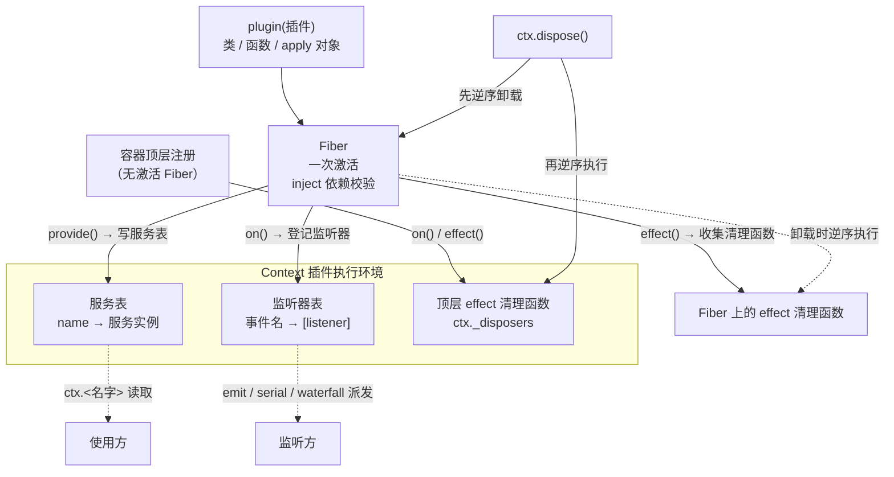

# 第 1 章 Cordis 容器内核（一切皆插件）

> 堂前不问来处，进门皆是插件。

## 本章回答的问题

- 一个插件容器如何装配？——上下文、服务、可逆注册、事件派发这四件事，是如何被一个 `Context` 统一起来的？
- 什么是上下文（`Context`）与服务（`Service`）？能力如何从「全局变量」变成「注册进容器的服务」？
- 什么是可逆注册（`effect` / `Fiber`）？注册如何变得可撤销、可回滚？
- 什么是事件派发（`on` / `emit` / `serial` / `waterfall`）？服务之间如何不互相认识却仍能协作？

本书要交付的是一套用 **Cordis** 装配 AI agent 的 harness——也就是 DeepSeek Harness（仓库与命令行里简称 **dsh**）：`agent = model + harness`，model 提供推理能力，harness 提供把能力组织起来的框架。这个框架的地基，就是本章的主角——**Cordis 插件容器内核**。

Cordis 的世界观只有一句话，也是本章开篇的题记：**一切皆插件**。容器不关心装进来的是「模型适配器」「会话日志」还是「提示词模板」，它们统统被当成插件：注册进容器、声明依赖、可逆卸载、靠事件互相协作。

本章只搭容器，不写业务。跑起来长什么样？`ch01/code/hello.py` 只有 41 行，运行后打印三行——输出与逐行解读放在 §8，等四条机制都讲完再一起看。

这三行对应容器的三条核心论断：**能力是服务**（不靠全局变量）、**注册是效应**（可以回滚）、**交互是事件**（调用方和监听器互不认识）。至于依赖从哪来——容器内核的完整实现位于 `vendor/cordis/src/`（vendored 自 Cordis 内核，本仓包名 `@deepseek-ai/cordis`，上游发布名 `cordis`），本章在 `ch01/code/cordis.py` 里用纯 Python 复刻了它的最小集，符号与源码位置的一一对应见本章 §9「源码对照」。全书引用的源码行号基于上游 HEAD `8bd0733`（dsh-v0.2.2-alpha.3）。

本章只交付容器内核；把会话、提示词、对话循环装进这个容器、跑出「一条消息进、一条回复出」的闭环，是下一章《最小 agent-loop 闭环》的事。

## 1. 没有容器时的困境

在介绍 Cordis 之前，先看一个没有容器的多 agent 系统会坏成什么样。

### 1.1 可运行的反面例子：共享的全局消息列表

保存为 `ch01/code/bad_example.py`，`python3 bad_example.py` 直接运行（仅标准库）：

```python
"""第 1 章反面示例：没有容器时会发生什么。

两个 agent 共享一个全局消息列表、硬编码的"模型调用"，
彼此的对话历史互相污染。运行：python3 bad_example.py
"""
messages = []  # 全局消息列表：所有 agent 共享


def ask(agent, question):
    messages.append({"role": "user", "content": question})
    reply = f"{agent} 收到: " + "".join(m["content"] for m in messages)
    messages.append({"role": "assistant", "content": reply})
    print(f"[{agent}] {reply}")


ask("客服 agent", "怎么改签车票？")
ask("导购 agent", "推荐一款机械键盘")
```

实际输出：

```text
[客服 agent] 客服 agent 收到: 怎么改签车票？
[导购 agent] 导购 agent 收到: 怎么改签车票？客服 agent 收到: 怎么改签车票？推荐一款机械键盘
```

第二行就是事故现场：导购 agent「收到」的内容里，混进了客服 agent 的问题和回复——全局列表被所有 agent 共享，谁写入都会污染所有人。

### 1.2 问题的根源：能力、依赖、生命周期、协作都无人管理

这个例子只有十几行，却暴露了没有容器时必然出现的三个问题；而第四个问题，会在我们试图解决前三个时浮现出来：

1. **能力是全局变量**。`messages` 挂在全局，谁都能写、谁都不负责。真实系统里，模型适配器、会话日志、提示词模板都会变成这样的模块级单例——谁提供、谁消费、何时清理，全靠默契。
2. **依赖不可见**。`ask` 隐式依赖 `messages`，但这条依赖没有出现在任何声明里；依赖缺失或顺序颠倒，只能等运行时报错才知道。
3. **没有生命周期**。想「干净地卸载一个 agent」时无从下手——全局状态还在，谁也说不清哪些资源该回收。
4. **服务要协作**（这是把前三个问题解决后才浮现的新问题）。一旦能力不再挂在全局、而是变成彼此隔离的**服务**，服务之间又要互相调用——如果直接互调，就重新引入了「谁认识谁」的耦合。

本章顺着这条问题链逐层求解，每一步都对应容器的一组机制：

| 问题 | 机制 | 一句话 |
|------|------|--------|
| ① 能力是全局变量 | `Context` + `Service` | 能力变成注册进容器的服务（§4） |
| ② 依赖不可见 | `plugin` + `inject` | 依赖变成声明，加载期校验（§5） |
| ③ 没有生命周期 | `effect` + `Fiber` | 注册变成可逆效应，按 LIFO（后进先出：后注册的先清理）回收（§6） |
| ④ 服务要协作 | `on`/`emit`/`serial`/`waterfall` | 一切交互皆事件（§7） |

在逐条拆解之前，先看装上容器后的最小闭环长什么样（§2），再给一张容器结构总览图（§3）。

## 2. 最小可运行闭环：hello.py（先给最简示例）

在逐段拆解机制之前，先立三条论断，再用一个最小例子验证它们。

### 2.1 三条论断

Cordis 的世界观可以浓缩为三条论断：

**论断一：一切能力都是服务。** 模型调用、会话存储、提示词组装——全部是注册在容器上的服务，通过 `ctx.<name>` 读取。没有模块级单例，没有全局状态。

**论断二：一切注册都是插件。** 服务不是直接 `new` 出来就完事，而是通过插件注册到容器。插件有三种形态（函数 / 类 / apply 对象），容器统一加载。注册动作本身是「效应」：可追踪、可回滚。

**论断三：一切交互都是事件。** 服务之间不直接互相调用，而是通过事件通信。调用方只负责 `emit`，监听方只认事件名，谁都不需要知道对方是谁。

### 2.2 最小例子：一个文件装下三条论断

把 2.1 的三条论断压缩进一个文件。保存为 `ch01/code/hello.py`；`cordis.py` 是本章实现的教学版容器，已在同目录就位，`python3 hello.py` 直接可跑（实现见 §4–§7 逐段拆解）：

```python
"""第 1 章 §2.2 最小例子：一个文件装下三条论断。

运行：python3 hello.py（与 cordis.py 同目录，仅标准库）。
"""
from cordis import Context, Service, ServiceNotFoundError

ctx = Context()  # 创建容器：内部有一张服务表和一张监听器表，后面的能力都注册到这里

# 为 "greet" 事件登记一个监听器：此后任何人 emit("greet", name)，这个 lambda 都会被调用。
# 监听器只认事件名，不知道是谁在 emit。
ctx.on("greet", lambda name: print(f"[event] hello, {name}"))


# 定义一个能力 Greeter：提供 greet 方法，打招呼并发出一个事件。
class Greeter(Service):
    def __init__(self, ctx, config=None):
        # 构造即注册：Service.__init__ 内部调 ctx.provide("greeting", self)，
        # 把这个实例写进服务表，此后 ctx.greeting 就指向它。
        super().__init__(ctx, "greeting")

    def greet(self, name):
        # 发出事件：容器会依次调用所有登记在 "greet" 上的监听器。
        # greet 不知道谁在监听——调用方和监听器只认事件名，互不认识（论断三）。
        self.ctx.emit("greet", name)
        return f"hello, {name}"


# 把 Greeter 作为插件注册进容器：容器负责实例化 Greeter(ctx, config)，
# 并把这次登记记为一笔「效应」——卸载时可以回滚（论断二）。
ctx.plugin(Greeter)

# 使用能力：按名字 "greeting" 从服务表里查出服务，调用它的 greet 方法，
# 全程没有全局变量（论断一）。
print(ctx.greeting.greet("cordis"))

# 注册是效应：dispose 按注册逆序回滚，把服务从服务表移除。
ctx.dispose()
try:
    ctx.greeting  # 再读一次：服务已被回滚，抛 ServiceNotFoundError
except ServiceNotFoundError:
    print("dispose 之后：ctx.greeting 已被回滚")
```

运行输出：

```text
[event] hello, cordis
hello, cordis
dispose 之后：ctx.greeting 已被回滚
```

（这三行各自对应哪条论断、由哪段机制产生，§8 用一张表对上号——那时 §4–§7 的机制都已拆完。这里只需留意：文件里的 `ctx.on(...)`、`ctx.plugin(...)`、`emit(...)`、`dispose()` 四步，正好各用到一个待讲机制。）

再补两句新手容易踩的：注册一律走显式 `provide()`（`Service` 的构造器内部就是这么做的）——`ctx.greeting = ...` 只是普通属性赋值，不会进服务表（见 §4.1）；服务可以是任何对象——真实系统里模型适配器、会话存储、agent-loop 都同样注册。

## 3. 容器结构总览（关系总览先行）

在逐段拆解之前，先用一张图建立整体视角：容器的核心是**一张服务表**和**一张监听器表**，加上一叠记录生命周期的 **Fiber**；此外还有一条容易漏看的旁路——没有 Fiber 在激活时注册的 effect（即容器顶层注册，比如 `hello.py` 里那句 `ctx.on(...)`），清理函数直接挂在 `Context._disposers` 上，由 `ctx.dispose()` 最后统一回收。插件通过 Fiber 写入服务、登记监听、挂清理函数；使用方读服务表，监听方收事件，`dispose()` 先逆序卸载 Fiber，再回收顶层清理函数。



三个子系统对应第 1 节的四个问题（§4–§7 逐个拆解）：

- **服务表**（§4）：解决问题 ①「能力是全局变量」——能力被 `provide()` 收编进服务表，`ctx.<名字>` 读取，没有全局单例。
- **Fiber 栈**（§5、§6）：解决问题 ②「依赖不可见」与问题 ③「没有生命周期」——每次 `plugin()` 产生一个 Fiber，声明 `inject` 依赖（§5），把 `effect()` 的清理函数挂在 Fiber 上，`dispose()` 逆序回收（§6）。
- **监听器表 + 派发**（§7）：解决问题 ④「服务要协作」——`on()` 登记监听，`emit/serial/waterfall` 派发，服务之间只认事件名。

拆解顺序按 §4 → §7 依次展开：先立 `Context` 与服务表（§4），再看插件如何带着 `inject` 进来（§5）、如何带 `effect` 离开（§6），最后看它们如何靠事件协作（§7）。

## 4. Context + Service

第 1 节的 `messages` 挂在全局、谁都能写。Cordis 的解法：把能力收编为注册在 `Context` 上的**服务**，谁提供、谁消费、何时移除，都由容器管理。

### 4.1 Context：一张服务表 + 一个 __getattr__

```python
# cordis.py —— Context 的构造与服务解析（节选；类 docstring 从略）
class Context:
    def __init__(self):
        setattr(self, Symbols.services, {})    # 服务表：name → 实例
        setattr(self, Symbols.events, {})      # 监听器表：事件名 → [listener]
        setattr(self, Symbols.dispose, False)  # dispose 标记
        self._fibers: list[Fiber] = []        # 全部 fiber（按注册顺序）
        self._pending: list[Fiber] = []       # 依赖未满足，等待加载
        self._disposers: list[Callable] = []  # 根级 effect 清理函数

    def __getattr__(self, name):
        """普通属性查找失败时按服务名查服务表。"""
        if name.startswith("_"):
            raise AttributeError(name)
        services = getattr(self, Symbols.services)
        if name in services:
            return services[name]
        raise ServiceNotFoundError(name)

    def provide(self, name, value):
        """注册服务，返回「注销」disposer。

        写服务表 → 派发 service/provide → 结算等待依赖的 fiber。
        """
        services = getattr(self, Symbols.services)
        services[name] = value
        self.emit("service/provide", {"name": name})
        self._settle_pending()

        def dispose():
            if services.get(name) is value:
                del services[name]
                self.emit("service/dispose", {"name": name})

        return dispose

    def _settle_pending(self):
        """新服务到达后逐个复查 PENDING fiber：依赖已满足才加载。"""
        while True:
            ready = [f for f in self._pending if f.deps_satisfied()]
            if not ready:
                return
            for fiber in ready:
                self._pending.remove(fiber)
                fiber.activate()
```

`Symbols.services`、`Symbols.events` 等键名来自 `cordis.py` 顶部的 `Symbols` 类：一组双下划线字符串常量（`Symbols.services` 就是 `"__cordis_services__"`），对应源码里 `symbols` 对象的 `Symbol.for('cordis.*')` 键（`vendor/cordis/src/utils.ts:50-74`；全仓无 symbols.ts），用作容器内部字段的键名。

Context 的全部机制都建立在两张表上：服务表（name → 实例）与监听器表（事件名 → listener 列表）。`__getattr__` 是 Python 的属性访问兜底方法——常规查找失败才调用——它把失败的属性名当服务名查表；`_` 开头的内部字段不走服务表，避免误伤。`provide` 把 `value` 写进服务表，返回一个能把它删掉的 `dispose` 闭包，并派发 `service/provide` 事件、结算等待依赖的插件（见 §5）。

为什么这样设计：

- **`__getattr__` 而非 `__setattr__`**：`__getattr__` 只在属性缺失时触发，内部字段（`_fibers` 等）不受影响；`__setattr__` 会拦截一切赋值，容易误伤。TS 的 Proxy 同时拦截 get/set；Python 只拦截缺失读取，因此服务注册一律走显式 `provide()`。
- **`ServiceNotFoundError` 继承 `AttributeError`**：`getattr(ctx, name, default)` 的缺省值写法仍然可用。真实源码没有这个错误类型（未提供时 `ctx.reflect.get` 返回 `undefined`），`ServiceNotFoundError` 是教学版自定的。
- **真实版同名 `provide` 抛错；教学版静默替换**：真实 `reflect.provide` 发现同一隔离域（服务名去重的那一层命名空间，对应源码的 `isolate` 标签）里该名字已有实现时，直接抛 `service "<name>" has been registered at <...>`（`vendor/cordis/src/reflect.ts:303-305`）。[教学简化] 教学版 `cordis.py:74` 是 `services[name] = value`，同名静默替换——第 5 章正是靠这一点说明「一个 context 只该有一个 shell provider」。
- **`service/provide` / `service/dispose` 是教学自造的事件名**：真实内核把服务变更走 `reflect.notify([name])`（`reflect.ts:308-310`），并派发 `internal/service` 等 `internal/*` 事件；教学版用这两个更直白的名字替代。[教学简化] 名称不同，语义相同：让「服务表变了」这件事可被观察。

### 4.2 Service：构造即注册

```python
# cordis.py —— Service 基类
class Service:
    """服务基类：构造即注册。

    对应 vendor/cordis/src/service.ts:11。
    注册本身是可逆效应——容器销毁时自动从服务表移除。
    """

    def __init__(self, ctx, name=None):
        self.ctx = ctx
        self.service_name = name
        if name is not None:
            dispose = ctx.provide(name, self)
            ctx.effect(lambda: dispose)
```

`Greeter(ctx, "greeting")` 一行就完成了「构造 + 注册 + 卸载登记」三件事。注册不是赋值，而是一个效应：容器销毁时，`ctx.effect` 登记的清理函数会把服务从服务表移除（`effect` 的完整机制见 §6）。

[教学简化] 真实 `service.ts:57` 只调一次 `self.ctx.reflect.provide(name, self, check)`——`provide` 内部已经把整件事包进了一笔 `this.ctx.fiber.effect(...)`（`vendor/cordis/src/reflect.ts:292`）。教学版的 `provide` 是普通函数，所以 `Service.__init__` 再手动补一笔 `ctx.effect(lambda: dispose)` 来表达同一个生命周期归属。

**回溯**：这一节解决了问题 ①——能力从全局变量变成了注册进容器的服务，谁提供、谁消费、何时移除都由 `Context` 管理。但 `Greeter` 的依赖关系仍是隐式的：它需要什么服务、依赖是否就绪，只能靠读代码去猜。这正是问题 ②，由下一节的 `plugin` + `inject` 解决。

### 4.3 源码对照

- `Context` `vendor/cordis/src/context.ts:42`；对外接口 `:16`，构造函数里用 Proxy 包住自身（`context.ts:74`）
- 属性读取：TS 的 Proxy get 陷阱在 `vendor/cordis/src/reflect.ts:143-184`——先走 `reflect.get`，找不到再沿 fiber 链找注入的服务；Python 用 `__getattr__` 兜底
- `provide` 返回注销 disposer：`vendor/cordis/src/reflect.ts:291-327`，disposer 在 `:311-325`
- `Service` `vendor/cordis/src/service.ts:11`；构造器 `:42-59`，注册语句 `self.ctx.reflect.provide(name, self, ...)` 在 `:57`

## 5. plugin + inject

第 1 节的 `ask` 隐式依赖全局 `messages`，这条依赖不写在任何声明里。Cordis 的解法：依赖变成插件上的 `inject` 声明，容器在加载期校验——声明不满足就不加载。

### 5.1 插件三形态：归一化为「接收 ctx 的函数」

```python
# cordis.py —— Context.plugin 与插件三形态归一（节选）
class Context:
    def plugin(self, callback, config=None):
        """注册插件：函数 / 类 / apply 对象三形态归一，返回 Fiber。"""
        body = _normalize(callback, config)
        return Fiber(self, getattr(callback, "inject", None) or [], body)


def _normalize(callback, config):
    """三种插件形态归一化为「接收 ctx 的函数」。"""
    if isinstance(callback, type):
        if config is not None:
            return lambda ctx: callback(ctx, config)
        return callback
    apply_ = getattr(callback, "apply", None)
    if callable(apply_):
        return apply_
    return callback
```

插件有三种形态：函数、类、带 `apply` 方法的对象。`ctx.plugin()` 把它们归一化为「接收 ctx 的函数」，然后创建 Fiber——插件的一次激活。Fiber 是 effect 的宿主：插件体执行期间注册的所有 effect，清理函数都收集在这个 Fiber 上（见 §6）。

### 5.2 inject：依赖声明与「满足才加载」

```python
# cordis.py —— Fiber 的依赖检查与激活（节选）
# [教学简化] 真实版靠各 fiber 自己的上下文传递「当前宿主」；
# 教学版同步单线程，用一个模块级变量标记「当前正在激活的 fiber」即可。
_current_fiber: "Fiber | None" = None


class Fiber:
    def deps_satisfied(self):
        """inject 声明的服务全部已提供才加载。events 不计入。"""
        services = getattr(self.ctx, Symbols.services)
        return all(name in services for name in self.inject if name != "events")

    def activate(self):
        """执行插件体；期间 _current_fiber 指向 self（effect 收集目标）。"""
        global _current_fiber
        self.state = self.ACTIVE
        parent = _current_fiber
        _current_fiber = self
        try:
            self._body(self.ctx)
        finally:
            _current_fiber = parent
```

（摘录与 `cordis.py` 逐字一致，只省略了 `__init__` 与 `dispose`：前者见 §4.1 的 `Context` 类骨架，`Fiber.__init__` 与 `Fiber.dispose` 见 §6.1。）

插件通过在类上声明 `inject = ['logger']` 来表达「我需要 `logger` 这个服务」。`ctx.plugin()` 从原始回调上读出 `inject` 属性并传给 Fiber。`deps_satisfied` 检查这些名字是否都已出现在服务表里——教学版把 `events` 当内置能力，不计入外部依赖。依赖满足，立即 `activate()`；不满足，挂进 `ctx._pending`，等每次 `provide` 后由 `_settle_pending` 逐个复查（方法体见 §4.1 摘录末段），满足才激活。

[教学简化] 真实 Fiber 的依赖检查更严，也更动态：`_checkImpl` 逐个确认注入的服务「当前可解析」（`fiber.ts:603-615`），`_refresh` 把每个依赖的实现 `uid` 拼成 epoch（`:617-628`），epoch 一变就卸载重载（`_setEpoch` `:630-646`）——依赖断了会卸载，依赖换了实现会重跑插件体。教学版只保留「满足才加载」这一半，不实现「变化即重载」；`events` 在真实内核里本身也是一个服务（`EventsService`），教学版把它当内置能力排除在检查之外。

**回溯**：这一节解决了问题 ②——依赖从隐式变成了 `inject` 声明，容器在加载期校验。但「注册」本身还不能撤销：插件加载后如何干净卸载、资源如何回收，尚无答案。这正是问题 ③，由下一节的 `effect` + `Fiber` 解决。

### 5.3 源码对照

- `ctx.plugin` → `RegistryService`（`vendor/cordis/src/registry.ts:195`）的 `plugin()` 在 `:316-336`：取可执行入口 `:318`、复用或新建 runtime `:322-328`、`new Fiber(...)` `:330`
- 三形态归一 `resolve()` 在 `registry.ts:222-228`（函数直接返回；带 `apply` 的对象取其 `apply`，`isApplicable` 判定在 `:8-10`）
- `inject` 归一 `Inject.resolve` 在 `registry.ts:71-88`（数组 → `{name: null}` 映射）
- `Fiber` `vendor/cordis/src/fiber.ts:184`；创建后按 inject 逐个 `_checkImpl` 再 `_refresh` `:320-325`，`_checkImpl` 在 `:603-615`

## 6. effect + Fiber

第 1 节里「干净卸载一个 agent」无从下手。Cordis 的解法：注册动作本身变成一笔**效应**，卸载时按注册逆序逐一回收。

### 6.1 effect：立即执行，逆序回收

```python
# cordis.py —— Context.effect / Context.dispose / Fiber.dispose（节选）
    def effect(self, execute):
        """注册 effect：立即执行 execute，收集其返回的清理函数。

        清理函数在卸载时逆序执行——后注册的先清理。
        """
        disposer = execute()
        if disposer is None:
            disposer = lambda: None
        if _current_fiber is not None:
            _current_fiber._disposers.append(disposer)
        else:
            self._disposers.append(disposer)
        return disposer

    def dispose(self):
        """销毁容器：按注册逆序卸载 fiber，再逆序执行根级 effect。"""
        if getattr(self, Symbols.dispose):
            return
        setattr(self, Symbols.dispose, True)
        for fiber in reversed(self._fibers):
            fiber.dispose()
        for disposer in reversed(self._disposers):
            disposer()


class Fiber:
    def dispose(self):
        """卸载：逆序执行清理函数。"""
        if self.state == self.DISPOSED:
            return
        for disposer in reversed(self._disposers):
            disposer()
        self._disposers.clear()
        self.state = self.DISPOSED
```

effect 的契约：`execute()` 立即执行，返回清理函数；清理函数在卸载时**逆序**执行——后注册的先清理。这就是「注册即生效、卸载即回收」的生命周期：没有永远清不掉的全局状态，因为每笔注册都自带一笔可逆的清理。

「逆序」在真实内核里有两层。单个 effect 内，`effect()` 收集到的多个 disposer 用 `splice(0).reverse()` 倒序执行（`vendor/cordis/src/fiber.ts:437`）。整个 Fiber 卸载时，`_disposables.clear()` 返回的也是倒序列表（`vendor/cordis/src/utils.ts:27-31`），但这批清理函数由 `Promise.all` **并发**等待（`fiber.ts:720`），所以真实语义是「逆序发起、并发等待」，不是逐条串行。[教学简化] 教学版是同步串行，顺序严格、不并发。

### 6.2 宿主之分：Fiber 级 vs 容器级

effect 有宿主之分：插件体执行期间注册的 effect 挂在当前 Fiber 上（随 Fiber 卸载）；容器顶层注册的挂在 `ctx._disposers`（随 `ctx.dispose()` 清理）。

回到 §2 的 `hello.py`，正好能验证这条 LIFO 链：

1. `ctx.on("greet", ...)` 在容器顶层执行，内部走 `self.effect(setup)`——此时没有 Fiber 在激活，清理函数挂到 `ctx._disposers`。
2. `ctx.plugin(Greeter)` 创建一个 Fiber 并 `activate()`；`Greeter.__init__` 里 `super().__init__(ctx, "greeting")` 调 `ctx.provide(...)` 再 `ctx.effect(lambda: dispose)`——此时 `_current_fiber` 指向 Greeter 的 Fiber，清理函数挂到 `fiber._disposers`。
3. `ctx.dispose()` 先 `reversed(self._fibers)` 卸载 Greeter 的 Fiber（把 `"greeting"` 从服务表移除），再 `reversed(self._disposers)` 注销 `"greet"` 监听器。

所以第三行输出 `dispose 之后：ctx.greeting 已被回滚`，正是 §6.2 的 Fiber 级清理函数（`provide` 返回的 `dispose`）在 `fiber.dispose()` 里被逆序执行的证据。

**回溯**：这一节解决了问题 ③——注册变成可逆效应，`dispose()` 按注册逆序回收。但能力收编成彼此隔离的服务后，服务之间要协作，直接互调又会让耦合卷土重来。这正是问题 ④，由下一节的事件派发解决。

[教学简化] 真实 Fiber 卸载时调用的是其父 fiber 上的一笔 effect：`Fiber` 构造函数里 `this.dispose = parent.fiber.effect(...)`（`fiber.ts:271-303`），根 fiber 的 `dispose` 则是 `() => this.restart()`（`:337`），即**重置容器**而不是把容器标成已销毁。教学版把这两种行为合并成 `ctx.dispose()`：先逆序卸载所有 fiber，再逆序执行根级 effect，并用 `Symbols.dispose` 做一次性保护。

### 6.3 源码对照

- `effect` `vendor/cordis/src/fiber.ts:424-448`：`:430` 新建本次 effect 的 disposer 列表，`:437` 倒序回收；Fiber 自己的收集列表 `_disposables` 在 `:203`
- Fiber 卸载：`_unload()` 在 `fiber.ts:712-745`，先等依赖它的 fiber 卸载完（`:716-719`，`dependents` 等待），再 `Promise.all` 并发执行逆序列表（`:720`）
- Fiber 的 dispose 本身是一笔 effect：`fiber.ts:271-303`；根 fiber 的 dispose 是重启 `:337`
- 生命周期是异步的：disposer 可以返回 Promise；调用 `fiber.await()`（`fiber.ts:754-759`）可等到稳定态。[教学简化] 教学版全程同步
- 状态机：`FiberState` 六态 `fiber.ts:147-154`（PENDING / LOADING / ACTIVE / FAILED / DISPOSED / UNLOADING）；其中 LOADING / FAILED / UNLOADING 服务于异步加载与失败重试，教材只用到 PENDING / ACTIVE / DISPOSED 三态

## 7. on / emit / serial / waterfall

能力收编成服务之后，服务之间总要协作。如果 `Greeter` 直接 import `Logger` 再调用，就重新引入了「谁认识谁」的耦合。Cordis 的解法：一切交互都走事件，调用方只 `emit`，监听方只认事件名。

### 7.1 四种派发

```python
# cordis.py —— Context 的四种派发（节选）
    def on(self, event, listener):
        """注册监听器，返回 off disposer。

        注册本身是 effect：宿主 fiber 卸载时自动注销。
        """
        listeners = getattr(self, Symbols.events).setdefault(event, [])

        def setup():
            listeners.append(listener)

            def off():
                if listener in listeners:
                    listeners.remove(listener)

            return off

        return self.effect(setup)

    def emit(self, event, *args):
        """同步派发：按注册顺序调用，不等返回值。"""
        for listener in list(getattr(self, Symbols.events).get(event, [])):
            listener(*args)

    def serial(self, event, *args):
        """顺序调用，遇 bail 值（非 None 且非 False）立即返回。"""
        for listener in list(getattr(self, Symbols.events).get(event, [])):
            result = listener(*args)
            if result is not None and result is not False:
                return result
        return None

    def waterfall(self, event, value):
        """把返回值逐个传递：返回 None 放行，非 None 替换当前值。

        [教学简化] 真实 events.ts:246 把最后一个参数当作最内层 next，
        监听器签名是 (...args, next)，不调 next 就等于拦截；
        教学版按「单值串接」简化，第 4 章用 waterfall_wrap 补回中间件语义。
        """
        for listener in list(getattr(self, Symbols.events).get(event, [])):
            result = listener(value)
            if result is not None:
                value = result
        return value
```

四种派发的分工：

| API | 语义 | 本章用例 |
|-----|------|---------|
| `on` | 注册监听器（本身是 effect，随宿主卸载） | hello.py 里 `ctx.on("greet", ...)` 注册打印器 |
| `emit` | 同步广播，不等返回值 | hello.py 里 `greet` 内部的 `emit("greet", name)` |
| `serial` | 顺序询问，遇 bail 值立即返回（真实版逐个 `await`；教学版同步） | 教学版实现；上游 HEAD（`8bd0733`）里 `agent/turn-stopping` 用它（`packages/core/agent-loop/src/agent.ts:396`） |
| `waterfall` | 值逐个穿过监听器（真实版是中间件链：末参数为 `next`，不调即否决；教学版为单值串接） | 教学版实现；上游 HEAD（`8bd0733`）里 `agent/pre-step` 用它（`agent.ts:296-305`） |

两个「教学简化」派的语义，用一句话说清：

- `serial` 像逐个敲门问「谁能处理这件事」，第一个返回 bail 值的监听器作数，后面的不再问——用于「谁先给出答复就采用谁」的仲裁场景。bail 的判定是 `isBailed`：非 `null`、非 `false`、也非 `undefined`（`vendor/cordis/src/events.ts:12-14`）。
- `waterfall` 像一条流水线，每个监听器对同一个值加工，前一个的返回值交给下一个，最后返回最终值——用于「多个模块依次补全同一个对象」的场景。

注意 `on` 的注册本身是 effect：监听器随宿主 Fiber 卸载而自动注销——事件订阅也有生命周期（这正是 §6 机制在事件侧的复用）。

`waterfall` 在真实内核里不是「返回值替换」这么简单。最后一个参数被当作最内层的 `next` 回调，监听器签名是 `(...args, next)`：调 `next()` 就继续往里走，不调就等于拦截整条链（`vendor/cordis/src/events.ts:246-261`）。这正是中间件的形状——第 2 章的 `agent/pre-step` 就是靠「不调 next 就否决」实现的。[教学简化] 教学版的 `ctx.waterfall(event, value)` 只做单值串接，不提供把内层 `next` 交回监听器的机制（即无续体）；第 4 章的 `waterfall_wrap` 会把中间件语义补回来。

**回溯**：这一节解决了问题 ④——协作走事件、服务只认事件名。至此四条问题全部闭合：能力是服务、依赖是声明、注册是效应、协作是事件，容器内核的五段机制（§4–§7）共同兑现了「一切皆插件」的开篇题记。

### 7.2 源码对照

- `on` `vendor/cordis/src/events.ts:294-307`（注册动作交给私有 `register()` `:263-270`，内部 `this.ctx.fiber.effect(...)`——这就是「注册即效应」）
- `emit` `vendor/cordis/src/events.ts:203-206`、`serial` `:214-220`、`waterfall` `:246-261`；另有 `parallel`（并发，`:191-196`）与 `bail`（同步版 serial，`:228-234`）
- bail 判定 `isBailed`：非 null、非 false、非 undefined（`events.ts:12-14`）
- 派发前统一解析监听器：`_resolve()` `:162-172`（取可选 `thisArg`、事件名，按 `internal/dispatch` 观察与 `Context.filter` 过滤）
- 教学版行为：emit 无监听器是 no-op；waterfall 无监听器原样返回初始 value

## 8. 回扣三条论断

前面看过三行输出（§2.2）。现在机制都讲完了，用一张表把它们对上号：

| 输出行 | 来自哪一步 | 机制 | 论断 |
|---|---|---|---|
| `[event] hello, cordis` | `Greeter.greet` 里的 `emit("greet", name)` | 事件派发（§7）：监听器从未被直接调用，只凭事件名 `"greet"` 被唤起 | 交互是事件 |
| `hello, cordis` | `print(ctx.greeting.greet("cordis"))` 的返回值 | 服务读取（§4）：`ctx.greeting` 走 `__getattr__` 查服务表，全程无全局变量 | 能力是服务 |
| `dispose 之后：ctx.greeting 已被回滚` | 再读 `ctx.greeting` 抛 `ServiceNotFoundError`，被 `except` 捕获 | 生命周期（§6）：`ctx.dispose()` 先逆序卸载 Fiber，Fiber 的清理函数把 `"greeting"` 从服务表移除 | 注册是效应 |

试着自己回答两个问题，能答上就说明本章的图景已经立住：第一行的监听器如果换成写日志，`Greeter.greet` 要不要改？第三行里「服务从表里消失」这件事，是 `dispose()` 亲自做到的，还是某笔 effect 的清理函数做到的？

对照反面例子：`bad_example.py` 的两行输出见 §1，第二行里导购 agent「收到」的内容混进了客服 agent 的问题与回复——那正是没有容器时全局状态互相污染的现场；装上容器后，能力、依赖、生命周期、协作各自有了落点。

## 9. 源码对照

本章教学版 `cordis.py` 与真实源码（`vendor/cordis/src/`，vendored 自 Cordis 内核，本仓包名 `@deepseek-ai/cordis`）的对应关系：

| 容器机制 | 源码位置（vendor/cordis/src/） | 教学版差异概括 |
|------|------|------|
| `Context` | `context.ts:42`（接口 `:16`；构造函数里 `new Proxy` `:74`，get 陷阱在 `reflect.ts:143-184`） | TS Proxy 同时拦截 get/set → Python `__getattr__` 只拦截缺失读取，注册走显式 `provide()` |
| `Service` | `service.ts:11`（构造器 `:42-59`，注册 `self.ctx.reflect.provide(...)` `:57`） | 用 `ctx.effect` 显式表达「卸载即移除」——注册本身是可逆效应 |
| `Fiber` | `fiber.ts:184`（状态机 `FiberState` `:147-154`） | 六态 → 三态（PENDING / ACTIVE / DISPOSED）；只实现「满足才加载」，不实现 epoch 变化触发的卸载重载 |
| `Context.plugin` | `RegistryService`（`registry.ts:195`）的 `plugin()`（`:316-336`） | 三形态归一（函数 / 类 / apply），`inject` 只取数组 |
| `effect` | `fiber.ts:424-448`（逆序回收 `:437`；Fiber 卸载 `_unload` `:712-745`） | 真实 dispose 是异步的，根 fiber 的 dispose 是重置容器（`:337`）；教学版同步、`ctx.dispose()` 一次性销毁 |
| `on`/`emit`/`serial`/`waterfall` | `events.ts:294-307` / `:203-206` / `:214-220` / `:246-261` | serial / waterfall 教学简化；真实 waterfall 是中间件链（末参数为 `next`） |

两点补充：

- **符号映射**：`Symbol.for('cordis.*')`（`vendor/cordis/src/utils.ts:50-74`，一个 `symbols` 对象；全仓无独立 symbols.ts）→ 教学版双下划线字符串常量（`Symbols.services` 即 `"__cordis_services__"`）。完整 TS→Python 映射见 §11.2。
- **教学取舍**：真实版靠每个 Fiber 自己的上下文传递「当前宿主」→ 教学版用模块级变量 `_current_fiber`（同步单线程，同一时刻只加载一个插件）；`ServiceNotFoundError` 继承 `AttributeError`，以保留 `getattr(ctx, name, default)` 缺省写法；emit 无监听器为 no-op、waterfall 无监听器原样返回。

## 10. 小结与预告

本章交付了容器内核的五个机制，全部建立在 `Context` 的两张表（服务表 + 监听器表）与 Fiber 的生命周期记录之上：

| 机制 | 一句话 | 源码位置 |
|------|--------|---------|
| `Context` | 服务表 + 监听器表，`__getattr__` 兜底读服务 | `context.ts:42` |
| `Service` | 构造即注册，注销是一个 effect | `service.ts:11` |
| `plugin` + `inject` | 三形态归一化；依赖「满足才加载」 | `registry.ts:195`、`fiber.ts:184` |
| `effect` + `Fiber` | 注册即执行，逆序回收 | `fiber.ts:424-448` |
| `on`/`emit`/`serial`/`waterfall` | 注册本身是 effect；四种派发各司其职 | `events.ts:294` / `:203` / `:214` / `:246` |

问题链至此闭合：能力从全局变量变成了服务（§4），依赖从隐式变成了声明（§5），注册从「无法撤销」变成了可逆效应（§6），协作从「直接互调」变成了事件（§7）。上面这些源码段落加起来约两百五十行，却构成了一切插件系统的最小骨架。

下一章《最小 agent-loop 闭环》，我们把 `Sessions`（对话状态）、`SystemPromptService`（提示词组装）、`AgentLoop`（对话循环）作为三个服务装进本章的容器，跑出「一条消息进、一条回复出」的闭环。到那时，`serial` 的 turn-stopping、`waterfall` 的 pre-step 这些本章只讲语义的派发，会第一次真正派上用场。

## 11. 附录：关键概念速查表

### 11.1 概念速查（按依赖分层）

| 层 | 概念 | 作用 | 关键点 |
|----|------|------|--------|
| 0 | `harness` | agent 的框架层 | `agent = model + harness`，容器是 harness 的地基 |
| 1 | `Context` | 插件执行环境 | 持有服务表 + 监听器表；`__getattr__` 把缺失属性当服务名查表 |
| 1 | `Service` | 服务基类 | 构造即注册（`provide` + `effect`）；`ctx.<名字>` 读取 |
| 1 | `plugin` | 注册插件入口 | 函数 / 类 / apply 对象三形态归一化，返回 Fiber |
| 1 | `inject` | 依赖声明 | 类属性声明依赖服务；「满足才加载」，不满足挂 `_pending` |
| 2 | `Fiber` | 插件的一次激活 | effect 的宿主；持有 `disposers`，卸载时逆序回收 |
| 2 | `effect` | 可逆注册 | 立即执行、返回清理函数；LIFO（后进先出）回收 |
| 2 | `provide` | 注册服务 | 写服务表、触发 `service/provide`、返回注销 disposer |
| 2 | `on`/`emit`/`serial`/`waterfall` | 事件派发四件套 | 广播 / 仲裁（遇 bail 即止）/ 流水线（值逐个加工）；注册本身是 effect |
| 2 | `ServiceNotFoundError` | 缺失显式暴露 | 继承 `AttributeError`，保留 `getattr(ctx, name, default)` 用法 |

### 11.2 符号映射（教学版 → 源码）

| 教学版符号 | 源码位置（vendor/cordis/src/） |
|-----------|------|
| `Context` | `context.ts:42` |
| `Service` | `service.ts:11` |
| `Fiber` | `fiber.ts:184` |
| `Context.plugin` | `registry.ts:195`（`plugin()` `:316`） |
| `Context.effect` | `fiber.ts:424` |
| `Context.provide` | `reflect.ts:291-327` |
| `on`/`emit`/`serial`/`waterfall` | `events.ts:294-307` / `:203` / `:214` / `:246` |
| `Symbols.services` 等 | `Symbol.for('cordis.*')`，`utils.ts:50-74` |
