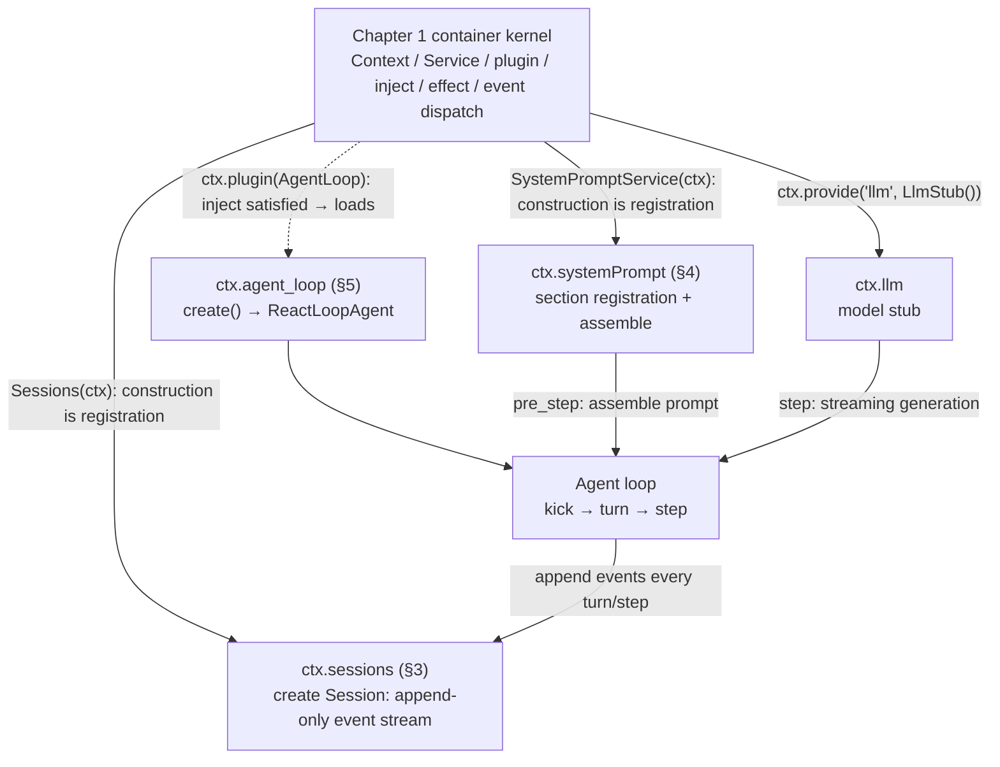
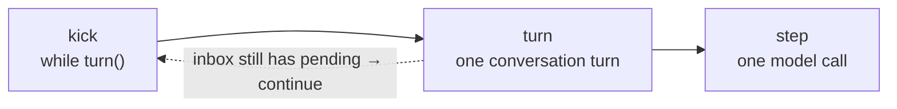
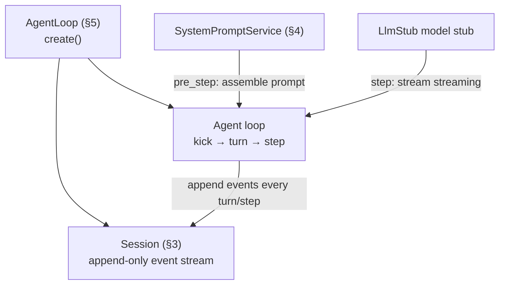
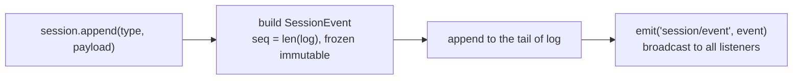
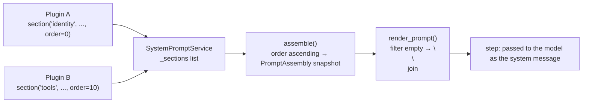
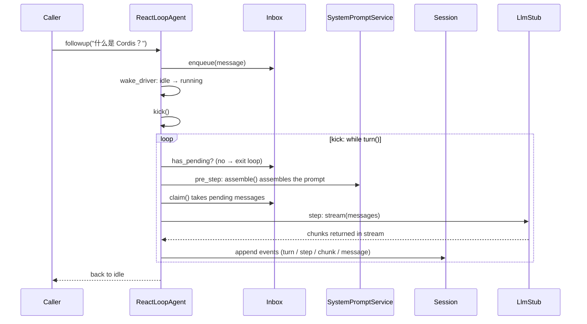

# Chapter 2: The Minimal agent-loop Closed Loop (One Message In, One Reply Out)

> One word comes in, one word goes out; the loop turns on its own, turn after turn.

## Questions this chapter answers

- Where does an agent's conversation state live, and how do we guarantee it is the single source of truth?
- When calling the model, where does the system prompt come from, and how can third parties inject content into it?
- Who drives the conversation loop: after a message goes in, who pushes it forward, and how does the reply come out?
- How is an agent "assembled" by Chapter 1's container?

Chapter 1 delivered the container kernel: `Context` holds two tables (service table + listener table), `Service` registers on construction, `plugin` + `inject` make plugins "load only when dependencies are satisfied", `effect` + `Fiber` make registration a reversible effect, and the four dispatch methods `on`/`emit`/`serial`/`waterfall` carry collaboration. But the container is only a skeleton; by itself it does not answer "how does an agent hold a conversation".

This chapter installs three services as plugins into this skeleton: `Sessions` (conversation state), `SystemPromptService` (prompt assembly), `AgentLoop` (conversation loop). At the end of Chapter 1 we said that `serial`'s turn-stopping and `waterfall`'s pre-step were at that time "semantics only"; in this chapter they finally get put to real use for the first time (appearing in §5.4 and §5.5 respectively).

Code relationships: this chapter incrementally reuses Chapter 1's `ch01/code/cordis.py` (`main.py` imports only `Context` from it, `agent_loop.py` imports only `Service`; not re-pasted), and adds two new files under `ch02/code/`: `agent_loop.py` (teaching-version agent-loop) and `main.py` (runnable assembly entry point). Running `python3 ch02/code/main.py` shows the complete closed loop of "one message in, one reply out"; the full output is in §6.

## 1. Scattered Messages, Hard-Coded Prompts, and a Loop Nobody Drives

Without any framework, hand-writing a "conversable agent" hits a wall within three steps.

**Wall 1: conversation state has no single source of truth.** The most intuitive way to write it is to hang history on a function-local variable:

```python
# Counterexample: conversation messages scattered across local variables
def chat(user_text):
    history = []  # Hang the conversation history inside the function; it vanishes when the call ends
    history.append({"role": "user", "content": user_text})
    reply = call_model(history)  # call_model is an illustrative pseudo-function
    history.append({"role": "assistant", "content": reply})
    return reply

# Want to replay this turn? Want to persist it to disk? history is scattered inside the function, nowhere to export from.
```

Once messages are scattered across local variables, global lists, or various callers, there is no single answer to "what actually happened in this turn", and replay and persistence are both out of the question.

**Wall 2: hard-coded system prompt.** To call the model you first need a system prompt; the most intuitive way to write it is to hard-code a string:

```python
# Counterexample: hard-coded system prompt
SYSTEM_PROMPT = "You are an assistant."  # Hard-coded at module top level

def build_prompt(user_text):
    # If a third party wants to add a "current time" or "tool description" segment, they have to come back and edit this concatenation line
    return SYSTEM_PROMPT + "\n" + user_text
```

A hard-coded prompt is not extensible: a third-party plugin can neither inject its own segment nor take the segment away when it unloads.

**Wall 3: nobody drives the loop.** State exists, prompt exists, but between "one message in, one reply out" there is still a long chain of actions: fetch messages, assemble prompt, call model, collect streaming chunks, assemble reply, write back to state, decide whether to continue — who is responsible for pushing it forward?

```python
# Counterexample: hand-written driving, every step scattered inside a while
while True:
    msg = wait_user_input()        # Who is responsible for receiving messages?
    prompt = build_prompt(msg)     # Who is responsible for assembling the prompt?
    chunks = model.stream(prompt)  # Who is responsible for collecting the stream?
    reply = "".join(chunks)        # Who is responsible for assembling the reply, writing back to state, deciding whether to continue?
```

So this chapter's problem chain is:

- **Problem ①**: an agent's conversation state must have a single source of truth (messages scattered everywhere, replay/persistence out of the question) → mechanism: `Session` (append-only event stream), solved in §3;
- **Problem ②**: when calling the model, where does the system prompt come from (hard-coding is not extensible, third parties cannot inject) → mechanism: `SystemPromptService` (section registration + assemble), solved in §4;
- **Problem ③**: who drives the conversation loop (message in, reply out, who pushes forward in between) → mechanism: `AgentLoop` + `ReactLoopAgent` + kick/turn/step, closed in §5.

## 2. Assembly Overview: Three Plugins Mounted into the Container

Before dissecting mechanism by mechanism, first build the overall view with three diagrams: **Figure 1** is the assembly overview, showing how the three plugins are mounted into Chapter 1's container and get the loop running; **Figure 2** zooms into the loop trunk itself; **Figure 3** shows the data flow between the loop and each collaborating module.

**Figure 1 · Assembly overview: three plugins mounted into Chapter 1's container**



Chapter 1's container kernel, through `provide` registering services and `inject` declaring dependencies, assembles three runtime services: `Sessions` and `SystemPromptService` register on construction as `Service` subclasses (Chapter 1 mechanism), `LlmStub` is a plain object, explicitly `provide`d, and `AgentLoop` declares `inject = ["sessions", "llm"]` and loads only after dependencies are satisfied. `AgentLoop.create()` builds the Session and this loop; once running, the loop fetches the prompt from `SystemPromptService` at `pre_step`, calls `LlmStub` for streaming generation at `step`, and appends every step as an event into the `Session`.

**Figure 2 · loop trunk: kick → turn → step**



The trunk is a three-stage loop: `kick` repeatedly drives `turn`, each `turn` calls `step` once (one model call); as long as the inbox still has unprocessed messages, `turn` returns "continue", and `kick` enters the next turn. This chapter has no tools, so one message runs only one turn.

**Figure 3 · loop and collaborating modules: how data flows**



The order of dissection follows dependencies from bottom to top: first look at `Session` (§3, where the loop writes state), then `SystemPromptService` (§4, where the loop fetches the prompt), and finally how `AgentLoop` wires the two together with the model stub into the kick → turn → step closed loop (§5).

## 3. Session: Append-Only Event Stream

### 3.1 Concept introduction: minimal example

What Problem ① asks for is "one single place to store conversation state". The minimal form is an append-only list:

```python
# Minimal example: append-only conversation log (self-contained, runnable)
log = []  # 对话状态唯一存放处

def append(type_, payload):
    # 用当前日志长度当序号：seq 天然连续、无空洞
    event = {"seq": len(log), "type": type_, "payload": payload}
    log.append(event)  # 只追加，不修改、不删除
    return event

append("user/message", {"text": "什么是 Cordis？"})
append("assistant/chunk", {"text": "收到问题。"})  # [教学简化] HEAD 无 assistant/chunk 事件，见 §7
print([e["seq"] for e in log])  # [0, 1]
print(log[0]["type"])           # user/message
```

This list is the minimal form of a **Session**. To generalize it into a framework mechanism, three things need to be added: event entries are immutable, sequence numbers have a contract, and every append is broadcast outward.

### 3.2 Internal implementation

Definition of **Session**: **an append-only event log, the single source of truth for an agent's conversation state.** Each record in the log is a **SessionEvent**, with four fields: `seq` (sequence number), `type` (event type), `time` (timestamp) and `data` (the payload) — the session identity is not inside the event but supplied by the owning `Session` object (the real source calls the payload `data`, `packages/core/session/src/types.ts:501-524`; the teaching version simplifies this to `session_id` / `payload`).

The complete sequence of actions for one `append`:



The diagram corresponds to the code line by line: first build the event entry with the current log length as the sequence number, append it to the tail of `log`, and finally broadcast the event through Chapter 1's `emit` — any plugin that wants to observe the session (logging, telemetry, persistence) only needs `on("session/event", ...)`, without intruding into Session itself.

Session has three iron rules:

1. **append-only**: append only, never modify, never delete. Want to "retract" a message? That too is appending a new retraction event; the history itself is untouched.
2. **seq == len(log)**: the sequence number is the log length before appending, naturally incrementing contiguously from 0, no gaps. In §6's output, `seq=0` through `seq=8` are all present without a single one missing, thanks to this contract.
3. **events are immutable**: `SessionEvent` uses `@dataclass(frozen=True)`; after creation no field can be changed — once written, frozen; the real source uses `deepFreeze` (`packages/util/values/src/index.ts:195`).

Session itself is not a service; it is created and looked up by **Sessions** (the session registry service, mounted at `ctx.sessions`): `create()` allocates an incrementing id like `session-0001` and registers it, `get()` retrieves by id. One container can have multiple mutually independent sessions, each with its own state. Upstream calls the registry `SessionStore` (`packages/core/session/src/index.ts:1064`), and `create` (`packages/core/session/src/index.ts:1126`) → `prepare` (`packages/core/session/src/index.ts:1158`) → `enter` (`packages/core/session/src/index.ts:1231`) → `announce` (`packages/core/session/src/index.ts:1287`) is a four-stage chain — validate the id and metadata first (`prepare`; not yet in the registry), then enter the registry (`enter`), and only then dispatch `session/created` (`announce`). It is split this way so agent-loop can fold the session and its driver into one effect and tear them down in order (§5.2 shows the call site).

At HEAD (`8bd0733`) the package is split into 10 `.ts` files: `Session` and `SessionStore` remain in `packages/core/session/src/index.ts:525` and `packages/core/session/src/index.ts:1064`; surface (which folds events into model messages) is in `packages/core/session/src/surface.ts:612`; `repair.ts:209` closes interrupted turns; `fork.ts:21` builds fork seeds; `preparation.ts:9` does two-phase preparation; the rest are the event-type table and sequence-range encoding, not used here. This chapter only uses the event log itself: surface and the `deriveMessages()` it feeds (`packages/core/session/src/index.ts:999`) are the same thing — surface is the incrementally folded state, `deriveMessages` the snapshot you can read at any time; Chapter 10 expands this.

One last boundary: `append` does only two things — validate and build the frozen event with `seq = log.length` (`packages/core/session/src/index.ts:827-833`), then in `commit` push it into `log` and notify `session/event` listeners (`packages/core/session/src/index.ts:901-905`). Writing to disk is **not** part of append: the persistence backend hangs on the same event bus and routes events by session id into the batching window of that session's active write handle (the live write path from Chapter 3). So the "reply write" in this chapter is naturally persistable in the real system; the teaching version keeps only the in-memory log.

### 3.3 Python reconstruction

The teaching version lands the above mechanisms on three symbols in `agent_loop.py`: `SessionEvent`, `Session`, `Sessions`.

```python
# ch02/code/agent_loop.py (new in this chapter; Service comes from Chapter 1's cordis.py)
# ---------- session：append-only 事件日志 ----------


@dataclass(frozen=True)
class SessionEvent:
    """append-only 事件条目，对应 SessionEvent（packages/core/session/src/types.ts:501-524）。

    [教学简化] 真实事件字段是 type/seq/time/data，无 session_id，还可带 `ignorable`（:519）与 surface 元数据；frozen 对应 deepFreeze。
    """

    session_id: str
    seq: int
    type: str
    payload: dict


class Session:
    """append-only 事件日志，对应 Session（packages/core/session/src/index.ts:525）。"""

    def __init__(self, ctx, session_id):
        self.ctx = ctx
        self.id = session_id
        self.log: list[SessionEvent] = []

    def append(self, type, payload):
        """追加一条事件：seq == len(log)（packages/core/session/src/index.ts:806-837），事件不可变（deepFreeze，packages/core/session/src/index.ts:827）。

        [教学简化] 省略 JSON 校验（append 内）与 surface/surfaceOp（第 10 章机制，G9）。
        """
        event = SessionEvent(self.id, len(self.log), type, payload)
        self.log.append(event)
        self.ctx.emit("session/event", event)
        return event


class Sessions(Service):
    """会话注册表服务 ctx.sessions，对应 SessionStore（packages/core/session/src/index.ts:1064）。

    [教学简化] 真实 create() 走 prepare（:1158）→ enter（:1231）→ announce（:1287）三步；此处直接创建。
    """

    def __init__(self, ctx, config=None):
        super().__init__(ctx, "sessions")
        self._sessions = {}
        self._next_id = 0

    def create(self):
        self._next_id += 1
        session = Session(self.ctx, f"session-{self._next_id:04d}")
        self._sessions[session.id] = session
        return session

    def get(self, session_id):
        return self._sessions.get(session_id)
```

`Sessions` inherits Chapter 1's `Service`; the single line `super().__init__(ctx, "sessions")` completes "construction is registration" — after `Sessions(ctx)` in `main.py`, it can be read via `ctx.sessions`.

### 3.4 Recap: state has a single source of truth; where does the prompt come from

Problem ① solved: conversation state converges to one place, `session.log`; replay is just re-reading the log, while persistence is another consumer on the same event stream, handing events to `SessionHandle` to write in batches (the subject of Chapter 3). But one thing is still missing for the loop to run — when `step` calls the model it needs a system prompt; where does it come from? Hard-coding is not extensible (Problem ②); the next section solves it.

## 4. SystemPromptService: Section Registration + assemble

### 4.1 Concept introduction: minimal example

What Problem ② asks for is "don't hard-code the prompt; anyone can inject a segment". Minimal form: a public list of segments, registration records the order, assembly sorts and concatenates:

```python
# Minimal example: register prompt sections, then assemble in order (self-contained, runnable)
sections = []  # 提示词片段的公共登记处

def section(name, text, order=0):
    # 注册一个片段：name 标识来源，order 决定组装顺序
    sections.append({"name": name, "order": order, "text": text})

def assemble():
    # 按 order 升序排序，过滤空片段，用空行拼接
    ordered = sorted(sections, key=lambda s: s["order"])
    return "\n\n".join(s["text"] for s in ordered if s["text"])

section("identity", "你是一个有帮助的助手。", order=0)
section("time", "当前时间：2026-08-18。", order=10)
print(assemble())
```

Output:

```text
你是一个有帮助的助手。

当前时间：2026-08-18。
```

The two registrants don't know each other; each registers its own section, and the assembly result is determined by `order` — this is the minimal form of "third-party injectable".

### 4.2 Internal implementation

Definition of **SystemPromptService** (system prompt service, container service name `ctx.systemPrompt`): **the registration and assembly hub for the system prompt.** Three symbols revolve around it:

- **PromptSection** (prompt section): `name` (who registered it) + `order` (what position) + `text` (content);
- **PromptAssembly** (assembly snapshot): the finalized result of one `assemble()`, holding the sections list sorted by order — snapshot means subsequent `step`s only read, never modify;
- **render_prompt(assembly)**: renders the snapshot into a text block, filtering empty sections, joining with `\n\n`.

The full picture of registration and assembly:



The key mechanism is **`section()` registration is an effect**: the registration action is wrapped in Chapter 1's `ctx.effect`, setup adds the section to the list, teardown removes the section. Thus any plugin can inject its own prompt section, and when the plugin unloads the section is automatically taken away — prompt registration also has a lifecycle. This is exactly the answer to Problem ②: what a hard-coded string cannot do — "injectable, retractable" — is underwritten by the effect mechanism.

### 4.3 Python reconstruction

The teaching version corresponds to four symbols in `agent_loop.py`: `PromptSection`, `PromptAssembly`, `SystemPromptService`, `render_prompt`.

```python
# ch02/code/agent_loop.py (new in this chapter; Service/effect come from Chapter 1's cordis.py)
# ---------- system-prompt：sections 组装 ----------


@dataclass
class PromptSection:
    """提示词片段，对应 PromptSection（packages/core/system-prompt/src/index.ts:53）。"""

    name: str
    order: int
    text: str


@dataclass
class PromptAssembly:
    """组装快照，对应 PromptAssembly（packages/core/system-prompt/src/index.ts:132）。

    [教学简化] 真实快照还含 variables/tools/contexts。
    """

    sections: list[PromptSection] = field(default_factory=list)


class SystemPromptService(Service):
    """ctx.systemPrompt 最小版，对应真实项目 SystemPrompt（packages/core/system-prompt/src/index.ts:435）。

    [教学简化] 真实版有 section/context/tools/variable 四种注册（:484/:519/:551/:567）；此处只保留 section。
    """

    def __init__(self, ctx, config=None):
        super().__init__(ctx, "systemPrompt")
        self._sections: list[PromptSection] = []

    def section(self, name, text, order=0):
        """注册一个片段（packages/core/system-prompt/src/index.ts:484）。注册即效应：卸载时自动移除。"""
        entry = PromptSection(name, order, text)

        def setup():
            self._sections.append(entry)
            return lambda: self._sections.remove(entry)

        return self.ctx.effect(setup)

    def assemble(self):
        """按 order 升序组装，对应 assemble（packages/core/system-prompt/src/index.ts:620）。

        [教学简化] 真实版还会派发 waterfall('system-prompt/assemble')（packages/core/system-prompt/src/index.ts:683）并合并 variables/tools。
        """
        assembly = PromptAssembly()
        assembly.sections = sorted(self._sections, key=lambda s: s.order)
        return assembly


def render_prompt(assembly):
    """sections → 过滤空 → \\n\\n 拼接，对应 renderPrompt（packages/core/system-prompt/src/index.ts:296-301）。

    [教学简化] 省略 {{variable}} 插值。
    """
    return "\n\n".join(section.text for section in assembly.sections if section.text)
```

Paragraph 3 of `main.py` constructs `SystemPromptService(ctx)` and registers one `identity` section, then immediately `assemble()` + `render_prompt()` prints the assembly result — the `组装结果:` line in §6 output paragraph 3 is its product (the program prints Chinese; the payload is quoted verbatim). The registration action itself is silent: `section()` goes through `ctx.effect(setup)`, setup executes immediately, appending the section to `_sections`, and returns the "remove on unload" cleanup function (Chapter 1 effect semantics).

### 4.4 Recap: the prompt is extensible now; who drives the loop

Problem ② solved: the prompt is no longer hard-coded; any plugin can inject sections via `section()`, automatically taken away on unload. Note that this chapter has two paths feeding context into `step`: `identity` goes through section registration (registered once, valid long-term, leaves with plugin unload), while paragraph 5 of `main.py` injects the time context via the `agent/pre-step` waterfall (computed fresh at every step) — how the two converge inside `step` is exactly the content of the next section. Now only Problem ③ remains: who drives the "message in, reply out" loop.

## 5. Closing the Assembly Loop: AgentLoop → ReactLoopAgent → kick/turn/step

The previous two sections built the event stream (§3) and prompt assembly (§4). This section assembles them with the model stub into a running agent-loop: first meet the model stub being called (§5.1), then see how the container assembles the `AgentLoop` service (§5.2), then dissect layer by layer the driver `ReactLoopAgent`'s kick (§5.3), turn (§5.4), pre_step (§5.5), step (§5.6), and finally overview one message's complete journey with a sequence diagram (§5.7).

### 5.1 LlmStub: the model stub

`step` ultimately calls the model. This chapter does not connect a real model; a streaming stub stands in. In the teaching code the stub's `stream(self, messages, **options)` takes `messages` positionally and swallows everything else — including the `system_prompt` that `step` passes — into `**options`; it consumes only `messages` and yields a series of chunks. `system_prompt` is the entry point the teaching version keeps for §4's product: the real loop never passes it — the system prompt enters history as a `system/message` event (§5.6 spells this out).

```python
# ch02/code/agent_loop.py (new in this chapter)
# ---------- llm stub：无真实模型的流式服务 ----------


class LlmStub:
    """[教学简化] ctx.llm 服务的桩：无需真实模型。

    stream() 是生成器，yield 3 个写死的文本 chunk + 1 个 finish，
    对应 LlmRuntime.stream（packages/llm/llm/src/index.ts:1170 → streamWithRegistration
    packages/llm/llm/src/index.ts:1174）与 StreamChunk 协议（packages/llm/llm/src/types.ts:496-508）。
    [教学简化] 真实 finish chunk 的形状是 {type: 'finish', reason}；教学版用 stop_reason 简写。
    [教学决策 G7] 真实版是 async 流；教学版用同步生成器，机制语义不变。
    """

    def stream(self, messages, **options):
        user_text = messages[-1]["content"] if messages else ""
        for piece in (
            f"收到问题「{user_text}」。",
            "这是一个最小闭环：",
            "chunk 逐条到达，拼成完整回复。",
        ):
            yield {"type": "text-delta", "text": piece}
        yield {"type": "finish", "stop_reason": "end-turn"}
```

Note that `stream` is a generator: it first takes the text from the last entry of `messages` and echoes it into the first chunk (so in §6's output you can see '收到问题「什么是 Cordis？」。'), then yields two hard-coded text segments, and finally a `finish` chunk carrying `stop_reason="end-turn"` (the teaching version's `step` only consumes `text-delta`, skipping `finish` as-is). `[Teaching simplification]` The real `finish` chunk uses the field `reason`, and `end-turn` is not a real enum value — the real loop uses the `TurnEndReason` discriminated union (`completed` / `max-tokens` / `blocked` / `aborted` / `error`), see `packages/llm/llm/src/types.ts:503-508`. Paragraph 2 of `main.py` mounts it into the container with `ctx.provide("llm", LlmStub())` — it is a plain object, not a `Service` subclass, so it goes through explicit `provide` (one of Chapter 1's two registration methods).

The chunks ultimately need to be assembled into one complete assistant message, relying on the module-level function `create_assistant_message`:

```python
# ch02/code/agent_loop.py (new in this chapter)
# ---------- assistant message：chunk 拼装终点 ----------


def create_assistant_message(text, source_event_seqs):
    """流式文本 → 不可变 assistant 消息，对应 createAssistantMessage（packages/llm/llm/src/message.ts:260-271）。

    [教学简化] 真实版接收 ContentBlock[] 与 source；此处接收已拼好的文本。
    [教学决策 G10] 省略 BlockAssembler 块归一化（`packages/llm/llm/src/assembler.ts:158-163`），直接拼接文本。
    """
    return {
        "role": "assistant",
        "content": [{"type": "text", "text": text}],
        "source": {"kind": "model"},
        "source_event_seqs": tuple(source_event_seqs),
    }
```

`source_event_seqs` records which chunk events' seqs this message was assembled from — the traceability chain between message and event stream; the assistant/message's `source_event_seqs: (3, 4, 5)` in §6's output is exactly it.

### 5.2 AgentLoop: a service assembled by the container

**AgentLoop** (the agent-loop service, container service name `ctx.agent_loop`) is the only service in this chapter loaded via `plugin`: it declares dependencies with the class attribute `inject`, and the container loads it only after dependencies are satisfied (Chapter 1's plugin + inject mechanism).

```python
# ch02/code/agent_loop.py (new in this chapter; Service comes from Chapter 1's cordis.py)
# ---------- AgentLoop：被容器装配出来的服务 ----------


class AgentLoop(Service):
    """agent-loop service, corresponds to AgentLoop (packages/core/agent-loop/src/index.ts:290).

    The inject declaration corresponds to static inject (packages/core/agent-loop/src/index.ts:292): the real version
    requires six dependencies, agents/sessions/llm/tools/systemPrompt/sessionProjections; the teaching version takes two.
    [Teaching simplification] The real version has create() (:667) → initializeAgent() (:464) two phases; publication runs
    sessions.enter → sessions.announce → agents.enter → agents.announce; the teaching version merges them into one create().
    """

    inject = ["sessions", "llm"]

    def __init__(self, ctx, config=None):
        super().__init__(ctx, "agent_loop")  # [教学决策 G2] 教学服务名 agent_loop（素材未定，见 notes §11）
        self.agents = {}

    def create(self, **options):
        """create + publish（[教学简化] 两段合一）：建 Session → 建 ReactLoopAgent → 登记 → 广播 agent/session-start。"""
        session = self.ctx.sessions.create()
        agent = ReactLoopAgent(self.ctx, session, options)
        self.agents[session.id] = agent
        # 真实 initializeAgent 在 sessions.enter/announce 与 agents.enter/announce 之后才返回 agent（packages/core/agent-loop/src/index.ts:626-637）
        self.ctx.emit("agent/session-start", {"session_id": session.id, "agent": agent})
        return agent
```

`inject = ["sessions", "llm"]` is a class-attribute-form dependency declaration: it loads only after both `sessions` and `llm` are provided. In paragraph 4 of `main.py`, `ctx.plugin(AgentLoop)` immediately becomes active, precisely because paragraphs 1 and 2 have already prepared both dependencies.

The order inside `create()` is: build the Session, build the Agent, register, and only then broadcast `agent/session-start`. Broadcasting is the last step — when listeners receive the event, everything is already ready. The real version treats this ordering as load-bearing: `initializeAgent` first calls `sessions.enter` / `sessions.announce` so the session joins the registry and dispatches `session/created`, then `agents.enter` / `agents.announce` dispatch `agent/created` (`packages/core/agent-loop/src/index.ts:626-637`); only after the registries can see both the session and the agent does the caller get a handle. The teaching version has no `agents` registry and stands in with one event.

### 5.3 Inbox and ReactLoopAgent: send / wake_driver / kick

The driver built by `AgentLoop.create()` is **ReactLoopAgent** (the reactive loop driver). It comes with an **Inbox** (pending message queue): `enqueue` enqueues, `claim()` takes the whole batch at a step boundary, `has_pending` checks whether any remain.

At HEAD the inbox is a standalone file, `packages/core/agent-loop/src/inbox.ts`, with the class name `ReactLoopInbox`. It was standalone before too, just in a different package: at the baseline it was `Inbox` at line 25 of `inbox.ts` in the `core/agent` package, and HEAD commit `1101422362` (refactor(agent): keep concrete inbox loop-internal) moved the implementation from the public package into agent-loop and renamed it — a cross-package move plus rename, not a split out of `agent.ts`.

`ReactLoopInbox` exposes four actions: two queues, `next-turn` (waiting a whole turn) and `next-step` (needed by the very next step; `splice` takes one of them as its `target`); `claim(target, turn)` takes the single message or the whole batch selected by `target` (`packages/core/agent-loop/src/inbox.ts:108`); `hasPending` asks whether both queues are empty; `splice(target, start, deleteCount, inserted)` inserts or removes messages at a position (`packages/core/agent-loop/src/inbox.ts:166`) — the teaching version has one `deque`, so it calls this `enqueue`. It also does one thing the teaching version drops: every enqueue, claim and removal folds into an `agent/inbox/spliced` session event (`packages/core/agent-loop/src/inbox.ts:223`), which `inboxProjectionDefinition` in the same file folds back into the two queues (`packages/core/agent-loop/src/inbox.ts:26`), so pending messages can be rebuilt after a restart. This chapter covers queue semantics only; `steer` / `inject` and their `next-step` remain "omitted in this chapter".

```python
# ch02/code/agent_loop.py (new in this chapter)
# ---------- inbox：待处理队列 ----------


class Inbox:
    """待处理队列，对应 ReactLoopInbox（packages/core/agent-loop/src/inbox.ts:73）。

    [教学简化] 只实现 next-turn 一条队列；next-step（steer/inject，packages/core/agent-loop/src/agent.ts:183/:187）本章不展开。
    """

    def __init__(self):
        self.next_turn: deque = deque()

    def enqueue(self, message):
        self.next_turn.append(message)

    def claim(self):
        """在 step 边界一次性取走整批待处理消息（packages/core/agent-loop/src/inbox.ts:108）。"""
        claimed = list(self.next_turn)
        self.next_turn.clear()
        return claimed

    @property
    def has_pending(self):
        return bool(self.next_turn)
```

The driver's entry is a three-piece set: `send` enqueues and wakes, `wake_driver` is the only entry into the running phase, `kick` is the outermost driving loop. Below is the first half of `ReactLoopAgent` (class definition through `kick`; `turn`/`pre_step`/`step` in §5.4–§5.6):

```python
# ch02/code/agent_loop.py lines 236-294 (contiguous excerpt; full class at lines 236-350)
# ---------- ReactLoopAgent：反应式循环驱动器 ----------


class ReactLoopAgent:
    """反应式循环驱动器，对应 ReactLoopAgent（packages/core/agent-loop/src/agent.ts:112）。

    [教学简化] 真实代码的 phase 是判别联合 idle/maintenance/running（packages/core/agent-loop/src/agent.ts:53）；
    教学版用一个字符串字段表达 idle/running 两相。
    """

    def __init__(self, ctx, session, options=None):
        self.ctx = ctx
        self.session = session
        self.options = options or {}
        self.inbox = Inbox()
        self.phase = "idle"
        self._wake_requested = False

    # -- 入队口（packages/core/agent-loop/src/agent.ts:170-189；steer/inject 本章省略） --

    def send(self, message, wakeup=True):
        """入队 + 唤醒（packages/core/agent-loop/src/agent.ts:170-177）。

        [教学简化] 省略 wakingAfterAbort 分支（packages/core/agent-loop/src/agent.ts:171-174）：
        真实 send() 还带 target 参数，入队走 inbox.splice。
        """
        if isinstance(message, str):
            message = {"role": "user", "content": message}
        self.inbox.enqueue(message)
        if wakeup:
            self.wake_driver()

    def followup(self, message):
        """用户追问：入 next-turn 并立即唤醒（packages/core/agent-loop/src/agent.ts:179-181）。"""
        self.send(message, wakeup=True)

    # -- 驱动循环 --

    def wake_driver(self):
        """进入 running 相位的唯一入口（packages/core/agent-loop/src/agent.ts:230）。"""
        if self.phase == "running":
            self._wake_requested = True
            return
        self.phase = "running"
        try:
            self.kick()
        finally:
            self.phase = "idle"
            # 真实代码 kick finally：wakeRequested 且 inbox.hasPending → 再 wakeDriver（packages/core/agent-loop/src/agent.ts:275-279）
            if self._wake_requested and self.inbox.has_pending:
                self._wake_requested = False
                self.wake_driver()

    def kick(self):
        """kick() → while (await turn()) {}（packages/core/agent-loop/src/agent.ts:268-281）。

        [教学简化] 真实代码 catch 在驱动边界吞掉错误（packages/core/agent-loop/src/agent.ts:271-272），
        finally 里把 phase 归零并在需要时再唤醒。
        """
        while self.turn():
            pass
```

`kick` has only a one-line loop: `while self.turn()`. If turn says continue, it continues — the criterion for "continue" is whether the inbox still has pending. `wake_driver` guarantees only one kick runs at any moment: when already running, it only records one "wake request", and decides whether to re-enter after the current kick wraps up.

The real execution is wrapped in an asynchronous activity opened by `wakeDriver`: after setting the `running` phase, it starts `kick()` inside `agents.withInitiator(this, ...)` (`packages/core/agent-loop/src/agent.ts:250`), and its finally calls `wakeDriver` once more when `wakeRequested && inbox.hasPending` (`packages/core/agent-loop/src/agent.ts:275-279`). In other words, "one loop at a time" is not enforced by a lock but by the phase itself: outside idle, `wakeDriver` only sets a boolean.

### 5.4 turn(): one conversation turn and turn-stopping

**turn** (one conversation turn) is the unit of the kick loop. Within one turn, in order: `turn/start` → `step/start` → `user/message` one by one → `step` → `step/end` → turn-stopping query → `turn/end`.

```python
# ch02/code/agent_loop.py lines 297-317 (contiguous excerpt)
    def turn(self):
        """一个 turn：turn/start → pre_step → step/start → user/message → step → step/end
        → turn-stopping → turn/end（turn() packages/core/agent-loop/src/agent.ts:327-433）。

        返回是否续跑。[教学决策 G5] 判定取「inbox 是否仍有 pending」。
        """
        if not self.inbox.has_pending:
            return False
        self.session.append("turn/start", {})
        snapshot = self.pre_step()
        # 真实源码顺序：step/start（:361）→ 逐条 user/message（:467-477）→ step() 调用（:370）（`packages/core/agent-loop/src/agent.ts:344-401` 内）
        self.session.append("step/start", {})
        for message in snapshot["claimed"]:
            self.session.append("user/message", {"message": message})
        self.step(snapshot)
        self.session.append("step/end", {})
        # turn-stopping：真实代码在无 next-step 待处理时 serial('agent/turn-stopping') 后 break（packages/core/agent-loop/src/agent.ts:395-399）
        stop = self.ctx.serial("agent/turn-stopping", self)
        self.session.append("turn/end", {"reason": stop or "completed"})
        return self.inbox.has_pending
```

When Chapter 1 introduced `serial` it only gave the semantics — "listeners execute in order; as soon as any returns a non-empty value, stop and return that value". Here it is finally put to real use for the first time: **the turn-stopping query**. After `step` ends, turn asks all listeners via `serial("agent/turn-stopping", self)` "should we stop": whoever returns a non-empty string (e.g. an error reason), turn wraps up with that reason; if nobody intercepts, `stop` is `None`, and `turn/end`'s reason lands as `"completed"`. The `[seq=8] turn/end: {'reason': 'completed'}` at the end of §6's output is the product of this path.

The real turn is much thicker than this excerpt: `turn/start` carries a `{turn}` counter (`packages/core/agent-loop/src/agent.ts:336`); the inner `while (true)` allows several steps per turn, each preceded by `preStep` and an enter/reject decision (`:344`); `turn/end`'s reason is the `TurnEndReason` discriminated union (`completed` / `max-tokens` / `blocked` / `aborted` / `error`, `packages/core/session/src/types.ts:303`), not a nullable string. One easily missed cleanup at turn end: if the inbox still has pending input, it swaps in a fresh `AbortController` and clears the old wake latch before returning `true` so kick runs another turn (`packages/core/agent-loop/src/agent.ts:427-432`).

turn's return value decides whether to continue: if the inbox still has pending, return `True`, and kick enters the next turn; this chapter sends only one message, so after one turn the inbox is empty and the loop exits.

### 5.5 pre_step(): the prelude to step and waterfall

The first action after turn starts work is `pre_step()`: assemble the prompt, take away messages, pass through the waterfall for interception.

```python
# ch02/code/agent_loop.py lines 319-328 (contiguous excerpt)
    def pre_step(self):
        """step 前奏：取消息 → 组装 prompt → waterfall('agent/pre-step') 放行拦截（packages/core/agent-loop/src/agent.ts:283-317）。"""
        assembly = self.ctx.systemPrompt.assemble()
        snapshot = {
            "claimed": self.inbox.claim(),
            "assembly": assembly,
            "additional_contexts": [],
        }
        return self.ctx.waterfall("agent/pre-step", snapshot)
```

When Chapter 1 introduced `waterfall` it also only gave the semantics — "each listener receives the previous value and returns a new one". Here it is finally put to real use for the first time: **pre-step pass-through interception**. The `snapshot` dictionary is this step's input snapshot, with three keys: `claimed` (the message list just taken from the inbox), `assembly` (§4's prompt assembly result), `additional_contexts` (contexts that can be appended along the waterfall). The snapshot passes through listeners on `agent/pre-step`; each listener can modify it and pass it to the next — the time context registered in paragraph 5 of `main.py` is appended into `additional_contexts` right here.

Two context paths converge here: the section-registered `identity` is in `assembly` (registered once, valid long-term), and the waterfall-injected time is in `additional_contexts` (computed fresh at every step).

### 5.6 step(): one model call

**step** (one model call) is the innermost layer of the loop, divided into three stages: assemble input, consume stream, assemble and write back. At HEAD there are two more layers between those stages: before assembling input it resolves this step's tool set (`tools.resolve`, `packages/core/agent-loop/src/agent.ts:292`); before streaming it admits the system prompt and context messages (`system/message` and `user/message`, `packages/core/agent-loop/src/agent.ts:459-477`); after streaming, `AssistantStreamAttempt` folds the chunks into `assistant/message`, or `assistant/attempt` on failure (`packages/core/agent-loop/src/assistant-stream.ts:18`).

```python
# ch02/code/agent_loop.py lines 330-350 (contiguous excerpt)
    def step(self, snapshot):
        """一次模型调用（packages/core/agent-loop/src/agent.ts:435-610）。

        [教学简化] 真实代码一个 turn 内可循环多个 step（tool-call 驱动）；本章无工具，一 turn 一 step。
        """
        claimed = snapshot["claimed"]
        assembly = snapshot["assembly"]
        system_text = render_prompt(assembly)
        # [教学简化] 真实代码经 deriveMessages 派生模型消息（packages/core/session/src/index.ts:999-1020）
        messages = [{"role": "user", "content": text} for text in snapshot["additional_contexts"]]
        messages += [{"role": "user", "content": m["content"]} for m in claimed]

        text_parts, chunk_seqs = [], []
        for chunk in self.ctx.llm.stream(messages, system_prompt=system_text):
            if chunk["type"] == "text-delta":
                event = self.session.append("assistant/chunk", {"chunk": chunk})
                chunk_seqs.append(event.seq)
                text_parts.append(chunk["text"])
        message = create_assistant_message("".join(text_parts), chunk_seqs)
        self.session.append("assistant/message", {"message": message})
        return "completed"  # 无 tool-call → 本轮结束（packages/core/agent-loop/src/agent.ts:435-610）
```

Dissecting the three stages one by one:

1. **Assemble input**: `render_prompt(assembly)` renders §4's snapshot into `system_text`; `additional_contexts` (the waterfall-injected time context) and `claimed` (user messages) are concatenated into `messages`.
2. **Consume stream**: `ctx.llm.stream(...)` returns chunk by chunk; each `text-delta` is immediately `append`ed as one `assistant/chunk` event — chunks are not written after accumulating, but enter the event stream as they stream; `event.seq` is recorded into `chunk_seqs`, text into `text_parts`.
3. **Assemble and write back**: `create_assistant_message` concatenates the text into a complete message (`chunk_seqs` lands as the message's `source_event_seqs` field), `append`ed as an `assistant/message` event.

Note that in `turn()`, `self.step(snapshot)` discards the return value: the teaching version's `step` always returns `"completed"` — without tools there is no "next step", and turn doesn't need to read it. The real `step` returns `StepEndReason | null`: `null` means the tool results asked to continue, and only `{kind:'completed'}` wraps up (`packages/core/agent-loop/src/agent.ts:597`); turn uses that value to set `turnEnds` and then decides whether to run another step or break (tool-driven multi-step loops in Chapter 4). Another detail: the `finish` chunk yielded last by `LlmStub` carries this turn's termination reason; the teaching version's step only consumes `text-delta`, not reading finish; in the real protocol the `finish` field is `reason`, not `stop_reason` (`packages/llm/llm/src/types.ts:503-508`).

One protocol point is worth making explicit. `LlmStub` is written against "one model call = a stream of `StreamChunk`", which is also the interface between agent-loop and the LLM adapter layer throughout this repository; how a given provider's wire protocol (the Messages event stream, SDK events, …) is translated into these chunks is Chapter 7's subject. The real loop also does not pass anything like `system_prompt` when building a request: the system prompt goes into history as a `system/message` event and `deriveMessages` folds it into the message array; `GenerateOptions.system` exists only for one-shot callers (`packages/llm/llm/src/types.ts:581`).

### 5.7 Sequence diagram: one message's complete journey



The diagram only draws the trunk journey: message enqueued → `wake_driver` flips the phase from idle to running and starts `kick` → each `turn` takes messages, assembles the prompt, calls the model, writes events into Session → exits when no pending messages. The ordering in the diagram matches the teaching `pre_step` (assemble before claim); the real `preStep` is the reverse — `claim` (`packages/core/agent-loop/src/agent.ts:288`) comes before `assemble` (`packages/core/agent-loop/src/agent.ts:294`). Internal details like `waterfall` / `serial` / `render_prompt` and the seq numbers of each `append` are not in this diagram — for the former see each method's code above, for the complete sequence of nine events see §6's actual output, and for the correspondence between event types and source code see §7 source mapping.

Now Problem ③ is solved: what drives the loop is not the caller's hand-written while, but the container-assembled `AgentLoop` → `ReactLoopAgent` → kick/turn/step three-layer loop. Messages go in through `followup`, replies land in Session as events; one message in, one reply out.

## 6. Full Run Output

### 6.1 Actual output

This chapter's runnable entry point is `main.py`, demonstrating the assembly closed loop in 6 stages: create container → provide sessions + llm → register identity prompt section → plugin-load AgentLoop → register listeners → followup runs one closed-loop turn. Full text below:

```python
# ch02/code/main.py (this chapter's runnable entry point)
# ... lines 1-12 docstring and lines 16-20 sys.path cross-chapter boilerplate omitted, see code file; the imports on lines 13-14 below are kept as-is ...

import os
import sys

from cordis import Context  # noqa: E402
from agent_loop import AgentLoop, LlmStub, Sessions, SystemPromptService, render_prompt  # noqa: E402


def main():
    # -- 1. 建容器 --
    print("== 1. 建容器 ==")
    ctx = Context()

    # -- 2. provide sessions + llm --
    print("\n== 2. provide sessions + llm ==")
    Sessions(ctx)  # Service 子类：构造即注册为 ctx.sessions
    ctx.provide("llm", LlmStub())  # 普通对象：显式 provide
    print(f"  ctx.sessions -> {type(ctx.sessions).__name__}")
    print(f"  ctx.llm      -> {type(ctx.llm).__name__}")

    # -- 3. 注册 identity 提示词片段 --
    print("\n== 3. 注册 identity 提示词片段 ==")
    SystemPromptService(ctx)  # 构造即注册为 ctx.systemPrompt
    ctx.systemPrompt.section("identity", "你是一个最小教学 agent，只用标准库，没有工具。", order=0)
    print(f"  组装结果: {render_prompt(ctx.systemPrompt.assemble())}")

    # -- 4. plugin 加载 AgentLoop（inject 满足才加载） --
    print("\n== 4. plugin 加载 AgentLoop（inject 满足才加载） ==")
    fiber = ctx.plugin(AgentLoop)  # inject = ["sessions", "llm"] 已备齐 → 立即加载
    print(f"  AgentLoop inject={AgentLoop.inject} -> state={fiber.state}")
    print(f"  ctx.agent_loop -> {type(ctx.agent_loop).__name__}")

    # -- 5. 注册监听器 --
    print("\n== 5. 注册监听器 ==")
    ctx.on("session/event", lambda ev: print(f"  [event] seq={ev.seq} {ev.type}"))
    ctx.on("agent/session-start", lambda info: print(f"  [agent/session-start] {info['session_id']}"))

    def time_context(snapshot):
        # waterfall('agent/pre-step') 监听器：每次 step 前注入时间上下文（每次现算）
        print("  [pre-step] 注入时间上下文")
        snapshot["additional_contexts"].append("当前时间：2026-08-18")
        return snapshot

    ctx.on("agent/pre-step", time_context)

    # -- 6. followup 跑一轮闭环 --
    print("\n== 6. followup 跑一轮闭环 ==")
    agent = ctx.agent_loop.create()
    print(f"  session={agent.session.id}")
    agent.followup("什么是 Cordis？")

    print("\n  -- session 日志（append-only，seq == len(log)） --")
    for ev in agent.session.log:
        print(f"  [seq={ev.seq}] {ev.type}: {ev.payload}")
    assistant = next(
        ev.payload["message"]["content"][0]["text"]
        for ev in agent.session.log
        if ev.type == "assistant/message"
    )
    print(f"\n  拼出的 assistant 消息: {assistant}")


if __name__ == "__main__":
    main()
```

How to run (from the repository root):

```bash
python3 ch02/code/main.py
```

Actual output (captured from a real run, unedited):

```text
== 1. 建容器 ==

== 2. provide sessions + llm ==
  ctx.sessions -> Sessions
  ctx.llm      -> LlmStub

== 3. 注册 identity 提示词片段 ==
  组装结果: 你是一个最小教学 agent，只用标准库，没有工具。

== 4. plugin 加载 AgentLoop（inject 满足才加载） ==
  AgentLoop inject=['sessions', 'llm'] -> state=active
  ctx.agent_loop -> AgentLoop

== 5. 注册监听器 ==

== 6. followup 跑一轮闭环 ==
  [agent/session-start] session-0001
  session=session-0001
  [event] seq=0 turn/start
  [pre-step] 注入时间上下文
  [event] seq=1 step/start
  [event] seq=2 user/message
  [event] seq=3 assistant/chunk
  [event] seq=4 assistant/chunk
  [event] seq=5 assistant/chunk
  [event] seq=6 assistant/message
  [event] seq=7 step/end
  [event] seq=8 turn/end

  -- session 日志（append-only，seq == len(log)） --
  [seq=0] turn/start: {}
  [seq=1] step/start: {}
  [seq=2] user/message: {'message': {'role': 'user', 'content': '什么是 Cordis？'}}
  [seq=3] assistant/chunk: {'chunk': {'type': 'text-delta', 'text': '收到问题「什么是 Cordis？」。'}}
  [seq=4] assistant/chunk: {'chunk': {'type': 'text-delta', 'text': '这是一个最小闭环：'}}
  [seq=5] assistant/chunk: {'chunk': {'type': 'text-delta', 'text': 'chunk 逐条到达，拼成完整回复。'}}
  [seq=6] assistant/message: {'message': {'role': 'assistant', 'content': [{'type': 'text', 'text': '收到问题「什么是 Cordis？」。这是一个最小闭环：chunk 逐条到达，拼成完整回复。'}], 'source': {'kind': 'model'}, 'source_event_seqs': (3, 4, 5)}}
  [seq=7] step/end: {}
  [seq=8] turn/end: {'reason': 'completed'}

  拼出的 assistant 消息: 收到问题「什么是 Cordis？」。这是一个最小闭环：chunk 逐条到达，拼成完整回复。
```

### 6.2 Reading the output segment by segment

Below we follow the `== N. ==` segments in the output; every output line can find its corresponding print or event source in `main.py` above.

**Segment 1: create the container.** One `Context()`, two internal tables (service table + listener table) in place. Except for a one-line segment title confirming arrival, the container itself has no presence.

**Segment 2: provide sessions + llm.** `Sessions(ctx)` registers on construction (§3.3); `LlmStub` is a plain object, going through explicit `provide` (§5.1) — Chapter 1's two registration methods are each used once here. Two print lines verify both services can be read from `ctx`.

**Segment 3: register the identity prompt section.** `SystemPromptService(ctx)` registers on construction, `section("identity", ...)` registers the section (§4.3) — registration itself is silent, and the immediately following `assemble() + render_prompt()` prints the assembly result: "你是一个最小教学 agent……". This line is the first appearance of §4's mechanism.

**Segment 4: plugin-load AgentLoop.** `AgentLoop`'s declared `inject = ["sessions", "llm"]` was already prepared in segment 2; `ctx.plugin(AgentLoop)` immediately becomes `state=active`, and `ctx.agent_loop` is readable (§5.2).

**Segment 5: register listeners.** All three `on` registrations produce no output — registration and triggering are separated, which is exactly the benefit of event dispatch (Chapter 1). The `session/event` printer is the source of every `[event]` line in segment 6; the `agent/session-start` printer appears when `create()` broadcasts; the `agent/pre-step` listener is only triggered when segment 6's turn starts work.

**Segment 6: followup runs one closed-loop turn.** The showpiece of the whole chapter. `ctx.agent_loop.create()` broadcasts `[agent/session-start] session-0001` (§5.2); `followup("什么是 Cordis？")` → enqueue → wake_driver → kick → turn (§5.3). Every `[event] seq=N` line comes from `session.append → emit('session/event')` → the printer registered in segment 5. Note that `[pre-step] 注入时间上下文` appears between seq=0 and seq=1 — it is `pre_step`'s waterfall (§5.5), not a session event. Nine events seq 0–8 correspond one-to-one with §5.7's sequence diagram.

The second half prints the session log itself: append-only, `seq == len(log)`, events freeze once written (§3). The first chunk echoes the user question — that is `LlmStub.stream` taking the text of `messages[-1]` (§5.1); assistant/message's `source_event_seqs: (3, 4, 5)` records which three chunk events this message was assembled from — the traceability chain is complete (§5.1). `turn/end`'s `reason=completed` comes from the path where turn-stopping has no interceptor (§5.4). Finally the code looks up the `assistant/message` event from the event stream in reverse, taking the complete reply from `content[0]["text"]` — one message in, one reply out.

### 6.3 Reader exercises

1. Comment out the `ctx.on("agent/pre-step", time_context)` line in paragraph 5 of `main.py`, re-run: the `[pre-step]` output disappears, and the nine events are all present without a single one missing — experience how waterfall passes through as-is when there are no listeners (Chapter 1 waterfall semantics).
2. Add another listener to `agent/turn-stopping` that returns `"user-stop"`, and observe what `turn/end`'s reason becomes (hint: serial returns immediately upon a bail value, see Chapter 1).
3. Count: the number of `[event]` lines in segment 6's output, the number of session log entries, the seq range (0–8) — the three should agree (9 events).

## 7. Source Mapping

This chapter's mechanisms are based on the `/Users/chenyu/PycharmProjects/deepseek-harness` source (upstream HEAD `8bd0733`, dsh-v0.2.2-alpha.3). The event type vocabulary is taken from `SessionEventMap` (`packages/core/session/src/types.ts:287`, members: turn/start :294, turn/end :303, step/start :305, step/end :307, user/message :315, assistant/message :349, assistant/attempt :363, tool/call :369, tool/result :383). Apart from the `assistant/chunk` the teaching version keeps, this chapter's event sequence is a subset of that vocabulary; `assistant/chunk` has no matching member in that map — see the next paragraph for why.

`[Teaching simplification]` One divergence needs to be explicit: upstream HEAD has no `assistant/chunk` event type — streaming chunks no longer enter the log one by one; `AssistantStreamAttempt` accumulates them in memory and commits a single `assistant/message` on success (or `assistant/attempt` on failure or interruption), see `packages/core/agent-loop/src/assistant-stream.ts:18`. The teaching version keeps per-chunk `assistant/chunk` so that "the stream enters the event log as it flows" stays visible; the real system keeps only the final message in session history and publishes live frames as `agent/assistant-stream` notifications.

| Runtime mechanism | Source location | Teaching-version difference in brief |
|-----------|---------|---------------|
| Session (append-only event log) | `packages/core/session/src/index.ts:525`; `append()` :806-837; commit and broadcast :892-912 | Omits JSON validation (`snapshotJsonValue`), `time`, surface metadata; keeps seq == len(log) and event immutability (frozen dataclass corresponds to deepFreeze) |
| SessionEvent (event entry) | `packages/core/session/src/types.ts:501-524` | Real fields are type/seq/time/data; the teaching version uses session_id/seq/type/payload |
| Sessions (ctx.sessions) | `SessionStore` `packages/core/session/src/index.ts:1064`; create :1126; prepare :1158; enter :1231; announce :1287 | Omits the prepare → enter → announce three-stage chain and `session/created` dispatch, creates directly |
| SystemPromptService | `packages/core/system-prompt/src/index.ts:435`; `section` :484-493; `assemble` :620; `renderPrompt` :296-301; waterfall :683 | Real version has four kinds of registration: section/context/tools/variable; teaching version keeps only section; omits `{{variable}}` interpolation |
| PromptSection / PromptAssembly | `packages/core/system-prompt/src/index.ts:53` (PromptSection) / `:132` (PromptAssembly) | Teaching-version snapshot contains only sections (real version also contains contexts/variables/tools) |
| AgentLoop | `packages/core/agent-loop/src/index.ts:290`; static inject :292; create :667; initializeAgent :464; publication order :626-637 | create and publication merged; teaching service name `agent_loop` (teaching decision G2) |
| ReactLoopAgent | `packages/core/agent-loop/src/agent.ts:112`; send :170-177; followup :179-181; steer :183; inject :187; wakeDriver :230-251; kick :268-281; turn :327-433; preStep :283-317; step :435-610 | phase simplified from a three-state union to idle/running; no tools, one turn one step; step always returns completed |
| Inbox | `ReactLoopInbox` `packages/core/agent-loop/src/inbox.ts:73`; `claim` :108; `splice` :166; `agent/inbox/spliced` :223 | At baseline it was `Inbox` in the `core/agent` package; HEAD moved it into agent-loop and renamed it; teaching version implements only the next-turn queue, dropping next-step and the durable rebuild on enqueue |
| turn-stopping / pre-step dispatch | `serial('agent/turn-stopping')` `packages/core/agent-loop/src/agent.ts:396`; `waterfall('agent/pre-step')` `packages/core/agent-loop/src/agent.ts:296-306` | Dispatch points kept as-is; listener side demonstrated by main.py |
| LlmStub (teaching stub, no such class in source) | `LlmRuntime.stream` `packages/llm/llm/src/index.ts:1170` → `streamWithRegistration` `packages/llm/llm/src/index.ts:1174` (dispatches waterfall('llm/stream')); `StreamChunk` `packages/llm/llm/src/types.ts:496-508` | Stub yields chunks directly, without going through waterfall interception; `finish` uses `stop_reason` instead of `reason` |
| create_assistant_message | `createAssistantMessage` `packages/llm/llm/src/message.ts:260-271` | Receives already-assembled text instead of ContentBlock[]; omits BlockAssembler normalization and usage computation; traceability field source_event_seqs |

## 8. Summary and Preview

### 8.1 Chapter summary

| Mechanism | In one sentence | Source |
|------|-----------|------|
| Session | append-only: seq == len(log), events immutable | `packages/core/session/src/index.ts:525` |
| SystemPromptService | section registration is an effect, assemble assembles by order ascending | `packages/core/system-prompt/src/index.ts:435` |
| AgentLoop | A service assembled by the container: loads only when inject is satisfied, create() builds Session + Agent | `packages/core/agent-loop/src/index.ts:290` |
| kick → turn → step | One message in, one reply out | `packages/core/agent-loop/src/agent.ts:268` / `packages/core/agent-loop/src/agent.ts:327` / `packages/core/agent-loop/src/agent.ts:435` |

This chapter used 460 lines of standard-library Python (as of this revision: agent_loop.py 379 + main.py 81, no third-party dependencies, no async) to get the agent-loop running; adding the reused Chapter 1 cordis.py's 252 lines, the two chapters total 712 lines of runnable code. §1's three problems each land: conversation state converges to Session, this append-only event stream (Problem ①); the system prompt is assembled via SystemPromptService's section registration + assemble, third-party plugins can inject and retract (Problem ②); the loop is driven by the container-assembled AgentLoop → ReactLoopAgent → kick/turn/step (Problem ③). Every mechanism can find its corresponding line in §6's output.

### 8.2 Next chapter preview

This chapter's session log only lives in memory; it vanishes when the process exits. The next chapter, "Session Event Stream, Handle Persistence, and Format Migration", picks up this append-only log: how events reach the batching window of a `SessionHandle` through the persistence seam (a seam being an injection point where behavior can be replaced), how `flush` becomes the durability barrier, how torn tails and interrupted turns are cleaned up on a cold read, and how the format version chain keeps old logs readable. Multi-step loops and tool-call (step no longer always returns `"completed"`) are left to Chapter 4.

To see what "a minimal combination that actually runs" looks like in the real system, the upstream reference is `packages/bundle/sdk-minimal`: a complete Cordis tree that does not layer over `dsh-base`, centered on the SDK startup entry and JSON-RPC service, one DeepSeek adapter, a persistent shell and JSONL session persistence, with filesystem, attachments, compaction and others among the 37 entries of the patch table (`packages/bundle/sdk-minimal/cordis.patch.yml`). At the baseline this spot was `packages/examples/agent-spine-demo`; that example has been deleted at HEAD.

## 9. Appendix: Quick Reference for Key Concepts

Concepts come in two layers: layer 1 is the Chapter 1 container symbols reused in this chapter (the runtime is built on top of them), layer 2 is the runtime concepts new in this chapter. When stuck on some concept in the body, come back to this table to locate which layer it belongs to.

**Layer 1 · Reused container symbols (Chapter 1, the foundation of this chapter's runtime)**

| Concept | One-sentence definition |
|------|-----------|
| Context | Plugin execution environment: service table + listener table, `__getattr__` as the fallback for reading services (Chapter 1) |
| Service | Service base class that registers on construction: Sessions / SystemPromptService / AgentLoop all mount into the container through it (Chapter 1) |
| plugin / inject | Load only when dependencies are satisfied: AgentLoop declares `inject = ["sessions", "llm"]` (Chapter 1) |
| effect | Registration executes immediately, unload rolls back: `section()` registration-is-an-effect is built on top of it (Chapter 1) |
| on / emit | Event registration and synchronous dispatch: the mechanism behind the `session/event` broadcast (Chapter 1) |
| serial | Serial interception: stops as soon as any listener returns non-empty; used in this chapter for turn-stopping (Chapter 1) |
| waterfall | Waterfall processing: value passes through listeners in order; used in this chapter for pre-step pass-through interception (Chapter 1) |

**Layer 2 · Runtime (the agent closed loop assembled in this chapter)**

| Concept | One-sentence definition |
|------|-----------|
| Session | append-only event log: seq == len(log), events immutable, single source of truth for conversation state |
| SessionEvent | Event entry: session_id / seq / type / payload (real fields are type/seq/time/data), frozen and unchangeable |
| Sessions | Session registry service ctx.sessions: create() allocates session-NNNN and registers |
| PromptSection / PromptAssembly | Prompt section (name/order/text) / snapshot finalized by one assembly |
| SystemPromptService | Registration and assembly hub for the system prompt: section() registers sections, assemble() sorts by order ascending |
| render_prompt | Renders snapshot into text: filters empty sections, joins with `\n\n` |
| AgentLoop | Service assembled by the container: loads only when inject is satisfied, create() builds Session + Agent and broadcasts |
| ReactLoopAgent | Reactive loop driver: send / wake_driver / kick, comes with Inbox |
| Inbox | Pending message queue: enqueue enqueues, claim() takes the whole batch at a step boundary, has_pending checks the remainder; the real class is `ReactLoopInbox` in its own file, descended from `core/agent`'s `Inbox` |
| kick | `while(turn())`: outermost driving loop, continues if turn says continue |
| turn | One conversation turn: turn/start → step/start → user/message → step → step/end → turn-stopping → turn/end; returns whether to continue |
| pre_step | step prelude: assemble prompt → take messages → waterfall('agent/pre-step') pass-through interception |
| step | One model call: render prompt → collect streaming chunks, append one by one → assemble assistant message (the real stream accumulates chunks in memory and commits one assistant/message or assistant/attempt at the end) |
| LlmStub | Streaming model stub: yields chunks according to the LlmRuntime.stream calling convention (teaching stub, no such class in source) |
