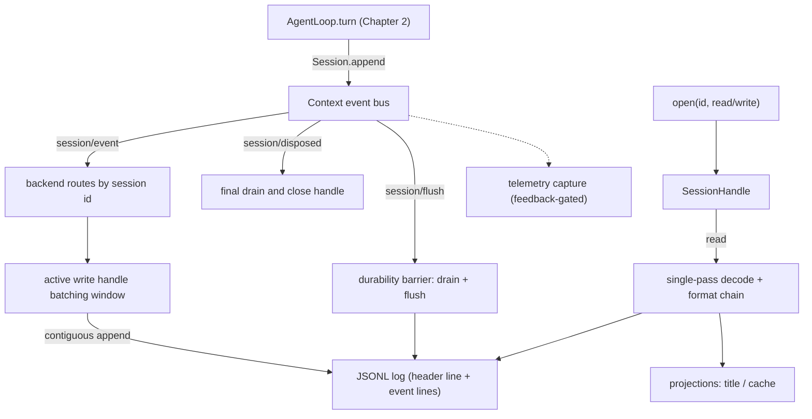

# Chapter 3: Session Event Stream, Handle Persistence, and Format Migration (Silent on Write, Traceable on Cold Read)

> Silent on write, traceable on cold read.

## Questions this chapter answers

- How does the session event stream land on disk without disturbing the running loop, and what can be read back after a crash?
- After a process restart, how is the session read back (cold read), and how are half-written lines and unclosed turns handled?
- One log has exactly one writer — what enforces that?
- How does a log written by an older version get understood by the current build, and why must unreadable logs be refused rather than guessed at?

Chapter 2 completed the minimal closed loop: one user message in, one assistant reply out, the whole process recorded by `Session.log` as 9 append-only events, with `Session.append` also emitting each event onto the `Context` event bus. But at the end of that chapter those events lived only in memory — gone when the process exits, and a new process had no way to read them back. This chapter picks up that event log and answers four things: how events land on disk without blocking the loop; how to rebuild a session from disk after a restart and clean up the mess a power failure leaves; how one log is held by exactly one writer; and how an old-format log is read by the current build.

Code relationships: this chapter reuses `ch01/code/cordis.py` (`Context`, `Service`) and `ch02/code/agent_loop.py` (`SessionEvent`, `Session`, `Sessions`, `AgentLoop`, `LlmStub`, `SystemPromptService`). It rewrites `session_persistence.py` (seam, handle, JSONL backend, format chain, projections, telemetry capture) and rewrites `main.py`; `bad_example.py` keeps its role as the counterexample.

## 1. Process Exits, Session Vanishes

First the counterexample: two functions simulate two process lifecycles. The first runs one conversation turn with no persistence backend mounted and no handle claiming the session; the second cold-reads the same session with a brand-new container:

```python
# ch03/code/bad_example.py lines 22-33 (contiguous excerpt; cross-chapter imports at lines 9-18)
def run_first_process():
    """进程 1：装配容器、跑一轮对话。没有后端，也就没有句柄认领这个会话。"""
    ctx = Context()
    Sessions(ctx)
    ctx.provide("llm", LlmStub())
    SystemPromptService(ctx)
    ctx.plugin(AgentLoop)
    agent = ctx.agent_loop.create()
    agent.followup("什么是 Cordis？")
    print(f"进程 1：session={agent.session.id}，内存日志 {len(agent.session.log)} 条事件")
    print("进程 1：进程退出——容器销毁，日志随之消失")
    return agent.session.id
```

Run output (`python3 bad_example.py`):

```text
进程 1：session=session-0001，内存日志 9 条事件
进程 1：进程退出——容器销毁，日志随之消失
进程 2：冷读 session-0001 -> None
进程 2：注册表空空如也——那场对话「从未发生过」
```

The second process gets `None`: `Sessions` is just an in-memory dictionary, and the container dies with the process. That leads to this chapter's problem chain:

- **Problem ①: the event stream lives only in memory.** A seam must wire session reads and writes to storage, with both going through one entry point (§3).
- **Problem ②: writing must not block the loop, yet a power failure must not lose acknowledged data.** Who writes, and at which step does it count? (§4)
- **Problem ③: a power failure leaves half-written lines and unclosed turns.** Should a read repair them, and who does it? (§5)
- **Problem ④: logs on disk carry versions.** How does this year's build read a session written last year? (§6)

## 2. Assembly Overview: Write Side and Read Side

Start with the map. In Figure 1, `Session.append` (from Chapter 2) emits events onto the `Context` event bus; the backend installs three listeners on that bus: `session/event` copies the event into the batching window of that session's active write handle, `session/flush` is the immediate durability barrier, and `session/disposed` performs the final drain and closes the handle. Cold read runs the other way: the caller gets a handle from `open`, then turns the log into events with `handle.read`.



Figure 1: the assembly at a glance — the write side is owned by the backend (three listeners), the read side goes through a handle held by the caller. The last two nodes, `proj` and `tele`, are the projections of §7.1 and the telemetry capture of §7.2.

Reading order: contracts and ownership first (§3), then the write path (§4), cold read and repair (§5), format migration (§6), and finally projections and telemetry (§7).

## 3. seam: One Service Contract Plus One Handle Contract

A seam is literally the stitching line between two pieces of fabric; in software it means **an injection point whose behavior can be swapped out**: the caller depends only on one contract (a set of method signatures), the concrete implementation is injected from outside and can be replaced wholesale, while the call site doesn't change a line. Chapter 2's event bus decoupled "who cares about events", but disk reads and writes still lacked the same kind of seam: if agent-loop wrote files directly, swapping the storage form would mean editing the loop itself.

This round upstream split that seam into two contracts, instead of the previous version's two layers of "service + backend adapter":

- **`SessionPersistence`**: the service definition bound at `ctx.sessionPersistence`, with five methods — `create` / `open` / `stat` / `list` / `flush` (`packages/session/session-persistence/src/index.ts:144`; declarations at `packages/session/session-persistence/src/index.ts:159` / `packages/session/session-persistence/src/index.ts:174` / `packages/session/session-persistence/src/index.ts:187` / `packages/session/session-persistence/src/index.ts:203` / `packages/session/session-persistence/src/index.ts:210`). It knows nothing about "append a batch of events".
- **`SessionHandle`**: the per-session handle returned by `create` or `open`, whose methods are only `read` / `append` / `flush` / `close` (`packages/session/session-persistence/src/handle.ts:59`; declarations at `packages/session/session-persistence/src/handle.ts:83` / `packages/session/session-persistence/src/handle.ts:97` / `packages/session/session-persistence/src/handle.ts:109` / `packages/session/session-persistence/src/handle.ts:116`).

The division of labor in one sentence: **the service governs the session lifecycle, the handle governs log reads and writes**. There is no id-addressed append/load method — to write a log you must first hold a handle.

### 3.1 Minimal example: same contract, swapped implementation

The minimal example below shows the value of this seam: one calling function, two implementations, zero changes at the call site (inline, self-contained, directly runnable; the formal contract is in §3.2):

```python
# Inline minimal example (self-contained, runnable; not part of the chNN/code/ teaching codebase)
import os, tempfile

class MemoryHandle:                      # 实现 1：事件留在内存
    def __init__(self): self.events = []
    def read(self): return list(self.events)
    def append(self, events): self.events.extend(events)
    def flush(self): pass                # 内存形态：没有需要落盘的东西

class FileHandle:                        # 实现 2：事件追加到磁盘
    def __init__(self, path):
        self.path = path
        open(path, "w").close()          # 每次构造清空，重复运行结果一致
    def read(self):
        with open(self.path, encoding="utf-8") as f:
            return [line for line in f]
    def append(self, events):
        with open(self.path, "a", encoding="utf-8") as f:
            for event in events: f.write(event + "\n")
    def flush(self): pass                # 每行 append 后已落盘

def record_turn(handle):                 # 业务代码：只认 read/append/flush
    handle.append(["user/message", "assistant/message"])
    handle.flush()
    return len(handle.read())

print("内存句柄:", record_turn(MemoryHandle()))
print("文件句柄:", record_turn(FileHandle(os.path.join(tempfile.gettempdir(), "handle-demo.txt"))))
```

Run output:

```text
内存句柄: 2
文件句柄: 2
```

`record_turn` didn't change a line: it depends only on the three names `append` / `read` / `flush`. Note that neither implementation has a `load(session_id)` — session-level operations live on the service, not on the handle.

### 3.2 The contract table

| Layer | Contract | Method | Semantics |
|---|---|---|---|
| Service | `SessionPersistence` | `create(header)` | Create a session, take write ownership, return a write handle |
| Service | same | `open(id, access)` | `read` only observes and takes no ownership; `write` atomically claims single-writer ownership |
| Service | same | `stat(id)` / `list()` | Look only at the header and metadata; return no event body |
| Service | same | `flush()` | Service-wide durability barrier: drain every active write handle together |
| Handle | `SessionHandle` | `read(offset?, length?)` | Read a slice of the valid prefix; a torn tail (an incomplete record left by a power failure, see §5.3) is never returned |
| Handle | same | `append(events)` | Append a seq-contiguous batch (each event checked against next-seq + i); resolution means "accepted" |
| Handle | same | `flush()` | Durability barrier: resolution promises the data is stored and materialized |
| Handle | same | `close()` | Idempotent, uncancellable; a write handle releases ownership here |

Two terms deserve their own paragraph. **Durability barrier**: an `append` resolution only means the batch was accepted, ordered, and is readable on this backend instance — the storage layer may legitimately keep buffering in memory. Only a `flush` resolution promises the data survives a crash (`packages/session/session-persistence/src/handle.ts:97`, `packages/session/session-persistence/src/handle.ts:109`). The shipped JSONL backend happens to persist on every `append`, but the contract does not promise that — a third-party backend may legally batch.

**handle ownership contract**: one session has at most one write handle at any moment. `create` and `open(id, 'write')` claim it in memory, and a second claim fails outright; `open(id, 'read')` takes no claim, so it can coexist with other read handles, even with a write handle held by another process (`packages/session/session-persistence/src/index.ts:164-165`). Cross-process exclusion is the provider's job: the seam guarantees write ownership only within one backend instance, and the JSONL backend adds a kernel file lock on top (`packages/session/session-persistence/README.md:150`). The constraint is not a documentation promise but a code path: until the write handle closes, its registration keeps occupying that id.

### 3.3 Eight error classes: failures have names (seven operations + one format)

Callers should not parse error strings. The persistence seam fixes the predictable failures as error classes (starting at `packages/session/session-persistence/src/errors.ts:13`):

| Error class | Trigger | What the caller should do |
|---|---|---|
| `SessionPersistenceNotFoundError` | `open` cannot find the session; `stat` returns `undefined` for the same case instead of throwing (`packages/session/session-persistence/src/errors.ts:13`) | Treat it as "no such session"; do not retry the write |
| `SessionAlreadyExistsError` | `create` hits an id that already exists (`packages/session/session-persistence/src/errors.ts:22`) | Pick another id, or use `open` |
| `SessionAlreadyOwnedError` | `open(write)` while an active write handle exists (`packages/session/session-persistence/src/errors.ts:31`) | Wait for the other side to close, or open read-only |
| `SessionReadOnlyError` | `append` / `flush` on a read handle (`packages/session/session-persistence/src/errors.ts:40`) | Reopen with `open(write)` |
| `SessionOwnershipLostError` | **Reserved**: declared for the cross-process lease layer; the current in-process backends never throw it (`packages/session/session-persistence/src/errors.ts:59`, see the original wording at `packages/session/session-persistence/src/errors.ts:56-57`) | Close the handle and reopen with `open(write)` |
| `SessionHandleClosedError` | any operation after the handle's `close()` (`packages/session/session-persistence/src/errors.ts:68`) | Reopen; do not reuse the handle |
| `SessionPersistenceCorruptionError` | committed content fails validation (`packages/session/session-persistence/src/errors.ts:93`) | Report corruption; do not silently skip |
| `SessionFormatUnsupportedError` | the log is intact but this build cannot read it (newer version, no upgrade path, unknown event vocabulary) (`packages/session/session-persistence/src/errors.ts:111`) | Change build or upgrade; **do not** treat it as corruption (semantics in §6.5, construction-time gap check in §6.3) |

The first seven are operation failures; the eighth is "cannot read this". Keep them apart in a `catch`: reporting a format refusal as corruption misleads users into deleting data. Upstream places this family in the seam package rather than in each backend precisely so callers can write the same `catch` across backends.

### 3.4 Recap

Problem ① solved: session reads and writes are folded into two contracts — the service governs the lifecycle, the handle governs the log; "who may write" is answered by the ownership contract, "at which step it counts" by the durability barrier; and the storage form can be injected from outside. What the contract does not specify is something else: **how live events reach the handle, and who calls flush when**. That is the implementation's orchestration, covered in §4.

## 4. Write Path: the Backend Owns the live write path

### 4.1 The write path must satisfy two opposing constraints

Picture a concrete case: a long turn is streaming, and every chunk makes `Session.append` emit one `session/event`. If every event were written to disk synchronously, disk IO would drag the loop and the user would see stuttering output. If events were buffered in memory and written at the end, a kill right before flush would leave none of the reply that was already shown to the user. A subtler third constraint is **who is responsible for writing**. With several writers, two components each keep their own idea of "how many events are written", and recovery cannot reconcile them.

The old model (`packages/session/session-persistence/src/write-behind.ts` for buffering plus `packages/session/session-persistence/src/coordinator.ts` for coordination; both files are gone from the current upstream snapshot) tried to answer with two layers: the coordinator subscribed to `session/event`, batched on a 200ms period or turn end, and validated seq against its own `cursor`; the backend adapter only wrote bytes. The awkward part is exactly here: **"who owns the writer" was spread across two places** — the coordinator tracked the cursor, the backend tracked bytes, and the two disagreed about how far the log had been written, so repair and recovery each had to cross two layers.

The current upstream snapshot (HEAD, the latest commit of the target repository) replaces this with one simpler sentence: **the backend itself owns the live write path**. The live write path is a channel: an event is emitted onto the `Context` event bus, the backend routes it by session id into the batching window of that session's active write handle, and the handle writes it to disk in batches; the handle's `flush` is the durability barrier on that channel. Put another way, the writer is the handle, and there is exactly one handle.

### 4.2 Three listeners and one routing rule

`install` is a generator: each function it `yield`s is a disposer that Cordis runs in reverse order when the backend unloads, so listeners and the close action hang on the same effect chain (`packages/session/session-persistence-jsonl/src/storage.ts:535-537`).

On install the JSONL backend registers three session listeners at once (`install` at `packages/session/session-persistence-jsonl/src/storage.ts:535`; the three `ctx.on` calls at `packages/session/session-persistence-jsonl/src/storage.ts:549` / `packages/session/session-persistence-jsonl/src/storage.ts:554` / `packages/session/session-persistence-jsonl/src/storage.ts:562`):

```text
// JsonlBackendTracker.install()（storage.ts:535）
yield ctx.on('session/event', (session, event) => { ... })      // storage.ts:549
yield ctx.on('session/flush', (session) => { ... })             // storage.ts:554
yield ctx.on('session/disposed', (session) => { ... })          // storage.ts:562
```

There is exactly one routing rule: **look up the active write handle by session id**. When `session/event` arrives, the backend finds that id in its `writers` table and copies the event into the handle's batching window; when it finds nothing it does nothing (`packages/session/session-persistence-jsonl/src/storage.ts:550`). So "a published session with no active write handle" is not an error — it means **that session is not persisted**. This is precisely the "who writes" question the previous coordinator had to maintain separately; now the registry table itself answers it.

The `writers` table lives in `JsonlBackendTracker` (`packages/session/session-persistence-jsonl/src/storage.ts:391`) and serves three purposes at once: single-writer registration (`claimWrite`, `packages/session/session-persistence-jsonl/src/storage.ts:429`), live routing target (`adopt`, `packages/session/session-persistence-jsonl/src/storage.ts:482`), and release on close (`release`, `packages/session/session-persistence-jsonl/src/storage.ts:495`). One data structure implementing both ownership and routing is the most economical part of this model.

### 4.3 Batching window and drain

Each handle keeps a batching window (`JsonlSessionHandle`, `packages/session/session-persistence-jsonl/src/storage.ts:85`). `enqueueLive` deep-copies the event into the window and, when the window is empty, arms a timer of at most 200ms (`packages/session/session-persistence-jsonl/src/storage.ts:274`); when the timer fires, or when `session/flush` explicitly asks, it calls `drainLive` (`packages/session/session-persistence-jsonl/src/storage.ts:288`):

```text
// JsonlSessionHandle.drainBuffered()（storage.ts:294）
while (this.buffered.length > 0) {
  await this.enqueueChain(async () => {
    const batch = this.buffered.splice(0)
    try { await this.persistContiguous(materializeAppendBatch(batch)) }
    catch (error) {
      this.buffered = batch.concat(this.buffered)   // 整批按原序放回
      this.drainPaused = true                       // 暂停自动定时器
      throw error
    }
  })
}
```

(Excerpted from `packages/session/session-persistence-jsonl/src/storage.ts:300-314`, with control flow outside the `while` omitted.)

[Teaching simplification] The timer exists only in the real version: `LIVE_WRITE_BATCH_MAX_DELAY_MS = 200` (`packages/session/session-persistence-jsonl/src/storage.ts:36`, used from `packages/session/session-persistence-jsonl/src/storage.ts:280`) drains automatically once the window goes idle. The teaching version's `enqueue_live` only appends and arms no timer, so the drain must be triggered by an explicit flush or close (the §9 table says the same).

On failure the whole batch goes back **at the head, in original order**, and the automatic timer pauses — the next explicit `session/flush`, a write-handle `close`, or backend teardown will retry and fail loudly (`packages/session/session-persistence/README.md:57`, `packages/session/session-persistence/README.md:104`; for "close drains before releasing ownership" see `packages/session/session-persistence-jsonl/src/storage.ts:214-220`). "No duplication on retry" is upheld by the append continuity assertion (it used to be the coordinator's cursor; that code no longer exists): `assertContiguous` requires the i-th event in the batch to have `seq` exactly equal to "the handle's known next-seq + i" (`packages/session/session-persistence/src/storage-contract.ts:145`, assertions at `packages/session/session-persistence/src/storage-contract.ts:146-152`).

### 4.4 What one real append does

`persistContiguous` is the only place on the write path that actually stores bytes (`packages/session/session-persistence-jsonl/src/storage.ts:319`), and the order is fixed:

1. A read handle is refused outright (`SessionReadOnlyError`).
2. `assertContiguous` checks seq contiguity.
3. If a torn tail is pending, truncate it first (§5.3).
4. On the first write, or right after a format migration, "publish" the whole log in the current format; otherwise append.
5. Advance `cursor` and drop the "already read prefix" cache.

Step 4's "first write" and "after migration" are the same action with different causes. The agent-loop side makes it clear: when a session is created, `create` only registers it and writes no bytes (`packages/core/agent-loop/src/index.ts:690`); after publication the loop keeps handing events to the handle (`appendUnstoredSuffix` at `packages/core/agent-loop/src/index.ts:702-707`), and the first `append` is what makes the file appear. If the process crashes along the way, the session never materialized and therefore never existed (`packages/session/session-persistence/README.md:53`).

### 4.5 agent-loop does only three things

In the previous version the coordinator was "the hub from event stream to disk" and agent-loop only created sessions. Now it is the other way around: **agent-loop is the handle's owner**, and the backend only routes events in by id. A source comment says it plainly — "The mounted backend routes announced live events into the active write handle by session id; the loop only owns the handle itself" (`packages/core/agent-loop/src/index.ts:633`).

The loop's three jobs are: `create` to obtain a handle (`packages/core/agent-loop/src/index.ts:690`), write the not-yet-stored suffix before publication (`packages/core/agent-loop/src/index.ts:702`, `appendUnstoredSuffix`), and `close` on teardown (`packages/core/agent-loop/src/index.ts:533` and `packages/core/agent-loop/src/index.ts:600`). It does not subscribe to `session/event`, keeps no cursor, and does no batching. The teaching `main.py` has no real agent-loop resume path, so it takes write ownership explicitly through `backend.create(header)`, which makes each stage observable; the real version does this inside the loop, in `createStoredSession`.

### 4.6 Recap

Problem ② lands here: **no loss on power failure** — `flush` is the only promise point, and a handle `close` also drains before releasing ownership; **no duplication on retry** — the seq continuity assertion lives in the single writer; **loop not blocked** — an event costs one deep copy into the window, and the actual disk write happens when the window expires.

## 5. Cold Read: open + read, repair belongs to the reader

### 5.1 The read path

Cold read has no dedicated `load` method — just two steps: get a handle with `open(id, 'read')`, get events with `handle.read()`.

```python
# ch03/code/session_persistence.py lines 277-293 (excerpt; docstring collapsed to one line; class SessionHandle at lines 239-395)
    def read(self, offset=0, length=None):
        """读合法前缀的一段（handle.ts:83）。"""
        self._assert_open("read")
        if offset < 0 or (length is not None and length < 0):
            raise ValueError("read offset/length must be non-negative")
        events = self._load()
        if len(events) < self._observed:
            raise SessionPersistenceCorruptionError(
                f'session "{self.id}": stored log shrank below a previously observed prefix'
            )
        self._observed = len(events)
        end = None if length is None else offset + length
        return events[offset:end]
```

The real version also hangs the pre-read prefix on the handle (`primed`, i.e. "the stretch of log already validated when the handle opened"); a write open serves that prefix first and invalidates it on the first append (`packages/session/session-persistence-jsonl/src/storage.ts:130-142`). This explains a semantics that is easy to miss: **a write handle can read too, and it reads what it appended itself**.

Single-pass decoding happens at the storage layer, but the entry point depends on the physical encoding:

- **`compression: 'none'`**: the whole byte buffer is handed to `scanLog` in one go (`packages/session/session-persistence-jsonl/src/format.ts:532`; branch at `packages/session/session-persistence-jsonl/src/index.ts:830-834`).
- **The default `zstd`** (`packages/session/session-persistence-jsonl/src/index.ts:69`): frames are decompressed one by one, and the plaintext of each frame is fed to the same `SessionLogScanner` (`packages/session/session-persistence-jsonl/src/index.ts:1021-1022`, `packages/session/session-persistence-jsonl/src/generation.ts:589-600`).

Both paths end at `SessionLogScanner` (`packages/session/session-persistence-jsonl/src/format.ts:386`): the scanner splits line by line and decodes each line exactly once. Historical versions go through the format chain inside the same scan (§6) instead of decoding one copy and copying it.

### 5.2 Interrupted turns: repair on the read side

A power failure leaves two kinds of mess. The first is semantic: the last turn has `turn/start` but no `turn/end`. This is not a storage problem — those events were already written before the crash — so the repair does not belong to the persistence layer but to the **read side**:

```python
# ch03/code/session_persistence.py lines 412-427 (excerpt; docstring collapsed to one line)
def interrupted_turn_closers(events):
    """读侧修复：为断电留下的未闭合 turn 合成收尾事件（repair.ts:209）。"""
    open_turn = False
    for event in events:
        if event.type == "turn/start":
            open_turn = True
        elif event.type == "turn/end":
            open_turn = False
    if not open_turn:
        return []
    return [SessionEvent(events[0].session_id if events else "", 0, "turn/end",
                         {"reason": "interrupted"})]
```

The real `openTurnClosers` supplies more than one event: a missing tool call first gets an error `tool/result`, then an open `step/end` is closed, and finally `turn/end {interrupted}` is added (`packages/core/session/src/repair.ts:53`); `interruptedTurnClosers` is a thin wrapper passing the `interrupted` cause (`packages/core/session/src/repair.ts:209`). [Teaching simplification] The teaching version only adds `turn/end` and does not distinguish a fork-inherited prefix either. The excerpt collapses the source's three-line docstring into one and is marked "excerpt".

How do the repair events reach disk? On resume, agent-loop takes a write handle with `open(id, 'write')` (`packages/core/agent-loop/src/index.ts:788`), reads the stored log with `handle.read` (`packages/core/agent-loop/src/index.ts:797`), computes the closers (`packages/core/agent-loop/src/index.ts:800`), and then **appends the closers as an ordinary batch through the same handle** (`packages/core/agent-loop/src/index.ts:801`). The old `commit_repair` (truncate, then rewrite the whole file) is gone: repaired events are simply the log's next segment. Read-only observers (pure readers such as session-query) balance the log in memory only, without writing.

### 5.3 Torn tail: not part of the committed region

The second mess is physical: the last write was cut off by a power failure, leaving half a line of JSON at the end of the file. The rule is one sentence: **a torn tail is never returned to a reader and is truncated before the next write** (`packages/session/session-persistence/src/index.ts:128-130`).

```python
# ch03/code/session_persistence.py lines 541-554 (contiguous excerpt; class JsonlSessionPersistence at lines 465-674)
    def _scan(self, session_id):
        """一次读完全部字节：最后一条不完整记录即撕裂尾，不进入已提交区。"""
        path = self.log_path(session_id)
        if not path.exists():
            return None
        raw = path.read_bytes()
        if raw.endswith(b"\n"):
            committed, torn_at = raw, None
        else:
            cut = raw.rfind(b"\n") + 1
            committed, torn_at = raw[:cut], len(raw[:cut])
        if not committed:
            raise SessionPersistenceCorruptionError(f'session "{session_id}": 没有完整的头行')
        lines = committed.decode("utf-8").splitlines()
```

The real version is finer-grained: if **complete events** can already be decoded out of the half frame, they are not lost — they are "recovered from the torn tail" and durably rewritten by the write path before the next append (`packages/session/session-persistence-jsonl/src/storage.ts:332-337`, `recoveredTail`). [Teaching simplification] The teaching version discards the incomplete record wholesale.

```mermaid
sequenceDiagram
    participant A as agent-loop (resume)
    participant H as SessionHandle(write)
    participant B as JSONL backend
    participant R as read-side rules
    A->>B: open(id, 'write')
    B->>B: scan the log; record the torn-tail cutoff on the handle
    A->>H: read(0)
    H-->>A: valid prefix (torn tail excluded)
    A->>R: interruptedTurnClosers(events)
    R-->>A: synthesized turn/end(interrupted)
    A->>H: append(closers)
    H->>B: cut the torn tail, then append
    A->>B: flush() (service-wide)
```

Figure 2: the recovery sequence — the storage layer blocks the torn tail, the read side fills in the interrupted turn, and the synthesized events still go back through the same handle. The last step uses the service-wide `flush`, synonymous with §4.2's `session/flush` listener (the teaching code may call `handle.flush()` directly instead).

### 5.4 Recap

Problem ③ solved: a cold read always sees a valid prefix; semantic leftovers are completed by the reader, and the completed events travel the same write path as ordinary events. This also explains why "repair" needs no separate API — whoever repairs already holds a write handle.

## 6. session format chain v0→v4

### 6.1 Why logs need versions

Session logs live on disk for a long time. A format written today may have changed its shape by next year (for example, tool results embedded inside messages becoming standalone events). If the reader assumes "what is on disk is exactly my current shape", an old log either fails to decode or decodes into something wrong — the latter is worse because it looks like success.

So every log carries a `version` in its header line, and the current build writes `4` (`packages/core/session/src/types.ts:90`). The **session format chain v0→v4** is the chain that upgrades any supported historical version to the current one.

### 6.2 Adjacent migration edges

The chain is built from **adjacent migration edges**: one edge may only go from `vN` to `v(N+1)`, and skipping versions must be split into several edges. `defineSessionFormatMigration` welds this constraint in at declaration time (`packages/session/session-format/src/chain.ts:24`):

```text
// defineSessionFormatMigration()（chain.ts:24）
if (to !== from + 1) {
  throw new SessionFormatError(`${migration.name} must declare adjacent v${from}->v${from + 1}`)
}
```

Why must edges be adjacent? Because each edge only needs to understand "what the previous version looked like and what this one looks like", not the Cartesian product of any two versions. Adding v5 means writing one v4→v5 edge; the four existing edges do not change a line.

Upstream's four edges each do one concrete job, with no placeholders:

[Teaching simplification] The teaching `SESSION_FORMAT_MIGRATIONS` only performs real transformation on v2→v3 (preset rename) and v3→v4 (tool-result lifting); v0→v1 and v1→v2 are placeholder edges, present only to demonstrate the "adjacent chain + gap check".

| Edge | Main transformation | Source |
|---|---|---|
| v0→v1 | Decode v0 physical rows and apply the finite historical normalizations | `packages/session/session-format-v0-to-v1/src/migration.ts:27` |
| v1→v2 | Fold top-level `assistant/chunk` into v2 attempt events (also emitting a standalone `assistant/attempt`), renumbering output seq contiguously | `packages/session/session-format-v1-to-v2/src/migration.ts:43`, `packages/session/session-format-v1-to-v2/src/migration.ts:559` |
| v2→v3 | Promote system prompts into messages, remap references, rename preset `code` to `ptc` | `packages/session/session-format-v2-to-v3/src/migration.ts:12`, `packages/session/session-format-v2-to-v3/src/migration.ts:18` |
| v3→v4 | Lift tool results into standalone events, rename message sources, append parent catalog facts | `packages/session/session-format-v3-to-v4/src/migration.ts:15`, `packages/session/session-format-v3-to-v4/src/migration.ts:36` |

### 6.3 Validating a complete chain at startup

The chain does not discover a missing edge at call time. `createSessionFormatCatalog` is an ordinary factory (`packages/session/session-format/src/catalog.ts:29`) that does two things before returning: it registers codecs by version and checks that **every version from 0 to current has exactly one codec** (`packages/session/session-format/src/catalog.ts:37`); then it calls `createSessionFormatChain` to compile the migration chain, which checks that **every version has exactly one edge, with no gaps and no edge beyond current** (`packages/session/session-format/src/chain.ts:37`, `packages/session/session-format/src/chain.ts:65-71`). The catalog's assembly list is a generated constant (`packages/session/session-format-catalog/src/generated.ts:16`), and `sessionFormatCatalog` itself is a module-level `createSessionFormatCatalog(...)` call (`packages/session/session-format-catalog/src/generated.ts:48`), so both checks happen at **module load time** — the backend fails to start rather than blowing up when some user opens an old session.

```python
# ch03/code/session_persistence.py lines 183-199 (contiguous excerpt; class SessionFormatChain at lines 176-236)
    def __init__(self, current_version, migrations):
        self.current_version = current_version
        by_from = {}
        for migration in migrations:
            if migration.to_version != migration.from_version + 1:
                raise ValueError(f"{migration.name} must declare adjacent versions")
            if migration.from_version in by_from:
                raise ValueError(f"migration from v{migration.from_version} is duplicated")
            by_from[migration.from_version] = migration
        ordered = []
        for version in range(current_version):
            migration = by_from.get(version)
            if migration is None:
                raise SessionFormatUnsupportedError(
                    f"Session migration v{version}->v{version + 1} is missing"
                )
            ordered.append(migration)
```

Putting the check at construction time rather than read time is deliberate: a missing edge is a **build configuration error** and should not wait until some user opens some old session. [Teaching simplification] The real version throws the format package's own `SessionFormatUnsupportedMigrationError` (`packages/session/session-format/src/error.ts:7`, a subclass of `SessionFormatError`); the teaching version reuses the seam package's `SessionFormatUnsupportedError`. The two share a name but not an identity; here both are treated as "a dedicated refusal", without replicating the inheritance hierarchy. The JSONL backend adds one more guard: if the catalog's current version disagrees with `SESSION_FORMAT_VERSION`, the backend constructor throws (`packages/session/session-persistence-jsonl/src/index.ts:319-324`).

### 6.4 Physical rows are consumed once

Migration is not "read the old file, copy it in memory, write it back". The JSONL on disk is streamed into the migration chain as physical rows: on the `none` compression path, the header line is split off to build the restore, and the body is pushed through `MigratingJsonlRows` in 1MB chunks (`packages/session/session-persistence-jsonl/src/generation.ts:389`, `packages/session/session-persistence-jsonl/src/generation.ts:393-405`; chunk size at `packages/session/session-persistence-jsonl/src/generation.ts:50`). Every row enters `SessionFormatRestore.decodeRow`, passes through every stage up to the current version, and comes out directly in the current event shape (`packages/session/session-format/src/types.ts:223`).

One read, one transform, one output. The catalog's own description states it as a promise: "restore a current Session directly or compose a unique sequence of adjacent migrations while consuming physical rows once" (`packages/session/session-format/README.md:12`).

The teaching version compresses this into a nested loop with the same semantics: the outer loop walks the edges in plan order, and the inner loop hands each edge's output to the next edge.

### 6.5 Refuse instead of guessing

Both directions must refuse, and with different wording. If a historical version has no upgrade path, say "this build ships no upgrade path for it"; if the on-disk version is **newer than this build**, say "upgrade the harness" — never answer "corrupt" (`sessionFormatVersionRefusal` at `packages/session/session-persistence/src/errors.ts:133`):

```text
session "<id>" uses log format v5, but this harness reads only v4:
the log was written by a newer harness — upgrade the harness to open it
```

That is a different thing from `SessionPersistenceCorruptionError`: an unreadable log may be perfectly intact, just unknown to this build; reporting it as corruption misleads users into deleting data.

### 6.6 storage family: SQLite is still here, just not in session logs

The old chapter used SQLite to demonstrate "same contract, swapped storage form"; that card can no longer be played: the session SQLite backend has been removed (`packages/session/session-persistence-sqlite` is not in HEAD), and the seam ships exactly one production backend, JSONL (`packages/session/session-persistence/README.md:32`).

But SQLite is still in the repository — it now belongs to the **storage domain**: the four packages under `packages/storage/` manage **non-session application data**, including workspace records and session sidecars, and explicitly do not touch the session event log (`packages/storage/README.md:12`).

| Package | Role |
|---|---|
| `packages/storage/storage` | The hub `ctx.storage`: a named backend registry (`packages/storage/storage/src/index.ts:47`) |
| `packages/storage/storage-json` | Backend storing each unit as one human-readable JSON file (`packages/storage/storage-json/src/index.ts:39`) |
| `packages/storage/storage-sqlite` | Backend storing units in one SQLite database (`packages/storage/storage-sqlite/src/index.ts:57`) |
| `packages/storage/storage-domain` | Schema-validated, change-notifying typed KV domains (`packages/storage/storage-domain/src/index.ts:69`) |

To decide which side a piece of data belongs to, ask one question: **is it part of the session event stream?** If yes, it goes through `ctx.sessionPersistence`; if not (say "the last working directory" or "a projection-cache checkpoint"), it goes through the storage domain. The projection cache is exactly such a second consumer: it writes its checkpoints into its own storage domain instead of disguising them as session events (`packages/session/session-projection-cache/src/index.ts:105`, `packages/session/session-projection-cache/src/index.ts:119`).

### 6.7 Recap

Problem ④ solved: versions are first-class, the chain is validated at startup and traversed in a single pass at read time, and anything unreadable is refused with a direction. On the storage-form question, SQLite left session persistence while the storage family still owns non-session data — the boundary matters more than which database is used.

## 7. Projections and Telemetry: Turning the Event Stream into Views

### 7.1 The projection registry

A cold read returns an event stream, but a UI wants something like `{"title": ...}`. The projection registry splits views into units (the `ProjectionDefinition` init/apply/view triple, `packages/session/session-projection/src/index.ts:83`) and folds them event by event (`packages/session/session-projection/src/index.ts:282`). The live path subscribes to `session/event` and calls `drive` (`packages/session/session-projection/src/index.ts:309`, `packages/session/session-projection/src/index.ts:887`); the cold path replays from the start with `restore` (`packages/session/session-projection/src/index.ts:711`); `snapshot` reads each unit's current value (`packages/session/session-projection/src/index.ts:514`).

```python
# ch03/code/session_persistence.py lines 695-711 (contiguous excerpt; class SessionProjectionRegistry at lines 677-716)
    def drive(self, session_id, event):
        states = self._states.setdefault(session_id, {})
        for key, definition in self._definitions.items():
            state = states.get(key)
            if state is None:
                state = definition["init"]()
            states[key] = definition["apply"](state, event)

    def restore(self, session_id, events):
        states = {}
        for key, definition in self._definitions.items():
            state = definition["init"]()
            for event in events:
                state = definition["apply"](state, event)
            states[key] = state
        self._states[session_id] = states
        return self.snapshot(session_id)
```

`apply` must be a pure synchronous function: same input, same output, so live folding and cold-read folding yield the same snapshot. The title unit is the first projection (`packages/session/session-title/src/index.ts:269`); it does last-wins only on `session/title` (a later title overwrites an earlier one). And the title is itself an event — once generated, `session.append('session/title', ...)` puts it into the event stream (`packages/session/session-title/src/index.ts:422`), so it lands on disk and folds together with everything else, with no special channel.

The projection cache is the accelerated version of the same idea: `turn/end` is a mandatory write point, so a cold read checks `cachedSnapshot` first and, on a miss, folds once with `coldSnapshot` and writes the result back (`packages/session/session-projection-cache/src/index.ts:162`, `packages/session/session-projection-cache/src/index.ts:288`; the mandatory point is inside `installWritePath` at `packages/session/session-projection-cache/src/index.ts:312-320`, where `turn/end` goes straight to `flushSoft`). [Teaching simplification] The real version persists checkpoints into the storage domain and throttles by count/time; the teaching version keeps only the two semantics in memory.

### 7.2 Telemetry: the capture side handles "how to capture", not "where to send"

Copying "telemetry is just another `session/event` consumer, one record per event" gives two wrong impressions: that capture is on by default, and that captured data may be sent. HEAD's model is much narrower: **by default only sessions the user explicitly gave feedback on are captured, capture is authorized by feedback events, and every captured record must point back to its source event.**

The capture side lives in `session-telemetry`. In live mode it registers four session listeners at once — `session/created`, `session/disposed`, `session/event`, `session/flush` (`packages/session/session-telemetry/src/coordinator.ts:93`, `packages/session/session-telemetry/src/coordinator.ts:98`, `packages/session/session-telemetry/src/coordinator.ts:104`, `packages/session/session-telemetry/src/coordinator.ts:111`) — plus an `agent/error` relay (`packages/session/session-telemetry/src/coordinator.ts:116`) that turns agent-layer failures into operational records too.

Each event becomes one record: `sourceEvent` keeps the source event's envelope (the wrapper around an event: the fields outside `session_id` / `seq` / `type` / `payload`), `body` keeps a deep copy of the event data, `attributes` keeps identity fields, and the record then passes through the `session-telemetry/record` waterfall for redaction (`packages/session/session-telemetry/src/coordinator.ts:180`, `packages/session/session-telemetry/src/coordinator.ts:205`). Redaction rules are mounted by the deployment; this package ships none, and a rule that throws **withholds** the record instead of uploading it (fail-closed).

"Which sessions may be captured" is the consumer's business, written in `session-telemetry-otel`. It defines only two modes, `FEEDBACK_ONLY` and `DISABLED`, defaulting to the former (`packages/session/session-telemetry-otel/src/index.ts:31`, `packages/session/session-telemetry-otel/src/index.ts:37`), and it configures the coordinator with `capture: 'on-demand'`, so the continuous listeners do no capturing; authorization happens in the checks below (`packages/session/session-telemetry-otel/src/index.ts:219-222`). Two checks:

- **Only feedback events authorize replay.** `isFeedback` accepts `feedback/record`, `feedback/message-put`, and `feedback/message-delete` (`packages/session/session-telemetry-otel/src/index.ts:43`), and always vetoes the fork-inherited prefix (`packages/session/session-telemetry-otel/src/index.ts:44`, judged by `seq < inheritedEventCount`, where `inheritedEventCount` is how many events were inherited when forking from a parent — that history does not belong to this session's feedback).
- **The authorized event must be the one on the canonical log.** If `session.eventAt(event.seq) !== event`, it warns and drops the event (`packages/session/session-telemetry-otel/src/index.ts:227`) — the object at that seq must be the very same object in the session's committed log; a replayed copy authorizes no prefix.

The last gate is at the sink: any record with `record.sourceEvent === undefined` is refused (`packages/session/session-telemetry-otel/src/index.ts:204`). So the most common redaction move — stripping the source event — naturally becomes "this record is not uploaded" rather than "upload data with no traceable origin".

```python
# ch03/code/session_persistence.py lines 832-844 (contiguous excerpt; class SessionTelemetryCoordinator at lines 816-862)
    def _on_event(self, event):
        if self.mode == TELEMETRY_MODE_DISABLED:
            return
        if not is_feedback(event):
            return
        session = self.ctx.sessions.get(event.session_id)
        if session is None:
            return
        if event_at(session, event.seq) is not event:
            # 事件不在规范日志上（重放来的副本）：不授权任何前缀
            self.non_canonical += 1
            return
        self.capture_session(session, event.seq)
```

After authorization, `captureSession` replays the log from the handoff cursor (the seq already delivered) onward (`packages/session/session-telemetry/src/coordinator.ts:151`). The cursor is a module-level `WeakMap<Session, ...>` (`packages/session/session-telemetry/src/coordinator.ts:58`) keyed by the session object itself, so a capture agent remounted after a hot reload continues where the previous one stopped instead of handing over the same history again.

[Teaching simplification] Three details here are not mirrored one-to-one in the teaching version: the fork-prefix veto (`is_feedback` only looks at event type), the module-level cursor that survives reloads (the teaching version uses an instance dict, `captured_upto`), and "a throwing redaction rule withholds the record" (the teaching version only demonstrates the one fail-closed path where redaction drops `sourceEvent` and the sink refuses it).

**Outbound delivery is not covered here.** How these records are queued, in what granularity they are batched, and who drains them on shutdown belong to another channel — see Chapter 18.

### 7.3 Recap

The problem chain closes: a view is not a second copy but something folded out of the event stream; as long as the stream exists, any view can be rebuilt. Telemetry capture is likewise just an authorization-gated reader on the event stream.

## 8. Full Run Output

### 8.1 Actual output

Run command: `cd ch03/code && python3 main.py` (`main.py` is 229 lines in total, 10 stages; the output below is the actual run result, unedited):

```text
== 1. 装配：seam + JSONL 后端 + live 路由 ==
  ctx.sessionPersistence -> JsonlSessionPersistence
  live 路由：session/event -> 活跃写句柄批量窗；session/flush -> drain+flush

== 2. 创建会话：create 返回写句柄 ==
  create(session-0001) -> access=write，写所有权已认领
  stat：{'header': {'id': 'session-0001', 'version': 4, 'cwd': '/tmp/demo'}, 'revision': 'memory:1', 'eventCount': 0}

== 3. 跑一轮对话：live 事件按 id 路由进写句柄 ==
  session=session-0001：内存 10 条事件（seq 0-9）
  生成标题：'什么是 Cordis'（session/title 也是一条事件）
  活快照：{'title': '什么是 Cordis'}
  flush 后磁盘 11 行（1 行头 + 10 行事件）
  首行：{"id": "session-0001", "version": 4, "cwd": "/tmp/demo"}
  末行：{"session_id": "session-0001", "seq": 9, "type": "session/title", "payload": {"title": "什么是 Cordis"}}

== 4. 所有权：单写者、只读句柄只能读 ==
  第二次 open(write)：SessionAlreadyOwnedError
  open(read) -> access=read，读回 10 条
  只读句柄 append：SessionReadOnlyError

== 5. 冷读：新进程 open(read) + handle.read ==
  open(read) + read()：10 条事件、header.version=4
  缓存查找：None
  cold_snapshot 构建：{'title': '什么是 Cordis'}
  再次缓存查找：命中=True

== 6. 中断 turn 修复：断电留下未闭合 turn ==
  open(write) 读回 11 条，合成 1 条收尾
  合成收尾：turn/end {'reason': 'interrupted'}
  append 后磁盘 13 行

== 7. 撕裂尾：半行不进已提交区 ==
  读到 12 条（半行被挡在已提交区之外）
  首次新写入后磁盘 14 行（半行已截掉）

== 8. 格式迁移：v3 日志经 v3→v4 边升级 ==
  磁盘头：version=3；open(read) 后 header.version=4
  读出口 4 条事件，类型：['turn/start', 'assistant/message', 'tool/result', 'turn/end']
  stat：header.version=4（对调用方永远是当前格式）

== 9. 拒绝：链条缺口与更新版本 ==
  启动期缺边：Session migration v2->v3 is missing
  读到 v5：session "from-newer-build" uses log format v5, but this harness reads only v4

== 10. 遥测：FEEDBACK_ONLY 授权 + 脱敏 + 同一性 ==
  普通事件后：records=0（未授权，一条都没上传）
  一条 feedback 后：records=11，末条 seq=10
  脱敏删掉 sourceEvent 后：records=11，withheld=1
```

### 8.2 Reading the output segment by segment

1. **Stages 1-3 (assembly, creation, write path)**: `create` only registers and writes no bytes; `stat` returns an in-memory revision with `eventCount=0`. After publication the conversation turn runs and then the title is generated (also an event, seq=9); after `flush` the disk holds 11 lines = 1 header line + 10 event lines — corresponding to §4.2, §4.6, §7.1.
2. **Stage 4 (ownership)**: a second `open(write)` on the same session reports `SessionAlreadyOwnedError`; `append` on the handle returned by `open(read)` reports `SessionReadOnlyError` — corresponding to §3.3.
3. **Stage 5 (cold read)**: a new container does `open(read) + read()` and gets 10 events with `header.version=4`; the cache misses, `cold_snapshot` folds out the title, and the next cache lookup hits — corresponding to §5.1, §7.1.
4. **Stage 6 (interrupted turn)**: a manually appended `turn/start` simulates a crash; the write open reads back 11 events, `interrupted_turn_closers` synthesizes one `turn/end {interrupted}`, and appending it as an ordinary batch leaves 13 lines on disk — corresponding to §5.2.
5. **Stage 7 (torn tail)**: after manually appending half a line, `read()` still returns 12 events, with the half line blocked outside the committed region; the next write truncates it first, giving 14 lines on disk (1 header + 13 events) — corresponding to §5.3.
6. **Stage 8 (format migration)**: the disk header is `version=3` with `tool_results` embedded in a message; `open(read)` reports `header.version=4`, and the read returns 4 events with the tool result lifted into a standalone `tool/result` — corresponding to §6.2, §6.4.
7. **Stage 9 (refusal)**: removing two migration edges makes chain construction report `v2->v3 is missing`; reading a v5 log reports `uses log format v5, but this harness reads only v4` (the teaching version reports only the version and the read ceiling; the real version appends "upgrade the harness") — corresponding to §6.3, §6.5.
8. **Stage 10 (telemetry)**: ordinary events upload nothing; one feedback event authorizes replay up to that seq, yielding 11 records; redaction that drops `sourceEvent` leaves the count unchanged with `withheld=1` — corresponding to §7.2.

### 8.3 Reader exercises

1. Remove `handle.flush()` in stage 3: no file appears on disk — the teaching version has no timer, so flush is the only drain point (the real version has a 200ms timer that drains automatically; see §4.3).
2. In stage 6, change the manually appended event to an ordinary `assistant/message` and observe whether the closers are still produced.
3. In stage 8, add a hypothetical v4→v5 edge to `SESSION_FORMAT_MIGRATIONS` while keeping `CURRENT_FORMAT_VERSION` at 4: chain construction reports `a migration does not lead to the current version`.
4. Add a `count` projection unit to the registry (apply accumulates the event count) and verify that the live snapshot and the cold-read snapshot agree.

## 9. Source Mapping

| Mechanism | Source location | Difference from the teaching version |
|---|---|---|
| Service contract | `packages/session/session-persistence/src/index.ts:144` | TS has five methods create/open/flush/stat/list; the teaching version keeps the same names and meanings, minus AbortSignal |
| Handle contract | `packages/session/session-persistence/src/handle.ts:59` | TS is async + `AsyncDisposable`, with read-only members `id`/`header`/`inheritedEventCount`/`access`, and read returns `{eventState, events}`; the teaching version is synchronous and returns a list |
| Ownership and failures | `packages/session/session-persistence/src/errors.ts:13` | TS has seven operation errors + one format refusal; the teaching version declares all eight, but `SessionOwnershipLostError` is a reserved entry that is never thrown, as in the real version (`packages/session/session-persistence/src/errors.ts:56-57`) |
| Single writer and live routing | `packages/session/session-persistence-jsonl/src/storage.ts:391` | TS uses one `writers` Map for ownership and routing, and `install` registers three listeners (`packages/session/session-persistence-jsonl/src/storage.ts:535`); the teaching version is structurally the same |
| Batching window and drain | `packages/session/session-persistence-jsonl/src/storage.ts:274` | TS has a 200ms timer + single-flight drain + ordered refill on failure (`packages/session/session-persistence-jsonl/src/storage.ts:288`); the teaching version keeps the semantics and drops the timer |
| Durability barrier | `packages/session/session-persistence-jsonl/src/storage.ts:203` | TS `flush` materializes an empty session and guarantees storage; the teaching version is the same |
| Torn-tail recovery | `packages/session/session-persistence-jsonl/src/storage.ts:319` | TS recovers complete events from a half frame and rewrites them before the next write (`packages/session/session-persistence-jsonl/src/storage.ts:332-337`); the teaching version discards the whole incomplete record |
| Interrupted turn repair | `packages/core/session/src/repair.ts:53`, `packages/core/session/src/repair.ts:209` | TS adds tool errors, step/end, and turn/end closers; the teaching version adds only turn/end |
| Resume flow | `packages/core/agent-loop/src/index.ts:788`, `packages/core/agent-loop/src/index.ts:800-801` | TS open(write) → read → closers → append through the same handle; the teaching version follows step by step |
| Adjacent migration edges | `packages/session/session-format/src/chain.ts:24`, `packages/session/session-format/src/chain.ts:65` | TS locks adjacency at declaration and validates gaps at construction; the teaching version is the same |
| Static catalog | `packages/session/session-format-catalog/src/generated.ts:16` | TS has codecs from six packages plus four edges, validated at module init; the teaching version has four edges, two with real transforms |
| Single-pass decoding | `packages/session/session-persistence-jsonl/src/generation.ts:389`, `packages/session/session-persistence-jsonl/src/generation.ts:393-405` | TS feeds `SessionLogScanner` in 1MB chunks on the `none` path and frame by frame on the zstd path; the teaching version does one `splitlines` |
| Format refusal | `packages/session/session-persistence/src/errors.ts:133` | TS distinguishes "newer version" from "no upgrade path" and appends upgrade guidance; the teaching version reports only the version and the read ceiling |
| Projection registry | `packages/session/session-projection/src/index.ts:282`, `packages/session/session-projection/src/index.ts:887` | TS keys cells by Session object, folds lazily, and notifies by `Object.is`; the teaching version stores a map by id |
| Projection cache | `packages/session/session-projection-cache/src/index.ts:105` | TS checkpoints into the storage domain with throttling; the teaching version keeps it in memory |
| Title projection | `packages/session/session-title/src/index.ts:269`, `packages/session/session-title/src/index.ts:422` | TS has a provider plus a deterministic fallback; the teaching version truncates the first user message |
| Telemetry capture | `packages/session/session-telemetry/src/coordinator.ts:75`, `packages/session/session-telemetry/src/coordinator.ts:180` | TS covers created/disposed/flush plus the `agent/error` relay and a module-level handoff cursor; the teaching version keeps only authorization and replay |
| Telemetry authorization | `packages/session/session-telemetry-otel/src/index.ts:43`, `packages/session/session-telemetry-otel/src/index.ts:204`, `packages/session/session-telemetry-otel/src/index.ts:227` | TS includes the fork veto, `eventAt(seq)` identity, and refusal of records without sourceEvent; [Teaching simplification] the teaching version implements only the latter two and omits the fork veto |
| storage family | `packages/storage/README.md:12` | TS splits backends from data forms across four packages; the teaching version explains the boundary in prose only and builds no code |

## 10. Summary and Preview

### 10.1 Chapter summary

| Mechanism | In one sentence | Source |
|---|---|---|
| `SessionPersistence` | The service governs the session lifecycle: create/open/stat/list/flush | `packages/session/session-persistence/src/index.ts:144` |
| `SessionHandle` | The handle governs log reads and writes: read/append/flush/close | `packages/session/session-persistence/src/handle.ts:59` |
| Ownership contract | One session has exactly one write handle at a time | `packages/session/session-persistence/src/errors.ts:31` |
| Durability barrier | `flush` resolution is what persists; `append` only accepts | `packages/session/session-persistence/src/handle.ts:109` |
| live write path | The backend routes a published session's events into its active write handle by id | `packages/session/session-persistence-jsonl/src/storage.ts:535` |
| Interrupted turn repair | The read side synthesizes closers and appends them as an ordinary batch | `packages/core/session/src/repair.ts:209` |
| Torn tail | Never returned to a reader; truncated before the first new write | `packages/session/session-persistence-jsonl/src/storage.ts:319` |
| session format chain v0→v4 | Adjacent edges, a gap-free chain at startup, physical rows consumed once | `packages/session/session-format/src/chain.ts:24` |
| storage domain | Non-session data goes through `ctx.storage`, separate from the session log | `packages/storage/README.md:12` |
| Projections | Views fold out of the event stream; the title is an event too | `packages/session/session-projection/src/index.ts:282` |
| Telemetry capture | Feedback authorization, fail-closed redaction, sourceEvent identity | `packages/session/session-telemetry-otel/src/index.ts:43` |

This chapter used 1137 lines of standard-library Python (`session_persistence.py` 862 + `main.py` 229 + `bad_example.py` 46) to complete the closed loop of "silent on write, traceable on cold read". §1's four problems each land: reads and writes are folded into a service and a handle contract (Problem ①); the backend owns the live write path and `flush` is the only promise point (Problem ②); torn tails and interrupted turns are cleaned up on the read side (Problem ③); and the format chain makes old logs readable while refusing what it cannot read, with a direction (Problem ④). Every mechanism can be found in a line of §8's output.

### 10.2 Next chapter preview

This chapter's loop is still "one message in, one reply out": the model can only talk, not act. Chapter 4, "Tools Registry and Executor Pipeline", gives the model tools: `ctx.tools` registration and presentation, the `ToolExecutor` seam that sits beside the registry (with native and PTC implementations), and the pre-execute/execute/post-execute guard pipeline. Multi-step loops — where a step can be followed by another step — are completed in later chapters.

## 11. Appendix: Quick Reference for Key Concepts

Arranged in dependency order: contract layer → write path → cold read and repair → format → views.

| Layer | Concept | Definition | First appearance (definition site) |
|---|---|---|---|
| Contract layer | seam | An injection point whose behavior can be swapped out: the caller depends on the contract, not the implementation | §3 |
| Contract layer | `SessionPersistence` | Session-level service contract: create/open/stat/list/flush | §3.2 |
| Contract layer | `SessionHandle` | Per-session read/write handle: read/append/flush/close, the only channel for log reads and writes | §3.2 |
| Contract layer | durability barrier | Only a `flush` resolution promises survival across a crash; `append` only promises acceptance | §3.2 |
| Contract layer | handle ownership contract | One session allows one write handle at a time; a second open reports AlreadyOwned | §3.2 |
| Write path | live write path | The channel where the backend routes events by id into the active write handle, which then writes them in batches | §4.1 |
| Write path | seq continuity assertion | The i-th event must equal "known next-seq + i", otherwise the whole batch is refused | §4.3 |
| Read path | cold read | Rebuilding a session from storage with `open` + `read` after a process restart | §5.1 |
| Read path | interrupted turn repair | The read side synthesizes turn/end(interrupted) and appends it as an ordinary batch | §5.2 |
| Read path | torn tail | An incomplete record left by a power failure; never returned, truncated before writing | §5.3 |
| Format | session format chain v0→v4 | The unique upgrade path composed of adjacent migration edges, gap-checked at startup | §6.1 |
| Format | adjacent migration edge | A migration declaration that may only go from vN to v(N+1) | §6.2 |
| Format | storage domain | The key-value domain for non-session application data (workspace records, session sidecars) | §6.6 |
| Views | projection unit | The init/apply/view triple: a view folded out of the event stream | §7.1 |
| Views | drive/restore | Live folding (event by event) and cold-read folding (replay from the start) | §7.1 |
| Views | sourceEvent | The reference to the source event inside a telemetry record; a missing one means refusal | §7.2 |
| Views | FEEDBACK_ONLY | The default telemetry mode: only explicit feedback authorizes upload | §7.2 |
