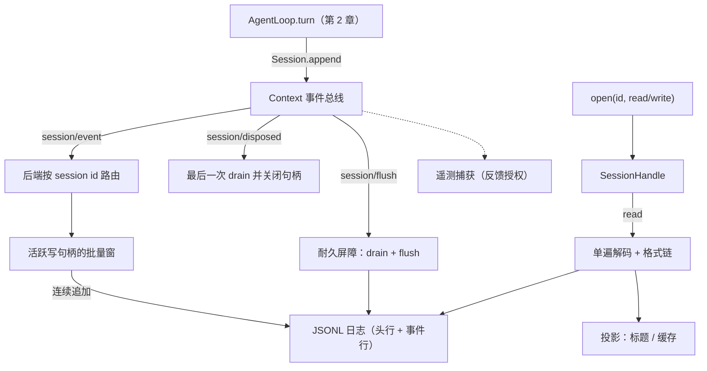
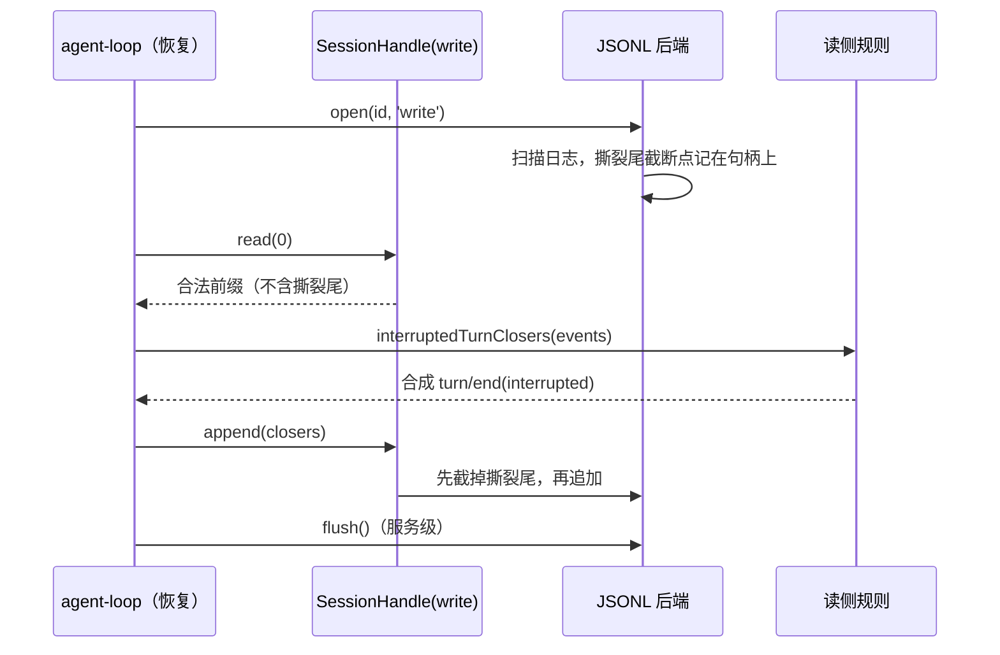

# 第 3 章 session 事件流、handle 持久化与格式迁移（写时无声，冷读有迹）

> 写时无声，冷读有迹。

## 本章回答的问题

- 会话事件流如何在不打扰运行循环的前提下落盘，进程崩溃后能读到什么？
- 进程重启后如何把会话读回来（冷读），半行写入与未闭合的 turn 怎么处理？
- 一条日志只有一个写者，这个约束靠什么强制？
- 旧版本写下的日志怎么被当前构建读懂，读不懂时为什么必须拒绝而不是猜？

第 2 章完成了最小闭环：一条用户消息进，一条助手回复出，整个过程被 `Session.log` 以 9 条 append-only 事件记下，`Session.append` 还把每条事件发到 `Context` 事件总线。但那一章结束时，这些事件只活在内存里——进程退出即丢，新进程也无从读回。本章接住这条事件日志，回答四件事：事件如何在不阻塞循环的情况下落到磁盘；重启后如何从磁盘重建会话、并收拾断电留下的残局；一份日志如何被唯一一个写者持有，以及旧格式的日志怎么被当前构建读懂。

代码关系：本章复用 `ch01/code/cordis.py`（`Context`、`Service`）与 `ch02/code/agent_loop.py`（`SessionEvent`、`Session`、`Sessions`、`AgentLoop`、`LlmStub`、`SystemPromptService`），重写 `session_persistence.py`（seam、handle、JSONL 后端、格式链、投影、遥测捕获），重写 `main.py`，`bad_example.py` 保持反面示例角色。

## 1. 进程退出，会话消失

先看反面示例：用两个函数模拟两次进程生命周期。第一个跑一轮对话，没有挂持久化后端，也没有任何句柄认领这个会话；第二个用全新容器冷读同一个 session：

```python
# ch03/code/bad_example.py 第 22-33 行（连续摘录；跨章导入见第 9-18 行）
def run_first_process():
    """进程 1：装配容器、跑一轮对话。没有后端，也就没有句柄认领这个会话。"""
    ctx = Context()
    Sessions(ctx)
    ctx.provide("llm", LlmStub())
    SystemPromptService(ctx)
    ctx.plugin(AgentLoop)
    agent = ctx.agent_loop.create()
    agent.followup("什么是 Cordis？")
    print(f"进程 1：session={agent.session.id}，内存日志 {len(agent.session.log)} 条事件")
    print("进程 1：进程退出——容器销毁，日志随之消失")
    return agent.session.id
```

运行输出（`python3 bad_example.py`）：

```text
进程 1：session=session-0001，内存日志 9 条事件
进程 1：进程退出——容器销毁，日志随之消失
进程 2：冷读 session-0001 -> None
进程 2：注册表空空如也——那场对话「从未发生过」
```

第二个进程拿到 `None`：`Sessions` 只是内存字典，容器随进程销毁。由此引出本章的问题链：

- **问题 ①：事件流只活在内存。** 需要一条 seam 把会话读写接到存储，并且读写都要经过同一个入口（§3）。
- **问题 ②：写盘不能卡住循环，断电又不能丢已确认的数据。** 谁在写、写到哪一步才算数？（§4）
- **问题 ③：断电会留下半行与没闭合的 turn。** 读的时候要不要修？谁来修？（§5）
- **问题 ④：磁盘上的日志有版本。** 去年写的会话，今年这版构建怎么读？（§6）

## 2. 装配总览：写侧与读侧

先给地图。图 1 里，`Session.append`（第 2 章）把事件发到 `Context` 事件总线；后端在这一条总线上装了三个监听：`session/event` 把事件复制进该会话活跃写句柄的批量窗，`session/flush` 是立即落盘的耐久屏障，`session/disposed` 做最后一次排空并关闭句柄。冷读方向反过来：调用方 `open` 拿到句柄，再用 `handle.read` 把日志读成事件。



图 1：装配总览——写侧由后端拥有（三条监听），读侧由调用方持有的句柄完成。末两个节点 `proj` 与 `tele` 分别是 §7.1 的投影和 §7.2 的遥测捕获。

阅读顺序：先看契约与所有权（§3），再看写路径（§4）、冷读与修复（§5）、格式迁移（§6），最后看投影与遥测（§7）。

## 3. seam：一个服务契约加一个句柄契约

seam（接缝）指**可被替换行为的注入点**：调用方只依赖一份契约（一组方法签名），具体实现从外部注入、可以整体更换，而调用处一行不动。第 2 章的事件总线把「谁关心事件」解耦了，但磁盘读写还缺一条同样的缝：如果 agent-loop 直接写文件，换存储形态就要改循环本身。

这一轮上游把这条缝拆成了两个契约，而不是上一版的两层「服务 + 后端适配器」：

- **`SessionPersistence`**：挂在 `ctx.sessionPersistence` 上的服务定义，五个方法——`create` / `open` / `stat` / `list` / `flush`（`packages/session/session-persistence/src/index.ts:144`，方法声明在 `packages/session/session-persistence/src/index.ts:159` / `packages/session/session-persistence/src/index.ts:174` / `packages/session/session-persistence/src/index.ts:187` / `packages/session/session-persistence/src/index.ts:203` / `packages/session/session-persistence/src/index.ts:210`）。它不认识「追加一批事件」这种操作。
- **`SessionHandle`**：`create` 或 `open` 返回的每会话句柄，方法只有 `read` / `append` / `flush` / `close`（`packages/session/session-persistence/src/handle.ts:59`，声明在 `packages/session/session-persistence/src/handle.ts:83` / `packages/session/session-persistence/src/handle.ts:97` / `packages/session/session-persistence/src/handle.ts:109` / `packages/session/session-persistence/src/handle.ts:116`）。

一句话说清分工：**服务管会话的生命周期，句柄管日志的读写**。没有任何按 session id 的 append/load 方法——要写日志，必须先持有句柄。

### 3.1 最小示例：同一契约换实现

下面的最小示例演示这条缝的价值：同一个调用函数，两种实现，调用处零改动（行内自包含，可直接运行；正式契约见 §3.2）：

```python
# 行内最小示例（自包含、可运行；不属于 chNN/code/ 教学代码库）
import os, tempfile

class MemoryHandle:                      # 实现 1：事件留在内存
    def __init__(self): self.events = []
    def read(self): return list(self.events)
    def append(self, events): self.events.extend(events)
    def flush(self): pass                # 内存形态：没有需要落盘的东西

class FileHandle:                        # 实现 2：事件追加到磁盘
    def __init__(self, path):
        self.path = path
        open(path, "w").close()          # 每次构造清空，重复运行结果一致
    def read(self):
        with open(self.path, encoding="utf-8") as f:
            return [line for line in f]
    def append(self, events):
        with open(self.path, "a", encoding="utf-8") as f:
            for event in events: f.write(event + "\n")
    def flush(self): pass                # 每行 append 后已落盘

def record_turn(handle):                 # 业务代码：只认 read/append/flush
    handle.append(["user/message", "assistant/message"])
    handle.flush()
    return len(handle.read())

print("内存句柄:", record_turn(MemoryHandle()))
print("文件句柄:", record_turn(FileHandle(os.path.join(tempfile.gettempdir(), "handle-demo.txt"))))
```

运行输出：

```text
内存句柄: 2
文件句柄: 2
```

`record_turn` 一行未改：它只依赖 `append` / `read` / `flush` 三个名字。注意两个实现都**没有** `load(session_id)`——会话级操作在服务上，不在句柄上。

### 3.2 契约表

| 层 | 契约 | 方法 | 语义 |
|---|---|---|---|
| 服务 | `SessionPersistence` | `create(header)` | 新建会话，取得写所有权，返回写句柄 |
| 服务 | 同上 | `open(id, access)` | `read` 只观察不取所有权；`write` 原子地认领单写所有权 |
| 服务 | 同上 | `stat(id)` / `list()` | 只看头与元数据，不返回事件体 |
| 服务 | 同上 | `flush()` | 服务级耐久屏障：所有活跃写句柄一起排空 |
| 句柄 | `SessionHandle` | `read(offset?, length?)` | 读合法前缀的一段；撕裂尾（断电留下的不完整记录，见 §5.3）永不返回 |
| 句柄 | 同上 | `append(events)` | 追加一批 seq 连续的事件（逐条校验 next-seq+i）；解析即「已接受」 |
| 句柄 | 同上 | `flush()` | 耐久屏障：解析即承诺落盘与物化 |
| 句柄 | 同上 | `close()` | 幂等、不可取消；写句柄在此交出所有权 |

这里有两组词值得单独划出来。**耐久屏障**（durability barrier）：`append` 解析只表示这批事件已被接受、排序、在本后端实例上可读，存储层完全可以继续在内存里攒着；只有 `flush` 解析才承诺崩溃后还在（`packages/session/session-persistence/src/handle.ts:97`、`packages/session/session-persistence/src/handle.ts:109`）。真实 JSONL 后端恰好每次 `append` 都立即落盘，但契约不承诺这一点——第三方后端可以合法地攒批。

**handle 所有权契约**：同一会话在同一时刻只允许一个写句柄。`create` 与 `open(id, 'write')` 在内存里认领，重复认领直接报错；`open(id, 'read')` 不参与认领，可以与其他只读句柄乃至另一个进程的写句柄并存（`packages/session/session-persistence/src/index.ts:164-165`）。跨进程的互斥由 provider 自己保证：seam 只保证单个后端实例内的写所有权，JSONL 后端额外加了一把内核文件锁（`packages/session/session-persistence/README.md:150`）。这条约束不是文档承诺，而是代码路径：写句柄关闭前，它的登记一直占着这个 id。

### 3.3 八个错误类：失败有名字（七操作 + 一格式）

调用方不该解析报错字符串。持久化 seam 把可预期的失败固化成错误类（`packages/session/session-persistence/src/errors.ts:13` 起）：

| 错误类 | 触发点 | 调用方该怎么办 |
|---|---|---|
| `SessionPersistenceNotFoundError` | `open` 找不到会话；`stat` 对同一情形返回 `undefined` 而不抛（`packages/session/session-persistence/src/errors.ts:13`） | 当作「没有这个会话」，不要重试写 |
| `SessionAlreadyExistsError` | `create` 撞上已存在的 id（`packages/session/session-persistence/src/errors.ts:22`） | 换 id，或改为 `open` |
| `SessionAlreadyOwnedError` | `open(write)` 时已有活跃写句柄（`packages/session/session-persistence/src/errors.ts:31`） | 等对方关闭，或改用只读 |
| `SessionReadOnlyError` | 在只读句柄上 `append` / `flush`（`packages/session/session-persistence/src/errors.ts:40`） | 用 `open(write)` 重新打开 |
| `SessionOwnershipLostError` | **预留**：为跨进程租约层声明，当前 in-process 后端从不抛出（`packages/session/session-persistence/src/errors.ts:59`，原文见 `packages/session/session-persistence/src/errors.ts:56-57`） | 关闭句柄并重新 `open(write)` |
| `SessionHandleClosedError` | 句柄 `close()` 之后再做任何操作（`packages/session/session-persistence/src/errors.ts:68`） | 重新打开，不要复用句柄 |
| `SessionPersistenceCorruptionError` | 已提交区的内容不合法（`packages/session/session-persistence/src/errors.ts:93`） | 报告损坏；不要静默跳过 |
| `SessionFormatUnsupportedError` | 日志完好但本构建读不懂（版本更新、无升级路径、未知事件词汇）（`packages/session/session-persistence/src/errors.ts:111`） | 换构建或升级；**不要**按损坏处理（语义见 §6.5，构造期缺口检查见 §6.3） |

前七个是操作失败，第八个是「读不懂」，两者在 `catch` 里要分开：把格式拒绝报成损坏，会误导用户去删数据。上游把这组类放在 seam 包里而不是各后端里，正是为了让调用方能跨后端写同样的 `catch`。

### 3.4 回顾

问题 ① 解决：会话读写被收进两个契约——服务管生命周期，句柄管日志；「谁能写」由所有权契约回答，「写到哪一步算数」由耐久屏障回答；存储形态可以从外部注入。契约没有规定的是另一件事：**live 事件怎么流到句柄、谁在什么时候调用 flush**。那是实现方的编排，§4 讲。

## 4. 写路径：后端拥有 live write path

### 4.1 写路径要同时满足两个相反的约束

想一个具体场景：一次长 turn 正在流式输出，每来一个 chunk，`Session.append` 就发一条 `session/event`。如果每条事件都同步写盘，磁盘 IO 会把循环拖住，用户看到的是卡顿的输出；如果先攒在内存、等最后再写，进程正好在 flush 之前被 kill，已经展示给用户的回复就一条都不剩。更隐蔽的是第三个约束：**谁负责写**。写者一多，就会出现两个组件各自记着「写到第几条」，恢复时对不上。

旧模型（`packages/session/session-persistence/src/write-behind.ts` 缓冲 + `packages/session/session-persistence/src/coordinator.ts` 协调器；两个文件在当前上游快照里已整个删除）试图用两层来回答：协调器订阅 `session/event`、按 200ms 或 turn 结束攒批，并在自己的 `cursor` 上校验 seq；后端适配器只负责落字节。别扭处正在这里——**「谁拥有写者」散落在两个地方**，协调器记 cursor，后端记字节，两边对「写到哪了」各有一份理解，修复与恢复都得穿两层。

当前上游快照（HEAD，即 target 仓库的最新提交）换成一句更简单的话：**后端自己拥有 live write path**。live write path（实时写路径）指这样一条通道：事件产生后进 `Context` 事件总线，后端按 session id 把它送进该会话活跃写句柄的批量窗，再由句柄批量落盘；句柄的 `flush` 是这条通道上的耐久屏障。换句话说，写者就是句柄，而句柄只有一个。

### 4.2 三条监听与一条路由规则

`install` 是一个生成器：`yield` 出去的函数是 disposer，由 Cordis 在后端卸载时逆序执行，所以监听和关闭动作都挂在同一条 effect 链上（`packages/session/session-persistence-jsonl/src/storage.ts:535-537`）。

JSONL 后端在安装时一次性注册三个会话监听（`packages/session/session-persistence-jsonl/src/storage.ts:535` 的 `install`，三条 `ctx.on` 在 `packages/session/session-persistence-jsonl/src/storage.ts:549` / `packages/session/session-persistence-jsonl/src/storage.ts:554` / `packages/session/session-persistence-jsonl/src/storage.ts:562`）：

```text
// JsonlBackendTracker.install()（storage.ts:535）
yield ctx.on('session/event', (session, event) => { ... })      // storage.ts:549
yield ctx.on('session/flush', (session) => { ... })             // storage.ts:554
yield ctx.on('session/disposed', (session) => { ... })          // storage.ts:562
```

路由规则只有一条：**按 session id 查活跃写句柄**。`session/event` 到达时，后端在 `writers` 表里找这个 id 的句柄，找到就把事件复制一份塞进句柄的批量窗；找不到就什么也不做（`packages/session/session-persistence-jsonl/src/storage.ts:550`）。因此「一个已发布会话没有活跃写句柄」不是错误，而是**这个会话不持久化**——这正是上一版协调器要额外维护的「谁来写」问题，现在由登记表本身回答。

`writers` 表放在 `JsonlBackendTracker` 里（`packages/session/session-persistence-jsonl/src/storage.ts:391`），同一张表兼任三件事：单写者登记（`claimWrite`，`packages/session/session-persistence-jsonl/src/storage.ts:429`）、live 路由目标（`adopt`，`packages/session/session-persistence-jsonl/src/storage.ts:482`）、关闭时释放（`release`，`packages/session/session-persistence-jsonl/src/storage.ts:495`）。一个数据结构同时实现所有权与路由，是这个模型最省的地方。

### 4.3 批量窗与排空

句柄内部有一个批量窗（`JsonlSessionHandle`，`packages/session/session-persistence-jsonl/src/storage.ts:85`）。`enqueueLive` 把事件深拷贝进窗，并在窗空时启动一个最长 200ms 的定时器（`packages/session/session-persistence-jsonl/src/storage.ts:274`）；定时器到点、或 `session/flush` 显式要求，就调用 `drainLive`（`packages/session/session-persistence-jsonl/src/storage.ts:288`）：

```text
// JsonlSessionHandle.drainBuffered()（storage.ts:294）
while (this.buffered.length > 0) {
  await this.enqueueChain(async () => {
    const batch = this.buffered.splice(0)
    try { await this.persistContiguous(materializeAppendBatch(batch)) }
    catch (error) {
      this.buffered = batch.concat(this.buffered)   // 整批按原序放回
      this.drainPaused = true                       // 暂停自动定时器
      throw error
    }
  })
}
```

（摘录自 `packages/session/session-persistence-jsonl/src/storage.ts:300-314`，省略了 `while` 之外的控制流。）

[教学简化] 定时器这一段只在真实版里：`LIVE_WRITE_BATCH_MAX_DELAY_MS = 200`（`packages/session/session-persistence-jsonl/src/storage.ts:36`，`packages/session/session-persistence-jsonl/src/storage.ts:280` 起用）会在窗空后自动排空；教学版的 `enqueue_live` 只追加、不设定时器，排空必须由显式 flush 或 close 触发（§9 对照表同样标注）。

失败时整批**按原顺序**放回窗头，并暂停自动定时器——下一次显式 `session/flush`、写句柄 `close` 或后端 teardown 都会重试，并把失败大声抛出（`packages/session/session-persistence/README.md:57`、`packages/session/session-persistence/README.md:104`；`close` 先 drain 再释放所有权的语义见 `packages/session/session-persistence-jsonl/src/storage.ts:214-220`）。「重试不重」由 `append` 的连续性断言守住（上一版是协调器的 cursor，那套代码已不存在）：`assertContiguous` 逐条要求批内第 i 条的 `seq` 恰好等于「句柄已知的 next-seq + i」（`packages/session/session-persistence/src/storage-contract.ts:145`，断言在 `packages/session/session-persistence/src/storage-contract.ts:146-152`）。

### 4.4 一次真实追加做了什么

`persistContiguous` 是写路径唯一真正落盘的地方（`packages/session/session-persistence-jsonl/src/storage.ts:319`），顺序固定：

1. 只读句柄直接拒绝（`SessionReadOnlyError`）。
2. `assertContiguous` 校验 seq 连续。
3. 若有待处理的撕裂尾，先截断（§5.3）。
4. 首次写入或刚做过格式迁移时，以当前格式「发布」整份日志；否则追加。
5. 推进 `cursor`，清掉「已预读前缀」缓存。

第 4 步的「首次」与「迁移后」是同一个动作的不同起因。看 agent-loop 侧就清楚了：创建会话时 `create` 只登记、不落字节（`packages/core/agent-loop/src/index.ts:690`），会话发布后循环继续把事件写给句柄（`packages/core/agent-loop/src/index.ts:702-707` 的 `appendUnstoredSuffix`），第一次 `append` 才让文件出现；如果这个过程崩掉，会话从未物化，也就从未存在过（`packages/session/session-persistence/README.md:53`）。

### 4.5 agent-loop 只做三件事

上一版里协调器是「事件流到磁盘的中枢」，agent-loop 只管建会话。现在旋转了：**agent-loop 才是句柄的拥有者**，后端只按 id 把事件送进来。源码注释写得很直白——「已挂载的后端把已发布会话的 live 事件按 id 路由进活跃写句柄；循环只拥有句柄本身」（`packages/core/agent-loop/src/index.ts:633`）。

循环的三件事是：`create` 拿句柄（`packages/core/agent-loop/src/index.ts:690`）、发布前把尚未写入的后缀补写（`packages/core/agent-loop/src/index.ts:702`，`appendUnstoredSuffix`）、销毁时 `close`（`packages/core/agent-loop/src/index.ts:533` 与 `packages/core/agent-loop/src/index.ts:600`）。它不订阅 `session/event`，不维护 cursor，不做批量。教学版 `main.py` 没有真正的 agent-loop 恢复路径，所以把「取得写所有权」显式放在 `backend.create(header)` 里，方便逐段观察；真实版这一步由 `createStoredSession` 在循环内部完成。

### 4.6 回顾

问题 ② 落地：**断电不丢**——`flush` 是唯一的承诺点，句柄 `close` 也会先排空再交出所有权；**重试不重**——seq 连续断言在唯一写者手上；**循环不阻塞**——事件只做一次深拷贝进窗，真正的写盘在批量窗到期后发生。

## 5. 冷读：open + read，修复属于读者

### 5.1 读路径

冷读没有专门的 `load` 方法，只有两步：`open(id, 'read')` 拿句柄，`handle.read()` 拿事件。

```python
# ch03/code/session_persistence.py 第 277-293 行（节选；docstring 压成一行；类 SessionHandle 见第 239-395 行）
    def read(self, offset=0, length=None):
        """读合法前缀的一段（handle.ts:83）。"""
        self._assert_open("read")
        if offset < 0 or (length is not None and length < 0):
            raise ValueError("read offset/length must be non-negative")
        events = self._load()
        if len(events) < self._observed:
            raise SessionPersistenceCorruptionError(
                f'session "{self.id}": stored log shrank below a previously observed prefix'
            )
        self._observed = len(events)
        end = None if length is None else offset + length
        return events[offset:end]
```

真实版还把前缀预读结果挂在句柄上（`primed`，即「打开时已经校验过的那一段日志」），写打开时先服务这份前缀，直到第一次 append 才让它失效（`packages/session/session-persistence-jsonl/src/storage.ts:130-142`）。这解释了一个容易看漏的语义：**写句柄也能读，而且读到的是它自己追加过的内容**。

单遍解码发生在存储层，但入口随物理编码不同：

- **`compression: 'none'`**：整份字节一次性交给 `scanLog`（`packages/session/session-persistence-jsonl/src/format.ts:532`；分支在 `packages/session/session-persistence-jsonl/src/index.ts:830-834`）。
- **默认的 `zstd`**（`packages/session/session-persistence-jsonl/src/index.ts:69`）：先逐帧解压，再按帧把明文喂给同一个 `SessionLogScanner`（`packages/session/session-persistence-jsonl/src/index.ts:1021-1022`、`packages/session/session-persistence-jsonl/src/generation.ts:589-600`）。

两条路都落到 `SessionLogScanner`（`packages/session/session-persistence-jsonl/src/format.ts:386`）：扫描器逐行切分、逐行解码，同一行只解码一次。历史版本则在同一次扫描里穿过格式链（§6），不会先解出一份再复制一份。

### 5.2 中断 turn：读侧的修复

断电会留下两种残局。第一种是语义残局：最后一个 turn 只有 `turn/start`、没有 `turn/end`。它不是存储问题——那些事件在崩溃前已经写进日志——所以修复不在持久化层，而在**读侧**：

```python
# ch03/code/session_persistence.py 第 412-427 行（节选；docstring 压成一行）
def interrupted_turn_closers(events):
    """读侧修复：为断电留下的未闭合 turn 合成收尾事件（repair.ts:209）。"""
    open_turn = False
    for event in events:
        if event.type == "turn/start":
            open_turn = True
        elif event.type == "turn/end":
            open_turn = False
    if not open_turn:
        return []
    return [SessionEvent(events[0].session_id if events else "", 0, "turn/end",
                         {"reason": "interrupted"})]
```

真实版 `openTurnClosers` 补的不止一条：缺失的 tool 调用先补错误 `tool/result`，再补未闭合的 `step/end`，最后补 `turn/end {interrupted}`（`packages/core/session/src/repair.ts:53`）；`interruptedTurnClosers` 只是传入 `interrupted` 这个 cause 的薄封装（`packages/core/session/src/repair.ts:209`）。[教学简化] 教学版只补 `turn/end`，也不区分 fork 继承来的前缀。摘录里把源码的三行 docstring 压成了一行，并标了「节选」。

修复结果怎么落盘？agent-loop 恢复时用 `open(id, 'write')` 拿写句柄（`packages/core/agent-loop/src/index.ts:788`），`handle.read` 读出已存日志（`packages/core/agent-loop/src/index.ts:797`），算出 closers（`packages/core/agent-loop/src/index.ts:800`），然后**把 closers 当作一批普通事件 append 回同一个句柄**（`packages/core/agent-loop/src/index.ts:801`）。旧版的 `commit_repair`（截断后整份重写）已删除：修复后的事件就是日志的正常下一段。只读观察者（session-query 这类纯读工具）则只在内存里补齐，不写盘。

### 5.3 撕裂尾：不属于已提交区

第二种残局是物理残局：最后一次写入被断电打断，文件尾部留下半行 JSON。它的处理规则只有一句：**撕裂尾永远不返回给读者，并且在下一次写入前被截断**（`packages/session/session-persistence/src/index.ts:128-130`）。

```python
# ch03/code/session_persistence.py 第 541-554 行（连续摘录；类 JsonlSessionPersistence 见第 465-674 行）
    def _scan(self, session_id):
        """一次读完全部字节：最后一条不完整记录即撕裂尾，不进入已提交区。"""
        path = self.log_path(session_id)
        if not path.exists():
            return None
        raw = path.read_bytes()
        if raw.endswith(b"\n"):
            committed, torn_at = raw, None
        else:
            cut = raw.rfind(b"\n") + 1
            committed, torn_at = raw[:cut], len(raw[:cut])
        if not committed:
            raise SessionPersistenceCorruptionError(f'session "{session_id}": 没有完整的头行')
        lines = committed.decode("utf-8").splitlines()
```

真实版更细：半帧里如果已经能解出**完整事件**，这些事件不会丢，而是「从撕裂尾部恢复」，由写路径在下一次 append 前持久地重写一遍（`packages/session/session-persistence-jsonl/src/storage.ts:332-337`，`recoveredTail`）。[教学简化] 教学版把不完整记录整体丢弃。



图 2：恢复时序——撕裂尾在存储层挡掉，中断 turn 在读侧补齐，补出来的事件仍写回同一个句柄。末步走服务级 `flush`，与 §4.2 的 `session/flush` 监听同义（教学代码里也可直接调 `handle.flush()`）

### 5.4 回顾

问题 ③ 解决：冷读拿到的永远是合法前缀；语义残局由读者补齐，并且补出来的事件和普通事件走同一条写路径。这也解释了为什么「修」不需要单独的 API——修复者本来就有写句柄。

## 6. session 格式链 v0→v4

### 6.1 为什么日志需要版本

会话日志会长期留在磁盘上。今天写下的格式，明年可能已经改了字段形状（比如把消息里内嵌的工具结果提升成独立事件）。如果读取方假设「磁盘上就是我现在这个形状」，旧日志要么解不出来，要么被解成错误的东西——后者更糟，因为它看起来成功了。

所以每条日志的头行带一个 `version`，当前构建写 `4`（`packages/core/session/src/types.ts:90`）。**session 格式链 v0→v4** 就是把任一受支持的历史版本升到当前版本的那条链。

### 6.2 相邻迁移边

链的组成单位是**相邻迁移边**：一条边只允许 `vN → v(N+1)`，跨版本必须拆成多条。`defineSessionFormatMigration` 在声明时就把这个约束焊死（`packages/session/session-format/src/chain.ts:24`）：

```text
// defineSessionFormatMigration()（chain.ts:24）
if (to !== from + 1) {
  throw new SessionFormatError(`${migration.name} must declare adjacent v${from}->v${from + 1}`)
}
```

为什么强制相邻？因为每一条边只需要理解「上一版长什么样、这一版长什么样」，不需要理解任意两版之间的笛卡尔积。新增 v5 时只写一条 v4→v5，前面四条一行不动。

上游这四条边各自做一件具体的事，没有占位边：

[教学简化] 教学版 `SESSION_FORMAT_MIGRATIONS` 只让 v2→v3（preset 改名）与 v3→v4（工具结果提升）做真实变换，v0→v1、v1→v2 是占位边，只为演示「相邻链 + 缺口校验」。

| 边 | 主要变换 | 源码 |
|---|---|---|
| v0→v1 | 解码 v0 的物理行、做有限的历史归一化 | `packages/session/session-format-v0-to-v1/src/migration.ts:27` |
| v1→v2 | 把顶层 `assistant/chunk` 收进 v2 的 attempt 事件（同时生成独立的 `assistant/attempt`），并把输出 seq 连续重编号 | `packages/session/session-format-v1-to-v2/src/migration.ts:43`、`packages/session/session-format-v1-to-v2/src/migration.ts:559` |
| v2→v3 | 把 system prompt 提升为消息、重映射引用、把 preset 名 `code` 改成 `ptc` | `packages/session/session-format-v2-to-v3/src/migration.ts:12`、`packages/session/session-format-v2-to-v3/src/migration.ts:18` |
| v3→v4 | 提升 tool 结果为独立事件、重命名消息来源、补 parent catalog 事实 | `packages/session/session-format-v3-to-v4/src/migration.ts:15`、`packages/session/session-format-v3-to-v4/src/migration.ts:36` |

### 6.3 启动时校验链条无缺口

链不是靠调用时才发现少一条边。`createSessionFormatCatalog` 是一个普通工厂（`packages/session/session-format/src/catalog.ts:29`），它在返回前做两件事：先把编解码器按版本登记并检查 **0 到 current 每个版本恰好一个编解码器**（`packages/session/session-format/src/catalog.ts:37`）；再调用 `createSessionFormatChain` 编译迁移链，后者检查**每个版本恰好一条边、没有缺口、也没有越过 current 的边**（`packages/session/session-format/src/chain.ts:37`、`packages/session/session-format/src/chain.ts:65-71`）。catalog 的装配列表是生成出来的常量（`packages/session/session-format-catalog/src/generated.ts:16`），而 `sessionFormatCatalog` 本身就是模块级的 `createSessionFormatCatalog(...)` 调用（`packages/session/session-format-catalog/src/generated.ts:48`），所以这两轮检查都发生在**模块加载时**——后端起不来，而不是等某个用户打开老会话时才炸。

```python
# ch03/code/session_persistence.py 第 183-199 行（连续摘录；类 SessionFormatChain 见第 176-236 行）
    def __init__(self, current_version, migrations):
        self.current_version = current_version
        by_from = {}
        for migration in migrations:
            if migration.to_version != migration.from_version + 1:
                raise ValueError(f"{migration.name} must declare adjacent versions")
            if migration.from_version in by_from:
                raise ValueError(f"migration from v{migration.from_version} is duplicated")
            by_from[migration.from_version] = migration
        ordered = []
        for version in range(current_version):
            migration = by_from.get(version)
            if migration is None:
                raise SessionFormatUnsupportedError(
                    f"Session migration v{version}->v{version + 1} is missing"
                )
            ordered.append(migration)
```

把检查放在构造期而不是读取期是有意的：缺一条边是**构建配置错误**，不该等到某个用户打开某个老会话时才炸。[教学简化] 真实版抛的是 format 包自己的 `SessionFormatUnsupportedMigrationError`（`packages/session/session-format/src/error.ts:7`，`SessionFormatError` 的子类），教学版复用 seam 包的 `SessionFormatUnsupportedError`：两个同名不同物，这里统一按「专用拒绝」处理，不复刻继承层级。JSONL 后端还额外守一道：catalog 的当前版本与 `SESSION_FORMAT_VERSION` 不一致时，后端构造直接抛错（`packages/session/session-persistence-jsonl/src/index.ts:319-324`）。

### 6.4 物理行只消费一次

迁移不是「读旧文件 → 在内存里复制一份 → 再写回去」。目录里的 JSONL 以物理行流式喂给迁移链：在 `none` 压缩路径上，先切出头行建立 restore，再把正文按 1MB 块推进 `MigratingJsonlRows`（`packages/session/session-persistence-jsonl/src/generation.ts:389`、`packages/session/session-persistence-jsonl/src/generation.ts:393-405`；块大小见 `packages/session/session-persistence-jsonl/src/generation.ts:50`）。每一行进入 `SessionFormatRestore.decodeRow`，穿过当前版本之前的所有 stage，出口直接是当前事件的形状（`packages/session/session-format/src/types.ts:223`）。

一次读、一次转换、一次产出。catalog 的说明也把它写成了一句承诺：「restore a current Session directly or compose a unique sequence of adjacent migrations while consuming physical rows once」（`packages/session/session-format/README.md:12`）。

教学版把这件事压缩成了一个嵌套循环，语义相同：外层按顺序穿过计划里的每条边，内层把该边的产物继续交给下一条边。

### 6.5 读不懂时拒绝，不要猜

两个方向都必须拒绝，而且要给出不同的措辞。历史版本若没有升级路径，说「本构建没有这个版本的升级路径」；磁盘上的版本**比本构建更新**，说「升级 harness」——绝不回答「损坏」（`packages/session/session-persistence/src/errors.ts:133` 的 `sessionFormatVersionRefusal`）：

```text
session "<id>" uses log format v5, but this harness reads only v4:
the log was written by a newer harness — upgrade the harness to open it
```

这与 `SessionPersistenceCorruptionError` 是两件事：一份读不懂的日志可能完好无损，只是本构建不认识；把它报成损坏会误导用户去删数据。

### 6.6 storage 家族：SQLite 还在，但不在会话日志里

旧版本章节用 SQLite 演示「同一契约换存储形态」，那张牌现在不能打了：session 的 SQLite 后端已经删除（`packages/session/session-persistence-sqlite` 不在 HEAD 里），seam 只发 JSONL 一个产品后端（`packages/session/session-persistence/README.md:32`）。

但仓库里仍有 SQLite——它现在属于 **storage domain**：`packages/storage/` 下的四个包管的是**非 session 的应用数据**，包括工作区记录与会话旁路数据（sidecar），明确不碰会话事件日志（`packages/storage/README.md:12`）。

| 包 | 角色 |
|---|---|
| `packages/storage/storage` | 枢纽 `ctx.storage`：命名后端注册表（`packages/storage/storage/src/index.ts:47`） |
| `packages/storage/storage-json` | 每单元一个人类可读 JSON 文件的后端（`packages/storage/storage-json/src/index.ts:39`） |
| `packages/storage/storage-sqlite` | 单元存进一个 SQLite 库的后端（`packages/storage/storage-sqlite/src/index.ts:57`） |
| `packages/storage/storage-domain` | 带 schema 校验与变更通知的类型化 KV 域（`packages/storage/storage-domain/src/index.ts:69`） |

判断一条数据该走哪边，只需要问一句：**它是不是会话事件流的一部分？** 是，走 `ctx.sessionPersistence`；不是（比如「上次打开的工作目录」「投影缓存 checkpoint」），走 storage domain。投影缓存正是第二个消费者：它把 checkpoint 写进自己的 storage 域，而不是伪装成会话事件（`packages/session/session-projection-cache/src/index.ts:105`、`packages/session/session-projection-cache/src/index.ts:119`）。

### 6.7 回顾

问题 ④ 解决：版本是一等公民，链条在启动期校验、在读取时单遍穿过；读不懂就带着方向拒绝。存储形态这块，SQLite 退出了会话持久化，但 storage 家族仍然负责非会话数据——边界比「哪个数据库」更重要。

## 7. 投影与遥测：把事件流变成视图

### 7.1 投影注册表

冷读拿回的是事件流，而界面要的是 `{"title": ...}`。投影注册表把视图拆成单元（`ProjectionDefinition` 的 init/apply/view 三件套，`packages/session/session-projection/src/index.ts:83`），逐事件折叠（`packages/session/session-projection/src/index.ts:282`）。活路径订阅 `session/event` 后调 `drive`（`packages/session/session-projection/src/index.ts:309`、`packages/session/session-projection/src/index.ts:887`），冷路径用 `restore` 从头重放（`packages/session/session-projection/src/index.ts:711`），`snapshot` 取各单元当前值（`packages/session/session-projection/src/index.ts:514`）。

```python
# ch03/code/session_persistence.py 第 695-711 行（连续摘录；类 SessionProjectionRegistry 见第 677-716 行）
    def drive(self, session_id, event):
        states = self._states.setdefault(session_id, {})
        for key, definition in self._definitions.items():
            state = states.get(key)
            if state is None:
                state = definition["init"]()
            states[key] = definition["apply"](state, event)

    def restore(self, session_id, events):
        states = {}
        for key, definition in self._definitions.items():
            state = definition["init"]()
            for event in events:
                state = definition["apply"](state, event)
            states[key] = state
        self._states[session_id] = states
        return self.snapshot(session_id)
```

`apply` 必须是纯同步函数：同样输入得同样输出，活折叠与冷读折叠才能得到同一张快照。标题单元就是第一个投影（`packages/session/session-title/src/index.ts:269`），它只对 `session/title` 做 last-wins（后到的标题覆盖先到的）；而标题本身也是事件——生成后 `session.append('session/title', ...)` 进入事件流（`packages/session/session-title/src/index.ts:422`），随其余事件一起落盘、折叠，全程不开特殊通道。

投影缓存是同一思想的加速版：`turn/end` 是强制写入点，冷读先查 `cachedSnapshot`，未命中再 `coldSnapshot` 一次性折叠并写回（`packages/session/session-projection-cache/src/index.ts:162`、`packages/session/session-projection-cache/src/index.ts:288`；强制写入点就在 `packages/session/session-projection-cache/src/index.ts:312-320` 的 `installWritePath` 里，`turn/end` 直接 `flushSoft`）。[教学简化] 真实版把 checkpoint 存进 storage 域并做计数/时间节流；教学版只在内存里保留两个语义。

### 7.2 遥测：捕获侧只负责「怎么抓」，不负责「往哪送」

如果照搬「遥测就是又一个 `session/event` 消费者，每个事件记一条」，会得到两个错误印象：以为默认全量抓取，也以为抓到就能发。HEAD 的模型更窄：**默认只捕获用户明确反馈过的会话，捕获由反馈事件授权，抓到的每条记录都要能指回它的源事件。**

捕获侧在 `session-telemetry` 包里。live 模式一次性注册四个 session 监听：`session/created`、`session/disposed`、`session/event`、`session/flush`（`packages/session/session-telemetry/src/coordinator.ts:93`、`packages/session/session-telemetry/src/coordinator.ts:98`、`packages/session/session-telemetry/src/coordinator.ts:104`、`packages/session/session-telemetry/src/coordinator.ts:111`），外加一个 `agent/error` 中继（`packages/session/session-telemetry/src/coordinator.ts:116`），把 agent 层的异常也变成一条运维记录。

每条事件构造一条记录：`sourceEvent` 存源事件的 envelope（事件的外层包装：`session_id` / `seq` / `type` / `payload` 之外的那层字段），`body` 存事件数据的深拷贝，`attributes` 存身份字段，然后过一道 `session-telemetry/record` waterfall 做脱敏（`packages/session/session-telemetry/src/coordinator.ts:180`、`packages/session/session-telemetry/src/coordinator.ts:205`）。脱敏规则由部署挂载，本包不内置；一条规则抛错，那条记录被**扣下**而不是上传（fail-closed）。

「哪条会话允许被抓」是消费者的事，写在 `session-telemetry-otel` 里。它只定义两个档位 `FEEDBACK_ONLY` 与 `DISABLED`，默认前者（`packages/session/session-telemetry-otel/src/index.ts:31`、`packages/session/session-telemetry-otel/src/index.ts:37`）；并且把 coordinator 配成 `capture: 'on-demand'`，所以连续监听不负责抓取，授权发生在下面的判据里（`packages/session/session-telemetry-otel/src/index.ts:219-222`）。两条判据：

- **只有 feedback 事件授权重放。** `isFeedback` 认 `feedback/record`、`feedback/message-put`、`feedback/message-delete`（`packages/session/session-telemetry-otel/src/index.ts:43`），并且 fork 继承来的前缀一律否决（`packages/session/session-telemetry-otel/src/index.ts:44`，判据是 `seq < inheritedEventCount`：`inheritedEventCount` 是从父会话 fork 时继承下来的条数，这一段历史不属于本会话的反馈）。
- **授权的事件必须是规范日志上的那一条。** `session.eventAt(event.seq) !== event` 就警告并丢弃（`packages/session/session-telemetry-otel/src/index.ts:227`）——同一个 seq 位置放着的必须是会话已提交日志里的同一个对象，重放来的副本不授权任何前缀。

最后一道闸在 sink：`record.sourceEvent === undefined` 的记录直接拒发（`packages/session/session-telemetry-otel/src/index.ts:204`）。于是「脱敏把源事件删掉」这种最常见的清洗方式，会自然地变成「这条不上传」，而不是「上传一条找不到出处的数据」。

```python
# ch03/code/session_persistence.py 第 832-844 行（连续摘录；类 SessionTelemetryCoordinator 见第 816-862 行）
    def _on_event(self, event):
        if self.mode == TELEMETRY_MODE_DISABLED:
            return
        if not is_feedback(event):
            return
        session = self.ctx.sessions.get(event.session_id)
        if session is None:
            return
        if event_at(session, event.seq) is not event:
            # 事件不在规范日志上（重放来的副本）：不授权任何前缀
            self.non_canonical += 1
            return
        self.capture_session(session, event.seq)
```

授权之后，`captureSession` 从 handoff cursor（上次已交付到的 seq）之后把日志重放一遍（`packages/session/session-telemetry/src/coordinator.ts:151`），游标是模块级的 `WeakMap<Session, ...>`（`packages/session/session-telemetry/src/coordinator.ts:58`）——键是会话对象本身，所以热重载后重新挂载的捕获者能接着上次的位置，而不是把历史再交一遍。

[教学简化] 这一段的三个细节教学版没有逐一对齐：fork 前缀否决（`is_feedback` 只看事件类型）、跨重载的模块级游标（教学版用实例字典 `captured_upto`）、脱敏抛错即扣下（教学版只演示「脱敏删掉 `sourceEvent` → sink 拒收」这一条 fail-closed 路径）。

**出向不在这里讲。** 这些记录怎么排队、按什么粒度攒批、关停时谁负责排空，属于另一条通道——见第 18 章。

### 7.3 回顾

问题链收束：视图不是另存一份，而是从事件流折叠出来；事件流在，任何视图都可重建。遥测捕获同样只是事件流上的一个受授权约束的读者。

## 8. 完整运行输出

### 8.1 实际输出

运行命令：`cd ch03/code && python3 main.py`（`main.py` 共 229 行，10 个阶段；以下为实跑结果，未删改）：

```text
== 1. 装配：seam + JSONL 后端 + live 路由 ==
  ctx.sessionPersistence -> JsonlSessionPersistence
  live 路由：session/event -> 活跃写句柄批量窗；session/flush -> drain+flush

== 2. 创建会话：create 返回写句柄 ==
  create(session-0001) -> access=write，写所有权已认领
  stat：{'header': {'id': 'session-0001', 'version': 4, 'cwd': '/tmp/demo'}, 'revision': 'memory:1', 'eventCount': 0}

== 3. 跑一轮对话：live 事件按 id 路由进写句柄 ==
  session=session-0001：内存 10 条事件（seq 0-9）
  生成标题：'什么是 Cordis'（session/title 也是一条事件）
  活快照：{'title': '什么是 Cordis'}
  flush 后磁盘 11 行（1 行头 + 10 行事件）
  首行：{"id": "session-0001", "version": 4, "cwd": "/tmp/demo"}
  末行：{"session_id": "session-0001", "seq": 9, "type": "session/title", "payload": {"title": "什么是 Cordis"}}

== 4. 所有权：单写者、只读句柄只能读 ==
  第二次 open(write)：SessionAlreadyOwnedError
  open(read) -> access=read，读回 10 条
  只读句柄 append：SessionReadOnlyError

== 5. 冷读：新进程 open(read) + handle.read ==
  open(read) + read()：10 条事件、header.version=4
  缓存查找：None
  cold_snapshot 构建：{'title': '什么是 Cordis'}
  再次缓存查找：命中=True

== 6. 中断 turn 修复：断电留下未闭合 turn ==
  open(write) 读回 11 条，合成 1 条收尾
  合成收尾：turn/end {'reason': 'interrupted'}
  append 后磁盘 13 行

== 7. 撕裂尾：半行不进已提交区 ==
  读到 12 条（半行被挡在已提交区之外）
  首次新写入后磁盘 14 行（半行已截掉）

== 8. 格式迁移：v3 日志经 v3→v4 边升级 ==
  磁盘头：version=3；open(read) 后 header.version=4
  读出口 4 条事件，类型：['turn/start', 'assistant/message', 'tool/result', 'turn/end']
  stat：header.version=4（对调用方永远是当前格式）

== 9. 拒绝：链条缺口与更新版本 ==
  启动期缺边：Session migration v2->v3 is missing
  读到 v5：session "from-newer-build" uses log format v5, but this harness reads only v4

== 10. 遥测：FEEDBACK_ONLY 授权 + 脱敏 + 同一性 ==
  普通事件后：records=0（未授权，一条都没上传）
  一条 feedback 后：records=11，末条 seq=10
  脱敏删掉 sourceEvent 后：records=11，withheld=1
```

### 8.2 逐段读输出

1. **阶段 1-3（装配、创建、写路径）**：`create` 只登记、不落字节，`stat` 返回内存 revision 与 `eventCount=0`；会话发布后先跑一轮对话再生成标题（标题也是事件，seq=9），`flush` 之后磁盘 11 行 = 1 行头 + 10 行事件——对应 §4.2、§4.6、§7.1。
2. **阶段 4（所有权）**：同一会话第二次 `open(write)` 直接报 `SessionAlreadyOwnedError`；`open(read)` 拿到的句柄 `append` 报 `SessionReadOnlyError`——对应 §3.3。
3. **阶段 5（冷读）**：新容器 `open(read) + read()` 一次读回 10 条，`header.version=4`；缓存未命中、`cold_snapshot` 折叠出标题、再次查缓存命中——对应 §5.1、§7.1。
4. **阶段 6（中断 turn）**：手工追加一条 `turn/start` 模拟断电，写打开读回 11 条，`interrupted_turn_closers` 合成一条 `turn/end {interrupted}`，作为普通批 append 后磁盘 13 行——对应 §5.2。
5. **阶段 7（撕裂尾）**：手工追加半行后 `read()` 仍是 12 条，半行被挡在已提交区之外；下一批写入前截断，磁盘变成 14 行（1 行头 + 13 条事件）——对应 §5.3。
6. **阶段 8（格式迁移）**：磁盘头 `version=3`、消息里内嵌 `tool_results`；`open(read)` 拿到 `header.version=4`，读出口 4 条事件并把工具结果提升成独立的 `tool/result`——对应 §6.2、§6.4。
7. **阶段 9（拒绝）**：手工去掉两条迁移边，链构造期报 `v2->v3 is missing`；读到 v5 日志报 `uses log format v5, but this harness reads only v4`（教学版只报版本与只读上限，真实版还会追加一句「upgrade the harness」）——对应 §6.3、§6.5。
8. **阶段 10（遥测）**：普通事件一条都不上传；一条 feedback 授权重放到该 seq，共 11 条记录；脱敏删掉 `sourceEvent` 后记录数不变、`withheld=1`——对应 §7.2。

### 8.3 读者练习

1. 在阶段 3 删掉 `handle.flush()`：磁盘上不会出现文件——教学版没有定时器，flush 是唯一的排空点（真实版另有 200ms 定时器会自动排空，见 §4.3）。
2. 在阶段 6 把手工追加的事件改成一条普通 `assistant/message`，观察 closers 是否仍会生成。
3. 在阶段 8 给 `SESSION_FORMAT_MIGRATIONS` 再加一条假想的 v4→v5 边、但 `CURRENT_FORMAT_VERSION` 保持 4：链构造期会报 `a migration does not lead to the current version`。
4. 给注册表新增一个 `count` 投影单元（apply 累计事件数），验证活快照与冷读快照一致。

## 9. 源码对照

| 机制 | 源码位置 | 与教学版的差异 |
|---|---|---|
| 服务契约 | `packages/session/session-persistence/src/index.ts:144` | TS 五方法 create/open/flush/stat/list；教学版同名同义，去掉 AbortSignal |
| 句柄契约 | `packages/session/session-persistence/src/handle.ts:59` | TS 为 async + `AsyncDisposable`，成员含只读属性 `id`/`header`/`inheritedEventCount`/`access`，read 返回 `{eventState, events}`；教学版同步、直接返回列表 |
| 所有权与失败 | `packages/session/session-persistence/src/errors.ts:13` | TS 七类操作错误 + 一类格式拒绝；教学版把八类都声明出来，但 `SessionOwnershipLostError` 与真实版一样是预留项、从不抛出（`packages/session/session-persistence/src/errors.ts:56-57`） |
| 单写者与 live 路由 | `packages/session/session-persistence-jsonl/src/storage.ts:391` | TS 用 `writers` Map 兼任所有权与路由，`install` 装三条监听（`packages/session/session-persistence-jsonl/src/storage.ts:535`）；教学版同构 |
| 批量窗与排空 | `packages/session/session-persistence-jsonl/src/storage.ts:274` | TS 200ms 定时 + 单飞 drain + 失败保序回填（`packages/session/session-persistence-jsonl/src/storage.ts:288`）；教学版保留语义，去掉定时器 |
| 耐久屏障 | `packages/session/session-persistence-jsonl/src/storage.ts:203` | TS `flush` 物化空会话并确保落盘；教学版相同 |
| 撕裂尾恢复 | `packages/session/session-persistence-jsonl/src/storage.ts:319` | TS 会从半帧里恢复完整事件并在下次写入前重写（`packages/session/session-persistence-jsonl/src/storage.ts:332-337`）；教学版整体丢弃 |
| 中断 turn 修复 | `packages/core/session/src/repair.ts:53`、`packages/core/session/src/repair.ts:209` | TS 补 tool 错误、step/end、turn/end 三类 closer；教学版只补 turn/end |
| 恢复流程 | `packages/core/agent-loop/src/index.ts:788`、`packages/core/agent-loop/src/index.ts:800-801` | TS open(write) → read → closers → append 同一句柄；教学版逐步对应 |
| 相邻迁移边 | `packages/session/session-format/src/chain.ts:24`、`packages/session/session-format/src/chain.ts:65` | TS 声明期锁死相邻、构造期校验缺口；教学版同构 |
| 静态 catalog | `packages/session/session-format-catalog/src/generated.ts:16` | TS 六包编解码器 + 四条边，模块初始化即校验；教学版四条边、两条有真实变换 |
| 单遍解码 | `packages/session/session-persistence-jsonl/src/generation.ts:389`、`packages/session/session-persistence-jsonl/src/generation.ts:393-405` | TS 在 `none` 路径按 1MB 块、zstd 路径按帧喂 `SessionLogScanner`；教学版一次性 splitlines |
| 格式拒绝 | `packages/session/session-persistence/src/errors.ts:133` | TS 区分「更新版本」与「无升级路径」并追加升级指引；教学版只报版本与只读上限 |
| 投影注册表 | `packages/session/session-projection/src/index.ts:282`、`packages/session/session-projection/src/index.ts:887` | TS 按 Session 对象建 cell、懒折叠、按 `Object.is` 通知；教学版按 id 存 map |
| 投影缓存 | `packages/session/session-projection-cache/src/index.ts:105` | TS checkpoint 进 storage 域并节流；教学版只在内存 |
| 标题投影 | `packages/session/session-title/src/index.ts:269`、`packages/session/session-title/src/index.ts:422` | TS 有 provider 与确定性 fallback；教学版截取首条用户消息 |
| 遥测捕获 | `packages/session/session-telemetry/src/coordinator.ts:75`、`packages/session/session-telemetry/src/coordinator.ts:180` | TS 有 created/disposed/flush 全景、`agent/error` 中继与模块级 handoff cursor；教学版只有授权判定与重放 |
| 遥测授权 | `packages/session/session-telemetry-otel/src/index.ts:43`、`packages/session/session-telemetry-otel/src/index.ts:204`、`packages/session/session-telemetry-otel/src/index.ts:227` | TS 含 fork 否决、`eventAt(seq)` 同一性、sourceEvent 缺失拒发；[教学简化] 教学版只实现后两条，省略 fork 前缀否决 |
| storage 家族 | `packages/storage/README.md:12` | TS 四包分离后端与数据形态；教学版只在正文说明边界，不建代码 |

## 10. 小结与预告

### 10.1 本章小结

| 机制 | 一句话要点 | 源码 |
|---|---|---|
| `SessionPersistence` | 服务管会话生命周期：create/open/stat/list/flush | `packages/session/session-persistence/src/index.ts:144` |
| `SessionHandle` | 句柄管日志读写：read/append/flush/close | `packages/session/session-persistence/src/handle.ts:59` |
| 所有权契约 | 同一会话同一时刻只有一个写句柄 | `packages/session/session-persistence/src/errors.ts:31` |
| 耐久屏障 | `flush` 解析才算持久化，`append` 只是接受 | `packages/session/session-persistence/src/handle.ts:109` |
| live write path | 后端按 id 把已发布会话的事件路由进活跃写句柄 | `packages/session/session-persistence-jsonl/src/storage.ts:535` |
| 中断 turn 修复 | 读侧合成 closers，再作为普通批 append | `packages/core/session/src/repair.ts:209` |
| 撕裂尾 | 永不返回给读者，首次新写入前截断 | `packages/session/session-persistence-jsonl/src/storage.ts:319` |
| session 格式链 v0→v4 | 相邻边、启动期无缺口、物理行只消费一次 | `packages/session/session-format/src/chain.ts:24` |
| storage domain | 非会话数据走 `ctx.storage`，与会话日志分家 | `packages/storage/README.md:12` |
| 投影 | 视图从事件流折叠，标题也是事件 | `packages/session/session-projection/src/index.ts:282` |
| 遥测捕获 | 反馈授权、脱敏 fail-closed、sourceEvent 同一性 | `packages/session/session-telemetry-otel/src/index.ts:43` |

本章用 1137 行标准库 Python（`session_persistence.py` 862 + `main.py` 229 + `bad_example.py` 46）完成了「写时无声，冷读有迹」的闭环。§1 的四个问题分别落地：读写收进服务与句柄两个契约（问题 ①），后端拥有 live write path、`flush` 是唯一承诺点（问题 ②），撕裂尾与中断 turn 在读侧被清理（问题 ③），格式链让旧日志可读、读不懂则带着方向拒绝（问题 ④）。每个机制都能在 §8 的输出里找到对应的那一行。

### 10.2 下一章预告

本章的循环仍是「一条消息进，一条回复出」：模型只能回话，不能动手。第 4 章《tools 注册表与执行器管线》让模型获得工具：`ctx.tools` 注册与呈现、`ToolExecutor` 这条与注册表并列的执行器 seam（native 与 PTC 两种实现），以及 pre-execute/execute/post-execute 的守卫管线。多步循环——一个 step 结束后还能继续下一个——将在后续章节补齐。

## 11. 附录：关键概念速查表

按依赖顺序排列：契约层 → 写路径 → 冷读与修复 → 格式 → 视图。

| 层 | 概念 | 定义 | 首次出现（定义处） |
|---|---|---|---|
| 契约层 | seam（接缝） | 可被替换行为的注入点：调用方依赖契约，不依赖实现 | §3 |
| 契约层 | `SessionPersistence` | 会话级服务契约：create/open/stat/list/flush | §3.2 |
| 契约层 | `SessionHandle` | 每会话读写句柄：read/append/flush/close，日志读写的唯一通道 | §3.2 |
| 契约层 | 耐久屏障 | `flush` 解析才承诺崩溃后仍在；`append` 只承诺已接受 | §3.2 |
| 契约层 | handle 所有权契约 | 同一会话同一时刻只允许一个写句柄；重复打开报 AlreadyOwned | §3.2 |
| 写路径 | live write path | 事件产生后由后端按 id 送进活跃写句柄、再由句柄批量落盘的通道 | §4.1 |
| 写路径 | seq 连续断言 | 批内第 i 条必须恰好等于「已知 next-seq + i」，否则拒绝整批 | §4.3 |
| 读路径 | 冷读 | 进程重启后 `open` + `read` 从存储重建会话 | §5.1 |
| 读路径 | 中断 turn 修复 | 读侧合成 turn/end(interrupted)，作为普通批追加 | §5.2 |
| 读路径 | 撕裂尾 | 断电留下的不完整记录；永不返回，写前截断 | §5.3 |
| 格式 | session 格式链 v0→v4 | 相邻迁移边组成的唯一升级路径，启动期校验无缺口 | §6.1 |
| 格式 | 相邻迁移边 | 只允许 vN → v(N+1) 的迁移声明 | §6.2 |
| 格式 | storage domain | 非 session 应用数据的键值域（工作区记录、会话 sidecar） | §6.6 |
| 视图 | 投影单元 | init/apply/view 三件套：视图从事件流折叠而来 | §7.1 |
| 视图 | drive/restore | 活折叠（逐事件）与冷读折叠（从头重放） | §7.1 |
| 视图 | sourceEvent | 遥测记录里对源事件的引用；缺失即拒发 | §7.2 |
| 视图 | FEEDBACK_ONLY | 遥测默认档：只有显式 feedback 授权回传 | §7.2 |
