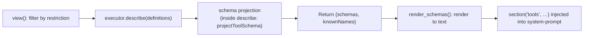
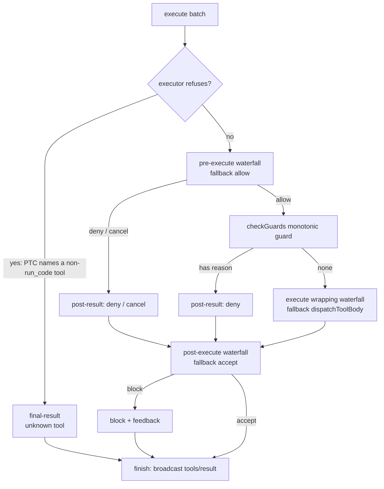
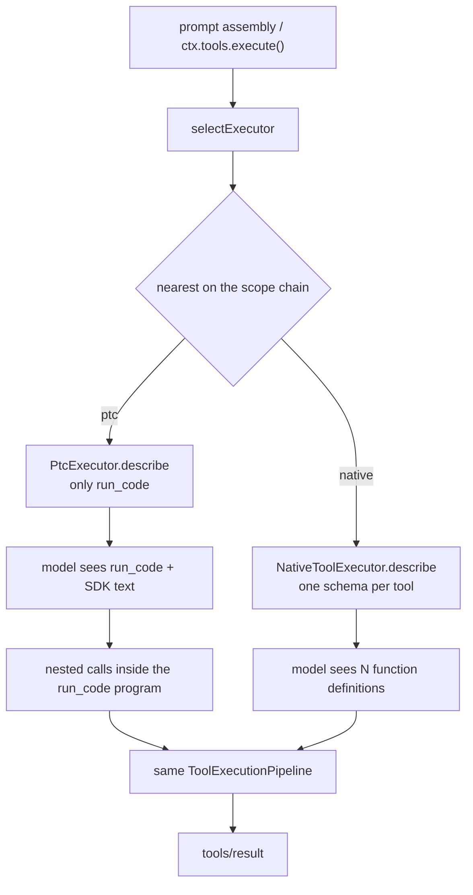

# Chapter 4: tools Registry and Executor Pipeline (Define First, Present Next, Guard at the Gate)

> Sign up your name first, then show your skills; someone guards the gate — and what the audience is told is up to the host.

## Questions this chapter answers

- How are tools "registered" into the container? How are multiple scopes isolated, hidden, or overridden? (The full scope-chain mechanism is Chapter 9; this chapter only does a single-layer mask.)
- Where does the model learn what tools exist and what each tool's parameters look like? Who decides that "visible" list?
- For a single tool call, from the moment the model says "I want to call X" to the result being written back, what checkpoints does it pass through?
- How do you intercept dangerous operations before the call, add a timeout during the call, and remind the user after the call?
- Why can **PTC (programmatic tool calls)** — formerly Code Mode — and `native` share one and the same registry, despite being two completely different model interactions?

**PTC** means the model does not emit tool calls directly; it writes a program that calls tools indirectly through an SDK the executor generates.

Chapter 1 gave us the container foundation: **Context** provides `provide/on/emit/serial/waterfall/effect/plugin`, and **Service** registers itself the moment it is constructed. Chapter 2 built **sessions and prompts** on top of it: **Session** records the event stream, **SystemPromptService** stitches prompt sections together with `section`, and **LlmStub** simulates model output with `stream`. Chapter 3 filled in **persistence**: writing the event stream to disk and rebuilding it via cold reads.

But until now, the model has been "naked" — it can only generate text and cannot call any tool. This chapter fills the "no tools" gap left in Chapter 2's `SystemPromptService` prompt: it populates the prompt with **tool definitions**, then uses a **guarded execution pipeline** to receive the invocation intents the model emits.

Tools are not capabilities the model "is born with"; they are contracts the harness hands to the model — with a name, a parameter description, and an executable body. This chapter breaks that contract into three steps: first register tools into a scope (**definition facet**), then decide which tools' schemas go to the model (**presentation facet**), and finally guard every call with a three-stage waterfall (**execution facet**). Above these three steps sits a seam that became independent in the reorganization: a **seam** (an interface that stays put while the implementation is swapped wholesale) — **the shape of the presentation facet is decided by the tool executor**, and swapping executors leaves the registry untouched. The full comparison of that seam is Chapter 5.

Incremental reuse relationships:

- Reuses ch01's **Context / Service / effect**: `ToolsService` is a `Service`, registering itself as `ctx.tools` at construction; `register` uses `ctx.effect` to express "unload means remove".
- Reuses ch01's **on / emit**: `tools/change` and `tools/result` are read-only notifications that go straight through ch01's event mechanism.
- **Upgrades ch01's waterfall**: ch01's `ctx.waterfall` is a simplified "value-passing" version (`None` passes through). This chapter's execution pipeline needs a "middleware-style" waterfall (listeners wrap the `next` continuation), so a new `waterfall_wrap` is added to complete the real semantics.
- Reuses ch02's **SystemPromptService.section**: schema injection rides on this ready-made stitching point ([Teaching simplification]; the real code has a dedicated seam `systemPrompt.tools`).

One more note: `main.py` keeps Chapter 2's full container assembly — it imports `AgentLoop`, provides `LlmStub`, and constructs `Sessions(ctx)` — but this chapter's demo only uses `SystemPromptService` and the tool runtime; the rest of the assembly is not used in this chapter, kept as the complete container shape and reserved for later chapters (e.g., the multi-step loop, previewed in §8).

## 1. Hard-Coded Tool Calls: No Registration, No Presentation, No Guarding

First look at a counterexample, `ch04/code/bad_example.py` (the full file is shown below; the `sample.txt` it reads is a sample file in the same directory, containing a single line `hello from ch04`):

```python
"""第 4 章反面示例：写死的工具调用——没有注册、没有 schema 展示、没有守卫。

运行：python3 bad_example.py（读取同目录下的 sample.txt，内容固定，任何平台可复现）
"""
import os


def read_file(path: str) -> str:
    """读文件（真正的工具体）。"""
    with open(path, "r", encoding="utf-8") as f:
        return f.read()


def run_shell(cmd: str) -> str:
    """执行 shell 命令（危险工具体，应当被守卫拦截）。"""
    import subprocess

    return subprocess.run(cmd, shell=True, capture_output=True, text=True).stdout


# 问题 1：工具散落在模块顶层，模型和容器都不知道它们存在。
# 问题 2：没有任何 schema 注入 prompt——模型无从得知有哪些工具、参数长什么样。
# 问题 3：调用点写死、无守卫——危险命令畅通无阻，也无法超时/提醒。


def naive_agent_dispatch(intent: str):
    """把模型的「意图」直接映射到 Python 函数：写死的分发，没有管线。"""
    if intent.startswith("read:"):
        return read_file(intent[len("read:"):])
    if intent.startswith("shell:"):
        return run_shell(intent[len("shell:"):])
    return "我不认识这个意图"


if __name__ == "__main__":
    # 读脚本同目录下的样例文件：内容固定为「hello from ch04」，输出在任何平台可复现。
    sample_path = os.path.join(os.path.dirname(os.path.abspath(__file__)), "sample.txt")
    # 模型说出「我要读 sample.txt」→ 直接调函数；模型说出「我要跑命令」→ 也直接调。
    print("[bad_example] read:", naive_agent_dispatch(f"read:{sample_path}").strip())
    print("[bad_example] shell:", naive_agent_dispatch("shell:echo hi").strip())
```

Running `python3 ch04/code/bad_example.py`:

```text
[bad_example] read: hello from ch04
[bad_example] shell: hi
```

This example exposes three concrete problems:

1. **Tools scattered, no registration**: `read_file` and `run_shell` are just ordinary functions at the module top level; the container doesn't know they exist, and the model knows even less. There is no record of who registered which tool or into which scope.
2. **No schema presentation**: no mechanism injects tools' names, descriptions, and parameters into the system-prompt. The model has no way to know what tools are available or what each tool's parameters look like; the only option is hand-writing them into the prompt (which easily drifts out of sync with the real functions).
3. **No guards, hard-coded calls**: `naive_agent_dispatch` hard-codes the mapping from intent strings to functions, and dangerous commands (`shell`) pass freely; there is no pre-call interception, no timeout, no post-call reminder. Wanting to add "dangerous commands require approval first" means editing this if-else.

This chapter dissolves these three problems one by one in three steps: **definition facet** (registration) → **presentation facet** (schema injection) → **execution facet** (guard pipeline), and finally adds one cross-cutting question: **who supplies this presentation and execution** (the executor seam).

## 2. Mechanism 1: Scoped Registration via ctx.tools (Definition Facet)

### 2.1 Concept introduction

First introduce three terms:

- **Tool definition (ToolDefinition)**: one tool contract, containing at least four elements: `name`, `description`, `parameters` (parameter schema), and `execute` (execution body). In the real source, `output` is a required `{schema, render}` output contract and `timeoutMs` is an optional timeout budget. **The teaching version drops the entire `output` contract** (no render template, no substitute field): whatever the tool body returns is broadcast as is. `timeoutMs` is kept.
- **Scope layer (ToolLayer)**: a "drawer" that holds a collection of tools. The real implementation is **ScopedLayers** — one global layer plus several agent-scope layers, where a scope can "shadow" a global tool of the same name; this chapter's teaching version keeps only a single global layer, establishing the concept of "layer" first.
- **restriction (tool mask)**: an allow/deny list attached to a scope. It only filters "inherited global tools" and does not affect tools registered in that scope itself. This chapter only uses a single mask table on the global layer; the scoped version is Chapter 9.

What `register` does is extremely simple: write one `ToolDefinition` into the `ToolLayer`, then **emit a `tools/change` event** to notify all observers, and finally return a `dispose` (unregister function). Returning `dispose` is the key — it turns "registration" into a **reversible effect**: when the registrant unloads, the tool is automatically removed from the layer.

### 2.2 Internal implementation

```mermaid
flowchart LR
    subgraph Registration side
        P[Plugin/app code] -->|register(def)| R[ToolsService.register]
        R --> W[Write into ToolLayer.tools]
        W --> E[emit tools/change]
        R -->|ctx.effect| D[Return dispose]
    end
    subgraph Observers
        E --> O1["main.py observer: prints tools/change name add"]
        E --> O2["any observer: the change lines in §6 output"]
    end
    subgraph Unregistration
        D -->|call dispose| R2[Remove from ToolLayer.tools]
        R2 --> E2[emit tools/change remove]
    end
```

Key point: `register` itself does not "execute" any tool; it only **defines** tools and broadcasts "the definitions have changed". The execution facet (§4) is what actually calls `execute`.

### 2.3 Python reconstruction

The registration part of `ch04/code/tools.py` (`ToolDefinition`/`ToolLayer`/`ToolRuntime` construction and `register`):

```python
@dataclass(frozen=True)
class ToolDefinition:
    """一条工具契约（contracts.ts:26）：名字 + 描述 + 参数 schema + 执行体。

    [教学简化] 真实版另有必填的 output 契约 {schema, render}，execute 签名 (args, exec)；
    教学版删掉了 output，结果不再快照/校验/渲染，execute 默认只收 args。
    wants_exec=True 时按真实签名把 exec 也传进去（present 工具用它暂存待落事件）。
    """

    name: str
    description: str
    parameters: dict
    execute: "callable"  # dict -> str（wants_exec 时为 dict, exec -> str）
    timeout_ms: int | None = None
    wants_exec: bool = False


@dataclass
class ToolLayer:
    """作用域层（packages/core/tools/src/index.ts:63）：只剩工具与 restriction 两张表。

    [教学简化] 真实版是 ScopedLayers 的全局层 + agent 作用域层（作用域 shadow 全局）；
    教学版只维护单一全局层，restriction 也不分作用域。guards 在真实代码里是独立的
    GuardLayer（index.ts:93），教学版合并进来省一张表。
    """

    tools: dict = field(default_factory=dict)
    restrictions: list = field(default_factory=list)  # 编译后的 {allow?, deny?}
    guards: list = field(default_factory=list)

    def admits(self, name):
        """restriction 判定：allow 名单里没有或 deny 名单里点名，都算不可见（index.ts:79–85）。"""
        for f in self.restrictions:
            if "allow" in f and name not in f["allow"]:
                return False
            if "deny" in f and name in f["deny"]:
                return False
        return True


class ToolRuntime(Service):
    """ctx.tools 服务：注册表 + 执行器选择 + 三段管线（index.ts:99；管线本体见 pipeline.ts:62）。"""

    def __init__(self, ctx, config=None):
        super().__init__(ctx, "tools")
        self._layer = ToolLayer()
        self._pre_execute = []
        self._execute = []
        self._post_execute = []
        self._executor = None
        self._executor_unavailable = False
        self.run_code_tool = ToolDefinition(
            "run_code", "提交一段程序，由执行器代跑其中的工具调用",
            {"code": "string"}, self._run_code_body, wants_exec=True,
        )
        # [教学简化] 真实代码由组合里的执行器行调用 set_executor；教学版默认挂原生执行器。
        self.set_executor(NativeToolExecutor())

    # ---------- 定义面：注册与限制 ----------

    def register(self, definition):
        """把工具写入作用域层并触发 tools/change，返回注销 disposer（index.ts:128–153）。"""
        name = definition.name
        if name == "run_code":
            raise ValueError(f'tool name "run_code" is reserved for the PTC mode presentation transport')
        if name in self._layer.tools:
            raise ValueError(f'tool "{name}" is already registered in this scope')
        self._layer.tools[name] = definition
        self.ctx.emit("tools/change", {"name": name, "op": "add"})

        def dispose():
            self._layer.tools.pop(name, None)
            self.ctx.emit("tools/change", {"name": name, "op": "remove"})

        return self.ctx.effect(lambda: dispose)
```

A sentence each for the newly appearing members.

`ToolRuntime.__init__` first completes Service registration with `super().__init__(ctx, "tools")` (ch01's "construction is registration"), then builds the single scope layer `_layer` and the listener lists for the three waterfalls. The `on_pre_execute`/`on_execute`/`on_post_execute` registration calls in §4.3 simply append to these three lists.

`ToolLayer`'s `restrictions` is the mask table used in §3, and `guards` is the guard table used in §4. **In the real source, `ToolLayer` has only `tools` and `restrictions`, with no `mode` field**; the old "one presentation mode per tool" field went away with the executor split (see §5).

`run_code_tool` is a special definition. It is not in the registry; only when the PTC executor is selected does the executor supply it (§5).

`register`'s first section performs two checks.

The first is that **the reserved name `run_code` cannot be registered**: it is the PTC transport channel, and no tool may occupy or shadow it.

The second is that **a duplicate registration in the same layer fails immediately**. The real error message suggests "register through that agent's `agent.ctx`" for a per-agent variant — that is, put the registration into that agent's own scope (see Chapter 9).

Both checks exist to "expose the error at registration time" instead of turning it into a mysterious missing tool at call time.

The `dispose` returned by `register` goes through `ctx.effect`: it is ch01's "reversible effect" — when the current fiber unloads, `dispose` is called automatically and the tool is removed along with it. This is how "registration into a scope" is realized, as opposed to "global permanent registration".

The calling side of registration is simple — `ch04/code/main.py` constructs `ToolDefinition`s and hands them to `register` (excerpted from inside the `main()` function; `slow_echo`'s body deliberately sleeps 50ms to set up the timeout demo in §6):

```python
# ch04/code/main.py 的 main() 内（第 1 段，缩进略）
def slow_echo(args):
    time.sleep(0.05)  # 50ms，制造超时
    return args["text"]

# ……（此处省略 echo 的定义与 read_file/shell 的两次 register 调用，形式相同）
ctx.tools.register(ToolDefinition("slow_echo", "慢速回声（演示超时）", {"text": "string"}, slow_echo, timeout_ms=20))
```

The four arguments of `ToolDefinition` correspond one-to-one to the contract fields: name, description, parameter schema, execution body `execute` (passed in as an ordinary function); `timeout_ms=20` is the optional timeout budget — the 20ms in the §6 timeout demo's "50ms > 20ms budget" comes from here. The other three tools (`read_file`/`shell`/`echo`) are registered the same way, just without `timeout_ms`. Each time a `register` returns, the observer immediately prints a line `[tools/change] <name> add` (see segment 1 of §6's output).

### 2.4 Recap

`register` solves problem 1: tools are no longer scattered ordinary functions but **contract objects** explicitly written into the `ToolLayer`, and every register/unregister broadcasts `tools/change`, so the container and observers can both perceive it. But at this point the model still cannot "see" these tools — so we move to the next step.

## 3. Mechanism 2: Schema View and Injection (Presentation Facet)

### 3.1 Concept introduction

Registration merely "stores" tools away; for the model to "use" them, it must first "see" them. The fields in a tool definition meant for the model (`name`/`description`/`parameters`) need to be **projected** into a schema and injected into the system-prompt. Two key terms here:

- **Schema projection**: pick out the **whitelist fields** `{name, description, parameters}` from a `ToolDefinition`, discarding execution-facet fields like `execute` and `output`. The model should only see "how it is described, how to pass arguments", not the execution body itself. The real implementation is `projectToolSchema` (`packages/core/tools/src/schema.ts:641`).
- **Tool view (ToolView)**: every tool one scope "sees" — the registry merged along the scope chain, then filtered by restriction so forbidden inherited global tools drop out. The presentation facet reads from the view, not from the raw registry.

The old third term, "presentation mode" — `native` / `code` / `both`, one mode per tool — **no longer exists**. In HEAD, `presentAs`, `modeFor`, and `ToolPresentationMode` have zero hits under `packages/`, and `ToolsService.Config`'s `mode` field has become `z.never()` with the message "Removed. Mount a native or PTC tool executor instead." (`packages/core/tools/src/index.ts:102`). What replaced it is the executor in §5: **the presentation shape of the whole tool set is decided once by the executor, not configured per tool**. Hold that thought: §3 only covers the projection on the registry side, and §5 connects up "who decides the shape".

`ToolsService.schemas()` projects every visible tool in the view into a schema list; its consumers are side-channel queries such as MCP inspect and PTC bindings, **not** the system-prompt. The prompt path lives in the constructor (`packages/core/tools/src/index.ts:113–117`): on every prompt assembly, the registry first asks the executor "how should this batch of definitions be described", then hands the result to `ctx.systemPrompt.tools()`.

### 3.2 Internal implementation



The data flows left to right: `view()` filters visible definitions by restriction (teaching version; the real version also merges the scope chain here, see Chapter 9), `describe()` does the **projection** on that batch and returns `{schemas, knownNames}`, `render_schemas()` renders it into text, and `section()` receives it last — **injection is the last step, not the first**.

The teaching version's `main.py` calls `ctx.systemPrompt.section("tools", ctx.tools.render_schemas(), order=10)` explicitly. In the real code this step is wired automatically when `ToolsService` is constructed, through `ctx.systemPrompt.tools(provider)` (`packages/core/system-prompt/src/index.ts:551`); the `provider` callback is "select the executor → `describe(...)`". Both sides follow the same main line of "filter → describe → inject".

### 3.3 Python reconstruction

```python
class ToolRuntime(Service):
    # ... register 见 §2.3；guards 与 execution 成员见 §4.3 ...

    def view(self):
        """可见工具集：注册表里通过 restriction 的那些（index.ts:199–227）。

        [教学简化] 真实 view(scope) 还要合并作用域链、应用继承 restriction（第 9 章）；
        教学版只有一张全局层。
        """
        return [d for name, d in self._layer.tools.items() if self._layer.admits(name)]

    def definitions(self):
        """交给执行器 describe() 的可见定义列表（index.ts:305–307）。"""
        return self.view()

    def schemas(self):
        """可见定义的 schema 投影（index.ts:316–318）。"""
        return [runtime_schema(d) for d in self.definitions()]

    def wire_schemas(self):
        """兼容名：describe 只给 {schemas}，knownNames 由这里兜底补齐。

        真实版由注册表在构造器里补齐（index.ts:115–116）；
        [教学简化] 教学版的 describe 两个执行器都返回 knownNames，省掉这一层兜底。
        """
        return self._executor.describe(self.definitions())

    def render_schemas(self):
        """把 describe 结果渲染成 prompt 文本，供 system-prompt section 注入。

        [教学简化] 真实代码由 ToolsService 构造时接到 ctx.systemPrompt.tools(provider)
        （index.ts:113–117 ↔ system-prompt/src/index.ts:551）；第 2 章教学版只有 section 缝合点。
        """
        description = self._executor.describe(self.definitions())
        lines = ["可用工具："]
        for s in description["schemas"]:
            lines.append(f"- {s['name']}: {s['description']}")
            lines.append(f"  参数 {s['parameters']}")
        return "\n".join(lines)
```

`runtime_schema` is a module-level function — the projection described in §3.1:

```python
def runtime_schema(definition):
    """把定义投影成给模型看的白名单：只留 {name, description, parameters}。

    真实版是 projectToolSchema（schema.ts:641）：丢 execute、output、presentCall，
    只留模型该看的四个字段（deferLoading 是可选的第五个）。
    """
    return {
        "name": definition.name,
        "description": definition.description,
        "parameters": definition.parameters,
    }
```

In `main.py`, the describe result is injected into the system-prompt, and the excerpt demonstrates how restriction narrows the presentation facet:

```python
# ch04/code/main.py 的 main() 内（第 2 段，缩进略）
print(f"    {ctx.tools.wire_schemas()}")
print("  restrict(deny=['shell']) 后，shell 从展示面隐藏：")
lift = ctx.tools.restrict(deny=["shell"])
print(f"    knownNames = {ctx.tools.wire_schemas()['knownNames']}")
lift()  # 解除掩码，后面还要演示 shell 的正常执行
ctx.systemPrompt.section("tools", ctx.tools.render_schemas(), order=10)
```

Visible in the output: after `restrict(deny=['shell'])`, `shell` disappears from `knownNames` — the dangerous tool has gone "invisible" to the model; lifting the mask brings the full list back.

Note that this is **restriction**'s job, not "setting a code mode on shell". Restriction answers "can this agent see the inherited tools", while "in what shape are these tools shown to the model" is an orthogonal question — the latter is the executor's job in §5.

`[Teaching simplification]` In the real code, `restrict` requires the current context to have a scope (`packages/core/tools/src/index.ts:162–166` throws otherwise), while this chapter's demo succeeds when called at the root. The teaching version's `restrict` simply appends the compiled `{allow?, deny?}` to `ToolLayer.restrictions` and returns a lifting disposer:

```python
class ToolRuntime(Service):
    def restrict(self, allow=None, deny=None):
        """给继承来的全局工具加一层掩码，返回解除 disposer（index.ts:162–189）。（节选）"""
        compiled = {}
        if allow is not None:
            compiled["allow"] = set(allow)
        if deny is not None:
            compiled["deny"] = set(deny)
        self._layer.restrictions.append(compiled)

        def dispose():
            self._layer.restrictions.remove(compiled)

        return self.ctx.effect(lambda: dispose)
```

### 3.4 Recap

Schema injection solves problem 2: tool definitions and the prompt are no longer hand-written and no longer drift out of sync; they are **projected from the same `ToolDefinition`**. Change a definition and the view and describe output follow automatically; change a restriction and the presentation facet expands or contracts accordingly. But "visible" does not mean "stoppable" — truly dangerous calls still need the execution facet to guard them. This section only covers what the registry side can project; what shape that projection finally takes is left for §5.

## 4. Mechanism 3: The Guarded Execution Pipeline (Execution Facet)

### 4.1 Concept introduction

This is the core of the chapter. A single tool call is decomposed into **three waterfall stages**, each allowing any number of listeners to intervene:

- **Pre-execution decision (PreToolDecision)**: `allow` / `deny` / `cancel` (settle as a cancellation result) / `ask` (ask for approval); the teaching version does not implement the last two, so a listener can only return allow or deny. Produced by the `tools/pre-execute` waterfall.
- **During execution (tools/execute)**: a **wrapping waterfall** — listeners wrap the function body, able to act before the call and after the call; only the innermost fallback is "actually call the tool body".
- **Post-execution decision (PostToolDecision)**: `accept` (accept, optionally replacing content and attaching context for the next turn) / `block` (block + feedback). Produced by the `tools/post-execute` waterfall.

And two more key concepts:

- **Middleware-style waterfall (waterfall_wrap)**: the listener signature is `listener(*args, next)`; only calling `next()` hands control to the inner layer. This is the real semantics simplified away in ch01's `ctx.waterfall` (ch01 is "value passing, `None` passes through").
- **Monotonic guard (`checkGuards`)**: a guard registered via `guard` is a function with **veto power only**, with a signature like `exec -> rejection reason string | None`.

  It can take only two stances: returning a string means **rejecting** the call with that reason; returning `None` only means "I don't object", **not** "I approve" — a guard simply has no "approve" option; letting a call through is merely the natural result of "no guard objects".

  The decision entry point is `checkGuards` (the teaching version corresponds to `ToolLayer.guard_reason`): it asks the guards one by one in registration order; **the first** guard to give a reason gets the call rejected with that reason, and later guards are not asked; only when all guards return `None` is the call allowed.

  "Monotonic" means guards can only stack rejections: adding guards can never flip a rejected call back to allowed. The difference from the `pre-execute` waterfall is that listeners in the waterfall can explicitly return allow/deny to decide "whether to continue", while a monotonic guard can only "raise an objection".

The **fallback values of the three waterfall stages are exactly the historical behavior with no guards**: `pre-execute` falls back to `allow`, `execute` falls back to calling the function body directly, `post-execute` falls back to `accept`. This is precisely the design of "behavior changes only when guards are added; without guards it is as if nothing happened".

**Order matters**: the `tools/pre-execute` waterfall runs first, `ask` is turned into an approval after the waterfall, and only after the approval or waterfall yields `allow` does the monotonic guard `checkGuards` get its turn. The real code writes it as one line (`packages/core/tools/src/pipeline.ts:213`):

```ts
// packages/core/tools/src/pipeline.ts 的 ToolExecutionPipeline.prepare() 内
const denialReason = decision.kind === 'allow' ? this.tools.checkGuards(exec) : decision.reason
```

So a guard always speaks only after "the extensible policy has already allowed"; it cannot overturn a `deny`, nor exempt an `ask` from approval.

### 4.2 Internal implementation



A call enters from batch scheduling and passes in order: executor refusal check → `pre-execute` waterfall (with ask approval) → monotonic guard → `execute` wrapping waterfall → `post-execute` waterfall → materialization and broadcast (`tools/result`). The real code has one more step before broadcasting, "materialization": the raw value returned by the tool body is materialized only after going through the `output` contract's snapshot/validation/render. The teaching version has no `output` contract (see the [Teaching simplification] note on `ToolDefinition` in §2.3) and broadcasts directly after execution.

Two details that are easy to get wrong:

1. **Rejected calls are still broadcast as `tools/result`.** A call rejected by the waterfall or a guard yields `post-result` — it **still goes through `post-execute`** before `finish`; only a call the executor refuses before policy is `final-result`, skipping `post-execute` and going straight to `finish`. Both paths end at `notifyResult` (`packages/core/tools/src/pipeline.ts:387`). A cancelled approval (`cancel`) likewise synthesizes a cancellation result that goes through `post-result`.
2. **`post-execute` does not run "only on success".** When a tool throws, the exception is wrapped into an error result that also enters `tools/post-execute`; only a failure thrown by the `complete` stage itself skips it.

The real code's facade is a standalone class `ToolExecutionPipeline` (`packages/core/tools/src/pipeline.ts:62`), with three public stages: `prepare` (`:190`), `dispatch` (`:295`), and `complete` (`:336`); batch scheduling `executeToolBatch` is in `packages/core/tools/src/batch.ts:50`, splitting calls into `exclusive` (barrier) and `parallel` (bounded pool) and committing results in model order.

### 4.3 Python reconstruction

First look at `waterfall_wrap` — it is the foundation of the whole pipeline. It is a **module-level function** (defined at the top level of `tools.py`, belonging to no class):

```python
# 模块级函数（tools.py 顶层，不属于任何类）
def waterfall_wrap(listeners, args, fallback):
    """中间件式瀑布：监听器从外到内包裹，fallback 最内层兜底。

    监听器签名 listener(*args, next)；调用 next() 才把控制权交给内层，不调则短路。
    补全第 1 章简化掉的真实中间件语义（events.ts:246 ↔ cordis.py:153–163）。
    """

    def invoke(index):
        if index >= len(listeners):
            return fallback()
        return listeners[index](*args, lambda: invoke(index + 1))

    return invoke(0)
```

Next the monotonic guard — the concept from §4.1 lands here. Registration and decision live in two places: `guard` appends the guard function to `ToolLayer.guards` (the `guards` list from §2.3, whose semantics were not unfolded then); `guard_reason` is consumed by `_prepare` below — it asks guards one by one in registration order, and if any guard gives a rejection reason the call is rejected with that reason (short-circuit); only when all guards return `None` is the call allowed:

```python
class ToolRuntime(Service):
    # ... register 见 §2.3；展示面成员见 §3.3；execute 管线见本节下文 ...

    def guard(self, guard_fn):
        """注册单调守卫：只能拒绝、不能放行（index.ts:384–386）。"""

        def setup():
            self._layer.guards.append(guard_fn)
            return lambda: self._layer.guards.remove(guard_fn)

        return self.ctx.effect(setup)


@dataclass
class ToolLayer:
    # ... tools / restrictions / guards 字段见 §2.3 ...

    def guard_reason(self, exec):
        """单调守卫：顺序跑 guards，返回第一个非 None 的拒绝理由（index.ts:393–401）。"""
        for guard in self.guards:
            reason = guard(exec)
            if reason is not None:
                return reason
        return None
```

In the real code, guards live in their own `GuardLayer` (`packages/core/tools/src/index.ts:93`), the decision entry point is called `checkGuards` (`:393`), and it checks the global layer first, then walks the caller's scope chain layer by layer (`packages/core/tools/src/index.ts:394`). The teaching version has only one layer; the logic is the same.

Next `_prepare` / `_dispatch` / `_complete`, the equivalents of `ToolExecutionPipeline`'s three stages:

```python
class ToolRuntime(Service):
    # ... register 见 §2.3；guard 见本节上文；展示面成员见 §3.3 ...

    def _prepare(self, exec):
        """调用前：执行器拒绝 → pre-execute 瀑布 → 单调守卫（pipeline.ts:190–251）。

        返回 {"kind": "final-result"|"post-result"|"dispatch"}。
        [教学简化] 真实版的 ask 走 serviceAsk 审批 seam（packages/core/tools/src/pipeline.ts:432）；教学版没有 ask
        分支，监听器若返回 kind="ask" 会落进下面的 dispatch（按放行处理），不是 deny。
        """
        if self._executor_is_ptc() and not exec.nested and exec.name != "run_code":
            # PTC 执行器在策略之前就拒绝直接调用（tool-executor-ptc/src/index.ts:35–38）。
            return {"kind": "final-result", "exec": exec,
                    "result": ToolResult(f"unknown tool: {exec.name} (call it inside run_code)", True)}
        gate = waterfall_wrap(self._pre_execute, (exec,), fallback=PreToolDecision.allow)
        if gate.kind == "allow":
            reason = self._layer.guard_reason(exec)
            if reason is not None:
                return {"kind": "post-result", "exec": exec, "result": ToolResult(f"Error: {reason}", True)}
        elif gate.kind == "deny":
            return {"kind": "post-result", "exec": exec, "result": ToolResult(f"Error: {gate.reason}", True)}
        return {"kind": "dispatch", "exec": exec}

    def _dispatch(self, exec):
        """调用中：execute 环绕瀑布，兜底直接调函数体（pipeline.ts:295–327）。"""
        return waterfall_wrap(self._execute, (exec,), fallback=lambda: self._dispatch_body(exec))

    def _complete(self, exec, result):
        """调用后：post-execute 瀑布，兜底 accept，然后广播结果（pipeline.ts:336–372）。"""
        decision = waterfall_wrap(self._post_execute, (exec, result), fallback=PostToolDecision.accept)
        if decision.kind == "block":
            result = ToolResult(content=decision.feedback or "blocked", is_error=True)
        return self._announce(exec, result)

    def _announce(self, exec, result):
        """广播冻结后的最终结果（pipeline.ts:374–423 finish → notifyResult）。

        被 pre-execute / 守卫拒绝的调用同样会广播；被执行器在策略前拒绝的也广播。
        真实版即使 complete 阶段出故障也仍会走到 notifyResult，只是结果换成错误。
        """
        self.ctx.emit("tools/result", exec, result)  # 只读通知（pipeline.ts:400–423）
        return result
```

Note `_dispatch_body` inside `_dispatch`: it is the concrete implementation of what §4.1 called "`execute`'s fallback calls the function body directly" — when no listener in the wrapping waterfall intercepts, control falls all the way to the innermost layer, calls the `execute` function body passed in at registration (e.g., `slow_echo`), and wraps the return value into a `ToolResult`.

In `main.py`, guards are registered: one listener on each of the three extension points (`on_pre_execute` / `on_execute` / `on_post_execute`), plus one monotonic guard:

```python
# ch04/code/main.py 的 main() 内（第 3 段，缩进略）
def sensitive_path_guard(exec_, next):
    if exec_.name == "read_file" and exec_.arguments.get("path", "").startswith("/etc"):
        return PreToolDecision.deny("敏感路径 /etc 被拒绝")
    return next()

ctx.tools.on_pre_execute(sensitive_path_guard)

ctx.tools.guard(lambda exec_: "禁止读取 /root/.ssh/id_rsa" if exec_.arguments.get("path") == "/root/.ssh/id_rsa" else None)

def timeout_wrapper(exec_, next):
    tool = ctx.tools.get(exec_.name)
    budget = tool.timeout_ms if tool and tool.timeout_ms else None
    if budget is None:
        return next()
    start = time.monotonic()
    result = next()
    if (time.monotonic() - start) * 1000 > budget:
        return ToolResult(content=f"timeout: 超过 {budget}ms", is_error=True)
    return result

ctx.tools.on_execute(timeout_wrapper)

def secret_blocker(exec_, result, next):
    if "secret" in result.content:
        return PostToolDecision.block("结果包含 secret，已拦截")
    return next()

ctx.tools.on_post_execute(secret_blocker)
```

Note the structure of `timeout_wrapper`: it first grabs the `budget`, then calls the function body with `next()`, and finally checks the elapsed time. This is exactly what "wrapping" means — logic can be added both before and after `next()`, corresponding to the deadline wrapping in the real `packages/guard/timeout-policy`. `secret_blocker` is a post-execute listener: at that point the tool body has already run and `result` is in hand; it checks `result.content`, and upon finding `secret` it `block`s with the feedback "结果包含 secret，已拦截" (the literal string shown in the output) — the error line for `echo 'my secret key'` in §6's output is exactly what it blocked.

### 4.4 Recap

The guard pipeline solves problem 3: dangerous calls are no longer hard-coded if-else but **pluggable listeners**. Want to add interception, timeouts, or reminders? Hang a listener on each of `on_pre_execute` / `on_execute` / `on_post_execute` — no need to touch the core dispatch code. The two guard packages in the real harness — `repeat-tool-reminder` (hung on `tools/post-execute`, observes only, never vetoes) and `timeout-policy` (hung as the `tools/execute` wrap) — are two instances of exactly this set of extension points.

One real consumer deserves its own paragraph: the **`present` tool**. The tool body in `packages/deliverables/tool-present/src/index.ts` only validates and **stashes** in `execute` — it puts `{session, turn, files}` into a `WeakMap` keyed by `exec` (`:37`, `:97`), then returns an ordinary value. The event is actually written in the `tools/result` observer (`:101–109`):

```ts
// packages/deliverables/tool-present/src/index.ts 里 apply() 的尾部
ctx.on('tools/result', (exec, result) => {
  const delivery = pending.get(exec)
  pending.delete(exec)
  if (delivery === undefined || result.isError) return
  const { session, turn, files } = delivery
  session.append('deliverables/presented', {
    turn, callId: exec.callId, files,
  })
})
```

Why take this detour? Between `execute` returning and the result settling sits the `tools/post-execute` policy layer — later plugins may turn the result into an error or block it. Writing the event directly in `execute` would leave a false "delivered" record for a call that is later intercepted. Deferring the write to `tools/result` (when the result is already frozen and can no longer change) makes "declare only on success" a natural outcome: a failed result simply `return`s and writes nothing.

Conversely, **a completed declaration is never revoked**: when the `present` tool body is wrapped in a `run_code` program and a later step of that program fails, the already-appended `deliverables/presented` event stays in the session. That is an upstream design decision, not an oversight — the event is an append-only factual record: "at this moment I declared these files" did happen; the program's overall failure is expressed by `run_code`'s own error result, and history does not need to be rewritten. The package documentation puts it plainly: nested calls append too, **a later enclosing program failure does not revoke an already completed declaration**, and blocked results publish nothing (`packages/deliverables/tool-present/README.md:56`).

## 5. Mechanism 4: The Executor Is the Seam (Who Supplies Presentation and Execution)

### 5.1 Concept introduction

The first three sections left one question open: the registry stores tool definitions, but in what form do those definitions finally reach the model?

Picture a real scenario: two agents run in the same process. One wants the model to see `read_file` / `shell` and other function definitions and call them one by one; the other wants the model to see only a `run_code` and write a program that calls those tools inside — the latter lets the model compose several calls in one go, saving round trips. But these two agents share **one and the same registry**.

What happens without a dedicated layer for this? The registry can only "store tools"; the prompt has no idea how many schemas to place or which ones; and `ctx.tools.execute()` receiving a batch has no idea how to run it (serial or parallel, whether nested calls inside a PTC program count as the same batch, how cancellation propagates). These are two sides of one question: **in what shape these definitions are handed to the model, and by what rules this batch of calls runs**.

The old version coped by "tagging every tool with a presentation mode", and it pleased neither side: N tools × 3 modes, and who composes a legal set (state explosion); worse, the presentation facet and the execution facet were tied to one field, leaving no place for "how the whole batch runs" (concurrency, cancellation, logging).

HEAD gathers the whole thing into a new **seam** (an interface that stays put: swap one plugin and the entire presentation plus execution is replaced): the **tool executor**. What is it? A plugin implementing the `ToolExecutor` interface (`packages/core/tools/src/executor.ts:64`) that answers only two questions:

- `describe(definitions)`: given this batch of visible definitions, what should the model see (returning `{schemas, knownNames}`)?
- `execute(batch)`: how does this batch of raw calls run (parse arguments, schedule concurrency, handle cancellation, write logs)?

What happens without it? The registry retains only half its job — "store tools"; the model sees no schema at all, and `ctx.tools.execute()` has no way to run. In the real code, when no executor can be selected it throws `ToolExecutorUnavailableError` (`packages/core/tools/src/executor.ts:97`).

This seam has two ready-made implementations, which happen to be the two sides of that scenario:

- **Native executor (native)**: `packages/core/tool-executor-native/src/index.ts:8`, the whole file is 35 lines. It projects each visible tool into one schema. Actual batch runs are delegated to the shared `executeToolBatch`.
- **PTC executor**: `packages/core/tool-executor-ptc/src/index.ts:20`. `describe` **returns exactly one tool** — `run_code` (`:41–43`); the remaining tools are rendered into an SDK text placed in the prompt (the `tools:sdk` section, `:45–52`), and the model can only reach them by writing them into a program submitted to `run_code`. Every nested call inside the program still goes through the same guard pipeline (`packages/core/tool-executor-ptc/src/ptc.ts:587–601`).

**Nearest-scope executor selection**: the executor is not globally unique but mounted per scope. The deployment can mount one, a preset another, a single Agent another; on the scope chain **the nearest one** wins. Mounting a second executor in the same scope fails immediately (`Only one tool executor may be registered in each scope`, `packages/core/tools/src/index.ts:328`). Selection happens in `selectExecutor` (`:357–367`): walk the scope chain for the first contributing scope, falling back to the deployment level.

One easily missed detail: after an executor unloads, **it does not fall back to the inherited one**. `setExecutor`'s cleanup only blanks `executor` in its record (`packages/core/tools/src/index.ts:345–348`), and `selectExecutor` then throws "unavailable". The reason is that an already-accepted batch cannot suddenly switch executors mid-run — a PTC program dropping into native halfway changes the call semantics.

### 5.2 Internal implementation



The main line: **the registry does not decide the shape; it only supplies "visible definitions"**. The executor describes the same batch of definitions as two utterly different callable surfaces; both paths finally converge on the same `ToolExecutionPipeline`. The only difference is that PTC calls carry a "program" shell, and every call inside the program is still an ordinary tool call.

### 5.3 Python reconstruction

The teaching version keeps the contract and both implementations in `tools.py`:

```python
class ToolExecutor:
    """执行器契约（executor.ts:64）：模型看见什么 + 一批调用怎样执行。

    两个成员各管一面：
    - describe(definitions)：返回 {schemas, knownNames}，决定模型的「可调用面」；
    - execute(batch)：接过整批调用（解析、调度、取消、落日志都归它）。
    sections 是它顺带注册的 prompt 片段（PTC 执行器用它在提示词里放 SDK）。
    """

    sections: list = ()

    def describe(self, definitions):
        raise NotImplementedError

    def execute(self, batch, runtime):
        raise NotImplementedError


class NativeToolExecutor(ToolExecutor):
    """原生执行器（tool-executor-native/src/index.ts:8–22）：每个可见工具都是一个函数定义。"""

    def describe(self, definitions):
        return {
            "schemas": [runtime_schema(d) for d in definitions],
            "knownNames": [d.name for d in definitions],
        }

    def execute(self, batch, runtime):
        return runtime.run_batch(batch)


class PtcExecutor(ToolExecutor):
    """PTC 执行器（tool-executor-ptc/src/index.ts:20–62）：只暴露 run_code，其余工具走生成的 SDK。

    [教学简化] 真实版按 runtime.language 生成 TypeScript/Python SDK 并接上 PTC 运行时；
    教学版只渲染一份 Python 风格 SDK 文本，run_code 用一个玩具解释器跑。
    """

    def __init__(self, runtime):
        self.runtime = runtime
        self.sections = [("tools:ptc-only", 5, self._only_instruction()),
                         ("tools:sdk", 6, self._sdk_text(runtime.definitions()))]

    def describe(self, _definitions):
        """PTC 下模型只看得见 run_code 一个 schema（index.ts:41–43）。"""
        return {
            "schemas": [runtime_schema(self.runtime.run_code_tool)],
            "knownNames": ["run_code"],
        }

    def execute(self, batch, runtime):
        return runtime.run_batch(batch)
```

The registry side is reduced to one slot and two rules:

```python
class ToolRuntime(Service):
    def set_executor(self, executor, replace=False):
        """在调用方作用域挂一个执行器；同一作用域重复挂即失败（index.ts:325–350）。

        真实版按 scope 分 root / scoped 两级存放，最近作用域胜出；教学版只有一个
        部署级槽位，用 replace=True 模拟「更近的作用域挂上新执行器」。
        """
        if self._executor is not None and not self._executor_unavailable and not replace:
            raise RuntimeError("Only one tool executor may be registered in each scope")
        self._executor = executor
        self._executor_unavailable = False

    def select_executor(self):
        """取当前生效的执行器；卸载后不会回落到继承的那个（index.ts:357–367）。"""
        if self._executor is None or self._executor_unavailable:
            raise RuntimeError("The selected tool executor is unavailable.")
        return self._executor
```

The most direct segment in `main.py` is "swap the executor, leave the registry alone":

```python
# ch04/code/main.py 的 main() 内（第 4 段，缩进略）
print("  切换前（native）describe()['knownNames']:", ctx.tools.wire_schemas()["knownNames"])
ctx.tools.set_executor(PtcExecutor(ctx.tools), replace=True)  # 更近的作用域挂上 PTC 执行器
print("  切换后（ptc）describe()['knownNames']:", ctx.tools.wire_schemas()["knownNames"])
...
run("shell", {"cmd": "echo hi"})                                  # PTC 下直接点名：失败
run("run_code", {"code": "shell(cmd='echo hi')\necho(text='from inside run_code')"})
```

§6's output shows it: before the swap `knownNames` holds four tools, after the swap only `['run_code']`; naming `shell` directly returns `unknown tool: shell (call it inside run_code)`; writing the same `shell` into a `run_code` program executes normally. Meanwhile `ctx.tools.view()` is those four tools throughout — **the registry did not change a single line**.

"Direct naming fails under PTC" lands, in the real code, not on some deny branch in §4 (the old "code-mode tools can only go through run_code" branch no longer exists). It is done by the executor's `reject` hook before `prepare`: any non-nested call naming something other than `run_code` is judged `UNKNOWN_TOOL` (`packages/core/tool-executor-ptc/src/index.ts:35–38`, consumed by `packages/core/tools/src/pipeline.ts:126–129`).

In other words, **under PTC the model cannot see these tools' schemas at all**, so there is no state of "visible but not directly callable". The deny branch could be deleted precisely because the callable surface is narrowed at the source.

### 5.4 Migration note: agent-tool-presentation is deprecated

If you have seen `@deepseek-ai/dsh-agent-tool-presentation` in an old configuration, that is a transitional compatibility package. Its README marks it deprecated on the first line (`packages/core/agent-tool-presentation/README.md:10`). In one sentence: new configurations mount the native or PTC executor directly; old configurations still work, and migration means replacing the selector row with an executor row and removing `config.mode`, without loading both in the same scope. The original text:

> **Deprecated:** For new configurations, mount `@deepseek-ai/dsh-tool-executor-native` or `@deepseek-ai/dsh-tool-executor-ptc` directly. Existing configurations remain supported. To migrate, replace this selector row with the corresponding executor row and remove `config.mode`; do not load both in the same scope.

Migration is only two steps: **replace the selector row with the corresponding executor row**, and **remove `config.mode`**. Align the values by version first: the old mechanism accepted `native` / `code` / `both`, while today's compatibility package accepts `native` / `ptc` (`packages/core/agent-tool-presentation/src/index.ts:33`, `packages/core/agent-tool-presentation/src/index.ts:42`) — `code` is today's PTC, renamed together with Code Mode. So the mapping is:

| Old configuration | New row |
|---|---|
| `mode: native` | `@deepseek-ai/dsh-tool-executor-native` |
| `mode: code` (now written `mode: ptc`) | `@deepseek-ai/dsh-tool-executor-ptc` |
| `mode: both` | No corresponding executor: one scope allows only one; split scopes per agent |

Do not load both in the same scope. The compatibility package itself does nothing more than `ctx.plugin(mode === 'native' ? Native : Ptc)` (`packages/core/agent-tool-presentation/src/index.ts:53`) — it has no logic of its own, just an old name.

### 5.5 Recap

The executor seam fills in the cross-cutting question of "who supplies". The registry answers only "which tools exist and who can see them"; the executor answers "what shape the model sees and how a batch of calls runs". Once separated, one process can let one agent use native and another use PTC over a shared tool table; the execution style can also be swapped wholesale (what the PTC runtime looks like is Chapter 17).

With that, all four facets of this chapter are covered: definition (§2), presentation (§3), guarding (§4), supply (§5), corresponding to questions 2–5 at the chapter opening. As for question 1's "how multiple scopes isolate, hide, and override", this chapter only does a single-layer tool mask; the full scope-chain mechanism is Chapter 9.

## 6. Full Run Output

Run `python3 ch04/code/main.py` (the temp file path in the output varies by environment and run; the body uses `/tmp/tmpXXXXXX.txt` as a placeholder; on this macOS machine it actually prints `/var/folders/.../tmpXXXX.txt`, which is equivalent). Lines starting with `[tools/change]` / `[tools/result]` come from the two observers `main.py` registers with `ctx.on` in segment 1; the `==` segment headings and result lines are the script's own `print`.

```text
$ python3 ch04/code/main.py
== 1. 装配容器 + 注册工具 ==
  [tools/change] read_file add
  [tools/change] shell add
  [tools/change] slow_echo add
  [tools/change] echo add

== 2. 展示面：执行器 describe() + restriction 掩码 ==
  原生执行器 describe()：
    {'schemas': [{'name': 'read_file', 'description': '读文件', 'parameters': {'path': 'string'}}, {'name': 'shell', 'description': '执行 shell 命令', 'parameters': {'cmd': 'string'}}, {'name': 'slow_echo', 'description': '慢速回声（演示超时）', 'parameters': {'text': 'string'}}, {'name': 'echo', 'description': '回声', 'parameters': {'text': 'string'}}], 'knownNames': ['read_file', 'shell', 'slow_echo', 'echo']}
  restrict(deny=['shell']) 后，shell 从展示面隐藏：
    knownNames = ['read_file', 'slow_echo', 'echo']
  注入 system-prompt 的 section 文本：
    可用工具：
    - read_file: 读文件
      参数 {'path': 'string'}
    - shell: 执行 shell 命令
      参数 {'cmd': 'string'}
    - slow_echo: 慢速回声（演示超时）
      参数 {'text': 'string'}
    - echo: 回声
      参数 {'text': 'string'}

== 3. 守卫管线：pre-execute / execute / post-execute ==
  [tools/result] read_file is_error=True
  read_file{'path': '/etc/hostname'} -> is_error=True content='Error: 敏感路径 /etc 被拒绝'
  [tools/result] read_file is_error=True
  read_file{'path': '/root/.ssh/id_rsa'} -> is_error=True content='Error: 禁止读取 /root/.ssh/id_rsa'
  [tools/result] slow_echo is_error=True
  slow_echo{'text': 'hi'} -> is_error=True content='timeout: 超过 20ms'
  [tools/result] echo is_error=True
  echo{'text': 'my secret key'} -> is_error=True content='结果包含 secret，已拦截'
  [tools/result] read_file is_error=False
  read_file{'path': '/tmp/tmpXXXXXX.txt'} -> is_error=False content='hello from a safe file\n'
  [tools/result] echo is_error=False
  echo{'text': 'all good'} -> is_error=False content='all good'

== 4. 换执行器，注册表不动：native -> PTC ==
  切换前（native）describe()['knownNames']: ['read_file', 'shell', 'slow_echo', 'echo']
  切换后（ptc）describe()['knownNames']: ['run_code']
  [section 5] tools:ptc-only:
    `run_code` is the only tool you can call directly — a tool call naming any other tool fails.
  [section 6] tools:sdk:
    可用的 SDK 函数（只能在 run_code 程序里调用）：
      read_file(path: string) -> 读文件
      shell(cmd: string) -> 执行 shell 命令
      slow_echo(text: string) -> 慢速回声（演示超时）
      echo(text: string) -> 回声
  模型直接点名 shell（PTC 下不允许）：
  [tools/result] shell is_error=True
  shell{'cmd': 'echo hi'} -> is_error=True content='unknown tool: shell (call it inside run_code)'
  同一个 shell，写进 run_code 程序里就能跑：
  [tools/result] shell is_error=False
  [tools/result] echo is_error=False
  [tools/result] run_code is_error=False
  run_code{'code': "shell(cmd='echo hi')\necho(text='from inside run_code')"} -> is_error=False content='hi\n\nfrom inside run_code'
  注册表本身没有任何改动，工具定义仍是: ['read_file', 'shell', 'slow_echo', 'echo']

== 5. present：执行期暂存，tools/result 成功后才落 deliverables/presented ==
  [tools/change] present add
  [tools/result] present is_error=False
  [deliverables/presented] ['report.md']
  present{'files': ['report.md']} -> is_error=False content='will present 1 file(s)'
  [tools/result] present is_error=True
  present{'files': ['/root/notes.md']} -> is_error=True content='Error: 交付路径落在受保护目录'
  session 事件类型： ['deliverables/presented']

== 6. 反注册：注销工具定义 ==
  [tools/change] temp_tool add
  temp_tool 已注册，knownNames=['read_file', 'shell', 'slow_echo', 'echo', 'present', 'temp_tool']
  [tools/change] temp_tool remove
  注销后 knownNames=['read_file', 'shell', 'slow_echo', 'echo', 'present']
```

Matching each line to its checkpoint:

- `read_file /etc/hostname` → rejected by the `pre-execute` guard (sensitive path); note it **still** prints a `[tools/result]` line, because rejected results are broadcast through `finish` too (§4.2, detail 1).
- `read_file /root/.ssh/id_rsa` → allowed by `pre-execute`, rejected by the **monotonic guard** (`checkGuards`).
- `slow_echo` → the timeout guard in the `execute` wrapping waterfall: 50ms > 20ms budget, returns a timeout error.
- `echo 'my secret key'` → the `post-execute` guard blocks a result containing secret.
- `read_file` (temp file), `echo 'all good'` → all allowed, pass normally.
- The three `[tools/result]` lines in segment 4 come from the two nested calls inside the `run_code` program and from `run_code` itself; a direct model call rejected under PTC takes the same broadcast path.
- The PTC `reject` hook raises `ToolNotFoundError`, whose error code is `UNKNOWN_TOOL` (`packages/core/tools/src/contracts.ts:291`) — to the model, "invisible" and "nonexistent" are the same failure, which is exactly the point of narrowing the callable surface at the source.
- Segment 5 prints exactly one `[deliverables/presented]`: the successful call appends the event, and the one rejected by `pre-execute` writes nothing.

## 7. Source Mapping

The correspondence between this chapter's teaching version and the real source is collected here. HEAD's `packages/core/tools/src/` has grown from a single file into nine source files: `index.ts` (the registry itself, 412 lines), `contracts.ts` (data shapes), `executor.ts` (the executor contract), `pipeline.ts` (the shared pipeline), `batch.ts` (batch scheduling), `schema.ts` (the schema DSL and `projectToolSchema`), `presentation.ts` (UI render vocabulary), `json-schema.ts` (JSON Schema validation), and `events.ts` (event signatures). Executor implementations live in the two packages outside.

| Teaching version symbol | Real source code | Notes |
|---|---|---|
| `ToolRuntime` | `packages/core/tools/src/index.ts:99` (`ToolsService`; export alias `ToolRuntime` at `:412`) | The ctx.tools service |
| `ToolLayer` | `packages/core/tools/src/index.ts:63–87` | Only `tools` + `restrictions` left; the `mode` field is gone |
| `ToolDefinition` | `packages/core/tools/src/contracts.ts:26–102` | name/description/parameters/output/execute/timeoutMs etc. |
| `PreToolDecision` / `PostToolDecision` | `packages/core/tools/src/contracts.ts:357` / `:367` | allow/deny/cancel/ask and accept/block |
| `register` | `packages/core/tools/src/index.ts:128–153` | Write into layer + `tools/change` + return disposer; duplicate names and the reserved `run_code` are rejected here |
| `restrict` | `packages/core/tools/src/index.ts:162–189` | Scoped allow/deny mask |
| `view` / `definitions` / `schemas` | `packages/core/tools/src/index.ts:199` / `:305` / `:316` | View and schema projection entry points |
| `runtime_schema` | `packages/core/tools/src/schema.ts:641` (`projectToolSchema`) | Project `{name, description, parameters}` (+ optional `deferLoading`) |
| `wire_schemas` | `packages/core/tools/src/index.ts:113–117` + `packages/core/system-prompt/src/index.ts:551` | Real version: registers a `systemPrompt.tools` provider at construction and asks the executor at assembly |
| `guard` / `_layer.guard_reason` | `packages/core/tools/src/index.ts:384` / `:393–401` (`checkGuards`; GuardLayer at `:93`) | Monotonic guard |
| `execute` (single-call entry) | `packages/core/tools/src/index.ts:375–377` | Real version takes a whole `ToolBatchInput` and delegates to the executor |
| `_prepare` (pre-execute waterfall) | `packages/core/tools/src/pipeline.ts:190–251` (waterfall at `:201–204`, guards at `:213`) | `ask` goes through `serviceAsk` (`packages/core/tools/src/pipeline.ts:432`) |
| `_dispatch` (execute wrapping waterfall) | `packages/core/tools/src/pipeline.ts:295–327` (waterfall at `:299–303`) | Fallback `dispatchToolBody` (`:258`) |
| `_complete` (post-execute waterfall) | `packages/core/tools/src/pipeline.ts:336–372`; `postExecute` at `:486` | Fallback accept |
| `_announce` (result broadcast) | `packages/core/tools/src/pipeline.ts:374–423` (`finish` → `notifyResult`) | Rejected results are broadcast too |
| Batch scheduling | `packages/core/tools/src/batch.ts:50` (`executeToolBatch`) | Exclusive barrier + bounded parallel pool; results commit in model order |
| `ToolExecutor` contract | `packages/core/tools/src/executor.ts:64–86` | `describe` + `execute` (+ optional `sections`) |
| `set_executor` / `select_executor` | `packages/core/tools/src/index.ts:325–350` / `:357–367` | Nearest-scope selection, duplicate in one scope fails, unload does not fall back (`:345–348`) |
| `NativeToolExecutor` | `packages/core/tool-executor-native/src/index.ts:8–22` (`apply` at `:33`) | One schema per tool |
| `PtcExecutor` | `packages/core/tool-executor-ptc/src/index.ts:20–62` (`describe` `:41`, SDK `:45`, `reject` `:35`) | Exposes only `run_code`; nested calls share the pipeline (`ptc.ts:587–601`) |
| `run_code` reserved name | `packages/core/tools/src/contracts.ts:12`, `packages/core/tools/src/index.ts:145–147` | Tools cannot register or shadow this name |
| `agent-tool-presentation` migration | `packages/core/agent-tool-presentation/README.md:10`, `packages/core/agent-tool-presentation/src/index.ts:53` | Deprecated; swap the row and drop `config.mode` |
| `present` stash and append | `packages/deliverables/tool-present/src/index.ts:37` (WeakMap), `:97` (stash), `:101–108` (`tools/result` observer) | Stash during execution → append only on success |
| `timeout-policy` wrap | `packages/guard/timeout-policy/src/index.ts:56` | Deadline wrapping (this chapter's `timeout_wrapper`) |
| `repeat-tool-reminder` | `packages/guard/repeat-tool-reminder/src/index.ts:220` | Hung on `tools/post-execute`, observes only, never vetoes |

## 8. Summary and Preview

This chapter split "tools" open into four facets.

**Definition facet**: `register` writes a tool into the scope layer and broadcasts `tools/change`, while `restrict` narrows inherited global tools with a mask. **Presentation facet**: the view filters visible definitions, the schema projection keeps only whitelist fields, and the result is injected into the system-prompt. **Execution facet**: the three-stage middleware-style waterfall (`pre-execute` → `execute` wrap → `post-execute`) plus a monotonic guard watches over every call. **Executor seam**: the shape in which this batch of definitions reaches the model (one schema per tool, or a single `run_code` plus an SDK) is decided by the nearest executor on the scope, and swapping executors leaves the registry untouched.

The old per-tool mode scheme, `presentAs` / `native|code|both`, has disappeared entirely, replaced by "one executor per scope, nearest wins".

`[Teaching simplification]` This chapter's demo calls `register` / `restrict` at the root level (where `main.py` activates no fiber/plugin), so the effects hang on the container itself. In the real code both must be called inside an agent scope, and fiber unload triggers dispose automatically; so the manual `dispose()` in segment 6 of §6's output is a direct demonstration of "unload means remove", not something you write in real scenarios.

Chapter 5 looks at the three roles of the capability seam — how one capability is decomposed into "defined, implemented, consumed" with three-way decoupling, walking through a complete seam contract using shell as the example. This chapter's executor is a seam of the "contract + nearest-scope selection" form; Chapter 5 puts the three seam forms (the definition/implementation/consumption triad, this chapter's contract-style selection, and wholesale package replacement in later chapters) on one cheat sheet for comparison. As for the multi-step loop of "model decides to call → execute → feed the result back to the model", it will be filled in by later chapters.

## 9. Appendix: Key Concepts Cheat Sheet

| Term | Meaning |
|---|---|
| **Tool definition (ToolDefinition)** | One tool contract: name/description/parameters/execute, optional timeoutMs; the real `output {schema, render}` contract is dropped in the teaching version |
| **Scope layer (ToolLayer)** | The drawer holding tools and restrictions; the real version is ScopedLayers (global layer + agent layers) |
| **restriction (tool mask)** | Scoped allow/deny list that filters only inherited global tools |
| **Registration (register)** | Write the definition into the layer + broadcast `tools/change` + return dispose; duplicate names and the reserved `run_code` fail immediately |
| **Schema projection (projectToolSchema)** | Pick out the whitelist fields `{name, description, parameters}` |
| **Tool view (ToolView)** | The tool set one scope sees: scope-chain merge + restriction filtering |
| **Pre-execution decision (PreToolDecision)** | allow / deny / cancel / ask |
| **Post-execution decision (PostToolDecision)** | accept (replace content, attach context) / block |
| **Middleware-style waterfall (waterfall_wrap)** | Listeners wrap the next continuation; outermost takes priority, fallback at the innermost |
| **Monotonic guard (`checkGuards`)** | A guard list that can only reject, never approve; runs after pre-execute allows |
| **Three-stage pipeline** | prepare → dispatch (wrapping) → complete; rejected results are broadcast as `tools/result` too |
| **Tool executor** | A seam parallel to the registry: decides the model's callable surface and how a whole batch runs |
| **Native executor (native)** | One schema per visible tool; `executeToolBatch` runs the batch |
| **PTC executor** | Exposes only `run_code`; other tools are called through the generated SDK inside a program |
| **Nearest-scope executor selection** | One executor per scope; the nearest on the scope chain wins; unload does not fall back |
| **agent-tool-presentation (deprecated)** | The old native/ptc selector row; migrate to an executor row and drop `config.mode` |
| **present's two-step** | Stash into a WeakMap during execution; append `deliverables/presented` only after `tools/result` succeeds |
