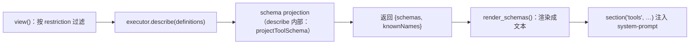
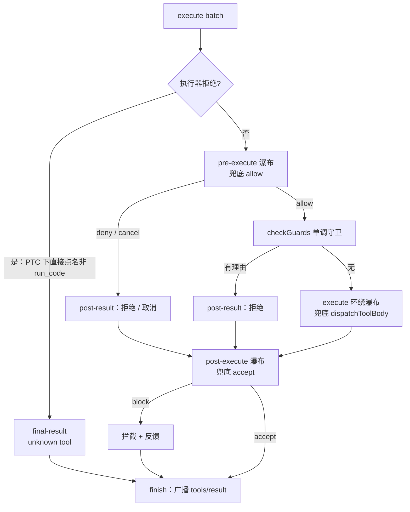
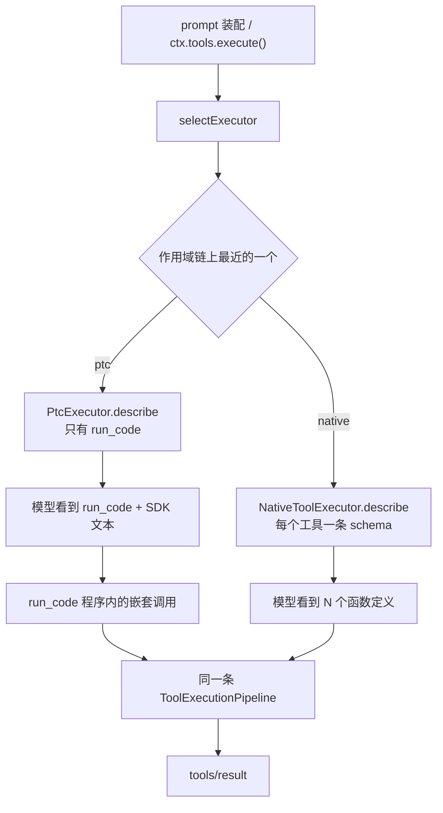

# 第 4 章 tools 注册表与执行器管线（先定义，再展示，最后把守）

> 先报名字，再亮本事，门口有人把守；至于向观众报什么，由主持人决定。

## 本章回答的问题

- 工具是怎么被"注册"进容器的？多个作用域之间如何隔离、隐藏、覆盖？（作用域链的完整机制见第 9 章，本章只做单层掩码）
- 模型从哪里得知有哪些工具、每个工具的参数长什么样？这份"看得见"的清单由谁决定？
- 一次工具调用，从模型说出"我要调用 X"到结果写回，中间经过哪些关卡？
- 如何在调用前拦截危险操作、调用中加超时、调用后提醒用户？
- **PTC（programmatic tool calls，程序化工具调用）**——旧名 Code Mode——和 `native` 两种完全不同的模型交互方式，为什么能共享同一张注册表？

**PTC** 指模型不直接发工具调用，而是写一段程序，经执行器生成的 SDK 间接调用工具。

第 1 章给了我们容器底座：**Context** 提供 `provide/on/emit/serial/waterfall/effect/plugin`，**Service** 构造即注册。第 2 章在它上面搭出**会话与提示词**：**Session** 记录事件流，**SystemPromptService** 用 `section` 缝合各段提示词，**LlmStub** 用 `stream` 模拟模型输出。第 3 章补齐**持久化**：事件流落盘、冷读重建。

但直到现在，模型始终是"裸"的——它只会生成文本，不会调用任何工具。本章把第 2 章 `SystemPromptService` 提示词里那段"无工具"的空缺补上：用**工具定义**填充提示词，再用一条**守卫执行管线**承接模型发出的调用意图。

工具不是模型"天生就会"的能力，而是 harness 交给模型的一份带名字、带参数说明、带执行体的契约。本章把这份契约拆成三步：先把工具注册进作用域（**定义面**），再决定把哪些工具的 schema 交给模型（**展示面**），最后用一条三段瀑布把每次调用把守起来（**执行面**）。这三步之上还压着一个重组后独立出来的 seam（接缝：接口固定在原地，实现可整块替换）：**展示面的形状由工具执行器决定**，换执行器不动注册表。这条缝的完整对照见第 5 章。

增量复用关系：

- 复用 ch01 的 **Context / Service / effect**：`ToolsService` 是 `Service`，构造即注册为 `ctx.tools`；`register` 用 `ctx.effect` 表达"卸载即移除"。
- 复用 ch01 的 **on / emit**：`tools/change`、`tools/result` 是只读通知，直接走 ch01 的事件机制。
- **升级 ch01 的 waterfall**：ch01 的 `ctx.waterfall` 是"值传递"简化版（`None` 放行）。本章执行管线需要"中间件式"瀑布（监听器包裹 `next` 续体），故新增 `waterfall_wrap` 补全真实语义。
- 复用 ch02 的 **SystemPromptService.section**：schema 注入借它这条现成缝合点承载（`[教学简化]`，真实代码另有 `systemPrompt.tools` 专用 seam）。

另需说明：`main.py` 保持了第 2 章的完整容器装配——import 了 `AgentLoop`、provide 了 `LlmStub`、构造了 `Sessions(ctx)`——但本章演示只用到 `SystemPromptService` 与工具运行时；其余装配本章不使用，保持完整容器形态，留待后续章节（如多步循环，见 §8 预告）。

## 1. 写死的工具调用，没有注册、没有展示、没有把守

先看一个反面示例 `ch04/code/bad_example.py`（下面给出完整文件；它读取的 `sample.txt` 是同目录下的样例文件，内容只有一行 `hello from ch04`）：

```python
"""第 4 章反面示例：写死的工具调用——没有注册、没有 schema 展示、没有守卫。

运行：python3 bad_example.py（读取同目录下的 sample.txt，内容固定，任何平台可复现）
"""
import os


def read_file(path: str) -> str:
    """读文件（真正的工具体）。"""
    with open(path, "r", encoding="utf-8") as f:
        return f.read()


def run_shell(cmd: str) -> str:
    """执行 shell 命令（危险工具体，应当被守卫拦截）。"""
    import subprocess

    return subprocess.run(cmd, shell=True, capture_output=True, text=True).stdout


# 问题 1：工具散落在模块顶层，模型和容器都不知道它们存在。
# 问题 2：没有任何 schema 注入 prompt——模型无从得知有哪些工具、参数长什么样。
# 问题 3：调用点写死、无守卫——危险命令畅通无阻，也无法超时/提醒。


def naive_agent_dispatch(intent: str):
    """把模型的「意图」直接映射到 Python 函数：写死的分发，没有管线。"""
    if intent.startswith("read:"):
        return read_file(intent[len("read:"):])
    if intent.startswith("shell:"):
        return run_shell(intent[len("shell:"):])
    return "我不认识这个意图"


if __name__ == "__main__":
    # 读脚本同目录下的样例文件：内容固定为「hello from ch04」，输出在任何平台可复现。
    sample_path = os.path.join(os.path.dirname(os.path.abspath(__file__)), "sample.txt")
    # 模型说出「我要读 sample.txt」→ 直接调函数；模型说出「我要跑命令」→ 也直接调。
    print("[bad_example] read:", naive_agent_dispatch(f"read:{sample_path}").strip())
    print("[bad_example] shell:", naive_agent_dispatch("shell:echo hi").strip())
```

运行 `python3 ch04/code/bad_example.py`：

```text
[bad_example] read: hello from ch04
[bad_example] shell: hi
```

这个例子暴露出三个具体问题：

1. **工具散落、无注册**：`read_file`、`run_shell` 只是模块顶层的普通函数，容器不知道它们存在，模型更不知道。谁注册了工具、注册到了哪个作用域，没有任何记录。
2. **无 schema 展示**：没有任何机制把工具的名字、描述、参数注入到 system-prompt，模型无从得知有哪些工具可用、每个工具的参数长什么样，只能靠提示词里手写（极易与真实函数不同步）。
3. **无守卫、调用写死**：`naive_agent_dispatch` 把意图字符串硬编码映射到函数，危险命令（`shell`）畅通无阻；没有调用前拦截、没有超时、没有调用后提醒。想加一个"危险命令先审批"，只能改这段 if-else。

本章用三步逐一消解这三个问题：**定义面**（注册）→ **展示面**（schema 注入）→ **执行面**（守卫管线），最后再补一个横切问题：**这套展示与执行由谁供货**（执行器 seam）。

## 2. 机制一：ctx.tools 作用域注册（定义面）

### 2.1 概念引入

先引入三个术语：

- **工具定义（ToolDefinition）**：一条工具契约，至少包含 `name`（名字）、`description`（描述）、`parameters`（参数 schema）、`execute`（执行体）四要素。真实源码里 `output` 是必填的 `{schema, render}` 输出契约，`timeoutMs` 是可选的超时预算。**教学版删掉了整个 `output` 契约**（没有渲染模板，也没有任何替代字段），工具体返回什么就直接广播什么；`timeoutMs` 保留。
- **作用域层（ToolLayer）**：一个承载工具集合的"抽屉"。真实实现里是 **ScopedLayers**——一个全局层加若干 agent 作用域层，作用域可以"遮蔽（shadow）"全局同名工具；本章教学版只维护单一全局层，把"层"这个概念先立起来。
- **restriction（工具掩码）**：挂在某个作用域上的一张 allow/deny 名单，只筛"继承来的全局工具"，不影响本作用域自己注册的工具。本章只用到全局层一张掩码表，作用域版见第 9 章。

`register` 做的事极其简单：把一条 `ToolDefinition` 写进 `ToolLayer`，然后**发一个 `tools/change` 事件**通知所有观察者，最后返回一个 `dispose`（注销函数）。返回 `dispose` 是关键——它让"注册"变成一个**可逆效应**：注册者卸载时，工具自动从层里移除。

### 2.2 内部实现

```mermaid
flowchart LR
    subgraph 注册面
        P[插件/应用代码] -->|register(def)| R[ToolsService.register]
        R --> W[写入 ToolLayer.tools]
        W --> E[emit tools/change]
        R -->|ctx.effect| D[返回 dispose]
    end
    subgraph 观察者
        E --> O1["main.py 的观察者：打印 tools/change name add"]
        E --> O2["任意观察者：§6 输出里的变更行"]
    end
    subgraph 反注册
        D -->|调用 dispose| R2[从 ToolLayer.tools 移除]
        R2 --> E2[emit tools/change remove]
    end
```

关键点：`register` 本身不"执行"任何工具，它只**定义**工具并广播"定义发生了变化"。执行面（第 4 节）才真正调用 `execute`。

### 2.3 Python 重构

`ch04/code/tools.py` 里的注册部分（`ToolDefinition`/`ToolLayer`/`ToolRuntime` 构造与 `register`）：

```python
@dataclass(frozen=True)
class ToolDefinition:
    """一条工具契约（contracts.ts:26）：名字 + 描述 + 参数 schema + 执行体。

    [教学简化] 真实版另有必填的 output 契约 {schema, render}，execute 签名 (args, exec)；
    教学版删掉了 output，结果不再快照/校验/渲染，execute 默认只收 args。
    wants_exec=True 时按真实签名把 exec 也传进去（present 工具用它暂存待落事件）。
    """

    name: str
    description: str
    parameters: dict
    execute: "callable"  # dict -> str（wants_exec 时为 dict, exec -> str）
    timeout_ms: int | None = None
    wants_exec: bool = False


@dataclass
class ToolLayer:
    """作用域层（packages/core/tools/src/index.ts:63）：只剩工具与 restriction 两张表。

    [教学简化] 真实版是 ScopedLayers 的全局层 + agent 作用域层（作用域 shadow 全局）；
    教学版只维护单一全局层，restriction 也不分作用域。guards 在真实代码里是独立的
    GuardLayer（index.ts:93），教学版合并进来省一张表。
    """

    tools: dict = field(default_factory=dict)
    restrictions: list = field(default_factory=list)  # 编译后的 {allow?, deny?}
    guards: list = field(default_factory=list)

    def admits(self, name):
        """restriction 判定：allow 名单里没有或 deny 名单里点名，都算不可见（index.ts:79–85）。"""
        for f in self.restrictions:
            if "allow" in f and name not in f["allow"]:
                return False
            if "deny" in f and name in f["deny"]:
                return False
        return True


class ToolRuntime(Service):
    """ctx.tools 服务：注册表 + 执行器选择 + 三段管线（index.ts:99；管线本体见 pipeline.ts:62）。"""

    def __init__(self, ctx, config=None):
        super().__init__(ctx, "tools")
        self._layer = ToolLayer()
        self._pre_execute = []
        self._execute = []
        self._post_execute = []
        self._executor = None
        self._executor_unavailable = False
        self.run_code_tool = ToolDefinition(
            "run_code", "提交一段程序，由执行器代跑其中的工具调用",
            {"code": "string"}, self._run_code_body, wants_exec=True,
        )
        # [教学简化] 真实代码由组合里的执行器行调用 set_executor；教学版默认挂原生执行器。
        self.set_executor(NativeToolExecutor())

    # ---------- 定义面：注册与限制 ----------

    def register(self, definition):
        """把工具写入作用域层并触发 tools/change，返回注销 disposer（index.ts:128–153）。"""
        name = definition.name
        if name == "run_code":
            raise ValueError(f'tool name "run_code" is reserved for the PTC mode presentation transport')
        if name in self._layer.tools:
            raise ValueError(f'tool "{name}" is already registered in this scope')
        self._layer.tools[name] = definition
        self.ctx.emit("tools/change", {"name": name, "op": "add"})

        def dispose():
            self._layer.tools.pop(name, None)
            self.ctx.emit("tools/change", {"name": name, "op": "remove"})

        return self.ctx.effect(lambda: dispose)
```

摘录里新出现的几个成员各交代一句。

`ToolRuntime.__init__` 先以 `super().__init__(ctx, "tools")` 完成 Service 注册（ch01「构造即注册」），再建好唯一的作用域层 `_layer` 与三条瀑布的监听器列表。§4.3 的 `on_pre_execute`/`on_execute`/`on_post_execute` 注册调用就是往这三个列表里 append。

`ToolLayer` 的 `restrictions` 是 §3 要用的掩码表，`guards` 是 §4 要用的守卫表。**真实源码里 `ToolLayer` 只有 `tools` 和 `restrictions` 两张表，没有 `mode` 字段**；旧版那套"每个工具一个展示模式"的字段已经随执行器拆分一起删掉了（见 §5）。

`run_code_tool` 是一个特殊定义。它不在注册表里，只有当 PTC 执行器被选中时才由执行器提供（§5）。

`register` 的第一段做了两个检查。

第一是**保留名 `run_code` 不许注册**：它是 PTC 的传输通道，工具不能占用或遮蔽它。

第二是**同层重名注册直接报错**。真实代码的报错信息会提示"要注册每个 agent 的变体请走 `agent.ctx`"，也就是把注册放进该 agent 自己的作用域（见第 9 章）。

这两条都是"让错误在注册时暴露"，而不是等调用时再变成一次神秘的取不到。

`register` 返回的 `dispose` 走 `ctx.effect`：它是 ch01 的"可逆效应"——当前 fiber 卸载时，`dispose` 被自动调用，工具随之移除。这就是"注册进作用域"而非"全局永久注册"的落地方式。

注册的调用侧很简单——`ch04/code/main.py` 构造 `ToolDefinition` 交给 `register`（摘录自 `main()` 函数内；`slow_echo` 的函数体故意睡 50ms，为 §6 的超时演示埋线）：

```python
# ch04/code/main.py 的 main() 内（第 1 段，缩进略）
def slow_echo(args):
    time.sleep(0.05)  # 50ms，制造超时
    return args["text"]

# ……（此处省略 echo 的定义与 read_file/shell 的两次 register 调用，形式相同）
ctx.tools.register(ToolDefinition("slow_echo", "慢速回声（演示超时）", {"text": "string"}, slow_echo, timeout_ms=20))
```

`ToolDefinition` 的四个实参与契约字段一一对应：名字、描述、参数 schema、执行体 `execute`（以普通函数传入）；`timeout_ms=20` 是可选的超时预算——§6 超时演示里"50ms > 20ms 预算"的 20ms 即来源于此。其余三个工具（`read_file`/`shell`/`echo`）同理注册，只是不带 `timeout_ms`。每次 `register` 返回，观察者随即打印一行 `[tools/change] <name> add`（见 §6 输出第 1 段）。

### 2.4 回溯

`register` 解决问题 1：工具不再是散落的普通函数，而是被显式写进 `ToolLayer` 的**契约对象**，并且每次注册/注销都广播 `tools/change`，容器和观察者都能感知。但此时模型仍然"看不见"这些工具——于是进入下一步。

## 3. 机制二：schema 视图与注入（展示面）

### 3.1 概念引入

注册只是把工具"存"起来了，模型要"用"它，必须先"看见"它。工具定义里那些给模型看的字段（`name`/`description`/`parameters`）需要被**投影**成一段 schema，注入 system-prompt。这里有两个关键术语：

- **schema 投影（schema projection）**：从 `ToolDefinition` 里挑出**白名单字段** `{name, description, parameters}`，丢弃 `execute`、`output` 等执行面字段。模型只该看到"怎么描述、怎么传参"，不该看到执行体本身。真实实现是 `projectToolSchema`（`packages/core/tools/src/schema.ts:641`）。
- **工具视图（ToolView）**：一个作用域"看得见"的全部工具——注册表按作用域链合并、再按 restriction 筛掉不许看的全局工具之后的结果。展示面只从视图里取数，不是从原始注册表取数。

旧版本的第三个术语"展示模式（presentation mode）"——`native` / `code` / `both` 三选一、每个工具一个模式——**已经不存在**。HEAD 里 `presentAs`、`modeFor`、`ToolPresentationMode` 整个符号在 `packages/` 下零命中，`ToolsService.Config` 里 `mode` 字段被改成了 `z.never()`，报错文案就是"Removed. Mount a native or PTC tool executor instead."（`packages/core/tools/src/index.ts:102`）。取而代之的是 §5 的执行器：**整套工具的展示形态由执行器一次性决定，不是逐个工具配置**。这句判断先记住，§3 只讲注册表这一侧的投影，§5 再把"谁决定形状"接上。

`ToolsService.schemas()` 把视图内所有可见工具投影成 schema 列表；它的消费者是 MCP inspect、PTC 绑定等旁路查询，**不是** system-prompt。prompt 那条路在构造函数里（`packages/core/tools/src/index.ts:113–117`）：每次 prompt 装配时，注册表先问执行器"这批定义该描述成什么样"，再把结果交给 `ctx.systemPrompt.tools()`。

### 3.2 内部实现



数据流从左往右：`view()` 先按 restriction 筛出可见定义（教学版；真实版在此处还要合并作用域链，见第 9 章），`describe()` 在这批定义上做**投影**并返回 `{schemas, knownNames}`，`render_schemas()` 把它渲染成文本，最后由 `section()` 接收——**注入是最后一步，不是第一步**。

教学版 `main.py` 显式调用 `ctx.systemPrompt.section("tools", ctx.tools.render_schemas(), order=10)`。真实代码里这一步由 `ToolsService` 构造时自动接到 `ctx.systemPrompt.tools(provider)`（`packages/core/system-prompt/src/index.ts:551`），`provider` 的回调就是"选执行器 → `describe(...)`"。两边都是"过滤 → 描述 → 注入"这条主线。

### 3.3 Python 重构

```python
class ToolRuntime(Service):
    # ... register 见 §2.3；guards 与 execution 成员见 §4.3 ...

    def view(self):
        """可见工具集：注册表里通过 restriction 的那些（index.ts:199–227）。

        [教学简化] 真实 view(scope) 还要合并作用域链、应用继承 restriction（第 9 章）；
        教学版只有一张全局层。
        """
        return [d for name, d in self._layer.tools.items() if self._layer.admits(name)]

    def definitions(self):
        """交给执行器 describe() 的可见定义列表（index.ts:305–307）。"""
        return self.view()

    def schemas(self):
        """可见定义的 schema 投影（index.ts:316–318）。"""
        return [runtime_schema(d) for d in self.definitions()]

    def wire_schemas(self):
        """兼容名：describe 只给 {schemas}，knownNames 由这里兜底补齐。

        真实版由注册表在构造器里补齐（index.ts:115–116）；
        [教学简化] 教学版的 describe 两个执行器都返回 knownNames，省掉这一层兜底。
        """
        return self._executor.describe(self.definitions())

    def render_schemas(self):
        """把 describe 结果渲染成 prompt 文本，供 system-prompt section 注入。

        [教学简化] 真实代码由 ToolsService 构造时接到 ctx.systemPrompt.tools(provider)
        （index.ts:113–117 ↔ system-prompt/src/index.ts:551）；第 2 章教学版只有 section 缝合点。
        """
        description = self._executor.describe(self.definitions())
        lines = ["可用工具："]
        for s in description["schemas"]:
            lines.append(f"- {s['name']}: {s['description']}")
            lines.append(f"  参数 {s['parameters']}")
        return "\n".join(lines)
```

`runtime_schema` 是模块级函数，也就是 §3.1 说的投影：

```python
def runtime_schema(definition):
    """把定义投影成给模型看的白名单：只留 {name, description, parameters}。

    真实版是 projectToolSchema（schema.ts:641）：丢 execute、output、presentCall，
    只留模型该看的四个字段（deferLoading 是可选的第五个）。
    """
    return {
        "name": definition.name,
        "description": definition.description,
        "parameters": definition.parameters,
    }
```

`main.py` 里把 describe 结果注入 system-prompt，并演示 restriction 如何收窄展示面：

```python
# ch04/code/main.py 的 main() 内（第 2 段，缩进略）
print(f"    {ctx.tools.wire_schemas()}")
print("  restrict(deny=['shell']) 后，shell 从展示面隐藏：")
lift = ctx.tools.restrict(deny=["shell"])
print(f"    knownNames = {ctx.tools.wire_schemas()['knownNames']}")
lift()  # 解除掩码，后面还要演示 shell 的正常执行
ctx.systemPrompt.section("tools", ctx.tools.render_schemas(), order=10)
```

输出可见：`restrict(deny=['shell'])` 之后，`shell` 从 `knownNames` 里消失——危险工具对模型"隐身"了；解除掩码后又回到完整列表。

注意这是 **restriction** 干的活，不是"给 shell 设一个 code 模式"。restriction 回答"这个 agent 能不能看见继承来的工具"，与"这些工具以什么形状展示给模型"是两个正交的问题——后者正是 §5 执行器的职责。

`[教学简化]` 真实代码里 `restrict` 要求当前上下文有作用域（`packages/core/tools/src/index.ts:162–166` 直接抛错），本章 demo 在根级调用也能成功。教学版 `restrict` 的实现就是把编译后的 `{allow?, deny?}` 追加进 `ToolLayer.restrictions` 并返回解除 disposer：

```python
class ToolRuntime(Service):
    def restrict(self, allow=None, deny=None):
        """给继承来的全局工具加一层掩码，返回解除 disposer（index.ts:162–189）。（节选）"""
        compiled = {}
        if allow is not None:
            compiled["allow"] = set(allow)
        if deny is not None:
            compiled["deny"] = set(deny)
        self._layer.restrictions.append(compiled)

        def dispose():
            self._layer.restrictions.remove(compiled)

        return self.ctx.effect(lambda: dispose)
```

### 3.4 回溯

schema 注入解决问题 2：工具定义与 prompt 不再手写、不再不同步，而是**从同一个 `ToolDefinition` 投影**而来。定义一变，视图与 describe 输出自动跟着变；restriction 一改，展示面随之收放。但"看得见"不等于"拦得住"——真正危险的调用还需要执行面把守。本节只讲注册表这一侧能投影出什么；这批投影最后以什么形状出现，留到 §5 再说。

## 4. 机制三：守卫执行管线（执行面）

### 4.1 概念引入

这是本章的核心。一次工具调用被拆成**三段瀑布**，每段都允许任意数量的监听器介入：

- **调用前决策（PreToolDecision）**：`allow`（放行）/ `deny`（拒绝）/ `cancel`（按取消结果收场）/ `ask`（询问）；后两个分支教学版没有实现，监听器只能返回 allow 或 deny。由 `tools/pre-execute` 瀑布产出。
- **调用中（tools/execute）**：一个**环绕瀑布**——监听器包裹函数体，可以在调用前做文章、调用后做文章，最内层的兜底才是"真正调用工具体"。
- **调用后决策（PostToolDecision）**：`accept`（接受，可替换内容、可附带下一轮上下文）/ `block`（拦截 + 反馈）。由 `tools/post-execute` 瀑布产出。

还有两个关键概念：

- **中间件式瀑布（waterfall_wrap）**：监听器签名是 `listener(*args, next)`，只有调用 `next()` 才把控制权交给内层。这是 ch01 `ctx.waterfall` 被简化掉的真实语义（ch01 是"值传递、`None` 放行"）。
- **单调守卫（`checkGuards`）**：`guard` 注册的守卫是一个**只有否决权**的函数，签名形如 `exec -> 拒绝理由字符串 | None`。

  它只能有两种表态：返回一个字符串，就是以该理由**拒绝**这次调用；返回 `None`，只表示「我不反对」，而**不是**「我批准」——守卫根本没有「放行」这个选项，放行只是「所有守卫都不反对」的自然结果。

  判定入口叫 `checkGuards`（教学版对应 `ToolLayer.guard_reason`）：按注册顺序逐个询问守卫，**第一个**给出理由的守卫就让调用以该理由被拒，后面的守卫不再问；所有守卫都返回 `None` 才放行。

  「单调」指守卫只能叠加拒绝：加守卫永远不会把一次被拒的调用翻成放行。它与 `pre-execute` 瀑布的区别在于，瀑布里的监听器能显式返回 allow/deny 决定「是否继续」，而单调守卫只能「提反对意见」。

三段瀑布的**兜底值就是无守卫时的历史行为**：`pre-execute` 兜底 `allow`、`execute` 兜底直接调函数体、`post-execute` 兜底 `accept`。这正是"加了守卫才改变行为、不加守卫等于什么都没发生"的设计。

**顺序很重要**：`tools/pre-execute` 瀑布先跑，`ask` 在瀑布之后转成审批；审批或瀑布给出 `allow` 之后，才轮到单调守卫 `checkGuards`。真实代码把它写成一行（`packages/core/tools/src/pipeline.ts:213`）：

```ts
// packages/core/tools/src/pipeline.ts 的 ToolExecutionPipeline.prepare() 内
const denialReason = decision.kind === 'allow' ? this.tools.checkGuards(exec) : decision.reason
```

所以守卫永远在"扩展策略已经放行"之后才发言，它无法推翻一个 `deny`，也无法让一个 `ask` 免于审批。

### 4.2 内部实现



一次调用从批调度进入，依次经过：执行器拒绝判定 → `pre-execute` 瀑布（含 ask 审批） → 单调守卫 → `execute` 环绕瀑布 → `post-execute` 瀑布 → 物化并广播（`tools/result`）。真实代码在广播前还有一步"物化"：工具体返回的原始值先经 `output` 契约快照/校验/渲染才算物化完成；教学版没有 `output` 契约（见 §2.3 `ToolDefinition` 的 [教学简化] 注释），执行完直接广播。

有两条容易记错的细节：

1. **被拒绝的调用照样会广播 `tools/result`**。瀑布或守卫拒掉一次调用，得到的是 `post-result`——它**仍然要过 `post-execute`**，再 `finish`；只有执行器在策略之前就拒绝的调用才是 `final-result`，跳过 `post-execute` 直接 `finish`。两条路最后都走到 `notifyResult`（`packages/core/tools/src/pipeline.ts:387`）。审批被取消（`cancel`）同样合成一个"取消"结果走 `post-result`。
2. **`post-execute` 不是"只在成功时才跑"**。工具执行抛异常，异常被包装成错误结果后同样进入 `tools/post-execute`；只有 `complete` 阶段自身抛出的故障才跳过它。

真实代码的门面是一个独立的类 `ToolExecutionPipeline`（`packages/core/tools/src/pipeline.ts:62`），三个公开阶段是 `prepare`（`:190`）、`dispatch`（`:295`）、`complete`（`:336`）；批调度 `executeToolBatch` 在 `packages/core/tools/src/batch.ts:50`，它负责把调用分成 `exclusive`（独占屏障）与 `parallel`（有界并发池）两组、按模型顺序提交结果。

### 4.3 Python 重构

先看 `waterfall_wrap`——它是整条管线的地基。它是一个**模块级函数**（定义在 `tools.py` 顶层，不属于任何类）：

```python
# 模块级函数（tools.py 顶层，不属于任何类）
def waterfall_wrap(listeners, args, fallback):
    """中间件式瀑布：监听器从外到内包裹，fallback 最内层兜底。

    监听器签名 listener(*args, next)；调用 next() 才把控制权交给内层，不调则短路。
    补全第 1 章简化掉的真实中间件语义（events.ts:246 ↔ cordis.py:153–163）。
    """

    def invoke(index):
        if index >= len(listeners):
            return fallback()
        return listeners[index](*args, lambda: invoke(index + 1))

    return invoke(0)
```

再看单调守卫——§4.1 的概念在这里落地。注册与判定分在两处：`guard` 把守卫函数追加进 `ToolLayer.guards`（即 §2.3 的 `guards` 列表，其语义当时未展开）；`guard_reason` 被 `_prepare` 消费——它按注册顺序逐个询问守卫，任一守卫给出拒绝理由就以该理由拒绝（短路），所有守卫都返回 `None` 才放行：

```python
class ToolRuntime(Service):
    # ... register 见 §2.3；展示面成员见 §3.3；execute 管线见本节下文 ...

    def guard(self, guard_fn):
        """注册单调守卫：只能拒绝、不能放行（index.ts:384–386）。"""

        def setup():
            self._layer.guards.append(guard_fn)
            return lambda: self._layer.guards.remove(guard_fn)

        return self.ctx.effect(setup)


@dataclass
class ToolLayer:
    # ... tools / restrictions / guards 字段见 §2.3 ...

    def guard_reason(self, exec):
        """单调守卫：顺序跑 guards，返回第一个非 None 的拒绝理由（index.ts:393–401）。"""
        for guard in self.guards:
            reason = guard(exec)
            if reason is not None:
                return reason
        return None
```

真实代码里守卫单独住在一个 `GuardLayer` 里（`packages/core/tools/src/index.ts:93`），判定入口叫 `checkGuards`（`:393`），并且会先查全局层、再沿调用者的作用域链逐层查（`packages/core/tools/src/index.ts:394`）。教学版只有一层，逻辑相同。

再看 `_prepare` / `_dispatch` / `_complete`，也就是 `ToolExecutionPipeline` 三个阶段的等价物：

```python
class ToolRuntime(Service):
    # ... register 见 §2.3；guard 见本节上文；展示面成员见 §3.3 ...

    def _prepare(self, exec):
        """调用前：执行器拒绝 → pre-execute 瀑布 → 单调守卫（pipeline.ts:190–251）。

        返回 {"kind": "final-result"|"post-result"|"dispatch"}。
        [教学简化] 真实版的 ask 走 serviceAsk 审批 seam（packages/core/tools/src/pipeline.ts:432）；教学版没有 ask
        分支，监听器若返回 kind="ask" 会落进下面的 dispatch（按放行处理），不是 deny。
        """
        if self._executor_is_ptc() and not exec.nested and exec.name != "run_code":
            # PTC 执行器在策略之前就拒绝直接调用（tool-executor-ptc/src/index.ts:35–38）。
            return {"kind": "final-result", "exec": exec,
                    "result": ToolResult(f"unknown tool: {exec.name} (call it inside run_code)", True)}
        gate = waterfall_wrap(self._pre_execute, (exec,), fallback=PreToolDecision.allow)
        if gate.kind == "allow":
            reason = self._layer.guard_reason(exec)
            if reason is not None:
                return {"kind": "post-result", "exec": exec, "result": ToolResult(f"Error: {reason}", True)}
        elif gate.kind == "deny":
            return {"kind": "post-result", "exec": exec, "result": ToolResult(f"Error: {gate.reason}", True)}
        return {"kind": "dispatch", "exec": exec}

    def _dispatch(self, exec):
        """调用中：execute 环绕瀑布，兜底直接调函数体（pipeline.ts:295–327）。"""
        return waterfall_wrap(self._execute, (exec,), fallback=lambda: self._dispatch_body(exec))

    def _complete(self, exec, result):
        """调用后：post-execute 瀑布，兜底 accept，然后广播结果（pipeline.ts:336–372）。"""
        decision = waterfall_wrap(self._post_execute, (exec, result), fallback=PostToolDecision.accept)
        if decision.kind == "block":
            result = ToolResult(content=decision.feedback or "blocked", is_error=True)
        return self._announce(exec, result)

    def _announce(self, exec, result):
        """广播冻结后的最终结果（pipeline.ts:374–423 finish → notifyResult）。

        被 pre-execute / 守卫拒绝的调用同样会广播；被执行器在策略前拒绝的也广播。
        真实版即使 complete 阶段出故障也仍会走到 notifyResult，只是结果换成错误。
        """
        self.ctx.emit("tools/result", exec, result)  # 只读通知（pipeline.ts:400–423）
        return result
```

注意 `_dispatch` 里的 `_dispatch_body`：它就是 §4.1 所说"`execute` 兜底直接调函数体"的具体实现——环绕瀑布没有监听器拦截时，控制权一路落到最内层，调用注册时传入的 `execute` 函数体（如 `slow_echo`），并把返回值包装成 `ToolResult`。

`main.py` 里注册守卫：三个扩展点（`on_pre_execute` / `on_execute` / `on_post_execute`）各挂一个监听器，外加一个单调守卫：

```python
# ch04/code/main.py 的 main() 内（第 3 段，缩进略）
def sensitive_path_guard(exec_, next):
    if exec_.name == "read_file" and exec_.arguments.get("path", "").startswith("/etc"):
        return PreToolDecision.deny("敏感路径 /etc 被拒绝")
    return next()

ctx.tools.on_pre_execute(sensitive_path_guard)

ctx.tools.guard(lambda exec_: "禁止读取 /root/.ssh/id_rsa" if exec_.arguments.get("path") == "/root/.ssh/id_rsa" else None)

def timeout_wrapper(exec_, next):
    tool = ctx.tools.get(exec_.name)
    budget = tool.timeout_ms if tool and tool.timeout_ms else None
    if budget is None:
        return next()
    start = time.monotonic()
    result = next()
    if (time.monotonic() - start) * 1000 > budget:
        return ToolResult(content=f"timeout: 超过 {budget}ms", is_error=True)
    return result

ctx.tools.on_execute(timeout_wrapper)

def secret_blocker(exec_, result, next):
    if "secret" in result.content:
        return PostToolDecision.block("结果包含 secret，已拦截")
    return next()

ctx.tools.on_post_execute(secret_blocker)
```

注意 `timeout_wrapper` 的结构：它先拿到 `budget`，再 `next()` 调用函数体，最后检查耗时。这正是"环绕"——`next()` 前后都可以加逻辑，对应真实 `packages/guard/timeout-policy` 的 deadline 环绕。`secret_blocker` 则是 post-execute 监听器：此时工具体已执行完、`result` 已在手，它检查 `result.content`，发现含 `secret` 就以「结果包含 secret，已拦截」为反馈 `block` 掉——§6 输出里 `echo 'my secret key'` 那行错误正是它拦截的。

### 4.4 回溯

守卫管线解决问题 3：危险调用不再是写死的 if-else，而是**可插拔的监听器**。想加拦截、超时、提醒，就 `on_pre_execute` / `on_execute` / `on_post_execute` 各挂一个监听器，不用改核心分发代码。真实 harness 的两个 guard 包——`repeat-tool-reminder`（挂在 `tools/post-execute`，只观察不否决）、`timeout-policy`（挂在 `tools/execute` 环绕）——就是这套扩展点的两个实例。

这里还有一个真实消费者值得单说：**`present` 工具**。`packages/deliverables/tool-present/src/index.ts` 的工具体在 `execute` 里只做校验和**暂存**——把 `{session, turn, files}` 塞进一个以 `exec` 为键的 `WeakMap`（`:37`、`:97`），然后返回一个普通值；真正写事件发生在 `tools/result` 观察者里（`:101–109`）：

```ts
// packages/deliverables/tool-present/src/index.ts 里 apply() 的尾部
ctx.on('tools/result', (exec, result) => {
  const delivery = pending.get(exec)
  pending.delete(exec)
  if (delivery === undefined || result.isError) return
  const { session, turn, files } = delivery
  session.append('deliverables/presented', {
    turn, callId: exec.callId, files,
  })
})
```

为什么绕这一圈？因为从 `execute` 返回到结果落定之间，还夹着 `tools/post-execute` 这一层策略——后面的插件可能把结果改成错误、可能 block 掉。`execute` 里直接写事件的话，一个随后被拦截的调用也会留下"已交付"的假记录。把写事件推迟到 `tools/result`（此时结果已经冻结、不会再变），"成功才 declaring" 就成了自然结果：失败的结果直接 `return`，什么都不写。

反过来说，**声明一旦写完就不会被撤销**：`present` 的工具体被包在 `run_code` 程序里时，如果程序后续某一步失败，已经 append 的 `deliverables/presented` 事件仍然留在 session 里。这是上游的设计决定而非疏漏——事件是 append-only 的事实记录，"这一刻我声明了这些文件"确实发生过；程序的整体失败由 `run_code` 自己的错误结果负责表达，不需要回头改写历史。这一点包文档写得很直白：嵌套调用同样会落事件，**后来包住它的程序失败，不会撤销已经完成的声明**；而被 block 的结果一条都不发（`packages/deliverables/tool-present/README.md:56`）。

## 5. 机制四：执行器即 seam（展示面与执行面由谁供货）

### 5.1 概念引入

前三节埋了一个问题：注册表里存的是工具定义，可这些定义最后以什么形式出现在模型面前？

设想一个真实场景：同一个进程里跑着两个 agent。一个希望模型直接看到 `read_file` / `shell` 等函数定义，逐个调用；另一个希望模型只看到一个 `run_code`，让它写一段程序，程序里再调这些工具——后者能让模型一口气组合多个调用，少走几轮往返。可这两个 agent 共享的是**同一张注册表**。

没有一层专门管这件事会怎样？注册表只能"存工具"，prompt 里不知道该放几条 schema、放哪几条；`ctx.tools.execute()` 拿到一批调用也不知道该怎么跑（串行还是并行、PTC 程序里的嵌套调用算不算同一批、取消怎么传）。这两件事本质上是同一个问题的两面：**这批定义以什么形状交给模型，这一批调用按什么规则执行**。

旧版用"给每个工具打一个展示模式标签"来应付，结果两头不讨好：N 个工具 × 3 种模式，谁负责组合出合法的一整套（状态爆炸）；而且展示面与执行面被一个字段绑死，想换整批调用的执行方式（并发、取消、日志）就没地方挂。

HEAD 把这件事整体收进一个新的 seam（接缝：接口不动，换一个插件就换掉整套展示与执行）：**工具执行器（tool executor）**。它是什么？一个插件，实现 `ToolExecutor` 接口（`packages/core/tools/src/executor.ts:64`），只回答两个问题：

- `describe(definitions)`：这批可见定义，模型应该看到什么（返回 `{schemas, knownNames}`）？
- `execute(batch)`：这一批原始调用怎么跑（解析参数、调度并发、处理取消、落日志）？

没有它会怎样？注册表只剩"存工具"一半能力，模型看不到任何 schema，`ctx.tools.execute()` 也无从执行——真实代码里选不到执行器时直接抛 `ToolExecutorUnavailableError`（`packages/core/tools/src/executor.ts:97`）。

这个 seam 的两种现成实现，恰好就是上面那个诉求的两面：

- **原生执行器（native）**：`packages/core/tool-executor-native/src/index.ts:8`，整个文件 35 行。它把每个可见工具投影成一条 schema。真正跑批时交给共享的 `executeToolBatch`。
- **PTC 执行器**：`packages/core/tool-executor-ptc/src/index.ts:20`。`describe` **只返回一个工具**——`run_code`（`:41–43`）；其余工具被渲染成一段 SDK 文本放进 prompt（`tools:sdk` 片段，`:45–52`），模型要调它们，只能写进 `run_code` 提交的程序里。程序里的每次嵌套调用仍然走同一条守卫管线（`packages/core/tool-executor-ptc/src/ptc.ts:587–601`）。

**最近作用域选执行器**：执行器不是全局唯一，而是按作用域挂载。部署级可以挂一个，preset 挂一个，单个 Agent 再挂一个；作用域链上**最近的那个**生效。同一个作用域里挂第二个执行器直接报错（`Only one tool executor may be registered in each scope`，`packages/core/tools/src/index.ts:328`）。选择逻辑在 `selectExecutor`（`:357–367`）：沿作用域链找第一个有贡献的 scope，找不到再退回部署级。

还有一个容易被忽略的细节：执行器被卸载后，**不会回落到继承的那个**。`setExecutor` 的清理函数只把记录里的 `executor` 置空（`packages/core/tools/src/index.ts:345–348`），`selectExecutor` 随后抛"不可用"。这样写是因为一次已经受理的批次不能突然换个执行器继续跑——PTC 程序跑到一半掉进 native，调用语义就变了。

### 5.2 内部实现



主干是：**注册表不决定形状，只提供"可见定义"**；执行器把同一批定义描述成两种截然不同的可调用面；两条路最后都汇进同一个 `ToolExecutionPipeline`——区别只在 PTC 的调用是多了一层"程序"外壳，程序里面的每次调用依然是普通工具调用。

### 5.3 Python 重构

教学版把契约和两个实现都放在 `tools.py` 里：

```python
class ToolExecutor:
    """执行器契约（executor.ts:64）：模型看见什么 + 一批调用怎样执行。

    两个成员各管一面：
    - describe(definitions)：返回 {schemas, knownNames}，决定模型的「可调用面」；
    - execute(batch)：接过整批调用（解析、调度、取消、落日志都归它）。
    sections 是它顺带注册的 prompt 片段（PTC 执行器用它在提示词里放 SDK）。
    """

    sections: list = ()

    def describe(self, definitions):
        raise NotImplementedError

    def execute(self, batch, runtime):
        raise NotImplementedError


class NativeToolExecutor(ToolExecutor):
    """原生执行器（tool-executor-native/src/index.ts:8–22）：每个可见工具都是一个函数定义。"""

    def describe(self, definitions):
        return {
            "schemas": [runtime_schema(d) for d in definitions],
            "knownNames": [d.name for d in definitions],
        }

    def execute(self, batch, runtime):
        return runtime.run_batch(batch)


class PtcExecutor(ToolExecutor):
    """PTC 执行器（tool-executor-ptc/src/index.ts:20–62）：只暴露 run_code，其余工具走生成的 SDK。

    [教学简化] 真实版按 runtime.language 生成 TypeScript/Python SDK 并接上 PTC 运行时；
    教学版只渲染一份 Python 风格 SDK 文本，run_code 用一个玩具解释器跑。
    """

    def __init__(self, runtime):
        self.runtime = runtime
        self.sections = [("tools:ptc-only", 5, self._only_instruction()),
                         ("tools:sdk", 6, self._sdk_text(runtime.definitions()))]

    def describe(self, _definitions):
        """PTC 下模型只看得见 run_code 一个 schema（index.ts:41–43）。"""
        return {
            "schemas": [runtime_schema(self.runtime.run_code_tool)],
            "knownNames": ["run_code"],
        }

    def execute(self, batch, runtime):
        return runtime.run_batch(batch)
```

注册表这一侧只剩一个槽位和两条规则：

```python
class ToolRuntime(Service):
    def set_executor(self, executor, replace=False):
        """在调用方作用域挂一个执行器；同一作用域重复挂即失败（index.ts:325–350）。

        真实版按 scope 分 root / scoped 两级存放，最近作用域胜出；教学版只有一个
        部署级槽位，用 replace=True 模拟「更近的作用域挂上新执行器」。
        """
        if self._executor is not None and not self._executor_unavailable and not replace:
            raise RuntimeError("Only one tool executor may be registered in each scope")
        self._executor = executor
        self._executor_unavailable = False

    def select_executor(self):
        """取当前生效的执行器；卸载后不会回落到继承的那个（index.ts:357–367）。"""
        if self._executor is None or self._executor_unavailable:
            raise RuntimeError("The selected tool executor is unavailable.")
        return self._executor
```

`main.py` 里最直观的一段是"换执行器，注册表不动"：

```python
# ch04/code/main.py 的 main() 内（第 4 段，缩进略）
print("  切换前（native）describe()['knownNames']:", ctx.tools.wire_schemas()["knownNames"])
ctx.tools.set_executor(PtcExecutor(ctx.tools), replace=True)  # 更近的作用域挂上 PTC 执行器
print("  切换后（ptc）describe()['knownNames']:", ctx.tools.wire_schemas()["knownNames"])
...
run("shell", {"cmd": "echo hi"})                                  # PTC 下直接点名：失败
run("run_code", {"code": "shell(cmd='echo hi')\necho(text='from inside run_code')"})
```

§6 输出会看到：切换前 `knownNames` 是四个工具，切换后只剩 `['run_code']`；直接点名 `shell` 返回 `unknown tool: shell (call it inside run_code)`；把同一个 `shell` 写进 `run_code` 程序就正常执行。而 `ctx.tools.view()` 自始至终是那四个工具——**注册表一行没改**。

"PTC 下直接点名会失败"在真实代码里的落点，不是 §4 的某条 deny 分支（旧版那条"code 态工具只能经 run_code"的分支已经不存在）。它由执行器的 `reject` 钩子在 `prepare` 之前完成：非 `run_code` 的非嵌套调用一律判成 `UNKNOWN_TOOL`（`packages/core/tool-executor-ptc/src/index.ts:35–38`，由 `packages/core/tools/src/pipeline.ts:126–129` 消费）。

换句话说，**PTC 下模型根本看不到这些工具的 schema**，也就不存在"看得到但不许直接调"的状态。deny 分支之所以能删，是因为可调用面从源头就收窄了。

### 5.4 迁移提示：agent-tool-presentation 已废弃

如果你在旧配置里见过 `@deepseek-ai/dsh-agent-tool-presentation`，那是过渡期的兼容包。它的 README 第一行就标了废弃（`packages/core/agent-tool-presentation/README.md:10`）。一句话概括：新配置直接挂原生或 PTC 执行器；旧配置仍可用，迁移就是把选择器行换成执行器行并删掉 `config.mode`，不要在同一作用域里同时加载两者。原文如下：

> **Deprecated:** For new configurations, mount `@deepseek-ai/dsh-tool-executor-native` or `@deepseek-ai/dsh-tool-executor-ptc` directly. Existing configurations remain supported. To migrate, replace this selector row with the corresponding executor row and remove `config.mode`; do not load both in the same scope.

迁移动作只有两步：**把选择器行换成对应的执行器行**，**删掉 `config.mode`**。取值要先对齐版本：旧机制的取值是 `native` / `code` / `both`，今天兼容包接受的已是 `native` / `ptc`（`packages/core/agent-tool-presentation/src/index.ts:33`、`packages/core/agent-tool-presentation/src/index.ts:42`）——`code` 就是今天的 PTC，随 Code Mode 一并改名。所以映射是：

| 旧配置 | 新行 |
|---|---|
| `mode: native` | `@deepseek-ai/dsh-tool-executor-native` |
| `mode: code`（现写作 `mode: ptc`） | `@deepseek-ai/dsh-tool-executor-ptc` |
| `mode: both` | 没有对应执行器：一个作用域只能挂一个，按 agent 拆分作用域 |

不要在同一个作用域里同时加载两者。兼容包内部做的也只是 `ctx.plugin(mode === 'native' ? Native : Ptc)`（`packages/core/agent-tool-presentation/src/index.ts:53`）——它没有自己的逻辑，只是一个旧名字。

### 5.5 回溯

执行器 seam 补上了"由谁供货"这个横切问题。注册表只回答"有哪些工具、谁看得见"；执行器回答"模型看见什么形状、一批调用怎么跑"。两者拆开后，同一个进程里可以让一个 agent 用原生、另一个用 PTC，共享一张工具表；也可以整包换掉执行方式（PTC 的运行时长什么样，见第 17 章）。

到此本章的四个面都讲完了：定义（§2）、展示（§3）、把守（§4）、供货（§5），对应章首的第 2–5 条问题。第 1 条问题里的"多个作用域之间如何隔离、隐藏、覆盖"，本章只做了单层工具掩码；作用域链的完整机制见第 9 章。

## 6. 完整运行输出

运行 `python3 ch04/code/main.py`（临时文件路径因环境与运行而异，正文以 `/tmp/tmpXXXXXX.txt` 占位；本机 macOS 实际打印的是 `/var/folders/.../tmpXXXX.txt`，二者等价）。以 `[tools/change]` / `[tools/result]` 开头的行来自 `main.py` 第 1 段用 `ctx.on` 注册的两个观察者；以 `==` 开头的段落标题与结果行是脚本自己的 `print`。

```text
$ python3 ch04/code/main.py
== 1. 装配容器 + 注册工具 ==
  [tools/change] read_file add
  [tools/change] shell add
  [tools/change] slow_echo add
  [tools/change] echo add

== 2. 展示面：执行器 describe() + restriction 掩码 ==
  原生执行器 describe()：
    {'schemas': [{'name': 'read_file', 'description': '读文件', 'parameters': {'path': 'string'}}, {'name': 'shell', 'description': '执行 shell 命令', 'parameters': {'cmd': 'string'}}, {'name': 'slow_echo', 'description': '慢速回声（演示超时）', 'parameters': {'text': 'string'}}, {'name': 'echo', 'description': '回声', 'parameters': {'text': 'string'}}], 'knownNames': ['read_file', 'shell', 'slow_echo', 'echo']}
  restrict(deny=['shell']) 后，shell 从展示面隐藏：
    knownNames = ['read_file', 'slow_echo', 'echo']
  注入 system-prompt 的 section 文本：
    可用工具：
    - read_file: 读文件
      参数 {'path': 'string'}
    - shell: 执行 shell 命令
      参数 {'cmd': 'string'}
    - slow_echo: 慢速回声（演示超时）
      参数 {'text': 'string'}
    - echo: 回声
      参数 {'text': 'string'}

== 3. 守卫管线：pre-execute / execute / post-execute ==
  [tools/result] read_file is_error=True
  read_file{'path': '/etc/hostname'} -> is_error=True content='Error: 敏感路径 /etc 被拒绝'
  [tools/result] read_file is_error=True
  read_file{'path': '/root/.ssh/id_rsa'} -> is_error=True content='Error: 禁止读取 /root/.ssh/id_rsa'
  [tools/result] slow_echo is_error=True
  slow_echo{'text': 'hi'} -> is_error=True content='timeout: 超过 20ms'
  [tools/result] echo is_error=True
  echo{'text': 'my secret key'} -> is_error=True content='结果包含 secret，已拦截'
  [tools/result] read_file is_error=False
  read_file{'path': '/tmp/tmpXXXXXX.txt'} -> is_error=False content='hello from a safe file\n'
  [tools/result] echo is_error=False
  echo{'text': 'all good'} -> is_error=False content='all good'

== 4. 换执行器，注册表不动：native -> PTC ==
  切换前（native）describe()['knownNames']: ['read_file', 'shell', 'slow_echo', 'echo']
  切换后（ptc）describe()['knownNames']: ['run_code']
  [section 5] tools:ptc-only:
    `run_code` is the only tool you can call directly — a tool call naming any other tool fails.
  [section 6] tools:sdk:
    可用的 SDK 函数（只能在 run_code 程序里调用）：
      read_file(path: string) -> 读文件
      shell(cmd: string) -> 执行 shell 命令
      slow_echo(text: string) -> 慢速回声（演示超时）
      echo(text: string) -> 回声
  模型直接点名 shell（PTC 下不允许）：
  [tools/result] shell is_error=True
  shell{'cmd': 'echo hi'} -> is_error=True content='unknown tool: shell (call it inside run_code)'
  同一个 shell，写进 run_code 程序里就能跑：
  [tools/result] shell is_error=False
  [tools/result] echo is_error=False
  [tools/result] run_code is_error=False
  run_code{'code': "shell(cmd='echo hi')\necho(text='from inside run_code')"} -> is_error=False content='hi\n\nfrom inside run_code'
  注册表本身没有任何改动，工具定义仍是: ['read_file', 'shell', 'slow_echo', 'echo']

== 5. present：执行期暂存，tools/result 成功后才落 deliverables/presented ==
  [tools/change] present add
  [tools/result] present is_error=False
  [deliverables/presented] ['report.md']
  present{'files': ['report.md']} -> is_error=False content='will present 1 file(s)'
  [tools/result] present is_error=True
  present{'files': ['/root/notes.md']} -> is_error=True content='Error: 交付路径落在受保护目录'
  session 事件类型： ['deliverables/presented']

== 6. 反注册：注销工具定义 ==
  [tools/change] temp_tool add
  temp_tool 已注册，knownNames=['read_file', 'shell', 'slow_echo', 'echo', 'present', 'temp_tool']
  [tools/change] temp_tool remove
  注销后 knownNames=['read_file', 'shell', 'slow_echo', 'echo', 'present']
```

逐条对号入座：

- `read_file /etc/hostname` → `pre-execute` 守卫拒绝（敏感路径）；注意它**照样**打印了一行 `[tools/result]`，因为拒绝结果也要经 `finish` 广播（§4.2 细节 1）。
- `read_file /root/.ssh/id_rsa` → `pre-execute` 放行，**单调守卫**（`checkGuards`）拒绝。
- `slow_echo` → `execute` 环绕瀑布的超时守卫，50ms > 20ms 预算，返回超时错误。
- `echo 'my secret key'` → `post-execute` 守卫拦截含 secret 的结果。
- `read_file`（临时文件）、`echo 'all good'` → 全部放行，正常通过。
- 第 4 段的三行 `[tools/result]` 来自 `run_code` 程序里的两次嵌套调用和 `run_code` 自己；PTC 下模型的直接调用被拒也是同样一条广播路径。
- PTC 的 `reject` 钩子用 `ToolNotFoundError` 报错，它的错误码是 `UNKNOWN_TOOL`（`packages/core/tools/src/contracts.ts:291`）——对模型来说"看不见"和"不存在"是同一种失败，这正是"可调用面从源头收窄"的用意。
- 第 5 段只有一次 `[deliverables/presented]`：成功的那次落事件，被 `pre-execute` 拒掉的那次什么都没写。

## 7. 源码对照

本章教学版与真实源码的对应关系集中在此。HEAD 的 `packages/core/tools/src/` 已经从单文件拆成九个源文件：`index.ts`（注册表本体，412 行）、`contracts.ts`（数据形状）、`executor.ts`（执行器契约）、`pipeline.ts`（共享管线）、`batch.ts`（批调度）、`schema.ts`（schema 投影 DSL 与 `projectToolSchema`）、`presentation.ts`（UI 渲染词汇）、`json-schema.ts`（JSON Schema 校验）、`events.ts`（事件签名）。执行器实现则在外面的两个包里。

| 教学版符号 | 真实源码 | 说明 |
|---|---|---|
| `ToolRuntime` | `packages/core/tools/src/index.ts:99`（`ToolsService`，出口别名 `ToolRuntime` 在 `:412`） | ctx.tools 服务 |
| `ToolLayer` | `packages/core/tools/src/index.ts:63–87` | 只剩 `tools` + `restrictions`；`mode` 字段已删 |
| `ToolDefinition` | `packages/core/tools/src/contracts.ts:26–102` | name/description/parameters/output/execute/timeoutMs 等 |
| `PreToolDecision` / `PostToolDecision` | `packages/core/tools/src/contracts.ts:357` / `:367` | allow/deny/cancel/ask 与 accept/block |
| `register` | `packages/core/tools/src/index.ts:128–153` | 写层 + `tools/change` + 返回 disposer；重名与 `run_code` 保留名在这里拒绝 |
| `restrict` | `packages/core/tools/src/index.ts:162–189` | 作用域级 allow/deny 掩码 |
| `view` / `definitions` / `schemas` | `packages/core/tools/src/index.ts:199` / `:305` / `:316` | 视图与 schema 投影入口 |
| `runtime_schema` | `packages/core/tools/src/schema.ts:641`（`projectToolSchema`） | 投影 `{name, description, parameters}`（+ 可选 `deferLoading`） |
| `wire_schemas` | `packages/core/tools/src/index.ts:113–117` + `packages/core/system-prompt/src/index.ts:551` | 真实版：构造时登记 `systemPrompt.tools` provider，装配时问执行器 |
| `guard` / `_layer.guard_reason` | `packages/core/tools/src/index.ts:384` / `:393–401`（`checkGuards`；GuardLayer 在 `:93`） | 单调守卫 |
| `execute`（单次入口） | `packages/core/tools/src/index.ts:375–377` | 真实版收整批 `ToolBatchInput` 并委托给执行器 |
| `_prepare`（pre-execute 瀑布） | `packages/core/tools/src/pipeline.ts:190–251`（瀑布在 `:201–204`，守卫在 `:213`） | `ask` 走 `serviceAsk`（`packages/core/tools/src/pipeline.ts:432`） |
| `_dispatch`（execute 环绕瀑布） | `packages/core/tools/src/pipeline.ts:295–327`（瀑布在 `:299–303`） | 兜底 `dispatchToolBody`（`:258`） |
| `_complete`（post-execute 瀑布） | `packages/core/tools/src/pipeline.ts:336–372`；`postExecute` 在 `:486` | 兜底 accept |
| `_announce`（结果广播） | `packages/core/tools/src/pipeline.ts:374–423`（`finish` → `notifyResult`） | 被拒结果同样广播 |
| 批调度 | `packages/core/tools/src/batch.ts:50`（`executeToolBatch`） | 独占屏障 + 有界并发池，结果按模型顺序提交 |
| `ToolExecutor` 契约 | `packages/core/tools/src/executor.ts:64–86` | `describe` + `execute`（+ 可选 `sections`） |
| `set_executor` / `select_executor` | `packages/core/tools/src/index.ts:325–350` / `:357–367` | 最近作用域选执行器，同层重复即失败；卸载不回落（`:345–348`） |
| `NativeToolExecutor` | `packages/core/tool-executor-native/src/index.ts:8–22`（`apply` 在 `:33`） | 每个工具一条 schema |
| `PtcExecutor` | `packages/core/tool-executor-ptc/src/index.ts:20–62`（`describe` `:41`、SDK `:45`、`reject` `:35`） | 只暴露 `run_code`；嵌套调用走同一管线（`ptc.ts:587–601`） |
| `run_code` 保留名 | `packages/core/tools/src/contracts.ts:12`、`packages/core/tools/src/index.ts:145–147` | 工具不能注册或遮蔽这个名字 |
| `agent-tool-presentation` 迁移 | `packages/core/agent-tool-presentation/README.md:10`、`packages/core/agent-tool-presentation/src/index.ts:53` | 已废弃，换执行器行并删 `config.mode` |
| `present` 的暂存与落事件 | `packages/deliverables/tool-present/src/index.ts:37`（WeakMap）、`:97`（暂存）、`:101–108`（`tools/result` 观察者） | 执行期暂存 → 成功才 append |
| `timeout-policy` 环绕 | `packages/guard/timeout-policy/src/index.ts:56` | deadline 环绕（本章 `timeout_wrapper`） |
| `repeat-tool-reminder` | `packages/guard/repeat-tool-reminder/src/index.ts:220` | 挂 `tools/post-execute`，只观察不否决 |

## 8. 小结与预告

本章把"工具"从四个方面拆开。

**定义面**：`register` 把工具写进作用域层并广播 `tools/change`，`restrict` 用掩码收窄继承来的全局工具。**展示面**：视图按通道筛出可见定义，schema 投影只留白名单字段，交给 system-prompt 注入。**执行面**：三段中间件式瀑布（`pre-execute` → `execute` 环绕 → `post-execute`）加单调守卫，把每次调用把守起来。**执行器 seam**：这批定义以什么形状摆到模型面前（原生逐条 schema，还是只给 `run_code` 加一份 SDK），由作用域上最近的执行器决定，换执行器不动注册表。

旧版那套 `presentAs` / `native|code|both` 的逐工具模式已经整体消失，取而代之的是"一个作用域挂一个执行器、最近的生效"。

`[教学简化]` 本章 demo 的几次 `register` / `restrict` 都发生在根级（`main.py` 没有激活任何 fiber/plugin），此时 effect 挂在容器自身上。真实代码里这两者都要求在 agent 作用域内调用，fiber 卸载时自动触发 dispose；因此 §6 输出第 6 段那次手动 `dispose()` 是对"卸载即移除"的直接演示，真实场景里无需手写。

第 5 章看 capability seam 的三角色——一个能力如何被"定义、实现、消费"三分解耦，以 shell 为例走一遍完整 seam 契约。本章的执行器是"契约 + 最近作用域选择"形态的 seam，第 5 章会把三种 seam 形态（定义/实现/消费三角色、本章的契约式选择、后续章节的整包替换）放在同一张速查表里对照。至于"模型决定调用 → 执行 → 结果回喂模型"的多步循环，将在后续章节补齐。

## 9. 附录：关键概念速查表

| 术语 | 含义 |
|---|---|
| **工具定义（ToolDefinition）** | 一条工具契约：name/description/parameters/execute，可选 timeoutMs；真实的 `output {schema, render}` 契约教学版已删 |
| **作用域层（ToolLayer）** | 承载工具与 restriction 的抽屉，真实版为 ScopedLayers（全局层 + agent 层） |
| **restriction（工具掩码）** | 作用域级 allow/deny 名单，只筛继承来的全局工具 |
| **注册（register）** | 把定义写入层 + 广播 `tools/change` + 返回 dispose；重名与 `run_code` 保留名直接报错 |
| **schema 投影（projectToolSchema）** | 挑出 `{name, description, parameters}` 白名单字段 |
| **工具视图（ToolView）** | 一个作用域看得见的工具集合：作用域链合并 + restriction 过滤 |
| **调用前决策（PreToolDecision）** | allow / deny / cancel / ask |
| **调用后决策（PostToolDecision）** | accept（可替换内容、附带上下文）/ block |
| **中间件式瀑布（waterfall_wrap）** | 监听器包裹 next 续体，最外层优先，兜底在最内层 |
| **单调守卫（`checkGuards`）** | 只能拒绝、不能放行的守卫列表；在 pre-execute allow 之后执行 |
| **三段管线** | prepare → dispatch（环绕）→ complete；被拒结果同样广播 `tools/result` |
| **工具执行器（tool executor）** | 与注册表并列的 seam：决定模型的"可调用面"与整批调用的执行方式 |
| **原生执行器（native）** | 每个可见工具一条 schema，`executeToolBatch` 跑批 |
| **PTC 执行器** | 只暴露 `run_code`，其余工具经生成的 SDK 在程序里调用 |
| **最近作用域选执行器** | 同一 scope 只能挂一个执行器，作用域链上最近的生效；卸载不回落 |
| **agent-tool-presentation（deprecated）** | 旧的 native/ptc 选择器行，迁移为执行器行并删 `config.mode` |
| **present 的两段式** | 执行期暂存到 WeakMap，`tools/result` 成功后才 append `deliverables/presented` |
