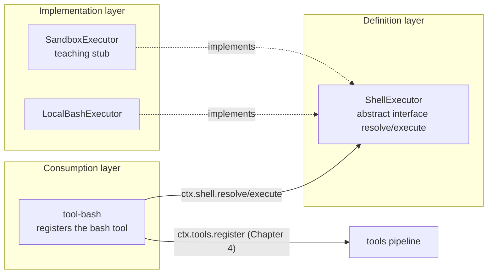

# Chapter 5: The Three Roles of the capability seam (Using shell as the Example)

> The seat stays, the actors may change; the audience watches the play and never asks about the backstage.

## Questions this chapter answers

- How is a capability (e.g., "which machine to run bash on") split into three mutually decoupled roles: definition, implementation, and consumption?
- What is the essential difference between a **method-call-style seam** (the two abstract methods `resolve`/`execute`) and Chapter 4's **event-waterfall-style pipeline** (`tools/pre-execute → tools/execute → tools/post-execute`)?
- Why is it that when you "swap out `LocalBashExecutor`", neither the `ShellExecutor` definition nor the consumer `tool-bash` needs a single line changed?

In Chapter 4 we built the **tools guard pipeline**: `ctx.tools` chains `tools/pre-execute → tools/execute → tools/post-execute` with `waterfall`, letting guards insert interception before and after tool execution. But that pipeline's **fallback action** — actually executing some tool's body — was still just "a function the caller writes themselves". This chapter answers: how is a **capability** inside a tool body (e.g., "which machine to run bash on") split into three mutually decoupled roles: definition, implementation, and consumption. This chapter adds `ch05/code/`, reusing Chapter 1's `cordis.py` (`Context`/`Service`), Chapter 2's `SystemPromptService`, and Chapter 4's `ToolDefinition`/`ToolRuntime`.

## 1. Welding the "Capability" Shut Inside the Consumer

First look at a real scenario: you want to add a `bash` tool to the agent so it can run shell commands. The most direct way to write it is — `import subprocess` inside the tool body and run directly (`ch05/code/bad_example.py`, full file):

```python
# ch05/code/bad_example.py（本章新增，可运行）
"""第 5 章反面示例：没有 capability seam 时的耦合写法。

仅标准库，Python 3.10+。运行：python3 bad_example.py

[教学定位] 用于 §1 的问题场景：如果消费者直接 import subprocess 跑 bash，
「在哪台机器跑」「怎么渲染退出码」全焊死在消费者体内，换 provider 必须改消费者。
对比正解：消费者只面向 ctx.shell 两个方法，换 provider 一行不改（见 main.py 第 5 段）。
"""
import subprocess


def run_bash_naive(command: str) -> str:
    """把「执行 bash」的实现细节直接写死在消费者里。

    问题：
    1. 换 provider（本地 → 沙箱/远程）必须改这一行，且所有调用点都要跟着改；
    2. 退出码/超时/取消的语义散落在调用方，没有统一的 marker 契约；
    3. 无法在组合期二选一 provider，也无法 mock 做测试。
    """
    p = subprocess.run(["bash", "-c", command], capture_output=True, text=True)
    return (p.stdout or "") + (p.stderr or "") + f"\n[exit code: {p.returncode}]"


if __name__ == "__main__":
    print(run_bash_naive("echo naive-no-seam"))
```

Running `python3 ch05/code/bad_example.py`, actual output:

```text
naive-no-seam

[exit code: 0]
```

This code runs, but "which machine to run bash on" and "how to render the exit code" are **all welded shut inside the consumer's body** — even the `[exit code: 0]` tail in the output is something the caller casually stitched together on its own, bringing three problems:

1. **Cannot swap the implementation**: one day you want to move commands into a sandbox (`bash-sandbox`) or switch to PowerShell (`pwsh-local`), and you must change this line in `run_bash_naive` — and every place that calls it must change along. There is no "choose one of two at composition time" seam anywhere; you can only invade the consumer.
2. **Exit-code semantics scattered**: the `[exit code: N]` marker is a string **you yourself** casually stitched together; switch to another tool (e.g., `pwsh`) and you must stitch it again; for edge cases like timeout, killed by signal, or cancelled, callers either ignore them or each invent their own representation.
3. **Cannot test in isolation**: to mock away the "execution" layer and test the upper logic, you can only monkey-patch `subprocess` — fragile and leaking implementation details.

This chapter uses the **three roles of the capability seam** to solve these three problems: split the **capability** of "running bash" into three parts — **definition** (Service Definition), **implementation** (Service Provider), and **consumption** (Consumer) — each independent, assembled at composition time.

## 2. Mechanism 1: Service Definition

> This chapter decomposes the three roles module by module: first the overall relationship diagram, then a breakdown one by one in the order "definition → implementation → consumption".



The diagram shows **three identities**: `ShellExecutor` defines "what can be done", `LocalBashExecutor`/`SandboxExecutor` each implement "how to do it", and `tool-bash` only cares about "using it". The consumer `tool-bash` only knows `ctx.shell` (pointing to the `ShellExecutor` abstraction) and **imports no concrete provider**; swapping providers only requires changing one line at the assembly site. Below we start with the definition layer.

### 2.1 Concept introduction: abstract interface + two methods

What is a **Service Definition**: the **contract face** a capability promises to the outside — it only declares "what methods exist and what type each returns", without writing any implementation. In this chapter it is the abstract class `ShellExecutor`, mounted on the one and only `ctx.shell` of each container context.

What problem does it solve: without it, consumers can only program against a **concrete implementation** (`LocalBashExecutor`), and swapping implementations forces changes to the consumer. With it, consumers program against an **abstract interface**, and any class that "implements these two methods" can replace it seamlessly.

Intuitive analogy: the definition layer is like **the standard for a power socket** — it only stipulates "two holes, 220V, live and neutral wires", not where the electricity comes from; the implementation layer is "coal power plant / solar PV / diesel generator", and the consumption layer is "the plug". Change the way you generate power, and neither the plug nor the socket standard needs a single line changed.

### 2.2 Internal implementation: two abstract methods make a "method-call-style" seam

The contract face of `ShellExecutor` is only **two abstract methods** (`@abstractmethod`), which is exactly the "method-call-style seam" in this chapter's core assertion:

| Method | Input | Output | Semantics |
|---|---|---|---|
| `resolve(request)` | `ShellExecRequest` (only `command` required) | `ShellExecSpec` (core fields required) | Fill in defaults, cap the timeout |
| `execute(spec)` | `ShellExecSpec` | `ShellExecution` (live handle) | Prepare and spawn the command; **throws only on preparation failure**, not on the command's own failure |

`ShellExecSpec` is not "every field required" but "**core fields** required": `command`/`workdir`/`timeout_ms`/`on_expiry`/`stdout_max_bytes` and `sandbox_policy` are required, while `signal`/`stdin`/`env`/`dsh_env` may still be absent (`packages/shell/shell/src/types.ts:111-137`, the four `?:` at `:123`, `:125`, `:132`, `:134`).

"Foreground or background" is **not two methods**; it is whether the caller awaits `result()` on the handle. Await it and the call is foreground: when the process closes you get the split stdout/stderr plus the **first-cause classification** (first cause = the termination reason that happened first; when timeout and cancellation race, only one is reported — expanded in §3.2). Do not await it and just keep the handle, and the call is background: you can `read_output()` / `kill()` at any time. That choice is stated in the class comment at `packages/shell/shell/src/index.ts:42`; it is not part of a method signature.

The failure contract has three layers, used consistently throughout this chapter:

1. **The command's own failure never throws** — non-zero exit, timeout kill, and abort kill are all folded into the `ShellRunResult` returned by `result()` (`packages/shell/shell/src/index.ts:50-52`: `result` rejects only for infrastructure failures).
2. **Preparation failure does throw** — when resolving argv, preparing directories, and similar steps fail, `execute` throws directly (`index.ts:92`'s `@throws on preparation failure or caller cancellation`; the implementation's counterpart is `disarm(); throw error` at `packages/shell/bash-local/src/index.ts:242-246`).
3. **A spawn infrastructure failure does not throw; it converges into a killed handle** — when a synchronous or asynchronous spawn fails, `execute` returns a handle already settled as `killed`, and the error itself is thrown by `result()` (`packages/shell/bash-local/src/index.ts:251-254`, `:370-374`); the handle's `done` never rejects (`packages/shell/shell/src/index.ts:53-55`).

The key lies in the phrase "method-call-style": the consumer **directly calls** `ctx.shell.resolve(...)`, `ctx.shell.execute(...)`, just like calling ordinary object methods. This forms an orthogonal contrast with Chapter 4's **event-waterfall-style** pipeline — Chapter 4's tools chain multiple listeners along event names via `waterfall('tools/pre-execute' ...)`, with the order decided by the "event chain"; this chapter's shell nails down the responsibilities via **abstract method signatures**, with the order hard-coded by the caller. One faces the "event stream", the other faces the "method interface", and the two can stack: this chapter's consumer happens to be a tool body inside Chapter 4's tools pipeline (see §4).

In addition, the definition layer provides two shared vocabularies: `ShellExecRequest` (the request) and `ShellExecSpec` (the spec after resolve). The fields of `ShellExecRequest`, listed all at once: `command` is required; `workdir`/`timeout_ms`/`on_expiry`/`stdout_max_bytes`/`signal`/`stdin`/`env`/`dsh_env`/`sandbox_policy` are all optional — the job of `resolve` is to turn these optional fields into a complete spec (core fields required, `signal`/`stdin`/`env`/`dsh_env` may still be absent; §3.2). The definition layer also provides a **shared marker contract** `parse_exit_status` (implementation in §2.3): it unifies the two exit-status markers at the tail of a rendered result — `[exit code: N]` / `[killed by signal: X]` — into a single function for all consumers to reuse (solving half of problem 2, "exit-code semantics scattered").

### 2.3 Python reconstruction

```python
# ch05/code/shell.py（本章新增）
# ... 第 1 章 Service 省略（构造即注册，ch01/code/cordis.py:241）...

class ShellExecutor(Service, ABC):
    def __init__(self, ctx):
        super().__init__(ctx, "shell")  # 挂到 ctx.shell（packages/shell/shell/src/index.ts:65-67）

    @property
    def sandbox_mode(self):
        return None

    @abstractmethod
    def resolve(self, request: ShellExecRequest) -> ShellExecSpec:
        raise NotImplementedError

    @abstractmethod
    def execute(self, spec: ShellExecSpec) -> ShellExecution:
        raise NotImplementedError
```

Above is the interface skeleton (the remaining vocabulary types and `parse_exit_status` are in the §2.2 table and the full `shell.py`). Note `super().__init__(ctx, "shell")`: this is Chapter 1's `Service` base class "construction is registration" — whenever any subclass of `ShellExecutor` is instantiated, it automatically mounts itself on `ctx.shell`.

Strictly speaking, Chapter 1's `provide` is a dict assignment with **silent overwrite of the same name** (`ch01/code/cordis.py:71`): constructing two providers one after another in the same context means the latter quietly replaces the former. So the correct way to realize "one context has only one shell service" is to **assemble a fresh context for each provider** — §4.4 writes out `ctx2 = _assemble(lambda c: SandboxExecutor(c))`. The consumer only needs `ctx.shell` and doesn't need to care which implementation is behind it.

The `ShellExecution` returned by `execute` is also vocabulary of the definition layer (`packages/shell/shell/src/types.ts:226`): it **extends** the `ShellProcess` handle and adds a `result()` foreground projection. `ShellProcess` (`types.ts:188`) has the fields `status` (enum `ShellProcessStatus`, values `running`/`completed`/`killed`), `exit_code`, and `signal` (the teaching version omits the `observed`/`sandbox` fields; see §6); its methods are `done()` (wait for the terminal state; never rejects), `read_output()` (incremental read; consecutive reads never re-deliver the same bytes), and `kill()` (idempotent; returns false once finished). What `proc.status.value` reads in §4.3 is the string value of this enum — the current state of the background handle.

The logic of `parse_exit_status` stripping the tail marker (corresponding to source `packages/shell/shell/src/render.ts:37-43`, see the §6 Source Mapping table):

```python
# ch05/code/shell.py（模块级函数）
def parse_exit_status(text: str) -> ParsedExitStatus:
    """共享 marker 契约：剥离尾部 [killed by signal: X] / [exit code: N]（render.ts:37-43）。

    tool-pwsh 与 tool-bash 复用同一份，保证展示层能回读退出状态。
    没有 marker 就是干净退出 0——所以渲染端对成功不写 [exit code: 0]。
    超时、沙箱拒绝这类 marker 留在 body 里：它们承载的事实没有对应的展示位置。
    """
    import re

    m = re.search(r"\n\[killed by signal: ([^\]\n]+)\]$", text)
    if m is not None:
        return ParsedExitStatus(body=text[: m.start()], signal=m.group(1))
    m = re.search(r"\n\[exit code: (\d+)\]$", text)
    if m is not None:
        return ParsedExitStatus(body=text[: m.start()], exit_code=int(m.group(1)))
    return ParsedExitStatus(body=text, exit_code=0)
```

It first matches "killed by signal", then a non-zero exit code, and defaults to `exit_code=0` if neither matches. That is why the success path writes no marker at all — the fallback branch at `render.ts:42` is 0; and the timeout marker `[timed out after Nms]` is deliberately **not** stripped, staying in the body. This way the presentation layer can always read back the exit status, and `tool-bash` and `tool-pwsh` share the same contract.

### 2.4 Recap: "cannot swap the implementation" is solved; what remains is "the implementation still has to be written out"

The definition layer has set up the abstract interface, and the consumer can now program against `ctx.shell` — but this only solves **half** of problem 1: the interface exists, yet someone still has to write the **concrete implementation**. `LocalBashExecutor` must handle `resolve`'s default-filling and capping, `execute`'s deadline wiring, and the handle's `status` and `result()` on its own. If every provider writes this logic its own way, problem 2 (exit-code semantics scattered) still exists. This leads to mechanism 2.

## 3. Mechanism 2: Service Provider

### 3.1 Concept introduction: one interface, multiple implementations

What is a **Service Provider**: a **concrete class** that implements the two abstract methods of `ShellExecutor`, landing the "how to do it". This chapter's `LocalBashExecutor` is the provider for "executing with bash on the local machine".

What problem does it solve: the definition layer only gives the interface, not the behavior. The provider is the only role that knows "how a command actually gets running" — how `resolve` fills defaults, how `execute` wires the deadline, how the handle settles its status and `result()`. Once this part is converged into the provider, the consumer **no longer touches** any stitching logic for exit codes/timeout/cancellation (the remaining part of problem 2).

Intuitive analogy: the provider is "a specific power plant" — it cares about how coal is burned, how electricity is generated, and how to shut down on failure, but externally it only obeys the two interfaces of the "socket standard".

### 3.2 Internal implementation: resolve fills defaults, execute wires a single deadline

The key behaviors of `LocalBashExecutor` (four items):

- **`resolve`**: turns "a request with only command filled in" into a complete spec — `workdir` takes `request.workdir ?? config.cwd ?? process.cwd()` (`packages/shell/bash-local/src/index.ts:132`), `timeout_ms` gets clamped (default if not given, capped at the upper limit), `on_expiry` defaults to `'kill'` (`:134`); `stdout_max_bytes` uses the default if not given and must be "positive and finite", otherwise an error is raised. `stdin`/`env`/`dsh_env`/`sandbox_policy` are passed through verbatim with **no default** (`:139-145`).
- **`execute`** (`:187`): delegates to `executeArgv(spec, ['bash','-c', command])`. The latter first wires by `onExpiry`: under `'kill'` a **single** deadline fuses "executor timeout" with "caller cancellation" (`:213-222`); under `'none'` no deadline is armed, and only `kill()` or `signal` can stop the command (`:224-227`). Preparation failure throws here (`:242-246`); a spawn failure converges into a killed handle whose error is left to `result()` (`:251-254`, `:370-374`).
- **Handle** (`:302-386`): `status` settles exactly once (`running → completed | killed`, any signal termination counts as killed); `done` never rejects; `result()` is created on demand and memoized, classified by the deadline's **first cause** — `timed_out` and `aborted` are mutually exclusive (`:218-221`).
- **env merging**: `spawnSpec` has exactly one explicit env map `{ ...ENV_OVERRIDES, ...spec.env, ...spec.dshEnv }` — `ENV_OVERRIDES` (`NO_COLOR`/`TERM=dumb`, etc.) at the bottom, the caller's `spec.env` in the middle, and the trusted `dsh_env` with the highest priority (`:172`).

The diagram below is the foreground path, highlighting the key convention "resolve before execute":


Note the **division of labor** between the two paths: `resolve` is responsible for "completing the spec"; `execute` only consumes the completed spec and **never takes defaults a second time** (see §4.2). This guarantees that when "swapping providers", as long as `resolve`'s semantics are consistent, the spec received by `execute` is consistent.

### 3.3 Python reconstruction

```python
# ch05/code/bash_local.py（本章新增）
# ... 第 1 章 Service、§2 的 ShellExecutor/ShellExecSpec 等省略 ...

class LocalBashExecutor(ShellExecutor):
    """本地 bash 实现（bash-local/src/index.ts:97）。

    inject=['subprocess'] 在 TS 里由 cordis 注入；教学版改为构造参数显式注入。
    """

    inject = ["subprocess"]

    def __init__(self, ctx, subprocess, config=None):
        super().__init__(ctx)  # 挂到 ctx.shell
        self._subprocess = subprocess
        self.config = config or Config()
        assert_serviceable_bash_config(self.config)

    # -- resolve：把请求填默认值/封顶成 spec（bash-local/src/index.ts:120-147） --

    def resolve(self, request: ShellExecRequest) -> ShellExecSpec:
        assert_serviceable_bash_config(self.config)
        timeout_ms = _clamp_timeout(request.timeout_ms, self.config)
        stdout_max_bytes = (
            request.stdout_max_bytes
            if request.stdout_max_bytes is not None
            else self.config.max_output_bytes
        )
        _assert_positive_finite("request.stdout_max_bytes", stdout_max_bytes)
        return ShellExecSpec(
            command=request.command,
            # index.ts:132：request.workdir ?? config.cwd ?? process.cwd()
            workdir=request.workdir or self.config.cwd or os.getcwd(),
            timeout_ms=timeout_ms,
            # 真实版在这里填默认 'kill'（index.ts:134）；教学版的 'kill' 默认落在 ShellExecRequest 字段上
            on_expiry=request.on_expiry,
            stdout_max_bytes=stdout_max_bytes,
            # stdin/env/dshEnv/sandboxPolicy 原样透传，不给默认（index.ts:139-145）
            signal=request.signal,
            stdin=request.stdin,
            env=request.env,
            dsh_env=request.dsh_env,
            sandbox_policy=request.sandbox_policy,
        )
```

`resolve` turns the request into a complete spec: the three defaults (`workdir`/`timeout_ms`/`stdout_max_bytes`) are all settled here, and an error is raised if `stdout_max_bytes` is invalid. `execute` delegates to `execute_argv`; below is how it consumes the spec:

```python
# ch05/code/bash_local.py（LocalBashExecutor 的方法）
    def execute_argv(self, spec: ShellExecSpec, argv) -> ShellExecution:
        # 1. deadline 接线（bash-local/src/index.ts:213-227）
        if spec.on_expiry == "kill":
            deadline = Deadline(spec.signal, spec.timeout_ms)  # 一条 deadline 融合超时与取消
            def classify():
                return deadline.classify()      # 首因：timed_out 与 aborted 互斥
            spawn_signal = deadline
        else:
            def classify():                    # 'none'：不装 deadline
                return {"timed_out": False, "aborted": bool(getattr(spec.signal, "aborted", False))}
            spawn_signal = spec.signal

        # 2. spawn（index.ts:251-254）：同步 spawn 抛错被收进已结算的 killed 句柄，
        #    错误本身由 result() 抛出，done() 不 reject
        handle = None
        try:
            handle = self._subprocess.spawn(self.spawn_spec(spec, argv, spawn_signal))
        except Exception as error:
            spawn_error = error

        # 3. 句柄（index.ts:302-386）：status 只结算一次，result() 按需 memoize
        proc = ShellExecution(status=ShellProcessStatus.running)
        ...
        def done():
            if handle is None:                  # spawn 没产出进程：结算成 killed，不抛
                proc.status = ShellProcessStatus.killed
                return proc
            ...
        def result():
            if "value" in result_box:
                return result_box["value"]
            if handle is None:                  # 只有基础设施失败才 reject（index.ts:370-374）
                raise spawn_error
            outcome = handle.done
            result_box["value"] = ShellRunResult(
                exit_code=outcome.get("exit_code"),
                signal=outcome.get("signal"),
                timeout_ms=spec.timeout_ms,
                **classify(),
            )
            return result_box["value"]
```

`execute` throws no "command failure" exception; it folds "non-zero exit/timeout/cancellation" into the `ShellRunResult` returned by `result()` (the `timed_out`/`aborted` fields). Preparation failure still throws (layer 2 of §2.2); a spawn failure takes layer 3 — the handle is returned as usual, `done()` settles normally, and only `result()` throws the original error.

`[Teaching simplification]` The last four lines of the excerpt, `proc.done = done` and the rest, attach the four closures directly as instance attributes. Python allows instance attributes to shadow class methods, and the teaching version uses that to skip four handle subclasses; production code should define a real `ShellExecution` subclass rather than hanging functions on an instance.

`ctx.subprocess` is a seam that only unfolds in Chapter 6; this chapter uses a teaching stub `SubprocessStub` (inside `bash_local.py`) as a placeholder: its `spawn` executes synchronously using the standard library's `subprocess.run` and returns a handle with `done`/`read_from`/`terminate`. The real behavior is asynchronous process-tree management; here only the mechanism face of "spawn→done" is kept (`[Teaching simplification]`, see §6 Source Mapping for details).

### 3.4 Recap: the implementation exists, but the consumer still doesn't know how to "use" it

Now both the interface (definition) and the implementation (provider) are in place, and `LocalBashExecutor` knows how to run bash. But **with just these two roles, the agent still cannot use it** — someone has to register "the bash tool" into Chapter 4's `ctx.tools` pipeline and render "the result after execution" into text the model can read. This is the real solution to problem 3 (cannot test in isolation + consumers each assembling their own logic), leading to mechanism 3.

## 4. Mechanism 3: Consumer

### 4.1 Concept introduction: facing the abstraction, not knowing the implementation

What is a **Consumer**: the party that uses this capability. This chapter's `tool-bash` is a **module-level plugin**, with `name`, `inject`, and `apply` all module-level metadata and functions. It belongs to the "apply object" form among Chapter 1's three plugin forms (function / class / apply object): the module itself is an object with an `apply` attribute. It does two things: injects a piece of guidance on "how to read exit markers" into the system-prompt, and registers a `bash` tool into `ctx.tools`. `[Teaching simplification]` In real cordis, after `ctx.plugin(tool_bash)` the container reads `inject` to auto-inject dependencies before activating; this chapter's teaching version manually calls `tool_bash.apply(ctx)` at the assembly site in `main.py`, and `inject` is only declarative metadata — the real version's declared dependencies are `['tools','shell','systemPrompt','shellEnv','workingDirectory']` (`packages/shell/tool-bash/src/index.ts:34`); the teaching version drops the last two, but the dependency list still corresponds one-to-one with the services the plugin body actually consumes.

What problem does it solve: the consumer is the only role "facing the user/model" — it is responsible for rendering `ShellRunResult` into readable text with an `[exit code: N]` marker, and deciding "await `result()` for a foreground result, or keep the handle for background". The key constraint is: **it only imports the `shell` abstraction and never imports `bash_local`**, so when swapping providers (e.g., replacing `LocalBashExecutor` with a sandbox implementation), the consumer **changes not a single line**.

Intuitive analogy: the consumer is "the plug" — it only recognizes the socket standard (the two methods of `ctx.shell`), not who the power plant is. Change the power plant, and the plug still plugs in just the same.

### 4.2 Internal implementation: execute is exactly the tool body inside the tools pipeline

The core of `tool-bash` is `execute(args, exec)` (`packages/shell/tool-bash/src/index.ts:478`) — this function **plays two orthogonal roles at the same time**:

- In the **tools pipeline** (Chapter 4), it is **a tool body** registered via `ctx.tools.register(defineTool(...))`, called by the `tools/execute` waterfall's fallback `dispatchToolBody`; it also submits `output.render` (`packages/shell/tool-bash/src/index.ts:468`), which turns the value into text.
- In the **shell seam** (this chapter), it is **the consumer**: `resolve → execute`, then decides by foreground/background whether to await `result()`.

This is exactly the connection point between this chapter and Chapter 4 (expanded in §6): **the Consumer among the three shell roles happens to be a tool body inside the tools pipeline**. One faces the "method interface", the other faces the "event stream", stacked orthogonally.

`[Teaching simplification]` The two bullets above use the real API: `defineTool` + `output.render` + `execute(args, exec)`. Chapter 4's teaching version dropped the `output` contract, so `execute` only takes `args`, and result rendering (`render_result`) therefore moved into the tool body itself; the cancellation chain carried by `exec`'s `signal` is also omitted (see §6).

The orchestration order of `execute`: validate arguments → assemble `ShellExecRequest` → **`resolve` first, then `execute`** → await `result()` in the foreground / keep the handle in the background. The teaching version validates only "`command` is present" (reading `args["command"]`); the real version's `validateBashArgs` (non-empty command/description, positive timeout) is omitted. The key convention is "resolve first, execute after": the spec received by `execute` already carries explicit defaults and never takes defaults a second time. The real version has three more forks, of which the teaching version keeps only one: the background path and "timeout promotion" (promoting a timed-out foreground command to a queryable background job; the teaching version does not implement it) both use `resolve({ ...request, onExpiry: 'none' })` (`packages/shell/tool-bash/src/index.ts:508`, `:517`), and the foreground path carries `signal: exec.signal` through the cancellation chain (`:526`). The teaching version demonstrates only that background `resolve(onExpiry:'none')`; the real version registers the returned handle with `ctx.jobs` and holds it, whereas the teaching version has no job system, so it prints `status` and drops the handle — the background command therefore never really finishes in the teaching version. That is not a bug, it is an omission.

### 4.3 Python reconstruction

```python
# ch05/code/tool_bash.py（本章新增）
# ... 第 1 章 Context、第 4 章 ToolDefinition、§2 的 ShellExecRequest 省略 ...
# [教学简化] 真实版是 defineTool + output.render + execute(args, exec)；
# 教学版 execute 只收 args，渲染在工具体里调 render_result。

# 三角色之「消费者」：只面向 ctx.shell 抽象，不 import 任何具体 provider。
name = "tool-bash"
inject = ["shell", "systemPrompt", "tools"]


def apply(ctx: Context, config=None):
    """tool-bash 插件体（tool-bash/src/index.ts:202）：注入 guidance + 注册 bash 工具。"""
    # 1. guidance：教育模型读 [exit code: N] 标记（index.ts:251-255）
    ctx.systemPrompt.section("tool:bash", _guidance_text(), order=20)

    # 2. 注册 bash 工具：execute 即第 4 章 tools 管线里的一个 tool body
    def bash_tool(args):
        # 面向抽象：resolve → execute；消费者不认识 LocalBashExecutor（index.ts:491-530）
        request = ShellExecRequest(
            command=args["command"],
            workdir=args.get("workdir"),
            timeout_ms=args.get("timeout_ms"),
        )
        if args.get("run_in_background"):
            # 后台：onExpiry='none' 不装 deadline（index.ts:508）。
            # 教学版打印 status 后即丢弃句柄；真实版把句柄注册进 ctx.jobs 长期持有。
            spec = ctx.shell.resolve(dataclasses.replace(request, on_expiry="none"))
            proc = ctx.shell.execute(spec)
            return f"[started in background, status={proc.status.value}]"
        # 前台：resolve 一次，execute 拿到句柄，再等 result()（index.ts:526-528）
        spec = ctx.shell.resolve(request)
        proc = ctx.shell.execute(spec)
        result = proc.result()
        return render_result(result)

    ctx.tools.register(
        ToolDefinition(
            name="bash",
            description="执行 bash 命令（shell seam 消费者）",
            parameters={"command": "string", "workdir": "string?", "timeout_ms": "int?"},
            execute=bash_tool,
        )
    )
```

Note three places: inside `bash_tool` only `ctx.shell.resolve/execute` appears — **the string `LocalBashExecutor` appears nowhere**, which is direct evidence of "the consumer doesn't know the implementation"; `ctx.systemPrompt.section` reuses Chapter 2; `ctx.tools.register` reuses Chapter 4. The `proc.status.value` in the background branch reads the string value of the `ShellProcess.status` enum (`running`/`completed`/`killed`; field description in §2.3). `render_result` is responsible for writing the markers:

```python
# ch05/code/tool_bash.py（模块级函数）
def render_result(result) -> str:
    """渲染 ShellRunResult：输出体 + marker（tool-bash/src/render.ts:28-66）。"""
    out = result.stdout
    if result.stderr:
        out += ("\n" if out and not out.endswith("\n") else "") + "[stderr]\n" + result.stderr
    if not out:
        out = "(no output)"

    markers = []
    if result.timed_out:
        # 命令可能捕获 SIGTERM 后 exit 0，所以超时独立成 marker（render.ts:53）
        markers.append(f"[timed out after {result.timeout_ms}ms]")
    if result.signal is not None:
        markers.append(f"[killed by signal: {result.signal}]")
    elif result.exit_code is not None:
        # [教学简化] 真实版 exitCode 可为 null（准备阶段即超时）；教学版走到 None
        # 时两种 marker 都不写，绝不输出 [exit code: None]。
        if result.exit_code != 0:
            # 非零退出报给模型判断，不抛工具错误（render.ts:59-60）
            markers.append(f"[exit code: {result.exit_code}]")
    if not markers:
        return out
    return out + ("" if out.endswith("\n") else "\n") + "\n".join(markers)
```

`render_result` writes a marker only **when needed**: `[timed out after Nms]` / `[killed by signal: X]` / `[exit code: N]`; on success it writes nothing. This is the exact inverse of §2.3's `parse_exit_status` — the reader falls back to 0 when there is no marker, and the writer writes nothing for 0 — writing and reading use **the same contract**, ensuring exit-status semantics do not scatter (problem 2 fully solved). The real version has a fourth marker, `[stopped: reason]` (a human stopping the job from outside, `render.ts:56`), plus sandbox-denial markers; the teaching version has no job system and no sandbox policy, so those are omitted.

### 4.4 Recap: swap the provider; the consumer changes not a single line

All three roles are in place. Now we cash in this chapter's core assertion: **swap out `LocalBashExecutor`, and neither the `ShellExecutor` definition nor the consumer `tool-bash` changes a single line**. This chapter adds a second provider form `SandboxExecutor` (teaching stub) to demonstrate:

```python
# ch05/code/sandbox_executor.py（本章新增，教学桩；核心两段）
class SandboxExecutor(ShellExecutor):
    """模拟沙箱实现：与 LocalBashExecutor 同接口、不同行为。

    换 provider 演示：消费者 tool-bash 与定义 ShellExecutor 均不改一行，
    只需在装配处把 ctx.shell 从 LocalBashExecutor 换成 SandboxExecutor。
    """

    @property
    def sandbox_mode(self):
        return "sandbox"  # 与 LocalBashExecutor 的 None 形成对照（index.ts:74 的同一契约）

    def resolve(self, request: ShellExecRequest) -> ShellExecSpec:
        return ShellExecSpec(
            command=request.command,
            workdir=request.workdir or os.getcwd(),
            timeout_ms=request.timeout_ms or 120_000,
            on_expiry=request.on_expiry,
            stdout_max_bytes=request.stdout_max_bytes or 64 * 1024,
            ...
        )

    def execute(self, spec: ShellExecSpec) -> ShellExecution:
        self.log.append(spec.command)
        return _SandboxProcess(spec.command, spec.timeout_ms)
```

Note that `SandboxExecutor` **implements both methods** `resolve`/`execute` — what is swapped is the implementation, not the interface; its `execute` does not really spawn, but records the command into `self.log` and returns an already-finished handle whose `result()` yields two lines, "command recorded / not actually executed (teaching stub)"; the same `render_result` then decides what marker to write (none, because it succeeded).

The swap in `main.py` happens at the assembly site, and it is not a rewrite of `ctx.shell` inside the same context but **a different provider factory assembling a new context** (the reason was given in §2.3):

```python
# ch05/code/main.py（装配段）
ctx = _assemble(lambda c: LocalBashExecutor(c, c.subprocess))   # §1–4 用本地实现
ctx2 = _assemble(lambda c: SandboxExecutor(c))                 # §5 换沙箱实现
```

`tool_bash.apply` is the same code both times, and the `ShellExecutor` definition is untouched.

## 5. Full Run Output

How to run: `python3 ch05/code/main.py` (all mechanisms explained; only here is the end-to-end output shown).

```text
== 1. 装配容器 + 三角色就位 ==
  ctx.shell = LocalBashExecutor
  ctx.shell.sandbox_mode = None
  tool-bash inject = ['shell', 'systemPrompt', 'tools']
  system-prompt 的 tool:bash section 已注入：
    Check the [exit code: N] marker on every bash result; investigate failures before moving on.

== 2. 前台 execute → result()：成功不写 marker ==
hello-from-shell-seam

  [解析 marker] body='hello-from-shell-seam\n' exit_code=0（无 marker 兜底 0）

== 3. 非零退出：写 [exit code: N] marker ==
[stderr]
boom
[exit code: 3]
  [解析 marker] body='[stderr]\nboom' exit_code=3

== 4. 后台 execute：立即返回 running 句柄 ==
  [started in background, status=running]

== 5. 换 provider：ctx.shell 换成 SandboxExecutor ==
  ctx2.shell = SandboxExecutor
  ctx2.shell.sandbox_mode = sandbox
[sandbox] 已记录命令：rm -rf /tmp/dangerous
[sandbox] 未真正执行（教学桩）
  同一消费者 tool_bash 与定义 ShellExecutor 均未改一行。

== 6. 方法调用式 seam vs 事件瀑布式管线 ==
  shell seam：两个抽象方法（resolve/execute），消费者直接方法调用
  tools 管线：tools/pre-execute → tools/execute → tools/post-execute，事件瀑布
  二者正交：bash 工具体的 execute 正是 tools 管线里的一个 tool body
```

The block above is the program's own output, printed in Chinese; it is reproduced verbatim so it can be diffed against a run.

Segment-by-segment trace:

- Segment 1: `main.py` prints the assembly result. `ctx.shell = LocalBashExecutor` comes from the provider passed into `_assemble`; `sandbox_mode = None` is `ShellExecutor`'s default; `inject` is `tool_bash`'s module-level metadata; the section text comes from `tool_bash._guidance_text()`.
- Segment 2: `echo hello-from-shell-seam` is really executed via `bash_tool → resolve → execute → result()`; `stdout` is the command output; there is no marker, so `render_result` returns the output body as is; the `[parse marker]` line is `main.py` calling `parse_exit_status` to read back, proving the "no marker means 0" fallback.
- Segment 3: the `exit 3` command writes `boom` to stderr and exits with 3; `render_result` assembles the `[stderr]` section and `[exit code: 3]`, and `parse_exit_status` can split both back out — a closed write-read loop.
- Segment 4: the background `execute` returns immediately; `status=running` proves "the handle is returned before `result()`". The teaching stub only really spawns when `done` is first read, and this path drops the handle, so the command never actually runs — the omission described in §4.2.
- Segment 5: after swapping providers, `sandbox_mode = sandbox`; the `rm -rf` command is recorded by the sandbox without being actually executed, and the tail carries no exit marker (success path) — the consumer changed not a single line. The swap happened at the assembly site: `ctx2 = _assemble(lambda c: SandboxExecutor(c))` (see §4.4), not a rewrite of `ctx.shell` in the original context.
- Segment 6: `main.py` prints the orthogonal contrast between the two main lines.

## 6. Source Mapping

> The mechanism explanations in this chapter do not insert source excerpts; the corresponding source locations and teaching-version differences are given collectively here.

`packages/shell` is the package family newly introduced in this chapter: `shell` carries the definition, `bash-local` carries the local implementation, and `tool-bash` carries the model-facing consumer. The container foundation is still Chapter 1's `Context`; the two new packages `bash-local` and `tool-bash` carry the "implementation" and "consumption" roles. The definition/implementation/consumption split matches the upstream architecture document's seam definition (`docs/architecture.zh.md:142`: design all three together; a single role is not a seam).

| This chapter's mechanism | Corresponding source location | Summary of teaching-version differences |
|---|---|---|
| Three roles definition/implementation/consumption | `packages/shell/shell/src/index.ts:64`, `packages/shell/bash-local/src/index.ts:97`, `packages/shell/tool-bash/src/index.ts:202` | The three-role structure is consistent; Python uses `Service`'s construction-is-registration to replace cordis's composition-time assembly |
| `resolve/execute` abstract methods | `packages/shell/shell/src/index.ts:84`, `packages/shell/shell/src/index.ts:93` | Same signatures; `abstract` → `abc.ABC` + `@abstractmethod`. HEAD has exactly these two abstract methods; foreground/background is decided by whether the caller awaits `result()` (`index.ts:42`) |
| `sandbox_mode` defaults to `None` | `packages/shell/shell/src/index.ts:74` | Same meaning; `get sandboxMode()` → `@property sandbox_mode` |
| `ShellExecRequest/Spec/RunResult` | `packages/shell/shell/src/types.ts:61`, `packages/shell/shell/src/types.ts:111`, `packages/shell/shell/src/types.ts:140` | All three are `export interface` in HEAD (only Config uses `z.object()`); the teaching version switches to `@dataclass`. `on_expiry` already exists in the real version (`types.ts:68`, `:116`); the teaching version merely lists it explicitly in the spec. Field differences: the real `stdout`/`stderr` are `CollectedOutput` objects (with `truncated`/`spillPath`), the teaching version uses `str`; the real version has an optional `sandbox` facts field (`types.ts:163-164`), omitted in the teaching version; `exit_code` may be `null` on both sides |
| `ShellProcess` / `ShellExecution` handles | `packages/shell/shell/src/types.ts:188`, `packages/shell/shell/src/types.ts:226` | The teaching version keeps `status/done/read_output/kill` and `result()`; the real version also has `observed` (a separate read-only, non-consuming read path) and `sandbox` facts, omitted in the teaching version |
| `parse_exit_status` marker contract | `packages/shell/shell/src/render.ts:37` | Recognizes only `[killed by signal: X]` and `[exit code: N]`; no marker means 0; timeout and sandbox markers deliberately stay in the body (`:24-27`) |
| `LocalBashExecutor`'s `resolve` default capping | `packages/shell/bash-local/src/index.ts:120`, `packages/shell/bash-local/src/index.ts:132` | Same `clamp`/`assertPositiveFinite` semantics; the teaching version's `assert_serviceable_bash_config` only validates positivity and the grace upper limit |
| Command failure does not reject; infrastructure failure does | `packages/shell/bash-local/src/index.ts:242-246`, `packages/shell/bash-local/src/index.ts:251-254`, `packages/shell/bash-local/src/index.ts:370-374` | Same three-layer contract as §2.2: preparation failure throws (`:242-246`); spawn failure converges into a killed handle and only `result()` throws (`:251-254`, `:370-374`). The real version's `deadline(spec.signal, spec.timeoutMs, 'BASH_TIMEOUT')` fuses timeout and cancellation (`:216`); the teaching version uses a synchronous `Deadline` to record the first cause |
| Handle settlement and first-cause classification | `packages/shell/bash-local/src/index.ts:302`, `packages/shell/bash-local/src/index.ts:218-221` | Same "status settles once, `timed_out` and `aborted` are mutually exclusive"; the real version advances asynchronously, while the teaching stub runs to completion synchronously |
| `ctx.subprocess` dependency | `packages/shell/bash-local/src/index.ts:98` | The real version is the process-tree seam (unfolded in Chapter 6); the teaching version's `SubprocessStub` uses the standard library's `subprocess.run` for synchronous execution, keeping only the `spawn/done/read_from/terminate` mechanism face |
| `tool-bash`'s `execute` orchestration | `packages/shell/tool-bash/src/index.ts:478`, `packages/shell/tool-bash/src/index.ts:526-530` | Same "resolve first, then execute"; the real version registers jobs with `ctx.jobs`, carries `exec.signal` through the cancellation chain, and takes a `DSH_*` snapshot with `ctx.shellEnv.collect` — all omitted in the teaching version (the assertion that the consumer does not import the provider still holds) |
| `render_result` marker write side | `packages/shell/tool-bash/src/render.ts:28`, `packages/shell/tool-bash/src/render.ts:44-61` | Same "write markers only when needed, exit marker last"; the real version also has `[stopped: …]`, sandbox denials, and the escalation hint (a prompt asking for higher privileges); the teaching version keeps only timeout/signal/exit code |
| Reusers of `parseExitStatus` | `packages/shell/tool-bash/src/render.ts:126` | The real `tool-bash` re-exports it from `dsh-shell` and `tool-pwsh` shares it; the teaching version assumes the same contract |

## 7. Summary and Preview

This chapter used the **three roles of the capability seam** to split a "capability" into three parts: **definition** (`ShellExecutor`: the two abstract methods `resolve`/`execute`), **implementation** (`LocalBashExecutor` local bash), and **consumption** (`tool-bash` registers the bash tool), cashing in the core assertion "swap the implementation; neither the definition nor the consumer changes a single line" — this is the "method-call-style" seam, stacked orthogonally with Chapter 4 tools' "event-waterfall-style" pipeline.

These three roles are not an implementation detail but a skeleton that can be reused in other shapes. Chapter 18 groups the book's seams into three lineages: **method-call style**, **event-waterfall style**, and **empty-definition style**. This chapter is the prototype of the method-call style (the definition declares abstract methods and the consumer calls them directly in a fixed order); the event-waterfall style is Chapter 4's tools guard pipeline and is not part of this three-role skeleton.

This chapter's skeleton reappears in two other shapes. First, **whole-provider replacement**: Chapter 6's SSH provider family swaps `ctx.fs`/`ctx.subprocess`/`ctx.sandbox` — three implementations at once — over to the remote side, with the definition and the consumer unchanged; the unit of replacement rises from one provider to a whole family. Second, the **empty-definition style**: Chapter 13's single-slot exclusive registries (`ctx.computerUse`/`ctx.browserUse`) and Chapter 18's `ctx.otel` both belong to this class — the definition layer declares no abstract members at all, and all semantics live on the consumer side.

The next chapter will unveil the foreshadowing buried in this chapter: what exactly is `ctx.subprocess`, the dependency of `LocalBashExecutor`'s `inject=['subprocess']` — Chapter 6 unfolds the **subprocess seam** (process tree / spawn / kill / signal), letting the agent actually do things on the machine.

## 8. Appendix: Key Concepts Cheat Sheet

> Only concepts defined in this chapter are listed, layered by dependency (bottom → top).

| Concept | One-line explanation | Depends on |
|---|---|---|
| **Service Definition** | The contract face a capability promises to the outside; only declares methods, writes no implementation (this chapter's `ShellExecutor`) | — (bottom layer) |
| **Method-call-style seam** | The consumer directly calls abstract methods (`resolve/execute`); the order is hard-coded by the caller | Service Definition |
| **Descriptive fields (descriptor)** | Beyond abstract methods, the definition layer also exposes read-only descriptor fields (`language`/`isolation`), used only for diagnostics and selection; this does **not** make a new seam shape and still counts as method-call style (`ctx.ptcRuntime`, see Chapter 17; Chapter 18 classifies it this way) | Service Definition |
| **Empty-definition style** | The definition layer declares no abstract members and carries no configuration or defaults; it may have concrete factories or registration methods, but requires nothing of a provider, and all semantics live on the consumer side. Chapter 13's single-slot exclusive registries (`ctx.computerUse`/`ctx.browserUse`) only admit a provider at composition time; Chapter 18's `ctx.otel` has only two factories | — (bottom layer) |
| **Vocabulary types (DTO)** | The shared vocabulary between the definition layer and the implementation/consumption (`ShellExecRequest`/`ShellExecSpec`/`ShellRunResult`) | Service Definition |
| **Marker contract** | The write (`render_result`: only when needed) and read (`parse_exit_status`: no marker means 0) closed loop of exit-status tail markers | Vocabulary types |
| **Service Provider** | The concrete class implementing the abstract methods; the only one who knows "how to do it" (`LocalBashExecutor`) | Service Definition |
| **Whole-provider replacement** | Not swapping one implementation but a whole family of providers at once (Chapter 6's SSH: `ctx.fs`/`ctx.subprocess`/`ctx.sandbox` each get a remote implementation) | Service Provider |
| **Consumer** | The party that uses the capability facing the `ctx.shell` abstraction; does not import concrete providers (`tool-bash`) | Service Definition, Service Provider |
| **Three roles of capability seam** | The organizational paradigm that decouples a capability into definition/implementation/consumption | All of the above |

| Python symbol | Source symbol |
|---|---|
| `ShellExecutor` / `LocalBashExecutor` | `ShellExecutor` / `LocalBashExecutor` |
| `resolve` / `execute` | `resolve` / `execute` |
| `ShellExecution` / `ShellProcess` | `ShellExecution` / `ShellProcess` |
| `ShellExecRequest` / `ShellExecSpec` / `ShellRunResult` | Same name (TS `camelCase` fields → `snake_case`) |
| `parse_exit_status` / `render_result` | `parseExitStatus` / `renderResult` |
| `tool_bash` / `apply` / `bash_tool` | `tool-bash` / `apply` / `execute` |
