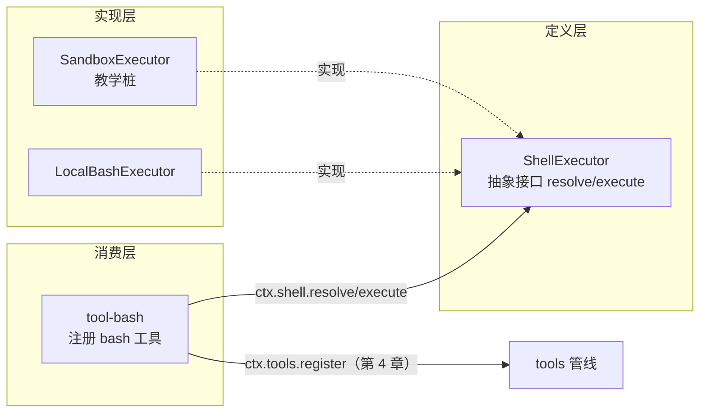

# 第 5 章 capability seam 三角色（以 shell 为例）

> 席位常在，演员可换；观众看戏，不问后台。

## 本章回答的问题

- 一个能力（比如「在哪台机器上跑 bash」）如何被拆成定义、实现、消费三个互不耦合的角色？
- **方法调用式 seam**（`resolve`/`execute` 两个抽象方法）与第 4 章的**事件瀑布式管线**（`tools/pre-execute → tools/execute → tools/post-execute`）有何本质区别？
- 为什么「换掉 `LocalBashExecutor`」，`ShellExecutor` 定义与消费者 `tool-bash` 可以一行不改？

第 4 章我们建起了 **tools 守卫管线**：`ctx.tools` 用 `waterfall` 串联 `tools/pre-execute → tools/execute → tools/post-execute`，让守卫（guard）在工具执行前后插入拦截。但那条管线的**兜底动作**——真正执行某个工具的 body——还只是一个「调用方自己写的函数」。本章回答：一个工具 body 里的**能力**（比如「在哪台机器上跑 bash」）如何被拆成定义、实现、消费三个互不耦合的角色。本章新增 `ch05/code/`，复用第 1 章 `cordis.py`（`Context`/`Service`）、第 2 章 `SystemPromptService`、第 4 章 `ToolDefinition`/`ToolRuntime`。

## 1. 把「能力」焊死在消费者体内

先看一个真实场景：你要给 agent 加一个 `bash` 工具，让它能执行 shell 命令。最直接的写法是——在工具体里 `import subprocess` 直接跑（`ch05/code/bad_example.py`，完整文件）：

```python
# ch05/code/bad_example.py（本章新增，可运行）
"""第 5 章反面示例：没有 capability seam 时的耦合写法。

仅标准库，Python 3.10+。运行：python3 bad_example.py

[教学定位] 用于 §1 的问题场景：如果消费者直接 import subprocess 跑 bash，
「在哪台机器跑」「怎么渲染退出码」全焊死在消费者体内，换 provider 必须改消费者。
对比正解：消费者只面向 ctx.shell 两个方法，换 provider 一行不改（见 main.py 第 5 段）。
"""
import subprocess


def run_bash_naive(command: str) -> str:
    """把「执行 bash」的实现细节直接写死在消费者里。

    问题：
    1. 换 provider（本地 → 沙箱/远程）必须改这一行，且所有调用点都要跟着改；
    2. 退出码/超时/取消的语义散落在调用方，没有统一的 marker 契约；
    3. 无法在组合期二选一 provider，也无法 mock 做测试。
    """
    p = subprocess.run(["bash", "-c", command], capture_output=True, text=True)
    return (p.stdout or "") + (p.stderr or "") + f"\n[exit code: {p.returncode}]"


if __name__ == "__main__":
    print(run_bash_naive("echo naive-no-seam"))
```

运行 `python3 ch05/code/bad_example.py`，实际输出：

```text
naive-no-seam

[exit code: 0]
```

这段代码能跑，但「在哪台机器上跑 bash」「怎么渲染退出码」**全部焊死在消费者体内**——连输出里的 `[exit code: 0]` 尾巴都是调用方自己随手拼的，带来三个问题：

1. **换不了实现**：某天你要把命令挪进沙箱（`bash-sandbox`）或换成 PowerShell（`pwsh-local`），就必须改 `run_bash_naive` 这一行——而且每个调用它的地方都要跟着改。没有一处「组合期二选一」的接缝，只能侵入消费者。
2. **退出码语义散落**：`[exit code: N]` 这个标记是**你自己**随手拼的字符串，换一个工具（比如 `pwsh`）又得再拼一遍；超时、被信号杀、被取消这些边界，调用方要么不管、要么各自发明一套表达。
3. **无法隔离测试**：要 mock 掉「执行」这一层来测上层逻辑，只能 monkey-patch `subprocess`，脆弱且泄漏实现细节。

本章用 **capability seam 三角色**解决这三个问题：把「跑 bash」这个**能力**（capability）拆成**定义**（Service Definition）、**实现**（Service Provider）、**消费**（Consumer）三份，各自独立、组合期拼装。

## 2. 机制一：Service Definition

> 本章逐模块拆解三角色，先给整体关系图，再按「定义 → 实现 → 消费」逐一拆解。



图里是**三种身份**：`ShellExecutor` 定义「能做什么」，`LocalBashExecutor`/`SandboxExecutor` 各自实现「怎么做」，`tool-bash` 只管「拿来用」。消费者 `tool-bash` 只认识 `ctx.shell`（指向 `ShellExecutor` 抽象），**不 import 任何具体 provider**；换 provider 只需在装配处换一行。下面先讲定义层。

### 2.1 概念引入：抽象接口 + 两个方法

**Service Definition（服务定义）** 是什么：一个能力对外承诺的**契约面**——它只声明「有哪些方法、各返回什么类型」，不写任何实现。在本章它就是抽象类 `ShellExecutor`，挂在每个容器 context 唯一的一个 `ctx.shell` 上。

它解决什么问题：没有它，消费者只能对着**具体实现**（`LocalBashExecutor`）编程，换实现就得改消费者。有了它，消费者对着**抽象接口**编程，任何「实现这两个方法」的类都能无缝替换。

直觉类比：定义层像**电源插座的标准**——它只规定「两个孔、220V、零火线」，不规定电从哪来；实现层是「火电厂 / 光伏 / 柴油发电机」，消费层是「插头」。你换发电方式，插头和插座标准一行都不用改。

### 2.2 内部实现：两个抽象方法即「方法调用式」seam

`ShellExecutor` 的契约面只有**两个抽象方法**（`@abstractmethod`），这就是本章核心论断里的「方法调用式 seam」：

| 方法 | 输入 | 输出 | 语义 |
|---|---|---|---|
| `resolve(request)` | `ShellExecRequest`（仅 `command` 必填） | `ShellExecSpec`（核心字段必填） | 填默认值、封顶超时 |
| `execute(spec)` | `ShellExecSpec` | `ShellExecution`（活句柄） | 准备并启动命令；**准备阶段失败才抛**，命令自身的失败不抛 |

`ShellExecSpec` 不是「全字段必填」，而是**核心字段必填**：`command`/`workdir`/`timeout_ms`/`on_expiry`/`stdout_max_bytes` 与 `sandbox_policy` 必填，`signal`/`stdin`/`env`/`dsh_env` 仍可缺省（`packages/shell/shell/src/types.ts:111-137`，`:123`、`:125`、`:132`、`:134` 四处 `?:`）。

「前台还是后台」**不是两个方法**，而是调用方等不等句柄上的 `result()`：等它就是前台，命令关闭时拿到切分好的 stdout/stderr 与**首因分类**（首因 = 先发生的终止原因，超时与取消竞争时只报一个；§3.2 展开）；不等、只留着句柄，就是后台，随时 `read_output()` / `kill()`。这个选择写在 `packages/shell/shell/src/index.ts:42` 的类注释里，不是方法签名的一部分。

失败口径分三层，全章统一按这一份说：

1. **命令自身的失败不抛**——非零退出、超时被杀、被取消，都折叠进 `result()` 的 `ShellRunResult`（`packages/shell/shell/src/index.ts:50-52`：`result` rejects only for infrastructure failures）。
2. **准备阶段失败会抛**——解析 argv、准备目录等步骤失败时，`execute` 直接抛（`index.ts:92` 的 `@throws on preparation failure or caller cancellation`；实现里对应 `packages/shell/bash-local/src/index.ts:242-246` 的 `disarm(); throw error`）。
3. **spawn 基础设施失败不抛、收敛成 killed 句柄**——同步或异步 spawn 失败时，`execute` 返回一个已结算为 `killed` 的句柄，错误本身由 `result()` 抛出（`packages/shell/bash-local/src/index.ts:251-254`、`:370-374`）；句柄的 `done` 永不 reject（`packages/shell/shell/src/index.ts:53-55`）。

关键在「方法调用式」四个字：消费者**直接调用** `ctx.shell.resolve(...)`、`ctx.shell.execute(...)`，像调普通对象方法一样。这与第 4 章的 **事件瀑布式** 管线形成正交对比——第 4 章 tools 是靠 `waterfall('tools/pre-execute' ...)` 沿事件名把多个监听器串起来，顺序由「事件链」决定；本章 shell 靠**抽象方法签名**把职责钉死，顺序由「调用者写死」。一个面向「事件流」，一个面向「方法接口」，二者可叠加：本章的消费者恰是第 4 章 tools 管线里的一个 tool body（见 §4）。

此外定义层还提供两个共享词汇表：`ShellExecRequest`（请求）与 `ShellExecSpec`（resolve 后的全量规格）。`ShellExecRequest` 的字段一次列全：`command` 必填；`workdir`/`timeout_ms`/`on_expiry`/`stdout_max_bytes`/`signal`/`stdin`/`env`/`dsh_env`/`sandbox_policy` 全部可选——`resolve` 的工作就是把这些可选字段补成一份完整 spec（核心字段必填，`signal`/`stdin`/`env`/`dsh_env` 仍可缺省；§3.2）。定义层还提供一个**共享 marker 契约** `parse_exit_status`（实现见 §2.3）：它把渲染结果尾部的两种退出状态标记——`[exit code: N]` / `[killed by signal: X]`——统一成一份函数，供所有消费者复用（解决问题 2「退出码语义散落」的一半）。

### 2.3 Python 重构

```python
# ch05/code/shell.py（本章新增）
# ... 第 1 章 Service 省略（构造即注册，ch01/code/cordis.py:241）...

class ShellExecutor(Service, ABC):
    def __init__(self, ctx):
        super().__init__(ctx, "shell")  # 挂到 ctx.shell（packages/shell/shell/src/index.ts:65-67）

    @property
    def sandbox_mode(self):
        return None

    @abstractmethod
    def resolve(self, request: ShellExecRequest) -> ShellExecSpec:
        raise NotImplementedError

    @abstractmethod
    def execute(self, spec: ShellExecSpec) -> ShellExecution:
        raise NotImplementedError
```

上面是接口骨架（其余词汇类型与 `parse_exit_status` 见 §2.2 表格与 `shell.py` 全文）。注意 `super().__init__(ctx, "shell")`：这是第 1 章 `Service` 基类的「构造即注册」——`ShellExecutor` 的每个子类实例化时，自动把自己挂到 `ctx.shell`。

严格说，第 1 章的 `provide` 是 dict 赋值，**同名静默覆盖**（`ch01/code/cordis.py:71`）：在同一 context 里先后构造两个 provider，后一个会悄悄顶掉前一个。所以「一个 context 只有一个 shell 服务」的正确打开方式，是**为每个 provider 装配一个新 context**——§4.4 会写出 `ctx2 = _assemble(lambda c: SandboxExecutor(c))`。消费者只需 `ctx.shell`，不必关心背后是哪个实现。

`execute` 返回的 `ShellExecution` 也是定义层的词汇（`packages/shell/shell/src/types.ts:226`）：它**继承** `ShellProcess` 句柄，再加一个 `result()` 前台投影。`ShellProcess`（`types.ts:188`）的字段是 `status`（枚举 `ShellProcessStatus`，取值 `running`/`completed`/`killed`）、`exit_code`、`signal`（教学版省略了 `observed`/`sandbox` 两个字段，见 §6）；方法是 `done()`（等待终态，永不 reject）、`read_output()`（增量读，连续两次读不重复交付）、`kill()`（幂等，已结束返回 false）。§4.3 里 `proc.status.value` 读的就是这个枚举的字符串值——后台句柄的当前状态。

`parse_exit_status` 剥离尾部标记的逻辑（对应源码 `packages/shell/shell/src/render.ts:37-43`，见 §6 源码对照表）：

```python
# ch05/code/shell.py（模块级函数）
def parse_exit_status(text: str) -> ParsedExitStatus:
    """共享 marker 契约：剥离尾部 [killed by signal: X] / [exit code: N]（render.ts:37-43）。

    tool-pwsh 与 tool-bash 复用同一份，保证展示层能回读退出状态。
    没有 marker 就是干净退出 0——所以渲染端对成功不写 [exit code: 0]。
    超时、沙箱拒绝这类 marker 留在 body 里：它们承载的事实没有对应的展示位置。
    """
    import re

    m = re.search(r"\n\[killed by signal: ([^\]\n]+)\]$", text)
    if m is not None:
        return ParsedExitStatus(body=text[: m.start()], signal=m.group(1))
    m = re.search(r"\n\[exit code: (\d+)\]$", text)
    if m is not None:
        return ParsedExitStatus(body=text[: m.start()], exit_code=int(m.group(1)))
    return ParsedExitStatus(body=text, exit_code=0)
```

它先匹配「被信号杀」，再匹配「非零退出码」，都没有则默认 `exit_code=0`。所以成功路径根本不写 marker——`render.ts:42` 的兜底分支就是 0；而超时 marker `[timed out after Nms]` 故意**不**被剥离，留在 body 里。这样展示层永远能回读退出状态，且 `tool-bash` 与 `tool-pwsh` 共用同一份契约。

### 2.4 回溯：解决了「换不了实现」，还剩「实现仍要自己写全」

定义层立起了抽象接口，消费者可以面向 `ctx.shell` 编程了——但这只解决了问题 1 的**一半**：接口有了，可**具体实现**还得有人写。`LocalBashExecutor` 要自己处理 `resolve` 的默认值封顶、`execute` 的 deadline 接线、句柄的 `status` 与 `result()`。如果这块逻辑每个 provider 各写各的，问题 2（退出码语义散落）依然存在。于是引出机制二。

## 3. 机制二：Service Provider

### 3.1 概念引入：一个接口，多个实现

**Service Provider（服务实现）** 是什么：实现了 `ShellExecutor` 两个抽象方法的**具体类**，把「怎么做」落实。本章的 `LocalBashExecutor` 是「在本地机器上用 bash 执行」的 provider。

它解决什么问题：定义层只给接口，不给行为。provider 是唯一知道「命令到底怎么跑起来」的角色——`resolve` 怎么填默认值、`execute` 怎么接 deadline、句柄怎么结算状态与 `result()`。把这块收敛进 provider 后，消费者**不再碰**任何退出码/超时/取消的拼接逻辑（问题 2 的剩余部分）。

直觉类比：provider 是「具体某个发电厂」——它关心煤怎么烧、电怎么发、出故障怎么停机，但对外只遵守「插座标准」那两个接口。

### 3.2 内部实现：resolve 填默认值，execute 接一条 deadline

`LocalBashExecutor` 的关键行为（四项）：

- **`resolve`**：把「只填了 command 的请求」填成一份完整 spec——`workdir` 取 `request.workdir ?? config.cwd ?? process.cwd()`（`packages/shell/bash-local/src/index.ts:132`），`timeout_ms` 做 clamp（未给用默认、超上限封顶），`on_expiry` 默认 `'kill'`（`:134`）；`stdout_max_bytes` 未给用默认且必须「正且有限」否则抛错。`stdin`/`env`/`dsh_env`/`sandbox_policy` 原样透传、**不给默认**（`:139-145`）。
- **`execute`**（`:187`）：转调 `executeArgv(spec, ['bash','-c', command])`。后者先按 `onExpiry` 接线：`'kill'` 时用**一条** deadline 融合「执行器超时」和「调用方取消」（`:213-222`），`'none'` 时不装 deadline、只靠 `kill()` 或 `signal` 停（`:224-227`）。准备阶段失败在这里抛（`:242-246`）；spawn 失败则收敛成 killed 句柄，错误留给 `result()`（`:251-254`、`:370-374`）。
- **句柄**（`:302-386`）：`status` 只结算一次（`running → completed | killed`，任何信号终止都算 killed）；`done` 永不 reject；`result()` 按需创建并 memoize，分类用 deadline 的**首因**——`timed_out` 与 `aborted` 互斥（`:218-221`）。
- **env 合并**：spawnSpec 里只有显式 env 映射 `{ ...ENV_OVERRIDES, ...spec.env, ...spec.dshEnv }`——`ENV_OVERRIDES`（`NO_COLOR`/`TERM=dumb` 等）垫底，调用方 `spec.env` 居中，受信 `dsh_env` 最高优先级（`:172`）。

下图是前台路径，突出「resolve 先于 execute」这一关键约定：


注意两条路径的**分工**：`resolve` 负责「把规格补齐」，`execute` 只消费已补齐的 spec、**不再二次取默认**（见 §4.2）。这保证了「换 provider」时，只要 `resolve` 语义一致，`execute` 收到的 spec 就一致。

### 3.3 Python 重构

```python
# ch05/code/bash_local.py（本章新增）
# ... 第 1 章 Service、§2 的 ShellExecutor/ShellExecSpec 等省略 ...

class LocalBashExecutor(ShellExecutor):
    """本地 bash 实现（bash-local/src/index.ts:97）。

    inject=['subprocess'] 在 TS 里由 cordis 注入；教学版改为构造参数显式注入。
    """

    inject = ["subprocess"]

    def __init__(self, ctx, subprocess, config=None):
        super().__init__(ctx)  # 挂到 ctx.shell
        self._subprocess = subprocess
        self.config = config or Config()
        assert_serviceable_bash_config(self.config)

    # -- resolve：把请求填默认值/封顶成 spec（bash-local/src/index.ts:120-147） --

    def resolve(self, request: ShellExecRequest) -> ShellExecSpec:
        assert_serviceable_bash_config(self.config)
        timeout_ms = _clamp_timeout(request.timeout_ms, self.config)
        stdout_max_bytes = (
            request.stdout_max_bytes
            if request.stdout_max_bytes is not None
            else self.config.max_output_bytes
        )
        _assert_positive_finite("request.stdout_max_bytes", stdout_max_bytes)
        return ShellExecSpec(
            command=request.command,
            # index.ts:132：request.workdir ?? config.cwd ?? process.cwd()
            workdir=request.workdir or self.config.cwd or os.getcwd(),
            timeout_ms=timeout_ms,
            # 真实版在这里填默认 'kill'（index.ts:134）；教学版的 'kill' 默认落在 ShellExecRequest 字段上
            on_expiry=request.on_expiry,
            stdout_max_bytes=stdout_max_bytes,
            # stdin/env/dshEnv/sandboxPolicy 原样透传，不给默认（index.ts:139-145）
            signal=request.signal,
            stdin=request.stdin,
            env=request.env,
            dsh_env=request.dsh_env,
            sandbox_policy=request.sandbox_policy,
        )
```

`resolve` 把请求填成完整 spec：三处默认值（`workdir`/`timeout_ms`/`stdout_max_bytes`）都在这落定，`stdout_max_bytes` 非法时抛错。`execute` 转调 `execute_argv`，下面看它如何消费 spec：

```python
# ch05/code/bash_local.py（LocalBashExecutor 的方法）
    def execute_argv(self, spec: ShellExecSpec, argv) -> ShellExecution:
        # 1. deadline 接线（bash-local/src/index.ts:213-227）
        if spec.on_expiry == "kill":
            deadline = Deadline(spec.signal, spec.timeout_ms)  # 一条 deadline 融合超时与取消
            def classify():
                return deadline.classify()      # 首因：timed_out 与 aborted 互斥
            spawn_signal = deadline
        else:
            def classify():                    # 'none'：不装 deadline
                return {"timed_out": False, "aborted": bool(getattr(spec.signal, "aborted", False))}
            spawn_signal = spec.signal

        # 2. spawn（index.ts:251-254）：同步 spawn 抛错被收进已结算的 killed 句柄，
        #    错误本身由 result() 抛出，done() 不 reject
        handle = None
        try:
            handle = self._subprocess.spawn(self.spawn_spec(spec, argv, spawn_signal))
        except Exception as error:
            spawn_error = error

        # 3. 句柄（index.ts:302-386）：status 只结算一次，result() 按需 memoize
        proc = ShellExecution(status=ShellProcessStatus.running)
        ...
        def done():
            if handle is None:                  # spawn 没产出进程：结算成 killed，不抛
                proc.status = ShellProcessStatus.killed
                return proc
            ...
        def result():
            if "value" in result_box:
                return result_box["value"]
            if handle is None:                  # 只有基础设施失败才 reject（index.ts:370-374）
                raise spawn_error
            outcome = handle.done
            result_box["value"] = ShellRunResult(
                exit_code=outcome.get("exit_code"),
                signal=outcome.get("signal"),
                timeout_ms=spec.timeout_ms,
                **classify(),
            )
            return result_box["value"]
```

`execute` 不抛「命令失败」异常，而是把「非零退出/超时/取消」全部折叠进 `result()` 的 `ShellRunResult`（`timed_out`/`aborted` 字段）。准备阶段的失败仍然会抛（§2.2 的第 2 层）；spawn 失败则走第 3 层——句柄照常返回、`done()` 正常结算，`result()` 才抛原始错误。

`[教学简化]` 摘录最后四行 `proc.done = done` 等把四个闭包直接挂成实例属性。Python 允许用实例属性覆盖类方法，教学版借此省掉四个句柄子类；生产代码应定义真正的 `ShellExecution` 子类，而不是在实例上挂函数。

`ctx.subprocess` 是第 6 章才展开的 seam，本章用一个教学桩 `SubprocessStub`（`bash_local.py` 内）占位：它的 `spawn` 用标准库 `subprocess.run` 同步执行、返回带 `done`/`read_from`/`terminate` 的句柄。真实行为是异步进程树管理，这里只保留「spawn→done」的机制面（`[教学简化]`，详见 §6 源码对照）。

### 3.4 回溯：实现有了，但消费者还是不会「用」

现在接口（定义）与实现（provider）都齐了，`LocalBashExecutor` 知道怎么跑 bash。但**光有这两个角色，agent 还是用不上它**——得有人把「bash 这个工具」注册进第 4 章的 `ctx.tools` 管线，并把「跑完的结果」渲染成模型能读懂的文本。这是问题 3（无法隔离测试 + 消费者各自拼逻辑）的真正解法，引出机制三。

## 4. 机制三：Consumer

### 4.1 概念引入：面向抽象，不认识实现

**Consumer（消费者）** 是什么：使用这个能力的一方。本章的 `tool-bash` 是一个**模块级插件**（plugin），`name`、`inject`、`apply` 都是模块级的元数据与函数。它属于第 1 章插件三形态（函数 / 类 / apply 对象）里的「apply 对象」：模块本身就是一个带 `apply` 属性的对象。它做两件事：往 system-prompt 注入一段「如何读退出标记」的指导，再把一个 `bash` 工具注册进 `ctx.tools`。`[教学简化]` 真实 cordis 里 `ctx.plugin(tool_bash)` 之后由容器读 `inject` 自动注入依赖再激活；本章教学版在 `main.py` 装配处手动调 `tool_bash.apply(ctx)`，`inject` 只是声明性元数据——真实版声明的依赖是 `['tools','shell','systemPrompt','shellEnv','workingDirectory']`（`packages/shell/tool-bash/src/index.ts:34`），教学版删去后两个，但依赖清单与插件体实际消费的服务仍一一对应。

它解决什么问题：消费者是唯一「面向用户/模型」的角色——它负责把 `ShellRunResult` 渲染成带 `[exit code: N]` 标记的可读文本，并决定「等 `result()` 拿前台结果，还是留着句柄走后台」。关键约束是：**它只 `import shell` 抽象，从不 `import bash_local`**，因此换 provider（比如把 `LocalBashExecutor` 换成沙箱实现）时，消费者**一行不改**。

直觉类比：消费者是「插头」——它只认插座标准（`ctx.shell` 两个方法），不认发电厂是谁。换个发电厂，插头照样插。

### 4.2 内部实现：execute 正是 tools 管线里的 tool body

`tool-bash` 的核心是 `execute(args, exec)`（`packages/shell/tool-bash/src/index.ts:478`）——这个函数**同时扮演两个正交角色**：

- 在 **tools 管线**（第 4 章）里，它是 `ctx.tools.register(defineTool({...}))` 注册的**一个 tool body**，被 `tools/execute` 瀑布的兜底 `dispatchToolBody` 调用；它同时提交 `output.render`（`packages/shell/tool-bash/src/index.ts:468`）负责把结果转成文本。
- 在 **shell seam**（本章）里，它是**消费者**：`resolve → execute`，再按前后台决定等不等 `result()`。

这正是本章与第 4 章的衔接点（§6 会展开）：**shell 三角色里的 Consumer，恰好是 tools 管线里的一个 tool body**。一个面向「方法接口」，一个面向「事件流」，正交叠加。

`[教学简化]` 上面这两段用的是真实版 API：`defineTool` + `output.render` + `execute(args, exec)`。第 4 章的教学版删掉了 `output` 契约，`execute` 只收 `args`，结果渲染（`render_result`）因此移进了工具体本身；`exec` 携带的 `signal` 取消链也省略了（见 §6）。

`execute` 的编排顺序：校验参数 → 组装 `ShellExecRequest` → **先 `resolve` 后 `execute`** → 前台等 `result()` / 后台留句柄。教学版的校验只做到「`command` 必填」（取 `args["command"]`），真实版的 `validateBashArgs`（非空 command/description、正数 timeout）省略。关键约定是「先 resolve 后 execute」：`execute` 收到的 spec 已带显式默认值，不再二次取默认。真实版还有三处分叉，教学版只保留其中一处：后台路径与「超时晋升」（超时后把前台命令提升为可查询的后台任务，教学版不实现）都用 `resolve({ ...request, onExpiry: 'none' })`（`packages/shell/tool-bash/src/index.ts:508`、`:517`），前台带 `signal: exec.signal` 走取消链（`:526`）。教学版只演示后台那次 `resolve(onExpiry:'none')`；真实版把返回的句柄注册进 `ctx.jobs` 长期持有，教学版没有任务系统，打印 `status` 后即丢弃句柄——所以后台命令在教学版里不会真正跑完，这不是 bug，是省略。

### 4.3 Python 重构

```python
# ch05/code/tool_bash.py（本章新增）
# ... 第 1 章 Context、第 4 章 ToolDefinition、§2 的 ShellExecRequest 省略 ...
# [教学简化] 真实版是 defineTool + output.render + execute(args, exec)；
# 教学版 execute 只收 args，渲染在工具体里调 render_result。

# 三角色之「消费者」：只面向 ctx.shell 抽象，不 import 任何具体 provider。
name = "tool-bash"
inject = ["shell", "systemPrompt", "tools"]


def apply(ctx: Context, config=None):
    """tool-bash 插件体（tool-bash/src/index.ts:202）：注入 guidance + 注册 bash 工具。"""
    # 1. guidance：教育模型读 [exit code: N] 标记（index.ts:251-255）
    ctx.systemPrompt.section("tool:bash", _guidance_text(), order=20)

    # 2. 注册 bash 工具：execute 即第 4 章 tools 管线里的一个 tool body
    def bash_tool(args):
        # 面向抽象：resolve → execute；消费者不认识 LocalBashExecutor（index.ts:491-530）
        request = ShellExecRequest(
            command=args["command"],
            workdir=args.get("workdir"),
            timeout_ms=args.get("timeout_ms"),
        )
        if args.get("run_in_background"):
            # 后台：onExpiry='none' 不装 deadline（index.ts:508）。
            # 教学版打印 status 后即丢弃句柄；真实版把句柄注册进 ctx.jobs 长期持有。
            spec = ctx.shell.resolve(dataclasses.replace(request, on_expiry="none"))
            proc = ctx.shell.execute(spec)
            return f"[started in background, status={proc.status.value}]"
        # 前台：resolve 一次，execute 拿到句柄，再等 result()（index.ts:526-528）
        spec = ctx.shell.resolve(request)
        proc = ctx.shell.execute(spec)
        result = proc.result()
        return render_result(result)

    ctx.tools.register(
        ToolDefinition(
            name="bash",
            description="执行 bash 命令（shell seam 消费者）",
            parameters={"command": "string", "workdir": "string?", "timeout_ms": "int?"},
            execute=bash_tool,
        )
    )
```

注意三处：`bash_tool` 里只出现 `ctx.shell.resolve/execute`——**没有任何 `LocalBashExecutor` 字样**，这是「消费者不认识实现」的直接证据；`ctx.systemPrompt.section` 复用第 2 章；`ctx.tools.register` 复用第 4 章。后台分支的 `proc.status.value` 读的是 `ShellProcess.status` 枚举的字符串值（`running`/`completed`/`killed`，字段说明见 §2.3）。`render_result` 负责写 marker：

```python
# ch05/code/tool_bash.py（模块级函数）
def render_result(result) -> str:
    """渲染 ShellRunResult：输出体 + marker（tool-bash/src/render.ts:28-66）。"""
    out = result.stdout
    if result.stderr:
        out += ("\n" if out and not out.endswith("\n") else "") + "[stderr]\n" + result.stderr
    if not out:
        out = "(no output)"

    markers = []
    if result.timed_out:
        # 命令可能捕获 SIGTERM 后 exit 0，所以超时独立成 marker（render.ts:53）
        markers.append(f"[timed out after {result.timeout_ms}ms]")
    if result.signal is not None:
        markers.append(f"[killed by signal: {result.signal}]")
    elif result.exit_code is not None:
        # [教学简化] 真实版 exitCode 可为 null（准备阶段即超时）；教学版走到 None
        # 时两种 marker 都不写，绝不输出 [exit code: None]。
        if result.exit_code != 0:
            # 非零退出报给模型判断，不抛工具错误（render.ts:59-60）
            markers.append(f"[exit code: {result.exit_code}]")
    if not markers:
        return out
    return out + ("" if out.endswith("\n") else "\n") + "\n".join(markers)
```

`render_result` 只在**需要**时写 marker：`[timed out after Nms]` / `[killed by signal: X]` / `[exit code: N]`；成功则什么都不写。这与 §2.3 的 `parse_exit_status` 正好互逆——读端把「没有 marker」兜底成 0，写端对 0 不写——写与读用**同一份契约**，保证了退出状态语义不散落（问题 2 彻底解决）。真实版还有第四种 `[stopped: reason]`（人从外部停掉任务，`render.ts:56`）与沙箱拒绝 marker，教学版没有任务系统与沙箱策略，故省去。

### 4.4 回溯：换 provider，消费者一行不改

三个角色齐了。现在兑现本章核心论断：**换掉 `LocalBashExecutor`，`ShellExecutor` 定义与消费者 `tool-bash` 一行不改**。本章新增第二个 provider 形态 `SandboxExecutor`（教学桩）来演示：

```python
# ch05/code/sandbox_executor.py（本章新增，教学桩；核心两段）
class SandboxExecutor(ShellExecutor):
    """模拟沙箱实现：与 LocalBashExecutor 同接口、不同行为。

    换 provider 演示：消费者 tool-bash 与定义 ShellExecutor 均不改一行，
    只需在装配处把 ctx.shell 从 LocalBashExecutor 换成 SandboxExecutor。
    """

    @property
    def sandbox_mode(self):
        return "sandbox"  # 与 LocalBashExecutor 的 None 形成对照（index.ts:74 的同一契约）

    def resolve(self, request: ShellExecRequest) -> ShellExecSpec:
        return ShellExecSpec(
            command=request.command,
            workdir=request.workdir or os.getcwd(),
            timeout_ms=request.timeout_ms or 120_000,
            on_expiry=request.on_expiry,
            stdout_max_bytes=request.stdout_max_bytes or 64 * 1024,
            ...
        )

    def execute(self, spec: ShellExecSpec) -> ShellExecution:
        self.log.append(spec.command)
        return _SandboxProcess(spec.command, spec.timeout_ms)
```

注意 `SandboxExecutor` 把 `resolve`/`execute` **两个方法全部实现**——换的是实现，不是接口；它的 `execute` 不真 spawn，而是把命令记进 `self.log` 并返回一个已结束的句柄，`result()` 给出两行字符串「已记录命令 / 未真正执行（教学桩）」，再由同一个 `render_result` 决定写什么 marker（成功，故不写）。

`main.py` 的替换发生在装配处，而且不是在同一 context 里改写 `ctx.shell`，而是**换一个 provider 工厂、装配一个新 context**（§2.3 已说明原因）：

```python
# ch05/code/main.py（装配段）
ctx = _assemble(lambda c: LocalBashExecutor(c, c.subprocess))   # §1–4 用本地实现
ctx2 = _assemble(lambda c: SandboxExecutor(c))                 # §5 换沙箱实现
```

`tool_bash.apply` 两次调用的是同一份代码，定义 `ShellExecutor` 一行未动。

## 5. 完整运行输出

运行方式：`python3 ch05/code/main.py`（所有机制讲解完毕，此处才展示端到端输出）。

```text
== 1. 装配容器 + 三角色就位 ==
  ctx.shell = LocalBashExecutor
  ctx.shell.sandbox_mode = None
  tool-bash inject = ['shell', 'systemPrompt', 'tools']
  system-prompt 的 tool:bash section 已注入：
    Check the [exit code: N] marker on every bash result; investigate failures before moving on.

== 2. 前台 execute → result()：成功不写 marker ==
hello-from-shell-seam

  [解析 marker] body='hello-from-shell-seam\n' exit_code=0（无 marker 兜底 0）

== 3. 非零退出：写 [exit code: N] marker ==
[stderr]
boom
[exit code: 3]
  [解析 marker] body='[stderr]\nboom' exit_code=3

== 4. 后台 execute：立即返回 running 句柄 ==
  [started in background, status=running]

== 5. 换 provider：ctx.shell 换成 SandboxExecutor ==
  ctx2.shell = SandboxExecutor
  ctx2.shell.sandbox_mode = sandbox
[sandbox] 已记录命令：rm -rf /tmp/dangerous
[sandbox] 未真正执行（教学桩）
  同一消费者 tool_bash 与定义 ShellExecutor 均未改一行。

== 6. 方法调用式 seam vs 事件瀑布式管线 ==
  shell seam：两个抽象方法（resolve/execute），消费者直接方法调用
  tools 管线：tools/pre-execute → tools/execute → tools/post-execute，事件瀑布
  二者正交：bash 工具体的 execute 正是 tools 管线里的一个 tool body
```

逐段溯源：

- 第 1 段：`main.py` 打印装配结果。`ctx.shell = LocalBashExecutor` 来自 `_assemble` 传入的 provider；`sandbox_mode = None` 是 `ShellExecutor` 默认值；`inject` 是 `tool_bash` 模块级元数据；section 文本来自 `tool_bash._guidance_text()`。
- 第 2 段：`echo hello-from-shell-seam` 经 `bash_tool → resolve → execute → result()` 真实执行，`stdout` 为命令输出；没有 marker，`render_result` 直接返回输出体；`[解析 marker]` 行是 `main.py` 调 `parse_exit_status` 回读，证明「无 marker 即 0」的兜底成立。
- 第 3 段：`exit 3` 的命令把 `boom` 写到 stderr、以 3 退出；`render_result` 拼出 `[stderr]` 段与 `[exit code: 3]`，`parse_exit_status` 能把两者拆回去——写读闭环。
- 第 4 段：后台 `execute` 立即返回，`status=running` 证明「句柄先于 `result()` 返回」。教学桩要等 `done` 被首次读取才真正 spawn，而这条路径把句柄丢掉了，所以命令实际没跑——这是 §4.2 说明的省略。
- 第 5 段：换 provider 后 `sandbox_mode = sandbox`，`rm -rf` 命令被沙箱记录而未真正执行，尾部不带退出 marker（成功路径）——消费者一行未改。替换发生在装配处：`ctx2 = _assemble(lambda c: SandboxExecutor(c))`（见 §4.4），不是在原 context 里改写 `ctx.shell`。
- 第 6 段：`main.py` 打印两条主线的正交对照。

## 6. 源码对照

> 本章机制讲解中不插源码摘录，此处集中给出对应源码位置与教学版差异。

`packages/shell` 是本章新引入的包族：`shell` 承载定义，`bash-local` 承载本地实现，`tool-bash` 承载面向模型的消费者。容器底座仍是第 1 章的 `Context`；`bash-local` 与 `tool-bash` 两个新包承载的是「实现」与「消费」两角。定义/实现/消费三份职责的划分与上游架构文档的 seam 定义一致（`docs/architecture.zh.md:142`：三者一并设计，单一角色不算 seam）。

| 本章机制 | 对应源码位置 | 教学版差异概括 |
|------|------|------|
| 三角色定义/实现/消费 | `packages/shell/shell/src/index.ts:64`、`packages/shell/bash-local/src/index.ts:97`、`packages/shell/tool-bash/src/index.ts:202` | 三角色结构一致；Python 用 `Service` 构造即注册替代 cordis 组合期装配 |
| `resolve/execute` 抽象方法 | `packages/shell/shell/src/index.ts:84`、`packages/shell/shell/src/index.ts:93` | 同签名；`abstract` → `abc.ABC` + `@abstractmethod`。HEAD 的抽象方法只有这两个；前后台由调用方等不等 `result()` 决定（`index.ts:42`） |
| `sandbox_mode` 默认 `None` | `packages/shell/shell/src/index.ts:74` | 同义；`get sandboxMode()` → `@property sandbox_mode` |
| `ShellExecRequest/Spec/RunResult` | `packages/shell/shell/src/types.ts:61`、`packages/shell/shell/src/types.ts:111`、`packages/shell/shell/src/types.ts:140` | 三个类型在 HEAD 是 `export interface`（只有 Config 用 `z.object()`）；教学版换成 `@dataclass`。`on_expiry` 真实版本来就有（`types.ts:68`、`:116`），教学版只是把它显式列进 Spec。字段差异：真实版 `stdout`/`stderr` 是 `CollectedOutput` 对象（带 `truncated`/`spillPath`），教学版是 `str`；真实版有可选的 `sandbox` 事实字段（`types.ts:163-164`），教学版省略；`exit_code` 在两边都允许 `null` |
| `ShellProcess` / `ShellExecution` 句柄 | `packages/shell/shell/src/types.ts:188`、`packages/shell/shell/src/types.ts:226` | 教学版保留 `status/done/read_output/kill` 与 `result()`；真实版还有 `observed`（另一路只读、不消费的读取）与 `sandbox` 事实，教学版省略 |
| `parse_exit_status` marker 契约 | `packages/shell/shell/src/render.ts:37` | 只认 `[killed by signal: X]` 与 `[exit code: N]` 两种，没有 marker 即 0；超时与沙箱 marker 故意留在 body（`:24-27`） |
| `LocalBashExecutor` 的 `resolve` 默认值封顶 | `packages/shell/bash-local/src/index.ts:120`、`packages/shell/bash-local/src/index.ts:132` | 同 `clamp` 与 `assertPositiveFinite` 语义；教学版 `assert_serviceable_bash_config` 只校验正数与 grace 上限 |
| 命令失败不 reject、基础设施失败才 reject | `packages/shell/bash-local/src/index.ts:242-246`、`packages/shell/bash-local/src/index.ts:251-254`、`packages/shell/bash-local/src/index.ts:370-374` | 同 §2.2 的三层口径：准备阶段失败直接抛（`:242-246`）；spawn 失败收敛成 killed 句柄、`result()` 才抛（`:251-254`、`:370-374`）。真实版 `deadline(spec.signal, spec.timeoutMs, 'BASH_TIMEOUT')` 融合超时与取消（`:216`），教学版用同步 `Deadline` 记录首因 |
| 句柄结算与首因分类 | `packages/shell/bash-local/src/index.ts:302`、`packages/shell/bash-local/src/index.ts:218-221` | 同「status 只结算一次、`timed_out` 与 `aborted` 互斥」；真实版异步推进，教学版同步桩一次跑完 |
| `ctx.subprocess` 依赖 | `packages/shell/bash-local/src/index.ts:98` | 真实版是进程树 seam（第 6 章展开）；教学版 `SubprocessStub` 用标准库 `subprocess.run` 同步执行，仅保留 `spawn/done/read_from/terminate` 机制面 |
| `tool-bash` 的 `execute` 编排 | `packages/shell/tool-bash/src/index.ts:478`、`packages/shell/tool-bash/src/index.ts:526-530` | 同「先 resolve 后 execute」；真实版从 `ctx.jobs` 走任务注册、`exec.signal` 走取消链、`ctx.shellEnv.collect` 采 `DSH_*` 快照，教学版全省略（消费者不 import provider 的论断仍成立） |
| `render_result` marker 写端 | `packages/shell/tool-bash/src/render.ts:28`、`packages/shell/tool-bash/src/render.ts:44-61` | 同「marker 只在需要时写、出口 marker 放最后」；真实版还有 `[stopped: …]` 与沙箱拒绝、升权提示（要求更高权限的提示），教学版只保留超时/信号/退出码 |
| `parseExitStatus` 的复用方 | `packages/shell/tool-bash/src/render.ts:126` | 真实版 `tool-bash` 从 `dsh-shell` 重导出，`tool-pwsh` 共用；教学版假设同一份契约 |

## 7. 小结与预告

本章用 **capability seam 三角色**把一个「能力」拆成**定义**（`ShellExecutor`：`resolve`/`execute` 两个抽象方法）、**实现**（`LocalBashExecutor` 本地 bash）、**消费**（`tool-bash` 注册 bash 工具）三份，兑现了「换掉实现、定义与消费者一行不改」的核心论断——这是「方法调用式」seam，与第 4 章 tools 的「事件瀑布式」管线正交叠加。

这套三角色不是一种实现细节，而是一条可以换形态复用的骨架。第 18 章把全书 seam 归成三条谱系：**方法调用式**、**事件瀑布式**、**空定义式**。本章是「方法调用式」的原型（定义声明抽象方法，消费者按固定顺序直接调）；「事件瀑布式」见第 4 章的 tools 守卫管线，不属于本三角色骨架。

本章骨架还会以另外两种形态再现。第一，**整包替换的 Provider**：第 6 章的 SSH provider family 把 `ctx.fs`/`ctx.subprocess`/`ctx.sandbox` 三个实现整包换到远端，定义与消费者零改动——换的粒度从「一个 provider」升到「一族 provider」。第二，**空定义式**：第 13 章的单槽排他注册表（`ctx.computerUse`/`ctx.browserUse`）与第 18 章的 `ctx.otel` 都属于这一类——定义层不声明任何抽象成员，语义全在消费者侧。

下一章将揭开本章埋下的伏笔：`LocalBashExecutor` 的 `inject=['subprocess']` 依赖的 `ctx.subprocess` 到底是什么——第 6 章展开 **subprocess seam**（进程树 / spawn / kill / signal），让 agent 真正在机器上做事。

## 8. 附录：关键概念速查表

> 只列本章定义的概念，按依赖关系分层（底层 → 上层）。

| 概念 | 一句话解释 | 依赖 |
|------|-----------|------|
| **Service Definition（服务定义）** | 能力对外承诺的契约面，只声明方法不写实现（本章 `ShellExecutor`） | —（底层） |
| **方法调用式 seam** | 消费者直接调抽象方法（`resolve/execute`），顺序由调用者写死 | Service Definition |
| **描述字段（descriptor）** | 定义层在抽象方法之外再公开只读描述字段（`language`/`isolation`），只供诊断与选择用；**不**构成新的 seam 形态，仍归「方法调用式」（`ctx.ptcRuntime` 见第 17 章；第 18 章据此归类） | Service Definition |
| **空定义式** | 定义层不声明任何抽象成员，也不带配置与默认值；可以有具体工厂或注册方法，但不要求 provider 实现任何东西，语义全在消费者侧。第 13 章的单槽排他注册表（`ctx.computerUse`/`ctx.browserUse`）只做组合期准入；第 18 章的 `ctx.otel` 只有两个工厂 | —（底层） |
| **词汇类型（DTO）** | 定义层与实现/消费共享的词表（`ShellExecRequest`/`ShellExecSpec`/`ShellRunResult`） | Service Definition |
| **marker 契约** | 退出状态尾缀标记的写（`render_result`：只在需要时写）与读（`parse_exit_status`：无标记即 0）闭环 | 词汇类型 |
| **Service Provider（服务实现）** | 实现抽象方法的具体类，唯一知道「怎么做」（`LocalBashExecutor`） | Service Definition |
| **整包替换 Provider** | 不换单个实现，而是一族 provider 一起替换（第 6 章 SSH：`ctx.fs`/`ctx.subprocess`/`ctx.sandbox` 三个契约各换一份远端实现） | Service Provider |
| **Consumer（消费者）** | 面向 `ctx.shell` 抽象使用能力的一方，不 import 具体 provider（`tool-bash`） | Service Definition、Service Provider |
| **capability seam 三角色** | 定义/实现/消费三分解耦一个能力的组织范式 | 以上全部 |

| Python 符号 | 源符号 |
|------|------|
| `ShellExecutor` / `LocalBashExecutor` | `ShellExecutor` / `LocalBashExecutor` |
| `resolve` / `execute` | `resolve` / `execute` |
| `ShellExecution` / `ShellProcess` | `ShellExecution` / `ShellProcess` |
| `ShellExecRequest` / `ShellExecSpec` / `ShellRunResult` | 同名（TS `camelCase` 字段 → `snake_case`） |
| `parse_exit_status` / `render_result` | `parseExitStatus` / `renderResult` |
| `tool_bash` / `apply` / `bash_tool` | `tool-bash` / `apply` / `execute` |
