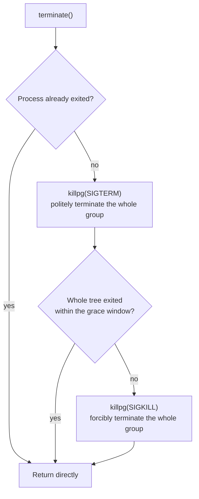
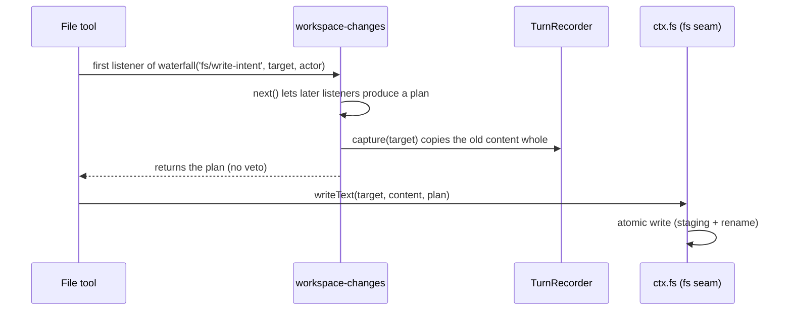
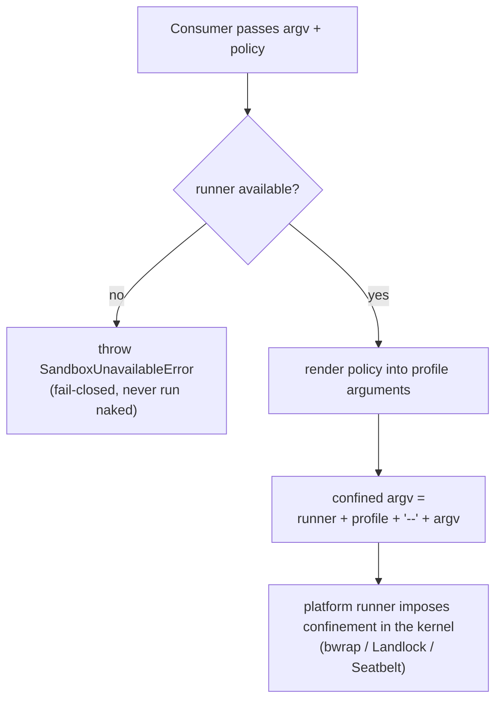
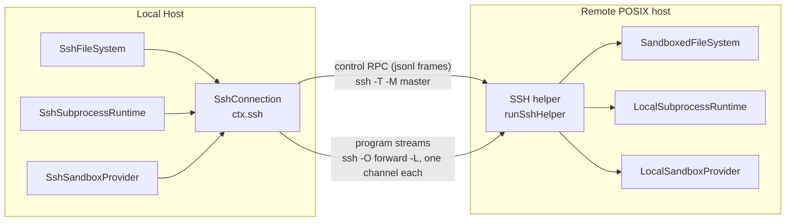

# Chapter 6: The Execution World of subprocess / shell / fs

> Every process is on the ledger, every overwrite leaves a trace, and a fence stands beyond the gate.

## Questions this chapter answers

- Why can't you hand the standard library's `subprocess` directly to the agent? What four things would be lost?
- What exactly does "process tree" mean? Why does terminate kill the entire tree rather than just the direct child?
- Why is the filesystem made into a seam instead of calling `os` / `open` directly?
- How does the sandbox manage to "wrap the runner without touching the tool layer"?
- Which files did one turn change, and who is watching? Why does the event carry only a turn number?
- To move the whole execution world to another machine, how many lines must consumers change?

In Chapter 5 we turned shell into a seam and got to know all three roles: `shell.py` is the definition, `bash_local.py` is the implementation, and `tool_bash.py` is the consumer. This chapter builds on that with three low-level services of the execution world — processes, files, and isolation — plus two cuts that push them to the limit: observing file changes turn by turn, and moving the entire execution world to the remote side.

If you open `bash_local.py`, you'll find it depends on a teaching stub `SubprocessStub`, whose docstring says it bluntly — "real process-tree management is deferred to Chapter 6". This chapter cashes in that promise.

shell is merely the "facade" of the execution world; what actually does the work is the trio:

- **`ctx.subprocess`**: the managed process tree. Spawning a process is not just calling `subprocess.run` once and being done — you also have to manage its entire tree, its exit semantics, its background registration, and its fallback reclamation.
- **`ctx.fs`**: the filesystem. Processes manage "motion", files manage "stillness" — versioned read / write / edit.
- **`ctx.sandbox`**: isolation. The first two let the agent act; the sandbox puts up a fence around it.

In terms of code relationships, this chapter **inherits** Chapter 5's `shell.py` / `bash_local.py` / `tool_bash.py` without changing a single line, and **adds** `subprocess_service.py` (replacing `SubprocessStub`), `fs_service.py`, `sandbox_service.py`, `bash_sandbox.py` (the sandbox's consumer), `workspace_changes.py` (change observation), and `remote_world.py` (the remote provider family). Reuse approach: `main.py` reuses Chapter 5's `bash_local.py` / `tool_bash.py` and the existing modules from Chapters 1/2/4 via sys.path; the ch06 directory holds only the files newly added in this chapter. shell is touched on only briefly in this chapter — `bash-sandbox` appears only as the sandbox's consumer, demonstrating "whole-provider migration: swap the executor without touching the tool layer". The title is named after the three domains of the execution facet; the sandbox is a fence spanning the three domains, not a fourth domain.

The second half of the chapter makes two cuts that tie it back to the book's main line. §3.5 follows fs to its third mechanism face — **change intent and snapshots** (whose change, which turn, how to look back). §6 moves all three providers to the remote side, proving that the seam the previous five chapters keep talking about is not a paper abstraction — both the observer and the remote providers are evidence that consumers change zero lines.

## 1. If the agent uses the standard library directly, it steps on three pitfalls

Imagine the agent wants to do something very ordinary: run a command that spawns child processes, and edit a config file along the way. Without the execution-world trio, it can only reach for the standard library directly (`ch06/code/bad_example.py`):

```python
import subprocess

# 坑 ① 进程管不好：失败即异常，退出码没被当成数据
try:
    subprocess.run(["bash", "-c", "exit 3"], check=True, capture_output=True)
except subprocess.CalledProcessError as e:
    print(f"坑①: 失败抛 {type(e).__name__}，模型拿不到干净的退出码")
# 而且：make 派生 gcc/cc1 时，kill 直接子进程杀不掉整棵树；后台任务无登记，卸载即泄漏

# 坑 ② 文件管不好：错误格式不统一，各是各的异常
try:
    open("no_such_dir/config.json").read()
except OSError as e:
    print(f"坑②: {type(e).__name__}，而不是统一的 [FS_NOT_FOUND] 错误码")

# 坑 ③ 没有隔离：危险命令无人设防
print("坑③: 没有 sandbox，rm -rf / 这类命令没有围栏")
```

Run output:

```text
坑①: 失败抛 CalledProcessError，模型拿不到干净的退出码
坑②: FileNotFoundError，而不是统一的 [FS_NOT_FOUND] 错误码
坑③: 没有 sandbox，rm -rf / 这类命令没有围栏
```

Three pitfalls, corresponding exactly to what this chapter's trio is meant to solve:

| # | Problem | Mechanism in this chapter |
|---|---|---|
| ① | Processes poorly managed: no tree management, no background registration, failure raises exceptions, no incremental reads | `ctx.subprocess` managed process tree |
| ② | Files poorly managed: inconsistent error formats, no path safety, no version guard | `ctx.fs` filesystem seam |
| ③ | No isolation: both processes and files are touchable, dangerous operations have no fence | `ctx.sandbox` isolation |

Pitfall ① is the most fatal. The moment you call `subprocess.run`, four things are lost:

1. **Process-tree management** — `make` spawns `gcc`, `cc1`; killing only the direct child leaves the grandchildren running;
2. **Background registration** — background tasks have no roster; when the context unloads, processes leak;
3. **Unified exit semantics** — failure raises `CalledProcessError`, but what the model needs is "the exit code is data, never raise";
4. **Incremental reads** — large output can only be captured all at once; you can't read while it runs. Also, credential-like variables from the parent environment are passed through to the child as-is — they must be scrubbed before spawn.

Let's break them down one by one. Processes first.

## 2. ctx.subprocess: The Managed Process Tree

### 2.1 Concept introduction: minimal example

**What it is**: `ctx.subprocess` is the "managed process tree" seam. `spawn` returns a handle; `handle.done` blocks until **the entire tree** converges and returns a unified result (the exit code is data, never raises); `handle.terminate()` is the only termination verb — SIGTERM → grace window → SIGKILL, applied to **the entire process group**; when the context unloads, all managed processes are reclaimed as a fallback.

**What problem it solves**: the four things lost in problem ① — tree management, background registration, unified exit semantics, incremental reads.

**Analogy**: like a process shepherd. `subprocess.run` is "let one sheep out and wait for it to come back on its own"; `ctx.subprocess` is "build a roster for the whole flock, and at dusk (dispose) drive every single one back — and for any that ran off, tell you explicitly which one didn't come back".

**Minimal example** (minimal runnable example, same caliber as §3.1/§4.1): inline example, run under `ch06/code/`; import paths are assembled via the same sys.path scheme as `ch06/code/main.py` (reusing existing modules from Chapters 1/4/5):

```python
from cordis import Context
from subprocess_service import SubprocessService

ctx = Context()
SubprocessService(ctx)                    # 构造即注册到 ctx.subprocess
handle = ctx.subprocess.spawn(["echo", "hello"])
result = handle.done                      # 阻塞等整树收敛，返回统一结果
print(result["exit_code"], repr(result["stdout"]))   # 0 'hello\n'
```

### 2.2 Internal implementation

At the macro level, one `spawn` to convergence goes through four things: **detached tree root → output collection → unified wait → three-stage termination**.

1. **Detached tree root**: on POSIX, `Popen(..., start_new_session=True)`; the child becomes its own process group, and the tree root's pid == the process group's pgid. This is the premise of "killing the whole tree" — with an independent process group, `killpg` can sweep them all up in one net.
2. **Output collection**: two reader threads push stdout/stderr into `OutputCollector`s for incremental reads via `read_output()` — reads do not clear the collector and can be repeated; tail takes the most recent N bytes, and offset (`read_delta`) takes the increment since the last read position.
3. **Unified wait**: `handle.done` blocks until the process exits (optionally with a timeout), collects the reader threads, and returns `{exit_code, stdout, stderr, timed_out, killed}` — the exit code is data, never raises.
4. **Three-stage termination**: `terminate()` first does `killpg(SIGTERM)`, waits one grace window, and if still alive does `killpg(SIGKILL)`; the grace value comes from the `main.py` assembly parameter `grace_ms=200` (the `_assemble` default).

Point 4 is the soul; the escalation chain is as follows:



Why "the whole group" rather than "the direct child"? Because **the leader exiting ≠ the tree exiting**: even if `make` exits, the `gcc`, `cc1` it spawned are still running; only `killpg` on the process group guarantees the whole tree converges. Why wait a grace window after SIGTERM? To give the processes a chance to clean up gracefully (flush to disk, release locks); only if they refuse to exit do we escalate to SIGKILL — this is exactly "courtesy first, force later".

Two accompanying things: **background registration** — every `spawn` issues a unique `spawn_id` recorded in the roster `_managed`, and `dispose` terminates them one by one, eliminating process leaks; **scrub_env** — before spawn, first strip credential-like variables from the parent environment (names containing KEY/TOKEN/SECRET/…) and `DSH_*`-prefixed variables, then merge the explicit env; sensitive values are never automatically passed through to the child.

### 2.3 Python reconstruction

The teaching version lands in `ch06/code/subprocess_service.py`: what is exposed to the consumer (`bash_local.py`) is still Chapter 5's four verbs `spawn/done/read_output/kill`, swappable without changing a single line; `terminate` is the internal termination verb newly added in this chapter — `kill()` marks killed and then delegates to `terminate()` for escalation (SIGTERM → grace → SIGKILL, whole group). The handle layer's `read_output()` internally delegates to the collector's `read_delta()` (offset-based incremental read). First look at environment scrubbing — the explicit env is merged only **after** scrubbing. What follows is the module-level function `scrub_env`:

```python
def scrub_env(parent_env):
    """剔除父环境里的凭据形变量与 DSH_* 前缀变量（packages/subprocess/subprocess/src/index.ts:66 scrubbedParentEnv）。

    显式 env 在 scrub 之后合并——父环境只贡献 PATH 这类基础变量，
    敏感值一律不自动透传给子进程。
    """
    return {
        key: value
        for key, value in parent_env.items()
        if not _SENSITIVE_ENV_RE.search(key) and not key.startswith(DSH_ENV_PREFIX)
    }
```

`SubprocessService.spawn`: detached tree root + output collection + background registration, all in one shot:

```python
    # 以下是 SubprocessService.spawn 的方法体
    def spawn(self, argv, workdir=None, env=None, timeout_ms=None):
        """spawn 全显式、无默认（packages/subprocess/subprocess/src/index.ts:153）：先 scrub 父环境再合并显式 env。"""
        full_env = scrub_env(dict(os.environ))
        if env:
            full_env.update(env)
        proc = subprocess.Popen(
            argv,
            cwd=workdir,
            env=full_env,
            stdout=subprocess.PIPE,
            stderr=subprocess.PIPE,
            start_new_session=True,  # detached 树根：自成进程组（spawn.ts:471 detached）
        )
        stdout_c, stderr_c = OutputCollector(), OutputCollector()
        handle = SubprocessHandle(proc, stdout_c, stderr_c, self._grace_ms, timeout_ms)
        handle._threads = [
            threading.Thread(target=_pump, args=(proc.stdout, stdout_c), daemon=True),
            threading.Thread(target=_pump, args=(proc.stderr, stderr_c), daemon=True),
        ]
        for thread in handle._threads:
            thread.start()
        # 后台登记：每个受管进程都有唯一 spawn_id，dispose 时统一回收。
        handle.spawn_id = self._next_id
        self._managed[self._next_id] = handle
        self._next_id += 1
        return handle
```

`SubprocessHandle.terminate`: the only termination verb, three-stage escalation, applied to the entire process group (note that it does not live in the same class as `spawn`):

```python
    # 以下是 SubprocessHandle.terminate 的方法体
    def terminate(self):
        """唯一终止动词（packages/subprocess/subprocess-local/src/spawn.ts:370）：SIGTERM → grace 窗口 → SIGKILL。

        作用于整个进程组（detached 树根），而非只杀直接子进程：
        领导者退出 ≠ 树退出，升级必须跨整树存活。
        """
        if self._proc.poll() is not None:
            return  # 已退出
        try:
            pgid = os.getpgid(self._proc.pid)
        except (ProcessLookupError, PermissionError):
            return
        try:
            os.killpg(pgid, signal.SIGTERM)  # 第一段：礼貌终止整组
        except ProcessLookupError:
            return
        deadline = time.monotonic() + self._grace_ms / 1000  # grace 窗口
        while time.monotonic() < deadline:
            if self._proc.poll() is not None:
                return
            time.sleep(0.01)
        try:
            os.killpg(pgid, signal.SIGKILL)  # 第二段：强制终止整组
        except ProcessLookupError:
            pass
```

Two closing things: `handle.done` (`_wait_for_exit`) blocks until exit, collects the reader threads, and folds the three paths exit/timeout/killed into a unified result dict `{exit_code, stdout, stderr, timed_out, killed}` — the exit code is data, never raises (implementation at `ch06/code/subprocess_service.py:134-152`); `SubprocessService.__init__` registers `_dispose_managed` via `ctx.effect`, and when the context unloads it terminates the managed processes in the roster `_managed` one by one, as a fallback against leaks.

[Teaching simplification] The real `OutputCollector` spills old output beyond maxBytes to an exclusive temporary file with 0600 (readable/writable only by the file owner); `waitForExit` uses `/proc` parsing + `kill(-pgid, 0)` to probe **whole-tree** liveness; the teaching version omits spill and approximates whole-tree state with the tree root's `poll()` inside the grace window — because SIGKILL acts on the whole group, convergence is still guaranteed.

### 2.4 Recap: processes are managed, files are not yet

All four things lost in problem ① are back: detached + `killpg` manages the tree, `_managed` + dispose manages registration, `done` manages unified exit semantics, and `read_output` manages incremental reads. But the agent doesn't just run commands — it also edits files — and using `open` directly is problem ②.

## 3. ctx.fs: The Other Half of the Execution World — the Filesystem

### 3.1 Concept introduction: minimal example

**What it is**: `ctx.fs` is the filesystem seam — a read/write interface with version tokens. `read` returns the content plus one opaque version token; `write`/`edit` on an existing file must carry `base_version`; all failures are unified into `FsError(code, path, message)`.

**What problem it solves**: problem ②. Concurrent file edits by the agent, blind overwrites, path escapes — under bare `open` all of these are silent accidents; `ctx.fs` turns "read before write" into a protocol and turns accidents into rejections with error codes.

**Analogy**: an archive-room clerk. Direct `open` is barging into the storage room and rummaging through files yourself; `ctx.fs` is a registration system — when you take a file you get a receipt (version token), and when you return it after editing you show the receipt: never taken out, no editing allowed; receipt expired, no editing allowed either.

**Minimal runnable example** (`ch06/code/fs_service.py`):

```python
import tempfile
from cordis import Context
from fs_service import FileSystem

ctx = Context()
FileSystem(ctx, root=tempfile.mkdtemp())  # 构造即注册为 ctx.fs
w = ctx.fs.write("a.txt", "v1")           # 新文件：无需版本直接写
r = ctx.fs.read("a.txt")                  # 读返回 content + version
ctx.fs.write("a.txt", "v2", base_version=r["version"])  # 带版本写
```

### 3.2 Internal implementation

Four mechanisms, from outside in:

1. **Unified error format**: all failures raise `FsError` with stable error codes (`FS_NOT_FOUND`, `FS_IS_DIR`, `FS_PATH_ESCAPE`, `FS_NOT_OBSERVED`, `FS_STALE_VERSION`, `FS_EDIT_NO_MATCH`, `FS_NOT_DIR`). Consumers catch only one exception type and branch on the code, without parsing free text (the `read()`/`list()` implementations are omitted; see `ch06/code/fs_service.py`: FS_NOT_FOUND=read on a nonexistent file, FS_NOT_DIR=list on a non-directory). The error-code vocabulary is owned by `FsErrorCode` at `packages/fs/fs/src/types.ts:209`.
2. **Path safety**: `_resolve` first normalizes with `realpath` (resolving symlinks and `..`), then verifies the result falls inside the workspace root — escape is rejected directly, no partial success (`resolveLocalTarget` at `packages/fs/fs-local/src/fsio.ts:179`).
3. **Atomic write**: first write a staging file in the same directory, then `rename` into place (`writeFileAtomic` at `packages/fs/fs-local/src/fsio.ts:618`). rename is atomic; readers always see either the old full text or the new full text, never a half-written file.
4. **Version guard**: `_version_of` takes the first 16 chars of the content's sha256 as the opaque token. When writing an existing file: no `base_version` → `FS_NOT_OBSERVED` (trying to edit without reading); present but doesn't match the current version → `FS_STALE_VERSION` (you read an old version; someone edited in between). The real version's two checks for existing files are at `packages/fs/fs-local/src/index.ts:354-363`.

[Teaching simplification] The real version's token is produced by `versionOf` (`packages/fs/fs-local/src/fsio.ts:76`) — it is inode metadata (`dev:ino:size:mtimeNs:ctimeNs`), not a content hash; the teaching version's sha256 prefix only illustrates "content changes, token changes". The write path also has `withLock` serialization (`packages/fs/fs-local/src/index.ts:124`) and `patchText` patch-style writes (`packages/fs/fs/src/index.ts:324`, with patch parsing at `packages/fs/fs-patch/src/parse.ts:140` and application at `packages/fs/fs-patch/src/apply.ts:65`); the teaching version uses the sha256 prefix to illustrate token semantics and omits locking and search.

### 3.3 Python reconstruction

The teaching version lands in `ch06/code/fs_service.py`. First look at the unified error format — what follows is the module-level exception class `FsError`:

```python
class FsError(Exception):
    """统一错误格式：一个错误码 + 路径 + 人话消息（packages/fs/fs/src/types.ts:209 FsErrorCode）。

    消费者只需 catch FsError 读 .code，不必分辨 FileNotFoundError /
    PermissionError / IsADirectoryError 等一堆标准库异常。
    """

    def __init__(self, code, path, message):
        super().__init__(f"[{code}] {path}: {message}")
        self.code = code
        self.path = path
```

Path safety `FileSystem._resolve` and atomic write + version guard `FileSystem.write`:

```python
    # 以下是 FileSystem._resolve 的方法体
    # -- 路径安全：realpath 身份 + workspace 包含（fsio.ts:179 resolveLocalTarget + containment.ts:58 isPathUnder） --

    def _resolve(self, path):
        """把相对路径锚定到 workspace 根，并拒绝逃逸（canonicalize-then-contain）。"""
        resolved = os.path.realpath(os.path.join(self._root, path))
        if resolved != self._root and not resolved.startswith(self._root + os.sep):
            raise FsError("FS_PATH_ESCAPE", path, "路径逃逸 workspace 边界")
        return resolved
```

```python
    # 以下是 FileSystem.write 的方法体
    def write(self, path, content, base_version=None, actor=None):
        target = self._resolve(path)
        if os.path.isdir(target):
            raise FsError("FS_IS_DIR", path, "目标是目录")
        if os.path.exists(target):
            # 已存在的文件必须先 read 观察再写，杜绝盲覆盖。
            if base_version is None:
                raise FsError("FS_NOT_OBSERVED", path, "写入前必须先 read 观察")
            if self._version_of(target) != base_version:
                raise FsError("FS_STALE_VERSION", path, "版本已变化，写入被拒")
        # 意图瀑布：在落盘之前广播（真实版由 tool-fs 的 write 工具触发），
        # 监听器（如 workspace-changes）趁旧内容还在时整份拷贝。
        self._intent("fs/write-intent", target, actor)
        return self._write_atomic(target, content)

    def _write_atomic(self, target, content):
        """原子写：先写临时 staging，再 rename 落位，避免半截文件。"""
        staging = f"{target}.staging-{os.urandom(4).hex()}"
        try:
            with open(staging, "w", encoding="utf-8") as f:
                f.write(content)
            os.rename(staging, target)
        finally:
            if os.path.exists(staging):
                os.remove(staging)
        return {"version": self._version_of(target)}
```

`edit(path, old, new, base_version)` is a "read-modify-write" wrapper: first `read` to get the current content and version; if the caller passed `base_version` and it doesn't match the observed version, raise `FS_STALE_VERSION`. If `old` doesn't hit, raise `FS_EDIT_NO_MATCH`; if it hits, replace the first occurrence, then pass the **version just read** to the atomic write as the guard — if someone else got in between the read and the write, the write is rejected.

### 3.4 Recap: files are managed, but there is no fence

Problem ② is solved: blind writes become `FS_NOT_OBSERVED`/`FS_STALE_VERSION` rejections, escapes become `FS_PATH_ESCAPE` rejections, and half-written files are eliminated by atomic writes. But processes and files being under control does not mean safety — the agent can still run **arbitrary commands**, which is problem ③.

But hold off on the sandbox for a moment. Atomic writes and version guarding govern "don't break a single write"; they cannot answer another question: **which files did this turn actually change?** The agent runs for five minutes, and the user wants to know "what did it do to my project". Counting tool-call log lines by hand is the dumbest way. The question list at the start of this chapter already mentioned it ("Which files did one turn change, and who is watching?"), and it lands exactly on the third mechanism face of `ctx.fs`.

### 3.5 The third mechanism face of fs: change intents and snapshots

**What it is**: before a file is modified, `ctx.fs` broadcasts an **intent waterfall** (a pluggable intercept point before a file is modified, used to capture the old content whole while it is still there) — `fs/write-intent`, `fs/edit-intent`, `fs/delete-intent`, three events. A listener at that moment still sees the **old content**. The `workspace-changes` plugin hangs on the waterfall and copies the file whole before it changes; at the end of a turn it takes a second snapshot, compares the two, and derives the turn's change list. The recorder is called **TurnRecorder**, and the event it produces is `workspace/changes` (an address event carrying only a turn number; the summary stays on the Host).

**What happens without it**: the tool-call log only says "called write with this text", not "what the file actually became on disk", and certainly not the changes that **bypass the file tools** (say, `patch` changing five files at once). `git diff` in the command line can fill the gap, but the agent runs inside the user's workspace, and temporarily touching the user's git index is an intrusion. What readers need is a **read-only observer**: it does not pollute the repository, does not change user state, and answers per turn.

**Analogy**: a dashcam. It does not steer; it takes one picture on departure and one on arrival, and comparing the two frames is "what happened on this trip". At the critical junction on the way (the instant before a write) it takes an extra shot, because some files no longer exist at the destination — without that mid-way frame, their original form would be lost forever.

#### 3.5.1 Intent comes before the pen, not after

The first shape of the new mechanism is "when the waterfall fires". All three intent events fire **before the real write to disk**; the listener receives the already-resolved target with content still unchanged:



The real trigger point is not inside `LocalFileSystem` but at the tool layer: `packages/fs/tool-fs/src/write.ts:121`
first calls `waterfall('fs/write-intent', target, exec, () => undefined)`, then hands the resulting plan to
`ctx.fs.writeText` (`packages/fs/tool-fs/src/write.ts:124`). Editing goes through `fs/edit-intent` at
`packages/fs/tool-fs/src/edit.ts:133`, and deleting a file inside a patch goes through `fs/delete-intent` at
`packages/fs/tool-fs/src/patch/plan.ts:80` (lines `plan.ts:81`/`:92` are the edit and write paths).

[Teaching simplification] The real version fires the intent waterfall at the tool layer; the teaching version has no tool layer, so it intercepts inside `write`/`edit`/`delete` of `ch06/code/fs_service.py`.

The waterfall's semantics differ from ordinary events: **the last argument is the innermost `next`, and the first listener that does not call `next()` owns the decision**. All three registrations in `workspace-changes` carry `{ prepend: true }` (`packages/deliverables/workspace-changes/src/index.ts:164-178`), so it sits at the outermost layer of the waterfall: it runs first, `await next()` first (by which point the inner policy plugin has produced its plan), and finishes the capture before returning.

#### 3.5.2 TurnRecorder: three things per turn

**TurnRecorder** (the recorder that takes a baseline tree at turn start, captures before each change, and produces a diff at turn-stopping; `packages/deliverables/workspace-changes/src/recorder.ts:107`) is one per session and works turn by turn:

| When | Action | Source |
|---|---|---|
| `turn/start` | Take the **baseline snapshot** — what the whole working tree looks like right now | `packages/deliverables/workspace-changes/src/recorder.ts:131`, `start()` |
| Every `fs/*-intent` | **Capture before the change** — copy the target file whole; once per path per turn | `packages/deliverables/workspace-changes/src/recorder.ts:155`, `capture()` |
| `agent/turn-stopping` | Take the **second snapshot**, compare the two, derive the change list, append the event | `packages/deliverables/workspace-changes/src/recorder.ts:181`, `stopping()` |

The three parts each do their job and none can be dropped; this "snapshot triad" is the only structure to remember from this section:

- **Baseline snapshot** answers "what it looked like before the turn". Without it, you cannot tell "added this turn" from "already there last turn".
- **Capture before the change** covers the blind spot. Baseline and second snapshot only see the two ends; a file created and deleted inside the turn is invisible at both ends, and the mid-way capture is the only evidence it ever existed.
- **Second snapshot** answers "what it looks like after the turn". Capture alone is not enough either: changes that bypass the file tools (an `mv` in shell, say) never fire an intent, and only a whole-tree comparison can see them.

`turn/end` also records once more (`packages/deliverables/workspace-changes/src/recorder.ts:191`, `end()`), but only when nothing has been recorded since the turn's last tool result — this covers aborted, failed, and steered turns without repeating a failed attempt.

#### 3.5.3 The event carries only an address; the summary stays on the Host

When a turn ends, the event that lands in the session log is a single line of address:

```ts
// packages/deliverables/workspace-changes/src/types.ts:106
declare module '@deepseek-ai/dsh-session/types' {
  interface SessionEventMap {
    'workspace/changes': { turn: number }
  }
}
```

`{ turn: number }` — just the turn number, no file names, no line counts, no diff. The full summary and each file's before/after content stay in Host memory, and the client comes back with `(sessionId, seq)` to fetch them: `ctx.workspaceChanges.summary(sessionId, seq)` (`packages/deliverables/workspace-changes/src/types.ts:86`) returns the summary, and `ctx.workspaceChanges.diff(sessionId, seq, index, signal)` (`packages/deliverables/workspace-changes/src/types.ts:96`) returns one file's comparison by index.

Why so stingy? Because **logs get replayed and copied** (Chapter 3). Stuffing a whole turn's diff into the event would write workspace content into every subscriber's log; keeping only an address lets the event travel safely across processes, with content served on demand by the side that owns the workspace.

The cost is written down explicitly: summaries and snapshots live only inside this Host process. If the user closes the client, the Host restarts, and the same conversation is reopened, the old turns' change cards **cannot be fetched**. This is not a bug; the upstream README calls it "the decided behavior" — a card whose content the Host can no longer open is better not shown at all.

The two content sources behind `diff` also explain why the triad needs three parts: for paths the snapshots cover, both sides are read from the snapshot trees; for paths the snapshots do not cover (ignored files, files outside the repository, a workspace with no git at all), both sides are read from the pre-change copy and the end-of-turn copy.

#### 3.5.4 Python reconstruction: a minimal version without git

The teaching version lands in `ch06/code/workspace_changes.py`. So that "snapshots" work on a machine without git, the baseline snapshot is simulated by `{relative path: content sha256}`, the pre-change capture stores bytes, and comparison uses the standard-library `difflib`:

```python
class TurnRecorder:
    """每会话一个记录器：一轮里「基线快照 → 改前捕获 → 收尾二次快照」。"""

    def start(self, turn: int) -> None:
        self._turn = turn
        self._baseline = _snapshot(self._root)   # turn/start：整棵树拍一遍
        self._captures.clear()

    def capture(self, absolute: str) -> None:
        if self._turn is None or not os.path.isfile(absolute):
            return
        rel = os.path.relpath(absolute, self._root)
        if rel in self._captures:                # 同一路径一轮只捕一次
            return
        with open(absolute, "rb") as f:
            data = f.read()
        self._captures[rel] = (_sha256(data), data)

    def stopping(self, turn: int, session) -> int | None:
        after = _snapshot(self._root)            # 二次快照
        changed = []
        for rel in sorted(set(self._baseline) | set(after) | set(self._captures)):
            if self._baseline.get(rel) == after.get(rel) and rel not in self._captures:
                continue
            ...
        summary = {"turn": turn, "files": changed}
        # 事件只有 turn 号；摘要按 seq 存在 Host 侧
        seq = session.append("workspace/changes", {"turn": turn}, summary)
        self._records[seq] = summary
        return seq
```

The host-side `WorkspaceChanges` attaches the three intent events via `ctx.on`; in the callback it calls `next_()` first and then `capture(target)`, matching the real version's `prepend` order. It also attaches `turn/start` and `agent/turn-stopping` to drive the recorder. (The code also attaches a `tools/pre-execute` hook to `_wait_settled`, which is empty in the teaching version — the real version waits there for the snapshot queue to settle, so a tool cannot mutate a file ahead of the baseline snapshot; the teaching version runs synchronously, so there is nothing to wait for.)

[Teaching simplification] The teaching version has no session log; `_InMemorySession.append` returns an increasing `seq` as the address. The real version writes into Chapter 3's session event stream, and after a restart the Host decides whether it can still serve the lookup.

[Teaching simplification] The real version uses a temporary git index plus a temporary object directory to take trees, leaving the repository's own index and object store read-only, and compares the complement of the snapshot coverage using whole-file copies; the teaching version simplifies both ends into file copies plus hashes, omitting git, ignore rules, binary and oversized-file handling. The **separation** of events and summaries is preserved — that is exactly the mechanism this section is about.

Change observation answers "what changed this turn", but it is still only an **observer**: files can be modified and commands can run, with no fence whatsoever. Back to problem ③ — the agent can still execute arbitrary commands, so the sandbox should take the stage.

## 4. ctx.sandbox: Isolation

### 4.1 Concept introduction: minimal example

**What it is**: `ctx.sandbox` is the isolation seam. Its core job is `confine(argv, policy)` — wrapping the raw argv into "runner + profile + `--` + argv"; the accompanying approval face `approve_escalation` governs the "widening ladder" of policy escalation. The actual confinement is imposed at the kernel level by a platform runner (Linux bwrap/Landlock, macOS Seatbelt); the provider itself performs no isolation logic.

**What problem it solves**: problem ③. The isolation policy travels with each call, fail-closed, escalation may only widen — all three disciplines are baked into the seam contract, so consumers have no entry point to run naked even if they wanted to.

**Analogy**: an airport security gate. The sandbox does not pat anyone down itself; it only escorts people to the gate (runner) and hands over the boarding pass (profile). The gate is where the pat-down happens. No gate? Then nobody gets in — refuse rather than let through.

**Minimal runnable example** (`ch06/code/sandbox_service.py`; `landlock-run` is an illustrative runner name — the teaching version's actual `runner_argv` is `[python3, mock_runner.py]`, see §4.3):

```python
from cordis import Context
from sandbox_service import SandboxProvider, SandboxPolicy, SandboxMode

ctx = Context()
SandboxProvider(ctx, runner_argv=["landlock-run"])  # 构造即注册为 ctx.sandbox
policy = SandboxPolicy(mode=SandboxMode.WORKSPACE_WRITE, workspace_root="/tmp/ws")
confined = ctx.sandbox.confine(["bash", "-c", "echo hi"], policy)
print(confined.argv)
# ['landlock-run', '--mode', 'workspace-write', '--workspace', '/tmp/ws', '--', 'bash', '-c', 'echo hi']
```

Here `landlock-run` comes from the `native/system` package: a workspace named `@deepseek-ai/node-addon-system`, with one prebuilt subpackage per platform (`linux-x64`, `darwin-arm64`, and so on), exporting `launcherPath()`, `grantArgs()`, and the `--probe` probe (`native/system/packages/entry/src/index.ts:22`, `native/system/packages/entry/src/index.ts:69`, `native/system/packages/entry/src/index.ts:94`, `native/system/packages/entry/src/index.ts:116`). sandbox-local imports it through the `@deepseek-ai/node-addon-system/landlock-run` subpath, so the package name referenced in this text is `native/system`, while "landlock-run" survives as a subpath and a prefix (`packages/sandbox/sandbox-local/src/index.ts:34`).

### 4.2 Internal implementation



Four points:

1. **Wrapping structure**: `--` is the separator; what follows is the argv to execute as-is. The runner first parses the profile before `--`, then execs the command after it — confinement takes effect before the business command.
2. **Three modes + carried per call**: `read-only` / `workspace-write` / `danger-full-access`. `SandboxPolicy` is given in full by the caller on every call; the provider does not merge it with defaults or apply it on its own — policy is a parameter, not state.
3. **fail-closed**: when no runner is available, throw `SandboxUnavailableError`; never fall back to unconfined execution.
4. **Escalation strictly widens**: `approve_escalation` only allows widening along read-only → workspace-write → danger-full-access; narrowing or staying level is rejected; widening may skip rungs (read-only straight to danger-full-access, exactly as `_WIDER_MODES` lists).

The platform chain selection order is: `PLATFORM_CHAINS` (`packages/sandbox/sandbox-local/src/index.ts:160`) forks by platform first — Linux is `['bwrap', 'landlock']`, darwin only `['seatbelt']`, win32 only `['windows-acl']`. **Select by platform first, then probe in order**: a platform with a single candidate is not probed and is taken directly; only Linux, with two candidates, arbitrates via `--probe`. So on Linux `landlock-run` is usually bwrap's backup, not the default.

Runner-side behavior (cited behavior, the C implementation is not expanded here): `landlock-run` restricts itself first and then execs the target command; exit code 125 means a launcher-level failure; `--probe` returns a full/partial/unusable capability report (`native/system/packages/entry/src/index.ts:31`, `native/system/packages/entry/src/index.ts:116`).

### 4.3 Python reconstruction

The teaching version lands in `ch06/code/sandbox_service.py`. The next two blocks are both **module-level** definitions — the `SandboxMode` enum and the widening table `_WIDER_MODES`; neither belongs to a class:

```python
class SandboxMode(Enum):
    """三模式（packages/sandbox/sandbox/src/index.ts:30）：只读 / 工作区写 / 全放行。"""

    READ_ONLY = "read-only"
    WORKSPACE_WRITE = "workspace-write"
    DANGER_FULL_ACCESS = "danger-full-access"


# 严格加宽序（packages/sandbox/sandbox/src/escalation.ts:29 WIDER_MODES）：只能往更宽走。
_WIDER_MODES = {
    SandboxMode.READ_ONLY: {SandboxMode.WORKSPACE_WRITE, SandboxMode.DANGER_FULL_ACCESS},
    SandboxMode.WORKSPACE_WRITE: {SandboxMode.DANGER_FULL_ACCESS},
    SandboxMode.DANGER_FULL_ACCESS: set(),
}
```

Core verb `SandboxProvider.confine` and escalation approval `SandboxProvider.approve_escalation` (`available` means runner_argv is non-empty; the real version probes the three states via `--probe`, see §4.2):

```python
    # 以下是 SandboxProvider.confine 的方法体
    def confine(self, argv, policy):
        """把 argv 包成「runner + profile + -- + argv」（packages/sandbox/sandbox/src/index.ts:192）。

        fail-closed：没有可用 runner 直接抛 SandboxUnavailableError，
        而不是退化成裸跑。
        """
        if not self.available:
            raise SandboxUnavailableError(
                "SANDBOX_UNAVAILABLE: 无可用 runner，拒绝执行（fail-closed）"
            )
        profile = self._render_profile(policy)
        return ConfinedArgv([*self._runner_argv, *profile, "--", *argv], policy)
```

```python
    # 以下是 SandboxProvider.approve_escalation 的方法体
    def approve_escalation(self, key, current, requested):
        """升级严格加宽（packages/sandbox/sandbox/src/escalation.ts:172）：只批准往更宽模式的请求。"""
        if requested not in _WIDER_MODES[current]:
            raise ValueError(
                f"escalation 拒绝：{current.value} → {requested.value} 不是严格加宽"
            )
        self._approved[key] = requested
        return requested
```

[Teaching simplification] The real `LocalSandboxProvider` selects bwrap/Landlock/Seatbelt runners via the platform chain (`PLATFORM_CHAINS`, `packages/sandbox/sandbox-local/src/index.ts:160`), and obtains its policy through `inject` from the `sandboxPolicy` service; the teaching version simulates the runner with `mock_runner.py` (parses the profile, then `os.execvp`s the remaining argv; launcher failure exits 125), and fixes the policy via a constructor argument. `ConfinedArgv` has only two fields: `argv` (the wrapped argv) and `policy` (this call's policy).

### 4.4 Recap: the fence is up, who uses it

Problem ③ is solved: wrapping structure, per-call carriage, fail-closed, strict widening — all four disciplines live in the seam. The fence stands — its first consumer is Chapter 5's bash executor, and swapping it was light: only the step before argv reaches spawn changed.

## 5. shell connection: bash-sandbox whole-provider migration (touched on briefly)

`ctx.sandbox`'s consumer is `bash-sandbox`: it **inherits** Chapter 5's `LocalBashExecutor`, declares `subprocess`, `sandbox`, and `sandboxPolicy` in its `inject` (`packages/shell/bash-sandbox/src/index.ts:46`), and overrides only the step "before argv reaches spawn" — `confine()` (`packages/shell/bash-sandbox/src/index.ts:187`) wraps `['bash', '-c', command]` once and hands it back to the parent class, while `execute()` (`packages/shell/bash-sandbox/src/index.ts:89`) skips the wrap entirely in `danger-full-access` mode. The tool layer and the seam definition change not a single line; this is "whole-provider migration": swap the executor without touching the tool layer.

Hold that conclusion — §6 will scale it up to the whole book: not only can a shell executor be swapped wholesale, the **entire execution world** can.

## 6. Moving the execution world to the remote side: the SSH provider family

### 6.1 Why the execution world must be movable as a whole

Imagine the user's working directory lives on a build machine while dsh runs locally. Three approaches are on the table:

1. Run the agent locally and drive the remote side with `ssh` commands — every action needs a command line of its own, and paths are half local, half remote;
2. Install another dsh on the remote side — each side then has its own session and session log, splitting state in two, and Chapter 3's persistence goes to waste;
3. **Swap only the three execution-world providers**: files, processes, and isolation happen remotely, while the session, the model, and the tools stay local.

Upstream picked the third, and the result is the five packages under `packages/ssh/`. What is most worth teaching is not the SSH protocol but the fact that it shows, in real code, what the "definition / implementation / consumer" triad the previous five chapters keep describing actually feels like: **not a line of the definition changed, the implementation was swapped wholesale, and consumers changed nothing**.

Could it work without this? Yes — the local execution world always works. But that would lock the "execution world" to a single machine, and the three seams `ctx.fs`/`ctx.subprocess`/`ctx.sandbox` were designed precisely to avoid that lock-in. The SSH family is the hardest cash-out of that design bet.

### 6.2 Three providers, three `extends`

| Local contract | Remote implementation | Injection | Key action |
|---|---|---|---|
| `FileSystem` (`packages/fs/fs/src/index.ts:103`) | `SshFileSystem` (`packages/ssh/fs-ssh/src/index.ts:16`) | `['ssh', 'sandboxPolicy']` (`packages/ssh/fs-ssh/src/index.ts:17`) | every verb forwards as `ssh.request('fs.…')` |
| `SubprocessRuntime` (abstract contract; the local implementation is `LocalSubprocessRuntime`, the teaching counterpart is `SubprocessService`; `packages/subprocess/subprocess/src/index.ts:117`) | `SshSubprocessRuntime` (`packages/ssh/subprocess-ssh/src/index.ts:229`) | `['ssh']` | `spawn` returns `RemoteProcess` (`packages/ssh/subprocess-ssh/src/index.ts:274`) |
| `SandboxProvider` (`packages/sandbox/sandbox/src/index.ts:174`) | `SshSandboxProvider` (`packages/ssh/sandbox-ssh/src/index.ts:10`) | `['ssh']` | `confine` forwards as `ssh.request('sandbox', …)` |

All three `extends` are written almost the same way — `static inject` declares `ssh` (the filesystem one also needs `sandboxPolicy`), plus a tree of methods whose bodies are each one RPC. This is exactly what the three contracts in §2–§4 of this chapter are worth: **a contract describes semantics, not location**. The `ConfinedArgv` returned by `SshSandboxProvider.confine()` still carries `enforcement` and `denialSignatures`. The former is the conclusion about "isolation strength"; the latter is "the stderr signatures of a denial" — both are semantics of the permission model and must not change with the machine. (Both fields exist in the local contract; the teaching version's `ConfinedArgv` omits them.)

The remote side is not a black box either. The **SSH helper** is a real dsh process started on the remote host, which installs a local provider set over there. Its entry is `runSshHelper` (`packages/ssh/ssh/src/helper.ts:56`). The `services()` it calls (`packages/ssh/ssh/src/helper.ts:28`) loads `SandboxedFileSystem`, `LocalSubprocessRuntime`, and `LocalSandboxProvider` in turn (`packages/ssh/ssh/src/helper.ts:32-34`). The remote side invented no second execution semantics; it moved the same local implementations onto that machine. The SSH provider family does nothing but act as "a cross-machine forwarding layer".

This is also the proof that Chapter 5's triad analysis holds: **definition unchanged, implementation swapped wholesale, consumers untouched**. The SSH family does not add a runner to the platform chain; it swaps all three providers together.

### 6.3 Dual channels: control over the master, data through its own door

One SSH connection carries two classes of traffic, differing by orders of magnitude:

- **Control**: handshake, heartbeat, process creation, file reads, `confine` — request/response, small frames;
- **Data**: a long task's stdout stream, a large file's text stream — possibly never idle.

Packed into the same channel, a large stream blocks small requests behind it. The real version therefore splits into **dual channels (control / data)**. Two terms up front: **master** is OpenSSH's multiplexed connection — after the first `ssh` command establishes it, later commands ride on it and do not re-handshake; **jsonl frames** are "one JSON object per line", with newlines separating requests and responses.



The control channel is brought up by `SshConnection.start()` (`packages/ssh/ssh/src/index.ts:279`). It issues `ssh -T -M -S <controlPath>` plus a set of conservative options: no interaction (`BatchMode=yes`), host-key checking (`StrictHostKeyChecking=yes`), no agent forwarding, and all forwardings cleared (`packages/ssh/ssh/src/index.ts:300-302`). The exec channel carries `SshRpcPeer`'s jsonl frames (`packages/ssh/ssh/src/protocol.ts:58`).

Data channels open on demand. `establishStream()` (`packages/ssh/ssh/src/index.ts:156`) issues `ssh -O forward -L <local>:<remote>` against the same master (`packages/ssh/ssh/src/index.ts:171`): `-O forward` means "add a forwarding to the established master", and `-L` is local port/path forwarding. When it returns, the local side has a Unix socket; connect to it and authenticate. Every program stream gets its own channel, so none steals another's window. The consumer of this entry is `SshSubprocessRuntime`: it calls `process.prepare` to get a handful of reverse paths, then `connectStream`s each one (`packages/ssh/subprocess-ssh/src/index.ts:117` / `packages/ssh/subprocess-ssh/src/index.ts:122`), with stdin/stdout/stderr/control each on its own stream.

This is as far as the transport details go. The table below lists the remaining layers; knowing they exist is enough, as this chapter does not walk through them line by line:

| Layer | One sentence | Source |
|---|---|---|
| Stream authentication | Each data stream uses a one-time 256-bit PSK (pre-shared key: both sides hold the same key in advance, no certificate chain) over TLS 1.2 | `packages/ssh/ssh/src/stream-security.ts:18` |
| Frame protocol | Versioned jsonl frames; ordinary requests and heartbeat/close each have a quota | `packages/ssh/ssh/src/protocol.ts:10`, `packages/ssh/ssh/src/protocol.ts:17` |
| Process custody | Terminals and ordinary processes on the helper side are all held by `RemoteProcesses` | `packages/ssh/ssh/src/helper-processes.ts:90` |
| helper distribution | A self-contained executable boots via SEA (single executable application: Node packs the JS into one executable); an environment variable selects the helper itself or the PTC worker (the child process that executes PTC programs) | `packages/ssh/ssh-helper-runtime/src/index.ts:14` |

### 6.4 Trust and leases: failures are never replayed

Remote execution has a problem local execution does not: **the connection dropped — did the remote side do it or not?** Say `rm` has already been sent and the local side times out: retrying may delete twice, not retrying may leave it undeleted. Upstream's answer is two disciplines:

1. **Verify identity at startup.** The handshake returns the helper's SHA-256 and kind, and the client compares them item by item against the configured `helperHash` and `launch.kind` (`packages/ssh/ssh/src/index.ts:316-318`); any mismatch refuses the connection. Whether the remote is the artifact you meant to run is answered before the connection is established.
2. **Failure voids, never replay.** On connection loss, `SshRpcPeer` rejects every pending request (`packages/ssh/ssh/src/protocol.ts:57` class comment and the `reject` at `packages/ssh/ssh/src/protocol.ts:125`), and states plainly "a completed remote mutation is not rolled back" (`packages/ssh/ssh/src/protocol.ts:103`).

§6.3's **dual channels (control / data)** solve traffic contention; here is the discipline that goes with them. A **lease** is the backstop for the second discipline. The client sends a heartbeat every `leaseMs/3` (`setInterval` at `packages/ssh/ssh/src/index.ts:321`). Each heartbeat received on the helper side pushes the timer back (`packages/ssh/ssh/src/helper.ts:121` → `touchLease` at `packages/ssh/ssh/src/helper.ts:86`). If it expires without renewal, the helper calls `peer.close` (`packages/ssh/ssh/src/helper.ts:87`) and runs the same cleanup. If nobody renews within the deadline, the remote side cleans up by itself — it does not assume the client is online. Both ends also accept POSIX hosts only (`packages/ssh/ssh/src/index.ts:90`, `packages/ssh/ssh/src/helper.ts:57`).

**ptcLaunch** (the entry that hands a remote executable to the PTC runtime) is a special entry on this connection (`packages/ssh/ssh/src/index.ts:114`): it hands a remote executable to the PTC (programmatic tool calls) runtime, so the "model writes a program, the program calls tools" mechanism can also run remotely. When Chapter 17 introduces `ctx.ptcRuntime`, it uses exactly this execution host and this same file policy; for now, just remember the name.

**A semantics this chapter does not expand**: how the client observes the remote managed range when the helper process goes silent. This chapter has not verified the implementation line by line, so it states no conclusion. `packages/ssh/ssh/src/helper-processes.ts` in the §6.3 table is responsible only for process custody.

### 6.5 Python reconstruction: the remote side in-process

The teaching version lands in `ch06/code/remote_world.py`. It **does not simulate the SSH protocol** — that would drag the teaching focus from the seam down to the transport. It keeps only the protocol boundary: the remote side is an in-process object `RemoteHelper`, and every verb is one `request`. The most crucial block is the provider's forwarding — the local method body computes nothing and just sends one remote request:

```python
class RemoteFs(FileSystem):
    """SshFileSystem 的教学版：read/write/edit 转发成 RPC。"""

    def write(self, path, content, base_version=None, actor=None):
        # 远端 provider 同样先过意图瀑布；观察者看到的是远端路径。
        self._intent("fs/write-intent",
                     os.path.join(self._ssh._helper.root, path), actor)
        self._ssh.request("fs.write", {"path": path, "content": content})
        return {"version": hashlib.sha256(content.encode()).hexdigest()[:16]}
```

The handshake check lives in `SshConnection.__init__` (corresponding to §6.4's SHA-256 / kind comparison) and is not repeated here. Each of the three providers does exactly one thing: rewrite a local method into `ssh.request`. `RemoteFs`, `RemoteSubprocess`, and `RemoteSandbox` keep the same **verbs and return shapes** — `read`/`write`/`edit`, `spawn`, `confine`; only the method bodies change: one is a remote request, one a remote handle, one a remote decision.

[Teaching simplification] The teaching version's `RemoteFs` demonstrates forwarding only: version guarding (`FS_NOT_OBSERVED`/`FS_STALE_VERSION`), unified error codes, and `delete`/`list` are all unimplemented. The real `SshFileSystem` is a complete `FileSystem` implementation, and the helper runs `SandboxedFileSystem` remotely, so guards and error codes match the local ones. The real versions follow the same pattern: `SshFileSystem`'s file semantics, `SshSubprocessRuntime`'s process lifecycle, and `SshSandboxProvider`'s authorization semantics are all defined by the local contract, with only the implementation moved remote.

The consuming code — Chapter 5's `LocalBashExecutor` (§2.3 uses it to consume `ctx.subprocess`), `ch06/code/bash_sandbox.py`, and anything that reads `ctx.fs` — changes **not a single line**.

The teaching version also keeps a minimal skeleton of the two disciplines: compare `helper_hash` at construction (corresponding to the SHA-256 check), and after `close()` every new request raises `ConnectionError` and is never replayed (corresponding to "failure voids"). Heartbeats and the lease timer are omitted — they are a time dimension, and the demo only needs to prove "a dropped connection does not pretend to succeed".

[Teaching simplification] The teaching version does not check the host platform (the real version accepts POSIX only on both ends, see §6.4).

[Teaching simplification] The real control channel uses jsonl frames, program streams use TLS-PSK, and each stream gets its own channel; the teaching version replaces the channel with an object method call, replaces the executable digest with a string hash, and omits the heartbeat timer and remote process custody. `ptcLaunch` keeps only its shape (`{'kind': 'embedded', 'executable': ...}`) and does not connect to Chapter 17's runtime.

## 7. Full Run Output

Run command: `python3 ch06/code/main.py` (pgid, pid, elapsed time, version token, temporary paths, and the truncated exception text in the output vary slightly from run to run; the interpreter path depends on the machine; the transcript below is one real run on the author's machine):

```text
== 1. ctx.subprocess：前台执行（经 bash 工具） ==
  ctx.subprocess = SubprocessService （替换第 5 章 SubprocessStub）
  hello-from-real-subprocess

  [exit code: 0]

== 2. ctx.subprocess：进程树终止（杀整棵树） ==
  spawn 忽略 SIGTERM 的树根（带后台子进程），pgid=45982
  terminate 前进程组存活: True
  terminate 后进程组存活: False
  exit_code=-9，耗时 202ms ≈ grace 200ms（SIGTERM 被忽略 → SIGKILL 整组）

== 3. ctx.subprocess：dispose 兜底回收 ==
  spawn 一个睡眠进程（不等待 done），dispose 前进程组存活: True
  dispose 后进程组存活: False（disposeManagedProcesses 兜底）

== 4. ctx.subprocess：scrub_env 剔除凭据形变量 ==
  父环境 MY_API_TOKEN=secret-123
  token=<scrubbed>

  [exit code: 0]

== 5. ctx.fs：写 + 读 + 版本守卫 ==
  write hello.txt → version=60329bc85480d3c6
  read hello.txt → content='v1 content' version=60329bc85480d3c6
  盲覆盖（未先 read）被拒: FS_NOT_OBSERVED
  过期版本写入被拒: FS_STALE_VERSION
  edit v1→v2（带正确版本）→ content='v2 content'

== 6. ctx.sandbox：confine 包裹 argv ==
  原 argv: ['bash', '-c', 'echo hi']
  confined.argv = runner + profile + '--' + argv:
    ['/Users/chenyu/anaconda3/bin/python3', '…/ch06/code/mock_runner.py', '--mode', 'workspace-write', '--workspace', '/var/folders/…/T/ch06-fs-txy34wgx', '--', 'bash', '-c', 'echo hi']
  无 runner 时 fail-closed: SandboxUnavailableError

== 7. bash-sandbox：整 provider 迁移（换执行器不动工具层） ==
  ctx7.shell = SandboxBashExecutor
  hello-from-sandbox

  [exit code: 0]
  同一消费者 tool_bash 与定义 ShellExecutor 均未改一行。

== 8. 改动意图与快照：intent 瀑布 → 改前捕获 → turn-stopping 出 diff ==
  事件只带地址: {'seq': 1, 'type': 'workspace/changes', 'data': {'turn': 1}}
  deleted  dead.txt   +0/-1
  added    fresh.txt  +1/-0
  modified notes.md   +1/-1
  摘要按 (sessionId, seq) 回取；Host 重启后同一 seq 取不到——这是决定行为

== 9. 远端执行世界：同一消费代码换远端 provider ==
  本地 fs/shell argv: hello world | from-executor | bash -c echo hi
  远端 fs/shell argv: hello world | from-executor | bash -c echo hi
  内容与 stdout 逐字相同: True
  ptcLaunch: {'kind': 'embedded', 'executable': '/remote/bin/dsh-helper'} （远端可执行文件交给 PTC 运行时，见第 17 章）
  连接断开后新请求被拒，不重放: SSH helper disconnected; remote outcomes are unk
```

Segments 1 and 7 print output bodies identical in shape to Chapter 5 — exactly the evidence of whole-provider migration: the consumer cannot tell the executor changed. `run_bash` is a demo helper in `main.py` (it drives Chapter 5's bash tool body through Chapter 4's tools pipeline), and the trailing `[exit code: 0]` marker is appended by the tool body's `render_result`.

Contexts are not one per segment. Segment 1 creates one `ctx`, and segments 2, 4, 5, and 6 keep reusing it (the same process, file, and sandbox state); segment 3 creates its own `ctx3` to demonstrate dispose, and segment 7 creates `ctx7` with `SandboxBashExecutor`; segments 8 and 9 create their contexts inside their own demo functions. So the fs state seen in segments 4–6 is what the earlier segments left behind, not a freshly assembled world.

Segment 2's elapsed time ≈ grace 200 ms confirms the escalation to SIGKILL after SIGTERM is ignored; segment 3's "no wait for done" means spawn is not followed by `handle.done` (Chapter 5's `start` background semantics instead wrap `done` into a method handed to the caller, who decides when to take it); segment 6's confined argv has runner + profile before `--` and the raw argv after (machine paths abbreviated as `…`).

Segment 8 prints one event line and three summary lines: `deleted`/`added`/`modified` are the three states `stopping()` derives from "pre-change capture + two snapshots", and `+1/-1` are the line counts `difflib` computes over the two texts. The event's `data` contains only `{'turn': 1}` — the summary is not in the event, which is why the next line prints the return value of `changes.summary('s1', seq)` rather than the event itself. The last sentence explains the decided behavior; it is not a claim about this turn.

Segment 9's two output lines are **identical word for word**, because `consume(ctx)` knows only the three seam names: the local context holds `FileSystem`/`SubprocessService`/`SandboxProvider`, the remote context holds `RemoteFs`/`RemoteSubprocess`/`RemoteSandbox`, and `consume` changed not a line. The `ptcLaunch` line is a property of `SshConnection`, not a return value of the consuming code; the last line is the exception obtained by spawning once more after `helper.close()` — `ConnectionError` is raised once and stops there, with no retry.

## 8. Source Mapping

| Teaching symbol | Source symbol | Location |
| --- | --- | --- |
| `SubprocessService` (including `_dispose_managed`) | `LocalSubprocessRuntime`/`disposeManagedProcesses` | `packages/subprocess/subprocess-local/src/index.ts:64`/`packages/subprocess/subprocess-local/src/index.ts:122` |
| `spawn` | `spawnSubprocess` (local implementation layer) | Service-level abstraction `packages/subprocess/subprocess/src/index.ts:153`; local implementation `packages/subprocess/subprocess-local/src/spawn.ts:454` |
| `SubprocessHandle` | `SubprocessHandle` | `packages/subprocess/subprocess/src/types.ts:169` (terminate:187 / waitForExit:195) |
| `read_output` (incremental read) | `OutputCollector` push/spill | `packages/subprocess/subprocess-local/src/output.ts:129`/`packages/subprocess/subprocess-local/src/output.ts:160`/`packages/subprocess/subprocess-local/src/output.ts:191` (the teaching `read_output()` delegates to `read_delta()`) |
| detached tree root | `detached: platform !== 'win32'` | `packages/subprocess/subprocess-local/src/spawn.ts:471` |
| `terminate` | `terminate` | `packages/subprocess/subprocess-local/src/spawn.ts:370` |
| `done` | `waitForExit` | `packages/subprocess/subprocess-local/src/spawn.ts:424` |
| `scrub_env`/`_SENSITIVE_ENV_RE`/`DSH_ENV_PREFIX` | `scrubbedParentEnv`/`SENSITIVE_ENV_PATTERN`/`DSH_ENV_PREFIX` | `packages/subprocess/subprocess/src/index.ts:66`/`packages/subprocess/subprocess/src/index.ts:47`, `packages/subprocess/subprocess/src/types.ts:13` |
| `FileSystem` | `abstract FileSystem` | `packages/fs/fs/src/index.ts:103` |
| `_resolve` | `resolveLocalTarget`/`isPathUnder` | `packages/fs/fs-local/src/fsio.ts:179`, `packages/fs/fs-sandbox/src/containment.ts:58` |
| `write`/`edit` | `writeText`/`editText` | `packages/fs/fs/src/index.ts:282`/`packages/fs/fs/src/index.ts:303` |
| `FsError` | `FsErrorCode` | `packages/fs/fs/src/types.ts:209` |
| Atomic write / version token | `writeFileAtomic`/`versionOf` | `packages/fs/fs-local/src/fsio.ts:618`/`packages/fs/fs-local/src/fsio.ts:76` |
| Version guard | `FS_STALE_VERSION`/`FS_NOT_OBSERVED` | `packages/fs/fs-local/src/index.ts:354-363` |
| Patch-style write | `patchText` + `parsePatch`/`applyHunks` | `packages/fs/fs/src/index.ts:324`, `packages/fs/fs-patch/src/parse.ts:140`, `packages/fs/fs-patch/src/apply.ts:65` |
| Intent waterfall | `fs/write-intent`/`fs/edit-intent`/`fs/delete-intent` | `packages/fs/fs/src/index.ts:66`/`packages/fs/fs/src/index.ts:74`/`packages/fs/fs/src/index.ts:82`; trigger point `packages/fs/tool-fs/src/write.ts:121` |
| `SandboxMode`/`SandboxPolicy`/`ConfinedArgv` | same names | `packages/sandbox/sandbox/src/index.ts:30`/`packages/sandbox/sandbox/src/index.ts:77`/`packages/sandbox/sandbox/src/index.ts:103` |
| `confine` | `SandboxProvider.confine` | abstract `packages/sandbox/sandbox/src/index.ts:192`; local implementation `packages/sandbox/sandbox-local/src/index.ts:325` |
| `SandboxUnavailableError` | `SANDBOX_UNAVAILABLE`/`SandboxUnavailableError` | `packages/sandbox/sandbox/src/index.ts:132`/`packages/sandbox/sandbox/src/index.ts:139` |
| `_WIDER_MODES`/`approve_escalation` | `WIDER_MODES`/`approveEscalation` | `packages/sandbox/sandbox/src/escalation.ts:29`/`packages/sandbox/sandbox/src/escalation.ts:172` |
| `mock_runner` | `PLATFORM_CHAINS`/`LocalSandboxProvider.confine` | `packages/sandbox/sandbox-local/src/index.ts:160`/`packages/sandbox/sandbox-local/src/index.ts:325` |
| `SandboxBashExecutor`/`_confine` | `SandboxBashExecutor`/`confine` | `packages/shell/bash-sandbox/src/index.ts:45`/`packages/shell/bash-sandbox/src/index.ts:187` |
| `TurnRecorder` (`start`/`capture`/`stopping`) | `TurnRecorder` | `packages/deliverables/workspace-changes/src/recorder.ts:107`/`packages/deliverables/workspace-changes/src/recorder.ts:131`/`packages/deliverables/workspace-changes/src/recorder.ts:155`/`packages/deliverables/workspace-changes/src/recorder.ts:181` |
| `WorkspaceChanges` (attaches intents + emits per-turn summaries) | `apply`/`provide('workspaceChanges')` | `packages/deliverables/workspace-changes/src/index.ts:95`/`packages/deliverables/workspace-changes/src/index.ts:120`/`packages/deliverables/workspace-changes/src/index.ts:164-179` |
| `workspace/changes` carries only `{turn}` | `SessionEventMap` declaration | `packages/deliverables/workspace-changes/src/types.ts:106`; fetch-back `packages/deliverables/workspace-changes/src/types.ts:86`/`packages/deliverables/workspace-changes/src/types.ts:96` |
| `RemoteFs`/`RemoteSubprocess`/`RemoteSandbox` | `SshFileSystem`/`SshSubprocessRuntime`/`SshSandboxProvider` | `packages/ssh/fs-ssh/src/index.ts:16`, `packages/ssh/subprocess-ssh/src/index.ts:229`, `packages/ssh/sandbox-ssh/src/index.ts:10` |
| `SshConnection` (handshake check / control RPC / stream channels) | `SshConnection` | `packages/ssh/ssh/src/index.ts:59`/`packages/ssh/ssh/src/index.ts:136`/`packages/ssh/ssh/src/index.ts:156`/`packages/ssh/ssh/src/index.ts:279` |
| `RemoteHelper` | `runSshHelper`'s `services()` | `packages/ssh/ssh/src/helper.ts:28`/`packages/ssh/ssh/src/helper.ts:56` |
| `ptcLaunch` | `ptcLaunch` getter | `packages/ssh/ssh/src/index.ts:114` |

Teaching-version differences in brief: the `OutputCollector` spill and whole-tree liveness probing are omitted (tree-root `poll` approximates it), as are `withLock` serialization and `glob`/`grep`; the platform runner chain is replaced by `mock_runner`; the `sandboxPolicy` inject is simplified to a fixed policy passed to the constructor. Both ends of the snapshot are simplified to "file copies + hashes" (the real version takes trees via a temporary git index/object directory and compares the uncovered complement line by line); the remote side replaces OpenSSH + jsonl frames + TLS-PSK with an in-process helper object, omitting heartbeat leases and `RemoteProcesses` custody.

**A boundary this chapter does not expand**: container / microVM / remote backends do not register a runner in the sandbox platform chain; they replace the whole sandbox provider (together with fs/subprocess). The SSH family is exactly this shape: `SshSandboxProvider` is still a `SandboxProvider` implementation, and `RemoteSandbox` still registers as `ctx.sandbox`, but the platform chain gains no new entry. The historical `e2b` packages are retired; remote execution is now carried by this SSH family. Patch-style writes (`packages/fs/fs-patch`) are an independent pure-function package in the fs family: it only parses and applies Codex-style hunks, does no IO; writing to disk still goes through `ctx.fs`'s `patchText` (`packages/fs/fs/src/index.ts:324`, local implementation at `packages/fs/fs-local/src/index.ts:286`).

## 9. Summary and Preview

This chapter completes the execution facet's trio: `ctx.subprocess` manages processes (detached tree root, single termination verb, background registration, environment scrubbing), `ctx.fs` manages files (version guard, atomic write, path safety, unified error codes, plus the intent waterfall before a change), and `ctx.sandbox` manages the boundary (confine wrapping, per-call carriage, fail-closed, strict widening).

Two cuts follow. §3.5 pushes fs to its observation face: change intents are broadcast before anything hits disk, and `TurnRecorder` uses "baseline snapshot + pre-change capture + second snapshot" to derive each turn's changes, while the `workspace/changes` event carries only `{turn}` — the summary stays on the Host, and its disappearance on restart is the decided behavior. §6 moves all three providers to the remote side: `SshFileSystem`/`SshSubprocessRuntime`/`SshSandboxProvider` each `extend` the local contract, and consumers change not a line; one `-T -M` master carries control RPC, each program stream gets its own channel; the helper verifies SHA-256 and kind at startup, a heartbeat lease expiring makes the remote clean up after itself, and a dropped connection is never replayed.

The next chapter enters the model layer. So far the model seat has always been Chapter 2's `LlmStub` — it only returns fixed text. Chapter 7 swaps it for a real LLM adapter: how the `ctx.llm` seam is defined, how providers register, and how a streaming response turns from a byte stream into repeated incremental callbacks. Without it, none of this chapter's execution capabilities has anyone to issue orders; with it, the loop the first six chapters assembled finally "does things" for the first time.

## 10. Appendix: Key Concepts Cheat Sheet

| Layer | Concept | Python symbol | Source symbol | One-line semantics |
| --- | --- | --- | --- | --- |
| Foundation (reused) | Service registration / teardown hook | `Service`/`ctx.effect` | `Service`/`ctx.effect` | construction registers, unload cleans up |
| Middle | Managed subprocess seam | `SubprocessService` | `LocalSubprocessRuntime` | spawn is fully explicit; dispose reclaims as fallback |
| Middle | Process handle | `SubprocessHandle` | `SubprocessHandle` | tree-root handle: done/read_output/kill (delegating to terminate internally) |
| Middle | Environment scrubbing | `scrub_env` | `scrubbedParentEnv` | credential-like and DSH_* variables are not passed through; the explicit env is merged after |
| Middle | Filesystem seam | `FileSystem` | `abstract FileSystem` | version-token reads and writes, unified FsError |
| Middle | Version guard | `FS_NOT_OBSERVED`/`FS_STALE_VERSION` | same error codes | read before write; stale writes rejected |
| Middle | Isolation seam | `SandboxProvider.confine` | `SandboxProvider.confine` | wrap into runner + profile + `--` + argv |
| Middle | Sandbox policy | `SandboxPolicy`/`SandboxMode` | same names | policy travels per call, not merged with defaults |
| Upper | Sandboxed bash executor | `SandboxBashExecutor` | `SandboxBashExecutor` | whole-provider migration: confine then spawn |
| Observation | Intent waterfall | `_run_intent`/`ctx.waterfall('fs/*-intent')` | declare with `ctx.on('fs/write-intent', …)`; fire with `ctx.waterfall('fs/write-intent', …)` | pluggable intercept point before a change; listeners see the old content |
| Observation | Snapshot triad | `TurnRecorder.start/capture/stopping` | same names | baseline snapshot + pre-change capture + second snapshot |
| Observation | Address-only event | `_InMemorySession.append` | `workspace/changes` | event carries only `{turn}`; summary stays on the Host by seq |
| Remote | SSH helper | `RemoteHelper` | `runSshHelper` | the local provider set running on the remote side |
| Remote | Dual channels (control/data) | `SshConnection.request`/`stream` | `SshConnection`/`SshRpcPeer` | the master carries control RPC; each program stream gets its own channel |
| Remote | Wholesale replacement | `RemoteFs`/`RemoteSubprocess`/`RemoteSandbox` | `SshFileSystem`/`SshSubprocessRuntime`/`SshSandboxProvider` | three providers each `extend` the local contract; consumers change nothing |
| Remote | ptcLaunch | `SshConnection.ptcLaunch` | `ptcLaunch` getter | hand a remote executable to the PTC runtime (Chapter 17) |
