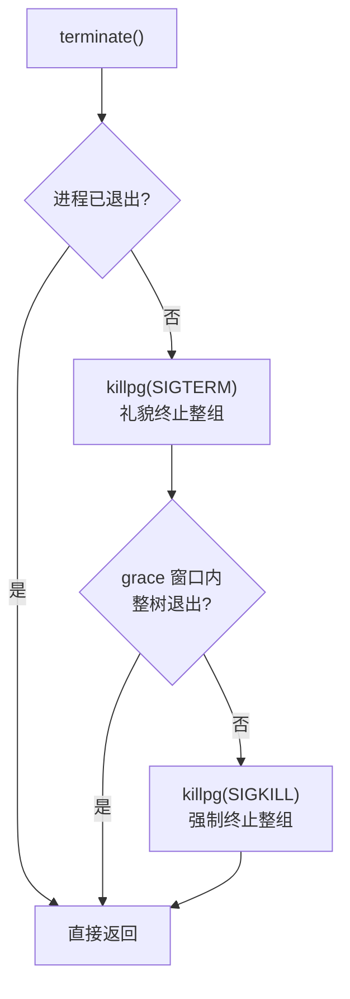
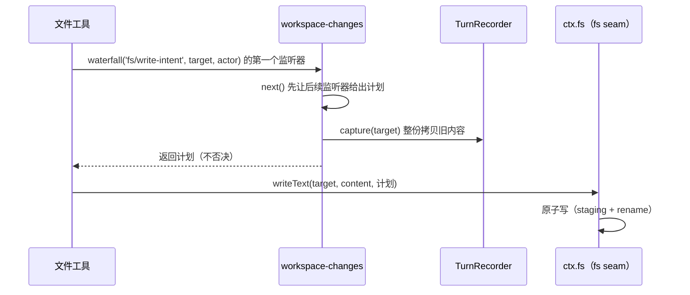
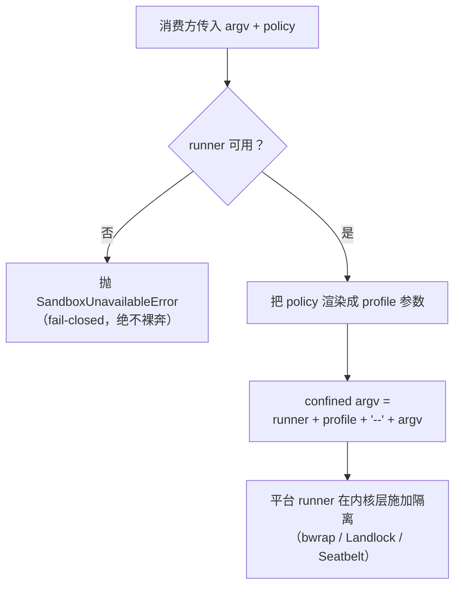
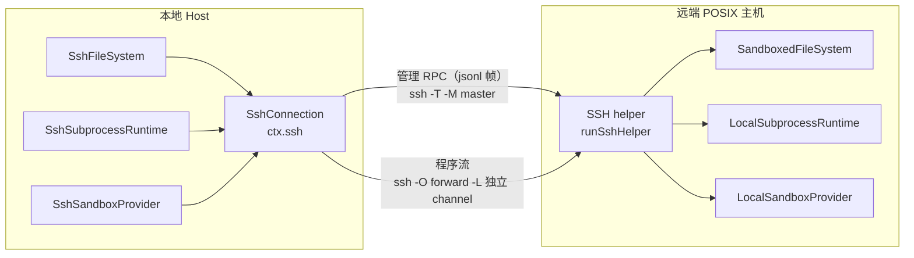

# 第 6 章 subprocess / shell / fs 执行世界

> 生死有簿，覆写留痕，门外有篱。

## 本章回答的问题

- 为什么不能直接拿标准库 `subprocess` 给 agent 用？会丢掉哪四样东西？
- 「进程树」到底指什么？为什么 terminate 要杀整棵树，而不是只杀直接子进程？
- 文件系统为什么要做成 seam，而不是直接调 `os` / `open`？
- sandbox 如何做到「包住 runner、却不碰工具层」？
- 一轮对话改了哪些文件，谁在观察？为什么事件里只有一个 turn 号？
- 把整个执行世界搬到另一台机器上，消费者要改几行？

第 5 章我们完成了 shell 的 seam 化，认全了三角色：`shell.py` 是定义、`bash_local.py` 是实现、`tool_bash.py` 是消费者。
本章在这个基础上新增执行世界的三个底层服务——进程、文件、隔离——以及两个把它们推到极限的切口：
按轮观察文件改动，和把整个执行世界搬到远端。

翻开 `bash_local.py` 会发现，它依赖一个教学桩 `SubprocessStub`，其 docstring 写得很直白——「真正进程树管理留到第 6 章」。这一章就来兑现这句话。

shell 只是执行世界的「门面」，真正动手干活的是三件套：

- **`ctx.subprocess`**：受管进程树。spawn 一个进程不是调一次 `subprocess.run` 就完事，
  还要管它的整棵树、它的退出语义、它的后台登记与兜底回收。
- **`ctx.fs`**：文件系统。进程管「动」，文件管「静」——带版本的读 / 写 / 编辑。
- **`ctx.sandbox`**：隔离。前两者让 agent 能动手，sandbox 给它圈一道围栏。

代码关系上，本章**继承**第 5 章的 `shell.py` / `bash_local.py` / `tool_bash.py` 一行不改，
**新增** `subprocess_service.py`（替换 `SubprocessStub`）、`fs_service.py`、`sandbox_service.py`、
`bash_sandbox.py`（sandbox 的消费方）、`workspace_changes.py`（改动观测）、`remote_world.py`（远端 provider 家族）。
复用方式：`main.py` 经 sys.path 复用第 5 章 `bash_local.py` / `tool_bash.py`
与第 1/2/4 章既有模块，ch06 目录只放本章新增文件。shell 本章点到即止——`bash-sandbox` 只作为 sandbox 消费方出场，演示「整 provider 迁移：换执行器不动工具层」。
标题以执行面三领域取名；sandbox 是横跨三领域的围栏而非第四领域。

后半程由两个「切口」把本章接进全书主线：§3.5 顺着 fs 讲它的第三个机制面——**改动意图与快照**（谁的改动、哪一轮、怎么回看）；
§6 把三个 provider 整体搬到远端，证明前五章反复讲的 seam 不是纸面抽象——观察者与远端 provider 都是「消费者零改动」的实证。

## 1. agent 直接上手标准库，会踩三个坑

设想 agent 要干一件很普通的事：跑一条会派生子进程的命令，顺手改一个配置文件。
没有执行世界三件套，它只能直接上手标准库（`ch06/code/bad_example.py`）：

```python
import subprocess

# 坑 ① 进程管不好：失败即异常，退出码没被当成数据
try:
    subprocess.run(["bash", "-c", "exit 3"], check=True, capture_output=True)
except subprocess.CalledProcessError as e:
    print(f"坑①: 失败抛 {type(e).__name__}，模型拿不到干净的退出码")
# 而且：make 派生 gcc/cc1 时，kill 直接子进程杀不掉整棵树；后台任务无登记，卸载即泄漏

# 坑 ② 文件管不好：错误格式不统一，各是各的异常
try:
    open("no_such_dir/config.json").read()
except OSError as e:
    print(f"坑②: {type(e).__name__}，而不是统一的 [FS_NOT_FOUND] 错误码")

# 坑 ③ 没有隔离：危险命令无人设防
print("坑③: 没有 sandbox，rm -rf / 这类命令没有围栏")
```

运行输出：

```text
坑①: 失败抛 CalledProcessError，模型拿不到干净的退出码
坑②: FileNotFoundError，而不是统一的 [FS_NOT_FOUND] 错误码
坑③: 没有 sandbox，rm -rf / 这类命令没有围栏
```

三个坑，正好对应本章三件套要解决的事：

| # | 问题 | 本章机制 |
|---|---|---|
| ① | 进程管不好：无树管理、无后台登记、失败即异常、无增量读 | `ctx.subprocess` 受管进程树 |
| ② | 文件管不好：错误格式不统一、无路径安全、无版本守卫 | `ctx.fs` 文件系统 seam |
| ③ | 没有隔离：进程 + 文件都能碰，危险操作无围栏 | `ctx.sandbox` 隔离 |

其中坑 ① 最要命。`subprocess.run` 一调，四样东西就丢了：

1. **进程树管理**——`make` 会派生 `gcc`、`cc1`，只 `kill` 直接子进程，孙进程还在跑；
2. **后台登记**——后台任务没有名册，context 卸载时进程泄漏；
3. **统一退出语义**——失败时抛 `CalledProcessError`，而模型需要的是「退出码是数据，永不抛异常」；
4. **增量读**——大输出只能一次性 capture，不能边跑边读。另外，父环境凭据变量会被原样透传给子进程——spawn 前必须清洗。

下面逐个拆。先看进程。

## 2. ctx.subprocess：受管进程树

### 2.1 概念引入：最小示例

**它是什么**：`ctx.subprocess` 是「受管进程树」seam。`spawn` 返回一个句柄；
`handle.done` 阻塞等**整棵树**收敛并返回统一结果（退出码是数据，永不抛异常）；
`handle.terminate()` 是唯一终止动词——SIGTERM → grace 窗口 → SIGKILL，作用于**整个进程组**；
context 卸载时兜底回收所有受管进程。

**解决什么问题**：问题 ① 丢掉的四样东西——树管理、后台登记、统一退出语义、增量读。

**类比**：像个进程牧羊人。`subprocess.run` 是「放一只羊出去，等它自己回来」；
`ctx.subprocess` 是「给整群羊建了名册，天黑（dispose）时一只不少地赶回来，
跑丢的也明确告诉你哪只没回来」。

**最简示例**（最小可运行示例，与 §3.1/§4.1 同口径）：内联示例，在 `ch06/code/` 下运行；import 路径由 `ch06/code/main.py` 同款 sys.path 拼装（复用第 1/4/5 章既有模块）：

```python
from cordis import Context
from subprocess_service import SubprocessService

ctx = Context()
SubprocessService(ctx)                    # 构造即注册到 ctx.subprocess
handle = ctx.subprocess.spawn(["echo", "hello"])
result = handle.done                      # 阻塞等整树收敛，返回统一结果
print(result["exit_code"], repr(result["stdout"]))   # 0 'hello\n'
```

### 2.2 内部实现

宏观上，一次 `spawn` 到收敛要经过四件事：**detached 树根 → 输出收集 → 统一等待 → 三段终止**。

1. **detached 树根**：POSIX 下 `Popen(..., start_new_session=True)`，子进程自成进程组，
   树根 pid == 进程组 pgid。这是「杀整棵树」的前提——有了独立进程组，`killpg` 才能一网打尽。
2. **输出收集**：两条读线程把 stdout/stderr 推入 `OutputCollector`，供 `read_output()` 增量读——
   读取不清空 collector、可反复读；tail 取最近 N 字节，offset（`read_delta`）从上次读位置取新增。
3. **统一等待**：`handle.done` 阻塞等进程退出（可带 timeout），收编读线程，返回
   `{exit_code, stdout, stderr, timed_out, killed}`——退出码是数据，永不抛异常。
4. **三段终止**：`terminate()` 先 `killpg(SIGTERM)`，等一个 grace 窗口，仍存活则 `killpg(SIGKILL)`；grace 取值来自 `main.py` 装配参数 `grace_ms=200`（`_assemble` 默认值）。

其中第 4 点是灵魂，升级链路如下：



为什么是「整组」而不是「直接子进程」？因为**领导者退出 ≠ 树退出**：`make` 退了，它派生的 `gcc`、`cc1` 还在跑，
只有对进程组 `killpg`，才能保证整棵树收敛。为什么 SIGTERM 之后还要等一个 grace 窗口？给进程体面清理的机会（落盘、释放锁），
只有拒不退出才升级到 SIGKILL——这正是「先礼后兵」。

配套两件事：**后台登记**——每次 `spawn` 发一个唯一 `spawn_id` 记入名册 `_managed`，`dispose` 时逐个 `terminate`，杜绝进程泄漏；
**scrub_env**——spawn 前先剔除父环境里的凭据形变量（名字含 KEY/TOKEN/SECRET/…）与 `DSH_*` 前缀变量，
再合并显式 env，敏感值绝不自动透传给子进程。

### 2.3 Python 重构

教学版落在 `ch06/code/subprocess_service.py`：对消费者（`bash_local.py`）暴露的仍是第 5 章
四动词 `spawn/done/read_output/kill`，一行不改即可换用；`terminate` 是本章新增的内部终止动词，`kill()` 标记 killed 后委托 `terminate()` 走升级（SIGTERM → grace → SIGKILL，整组）。
句柄层 `read_output()` 内部委托 collector 的 `read_delta()`（offset 增量读）。先看环境清洗——显式 env 在 scrub **之后**才合并。以下是模块级函数 `scrub_env`：

```python
def scrub_env(parent_env):
    """剔除父环境里的凭据形变量与 DSH_* 前缀变量（packages/subprocess/subprocess/src/index.ts:66 scrubbedParentEnv）。

    显式 env 在 scrub 之后合并——父环境只贡献 PATH 这类基础变量，
    敏感值一律不自动透传给子进程。
    """
    return {
        key: value
        for key, value in parent_env.items()
        if not _SENSITIVE_ENV_RE.search(key) and not key.startswith(DSH_ENV_PREFIX)
    }
```

`SubprocessService.spawn`：detached 树根 + 输出收集 + 后台登记，一次到位：

```python
    # 以下是 SubprocessService.spawn 的方法体
    def spawn(self, argv, workdir=None, env=None, timeout_ms=None):
        """spawn 全显式、无默认（packages/subprocess/subprocess/src/index.ts:153）：先 scrub 父环境再合并显式 env。"""
        full_env = scrub_env(dict(os.environ))
        if env:
            full_env.update(env)
        proc = subprocess.Popen(
            argv,
            cwd=workdir,
            env=full_env,
            stdout=subprocess.PIPE,
            stderr=subprocess.PIPE,
            start_new_session=True,  # detached 树根：自成进程组（spawn.ts:471 detached）
        )
        stdout_c, stderr_c = OutputCollector(), OutputCollector()
        handle = SubprocessHandle(proc, stdout_c, stderr_c, self._grace_ms, timeout_ms)
        handle._threads = [
            threading.Thread(target=_pump, args=(proc.stdout, stdout_c), daemon=True),
            threading.Thread(target=_pump, args=(proc.stderr, stderr_c), daemon=True),
        ]
        for thread in handle._threads:
            thread.start()
        # 后台登记：每个受管进程都有唯一 spawn_id，dispose 时统一回收。
        handle.spawn_id = self._next_id
        self._managed[self._next_id] = handle
        self._next_id += 1
        return handle
```

`SubprocessHandle.terminate`：唯一终止动词，三段升级，作用于整个进程组（注意它与 `spawn` 不在同一个类）：

```python
    # 以下是 SubprocessHandle.terminate 的方法体
    def terminate(self):
        """唯一终止动词（packages/subprocess/subprocess-local/src/spawn.ts:370）：SIGTERM → grace 窗口 → SIGKILL。

        作用于整个进程组（detached 树根），而非只杀直接子进程：
        领导者退出 ≠ 树退出，升级必须跨整树存活。
        """
        if self._proc.poll() is not None:
            return  # 已退出
        try:
            pgid = os.getpgid(self._proc.pid)
        except (ProcessLookupError, PermissionError):
            return
        try:
            os.killpg(pgid, signal.SIGTERM)  # 第一段：礼貌终止整组
        except ProcessLookupError:
            return
        deadline = time.monotonic() + self._grace_ms / 1000  # grace 窗口
        while time.monotonic() < deadline:
            if self._proc.poll() is not None:
                return
            time.sleep(0.01)
        try:
            os.killpg(pgid, signal.SIGKILL)  # 第二段：强制终止整组
        except ProcessLookupError:
            pass
```

收尾两件事：`handle.done`（`_wait_for_exit`）阻塞等退出、收编读线程，把 exit/timeout/killed 三路径折叠成统一结果字典 `{exit_code, stdout, stderr, timed_out, killed}`——退出码是数据，永不抛异常（实现见 `ch06/code/subprocess_service.py:134-152`）；
`SubprocessService.__init__` 里用 `ctx.effect` 注册 `_dispose_managed`，context 卸载时逐个 `terminate` 名册 `_managed` 里的受管进程，兜底防泄漏。

[教学简化] 真实版 `OutputCollector` 超出 maxBytes 的旧输出 spill 到 0600（仅文件属主可读写）独占临时文件，
`waitForExit` 用 `/proc` 解析 + `kill(-pgid, 0)` 探测**整树**存活；教学版省略 spill，
grace 窗口内以树根 `poll()` 近似整树状态——因为 SIGKILL 作用于整组，收敛性仍有保证。

### 2.4 回溯：进程管好了，文件还没管

问题 ① 丢掉的四样东西都补回来了：detached + `killpg` 管树，`_managed` + dispose 管登记，`done` 管统一退出语义，`read_output` 管增量读。
但 agent 不只会跑命令，还要改文件——直接上手 `open` 就是问题 ②。

## 3. ctx.fs：执行世界的另一半——文件系统

### 3.1 概念引入：最小示例

**是什么**：`ctx.fs` 是文件系统 seam——一个带版本令牌的读写接口。`read` 返回内容加一枚
不透明版本 token；`write`/`edit` 对已存在文件必须携带 `base_version`；所有失败统一为
`FsError(code, path, message)`。

**解决什么问题**：问题 ②。agent 并发改文件、盲写覆盖、路径逃逸，在裸 `open` 下全是静默事故；
`ctx.fs` 把「先读后写」变成协议，把事故变成带错误码的拒绝。

**类比**：档案室管理员。直接 `open` 是自己闯进库房翻文件；`ctx.fs` 是登记制——取文件时拿到
一张回执（版本 token），改完交回时出示回执：没领过文件不给改，回执过期也不给改。

**最小可运行示例**（`ch06/code/fs_service.py`）：

```python
import tempfile
from cordis import Context
from fs_service import FileSystem

ctx = Context()
FileSystem(ctx, root=tempfile.mkdtemp())  # 构造即注册为 ctx.fs
w = ctx.fs.write("a.txt", "v1")           # 新文件：无需版本直接写
r = ctx.fs.read("a.txt")                  # 读返回 content + version
ctx.fs.write("a.txt", "v2", base_version=r["version"])  # 带版本写
```

### 3.2 内部实现

四个机制，从外到内：

1. **统一错误格式**：所有失败抛 `FsError`，带稳定错误码（`FS_NOT_FOUND`、`FS_IS_DIR`、
   `FS_PATH_ESCAPE`、`FS_NOT_OBSERVED`、`FS_STALE_VERSION`、`FS_EDIT_NO_MATCH`、
   `FS_NOT_DIR`）。消费方只 catch 一种异常，按码分支，不用解析自由文本（`read()`/`list()` 实现从略，见 `ch06/code/fs_service.py`：FS_NOT_FOUND=read 不存在文件、FS_NOT_DIR=list 非目录）。
   错误码词表由 `packages/fs/fs/src/types.ts:209` 的 `FsErrorCode` 统一拥有。
2. **路径安全**：`_resolve` 先 `realpath` 归一化（消掉符号链接与 `..`），再校验结果必须
   落在 workspace 根内——逃逸直接拒绝，不给部分成功（`packages/fs/fs-local/src/fsio.ts:179` 的 `resolveLocalTarget`）。
3. **原子写**：先写同目录 staging 文件，再 `rename` 落位（`packages/fs/fs-local/src/fsio.ts:618` 的 `writeFileAtomic`）。
   rename 是原子的，读者永远看到旧全文或新全文，不会看到半截文件。
4. **版本守卫**：`_version_of` 对内容取 sha256 前 16 位作为不透明 token。写已存在文件时：
   没带 `base_version` → `FS_NOT_OBSERVED`（没读过就想改）；带了但对不上当前版本
   → `FS_STALE_VERSION`（读的是旧版，中间有人改过）。真实版对已存在文件的两条判据在
   `packages/fs/fs-local/src/index.ts:354-363`。

[教学简化] 真实版版本 token 由 `versionOf`（`packages/fs/fs-local/src/fsio.ts:76`）产出——它是 inode 元数据（`dev:ino:size:mtimeNs:ctimeNs`）而不是内容哈希，教学版用 sha256 前缀只是示意「内容一变 token 就变」。写路径还有 `withLock`
串行化（`packages/fs/fs-local/src/index.ts:124`）与 `patchText` 补丁式写入（`packages/fs/fs/src/index.ts:324`，
补丁解析在 `packages/fs/fs-patch/src/parse.ts:140`、应用在 `packages/fs/fs-patch/src/apply.ts:65`）；教学版用 sha256 前缀示意
token 语义，省略锁与检索。

### 3.3 Python 重构

教学版落在 `ch06/code/fs_service.py`。先看统一错误格式——以下是模块级异常类 `FsError`：

```python
class FsError(Exception):
    """统一错误格式：一个错误码 + 路径 + 人话消息（packages/fs/fs/src/types.ts:209 FsErrorCode）。

    消费者只需 catch FsError 读 .code，不必分辨 FileNotFoundError /
    PermissionError / IsADirectoryError 等一堆标准库异常。
    """

    def __init__(self, code, path, message):
        super().__init__(f"[{code}] {path}: {message}")
        self.code = code
        self.path = path
```

路径安全 `FileSystem._resolve` 与原子写 + 版本守卫 `FileSystem.write`：

```python
    # 以下是 FileSystem._resolve 的方法体
    # -- 路径安全：realpath 身份 + workspace 包含（fsio.ts:179 resolveLocalTarget + containment.ts:58 isPathUnder） --

    def _resolve(self, path):
        """把相对路径锚定到 workspace 根，并拒绝逃逸（canonicalize-then-contain）。"""
        resolved = os.path.realpath(os.path.join(self._root, path))
        if resolved != self._root and not resolved.startswith(self._root + os.sep):
            raise FsError("FS_PATH_ESCAPE", path, "路径逃逸 workspace 边界")
        return resolved
```

```python
    # 以下是 FileSystem.write 的方法体
    def write(self, path, content, base_version=None, actor=None):
        target = self._resolve(path)
        if os.path.isdir(target):
            raise FsError("FS_IS_DIR", path, "目标是目录")
        if os.path.exists(target):
            # 已存在的文件必须先 read 观察再写，杜绝盲覆盖。
            if base_version is None:
                raise FsError("FS_NOT_OBSERVED", path, "写入前必须先 read 观察")
            if self._version_of(target) != base_version:
                raise FsError("FS_STALE_VERSION", path, "版本已变化，写入被拒")
        # 意图瀑布：在落盘之前广播（真实版由 tool-fs 的 write 工具触发），
        # 监听器（如 workspace-changes）趁旧内容还在时整份拷贝。
        self._intent("fs/write-intent", target, actor)
        return self._write_atomic(target, content)

    def _write_atomic(self, target, content):
        """原子写：先写临时 staging，再 rename 落位，避免半截文件。"""
        staging = f"{target}.staging-{os.urandom(4).hex()}"
        try:
            with open(staging, "w", encoding="utf-8") as f:
                f.write(content)
            os.rename(staging, target)
        finally:
            if os.path.exists(staging):
                os.remove(staging)
        return {"version": self._version_of(target)}
```

`edit(path, old, new, base_version)` 是「读-改-写」的封装：先 `read` 拿当前内容与版本；
若调用方带了 `base_version` 且与观察版本不符，抛 `FS_STALE_VERSION`。`old` 未命中抛
`FS_EDIT_NO_MATCH`，命中则替换首次出现，再把**刚读到的版本**作为守卫传给原子写——
从读到写之间若有人插了一手，写入会被拒。

### 3.4 回溯：文件管好了，但没有围栏

问题 ② 解决：盲写变成 `FS_NOT_OBSERVED`/`FS_STALE_VERSION` 拒绝，逃逸变成 `FS_PATH_ESCAPE` 拒绝，半截文件被原子写消灭。
但进程与文件都受控，不代表安全——agent 还能跑**任意命令**，这是问题 ③。

不过先别急着进 sandbox。原子写和版本守卫管的是「一次写别写坏」，它们回答不了另一个问题：
**这一轮到底改了哪些文件？** agent 跑完五分钟，用户想知道「它动了我的项目什么」，
盯着工具调用日志一行行数是最笨的办法。本章开头的问题清单里已经提过它（「一轮对话改了哪些文件，谁在观察」），
而它正好落在 `ctx.fs` 的第三个机制面上。

### 3.5 fs 的第三个机制面：改动意图与快照

**它是什么**：文件被改动之前，`ctx.fs` 会广播一个**意图瀑布**（intent waterfall，
文件被改之前的可插拔拦截点，用于在旧内容还在时整份捕获）——
`fs/write-intent`、`fs/edit-intent`、`fs/delete-intent` 三个事件，
监听器在这一刻看到的还是**旧内容**。`workspace-changes` 插件挂在瀑布上，
趁文件没变时整份拷贝；一轮结束时再拍第二次快照，两次一比，得出这一轮的改动清单。
记录器叫 **TurnRecorder**，产出的事件叫 `workspace/changes`（只带 turn 号的地址事件，摘要留在 Host）。

**没有它会怎样**：工具调用日志只说了「调用了 write，参数是这段文本」，
没说「实际落盘后文件变成了什么」，更没说那些**绕过文件工具**的改动（比如 `patch` 一次改了五个文件）。
命令行里 `git diff` 能补上，但 agent 跑在用户的工作区里，临时去动用户的 git 索引是入侵行为。
读者需要的是一个**只读观察者**：不污染仓库、不改用户状态、按轮给出答案。

**类比**：行车记录仪。它不控制方向盘，只在出发时拍一张、到达时拍一张，
两次画面对比就是「这一程发生了什么」。中途的关键路口（写之前的那个瞬间）还会补拍一张，
因为有些文件到站时已经不存在了，没有中途那一张就永久失去原貌。

#### 3.5.1 意图在动笔之前，而不是动笔之后

新机制的第一个形状是「瀑布的触发时机」。三个意图事件都在**真正落盘之前**触发，
监听器拿到的是已解析的目标，还没变的内容：



真实的触发点不在 `LocalFileSystem` 内部，而在工具层：`packages/fs/tool-fs/src/write.ts:121`
先 `waterfall('fs/write-intent', target, exec, () => undefined)`，把拿到的计划交给
`ctx.fs.writeText`（`packages/fs/tool-fs/src/write.ts:124`）。编辑走 `packages/fs/tool-fs/src/edit.ts:133` 的 `fs/edit-intent`，
补丁里删文件走 `packages/fs/tool-fs/src/patch/plan.ts:80` 的 `fs/delete-intent`（同文件 `plan.ts:81`/`:92` 是编辑与写入两条）。

[教学简化] 真实版在工具层触发意图瀑布；教学版没有工具层，就在
`ch06/code/fs_service.py` 的 `write`/`edit`/`delete` 里各拦一道。

瀑布的语义和普通事件不同：**最后一个参数是最内层的 `next`，第一个不调 `next()` 的监听器占住决策位**。
`workspace-changes` 的三个注册都带 `{ prepend: true }`（`packages/deliverables/workspace-changes/src/index.ts:164-178`），
所以它排在瀑布最外层：先执行、先 `await next()`（此时里面的策略插件已经给出计划），
再在返回前完成拷贝。

#### 3.5.2 TurnRecorder：一轮三件事

**TurnRecorder**（每轮开始拍基线树、改前捕获、turn-stopping 出 diff 的记录器；
`packages/deliverables/workspace-changes/src/recorder.ts:107`）每会话一个，按轮工作：

| 时点 | 动作 | 源码 |
|---|---|---|
| `turn/start` | 拍**基线快照**——整棵工作树此刻的样子 | `packages/deliverables/workspace-changes/src/recorder.ts:131` 的 `start()` |
| 每次 `fs/*-intent` | **改前捕获**——把目标文件整份拷贝；同一路径一轮只捕一次 | `packages/deliverables/workspace-changes/src/recorder.ts:155` 的 `capture()` |
| `agent/turn-stopping` | 拍**二次快照**，两次对比算出改动清单并落事件 | `packages/deliverables/workspace-changes/src/recorder.ts:181` 的 `stopping()` |

三件东西各司其职，缺一不可，这张「快照三件套」是本节唯一需要记住的结构：

- **基线快照**回答「一轮开始前长什么样」。没有它，就分不清「这一轮新增」和「上一轮就存在」。
- **改前捕获**补快照的盲区。基线与二次快照只能看到首尾两端；一个文件在轮内被改又被删，
  首尾都看不到它，中间那次捕获是它存在过的唯一证据。
- **二次快照**回答「一轮结束后长什么样」。只靠捕获也不行：绕过文件工具的改动（例如 shell 里的 `mv`）
  不会触发意图，只有整树对比才看得见。

`turn/end` 时还会补一次记录（`packages/deliverables/workspace-changes/src/recorder.ts:191` 的 `end()`），但只在最后一轮工具结果之后还没记过时才做——
覆盖 aborted、failed、被 steer 的轮次，又不会重复一次已经失败的尝试。

#### 3.5.3 事件只报地址：摘要留在 Host

一轮结束时，会话日志里收到的事件只有一行地址：

```ts
// packages/deliverables/workspace-changes/src/types.ts:106
declare module '@deepseek-ai/dsh-session/types' {
  interface SessionEventMap {
    'workspace/changes': { turn: number }
  }
}
```

`{ turn: number }`——只有轮次号，没有文件名、没有行数、没有 diff。
完整的摘要和每份文件的改前/改后内容留在 Host 内存里，客户端拿 `(sessionId, seq)` 回来取：
`ctx.workspaceChanges.summary(sessionId, seq)`（`packages/deliverables/workspace-changes/src/types.ts:86`）返回摘要，
`ctx.workspaceChanges.diff(sessionId, seq, index, signal)`（`packages/deliverables/workspace-changes/src/types.ts:96`）按索引取单文件对比。

为什么这么抠门？因为**日志是会被重放和复制的**（第 3 章）。把一整轮的 diff 塞进事件，
等于把工作区内容写进每个订阅方的日志；只留地址，事件可以安全地跨进程传播，
内容则由拥有工作区的那一侧按需供出。

代价也是明确写下来的：摘要与快照只活在这个 Host 进程里。用户关掉客户端、Host 重启，
再打开同一个会话，旧轮次的改动卡片**取不到**了。这不是 bug，
上游 README 把它写成「决定的行为」——一张 Host 已经打不开内容的卡片，不如不显示。

`diff` 的两种内容来源也解释了「三件套」为什么要三件：快照覆盖到的路径，两侧内容从快照树里读；
快照覆盖不到的路径（被 ignore 的、仓库外的、根本没有 git 的工作区），两侧内容从改前拷贝与轮末拷贝里读。

#### 3.5.4 Python 重构：不引入 git 的最小版

教学版落在 `ch06/code/workspace_changes.py`。为了让「快照」能在没有 git 的机器上跑通，
基线快照用 `{相对路径: 内容 sha256}` 模拟，改前捕获存字节，对比用标准库 `difflib`：

```python
class TurnRecorder:
    """每会话一个记录器：一轮里「基线快照 → 改前捕获 → 收尾二次快照」。"""

    def start(self, turn: int) -> None:
        self._turn = turn
        self._baseline = _snapshot(self._root)   # turn/start：整棵树拍一遍
        self._captures.clear()

    def capture(self, absolute: str) -> None:
        if self._turn is None or not os.path.isfile(absolute):
            return
        rel = os.path.relpath(absolute, self._root)
        if rel in self._captures:                # 同一路径一轮只捕一次
            return
        with open(absolute, "rb") as f:
            data = f.read()
        self._captures[rel] = (_sha256(data), data)

    def stopping(self, turn: int, session) -> int | None:
        after = _snapshot(self._root)            # 二次快照
        changed = []
        for rel in sorted(set(self._baseline) | set(after) | set(self._captures)):
            if self._baseline.get(rel) == after.get(rel) and rel not in self._captures:
                continue
            ...
        summary = {"turn": turn, "files": changed}
        # 事件只有 turn 号；摘要按 seq 存在 Host 侧
        seq = session.append("workspace/changes", {"turn": turn}, summary)
        self._records[seq] = summary
        return seq
```

宿主侧 `WorkspaceChanges` 把三个意图事件挂上 `ctx.on`，在回调里先调 `next_()` 再 `capture(target)`，
与真实版 `prepend` 的顺序一致；再挂 `turn/start` 与 `agent/turn-stopping` 驱动记录器。
（代码里还挂了一个 `tools/pre-execute` 的 `_wait_settled`，教学版是空实现——真实版在这里等快照队列就绪，
保证工具不会抢在基线快照之前改动文件；教学版同步执行，所以没有等待可做。）

[教学简化] 教学版没有 Session 日志，用 `_InMemorySession.append` 返回递增的 `seq` 充当地址；
真实版写的是第 3 章的会话事件流，重启后由 Host 决定是否还能回取。

[教学简化] 真实版用 git 临时索引 + 临时对象目录拍树，仓库自身的索引与对象库只读不写，
并对快照覆盖不到的路径用整份拷贝做补集比较；教学版把两端都简化成文件拷贝 + 哈希，
省略 git、ignore 规则、二进制与超大文件判定。事件与摘要的**分离**是保留的——
这正是本节要讲的机制。

改动观察解决了「这一轮改了什么」，但它仍然只是一个**观察者**：文件能改、命令能跑，
却没有任何围栏。回到问题 ③——agent 还能执行任意命令，sandbox 该出场了。

## 4. ctx.sandbox：隔离

### 4.1 概念引入：最小示例

**是什么**：`ctx.sandbox` 是隔离 seam，核心职责是 `confine(argv, policy)`——把原始 argv 包成「runner + profile + `--` + argv」；
配套审批面 `approve_escalation` 管策略升级的「加宽阶梯」。真正的隔离动作由平台 runner 在内核层施加
（Linux bwrap/Landlock、macOS Seatbelt），provider 自己不执行任何隔离逻辑。

**解决什么问题**：问题 ③。隔离策略随每次调用携带、fail-closed、升级只许加宽，
三条纪律都固化在 seam 契约里，消费方想裸奔都没有入口。

**类比**：机场安检口。sandbox 不亲自搜身，它只负责把人带到安检口（runner）、
把登机牌（profile）递过去；安检口才是真正搜身的地方。没有安检口？谁也不许进——
宁可拒绝，不放行。

**最小可运行示例**（`ch06/code/sandbox_service.py`；`landlock-run` 为示意 runner 名，教学版真实 `runner_argv` 是 `[python3, mock_runner.py]`，见 §4.3）：

```python
from cordis import Context
from sandbox_service import SandboxProvider, SandboxPolicy, SandboxMode

ctx = Context()
SandboxProvider(ctx, runner_argv=["landlock-run"])  # 构造即注册为 ctx.sandbox
policy = SandboxPolicy(mode=SandboxMode.WORKSPACE_WRITE, workspace_root="/tmp/ws")
confined = ctx.sandbox.confine(["bash", "-c", "echo hi"], policy)
print(confined.argv)
# ['landlock-run', '--mode', 'workspace-write', '--workspace', '/tmp/ws', '--', 'bash', '-c', 'echo hi']
```

这里的 `landlock-run` 来自 `native/system` 包：它是一个名为 `@deepseek-ai/node-addon-system` 的 workspace，
每个平台一个预构建子包（`linux-x64`、`darwin-arm64` 等），对外导出 `launcherPath()`、`grantArgs()` 与
`--probe` 探测（`native/system/packages/entry/src/index.ts:22`、`native/system/packages/entry/src/index.ts:69`、`native/system/packages/entry/src/index.ts:94`、`native/system/packages/entry/src/index.ts:116`）。
sandbox-local 通过 `@deepseek-ai/node-addon-system/landlock-run` 子路径引它，因此正文里的包名是
`native/system`，而「landlock-run」作为子路径与前缀保留（`packages/sandbox/sandbox-local/src/index.ts:34`）。

### 4.2 内部实现



四个要点：

1. **包裹结构**：`--` 是分隔符，其后是原样执行的 argv。runner 先解析 `--` 之前的
   profile，再 exec 之后的命令——隔离先于业务生效。
2. **三模式 + 随调用携带**：`read-only` / `workspace-write` / `danger-full-access`。
   `SandboxPolicy` 由调用方每次完整给出，provider 不与默认值合并、不自行生效——
   策略是参数，不是状态。
3. **fail-closed**：runner 不可用时抛 `SandboxUnavailableError`，绝不退回无隔离执行。
4. **升级严格加宽**：`approve_escalation` 只允许沿 read-only → workspace-write → danger-full-access
   单向加宽，收窄或平级都拒绝；放宽允许跳级（read-only 可直达 danger-full-access，`_WIDER_MODES` 如实列出）。

平台链的选择顺序是：`PLATFORM_CHAINS`（`packages/sandbox/sandbox-local/src/index.ts:160`）
按平台先分叉——Linux 是 `['bwrap', 'landlock']`，darwin 只有 `['seatbelt']`，win32 只有 `['windows-acl']`。
**先按平台选，再按顺序探测**：只有一个候选的平台不探测，直接采用；有两个候选的 Linux 才用
`--probe` 仲裁。所以 `landlock-run` 在 Linux 上通常是 bwrap 的备胎，而不是默认。

runner 侧行为（引用行为，不展开 C 实现）：`landlock-run` 先限制自身再 exec 目标命令；
退出码 125 表示 launcher 自身失败；`--probe` 返回 full/partial/unusable 三态能力报告
（`native/system/packages/entry/src/index.ts:31`、`native/system/packages/entry/src/index.ts:116`）。

### 4.3 Python 重构

教学版落在 `ch06/code/sandbox_service.py`。下面两段都是**模块级**定义——`SandboxMode` 枚举与
加宽表 `_WIDER_MODES`，不属于任何类：

```python
class SandboxMode(Enum):
    """三模式（packages/sandbox/sandbox/src/index.ts:30）：只读 / 工作区写 / 全放行。"""

    READ_ONLY = "read-only"
    WORKSPACE_WRITE = "workspace-write"
    DANGER_FULL_ACCESS = "danger-full-access"


# 严格加宽序（packages/sandbox/sandbox/src/escalation.ts:29 WIDER_MODES）：只能往更宽走。
_WIDER_MODES = {
    SandboxMode.READ_ONLY: {SandboxMode.WORKSPACE_WRITE, SandboxMode.DANGER_FULL_ACCESS},
    SandboxMode.WORKSPACE_WRITE: {SandboxMode.DANGER_FULL_ACCESS},
    SandboxMode.DANGER_FULL_ACCESS: set(),
}
```

核心动词 `SandboxProvider.confine` 与升级审批 `SandboxProvider.approve_escalation`（`available` 即 runner_argv 非空；真实版靠 `--probe` 三态探测，见 §4.2）：

```python
    # 以下是 SandboxProvider.confine 的方法体
    def confine(self, argv, policy):
        """把 argv 包成「runner + profile + -- + argv」（packages/sandbox/sandbox/src/index.ts:192）。

        fail-closed：没有可用 runner 直接抛 SandboxUnavailableError，
        而不是退化成裸跑。
        """
        if not self.available:
            raise SandboxUnavailableError(
                "SANDBOX_UNAVAILABLE: 无可用 runner，拒绝执行（fail-closed）"
            )
        profile = self._render_profile(policy)
        return ConfinedArgv([*self._runner_argv, *profile, "--", *argv], policy)
```

```python
    # 以下是 SandboxProvider.approve_escalation 的方法体
    def approve_escalation(self, key, current, requested):
        """升级严格加宽（packages/sandbox/sandbox/src/escalation.ts:172）：只批准往更宽模式的请求。"""
        if requested not in _WIDER_MODES[current]:
            raise ValueError(
                f"escalation 拒绝：{current.value} → {requested.value} 不是严格加宽"
            )
        self._approved[key] = requested
        return requested
```

[教学简化] 真实版 `LocalSandboxProvider` 按平台链（`PLATFORM_CHAINS`，
`packages/sandbox/sandbox-local/src/index.ts:160`）选 bwrap/Landlock/Seatbelt runner，policy 经
`inject` 从 `sandboxPolicy` 服务获取；教学版用 `mock_runner.py` 模拟 runner
（解析 profile 后 `os.execvp` 余下 argv，launcher 失败退出 125），policy 由构造参数固定。`ConfinedArgv` 仅两个字段：`argv`（包裹后 argv）+ `policy`（本次策略）。

### 4.4 回溯：围栏有了，谁来用

问题 ③ 解决：包裹结构、随调用携带、fail-closed、严格加宽，四条纪律都在 seam 里。
围栏已经立好——第一个消费方就是第 5 章的 bash 执行器，而且它换得很轻：只改 argv 进 spawn 之前那一步。

## 5. shell 衔接：bash-sandbox 整 provider 迁移（点到即止）

`ctx.sandbox` 的消费方是 `bash-sandbox`：它**继承**第 5 章的 `LocalBashExecutor`，
`inject` 声明依赖 `subprocess`、`sandbox` 与 `sandboxPolicy`（`packages/shell/bash-sandbox/src/index.ts:46`），
只覆写「argv 进 spawn 之前」这一步——`confine()`（`packages/shell/bash-sandbox/src/index.ts:187`）把 `['bash', '-c', command]` 包一层再交回父类，
`execute()`（`packages/shell/bash-sandbox/src/index.ts:89`）在 `danger-full-access` 模式下直接跳过包裹。工具层与 seam 定义一行不改，
这就是「整 provider 迁移」：换执行器，不动工具层。

这条结论先存着，§6 会把它推到全书尺度：不只是 shell 执行器能整包换，**整个执行世界**都能换。

## 6. 把执行世界搬到远端：SSH provider family

### 6.1 为什么执行世界要能整体搬走

设想用户的工作目录在构建机上，而 dsh 跑在本地。三种做法摆在他面前：

1. 本地跑 agent，用 `ssh` 命令操作远端——每做一个动作都要拼一条命令行，路径一半在本机一半在远端；
2. 在远端再装一个 dsh，两边各有一套会话与会话日志——状态劈成两半，第 3 章的持久化白讲；
3. **只把执行世界的三个 provider 换掉**：文件、进程、隔离都在远端发生，会话、模型、工具仍在本地。

上游选了第三种，结果是 `packages/ssh/` 的五个包。它最值得讲的地方不是 SSH 协议，
而是它证明了前五章反复说的「定义 / 实现 / 消费者」三角色在真实代码里是什么手感：
**定义一行没改，实现整包替换，消费者零改动**。

没有它能成立吗？能——本地执行世界一直能用。但那就把「执行世界」锁死在一台机器上，
而 `ctx.fs`/`ctx.subprocess`/`ctx.sandbox` 这三个 seam 当初被设计出来，正是为了避免这种锁死。
SSH 家族是这条设计赌注最硬的一次兑现。

### 6.2 三个 provider，三条 `extends`

| 本地契约 | 远端实现 | 注入 | 关键动作 |
|---|---|---|---|
| `FileSystem`（`packages/fs/fs/src/index.ts:103`） | `SshFileSystem`（`packages/ssh/fs-ssh/src/index.ts:16`） | `['ssh', 'sandboxPolicy']`（`packages/ssh/fs-ssh/src/index.ts:17`） | 每个动词转发成 `ssh.request('fs.…')` |
| `SubprocessRuntime`（抽象契约；本地实现是 `LocalSubprocessRuntime`，教学版对应 `SubprocessService`；`packages/subprocess/subprocess/src/index.ts:117`） | `SshSubprocessRuntime`（`packages/ssh/subprocess-ssh/src/index.ts:229`） | `['ssh']` | `spawn` 返回 `RemoteProcess`（`packages/ssh/subprocess-ssh/src/index.ts:274`） |
| `SandboxProvider`（`packages/sandbox/sandbox/src/index.ts:174`） | `SshSandboxProvider`（`packages/ssh/sandbox-ssh/src/index.ts:10`） | `['ssh']` | `confine` 转发成 `ssh.request('sandbox', …)` |

三条 `extends` 的写法几乎一样——`static inject` 声明 `ssh`（文件系统那条还要 `sandboxPolicy`），
再加一棵方法树，方法体里各是一次 RPC。
这正是本章 §2–§4 那三份契约的价值：**契约描述的是语义，不是位置**。
`SshSandboxProvider.confine()` 返回的 `ConfinedArgv` 里仍然有 `enforcement` 与 `denialSignatures`。
前者是「隔离强度」的结论，后者是「被拒绝时的 stderr 特征」——都是权限模型的语义，不该随机器变。
（两个字段在本地契约里就存在；教学版 `ConfinedArgv` 省略了它们。）

远端也不是黑盒。**SSH helper** 是远端跑起来的一个真实 dsh 进程，它在那边装一套本地 provider。
入口是 `runSshHelper`（`packages/ssh/ssh/src/helper.ts:56`）。
它调用的 `services()`（`packages/ssh/ssh/src/helper.ts:28`）依次载入 `SandboxedFileSystem`、
`LocalSubprocessRuntime` 与 `LocalSandboxProvider`（`packages/ssh/ssh/src/helper.ts:32-34`）。
远端没有发明第二套执行语义，它把同一套本地实现搬到那台机器上跑。
SSH provider 家族做的只是「跨机器的转发层」。

这也是第 5 章那套三角色分析的有效性证明：**定义不变、实现整包换、消费者零改动**。
SSH 家族不是在平台链里多一个 runner，而是把三个 provider 一起换掉。

### 6.3 双通道：管理走 master，数据走各自的门

一条 SSH 连接上有两类流量，量级差着几个数量级：

- **管理类**：握手、心跳、建进程、读文件、`confine`——一问一答，帧小；
- **数据类**：一条长任务的 stdout 流、一次大文件的文本流——可能一刻不停。

塞进同一条通道，大流会把小请求堵在后面。真实版因此拆成**双通道**（管理 / 数据）。
这里先交代两个词：**master** 指 OpenSSH 的多路复用连接——第一条 `ssh` 命令建立后，
后续命令挂在这条连接上复用，不再重新握手；**jsonl 帧**指「一行一个 JSON 对象」的帧格式，用换行分隔请求与应答。



管理通道由 `SshConnection.start()` 拉起（`packages/ssh/ssh/src/index.ts:279`）。
它发 `ssh -T -M -S <controlPath>`，并加一串保守选项：不交互（`BatchMode=yes`）、
校验主机键（`StrictHostKeyChecking=yes`）、不转发 agent、清空所有转发
（`packages/ssh/ssh/src/index.ts:300-302`）。
这条 exec 通道上跑的是 `SshRpcPeer` 的 jsonl 帧（`packages/ssh/ssh/src/protocol.ts:58`）。

数据通道按需开。`establishStream()`（`packages/ssh/ssh/src/index.ts:156`）对同一个 master 发
`ssh -O forward -L <local>:<remote>`（`packages/ssh/ssh/src/index.ts:171`）：
`-O forward` 是「在已建立的 master 上加一条转发」，`-L` 是本地端口/路径转发；
执行完本地得到一个 Unix socket，连上去再握手。每条程序流一条独立 channel，互不抢窗口。
消费这个入口的是 `SshSubprocessRuntime`：它用 `process.prepare` 拿到若干反向路径，
再逐条 `connectStream`（`packages/ssh/subprocess-ssh/src/index.ts:117` / `packages/ssh/subprocess-ssh/src/index.ts:122`），
stdin/stdout/stderr/control 各自一条流。

这一节的传输细节到此为止。下面这张表列出其余层次，知道它们存在即可，本章不逐行：

| 层次 | 一句话 | 源码 |
|---|---|---|
| 流认证 | 每条数据流用一次性 256 位 PSK（预共享密钥，双方事先拿到同一个密钥，不依赖证书链）做 TLS1.2 | `packages/ssh/ssh/src/stream-security.ts:18` |
| 帧协议 | 版本化 jsonl 帧，普通请求与心跳/关闭各有限额 | `packages/ssh/ssh/src/protocol.ts:10`、`packages/ssh/ssh/src/protocol.ts:17` |
| 进程托管 | helper 侧的终端/普通进程由 `RemoteProcesses` 统一持有 | `packages/ssh/ssh/src/helper-processes.ts:90` |
| helper 分发 | 自包含可执行文件按 SEA（single executable application，Node 把 JS 打进一个可执行文件）引导；按环境变量选 helper 本尊或 PTC worker（执行 PTC 程序的子进程） | `packages/ssh/ssh-helper-runtime/src/index.ts:14` |

### 6.4 信任与租约：失败不重放

远端执行有一个本地执行没有的问题：**连接断了，远端到底做没做？**
比如 `rm` 已经发出去了，localhost 这边超时——重试可能删两次，不重试可能没删。
上游的答案是两条纪律：

1. **启动时验身份**。握手返回 helper 的 SHA-256 与 kind，客户端拿它与配置的
   `helperHash`、`launch.kind` 逐项比对（`packages/ssh/ssh/src/index.ts:316-318`），
   任何一项不符就拒绝连接。远端跑的是不是你要的那个 artifact，连接建立前就有答案。
2. **失败即作废，不重放**。`SshRpcPeer` 在连接丢失时把所有 pending 请求全部拒绝
   （`packages/ssh/ssh/src/protocol.ts:57` 的类注释与 `packages/ssh/ssh/src/protocol.ts:125` 的 `reject`），
   并明说「a completed remote mutation is not rolled back」（`packages/ssh/ssh/src/protocol.ts:103`）。

§6.3 讲的**双通道（管理 / 数据）** 解决的是流量互堵；这里补一条与它配套的纪律。
**租约**（lease）是第二条纪律的兜底。客户端按 `leaseMs/3` 的间隔发心跳（`packages/ssh/ssh/src/index.ts:321` 的 `setInterval`）。
helper 侧每收到一次心跳，就把定时器往后推（`packages/ssh/ssh/src/helper.ts:121` → `packages/ssh/ssh/src/helper.ts:86` 的 `touchLease`）。
到期没续上就 `peer.close`（`packages/ssh/ssh/src/helper.ts:87`），走同一套清理。
超过期限没人来续，远端自己收摊——不指望客户端一定在线。
此外两端都只接受 POSIX 主机（`packages/ssh/ssh/src/index.ts:90`、`packages/ssh/ssh/src/helper.ts:57`）。

**ptcLaunch**（把远端可执行文件交给 PTC 运行时的入口）是这条连接上的一个特殊入口（`packages/ssh/ssh/src/index.ts:114`）：
它把远端可执行文件交给 PTC（programmatic tool calls）运行时，让「模型写程序、程序调工具」
那套机制也能在远端跑。第 17 章讲 `ctx.ptcRuntime` 时，用的正是同一个执行宿主与同一份文件策略；
这里先记住这个名字即可。

**一条本章不展开的语义**：helper 进程「静默退出」时客户端如何观测远端托管范围，
本章没有逐行核实实现，因此不写结论。§6.3 表里的 `packages/ssh/ssh/src/helper-processes.ts` 只负责进程持有。

### 6.5 Python 重构：进程内的远端

教学版落在 `ch06/code/remote_world.py`。它**不模拟 SSH 协议**——那会把教学重心从 seam 拉到传输层。
它只保留协议边界：远端是一个进程内对象 `RemoteHelper`，每个动词是一次 `request`。
最关键的一段是 provider 的转发——本地方法体内什么都不算，只发一次远端请求：

```python
class RemoteFs(FileSystem):
    """SshFileSystem 的教学版：read/write/edit 转发成 RPC。"""

    def write(self, path, content, base_version=None, actor=None):
        # 远端 provider 同样先过意图瀑布；观察者看到的是远端路径。
        self._intent("fs/write-intent",
                     os.path.join(self._ssh._helper.root, path), actor)
        self._ssh.request("fs.write", {"path": path, "content": content})
        return {"version": hashlib.sha256(content.encode()).hexdigest()[:16]}
```

连接侧的握手校验在 `SshConnection.__init__` 里（对应 §6.4 的 SHA-256 / kind 比对），
这里不重复。三个 provider 各自只做一件事：把本地方法改写成 `ssh.request`。
`RemoteFs`、`RemoteSubprocess`、`RemoteSandbox` 分别保留 `read`/`write`/`edit`、`spawn`、`confine`
这几组**动词与返回形状**，换掉的只是方法体——一个是远端请求，一个是远端句柄，一个是远端决策。
[教学简化] 教学版 `RemoteFs` 只演示转发：版本守卫（`FS_NOT_OBSERVED`/`FS_STALE_VERSION`）、
统一错误码，以及 `delete`/`list` 都没有实现。真实的 `SshFileSystem` 是完整的
`FileSystem` 实现，远端 helper 里跑的是 `SandboxedFileSystem`，守卫与错误码与本地一致。
真实版也一样：`SshFileSystem` 的文件语义、`SshSubprocessRuntime` 的进程生命周期、`SshSandboxProvider` 的
授权语义，全部按本地契约定义，只是实现换到了远端。
消费它们的代码——第 5 章的 `LocalBashExecutor`（本章 §2.3 用它消费 `ctx.subprocess`）、
`ch06/code/bash_sandbox.py`、任何读 `ctx.fs` 的地方——**一行不改**。

教学版还保留了两条纪律的最小骨架：构造时比对 `helper_hash`（对应 SHA-256 校验），
`close()` 之后所有新请求抛 `ConnectionError` 且不重放（对应「失败即作废」）。
心跳与租约计时器省略——它们是时间维度，而教学演示只需要证明「断开后不会假装成功」。
[教学简化] 教学版不检查主机平台（真实版两端都只接受 POSIX，见 §6.4）。

[教学简化] 真实版的管理通道是 jsonl 帧、程序流走 TLS-PSK、每条流独立 channel；
教学版用一个对象方法调用代替通道，用字符串哈希代替可执行文件摘要，省略心跳定时器与远端进程托管。
`ptcLaunch` 只保留形状（`{'kind': 'embedded', 'executable': ...}`），不接第 17 章的运行时。

## 7. 完整运行输出

运行命令：`python3 ch06/code/main.py`（pgid、pid、耗时、版本 token、临时路径、输出里被截断的异常文案每次运行略有不同，解释器路径随机器而异；下文实录来自作者机器的一次真实运行）：

```text
== 1. ctx.subprocess：前台执行（经 bash 工具） ==
  ctx.subprocess = SubprocessService （替换第 5 章 SubprocessStub）
  hello-from-real-subprocess

  [exit code: 0]

== 2. ctx.subprocess：进程树终止（杀整棵树） ==
  spawn 忽略 SIGTERM 的树根（带后台子进程），pgid=45982
  terminate 前进程组存活: True
  terminate 后进程组存活: False
  exit_code=-9，耗时 202ms ≈ grace 200ms（SIGTERM 被忽略 → SIGKILL 整组）

== 3. ctx.subprocess：dispose 兜底回收 ==
  spawn 一个睡眠进程（不等待 done），dispose 前进程组存活: True
  dispose 后进程组存活: False（disposeManagedProcesses 兜底）

== 4. ctx.subprocess：scrub_env 剔除凭据形变量 ==
  父环境 MY_API_TOKEN=secret-123
  token=<scrubbed>

  [exit code: 0]

== 5. ctx.fs：写 + 读 + 版本守卫 ==
  write hello.txt → version=60329bc85480d3c6
  read hello.txt → content='v1 content' version=60329bc85480d3c6
  盲覆盖（未先 read）被拒: FS_NOT_OBSERVED
  过期版本写入被拒: FS_STALE_VERSION
  edit v1→v2（带正确版本）→ content='v2 content'

== 6. ctx.sandbox：confine 包裹 argv ==
  原 argv: ['bash', '-c', 'echo hi']
  confined.argv = runner + profile + '--' + argv:
    ['/Users/chenyu/anaconda3/bin/python3', '…/ch06/code/mock_runner.py', '--mode', 'workspace-write', '--workspace', '/var/folders/…/T/ch06-fs-txy34wgx', '--', 'bash', '-c', 'echo hi']
  无 runner 时 fail-closed: SandboxUnavailableError

== 7. bash-sandbox：整 provider 迁移（换执行器不动工具层） ==
  ctx7.shell = SandboxBashExecutor
  hello-from-sandbox

  [exit code: 0]
  同一消费者 tool_bash 与定义 ShellExecutor 均未改一行。

== 8. 改动意图与快照：intent 瀑布 → 改前捕获 → turn-stopping 出 diff ==
  事件只带地址: {'seq': 1, 'type': 'workspace/changes', 'data': {'turn': 1}}
  deleted  dead.txt   +0/-1
  added    fresh.txt  +1/-0
  modified notes.md   +1/-1
  摘要按 (sessionId, seq) 回取；Host 重启后同一 seq 取不到——这是决定行为

== 9. 远端执行世界：同一消费代码换远端 provider ==
  本地 fs/shell argv: hello world | from-executor | bash -c echo hi
  远端 fs/shell argv: hello world | from-executor | bash -c echo hi
  内容与 stdout 逐字相同: True
  ptcLaunch: {'kind': 'embedded', 'executable': '/remote/bin/dsh-helper'} （远端可执行文件交给 PTC 运行时，见第 17 章）
  连接断开后新请求被拒，不重放: SSH helper disconnected; remote outcomes are unk
```

第 1、7 段的输出体与第 5 章完全同形——这正是整 provider 迁移的证据：消费方感知不到执行器换了。
`run_bash` 是 `main.py` 的演示辅助函数（经第 4 章 tools 管线触发第 5 章 bash 工具体），输出尾部 `[exit code: 0]` 标记
由工具体内 `render_result` 追加。

上下文不是每段一支。段 1 建一个 `ctx`，段 2、4、5、6 继续复用它（同一套进程、文件、sandbox 状态）；
段 3 为了演示 dispose 另建 `ctx3`，段 7 以 `SandboxBashExecutor` 另建 `ctx7`；
段 8、9 在各自的演示函数内部新建。所以段 4–6 里看到的 fs 状态是段 5 之前那些段留下的，不是重新装配出来的。

第 2 段耗时 ≈ grace 200ms，印证 SIGTERM 被忽略后升级到 SIGKILL；第 3 段「不等待 done」指 spawn 后不调 `handle.done`
（第 5 章 `start` 的后台语义则是把 `done` 包成方法交给调用方，由调用方决定何时取）；
第 6 段 confined argv 里 `--` 之前是 runner + profile，之后是原样 argv（机器路径以 `…` 省略）。

第 8 段只有一行事件、三行摘要：`deleted`/`added`/`modified` 是 `stopping()` 里按「改前捕获 + 两次快照」判出的三种状态，
`+1/-1` 是 `difflib` 对两份文本算出的增删行数。事件里 `data` 只有 `{'turn': 1}`——摘要不在事件里，
所以下一行打印的是 `changes.summary('s1', seq)` 的返回，而不是事件本身。最后一句是决定行为的说明，不是断言本轮成立。

第 9 段的两行输出**逐字相同**，因为 `consume(ctx)` 只认三个 seam 的名字：
本地 context 装的是 `FileSystem`/`SubprocessService`/`SandboxProvider`，远端 context 装的是
`RemoteFs`/`RemoteSubprocess`/`RemoteSandbox`，而 `consume` 一行没改。
`ptcLaunch` 那行是 `SshConnection` 的属性，不是消费代码的返回值；最后一行是 `helper.close()` 之后
再 spawn 一次得到的异常——`ConnectionError` 一抛即止，没有重试。

## 8. 源码对照

| 教学符号 | 源符号 | 位置 |
| --- | --- | --- |
| `SubprocessService`（含 `_dispose_managed`） | `LocalSubprocessRuntime`/`disposeManagedProcesses` | `packages/subprocess/subprocess-local/src/index.ts:64`/`packages/subprocess/subprocess-local/src/index.ts:122` |
| `spawn` | `spawnSubprocess`（本地实现层） | 服务级抽象 `packages/subprocess/subprocess/src/index.ts:153`；本地实现 `packages/subprocess/subprocess-local/src/spawn.ts:454` |
| `SubprocessHandle` | `SubprocessHandle` | `packages/subprocess/subprocess/src/types.ts:169`（terminate:187 / waitForExit:195） |
| `read_output`（增量读） | `OutputCollector` push/spill | `packages/subprocess/subprocess-local/src/output.ts:129`/`packages/subprocess/subprocess-local/src/output.ts:160`/`packages/subprocess/subprocess-local/src/output.ts:191`（教学版 `read_output()` 委托 `read_delta()`） |
| detached 树根 | `detached: platform !== 'win32'` | `packages/subprocess/subprocess-local/src/spawn.ts:471` |
| `terminate` | `terminate` | `packages/subprocess/subprocess-local/src/spawn.ts:370` |
| `done` | `waitForExit` | `packages/subprocess/subprocess-local/src/spawn.ts:424` |
| `scrub_env`/`_SENSITIVE_ENV_RE`/`DSH_ENV_PREFIX` | `scrubbedParentEnv`/`SENSITIVE_ENV_PATTERN`/`DSH_ENV_PREFIX` | `packages/subprocess/subprocess/src/index.ts:66`/`packages/subprocess/subprocess/src/index.ts:47`、`packages/subprocess/subprocess/src/types.ts:13` |
| `FileSystem` | `abstract FileSystem` | `packages/fs/fs/src/index.ts:103` |
| `_resolve` | `resolveLocalTarget`/`isPathUnder` | `packages/fs/fs-local/src/fsio.ts:179`、`packages/fs/fs-sandbox/src/containment.ts:58` |
| `write`/`edit` | `writeText`/`editText` | `packages/fs/fs/src/index.ts:282`/`packages/fs/fs/src/index.ts:303` |
| `FsError` | `FsErrorCode` | `packages/fs/fs/src/types.ts:209` |
| 原子写/版本 token | `writeFileAtomic`/`versionOf` | `packages/fs/fs-local/src/fsio.ts:618`/`packages/fs/fs-local/src/fsio.ts:76` |
| 版本守卫 | `FS_STALE_VERSION`/`FS_NOT_OBSERVED` | `packages/fs/fs-local/src/index.ts:354-363` |
| 补丁式写入 | `patchText` + `parsePatch`/`applyHunks` | `packages/fs/fs/src/index.ts:324`、`packages/fs/fs-patch/src/parse.ts:140`、`packages/fs/fs-patch/src/apply.ts:65` |
| 意图瀑布 | `fs/write-intent`/`fs/edit-intent`/`fs/delete-intent` | `packages/fs/fs/src/index.ts:66`/`packages/fs/fs/src/index.ts:74`/`packages/fs/fs/src/index.ts:82`；触发点 `packages/fs/tool-fs/src/write.ts:121` |
| `SandboxMode`/`SandboxPolicy`/`ConfinedArgv` | 同名 | `packages/sandbox/sandbox/src/index.ts:30`/`packages/sandbox/sandbox/src/index.ts:77`/`packages/sandbox/sandbox/src/index.ts:103` |
| `confine` | `SandboxProvider.confine` | 抽象 `packages/sandbox/sandbox/src/index.ts:192`；本地实现 `packages/sandbox/sandbox-local/src/index.ts:325` |
| `SandboxUnavailableError` | `SANDBOX_UNAVAILABLE`/`SandboxUnavailableError` | `packages/sandbox/sandbox/src/index.ts:132`/`packages/sandbox/sandbox/src/index.ts:139` |
| `_WIDER_MODES`/`approve_escalation` | `WIDER_MODES`/`approveEscalation` | `packages/sandbox/sandbox/src/escalation.ts:29`/`packages/sandbox/sandbox/src/escalation.ts:172` |
| `mock_runner` | `PLATFORM_CHAINS`/`LocalSandboxProvider.confine` | `packages/sandbox/sandbox-local/src/index.ts:160`/`packages/sandbox/sandbox-local/src/index.ts:325` |
| `SandboxBashExecutor`/`_confine` | `SandboxBashExecutor`/`confine` | `packages/shell/bash-sandbox/src/index.ts:45`/`packages/shell/bash-sandbox/src/index.ts:187` |
| `TurnRecorder`（`start`/`capture`/`stopping`） | `TurnRecorder` | `packages/deliverables/workspace-changes/src/recorder.ts:107`/`packages/deliverables/workspace-changes/src/recorder.ts:131`/`packages/deliverables/workspace-changes/src/recorder.ts:155`/`packages/deliverables/workspace-changes/src/recorder.ts:181` |
| `WorkspaceChanges`（挂意图 + 按轮出摘要） | `apply`/`provide('workspaceChanges')` | `packages/deliverables/workspace-changes/src/index.ts:95`/`packages/deliverables/workspace-changes/src/index.ts:120`/`packages/deliverables/workspace-changes/src/index.ts:164-179` |
| `workspace/changes` 只带 `{turn}` | `SessionEventMap` 声明 | `packages/deliverables/workspace-changes/src/types.ts:106`；回取 `packages/deliverables/workspace-changes/src/types.ts:86`/`packages/deliverables/workspace-changes/src/types.ts:96` |
| `RemoteFs`/`RemoteSubprocess`/`RemoteSandbox` | `SshFileSystem`/`SshSubprocessRuntime`/`SshSandboxProvider` | `packages/ssh/fs-ssh/src/index.ts:16`、`packages/ssh/subprocess-ssh/src/index.ts:229`、`packages/ssh/sandbox-ssh/src/index.ts:10` |
| `SshConnection`（握手校验 / 管理 RPC / 流通道） | `SshConnection` | `packages/ssh/ssh/src/index.ts:59`/`packages/ssh/ssh/src/index.ts:136`/`packages/ssh/ssh/src/index.ts:156`/`packages/ssh/ssh/src/index.ts:279` |
| `RemoteHelper` | `runSshHelper` 的 `services()` | `packages/ssh/ssh/src/helper.ts:28`/`packages/ssh/ssh/src/helper.ts:56` |
| `ptcLaunch` | `ptcLaunch` getter | `packages/ssh/ssh/src/index.ts:114` |

教学版差异概括：省略 `OutputCollector` 落盘 spill 与整树 treeAlive 探测（以树根 `poll` 近似）、省略 `withLock` 串行化与 `glob`/`grep`；
平台 runner 链以 `mock_runner` 代替；`sandboxPolicy` inject 简化为构造参数固定 policy。
快照两端都简化成「文件拷贝 + 哈希」（真实版用 git 临时索引/对象目录，且对补集做行比较）；
远端用一个进程内 helper 对象代替 OpenSSH + jsonl 帧 + TLS-PSK，省略心跳租约与 `RemoteProcesses` 托管。

**本章不展开的边界**：container / microVM / remote 这类后端不往 sandbox 的平台链里注册一个 runner，
而是替换整个 sandbox provider（连同 fs/subprocess 一起换）。SSH 家族正是这种形态：
`SshSandboxProvider` 仍是 `SandboxProvider` 的实现、`RemoteSandbox` 照样注册成 `ctx.sandbox`，
但平台链里没有多出任何一项。历史上的 `e2b` 三包已退役，远程执行现在由这套 SSH 家族承担。
补丁式写入（`packages/fs/fs-patch`）是 fs 家族里独立的纯函数包：只解析与应用 Codex 风格的 hunk，
不做 IO；落盘仍走 `ctx.fs` 的 `patchText`（`packages/fs/fs/src/index.ts:324`，
本地实现在 `packages/fs/fs-local/src/index.ts:286`）。

## 9. 小结与预告

本章给执行面补齐三件套：`ctx.subprocess` 管进程（detached 树根、唯一终止动词、后台登记、环境清洗），
`ctx.fs` 管文件（版本守卫、原子写、路径安全、统一错误码，外加改动前的意图瀑布），
`ctx.sandbox` 管边界（confine 包裹、随调用携带、fail-closed、严格加宽）。

往后是两个切口。§3.5 把 fs 推到观察面：改动意图在落盘之前广播，`TurnRecorder` 用「基线快照 + 改前捕获 + 二次快照」
三件套算出每轮改动，而 `workspace/changes` 事件只带 `{turn}`——摘要留在 Host，重启即消失是决定行为。
§6 把三个 provider 整体搬到远端：`SshFileSystem`/`SshSubprocessRuntime`/`SshSandboxProvider` 各自 `extends`
本地契约，消费者一行不改；一条 `-T -M` master 承载管理 RPC，每条程序流独立通道；helper 启动时校验 SHA-256 与 kind，
心跳租约到期即远端自我清理，连接断了不重放。

下一章进入模型层。到目前为止，模型席位一直是第 2 章那个 `LlmStub`——它只会回固定文本。
第 7 章把它换成真实的 LLM 适配器：`ctx.llm` seam 怎么定义、provider 怎么注册、流式响应怎么从字节流变成
一次次的增量回调。没有它，本章这些执行能力无人发号施令；有了它，前六章拼起来的循环才第一次真正「会做事」。

## 10. 附录：关键概念速查表

| 层 | 概念 | Python 符号 | 源符号 | 一句话语义 |
| --- | --- | --- | --- | --- |
| 底层（复用） | 服务注册/卸载钩子 | `Service`/`ctx.effect` | `Service`/`ctx.effect` | 构造即注册，卸载即清理 |
| 中层 | 受管子进程 seam | `SubprocessService` | `LocalSubprocessRuntime` | spawn 全显式，dispose 兜底回收 |
| 中层 | 进程句柄 | `SubprocessHandle` | `SubprocessHandle` | 树根句柄：done/read_output/kill（内部委托 terminate） |
| 中层 | 环境清洗 | `scrub_env` | `scrubbedParentEnv` | 凭据形与 DSH_* 不透传，显式 env 后合并 |
| 中层 | 文件系统 seam | `FileSystem` | `abstract FileSystem` | 带版本令牌的读写，统一 FsError |
| 中层 | 版本守卫 | `FS_NOT_OBSERVED`/`FS_STALE_VERSION` | 同名错误码 | 先读后写，过期拒写 |
| 中层 | 隔离 seam | `SandboxProvider.confine` | `SandboxProvider.confine` | 包成 runner + profile + `--` + argv |
| 中层 | 沙箱策略 | `SandboxPolicy`/`SandboxMode` | 同名 | 策略随调用携带，不与默认合并 |
| 上层 | 沙箱 bash 执行器 | `SandboxBashExecutor` | `SandboxBashExecutor` | 整 provider 迁移：confine 后 spawn |
| 观察面 | 意图瀑布 | `_run_intent`/`ctx.waterfall('fs/*-intent')` | 声明 `ctx.on('fs/write-intent', …)`；触发 `ctx.waterfall('fs/write-intent', …)` | 改动之前的可插拔拦截点，监听器看到旧内容 |
| 观察面 | 快照三件套 | `TurnRecorder.start/capture/stopping` | 同名 | 基线快照 + 改前捕获 + 二次快照 |
| 观察面 | 只报地址的事件 | `_InMemorySession.append` | `workspace/changes` | 事件只带 `{turn}`，摘要按 seq 留在 Host |
| 远端 | SSH helper | `RemoteHelper` | `runSshHelper` | 远端跑的一套本地 provider |
| 远端 | 双通道（管理/数据） | `SshConnection.request`/`stream` | `SshConnection`/`SshRpcPeer` | master 走管理 RPC，每条程序流独立 channel |
| 远端 | 整包替换 | `RemoteFs`/`RemoteSubprocess`/`RemoteSandbox` | `SshFileSystem`/`SshSubprocessRuntime`/`SshSandboxProvider` | 三个 provider 各 `extends` 本地契约，消费者零改动 |
| 远端 | ptcLaunch | `SshConnection.ptcLaunch` | `ptcLaunch` getter | 把远端可执行文件交给 PTC 运行时（第 17 章） |
