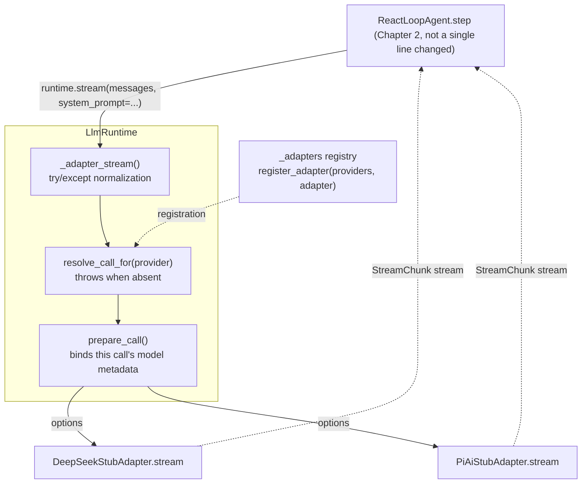
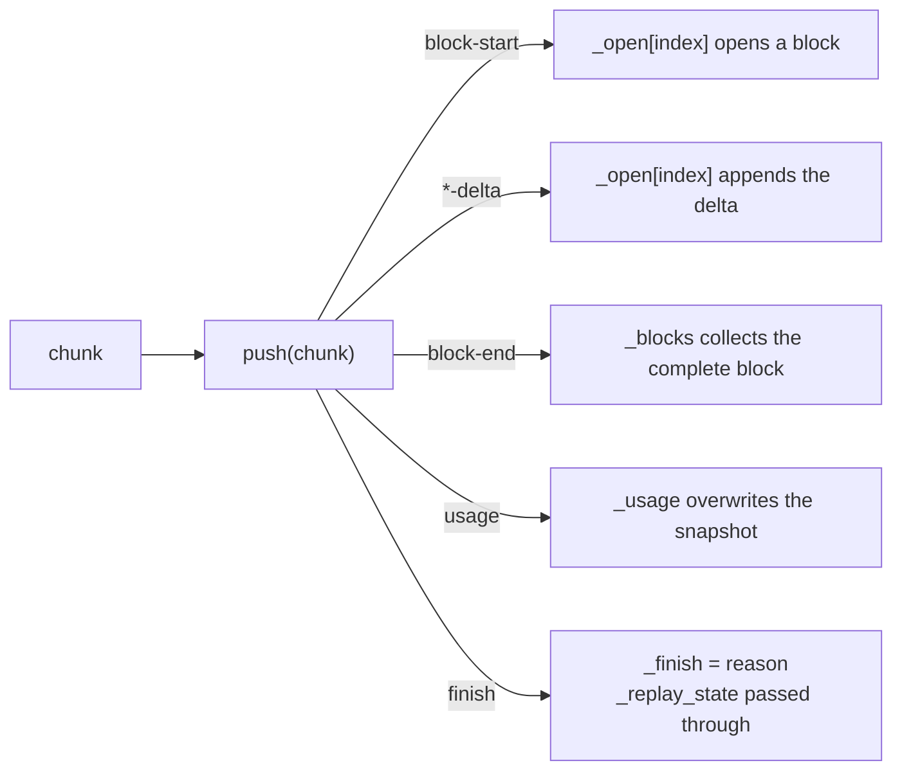
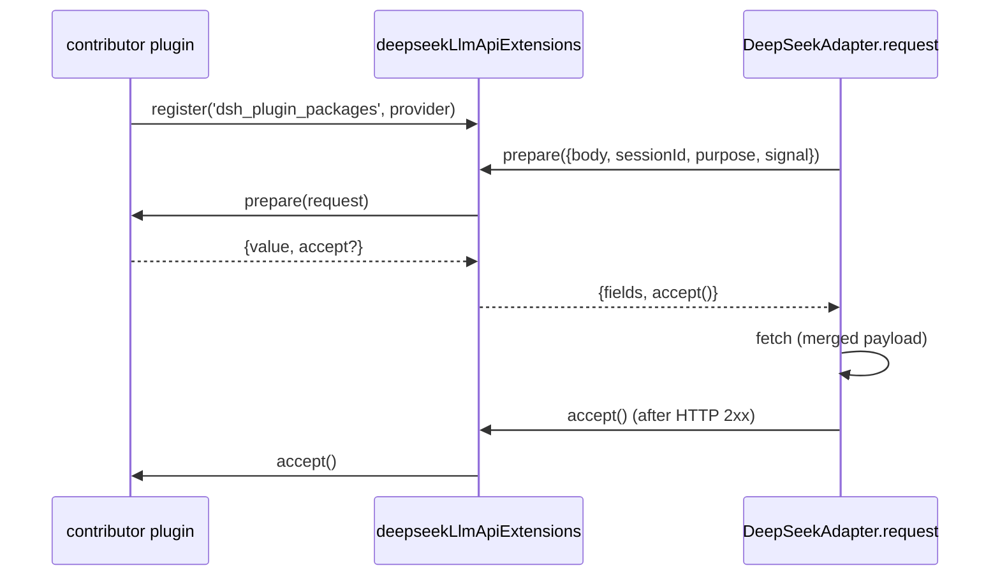
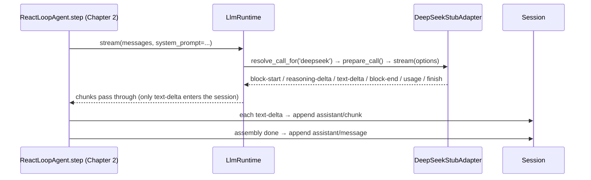

# Chapter 7: LLM Adaptation and Streaming

> Seats change often; the voice stays the same.

## Questions this chapter answers

- How do you replace the `LlmStub` placeholder left over from Chapter 2 with a real model without changing a single line on the caller side?
- Each provider's streaming protocol is different — how do you use one unified chunk protocol to shield those differences from consumers?
- How are streaming deltas accumulated into complete content blocks that downstream can consume directly?
- Where should secrets like API keys live, so they don't enter business code and aren't passed as plaintext arguments?
- When a plugin needs to add its own field to a provider request, how does it do that without editing the adapter?

In Chapter 2 §5.1, we placed a fake model in the model seat of the minimal closed loop: `LlmStub` yields 3 hard-coded text chunks plus 1 finish, letting `ReactLoopAgent.step` run through "consume chunk → append `assistant/chunk` → assemble `assistant/message`" without a real model. At the time we left a promise: **the stub is just a placeholder; later it will be replaced by a real model, and the caller won't change a single line**. This chapter cashes in that promise.

From Chapter 3 through Chapter 6, the loop kept getting thicker — persistence, tools pipeline, capability seam, execution world — but the model seat was always that stub. This chapter builds four things:

- **Adapter seam**: any provider can plug in; the caller only knows one `stream()`;
- **Unified streaming protocol**: differences in each provider's streaming format are absorbed inside the adapter; consumers only know one kind of chunk;
- **Credentials/settings seam**: secrets like API keys have a single home and stay out of business code;
- **Request-extension registry**: plugins each contribute their own request field; the adapter runs one merge transaction.

Once this is done, `ctx.provide("llm", runtime)` replaces Chapter 2's stub, and Chapter 2's AgentLoop runs through unchanged.

Code relationships: this chapter reuses ch01's `Context` and ch02's `Sessions`/`SystemPromptService`/`AgentLoop` (via the `sys.path` insertion at the top of `ch07/code/main.py`, without copying files); every file newly added in this chapter lives under `ch07/code/`.

## 1. Model Calls Welded Shut Inside Business Code

**Scenario**: the team first integrated Provider A (synchronous, whole-response), and business code called it directly; half a year later they need Provider B (HTTP + SSE streaming, completely different field names), and they also need "streaming display + persisting complete blocks" at the same time. SSE (server-sent events) is the protocol where a server keeps one HTTP connection open and pushes small `event:`/`data:` frames down it — a different shape from "send one request, receive one JSON document".

First, the counterexample without an adapter seam (`ch07/code/bad_example.py`, runnable with `python3 bad_example.py`):

```python
def answer_via_a(question):
    # 调用点焊死在 Provider A：同步、整段文本
    return provider_a_complete(question)


def answer_via_b(question):
    # 换到 Provider B：调用点必须重写，字段名、拼装方式全不同
    parts = []
    for event in provider_b_stream(question):
        parts.append(event["piece"])  # 字段名是 piece，不是 text
    return "".join(parts)
```

Output:

```text
Provider A: [A] 对「什么是 agent？」的回答
Provider B: [B] 对「什么是 agent？」的回答（流式到达）
问题：每接一家 provider 就写一套调用代码，换 provider = 重写调用点
```

The problems boil down to six:

| # | Problem | Symptom |
|---|---|---|
| ① | Model calls welded shut | Switching providers rewrites call sites; N providers means N sets of call code |
| ② | Each provider's streaming protocol differs | SSE vs SDK events, field names all different; every consumer writes its own parsing |
| ③ | Deltas must become complete blocks | Every consumer writes "delta → complete block" on its own; behavior drifts |
| ④ | Secrets have no home | API keys passed as plaintext arguments, scattered across business code and logs |
| ⑤ | Request fields monopolized by the adapter | A plugin that wants one request field has to edit the adapter itself |
| ⑥ | Config scattered across plugins, concurrent edits clobber each other | Every plugin keeps its own config with no unified editing surface; two simultaneous edits mean the later write silently wins |

This chapter takes them in order: §2 solves ①, §3 solves the consumer side of ②③, §4 solves the producer side of ②, §5.1–§5.3 solve ④⑥, and §5.4 solves ⑤.

## 2. Adapter seam: LlmAdapter + LlmRuntime

### 2.1 Concept introduction: minimal example

The **adapter seam** is a combination of "abstract interface + routing runtime": provider-private call logic is sealed inside adapters, and callers receive chunks through one unified entry. Without it the pain is §1 — every new provider means a new set of call code. Analogy: a socket unifies the interface between appliances and the power grid; an appliance just plugs in, and whether the electricity is thermal or wind is decided on the grid side. The adapter seam is the socket for model calls.

The core idea splits "model calls" into two roles:

- **LlmAdapter**: one implementation per provider, responsible for translating its own protocol into the unified form; the only abstract method is `stream`;
- **LlmRuntime**: holds the registry and exposes one unified entry, `stream()`, routing by provider.

Minimal example (run under `ch07/code/`):

```python
from llm_runtime import LlmAdapter, LlmRuntime


class EchoAdapter(LlmAdapter):  # 继承基类；最小适配器只需 provider_info + stream
    def provider_info(self, provider):
        return {"id": provider, "name": "Echo"}

    def stream(self, options):
        yield {"type": "text-delta", "index": 0, "text": f"echo: {options['messages'][-1]['content']}"}
        yield {"type": "finish", "reason": "stop"}


runtime = LlmRuntime()
runtime.register_adapter(["echo"], EchoAdapter())
for chunk in runtime.stream([{"role": "user", "content": "hi"}], provider="echo"):
    print(chunk)
```

Output:

```text
{'type': 'text-delta', 'index': 0, 'text': 'echo: hi'}
{'type': 'finish', 'reason': 'stop'}
```

The caller only knows `runtime.stream(...)`; which adapter the chunks come from is decided by the registry — that is the seam.

### 2.2 Internal implementation: registry and unified entry



Broken down, four things:

1. **register_adapter**: the caller supplies provider route names and an adapter instance (`packages/llm/llm/src/index.ts:401`). The whole batch is validated before anything is written (`prepareRoutes` at `packages/llm/llm/src/index.ts:437`): route names must be unique, the adapter's `providerInfo(provider)` must echo the route name back unchanged, and if any route is already owned by another adapter the whole batch fails — there is never a "half-registered" state. The returned handle is itself the disposer, and it also carries a `replace` method (`packages/llm/llm/src/index.ts:309`); `replace` swaps the same route set in one synchronous section, so no request observes a gap (`commitRoutes` at `:468`). [Teaching simplification] The teaching handle is a dict that puts the disposer under the `dispose` key — the real handle has no property named `dispose`; calling the handle is what unregisters.
2. **Retry policy frozen at registration**: `registerAdapter` calls `adapter.providerRetryPolicy(provider)` the moment a route is registered (`packages/llm/llm/src/index.ts:450`) and stores the result in the registration record. If the adapter later changes that return value, the registered route is unaffected — the real provider plugin listens on `loader/volatile-update` and re-registers via `registration.replace(...)` only when the policy actually changes (`packages/llm/llm-deepseek/src/host.ts:83`).
3. **resolve_call_for**: corresponds to the real `registration(provider)` (`packages/llm/llm/src/index.ts:1020`) — it looks the route up and throws `NO_ADAPTER` when absent. Routing errors surface at the entry instead of rotting deep inside consumers. (`resolveCallFor` is a different function: `packages/llm/llm/src/index.ts:902` receives an already-resolved registration and performs model-info resolution plus control validation.)
4. **_adapter_stream is the entry for one call** (`packages/llm/llm/src/index.ts:1068`): inside `try` it looks up the route, runs `prepareCall` (`:290`) and then `adapter.stream`, so failures in all three stages become one terminal chunk (`:1188`, `adapterFailureChunk`). **Normalization covers the adapter boundary only** — real middleware and downstream-consumer failures still throw (`:1063-1066` documents exactly that scope).

**Retry is not in this loop.** In the real source, retry is the standalone plugin `packages/llm/llm-retry`: it hangs off the agent loop's `agent/request-error` recovery point (`packages/llm/llm-retry/src/index.ts:240`) and reads the policy the router captured from adapter metadata (`mode` decides bounded vs unbounded attempts, `retryable_codes` decides which failure codes are worth retrying). Before it waits, it appends an `llm/retry` event to the session (`packages/llm/llm-retry/src/index.ts:184`); after the wait it appends `llm/retry-started` (`:186`). Retrying is therefore itself a durable, replayable fact. The runtime only decides what "this call failed" looks like.

**Numeric verification**: `main.py` segment 2 registers 3 adapters and `list_providers()` returns exactly 3 metadata entries; the handle has exactly three keys — `dispose` (the disposer), `replace` (atomic route swap), and `previous` (the registration it displaced; `None` on first registration); `provider_retry_policy('deepseek')` reads back the policy frozen at registration; registering `deepseek` a second time is rejected, and a `providerInfo` that doesn't echo the route name is rejected too — both whole-batch validations really run in the teaching version.

### 2.3 Python reconstruction

`ch07/code/llm_runtime.py` (excerpt):

```python
class LlmAdapter(ABC):
    """适配器抽象基类：每家 provider 实现一个，唯一抽象方法是 stream。

    对应 LlmAdapter（packages/llm/llm/src/index.ts:208）：其余方法均有默认实现。
    [教学决策] 真实版 stream 是 async 生成器；教学版用同步生成器，机制语义不变。
    """

    def provider_info(self, provider):
        """provider 元数据：路由键 id 必须等于注册时的 provider（index.ts:214）。"""
        return {"id": provider, "name": provider}

    def provider_retry_policy(self, provider):
        """重试策略：adapter 元数据，默认 None 表示用默认策略（index.ts:223）。"""
        return None

    @abstractmethod
    def stream(self, options):
        """抽象方法：接收 GenerateOptions，逐条 yield StreamChunk（index.ts:302）。"""
```

```python
class LlmRuntime:
    def register_adapter(self, providers, adapter):
        # ... 先整批校验：路由不重复、未被占用、provider_info 回显路由名（index.ts:437）...
        for provider in providers:
            self._adapters[provider] = {
                "adapter": adapter,
                "retry_policy": adapter.provider_retry_policy(provider),  # 注册瞬间冻结（:450）
            }
        # ... 返回 {"dispose", "replace", "previous"} ...

    def _adapter_stream(self, options):
        # ... 略：真实版还有 waterfall('llm/stream') 包装与 file/image 投影 ...
        adapter = self.resolve_call_for(options["provider"])   # 查不到即抛错，且在 try 外
        try:
            call = adapter.prepare_call(options["provider"], options["model"])
            yield from call["stream"](options)
        except Exception as exc:  # adapter 边界内的异常 → 终止 chunk
            yield self._failure_chunk(exc)
```

Note the signature of `stream()`: `(messages, system_prompt=None, ...)` is **fully compatible** with Chapter 2's `LlmStub.stream` — not coincidence but deliberate design: only then can the runtime directly replace the stub as `ctx.llm` (verified in §6).

### 2.4 Recap: the seam exists, but what flows through it

Problem ① solved: switching providers only touches the registry; call sites don't move a line. But the chunk stream flowing inside the seam still has no unified "language" — each provider's streaming protocol differs (SSE vs SDK events, field names all different), and if every consumer parses on its own, that is problems ②③. The next section unifies the chunk protocol and the consumer side.

## 3. Unified Streaming Protocol: StreamChunk + BlockAssembler

### 3.1 Concept introduction: the seven-variant protocol

The **unified streaming protocol** answers "what do the chunks inside the seam look like": it prescribes a fixed set of chunk types, producers send accordingly, consumers receive accordingly, and neither side needs to know the specific provider. Without it you get problems ②③ — every consumer writes parsing and assembly once per provider.

The real source defines the protocol as the discriminated union `StreamChunk` (`packages/llm/llm/src/types.ts:496`), with 7 variants; the teaching version expresses them as dicts discriminated by `type` (`STREAM_CHUNK_TYPES` in `llm_runtime.py`):

| Variant | Carries | Duty |
|---|---|---|
| `block-start` | `index`, `blockType` | Declares "a content block begins" |
| `text-delta` | `index`, `text` | Text delta |
| `reasoning-delta` | `index`, `text` | Reasoning delta |
| `tool-call-delta` | `index`, `id`/`name`/`argumentsDelta` | Tool-call delta (arguments appended segment by segment) |
| `block-end` | `index`, `block` | Block ends, **carrying the complete block** |
| `usage` | `usage` (TokenUsage) | Token metering snapshot |
| `finish` | `reason` (FinishReason), optional `replayState` | Call ends |

The "block" a chunk talks about is a `ContentBlock`: `ContentBlockMap` at `packages/llm/llm/src/types.ts:144` defines text / reasoning / image / file / tool-call / tool-addition / tool-removal, and the map is a merge-extensible interface — plugins can add block types, so consumers must "branch on type and fall back to a conservative path for unknown ones".

Consumers don't implement "delta → complete block" themselves: `BlockAssembler` does it. Minimal example (run under `ch07/code/`):

```python
from llm_runtime import BlockAssembler

assembler = BlockAssembler()
for chunk in (
    {"type": "block-start", "index": 0, "block_type": "text"},
    {"type": "text-delta", "index": 0, "text": "hello "},
    {"type": "text-delta", "index": 0, "text": "world"},
    {"type": "block-end", "index": 0, "block": {"type": "text", "text": "hello world"}},
    {"type": "finish", "reason": "stop"},
):
    assembler.push(chunk)
print(assembler.blocks)  # [{'type': 'text', 'text': 'hello world'}]
print(assembler.finish)  # stop
```

### 3.2 Internal implementation: push's dispatch table



Broken down, four states:

1. `_open`: the dict of "blocks being accumulated", keyed by `index`; `*-delta` appends into the matching block;
2. `_blocks`: the list of finished blocks; `block-end` carries the complete block in — the protocol requires `block-end` to carry it, so consumers may trust it directly;
3. `_usage`: the latest metering snapshot; a later `usage` chunk overwrites the earlier one (synchronously idempotent);
4. `_finish`/`_replay_state`: termination reason and adapter-private replay state (opaque to consumers, only passed through).

The external observation points are `blocks()` (`packages/llm/llm/src/assembler.ts:158`), `usage` (`:182`), `finish` (`:187`), `replayState` (`:196`), plus `message(source)` (`packages/llm/llm/src/assembler.ts:205`) that turns the accumulated result into one assistant message.

### 3.3 Python reconstruction

`BlockAssembler.push` in `ch07/code/llm_runtime.py` (excerpt; the source uses camelCase `blockType`/`argumentsDelta`/`replayState`, the teaching version uses snake_case throughout):

```python
class BlockAssembler:
    # ... __init__ 与观察点 blocks/usage/finish/replay_state 见 §3.2 ...

    def push(self, chunk):
        """消费一条 chunk，按类型更新内部状态。"""
        chunk_type = chunk["type"]
        if chunk_type == "block-start":
            # ... 略：按 block_type（text/reasoning/tool-call）开新块 ...
        elif chunk_type in ("text-delta", "reasoning-delta"):
            block = self._open.setdefault(
                chunk["index"], {"type": chunk_type.split("-")[0], "text": ""}
            )
            block["text"] += chunk["text"]
        # ... tool-call-delta 分支略（id/name/arguments 逐段追加）...
        elif chunk_type == "block-end":
            self._open.pop(chunk["index"], None)
            self._blocks.append(chunk["block"])
        elif chunk_type == "usage":
            self._usage = chunk["usage"]
        elif chunk_type == "finish":
            self._finish = chunk["reason"]
            self._replay_state = chunk.get("replay_state")
```

### 3.4 Recap: the protocol is unified, but who produces the chunks

The consumer side is unified; the producer side still faces each provider's private protocol head-on: DeepSeek speaks the HTTP + SSE Messages event stream, Pi.AI speaks SDK events. How do adapters translate them into the seven-variant protocol? Let's dissect one real adapter.

## 4. A Real Adapter: DeepSeek's Three-Stage Pipeline

### 4.1 Concept introduction: what's inside an adapter

HEAD split `llm-deepseek` into several files: four pipeline files (`adapter.ts` owns the lifecycle and sending, `serialize.ts` builds the request body, `sse.ts` cuts frames, `translate.ts` translates), plus one cross-cutting extension transaction (`request-extensions.ts`). The three-stage pipeline is still **serialize request → send it and accept extension fields → parse SSE and translate** (`request` at `packages/llm/llm-deepseek/src/adapter.ts:91`). The teaching version replaces "send the request" with a built-in sample (no network); the division of labor between the three stages matches the real version.

"Messages" here means DeepSeek's Messages API shape (`POST /v1/messages`): `system` is an independent top-level field, and the response is a stream of `content_block_start` / `content_block_delta` / `content_block_stop` events — not the same shape as an API that returns one whole completions object.

### 4.2 Internal implementation: serialize → request → parseSse → translate


Three stages, plus one cross-cutting extension transaction:

1. **serialize** (`packages/llm/llm-deepseek/src/serialize.ts:57`): maps GenerateOptions onto the Messages body — `system` is joined into one string at `:151` and lands in its own top-level slot at `:157`, never mixed into `messages`; `stream` is always True (`serialize.ts:153`); tool declarations go through `input_schema`, reasoning effort through `thinking`/`output_config`. [Teaching simplification] The teaching `serialize_request` keeps only model/messages/stream/system/temperature/max_tokens; the real version also performs message projection (tool-result pairing, developer messages turning into system updates), image and file handling, and writes `thinking`/`output_config`.
2. **request** (`packages/llm/llm-deepseek/src/adapter.ts:91`): first `resolveAuth` for the credential headers (`:98`), then the extension transaction (`:127`), then `fetch` to `messagesApiRoot(baseURL)/messages` (`:142`). `extensions.accept()` runs only after HTTP 2xx (`:167`) — whether a field really made it into the request is decided by the server accepting it.
3. **parseSse + translate** (`packages/llm/llm-deepseek/src/sse.ts:13` → `translate.ts:104`): while cutting frames, the `event` name must match the `type` inside `data` (`sse.ts:22`); otherwise the whole stream fails as `MALFORMED_RESPONSE`. Translation maps `content_block_start`/`content_block_delta`/`message_delta` onto the seven variants, and `stop_reason` is translated by `stopReason` (`translate.ts:90`: `end_turn`/`stop_sequence` → stop, `tool_use` → tool-calls, `max_tokens` → max-tokens).

(`prepareRequestExtensions` in stage 2 is the adapter-side entry of the registry from §5.4: it hands the serialized body to the registry's `prepare` and merges the returned `fields` into the payload it sends.)

One more term to translate: upstream calls the reasoning block `thinking` (`content_block.type = "thinking"`, delta type `thinking_delta`, text field also `thinking`), while the protocol side calls it `reasoning` — `translate`'s `startBlock` renames it there (`packages/llm/llm-deepseek/src/translate.ts:51-53`), see the code comment in §4.3.

Two field-level details:

- `usage` is overwritten key by key rather than accumulated (`updateUsage` at `translate.ts:34`), and `totalTokens` is filled in only at the end (`translate.ts:159`). The counters are disjoint: `input_tokens` excludes cache hits, while `cache_read_input_tokens`/`cache_creation_input_tokens` are listed separately — that is the `TokenUsage` contract (`packages/llm/llm/src/types.ts:182`).
- The protocol requires `block-end` to carry the **complete block**, while upstream only has deltas — so `translate` is a **stateful generator**: it accumulates by wire index (opens blocks at `translate.ts:45`, appends deltas at `:65`), emits the whole block on `content_block_stop`, and on `message_stop` emits exactly one `finish` carrying `replayState` (`translate.ts:161`).

### 4.3 Python reconstruction

`ch07/code/deepseek_adapter.py` (excerpt, **module-level functions**):

```python
def translate(events):
    """把 Messages 事件流翻译为统一 StreamChunk（translate.ts:104）。"""
    blocks = {}   # wire index -> {"index", "block_type", "text", "signature"}
    usage = map_usage({})
    reason = None
    for event in events:
        event_type = event.get("type")
        if event_type == "content_block_start":
            native = event["content_block"]
            # wire 的 "thinking" 在协议里叫 "reasoning"（translate.ts:51-53）
            block_type = "reasoning" if native["type"] == "thinking" else native["type"]
            blocks[event["index"]] = {"index": len(blocks), "block_type": block_type,
                                      "text": native.get("thinking", native.get("text", "")),
                                      "signature": native.get("signature", "")}
            yield {"type": "block-start", "index": len(blocks) - 1, "block_type": block_type}
        elif event_type == "content_block_delta":
            # ... 略：text_delta/thinking_delta 追加并 yield *-delta；signature_delta 只累积进 blocks ...
            pass
        elif event_type == "content_block_stop":
            block = blocks[event["index"]]
            yield {"type": "block-end", "index": block["index"],
                   "block": {"type": block["block_type"], "text": block["text"]}}
        elif event_type == "message_delta":
            # stop_reason 只在这里出现；不处理它，finish 永远落到 "error"
            if event["delta"].get("stop_reason") is not None:
                reason = map_stop_reason(event["delta"]["stop_reason"])
        elif event_type == "message_stop":
            # 终局 usage 补总量（translate.ts:159），再发唯一一条 finish（:161 带 replayState）
            total = usage["input_tokens"] + usage["output_tokens"] \
                + usage.get("cache_read_tokens", 0) + usage.get("cache_write_tokens", 0)
            yield {"type": "usage", "usage": {**usage, "total_tokens": total}}
            yield {"type": "finish", "reason": reason or "error", "replay_state": {...}}
```

```python
def map_usage(usage):   # 模块级函数
    """字段级映射：Messages usage → TokenUsage（translate.ts:34 updateUsage）。

    只映射上游真的给出的字段——updateUsage 逐键覆盖，缺的键保留旧值。
    """
    keys = {
        "input_tokens": "input_tokens",
        "output_tokens": "output_tokens",
        "cache_read_input_tokens": "cache_read_tokens",
        "cache_creation_input_tokens": "cache_write_tokens",
    }
    return {local: usage[wire] for wire, local in keys.items() if wire in usage}
```

`ch07/code/pi_adapter.py` shows another upstream form: Pi.AI goes through SDK events, and `toStreamChunks` (`packages/llm/llm-pi-ai/src/stream.ts:144`) normalizes SDK events into the same seven-variant protocol — **different upstream forms, same exit**; the adapter absorbs the difference.

### 4.4 Recap: the producer side is in place, but secrets still have no home

The pipeline is still missing one ingredient: the first step of `request` is `resolveAuth` (`packages/llm/llm-deepseek/src/adapter.ts:98`) — the API key cannot be hard-coded, nor passed as a plaintext argument. That is problem ④, solved by the credentials seam.

## 5. Infrastructure seams: credentials, settings, token metering, and request extensions

### 5.1 CredentialProvider: the only channel for secrets

**CredentialProvider** is the only channel for reading and writing secrets: confidential material like API keys goes through it, and hard-coding or plaintext argument passing is forbidden. Without it the pain is problem ④ — keys scattered across business code and logs.

The real `CredentialProvider` (`packages/credentials/credentials/src/index.ts:171`) defines five main actions: `resolve` (`:184`, reads the secret and returns it with a source tag), `describe` (`:192`, **returns metadata only, never the secret**, as `CredentialInfo` with `configured`/`source`/`writable`, `packages/credentials/credentials/src/types.ts:67`), `set` (`:201`, rejects empty values), `unset` (`:209`), and `notifyUpdated` (`:266`, broadcasts `credentials/reference-updated` **after** the write commits). A separate set of "record" methods (`readRecord` from `:217`) serves authorization records and is out of scope here.

Minimal example (run under `ch07/code/`):

```python
from credentials import InMemoryCredentialProvider

credentials = InMemoryCredentialProvider()
credentials.set("deepseek/api-key", "sk-demo-001", source="env")
print(credentials.describe("deepseek/api-key"))  # 元数据不含 secret
print(credentials.resolve("deepseek/api-key"))   # 只有这里取出 secret
```

Output:

```text
{'configured': True, 'source': 'env', 'writable': True}
{'value': 'sk-demo-001', 'source': 'env'}
```

The adapter calls it only at the last step before building the request (`DeepSeekStubAdapter.resolve_auth`; the real counterpart is `resolveAuth`, which `packages/llm/llm-deepseek/src/adapter.ts:98` performs through `resolveDeepSeekApiKey` at `packages/llm/llm-deepseek/src/credential.ts:15`), and the key never enters business code.

### 5.2 Settings: SettingsForms is not a key-value store

Problem ⑥: non-secret configuration — timeouts, model catalogs, reasoning effort — is written per plugin and scattered across their own config files; changing one value means knowing which plugin and which field it lives in, and two simultaneous edits silently overwrite each other with no error. HEAD used to have a "register a setting, then read it by key" seam; that shape is gone — **to read this section you first have to drop an assumption: `packages/settings/settings` is neither a read channel nor a storage channel for configuration**.

The values themselves still come from each plugin's own Config schema (the plugin declares the schema and defaults, profile and command-line overrides layer on top, and business code reads its own Config reference directly; profile composition is Chapter 15's topic). What `packages/settings/settings` provides is an **editing surface**: it projects the active plugins' Config into forms, accepts form edits, and writes them back into the profile. That is why it has no `get`/`register` — it was never in charge of "reading configuration".

`SettingsForms` (`packages/settings/settings/src/index.ts:223`) exposes four editing actions (plus one UI-policy hook, `configure`, at `packages/settings/settings/src/index.ts:266`):

- `describe(options?)` (`:302`): reads each active plugin entry's schema, resolved value, base layer and user layer, and returns a `revision`. When the content is unchanged the revision is reused; only a change bumps it by one — so it is **monotonically non-decreasing**, not "increment on every call";
- `update(ns, patch, expectedRevision?)` (`:348`): merges the patch into the current value;
- `replace(ns, section, expectedRevision?)` (`:358`): replaces the section wholesale;
- `mutate(ns, ops, expectedRevision?)` (`:368`): path-addressed `set`/`unset`, avoiding redacted fields the client never received.

Every write carries an optional `expectedRevision`: if it does not match the current revision, the write throws `SettingsConflictError` (`packages/settings/settings/src/index.ts:45`) instead of silently overwriting — when two people edit one configuration, the later one must re-read.

The teaching `InMemorySettingsForms` keeps describe/update/replace/mutate and the revision check. [Teaching simplification] The real `describe` returns four views (schema, resolved value, base layer, user layer, redacted for remote callers) while the teaching version returns only ns/value/revision; the real `update` deep-merges with `mergeLayers` (arrays replace wholesale) while the teaching version shallow-merges; `declare()` stands in for "the value comes from the profile's plugin Config".

One sentence for the division of labor: **secrets go through credentials; non-secret configuration lives in each plugin's own Config, and settings (SettingsForms) only provides the editing surface.** Credentials and settings are two independent seams; this chapter teaches their contracts, not where either stores its values (keychain, profile file, environment variable — all implementation details).

### 5.3 TokenMeter: folding the stream into usage

**Scenario**: context is nearly full and someone has to answer "how many tokens are we actually using"; a multi-step task finishes and the user wants to know what it cost; inside one session, compaction decisions, cost display and a UI progress bar each compute the number themselves — let the algorithm drift and the three numbers stop agreeing.

`TokenMeter` (`packages/llm/token-meter/src/index.ts:87`) is the single source of that answer. Give it one message and it folds it at a fixed density:

```python
from token_meter import estimate_message

print(estimate_message({"role": "user", "content": "你是谁？"}))  # 9
```

Four characters per token plus four tokens of role overhead is the `9` you see. Real metering has two tiers: if the assistant settlement carries usage, the exact value is used; only without it does it fall back to this estimate. The decision lives at `packages/llm/token-meter/src/measurement-projection.ts:61-75` (for `assistant/message`, exact usage is recorded when `event.data.usage` exists and a request header is present, otherwise `estimateMessage`); `usageOf` (`packages/llm/token-meter/src/usage-projection.ts:82-85`) takes the last usage sample from an `assistant/message`/`assistant/attempt` stream. `measure` (`:151`) first catches price caches up through `_sync` (`:231`), which replays the session log, while `_foldEvent` (`:274`) only maintains surface and anchor prices — it never reads usage.

The estimation rules live in `estimate.ts`: a fixed density of 4 characters per token (`packages/llm/token-meter/src/estimate.ts:13`), 4 tokens of structural overhead per content block (`:16`), and another 4 tokens of role overhead per message (`:19`). `estimateContent` (`:42`) and `estimateMessage` (`:88`) are the composition of those two layers.

[Teaching simplification] The teaching `TokenMeter.measure` consumes the chunk stream directly instead of replaying a session; two semantics are kept: a `usage` chunk makes the adapter's snapshot authoritative, **overwriting key by key** while missing keys keep their old values (`self._usage.update(...)`, the same semantics as `updateUsage` at `translate.ts:34` and the assembler's usage snapshot), and `text-delta` accumulates an estimate by character count. `main.py` segment 7 verifies: the estimate is ultimately overwritten key by key by the usage the adapter reports, and the result matches the assembler's `usage` snapshot in segment 4 of §6 (the two zero-valued keys `cache_write_tokens`/`reasoning_tokens` surviving is precisely the evidence for key-by-key overwriting).

### 5.4 Request-extension registry: plugins add fields to the request

Problem ⑤: the DeepSeek request body is the adapter's private format, and a plugin that wants to add a top-level field (say "the plugin package inventory this request carries" or "this stretch of session log") has to edit `serialize.ts` and then re-implement the sending logic in the adapter. A few fields later, the adapter is a collage of plugin demands.

The answer is the **request-extension registry** (`packages/llm/deepseek-llm-api-extensions/src/index.ts:66`): field ownership belongs to plugins, the merge transaction belongs to the adapter. The mechanism is two interfaces and one transaction:



1. **register** (`packages/llm/deepseek-llm-api-extensions/src/index.ts:81`): declares "who prepares this top-level field". The field name must be non-blank and trimmed; the duplicate check lives inside the `ctx.effect` that follows the plugin's fiber (`:91-99`), so registering the same field twice within one effect scope is rejected, and the returned disposer unregisters with the plugin. Field names are declaration-merged type keys (`DeepSeekLlmApiExtensionMap`), so a misspelled field fails at compile time.
2. **prepare** (`:111`): runs `prepare` across all current contributors concurrently and `structuredClone`s each return value before recursively freezing it (`:117`) — a contributor never gets a mutable alias to the outgoing request. One contributor throwing (including a `structuredClone` failure) does not sink the request: that field is simply absent this time, and each field warns only once (`:119`). **Cancellation is the exception**: the whole `prepare` is wrapped in `abortable(...)` (`:51`, `:114`), so when the request signal aborts the entire call rejects instead of omitting field by field.
3. **accept** (`:139`): `accept()` folds every contributor's commit callback into one settlement and is **idempotent** — repeated calls join the same settlement. The adapter calls it only after HTTP 2xx (`packages/llm/llm-deepseek/src/adapter.ts:167`); a commit failure is reported but does not fail the request, and contributors resend their unaccepted state on a later request.

The `dsh_*` namespace is the convention: a field starting with `dsh_` is visibly "the harness's own extension field, not a provider-protocol field". HEAD ships two built-in contributors:

| Field | Contributor | Content |
|---|---|---|
| `dsh_plugin_packages` | `packages/llm/plugin-package-inventory-deepseek` (`packages/llm/plugin-package-inventory-deepseek/src/index.ts:205`) | The active plugin package inventory (name + version), for server-side attribution |
| `dsh_session_log` | `packages/session/session-log-deepseek` (`packages/session/session-log-deepseek/src/index.ts:196`) | A stretch of session log; `accept` records "accepted through seq" back into the session (`:253`) |

`dsh_session_log` is the best illustration of accept semantics: the field value is trimmed to a byte budget during prepare, and only after a server 2xx is `session-log-deepseek/delivery-accepted` appended; if the process dies right after that 2xx, the log is resent on the next request — **duplicate rather than pretend it was delivered**.

The teaching version implements the same semantics in `RequestExtensionRegistry` in `ch07/code/deepseek_adapter.py`: duplicate registration throws, one failing contributor only omits its field, accept is idempotent. [Teaching simplification] The teaching version prepares synchronously and sequentially (the real one is concurrent + abortable), deep-copies without freezing, and warns on every request (the real one warns once per field). `main.py` segment 8 demonstrates three contributors (one deliberately throwing) and a duplicate registration.

## 6. Full Run Output

`cd ch07/code && python3 main.py`, eight segments of end-to-end output (identical to an actual run; every line here is printed by `main.py`'s `print`, the `[warn]` line is the teaching registry's warning about a failing contributor, and there are no framework logs or third-party output):

```text
== 1. 凭据 / 设置 seam ==
  describe(deepseek/api-key) -> {'configured': True, 'source': 'env', 'writable': True}
  settings.describe(llm-deepseek) -> {'ns': 'llm-deepseek', 'value': {'idle_timeout_ms': 30000}, 'revision': 0}
  stale write rejected -> llm-deepseek: stale revision 7
  after stale write -> {'ns': 'llm-deepseek', 'value': {'idle_timeout_ms': 30000}, 'revision': 0}

== 2. 注册适配器：LlmRuntime 注册表 ==
  list_providers() -> [{'id': 'deepseek', 'name': 'DeepSeek'}, {'id': 'pi-ai', 'name': 'Pi.AI'}, {'id': 'pi-fail', 'name': 'Pi.AI'}]
  register 返回句柄键 -> ['dispose', 'previous', 'replace']
  provider_retry_policy(deepseek) -> {'mode': 'normal', 'max_retries': 2, 'retryable_codes': ['RATE_LIMIT', 'SERVER']}
  路由已占用被拒 -> adapter for provider 'deepseek' is already registered
  id 未回显被拒 -> adapter metadata for 'deepseek-2' must preserve its id

== 3. 统一流式入口：调用方一行不改，只换 provider ==
  provider=deepseek: 10 chunks
    types=['block-start', 'reasoning-delta', 'reasoning-delta', 'block-end', 'block-start', 'text-delta', 'text-delta', 'block-end', 'usage', 'finish']
  provider=pi-ai: 6 chunks
    types=['block-start', 'text-delta', 'text-delta', 'usage', 'block-end', 'finish']

== 4. BlockAssembler：delta 累积成完整块 ==
  blocks -> [{'type': 'reasoning', 'text': '先拆解问题，再给结论。'}, {'type': 'text', 'text': 'DeepSeek 是一家模型公司。'}]
  usage  -> {'input_tokens': 8, 'cache_read_tokens': 4, 'output_tokens': 8, 'total_tokens': 20}
  finish -> stop
  message() -> {'role': 'assistant', 'content': [{'type': 'reasoning', 'text': '先拆解问题，再给结论。'}, {'type': 'text', 'text': 'DeepSeek 是一家模型公司。'}]}

== 5. 异常归一化：异常 → finish(reason=error) ==
  chunk -> {'type': 'finish', 'reason': 'error', 'error': 'upstream unavailable（演示异常归一化）'}

== 6. 兑现第 2 章承诺：runtime 顶替 LlmStub ==
  assistant/chunk 事件 2 条；assistant 消息：DeepSeek 是一家模型公司。

== 7. TokenMeter：chunk 流折算 usage ==
  measure(stream) -> {'input_tokens': 8, 'output_tokens': 8, 'cache_read_tokens': 4, 'cache_write_tokens': 0, 'reasoning_tokens': 0, 'total_tokens': 20}
  estimate_message(user) -> 9 tokens

== 8. 请求扩展注册表：register → prepare → accept ==
  [warn] omitting dsh_broken from this request: 贡献者自己的 bug
  fields -> ['dsh_plugin_packages', 'dsh_session_log']
    accept(): dsh_session_log 已提交
  重复注册被拒 -> field 'dsh_plugin_packages' is already registered
```

Segment 6 is this chapter's cash-in moment; the timeline is:



**Line-by-line trace**:

| Segment | Mechanism | Source anchor |
|---|---|---|
| 1 credentials | `resolve`/`describe` | `packages/credentials/credentials/src/index.ts:184`/`:192` |
| 1 settings | `describe`/`update` + revision conflict | `packages/settings/settings/src/index.ts:302`/`:348`/`:45` |
| 2 registration | registerAdapter → routes + frozen retry policy | `packages/llm/llm/src/index.ts:401`/`:450` |
| 3 unified entry | stream → registration → prepareCall → adapterStream | `packages/llm/llm/src/index.ts:1170`/`:1020`/`:290`/`:1068` |
| 4 accumulation | push → blocks/usage/finish/message | `packages/llm/llm/src/assembler.ts:158`/`:182`/`:187`/`:205` |
| 5 normalization | adapterFailureChunk | `packages/llm/llm/src/index.ts:1188` |
| 6 cash-in | runtime replaces LlmStub; Chapter 2's step unchanged | `packages/llm/llm/src/index.ts:1174` (the `llm/stream` waterfall) |
| 7 metering | measure → _sync replay; exact-vs-estimated decided in projections | `packages/llm/token-meter/src/index.ts:151`/`:231`; `packages/llm/token-meter/src/measurement-projection.ts:61-75` |
| 8 extensions | register/prepare/accept | `packages/llm/deepseek-llm-api-extensions/src/index.ts:81`/`:111`/`:139` |

## 7. Source Mapping

| Teaching symbol | Real source | Teaching simplification |
|---|---|---|
| `LlmAdapter` | `packages/llm/llm/src/index.ts:208` (providerInfo :214 / providerRetryPolicy :223 / listModels :260 / resolveModel :273 / prepareCall :290 / stream :302) | stream is a synchronous generator (real one is async); image/tool-update default implementations omitted |
| `LlmRuntime` | `packages/llm/llm/src/index.ts:354` (registerAdapter :401 / prepareRoutes :437 / listProviders :483 / providerRetryPolicy :668 / registration :1020 / adapterStream :1068 / stream :1170 / streamWithRegistration :1174 / adapterFailureChunk :1188; resolveCallFor :902 only resolves model info and validates controls) | Omits the `llm/stream` waterfall, prepareCall generation binding, file/image/tool-update projection and model discovery; the handle exposes a dict `dispose` key instead of "calling the handle unregisters" |
| `STREAM_CHUNK_TYPES` | `packages/llm/llm/src/types.ts:496` (StreamChunk seven variants; FinishReason :172; TokenUsage :182; ContentBlockMap :144) | TS discriminated union → dict + type field |
| `BlockAssembler` | `packages/llm/llm/src/assembler.ts:38` (blocks :158 / usage :182 / finish :187 / replayState :196 / message :205) | Semantics identical; message omits the source argument |
| `DeepSeekStubAdapter` | `packages/llm/llm-deepseek/src/adapter.ts:22` (stream :55 / generate :65 / request :91 / resolveAuth :98 / fetch :142); `serialize.ts:57` (system join :151 / top-level slot :157 / stream :153); `sse.ts:13`; `translate.ts:104` (updateUsage :34 / startBlock :45 / deltaChunk :65 / stopReason :90 / finish :161) | fetch replaced by a built-in SSE sample (no network); serialize keeps only model/messages/stream/system/temperature/max_tokens, omitting message projection, images/files and tools/thinking; omits idle watchdog, abort lifecycle and beta headers |
| `RequestExtensionRegistry` | `packages/llm/deepseek-llm-api-extensions/src/index.ts:66` (register :81 / prepare :111 / freeze+clone :117 / accept :139 / abortable :51); merge points `packages/llm/llm-deepseek/src/request-extensions.ts:21`, `adapter.ts:127`/`:167` | Synchronous sequential prepare (real one is concurrent + rejects the whole call on abort); deep-copies without freezing; warns on every failure (real one warns once per field); omits AggregateError settlement |
| `PiAiStubAdapter` | `packages/llm/llm-pi-ai/src/adapter.ts:273` (resolveModel :356 / stream :394 / streamWithSnapshot :398 / streamSimple :460); `stream.ts:144` (mapStopReason :80) | SDK streamSimple replaced by a built-in event sample |
| `CredentialProvider` | `packages/credentials/credentials/src/index.ts:171` (resolve :184 / describe :192 / set :201 / unset :209 / notifyUpdated :266; record half from :217); `types.ts:67` | resolve async → synchronous; in-memory storage replaces credentials-local (`credentials-local/src/index.ts:517`) |
| `InMemorySettingsForms` | `packages/settings/settings/src/index.ts:223` (configure :266 / describe :302 / update :348 / replace :358 / mutate :368 / SettingsConflictError :45) | Synchronous writes; `declare()` stands in for the real profile plugin Config; describe returns only ns/value/revision (real one also has schema/base/user layers and redacted views); update shallow-merges (real one deep-merges); omits the legacy settings.yaml import |
| `TokenMeter` | `packages/llm/token-meter/src/index.ts:87` (measure :151 / _sync :231 / _foldEvent :274); `measurement-projection.ts:61-75` (exact vs estimated); `usage-projection.ts:82-85` (usageOf); `estimate.ts:13`/`:16`/`:19`/`:42`/`:88` | Consumes the chunk stream instead of replaying a session; _foldEvent keeps only the "fold one chunk" teaching shape (the real one only maintains surface/anchor prices); omits image route pricing and provider-specific estimation |

## 8. Summary and Preview

| Problem | Solving mechanism | One-line principle |
|---|---|---|
| ① Model calls welded shut | LlmAdapter + LlmRuntime | A provider is one registry entry; the caller only knows stream() |
| ② Streaming protocols differ | StreamChunk seven variants + adapter translation | Differences absorbed inside adapters; the exit is one protocol |
| ③ Delta assembly | BlockAssembler | push consumes one by one; blocks/usage/finish are read-only observation points |
| ④ Secrets have no home | CredentialProvider | Secrets are read and written only through credentials, never in business code |
| ⑥ Config scattered, concurrent edits clobber | plugin Config + SettingsForms | Values stay in each plugin's Config; settings provides one revisioned editing surface |
| ⑤ Request fields monopolized by the adapter | request-extension registry | Plugins register fields and prepare them; the adapter merges and accepts once on 2xx |

The opening epigraph is cashed in here: "seats change often" — segment 6 replaces the stub with the runtime and Chapter 2's caller changes not a single line; "the voice stays the same" — segment 3 shows both providers exiting through the same seven-variant chunks, and segment 4 runs deepseek again to show the same assembler handles it.

Chapter 2's `LlmStub` officially retires here: the model seat goes from "hard-coded stub" to "pluggable runtime", and the session starts receiving real-shaped streaming chunks. With the model seat in place, the next question is more basic: where the prompt sent to the model comes from, and how it is assembled. Chapter 8 "system-prompt assembly and context" answers that: plugins register ordered sections via `ctx.systemPrompt.section()`, `assemble()` merges and sorts them, `renderPrompt()` renders the system text, and tool schemas are a separate field alongside it. Later chapters keep building on the same seat. As for conversations growing ever longer until the context presses against the window limit and produces `finish(reason=max-tokens)` (`packages/llm/llm/src/types.ts:166`), Chapter 10 "compaction and token pressure" solves it along the `compaction` direction: when to compact, what to compact, and how to keep a compacted session traceable.

## 9. Appendix: Key Concepts Cheat Sheet

| Layer | Concept | One-line definition | First appearance |
|---|---|---|---|
| Vocabulary | ContentBlock | Merge-extensible union of content blocks (text/reasoning/image/file/tool-call/tool-addition/tool-removal) | §3.1 |
| Vocabulary | FinishReason | Call termination reason (stop/tool-calls/max-tokens/aborted/error) | §3.1 |
| Vocabulary | TokenUsage | Metering snapshot (input/output/cache_read/cache_write/reasoning); counters are disjoint | §3.1 |
| Protocol | StreamChunk | Seven-variant streaming protocol, the only language between adapter and consumer | §3.1 |
| seam | LlmAdapter | Provider adapter base class; the only abstract method is stream | §2.1 |
| seam | CredentialProvider | The only channel for reading and writing secrets | §5.1 |
| seam | SettingsForms | An editing surface that projects plugin Config into editable forms (not a key-value store) | §5.2 |
| Runtime | LlmRuntime | Registry + routing + exception normalization, with the retry policy frozen at registration | §2.1 |
| Runtime | BlockAssembler | Accumulates deltas into complete blocks | §3.1 |
| Runtime | TokenMeter | Folds a chunk/session event stream into TokenUsage | §5.3 |
| Registry | request-extension registry | Plugins each register one top-level request field; the adapter runs one prepare/accept transaction | §5.4 |
