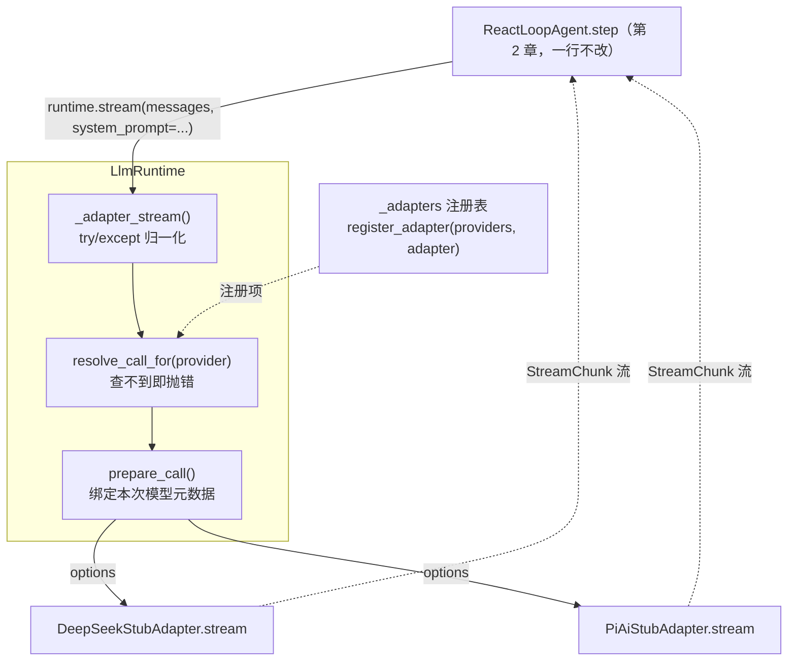
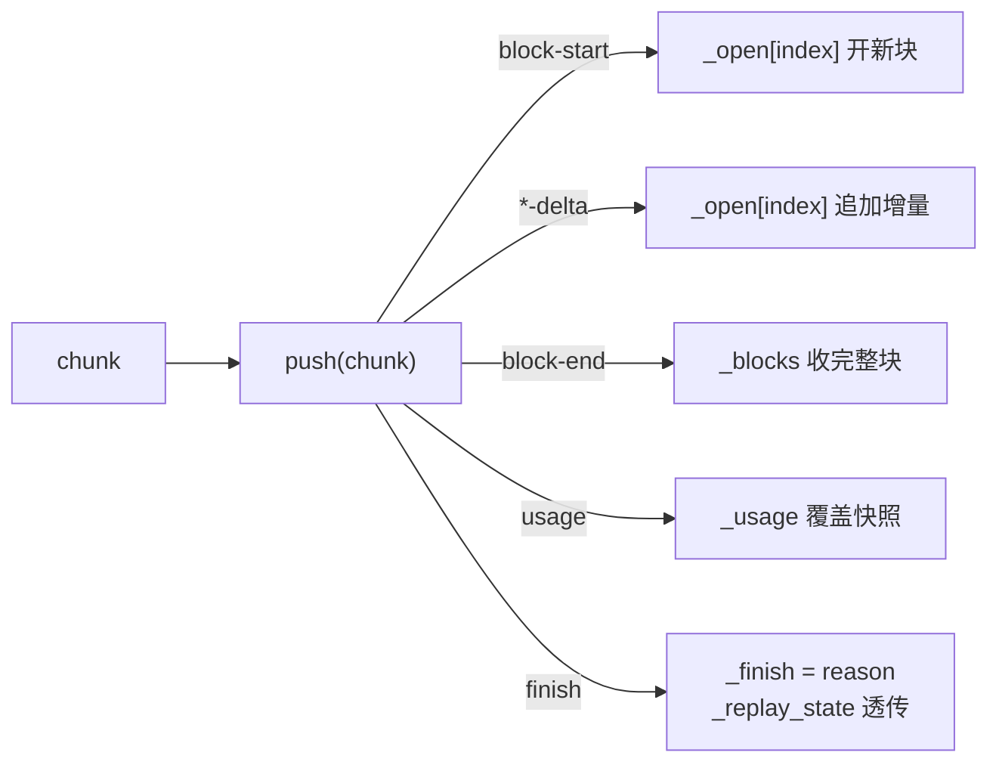
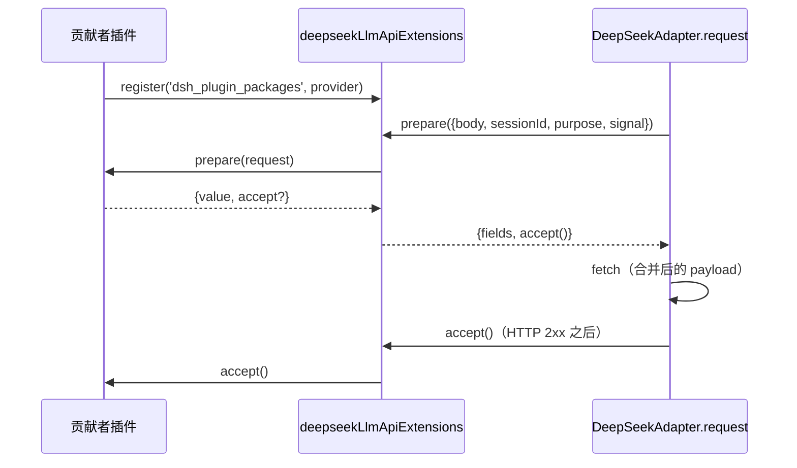
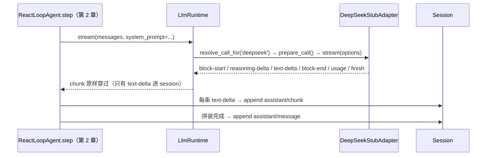

# 第 7 章 LLM 适配与流式

> 席位常换，声音如一。

## 本章回答的问题

- 第 2 章留下的 `LlmStub` 桩位，如何换成真实模型而调用方一行不改？
- 各家 provider 的流式协议各不相同，如何用一套统一的 chunk 协议对上屏蔽差异？
- 流式增量（delta）如何被累积成完整内容块，供下游直接消费？
- API Key 这类 secret 放在哪里，才能不进业务代码、不明文传参？
- 插件想往 provider 请求里加一个自己的字段，怎么加才不用改适配器？

第 2 章 §5.1 里，我们在最小闭环的模型席位上放了一个假模型：`LlmStub` yield 3 个写死的文本 chunk 加 1 个 finish，让 `ReactLoopAgent.step` 在没有真实模型的情况下跑通「消费 chunk → 追加 `assistant/chunk` → 拼出 `assistant/message`」。当时留了一句承诺：**桩只是占位，将来要换成真实模型，且调用方一行不改**。本章兑现这个承诺。

第 3 章到第 6 章，循环一路加厚——持久化、工具管线、能力 seam、执行世界——但模型席位始终是那个桩。本章造四样东西：

- **适配器 seam**：任何 provider 都能挂进来，调用方只认一个 `stream()`；
- **统一流式协议**：各家流式格式的差异在适配器内部消化，消费者只认一种 chunk；
- **凭据/设置 seam**：API key 这类 secret 有统一去处，不进业务代码；
- **请求扩展注册表**：插件各自贡献请求字段，适配器只做一次合并事务。

做完之后，`ctx.provide("llm", runtime)` 顶替第 2 章的桩，第 2 章的 AgentLoop 原样跑通。

代码关系：本章复用 ch01 的 `Context` 与 ch02 的 `Sessions`/`SystemPromptService`/`AgentLoop`（经 `ch07/code/main.py` 顶部 `sys.path` 插入，不复制文件）；本章新增文件全部落在 `ch07/code/`。

## 1. 模型调用焊死在业务代码里

**场景**：团队先接了 Provider A（同步、整段返回），业务代码直接调用；半年后要接 Provider B（HTTP + SSE 流式，字段名完全不同），还要同时支持「流式展示 + 完整块落库」。SSE（server-sent events）是服务端沿一条 HTTP 长连接、持续往前端推 `event:`/`data:` 小帧的协议——和「请求一次、拿一整个 JSON」是两种形态。

先看没有适配器 seam 的反面示例（`ch07/code/bad_example.py`，`python3 bad_example.py` 可运行）：

```python
def answer_via_a(question):
    # 调用点焊死在 Provider A：同步、整段文本
    return provider_a_complete(question)


def answer_via_b(question):
    # 换到 Provider B：调用点必须重写，字段名、拼装方式全不同
    parts = []
    for event in provider_b_stream(question):
        parts.append(event["piece"])  # 字段名是 piece，不是 text
    return "".join(parts)
```

输出：

```text
Provider A: [A] 对「什么是 agent？」的回答
Provider B: [B] 对「什么是 agent？」的回答（流式到达）
问题：每接一家 provider 就写一套调用代码，换 provider = 重写调用点
```

问题归为五条：

| # | 问题 | 表现 |
|---|---|---|
| ① | 模型调用焊死 | 换 provider 要重写调用点；N 家 provider 就有 N 套调用代码 |
| ② | 各家流式协议不同 | SSE vs SDK 事件，字段名各异；每个消费者自己写解析 |
| ③ | 增量要拼成完整块 | 「delta → 完整块」每个消费者各写一遍，行为容易漂移 |
| ④ | secret 没地方放 | API key 明文传参，散落在业务代码与日志里 |
| ⑤ | 请求字段被适配器垄断 | 插件想加一个请求字段，只能去改适配器本体 |
| ⑥ | 配置散在插件里、改动互相覆盖 | 每个插件的配置各写一份，没有统一编辑面；两个人同时改，后写的静默赢 |

本章逐一解决：§2 解决 ①，§3 解决 ②③ 的消费端，§4 解决 ② 的生产端，§5.1–§5.3 解决 ④⑥，§5.4 解决 ⑤。

## 2. 适配器 seam：LlmAdapter + LlmRuntime

### 2.1 概念引入：最小示例

**适配器 seam** 是一套「抽象接口 + 路由运行时」的组合：provider 私有的调用逻辑被封进适配器，调用方只经一个统一入口拿 chunk。没有它，痛在 §1——每接一家 provider 就写一套调用代码。打个比方：插座统一了电器与电网的接口，电器只管插电，电是火电还是风电由电网侧决定；适配器 seam 就是模型调用的插座。

核心思路是把「模型调用」拆成两个角色：

- **LlmAdapter**：每家 provider 实现一个，负责把自己的协议翻译成统一形态；唯一抽象方法是 `stream`；
- **LlmRuntime**：持有注册表，对外只暴露一个统一入口 `stream()`，按 provider 路由。

最小示例（在 `ch07/code/` 下运行）：

```python
from llm_runtime import LlmAdapter, LlmRuntime


class EchoAdapter(LlmAdapter):  # 继承基类；最小适配器只需 provider_info + stream
    def provider_info(self, provider):
        return {"id": provider, "name": "Echo"}

    def stream(self, options):
        yield {"type": "text-delta", "index": 0, "text": f"echo: {options['messages'][-1]['content']}"}
        yield {"type": "finish", "reason": "stop"}


runtime = LlmRuntime()
runtime.register_adapter(["echo"], EchoAdapter())
for chunk in runtime.stream([{"role": "user", "content": "hi"}], provider="echo"):
    print(chunk)
```

输出：

```text
{'type': 'text-delta', 'index': 0, 'text': 'echo: hi'}
{'type': 'finish', 'reason': 'stop'}
```

调用方只认识 `runtime.stream(...)`；chunk 从哪个适配器来，由注册表决定——这就是 seam。

### 2.2 内部实现：注册表与统一入口



拆开看是四件事：

1. **register_adapter**：调用方给出 provider 路由名与 adapter 实例（`packages/llm/llm/src/index.ts:401`）。整批先校验再写入（`packages/llm/llm/src/index.ts:437` 的 `prepareRoutes`）：路由名不能重复，adapter 的 `providerInfo(provider)` 必须原样回显这个路由名，任一路由已被别的 adapter 占用也整体失败——不会出现「注册了一半」的状态。返回的句柄本身就是注销函数，并带一个 `replace` 方法（`packages/llm/llm/src/index.ts:309`）；`replace` 对同一批路由做一次同步替换，中间没有空窗（`:468` 的 `commitRoutes`）。[教学简化] 教学版句柄是个 dict，把注销函数放在 `dispose` 键下——真实版没有名为 `dispose` 的属性，调用句柄即注销。
2. **注册时冻结重试策略**：`registerAdapter` 在注册瞬间调 `adapter.providerRetryPolicy(provider)`（`packages/llm/llm/src/index.ts:450`），把结果存进注册记录。之后 adapter 再改这个返回值也不影响已注册的路由——真实 provider 插件正是监听 `loader/volatile-update`，发现策略变了才 `registration.replace(...)` 重注册（`packages/llm/llm-deepseek/src/host.ts:83`）。
3. **resolve_call_for**：对应真实版的 `registration(provider)`（`packages/llm/llm/src/index.ts:1020`）——查表，查不到就抛 `NO_ADAPTER`。路由错误在入口处暴露，而不是烂在消费者深处。（`resolveCallFor` 是另一个函数，`packages/llm/llm/src/index.ts:902` 接收的是已经解析好的注册项，做模型信息解析与控制项校验。）
4. **_adapter_stream 才是一次调用的入口**（`packages/llm/llm/src/index.ts:1068`）：它在 `try` 里依次做查表、`prepareCall`（`:290`）与 `adapter.stream`，因此这三段里的异常都归一化为一条终止 chunk（`:1188`，`adapterFailureChunk`）。**归一化只覆盖 adapter 边界**——真实的中间件与下游消费者异常仍然照常抛出（`:1063-1066` 的注释就是这个范围）。

**重试不在这个循环里**。真实源码里重试是独立插件 `packages/llm/llm-retry`：它挂在 agent loop 的 `agent/request-error` 恢复点上（`packages/llm/llm-retry/src/index.ts:240`），读的是 router 从 adapter 元数据里取出的那条策略（`mode` 决定是有限次还是不限次，`retryable_codes` 决定哪些失败码值得重试）；进入等待前先把 `llm/retry` 事件 append 进 session（`packages/llm/llm-retry/src/index.ts:184`），等待结束再 append `llm/retry-started`（`:186`），因此重试本身也是可持久化、可回放的事实。runtime 只负责「这一次调用失败长什么样」。

**数字验证**：`main.py` 段落 2 注册 3 个适配器，`list_providers()` 恰好返回 3 条元数据；句柄恰好含 `dispose`（注销函数）/`replace`（原子换路由）/`previous`（被替换掉的旧注册项，首次注册时为 `None`）三个键；`provider_retry_policy('deepseek')` 读回注册时冻结的那份策略；再注册一次 `deepseek` 被拒、`providerInfo` 不回显路由名也被拒——两条整批校验都在教学版里真跑了一遍。

### 2.3 Python 重构

`ch07/code/llm_runtime.py`（节选）：

```python
class LlmAdapter(ABC):
    """适配器抽象基类：每家 provider 实现一个，唯一抽象方法是 stream。

    对应 LlmAdapter（packages/llm/llm/src/index.ts:208）：其余方法均有默认实现。
    [教学决策] 真实版 stream 是 async 生成器；教学版用同步生成器，机制语义不变。
    """

    def provider_info(self, provider):
        """provider 元数据：路由键 id 必须等于注册时的 provider（index.ts:214）。"""
        return {"id": provider, "name": provider}

    def provider_retry_policy(self, provider):
        """重试策略：adapter 元数据，默认 None 表示用默认策略（index.ts:223）。"""
        return None

    @abstractmethod
    def stream(self, options):
        """抽象方法：接收 GenerateOptions，逐条 yield StreamChunk（index.ts:302）。"""
```

```python
class LlmRuntime:
    def register_adapter(self, providers, adapter):
        # ... 先整批校验：路由不重复、未被占用、provider_info 回显路由名（index.ts:437）...
        for provider in providers:
            self._adapters[provider] = {
                "adapter": adapter,
                "retry_policy": adapter.provider_retry_policy(provider),  # 注册瞬间冻结（:450）
            }
        # ... 返回 {"dispose", "replace", "previous"} ...

    def _adapter_stream(self, options):
        # ... 略：真实版还有 waterfall('llm/stream') 包装与 file/image 投影 ...
        adapter = self.resolve_call_for(options["provider"])   # 查不到即抛错，且在 try 外
        try:
            call = adapter.prepare_call(options["provider"], options["model"])
            yield from call["stream"](options)
        except Exception as exc:  # adapter 边界内的异常 → 终止 chunk
            yield self._failure_chunk(exc)
```

注意 `stream()` 的签名：`(messages, system_prompt=None, ...)` 与第 2 章 `LlmStub.stream` **完全兼容**——这不是巧合而是刻意设计：只有这样，runtime 才能直接顶替桩成为 `ctx.llm`（§6 验证）。

### 2.4 回溯：seam 有了，流的是什么

问题 ① 解决：换 provider 只改注册表，调用点一行不动。但 seam 里流动的 chunk 流还没有统一「语言」——各家 provider 的流式协议不同（SSE vs SDK 事件，字段名各异），若每个消费者自己解析，就是问题 ②③。下一节统一 chunk 协议与消费端。

## 3. 统一流式协议：StreamChunk + BlockAssembler

### 3.1 概念引入：七变体协议

**统一流式协议**回答「seam 里流的 chunk 长什么样」：规定一组固定的 chunk 类型，生产者照此发、消费者照此收，双方都不必认识具体 provider。没有它，就是问题 ②③——每个消费者为每家 provider 各写一遍解析与拼装。

真实源码把流式协议定义为一个判别联合 `StreamChunk`（`packages/llm/llm/src/types.ts:496`），共 7 个变体；教学版用 dict 表达，靠 `type` 字段判别（`llm_runtime.py` 的 `STREAM_CHUNK_TYPES`）：

| 变体 | 携带 | 职责 |
|---|---|---|
| `block-start` | `index`、`blockType` | 声明「一个内容块开始」 |
| `text-delta` | `index`、`text` | 文本增量 |
| `reasoning-delta` | `index`、`text` | 推理增量 |
| `tool-call-delta` | `index`、`id`/`name`/`argumentsDelta` | 工具调用增量（arguments 逐段追加） |
| `block-end` | `index`、`block` | 块结束，**携带完整块** |
| `usage` | `usage`（TokenUsage） | token 计量快照 |
| `finish` | `reason`（FinishReason）、可选 `replayState` | 调用结束 |

chunk 里说的「块」是 `ContentBlock`：`packages/llm/llm/src/types.ts:144` 的 `ContentBlockMap` 定义 text / reasoning / image / file / tool-call / tool-addition / tool-removal 七种，且是可合并扩展的接口——插件能加新块型，所以消费端要「按 type 分支、未知类型落到保守路径」。

消费端不用自己实现「增量 → 完整块」：`BlockAssembler` 代劳。最小示例（在 `ch07/code/` 下运行）：

```python
from llm_runtime import BlockAssembler

assembler = BlockAssembler()
for chunk in (
    {"type": "block-start", "index": 0, "block_type": "text"},
    {"type": "text-delta", "index": 0, "text": "hello "},
    {"type": "text-delta", "index": 0, "text": "world"},
    {"type": "block-end", "index": 0, "block": {"type": "text", "text": "hello world"}},
    {"type": "finish", "reason": "stop"},
):
    assembler.push(chunk)
print(assembler.blocks)  # [{'type': 'text', 'text': 'hello world'}]
print(assembler.finish)  # stop
```

### 3.2 内部实现：push 的分发表



拆开看是四个状态：

1. `_open`：「正在累积的块」字典，以 `index` 为键；`*-delta` 把增量追加到对应块上；
2. `_blocks`：已完成块列表；`block-end` 携带完整块入列——协议要求 `block-end` 必须带完整块，消费者可直接信任；
3. `_usage`：最近一次计量快照，后来的 `usage` chunk 覆盖前者（同步幂等）；
4. `_finish`/`_replay_state`：终止原因与 adapter 私有重放状态（对消费者不透明，只透传）。

对外观察点是 `blocks()`（`packages/llm/llm/src/assembler.ts:158`）、`usage`（`:182`）、`finish`（`:187`）、`replayState`（`:196`）四个只读成员，加一个 `message(source)`（`packages/llm/llm/src/assembler.ts:205`），把累积结果转成一条 assistant 消息。

### 3.3 Python 重构

`ch07/code/llm_runtime.py` 的 `BlockAssembler.push`（节选；源码用 camelCase 的 `blockType`/`argumentsDelta`/`replayState`，教学版统一改成 snake_case）：

```python
class BlockAssembler:
    # ... __init__ 与观察点 blocks/usage/finish/replay_state 见 §3.2 ...

    def push(self, chunk):
        """消费一条 chunk，按类型更新内部状态。"""
        chunk_type = chunk["type"]
        if chunk_type == "block-start":
            # ... 略：按 block_type（text/reasoning/tool-call）开新块 ...
        elif chunk_type in ("text-delta", "reasoning-delta"):
            block = self._open.setdefault(
                chunk["index"], {"type": chunk_type.split("-")[0], "text": ""}
            )
            block["text"] += chunk["text"]
        # ... tool-call-delta 分支略（id/name/arguments 逐段追加）...
        elif chunk_type == "block-end":
            self._open.pop(chunk["index"], None)
            self._blocks.append(chunk["block"])
        elif chunk_type == "usage":
            self._usage = chunk["usage"]
        elif chunk_type == "finish":
            self._finish = chunk["reason"]
            self._replay_state = chunk.get("replay_state")
```

### 3.4 回溯：协议统一了，谁来生产 chunk

消费端统一了，生产端还要直面各家 provider 的私有协议：DeepSeek 走 HTTP + SSE 的 Messages 事件流，Pi.AI 走 SDK 事件。适配器如何把它们翻译成七变体协议？拆一个真实适配器看。

## 4. 一个真实适配器：DeepSeek 的三段流水线

### 4.1 概念引入：适配器内部长什么样

HEAD 把 `llm-deepseek` 拆成了多文件：四个流水线文件（`adapter.ts` 负责生命周期与发送，`serialize.ts` 负责请求体，`sse.ts` 负责切帧，`translate.ts` 负责翻译），外加一个横切的扩展事务（`request-extensions.ts`）。三段流水线仍然是 **序列化请求 → 发出请求并接受扩展字段 → 解析 SSE 并翻译**（`packages/llm/llm-deepseek/src/adapter.ts:91` 的 `request`）。教学版把「发出请求」换成内置样例（无网络），三段的分工与真实版一致。

这里的 Messages 指 DeepSeek 的 Messages 接口形态（`POST /v1/messages`）：`system` 是独立顶层字段，响应是一串带 `content_block_start` / `content_block_delta` / `content_block_stop` 的事件——和「一次返回整个 completions 对象」的接口不是一回事。

### 4.2 内部实现：serialize → request → parseSse → translate


拆开看是三段，外加一个横切的扩展事务：

1. **serialize**（`packages/llm/llm-deepseek/src/serialize.ts:57`）：把 GenerateOptions 映射为 Messages 请求体——`system` 在 `:151` 拼成一段文本、`:157` 落到顶层独立槽位，不混入 `messages`；`stream` 恒为 True（`serialize.ts:153`）；工具声明走 `input_schema`，思考强度走 `thinking`/`output_config`。[教学简化] 教学版 `serialize_request` 只保留 model/messages/stream/system/temperature/max_tokens；真实版还要做消息投影（工具结果配对、developer 消息转 system update）、图片与文件处理、`thinking`/`output_config` 写回。
2. **request**（`packages/llm/llm-deepseek/src/adapter.ts:91`）：先 `resolveAuth` 取凭据头（`:98`），再做扩展事务（`:127`），最后 `fetch` 到 `messagesApiRoot(baseURL)/messages`（`:142`）。HTTP 2xx 之后才调 `extensions.accept()`（`:167`）——「字段进没进请求」以服务端接受为准。
3. **parseSse + translate**（`packages/llm/llm-deepseek/src/sse.ts:13` → `translate.ts:104`）：切帧时 `event` 名必须与 data 里的 `type` 一致（`sse.ts:22`），否则整条流按 `MALFORMED_RESPONSE` 失败；翻译时把 `content_block_start`/`content_block_delta`/`message_delta` 映射成七变体，`stop_reason` 由 `stopReason` 翻译（`translate.ts:90`：`end_turn`/`stop_sequence` → stop，`tool_use` → tool-calls，`max_tokens` → max-tokens）。

（上面第 2 段里的 `prepareRequestExtensions` 就是 §5.4 那个注册表的适配器侧入口：它把序列化好的请求体交给注册表 `prepare`，再把拿到的 `fields` 合并进发出去的 payload。）

还有个术语要翻译：上游把推理块叫 `thinking`（`content_block.type = "thinking"`，增量类型 `thinking_delta`、文本字段也叫 `thinking`），协议侧统一叫 `reasoning`——`translate` 的 `startBlock` 在这一步改名（`packages/llm/llm-deepseek/src/translate.ts:51-53`），见 §4.3 的代码注释。

两个字段级细节：

- `usage` 是逐键覆盖而非累加（`translate.ts:34` 的 `updateUsage`），终局才补 `totalTokens`（`translate.ts:159`）。计数不相交：`input_tokens` 不含缓存命中，`cache_read_input_tokens`/`cache_creation_input_tokens` 单列——这是 `TokenUsage` 的契约（`packages/llm/llm/src/types.ts:182`）。
- 协议要求 `block-end` 携带**完整块**，而上游只有增量——所以 `translate` 是**有状态生成器**：按 wire index 累积（`translate.ts:45` 开块、`:65` 追加增量），`content_block_stop` 时整块吐出，`message_stop` 时发唯一一条 `finish` 并带上 `replayState`（`translate.ts:161`）。

### 4.3 Python 重构

`ch07/code/deepseek_adapter.py`（节选，**模块级函数**）：

```python
def translate(events):
    """把 Messages 事件流翻译为统一 StreamChunk（translate.ts:104）。"""
    blocks = {}   # wire index -> {"index", "block_type", "text", "signature"}
    usage = map_usage({})
    reason = None
    for event in events:
        event_type = event.get("type")
        if event_type == "content_block_start":
            native = event["content_block"]
            # wire 的 "thinking" 在协议里叫 "reasoning"（translate.ts:51-53）
            block_type = "reasoning" if native["type"] == "thinking" else native["type"]
            blocks[event["index"]] = {"index": len(blocks), "block_type": block_type,
                                      "text": native.get("thinking", native.get("text", "")),
                                      "signature": native.get("signature", "")}
            yield {"type": "block-start", "index": len(blocks) - 1, "block_type": block_type}
        elif event_type == "content_block_delta":
            # ... 略：text_delta/thinking_delta 追加并 yield *-delta；signature_delta 只累积进 blocks ...
            pass
        elif event_type == "content_block_stop":
            block = blocks[event["index"]]
            yield {"type": "block-end", "index": block["index"],
                   "block": {"type": block["block_type"], "text": block["text"]}}
        elif event_type == "message_delta":
            # stop_reason 只在这里出现；不处理它，finish 永远落到 "error"
            if event["delta"].get("stop_reason") is not None:
                reason = map_stop_reason(event["delta"]["stop_reason"])
        elif event_type == "message_stop":
            # 终局 usage 补总量（translate.ts:159），再发唯一一条 finish（:161 带 replayState）
            total = usage["input_tokens"] + usage["output_tokens"] \
                + usage.get("cache_read_tokens", 0) + usage.get("cache_write_tokens", 0)
            yield {"type": "usage", "usage": {**usage, "total_tokens": total}}
            yield {"type": "finish", "reason": reason or "error", "replay_state": {...}}
```

```python
def map_usage(usage):   # 模块级函数
    """字段级映射：Messages usage → TokenUsage（translate.ts:34 updateUsage）。

    只映射上游真的给出的字段——updateUsage 逐键覆盖，缺的键保留旧值。
    """
    keys = {
        "input_tokens": "input_tokens",
        "output_tokens": "output_tokens",
        "cache_read_input_tokens": "cache_read_tokens",
        "cache_creation_input_tokens": "cache_write_tokens",
    }
    return {local: usage[wire] for wire, local in keys.items() if wire in usage}
```

对照 `ch07/code/pi_adapter.py` 展示了另一种上游形态：Pi.AI 走 SDK 事件，`toStreamChunks`（`packages/llm/llm-pi-ai/src/stream.ts:144`）把 SDK 事件归一化为同一套七变体协议——**上游形态不同，出口相同**，差异被适配器吸收。

### 4.4 回溯：生产端就位，secret 还没地方放

三段流水线还差一味原料：`request` 的第一步是 `resolveAuth`（`packages/llm/llm-deepseek/src/adapter.ts:98`）——API key 不能写死，也不能明文传参。这是问题 ④，靠凭据 seam 解决。

## 5. 基础设施 seam：凭据、设置、token 计量与请求扩展

### 5.1 CredentialProvider：secret 的唯一通道

**CredentialProvider** 是 secret 读写的唯一通道：API key 这类机密一律经它存取，禁止硬编码与明文传参。没有它，痛在问题 ④——key 散落在业务代码与日志里。

真实源码的 `CredentialProvider`（`packages/credentials/credentials/src/index.ts:171`）定义五个主要动作：`resolve`（`:184`，读 secret，带来源标记返回）、`describe`（`:192`，**只回元数据，不含 secret**，返回 `CredentialInfo` 的 `configured`/`source`/`writable` 三项，`packages/credentials/credentials/src/types.ts:67`）、`set`（`:201`，拒绝空值）、`unset`（`:209`）、`notifyUpdated`（`:266`，在写入提交**之后**广播 `credentials/reference-updated`）。另有一组「记录」方法（`readRecord` 从 `:217` 起）服务于授权记录，本章不展开。

最小示例（在 `ch07/code/` 下运行）：

```python
from credentials import InMemoryCredentialProvider

credentials = InMemoryCredentialProvider()
credentials.set("deepseek/api-key", "sk-demo-001", source="env")
print(credentials.describe("deepseek/api-key"))  # 元数据不含 secret
print(credentials.resolve("deepseek/api-key"))   # 只有这里取出 secret
```

输出：

```text
{'configured': True, 'source': 'env', 'writable': True}
{'value': 'sk-demo-001', 'source': 'env'}
```

适配器只在构造请求前的最后一步调它（`DeepSeekStubAdapter.resolve_auth`；真实版是 `resolveAuth`，`packages/llm/llm-deepseek/src/adapter.ts:98` 调 `packages/llm/llm-deepseek/src/credential.ts:15` 的 `resolveDeepSeekApiKey`），key 从不进入业务代码。

### 5.2 设置：SettingsForms 不是 key-value 仓库

问题 ⑥：超时、模型目录、思考强度这类非 secret 配置，每个插件各写一份，散在各自的配置文件里；想改一处得知道它在哪个插件、哪个字段，两个人同时改还会互相覆盖且没人报错。HEAD 曾经有一个「注册设置项、再按键读值」的 seam，现在换了个形状——**阅读这段要先破一个惯性：`packages/settings/settings` 不是配置的读取通道，也不是存储通道**。

配置值本身仍来自插件自己的 Config schema（插件在声明里给出 schema 与默认值，profile 与命令行覆盖叠在上面，业务代码直接读自己的 Config 引用；profile 的组装见第 15 章）。`packages/settings/settings` 提供的是**编辑面**：把活跃插件的 Config 投影成表单，接收表单编辑并写回 profile。所以它没有 `get`/`register`——它从来不负责「读配置」。

`SettingsForms`（`packages/settings/settings/src/index.ts:223`）对外是四个编辑动作（外加一个 UI 策略钩子 `configure`，`packages/settings/settings/src/index.ts:266`）：

- `describe(options?)`（`:302`）：读每个活跃插件条目的 schema、已解析值、基础层与用户层，并给出一个 `revision`。内容没变时 revision 沿用旧值，变了才 +1——所以它是**单调非降**，不是每次调用都加一；
- `update(ns, patch, expectedRevision?)`（`:348`）：把 patch 合并进当前值；
- `replace(ns, section, expectedRevision?)`（`:358`）：整段替换；
- `mutate(ns, ops, expectedRevision?)`（`:368`）：按路径 `set`/`unset`，避开客户端不持有的脱敏字段。

写入都带可选的 `expectedRevision`：与当前 revision 不符就抛 `SettingsConflictError`（`packages/settings/settings/src/index.ts:45`），而不是静默覆盖——两个人同时编辑一份配置时，后到的那个必须重读。

教学版 `InMemorySettingsForms` 保留 describe/update/replace/mutate 与 revision 检查。[教学简化] 真实 `describe` 返回 schema、已解析值、基础层与用户层四份视图（并对 remote 调用方脱敏），教学版只返回 ns/value/revision；真实 `update` 用 `mergeLayers` 做递归深合并（数组整段替换），教学版是浅合并；`declare()` 顶替真实版「值来自 profile 插件 Config」。

一句话记住两个 seam 的分工：**secret 走 credentials；非 secret 配置由各插件自己的 Config 承载，settings（SettingsForms）只提供编辑面**。凭据与设置是两个独立 seam，本章只教契约，不教它们各自把值存在哪里（keychain、profile 文件、环境变量都只是实现细节）。

### 5.3 TokenMeter：把 chunk 流折算成 usage

**场景**：上下文快压满了，得有人回答「现在到底占了多少 token」；一次多步任务跑完，用户想知道花了多少；同一个会话里，压缩判断、成本展示、UI 进度条各算一遍，算法一漂移，三处数字就对不上。

`TokenMeter`（`packages/llm/token-meter/src/index.ts:87`）就是这个唯一答案来源。给它一条消息，它按固定密度折算：

```python
from token_meter import estimate_message

print(estimate_message({"role": "user", "content": "你是谁？"}))  # 9
```

四字符一个 token 加四 token 角色开销，就是你看到的 `9`。真实计量分两档：assistant 结算里带了 usage 就用精确值，没带才退回这套估算。判定在 `packages/llm/token-meter/src/measurement-projection.ts:61-75`（`assistant/message` 有 `event.data.usage` 且已有请求头时记精确值，否则 `estimateMessage`）；`usageOf`（`packages/llm/token-meter/src/usage-projection.ts:82-85`）从 `assistant/message`/`assistant/attempt` 的流里取最后一条 usage 样本。`measure`（`:151`）先经 `_sync`（`:231`）回放 Session 日志把价格缓存追到最新，而 `_foldEvent`（`:274`）只维护 surface 与锚点价格，不读 usage。

估算规则写在 `estimate.ts`：固定密度 4 字符/token（`packages/llm/token-meter/src/estimate.ts:13`），每个内容块另有 4 token 结构开销（`:16`），每条消息再加 4 token 角色开销（`:19`）。`estimateContent`（`:42`）与 `estimateMessage`（`:88`）就是这两层的组合。

[教学简化] 教学版 `TokenMeter.measure` 直接吃 chunk 流，不做 Session 回放；语义保留两条：`usage` chunk 以 adapter 上报的快照为准，**逐键覆盖**此前的估算、缺的键保留旧值（`self._usage.update(...)`，与 `translate.ts:34` 的 `updateUsage`、assembler 的 usage 快照同一语义），`text-delta` 按字符数累加估算。`main.py` 段落 7 验证：估算最终被 adapter 上报的 usage 逐键覆盖，结果与 §6 段落 4 中 assembler 的 `usage` 快照对得上（`cache_write_tokens`/`reasoning_tokens` 两个零值键保留，正是逐键覆盖的证据）。

### 5.4 请求扩展注册表：插件往请求里加字段

问题 ⑤：DeepSeek 请求体是适配器私有格式，插件想加一个顶层字段（比如「这条请求携带的插件包清单」「这段会话日志」），只能去改 `serialize.ts`，还要在 adapter 里再写一遍发送逻辑。字段一多，适配器就变成一堆插件诉求的拼盘。

解法是**请求扩展注册表**（`packages/llm/deepseek-llm-api-extensions/src/index.ts:66`）：字段的所有权归插件，合并事务归适配器。机制是两段接口、一次事务：



1. **register**（`packages/llm/deepseek-llm-api-extensions/src/index.ts:81`）：登记「某个顶层字段由谁准备」。字段名必须非空且去空白；重复校验落在随插件 fiber 生效的 `ctx.effect` 里（`:91-99`），同一作用域内重复注册同一字段会被拒，返回的 disposer 随插件一起注销。字段名是声明合并的类型键（`DeepSeekLlmApiExtensionMap`），所以拼错字段名在编译期就暴露。
2. **prepare**（`:111`）：对当前全部贡献者并发跑一次 `prepare`，每个返回值都 `structuredClone` 后递归冻结（`:117`）——贡献者拿不到出站请求的可变别名。单个贡献者抛错（`structuredClone` 失败同理）不会拖垮整个请求：该字段本次缺席，每个字段只告警一次（`:119`）。**例外是取消**：整个 `prepare` 包在 `abortable(...)` 里（`:51`、`:114`），请求 signal abort 时整次 reject，而不是逐字段省略。
3. **accept**（`:139`）：`accept()` 把各贡献者的提交回调合并成一次结算，且**幂等**——重复调用加入同一次结算。适配器只在 HTTP 2xx 之后调它（`packages/llm/llm-deepseek/src/adapter.ts:167`）；提交失败只上报、不让请求失败，贡献者下次请求重发自己的未确认状态。

`dsh_*` 命名空间是这套机制的约定：字段名以 `dsh_` 开头，一眼能看出「这是 harness 自己的扩展字段，不是 provider 协议字段」。HEAD 里有两个内置贡献者：

| 字段 | 贡献者 | 内容 |
|---|---|---|
| `dsh_plugin_packages` | `packages/llm/plugin-package-inventory-deepseek`（`packages/llm/plugin-package-inventory-deepseek/src/index.ts:205`） | 活跃插件包清单（name + version），供服务端归因 |
| `dsh_session_log` | `packages/session/session-log-deepseek`（`packages/session/session-log-deepseek/src/index.ts:196`） | 一段会话日志；`accept` 里把「已接受到哪个 seq」写回 session（`:253`） |

`dsh_session_log` 是 accept 语义的好例子：字段值在 prepare 时按字节上限裁剪，服务端 2xx 之后才落一条 `session-log-deepseek/delivery-accepted`；如果 2xx 之后进程崩了，这段日志下次会重发——**宁可重复，不可假装已送达**。

教学版在 `ch07/code/deepseek_adapter.py` 的 `RequestExtensionRegistry` 里实现同一套语义：重复注册抛错、单贡献者失败只省略该字段、accept 幂等。[教学简化] 教学版是同步顺序 prepare（真实版并发 + abortable）、深拷贝但不冻结、每次请求都告警（真实版每个字段只告警一次）。`main.py` 段落 8 演示三个贡献者（其中一个故意抛错）与一次重复注册。

## 6. 完整运行输出

`cd ch07/code && python3 main.py`，八段端到端输出（与实际运行一致；本节所有行均为 `main.py` 的 `print` 打印，`[warn]` 行是教学版注册表对失败贡献者的告警，无框架日志与第三方输出）：

```text
== 1. 凭据 / 设置 seam ==
  describe(deepseek/api-key) -> {'configured': True, 'source': 'env', 'writable': True}
  settings.describe(llm-deepseek) -> {'ns': 'llm-deepseek', 'value': {'idle_timeout_ms': 30000}, 'revision': 0}
  stale write rejected -> llm-deepseek: stale revision 7
  after stale write -> {'ns': 'llm-deepseek', 'value': {'idle_timeout_ms': 30000}, 'revision': 0}

== 2. 注册适配器：LlmRuntime 注册表 ==
  list_providers() -> [{'id': 'deepseek', 'name': 'DeepSeek'}, {'id': 'pi-ai', 'name': 'Pi.AI'}, {'id': 'pi-fail', 'name': 'Pi.AI'}]
  register 返回句柄键 -> ['dispose', 'previous', 'replace']
  provider_retry_policy(deepseek) -> {'mode': 'normal', 'max_retries': 2, 'retryable_codes': ['RATE_LIMIT', 'SERVER']}
  路由已占用被拒 -> adapter for provider 'deepseek' is already registered
  id 未回显被拒 -> adapter metadata for 'deepseek-2' must preserve its id

== 3. 统一流式入口：调用方一行不改，只换 provider ==
  provider=deepseek: 10 chunks
    types=['block-start', 'reasoning-delta', 'reasoning-delta', 'block-end', 'block-start', 'text-delta', 'text-delta', 'block-end', 'usage', 'finish']
  provider=pi-ai: 6 chunks
    types=['block-start', 'text-delta', 'text-delta', 'usage', 'block-end', 'finish']

== 4. BlockAssembler：delta 累积成完整块 ==
  blocks -> [{'type': 'reasoning', 'text': '先拆解问题，再给结论。'}, {'type': 'text', 'text': 'DeepSeek 是一家模型公司。'}]
  usage  -> {'input_tokens': 8, 'cache_read_tokens': 4, 'output_tokens': 8, 'total_tokens': 20}
  finish -> stop
  message() -> {'role': 'assistant', 'content': [{'type': 'reasoning', 'text': '先拆解问题，再给结论。'}, {'type': 'text', 'text': 'DeepSeek 是一家模型公司。'}]}

== 5. 异常归一化：异常 → finish(reason=error) ==
  chunk -> {'type': 'finish', 'reason': 'error', 'error': 'upstream unavailable（演示异常归一化）'}

== 6. 兑现第 2 章承诺：runtime 顶替 LlmStub ==
  assistant/chunk 事件 2 条；assistant 消息：DeepSeek 是一家模型公司。

== 7. TokenMeter：chunk 流折算 usage ==
  measure(stream) -> {'input_tokens': 8, 'output_tokens': 8, 'cache_read_tokens': 4, 'cache_write_tokens': 0, 'reasoning_tokens': 0, 'total_tokens': 20}
  estimate_message(user) -> 9 tokens

== 8. 请求扩展注册表：register → prepare → accept ==
  [warn] omitting dsh_broken from this request: 贡献者自己的 bug
  fields -> ['dsh_plugin_packages', 'dsh_session_log']
    accept(): dsh_session_log 已提交
  重复注册被拒 -> field 'dsh_plugin_packages' is already registered
```

段落 6 是本章的兑现时刻，时序如下：



**逐行溯源**：

| 段落 | 机制 | 源码锚点 |
|---|---|---|
| 1 凭据 | `resolve`/`describe` | `packages/credentials/credentials/src/index.ts:184`/`:192` |
| 1 设置 | `describe`/`update` + revision 冲突 | `packages/settings/settings/src/index.ts:302`/`:348`/`:45` |
| 2 注册 | registerAdapter → 路由 + 冻结重试策略 | `packages/llm/llm/src/index.ts:401`/`:450` |
| 3 统一入口 | stream → registration → prepareCall → adapterStream | `packages/llm/llm/src/index.ts:1170`/`:1020`/`:290`/`:1068` |
| 4 累积 | push → blocks/usage/finish/message | `packages/llm/llm/src/assembler.ts:158`/`:182`/`:187`/`:205` |
| 5 归一化 | adapterFailureChunk | `packages/llm/llm/src/index.ts:1188` |
| 6 兑现 | runtime 顶替 LlmStub，第 2 章 step 一行不改 | `packages/llm/llm/src/index.ts:1174`（`llm/stream` waterfall） |
| 7 计量 | measure → _sync 回放；精确/估算判定在投影 | `packages/llm/token-meter/src/index.ts:151`/`:231`；`packages/llm/token-meter/src/measurement-projection.ts:61-75` |
| 8 扩展 | register/prepare/accept | `packages/llm/deepseek-llm-api-extensions/src/index.ts:81`/`:111`/`:139` |

## 7. 源码对照

| 教学符号 | 真实源码 | 教学简化 |
|---|---|---|
| `LlmAdapter` | `packages/llm/llm/src/index.ts:208`（providerInfo :214 / providerRetryPolicy :223 / listModels :260 / resolveModel :273 / prepareCall :290 / stream :302） | stream 为同步生成器（真实版 async）；image/tool-update 相关默认实现省略 |
| `LlmRuntime` | `packages/llm/llm/src/index.ts:354`（registerAdapter :401 / prepareRoutes :437 / listProviders :483 / providerRetryPolicy :668 / registration :1020 / adapterStream :1068 / stream :1170 / streamWithRegistration :1174 / adapterFailureChunk :1188；resolveCallFor :902 只做模型信息解析与控制项校验） | 省略 `llm/stream` waterfall、prepareCall 代际绑定、file/image/tool-update 投影与模型发现；句柄用 dict 的 `dispose` 键替代「调用句柄即注销」 |
| `STREAM_CHUNK_TYPES` | `packages/llm/llm/src/types.ts:496`（StreamChunk 七变体；FinishReason :172；TokenUsage :182；ContentBlockMap :144） | TS 判别联合 → dict + type 字段 |
| `BlockAssembler` | `packages/llm/llm/src/assembler.ts:38`（blocks :158 / usage :182 / finish :187 / replayState :196 / message :205） | 语义一致；message 省略 source 参数 |
| `DeepSeekStubAdapter` | `packages/llm/llm-deepseek/src/adapter.ts:22`（stream :55 / generate :65 / request :91 / resolveAuth :98 / fetch :142）；`serialize.ts:57`（system 拼串 :151 / 顶层落位 :157 / stream :153）；`sse.ts:13`；`translate.ts:104`（updateUsage :34 / startBlock :45 / deltaChunk :65 / stopReason :90 / finish :161） | fetch 换成内置 SSE 样例（无网络）；serialize 只保留 model/messages/stream/system/temperature/max_tokens，省略消息投影、图片/文件与 tools/thinking；省略 idle watchdog、abort 生命周期与 beta 头 |
| `RequestExtensionRegistry` | `packages/llm/deepseek-llm-api-extensions/src/index.ts:66`（register :81 / prepare :111 / 冻结克隆 :117 / accept :139 / abortable :51）；合并点 `packages/llm/llm-deepseek/src/request-extensions.ts:21`、`adapter.ts:127`/`:167` | 同步顺序 prepare（真实版并发 + abort 整次 reject）；深拷贝不冻结；每次失败都告警（真实版每字段一次）；省略 AggregateError 结算 |
| `PiAiStubAdapter` | `packages/llm/llm-pi-ai/src/adapter.ts:273`（resolveModel :356 / stream :394 / streamWithSnapshot :398 / streamSimple :460）；`stream.ts:144`（mapStopReason :80） | SDK streamSimple 换成内置事件样例 |
| `CredentialProvider` | `packages/credentials/credentials/src/index.ts:171`（resolve :184 / describe :192 / set :201 / unset :209 / notifyUpdated :266；记录半区 :217 起）；`types.ts:67` | resolve async → 同步；内存存储替代 credentials-local（`credentials-local/src/index.ts:517`） |
| `InMemorySettingsForms` | `packages/settings/settings/src/index.ts:223`（configure :266 / describe :302 / update :348 / replace :358 / mutate :368 / SettingsConflictError :45） | 同步写；`declare()` 顶替真实版的插件 Config；describe 只回 ns/value/revision（真实版还有 schema/基础层/用户层与脱敏视图）；update 用浅合并（真实版递归深合并）；省略旧 settings.yaml 导入 |
| `TokenMeter` | `packages/llm/token-meter/src/index.ts:87`（measure :151 / _sync :231 / _foldEvent :274）；`measurement-projection.ts:61-75`（精确 vs 估算）；`usage-projection.ts:82-85`（usageOf）；`estimate.ts:13`/`:16`/`:19`/`:42`/`:88` | 直接吃 chunk 流而非回放 Session；_foldEvent 只保留「折叠一条 chunk」的教学形态（真实版只维护 surface/锚点价格）；省略图片路由定价与 provider 专属估算 |

## 8. 小结与预告

| 问题 | 解决机制 | 一句话原理 |
|---|---|---|
| ① 模型调用焊死 | LlmAdapter + LlmRuntime | provider 是注册表里的一项，调用方只认 stream() |
| ② 流式协议各异 | StreamChunk 七变体 + 适配器翻译 | 差异在适配器内消化，出口是统一协议 |
| ③ 增量拼装 | BlockAssembler | push 逐条消费，blocks/usage/finish 是只读观察点 |
| ④ secret 没地方放 | CredentialProvider | secret 只经 credentials 读写，不进业务代码 |
| ⑥ 配置分散、改动互相覆盖 | 插件 Config + SettingsForms | 值仍在各插件 Config 里，settings 只提供带 revision 的统一编辑面 |
| ⑤ 请求字段被适配器垄断 | 请求扩展注册表 | 插件注册字段并 prepare，适配器合并后在 2xx 时统一 accept |

开篇题记在此兑现：「席位常换」由段落 6 证明——runtime 顶替桩，第 2 章调用方一行不改；「声音如一」由段落 3 证明——两家 provider 出口都是同一套七变体 chunk；段落 4 再用 deepseek 跑一遍，证明同一台 assembler 接得住。

第 2 章的 `LlmStub` 至此正式退休：模型席位从「写死的桩」变成「可插拔的运行时」，session 开始接收真实形态的流式 chunk。模型席位就位后，下一个问题更基础：发给模型的提示词究竟从哪来、如何组装？第 8 章「system-prompt 组装与 context」将回答这个问题：插件经 `ctx.systemPrompt.section()` 注册有序段，`assemble()` 合并排序，`renderPrompt()` 渲染成 system 文本，工具 schema 则是与之并列的独立字段。至于对话越来越长、上下文逼近窗口上限出现 `finish(reason=max-tokens)`（`packages/llm/llm/src/types.ts:166`）的问题，将由第 10 章「compaction 与 token 压力」沿 `compaction` 方向解决：何时压、压什么、压完的 session 如何保持可追溯。

## 9. 附录：关键概念速查表

| 层 | 概念 | 一句话定义 | 首次出现 |
|---|---|---|---|
| 词汇 | ContentBlock | 可合并扩展的内容块联合（text/reasoning/image/file/tool-call/tool-addition/tool-removal） | §3.1 |
| 词汇 | FinishReason | 调用终止原因（stop/tool-calls/max-tokens/aborted/error） | §3.1 |
| 词汇 | TokenUsage | 计量快照（input/output/cache_read/cache_write/reasoning），各计数不相交 | §3.1 |
| 协议 | StreamChunk | 七变体流式协议，adapter 与消费者之间的唯一语言 | §3.1 |
| seam | LlmAdapter | provider 适配基类，唯一抽象方法是 stream | §2.1 |
| seam | CredentialProvider | secret 读写的唯一通道 | §5.1 |
| seam | SettingsForms | 把插件 Config 投影成可编辑表单的编辑面（不是 key-value 仓库） | §5.2 |
| 运行时 | LlmRuntime | 注册表 + 路由 + 异常归一化的统一入口，注册时冻结重试策略 | §2.1 |
| 运行时 | BlockAssembler | 把 delta 增量累积成完整块 | §3.1 |
| 运行时 | TokenMeter | 把 chunk/session 事件流折算成 TokenUsage | §5.3 |
| 注册表 | 请求扩展注册表 | 插件各注册一个顶层请求字段，适配器做一次 prepare/accept 事务 | §5.4 |
