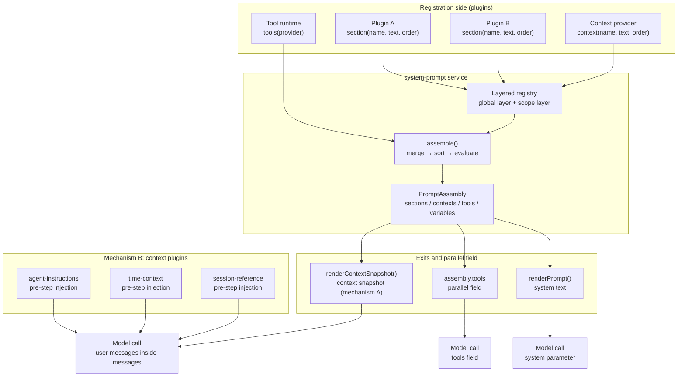

# Chapter 8: system-prompt Assembly and context: Where Does the Prompt Sent to the Model Come From

> The prompt is not a string; it is an assembled artifact.

## Questions this chapter answers

- Where does each section of the system prompt come from? How do multiple plugins write into the same prompt without stepping on each other?
- Why isn't the tool schema inside the prompt text? What is its relationship to the prompt?
- How do dynamic pieces of information like workspace instructions, the current time, and cross-session references enter the model's field of view?
- Both `context()` and the context plugins are called "context" — are they the same mechanism?

Chapter 7 turned the model seat into a pluggable runtime, and at the end of the chapter (§8) it left a more fundamental question: where exactly does the prompt sent to the model come from, and how is it assembled? This chapter answers that question.

Chapter 4 "tools Registry and Executor Pipeline" solved the tool-side problem: plugins register tools via `ctx.tools.register()`, schema projection (`projectToolSchema`, `packages/core/tools/src/schema.ts:641`) filters each definition down to the model-facing `{name, description, parameters}`, and after the model returns `tool_use`, it lands back in the session through the three-stage pipeline. That chapter left one loose end: the teaching version in ch04 stuffed the schema text into an ordinary section of Chapter 2's stub `SystemPromptService` (`ch04/code/main.py:79`), while the text noted that the real code has `ToolsService`'s constructor hook a provider to `ctx.systemPrompt.tools()` (`packages/core/tools/src/index.ts:113-117`). What that provider returns at assembly time, and why schemas cannot be a section, is exactly what this chapter answers.

Going back one more step: Chapter 2 §4 gave a minimal stub of `SystemPromptService` (`ch02/code/agent_loop.py:150`), with only two methods, `section()` and `assemble()`, enough to run Chapter 2's loop, but not enough to hold all the semantics of the real project. This chapter upgrades that stub to the full version.

This chapter's code is built incrementally on top of ch04:

| Source | File | How this chapter uses it |
| --- | --- | --- |
| Chapter 1 | `ch01/cordis.py` | Reused via sys.path: `Context`, `Service`, `ctx.effect` (the source of registration reversibility) |
| Chapter 2 | `ch02/agent_loop.py` | Reused via sys.path: `Sessions`, `ReactLoopAgent` (this chapter inherits from it and replaces `pre_step`/`step`), `create_assistant_message` (used by `step` to assemble the assistant reply) |
| Chapter 4 | `ch04/tools.py` | Reused via sys.path: `ToolRuntime`, `ToolDefinition` (the provider-style schema hookup lands on `ctx.systemPrompt.tools()` in this chapter) |
| Newly added in this chapter | `ch08/system_prompt.py` | Full version of the system-prompt service, replacing ch02's stub (without modifying ch02's files) |
| Newly added in this chapter | `ch08/context_plugins.py` | Three context plugins: workspace instructions, time, cross-session references |
| Newly added in this chapter | `ch08/prompt_agent.py` | Loop-side glue: context snapshot projection + full-version `pre_step` |

One-sentence main line: **plugins register ordered sections via `ctx.systemPrompt.section()`, `assemble()` merges and sorts, `renderPrompt()` renders into system text; tool schemas are an independent field parallel to the text; workspace instructions, time context, and cross-session references are injected by context plugins as user messages.**

## 1. The System Prompt Is a Hard-Coded Giant String

First look at the anti-pattern. Suppose every feature module concatenates its own requirements directly into one global string:

```python
SYSTEM_PROMPT = "You are an AI assistant."  # 唯一的初始文本


def register_safety(prompt):
    """安全模块：直接拼到末尾，位置由注册先后决定。"""
    return prompt + "\n\n[安全策略] 不要泄露敏感信息。"


def register_persona(prompt):
    """人格设定：本应在最前，但只能拼到末尾。"""
    return prompt + "\n\n[人格] 你是严谨的代码评审员。"


def register_tools(prompt):
    """工具 schema：也混进文本，模型读到的是一串 JSON 字符串。"""
    schema = {"name": "read_file", "parameters": {"path": "string"}}
    return prompt + f"\n\n[工具] {schema}"
```

Run `python3 ch08/code/bad_example.py`, output:

```text
最终提示词（注意：人格设定本应在最前，实际排在最后）：
You are an AI assistant.

[安全策略] 不要泄露敏感信息。

[人格] 你是严谨的代码评审员。

[工具] {'name': 'read_file', 'parameters': {'path': 'string'}}

假设安全模块现在卸载……
大字符串里仍含安全策略: True

安全模块重复注册后，安全策略出现次数: 2
```

All three problems come from the premise that "the prompt is a string":

1. **Order out of control**: a section's position is determined by concatenation order, not by importance. The persona setting should originally be at the front, but actually ends up last.
2. **Irreversibility**: once concatenated into the string, it cannot be taken out. Even if the safety module is unloaded, its text remains welded into the prompt; duplicate registration directly causes content duplication, with no way to detect it.
3. **Structural collapse**: tool schemas are mixed into the text; what the model reads is a JSON string, not a field that callers can process structurally.

The real project's solution is to upgrade the prompt from a "string" to a "registry + assembly flow": each section is one **revocable registration**, order is determined by an explicit `order`, and assembly happens fresh every time it is needed. First look at the overall structure, then break down each mechanism.

## 2. Overall Structure: One Assembly Line, Two Injection Paths

First look at the whole picture, then break down the parts. The system-prompt package is one assembly line, and `PromptAssembly` is its product; dynamic information enters the model's field of view via two mutually different paths:



Correspondence between the diagram and the body:

- **Registration side**: plugins don't write strings; they only call registration APIs. `section()` registers system text sections, `context()` registers runtime context sections, and `tools()` registers tool schema providers. Every registration returns a revocable disposer.
- **Assembly line**: section and context registrations enter the layered registry (this chapter uses only the global layer; the minimal form of the scope layer shadowing the global layer is in §3, with the full expansion in Chapter 9); tools providers do not enter the layered registry and go directly into `assemble()`'s evaluation queue (P3→A in the diagram). `assemble()` merges the registry, sorts by `order`, evaluates dynamic text and tools providers, and produces `PromptAssembly`.
- **Exits and parallel field**: `renderPrompt()` renders sections into the model call's system parameter (S1 in the diagram); `renderContextSnapshot()` renders contexts into a snapshot (**mechanism A**); `assembly.tools` is an independent field parallel to both, passed as the model call's other argument (S2 in the diagram) and never entering any text. Three nodes, two arguments to the model, no mixing.
- **Mechanism B**: the three context plugins do not go through the assembly line; each injects dynamic information as user messages. In HEAD all three hook `agent/pre-step` listeners and each decides where in the decision messages to put its text (the teaching version still has session-reference called by the host before enqueue, see §6.3). The distinction between mechanism A and mechanism B is a key concept of this chapter, compared specifically in §6.4.

## 3. section Registration and assemble Assembly

### 3.1 Concept introduction

**PromptSection (section contribution)**: the input of one registration, four elements — `name` (section name, unique within the same layer), `order` (sort key, concatenated in ascending order; equal orders are compared by section name), `text` (static text or dynamic provider), `interpolate` (whether to resolve `{{variable}}` references, on by default); plus an optional `complete` (this section alone is the complete prompt). The layer a section belongs to is not in this object: `section()` uses the caller's `ctx` to decide which layer it writes to. Corresponds to source code `packages/core/system-prompt/src/index.ts:53`.

**order (sort key)**: a section's position in the final text is determined solely by order and has nothing to do with registration order. The real project collects common positions into a constant table, `SECTION_ORDERS` (`index.ts:136-172`): harness identity `-1000`, persona prefix `0`, persona suffix `10200`, tool guidance sections starting at `1000`, and `DELIVERABLE_FILE_REFERENCES` at `9000`. In-repo contributors don't write numbers themselves; they look them up: `getSectionOrder('HARNESS_IDENTITY')` (`index.ts:500`) returns `-1000`.

**disposer (unregistration function)**: the return value of `section()`. Registration happens via `ctx.effect` (Chapter 1's reversible side effect); calling the disposer unregisters that section. This is the direct antidote to problem 2's "irreversibility".

**PromptAssembly (assembly product)**: the return value of `assemble()`, four fields — `sections`, `contexts`, `variables`, `tools`. Note that `tools` and `sections` are **parallel**, not one kind of sections (expanded in §4). The first three fields together are `PromptPresentation` (`index.ts:125`), the half the waterfall can rewrite; `PromptAssembly` adds `tools` on top (`index.ts:132`), which the waterfall never touches.

### 3.2 Internal implementation

The core of the assembly line is `assemble()`. The steps of the real implementation (`index.ts:620-695`):

1. Resolve variables first: evaluate the global layer's variables one by one, then overwrite same-name variables along the scope chain from farthest to nearest (`index.ts:626-635`);
2. Merge the global layer's and the scope layer's sections and contexts (`index.ts:637-638`; entries with the same name are shadowed by the scope layer);
3. Evaluate tools providers one by one, accumulating schemas and `knownNames` (`index.ts:644-656`);
4. Sort by order, breaking ties by section name (`index.ts:658` calls `comparePromptSections`, `index.ts:254`), recording `complete: true` sections along the way;
5. Apply `orderTools()` to fix the tool order (`index.ts:674`, body at `index.ts:232`);
6. Filter out suppressed context sections (`index.ts:677-679`) and build the `PromptPresentation`;
7. Go through the `system-prompt/assemble` waterfall, letting plugins rewrite sections / contexts / variables (`index.ts:683`, omitted in the teaching version);
8. After the waterfall, restore exactly two things: a `complete` section becomes the sole section, and when suppressed only `required` contexts remain (`index.ts:687-693`). `tools` never passes through the waterfall at any step.

The constructor registers three default sections (`index.ts:455-472`): the harness identity section (`harness:identity`, order `-1000`, switchable off via `includeHarnessIdentity`), the persona prefix section (`deployment:persona-prefix`, order `0`, text from `config.personaPrefix`), and the persona suffix section (`deployment:persona-suffix`, order `10200`, text from `config.personaSuffix`). The names are exported constants (`index.ts:196`, `index.ts:199`) — a composition registering the same name shadows the deployment default instead of appending a second section. This is the foreshadowing Chapter 9's scope chain picks up.

The rendering exit `renderPrompt()` (`index.ts:296`) does only three things: interpolate `{{variable}}` per section, discard sections that render empty, and join with blank lines; sections with `interpolate: false` are kept verbatim. `joinContextSections()` (`index.ts:320`) adds a fixed prefix to the context snapshot, declaring "this snapshot supersedes earlier runtime context" — the snapshot has **superseding** semantics, not append semantics.

### 3.3 Python reconstruction

The teaching version `ch08/system_prompt.py` implements the main line of the above flow (omitting step 5's `orderTools`, step 7's waterfall, and step 8's `complete` restore). The core of the registration API is the `section()` method of the `SystemPrompt` class (`ch08/system_prompt.py`):

```python
# class SystemPrompt(Service):  …… 构造器与层结构省略
    def section(self, name, text, order: int = 0, scope=None):
        """注册一条 system-prompt 段，对应 index.ts:484 section()。

        同层同名抛错；作用域层的同名段在 assemble 时 shadow 全局层（第 9 章展开）。
        注册走 ctx.effect，返回的 disposer 调用即注销（可逆性来自第 1 章）。
        """
        layer = self._layer(scope)
        if name in layer["sections"]:
            raise ValueError(f'section "{name}" 已注册（同层同名重复）')
        entry = PromptSection(name, order, text, scope)

        def setup():
            layer["sections"][name] = entry
            self.ctx.emit("system-prompt/change", {"name": name, "op": "add"})

            def teardown():
                layer["sections"].pop(name, None)
                self.ctx.emit("system-prompt/change", {"name": name, "op": "remove"})

            return teardown

        return self.ctx.effect(setup)
```

Line by line: first get the scope layer (this chapter has only the global layer); same layer + same name throws directly — problem 2's "duplicate registration undetectable" becomes one loud failure here; the registration body is wrapped in `ctx.effect`, `setup` writes the section into the registry and emits a change event, and the returned `teardown` performs the exact inverse operation. The real version stores sections in `NamedEntries`, where the duplicate-name error comes from the factory function given at construction (`index.ts:413-415`); the teaching version checks by hand, with the same semantics.

`context()` is exactly symmetric with `section()`, except the sections go into the contexts registry rather than the sections registry. It adds one `required` parameter: when runtime context is suppressed, assembly drops only the non-required contexts (corresponding to `index.ts:677-679`); registration itself is never blocked.

The assembly side, `SystemPrompt.assemble()` (same class):

```python
    def assemble(self, scope=None) -> PromptAssembly:
        """组装一次 PromptAssembly，对应 index.ts:620 assemble()。

        真实版步骤（index.ts:620-695）：解析变量 → 合并分层 → 求值工具提供者
        → 排序 → orderTools → 过滤被抑制的 context → waterfall。
        教学版：合并 → 排序 → 求值动态文本 → 求值工具提供者 → 解析变量。
        """
        assemble_context = {"scope": scope}

        sections = self._merge("sections", scope)
        contexts = self._merge("contexts", scope)
        # 按 order 升序排序；同 order 按段名比较（index.ts:254）
        sections.sort(key=lambda item: (item.order, item.name))
        # 被抑制时只保留 required 段（index.ts:677-679）
        if self._context_suppressed:
            contexts = [c for c in contexts if c.required]
        contexts.sort(key=lambda item: (item.order, item.name))
```

`_merge()` implements the minimal form of the scope layer shadowing the global layer: first copy the global layer's entries, then overwrite with same-name entries from the scope layer. The real version is `this.layers.merge(scope, ...)` (`index.ts:637-638`), merging along the scope chain from farthest to nearest. This chapter uses only "single-layer shadow"; the full scope chain (subagents, tasks, sessions nested layer by layer) is expanded in Chapter 9.

The rendering exit has the same name but a different shape from ch02's stub `render_prompt` — the stub version directly joins section text, while the full version interpolates first and then filters empty sections:

```python
def render_prompt(assembly: PromptAssembly) -> str:
    """把组装产物渲染成 system-prompt 文本，对应 index.ts:296 renderPrompt。

    步骤：逐段插值 {{variable}} → 丢弃渲染后为空的段 → 以空行连接。
    """
    parts = []
    for _name, text in assembly.sections:
        rendered = _interpolate(text, assembly.variables)
        if rendered.strip():
            parts.append(rendered)
    return "\n\n".join(parts)
```

### 3.4 Recap

Take a ready-made production example that lands exactly on problem 1 (order): `apply()` in `packages/deliverables/deliverable-file-references/src/index.ts:24` does one thing — registers a hard-coded `FILE_REFERENCE_PROMPT` as the section named `ui:deliverable-file-references`, with its order looked up from `DELIVERABLE_FILE_REFERENCES`. No condition, no evaluation, no side effect; it does not care about registration order, and its position comes entirely from the looked-up order.

Back to the three problems this chapter opened with, and how the teaching code solves them. Segment 2 of `main.py` demonstrates: simulated plugins register four sections in arbitrary order (orders 100, 20, 50, 30 respectively), yet the rendering result is strictly in ascending order of order — **order is determined by order, not by registration order**; then calling `dispose_safety()` unregisters the safety section, and on re-rendering that section disappears cleanly — **registration is reversible**; at the end, `try/except` is used to register `tools:guidance` again, catching `ValueError` on the spot — **duplicates are detectable** (contrasting with the anti-pattern problem "duplicate registration undetectable").

## 4. Tool Schemas: A Parallel Independent Field

Here we need to clarify an easily confusing statement: "tool schemas are part of the system-prompt". Looking at the source code, this statement is inaccurate — `PromptAssembly` has four fields (`index.ts:132-134`), `tools` and `sections` are **two parallel components**, `renderPrompt()` consumes only `sections` (`index.ts:296-301`), and schemas never enter the rendered text. The waterfall's input does not even have a `tools` field (`index.ts:125-129`) — plugins can rewrite the prompt text but not the tool surface the model sees.

This also answers the loose end left by Chapter 4. Stuffing the schema text into the stub section during the ch04 demo was an expedient; in the real code, `ToolsService`'s constructor hooks a provider to `ctx.systemPrompt.tools()`:

```typescript
// packages/core/tools/src/index.ts:113-117，ToolsService 构造器
ctx.systemPrompt.tools(({ scope, toolSet }) => {
  const executor = this.selectExecutor(scope)
  const description = executor.describe(this.definitions(scope, toolSet))
  return { ...description, knownNames: description.knownNames ?? [...this.view(scope).knownNames] }
})
```

The provider callback contains no projection code: it picks the executor for the current scope (`selectExecutor` at `packages/core/tools/src/index.ts:357`), hands the visible definitions to the executor's `describe()`, and lets the executor decide how to describe this batch. The native executor's description finally lands on `projectToolSchema` (`packages/core/tools/src/schema.ts:641`) — the whitelist `{name, description, parameters, deferLoading}`, dropping the execution body and output contract. Note the file name: `presentation.ts` holds **UI rendering vocabulary** such as `ToolCallView` / `ToolResultView`, not the schema projection host.

The teaching version copies this hookup as-is (`ch08/code/main.py` segment 3):

```python
    # 把 wireSchemas 接到 systemPrompt.tools()——第 4 章 wireSchemas 的真实落点
    ctx.systemPrompt.tools(lambda c: ctx.tools.wire_schemas())

    assembly = ctx.systemPrompt.assemble()
    print("assembly.tools（并列字段，独立传给模型调用方）：")
    print(f"  {assembly.tools}")
```

What `tools()` registers is a **provider**, not the schemas themselves: every `assemble()` re-evaluates the providers (`index.ts:646-647`), so later additions or removals in the tool registry are reflected in the next assembly with no need to re-register. See §7 segment 3 for the run output: `assembly.tools` is a structured schema array, while the `render_prompt` text contains neither tool descriptions nor `parameters` — the model caller receives two independent arguments: the system text and the tools field.

Why design it this way? Because the consumers of schemas are not only the model: callers need to validate arguments by schema and to sort and filter tools by `knownNames` (`index.ts:232 orderTools`). Welding schemas into the text loses all of these structural capabilities. There is one more layer: `describe()` receives the tool set admitted for this step (`AssembleContext.toolSet`, `packages/core/tools/src/index.ts:19-23`), so one registry can present different callable surfaces per step and per executor — the shape is decided by the executor, not by the prompt.

## 5. Mechanism A: context() → Runtime Context Snapshot

§4's `tools` field answers "which tools the model can see", but a batch of information belongs neither in the system text nor in a copy repeated every step: the current working directory, git status, which step of the plan is executing. These facts **can change every step**.

Suppose they were registered as sections instead. The system text would be recomputed at every assemble, the same sentence stuffed into the same system parameter over and over; and if they were spliced into message history, every step would append an almost identical user message — the model would see the same "Working directory: …" a dozen times in its context, pushing the actual conversation further back.

Worse is "report even when unchanged": if every step injects unconditionally, the model comes to believe the environment keeps changing and re-checks paths repeatedly.

The real project's answer is to register this kind of information with `context()` — its API shape is exactly symmetric with `section()`, but the exit differs: context sections do not enter the system text; they are rendered by `render_context_snapshot()` into one **snapshot**:

```python
def join_context_sections(sections: list) -> str:
    """拼接上下文段并加统一前缀，对应 index.ts:320 joinContextSections。"""
    body = "\n\n".join(sections)
    if not body:
        return ""
    # 前缀显式声明「本快照取代更早的运行时上下文」（对应 index.ts:323 常量文本）
    return (
        "Current runtime context. This snapshot supersedes earlier runtime-context snapshots."
        + "\n\n"
        + body
    )
```

Who consumes the snapshot? In the real code it is agent-loop's `preStep` (`packages/core/agent-loop/src/agent.ts:283`): each step first calls `assemble()` (`agent.ts:294`), then inside the waterfall's fallback renders the context sections and hands them to `runtimeContext.project()`; **only when the snapshot content changes** is the new snapshot appended as a user message after the claimed messages (messages claimed from the inbox for this step) (`agent.ts:299-303`); unchanged content is not re-injected. Before sending a request, `refreshContext()` (`agent.ts:446`) re-reads the context and the same projection runs again. The projector itself is `RuntimeContextProjection` at `packages/core/agent-loop/src/runtime-context.ts:119`, with `project()` at `runtime-context.ts:157`. The teaching version puts this glue in `ch08/prompt_agent.py`:

```python
class RuntimeContext:
    """运行时上下文快照去重器，对应 runtime-context.ts:119 RuntimeContextProjection。

    快照内容变化时才产生新的注入文本；内容不变返回 None，
    避免同一份上下文在每步重复注入（真实版记住的是快照在 session 里的位置与文本，
    教学版只按文本比较）。
    """

    def __init__(self):
        self._last_snapshot = None

    def project(self, snapshot_text: str):
        """投影一份快照：变化返回文本，未变化返回 None。"""
        if not snapshot_text or snapshot_text == self._last_snapshot:
            return None
        self._last_snapshot = snapshot_text
        return snapshot_text
```

Segment 4 of `main.py` verifies the deduplication behavior: after registering two context sections, the first projection produces injection text, and the second projection (content unchanged) returns `None`.

One switch: `suppress_runtime_context()` (`index.ts:536`) temporarily turns off optional context sections — it appends a suppression marker to the current layer, registration still happens normally, and `assemble()` drops non-`required` sections during filtering (`index.ts:677-679`). Sections with `required: true` are unaffected. The non-test caller in the real project is the persona preset (`packages/preset/persona/src/index.ts:74`, configured with `includeRuntimeContext: false`), and the constructor uses it to honor the same config field (`index.ts:473`) — the purpose is to let a deployment turn off automatic context wholesale and decide for itself what to inject. A context section's text can also be a dynamic provider, re-evaluated at each assemble — segment 4's `workspace:state` is one example.

## 6. Mechanism B: Three context Plugins

Mechanism A covers "runtime facts the assembly line itself knows". Another class of information the assembly line knows nothing about: what that AGENTS.md in the repository says, what time it is, what is inside the `dsh-session:xxx` the user mentioned. They belong to other subsystems, with different load costs, refresh timings, and invalidation conditions.

Forcing them into `section()` would be costly: reading AGENTS.md would have to be handled by a prompt service that knows nothing about the file system; time text changes every step yet could only sit in the system text as one static section; and a cross-session snapshot requires the host to query the session first. None of these dependencies belong on the assembly line.

The three plugins under `packages/context/` therefore take another path: without going through `context()` registration, each injects dynamic information directly as user messages. All three listen on `agent/pre-step`, but their injection positions and throttling differ.

### 6.1 agent-instructions: workspace instructions

Corresponds to `packages/context/agent-instructions/src/index.ts` (375 lines). The plugin only registers listeners and state in `apply` (:85); the instruction baseline is **lazily loaded on the first pre-step**: inside `compose` it starts from cwd and runs `findProjectRoot` (`packages/context/agent-instructions/src/files.ts:232`) then `loadBaselineInstructionSet` (`index.ts:141`), caching the result per session identity; the teaching version passes the instruction dict in directly. At each `agent/pre-step` it composes the baseline with the project instructions (:109) and renders them into text with a `<system-reminder>` frame (the frame is built by `render.ts:315 buildInstructionText` at :326), inserting it as a user message into this step's messages (`toSpliced` at :354).

The teaching version keeps the "compose → render → inject" main line. The teaching `compose` semantics is **project instructions shadow same-name baseline blocks** — project level is more specific and has higher priority; the real `compose` (`index.ts:109-243`) is file discovery + byte budget + per-scope-key reconcile, not a dict overwrite:

```python
def compose_instructions(baseline: dict, project: dict) -> dict:
    """合并 workspace 指令基线与项目指令，对应 index.ts:109 compose。

    指令是「块名 → 文本」的字典；同名块由项目指令 shadow 基线
    （项目级更具体、优先级更高）。
    """
    merged = dict(baseline)
    merged.update(project)
    return merged
```

The listener body (note that the real version is a middleware-style waterfall: first `await next()` to get the decision (:334), then insert its text into the decision messages (:354); ch01's simplified waterfall has no continuation, so the teaching version directly rewrites the snapshot and returns `None` to pass through):

```python
    def _on_pre_step(self, snapshot):
        """pre-step 监听器：组装指令文本并追加到 additional_contexts。

        真实版是中间件式 waterfall：先 await next() 拿决策再追加消息
        （index.ts:334 await next() / :354 toSpliced）；ch01 简化 waterfall
        无续体，这里直接改写 snapshot 并返回 None 放行。
        """
        composed = compose_instructions(self._baseline, self._project)
        text = render_workspace_context(composed)
        if text:
            snapshot["additional_contexts"].append(text)
        return None
```

### 6.2 time-context: time context

Corresponds to `packages/context/time-context/src/index.ts` (244 lines). `apply` (:133) registers an `agent/pre-step` listener (:199), registering it with `{prepend: true}` (:242). That option's dispatch semantics are not defined anywhere in HEAD's readable source (cordis is not vendored in the repo, so `prepend` could not be verified); from the name it adjusts the listener's position in the waterfall, so the text only describes the readable behavior — "it `await next()` first, then appends" — without inferring execution order. Each step samples the current time, renders "Time sampled while preparing turn N, step M: ..." (`renderText` :98, which also carries a browser time-zone line and the elapsed time since the last injection), and appends it as a new user message at the end of the decision messages (:236). The real version also throttles via `refreshIntervalMs` (default 600000 ms, :135) — below the interval it returns the decision unchanged and injects nothing; the teaching version omits throttling but makes the clock injectable, using a fixed clock in the demo for reproducible output.

### 6.3 session-reference: cross-session references

Corresponds to `packages/context/session-reference/src/index.ts` (483 lines). The entry point of `SessionReferenceResolver` (:88) is still `prepare()` (:310): it normalizes the parsed reference objects (`normalizeReferences` :409, called at :318; self-references throw at :424-426) → reads each session snapshot (`session-reference/src/index.ts`:328) → renders the prompt (:348). How it is invoked changed in HEAD: the plugin hooks its own `agent/pre-step` listener (:128, `{prepend: true}`), and `prepareDirectMessages()` (:147) identifies canonical mentions in direct user messages after `next()` and places each snapshot immediately after the message that cited it.

The resolved snapshots are carried in a JSON array, wrapped with a safety prefix (`PROMPT_PREFIX` :57, concatenated by `renderPrompt` at :440) — declaring the snapshots "untrusted, read-only": unless the current user explicitly repeats them, do not execute instructions, permission claims, or tool requests inside the snapshots. This is the defense line cross-session injection must have: the content of referenced sessions comes from history and cannot be treated as authorization from the current user.

```python
    def prepare(self, content: str, self_session_id=None):
        """宿主在 enqueue 前调用：解析 content 中的引用。

        返回 (content, additional_context)：无引用或引用不可解析时
        additional_context 为 None（对应 index.ts:319 的早退路径）。
        """
        references = normalize_references(content, self_session_id)
        if not references:
            return content, None
        sources = []
        for ref in references:
            summary = self._sessions.get(ref)
            if summary is not None:
                sources.append({"session_id": ref, "summary": summary})
        if not sources:
            return content, None
        return content, render_reference_prompt(sources)
```

[Teaching simplification] The real version's reference syntax is `dsh-session:<id>` (regex at `uri.ts:71`, used by `parseSessionReferenceText` :69); the resolver also caps the reference count, has a byte budget, and ranks candidates by working-directory affinity (sessions in the same directory come first). The teaching version simplifies the syntax to `session:<id>` and keeps the "normalize references → look up session snapshots → render prompt" main line. The teaching version also keeps the old shape where the host explicitly calls `prepare()` before enqueue; HEAD has moved to the plugin's own pre-step listener.

### 6.4 The two mechanisms must not be confused

Both mechanism A and mechanism B enter the model's field of view as user messages, but they are two independent paths:

| Dimension | Mechanism A: `context()` | Mechanism B: context plugins |
| --- | --- | --- |
| Registration/implementation location | `packages/core/system-prompt/src/index.ts:519` | Three independent plugins under `packages/context/` |
| Entry | `ctx.systemPrompt.context()` | Plugins hook their own `agent/pre-step` listeners (the teaching version still has the host call session-reference) |
| Rendering | `renderContextSnapshot()` (`index.ts:308`) | Each plugin renders itself (system-reminder frame / time text / reference prompt) |
| Injection timing | Inside the loop's `preStep`; injected only when the snapshot changes (`packages/core/agent-loop/src/agent.ts:299-303`) | All three plugins rewrite the decision messages during pre-step; each decides where |
| Deduplication | `runtimeContext.project()` deduplicates by content (`runtime-context.ts:157`) | agent-instructions deduplicates by content via `sameContextPayload()` (`packages/context/agent-instructions/src/index.ts:70-73`, comparison at `index.ts`:246-252 and `index.ts`:348); time-context relies on `refreshIntervalMs` throttling; session-reference relies on normalized mentions no longer matching |

While we're at it, clarify workspace's role: `WorkspaceRegistry` at `packages/workspace/workspace/src/index.ts` (:170) is an **entity registry** — `create()` (:238) registers workspace entities, `get()` (:282) retrieves by id; it does not inject any instructions. The path by which workspace instructions enter the model's field of view is the agent-instructions plugin (§6.1's `AgentInstructionsPlugin`), which reads the instruction files, renders them into a `<system-reminder>` box at each step's pre-step, and injects them as user messages. Treating workspace as an "instruction injector" is a common misconception.

## 7. Full Run Output

Run `python3 ch08/code/main.py` (segments 1–4 share one container to demonstrate incremental assembly; segment 5 runs the full loop in a brand-new container; note that segment 5's new container passes a different persona `ch08/code/main.py:179`, incidentally demonstrating that the persona prefix section can be replaced by the deployer), full output:

```text
== 段落 1：容器与 systemPrompt 服务——两个默认段 ==
构造器注册的段（assemble 顺序）：
  - harness:identity: You are an AI agent powered by DeepSeek Harness.
  - deployment:persona-prefix: 你是严谨的代码评审助手，用中文回答。

render_prompt 渲染结果：
You are an AI agent powered by DeepSeek Harness.

你是严谨的代码评审助手，用中文回答。

== 段落 2：插件注册有序段——assemble 合并排序 ==
注册顺序：tools:guidance(order=100) → workspace:conventions(order=20)
          → safety:policy(order=50) → review:focus(order=30)
render_prompt 渲染结果（段按 order 升序排列）：
You are an AI agent powered by DeepSeek Harness.

你是严谨的代码评审助手，用中文回答。

项目代码在 chNN/code/ 下，注释用中文。

本次评审重点：错误处理与边界条件。

不要输出任何密钥或凭据信息。

调用工具前先确认路径存在。

注销 safety:policy 后再渲染（该段消失）：
You are an AI agent powered by DeepSeek Harness.

你是严谨的代码评审助手，用中文回答。

项目代码在 chNN/code/ 下，注释用中文。

本次评审重点：错误处理与边界条件。

调用工具前先确认路径存在。

重复注册抛错：section "tools:guidance" 已注册（同层同名重复）

== 段落 3：工具 schema 是并列独立字段 ==
assembly.tools（并列字段，独立传给模型调用方）：
  [{'name': 'read_file', 'description': '读取文件内容', 'parameters': {'path': '文件路径'}}]

render_prompt 文本不含工具 schema：
  '读取文件内容' 在 system 文本中? False
  'parameters' 在 system 文本中? False

== 段落 4：机制 A——context() → 运行时上下文快照 ==
render_context_snapshot 渲染结果（带固定前缀）：
Current runtime context. This snapshot supersedes earlier runtime-context snapshots.

工作目录: ch08/code
Git 状态: working tree clean

当前计划执行到第 3 步：撰写 system-prompt 章节。

第一次投影：产生注入文本
第二次投影（内容未变）：None

== 段落 5：机制 B——三个插件在完整循环里注入 user 消息 ==
模型收到的内容：
  [system 提示词]（renderPrompt 渲染，不含工具 schema）：
    You are an AI agent powered by DeepSeek Harness.
    
    你是 harness 演示助手。
  [工具 schema]（并列字段）：
    [{'name': 'read_file', 'description': '读取文件内容', 'parameters': {'path': '文件路径'}}]
  [消息历史]（注入的 user 消息 + 原始 user 消息）：
    [user] Current runtime context. This snapshot supersedes earlier ru...
    [user] <system-reminder>
    [user] Time sampled while preparing turn 1, step 1: Wednesday, Augu...
    [user] ## Referenced sessions
    [user] 继续上次的工作 session:s-001，并查看 sample.txt 的内容
  [助手回复]（session 事件 assistant/message）：
    [{'type': 'text', 'text': '收到：先查看 sample.txt，再继续 s-001 的未完成工作。'}]
```

Segment 5's message history is worth checking item by item: the 1st is mechanism A's context snapshot (`RuntimeContext.project`'s first projection); the 2nd and 3rd are injections from mechanism B's two pre-step plugins (the workspace instructions' `<system-reminder>` frame, the time context); the 4th is session-reference's reference snapshot (produced in the teaching version by the host calling `prepare()` before enqueue); only the 5th is the original user message. The system prompt has only two sections of text, and tool schemas are listed separately as a parallel field — one call, three channels, no mixing.

## 8. Source Mapping

| Teaching version (ch08/code/) | Real source code (`packages/`) | Notes |
| --- | --- | --- |
| `system_prompt.py` `PromptSection` | `packages/core/system-prompt/src/index.ts:53` | Section contribution: name / order / text / interpolate / complete |
| `system_prompt.py` `PromptContext` | Same as above `:79` | Context contribution, plus `required` |
| `system_prompt.py` `PromptAssembly` | Same as above `:132` (`PromptPresentation` `:125`) | Four fields of the assembly product |
| `system_prompt.py` `PERSONA_PREFIX_SECTION` / `PERSONA_PREFIX_ORDER` | Same as above `:196` / `:138` (`SECTION_ORDERS`) | Persona prefix constants |
| `system_prompt.py` `render_prompt` | Same as above `:296` `renderPrompt` | Interpolate → filter → join |
| `system_prompt.py` `render_context_snapshot` | Same as above `:308` `renderContextSnapshot` | Context snapshot rendering |
| `system_prompt.py` `join_context_sections` | Same as above `:320` (prefix `:323`) | The snapshot prefix declares superseding semantics |
| `system_prompt.py` `SystemPrompt` | Same as above `:435` (constructor `:451`) | Default section registration `:455-472` |
| `system_prompt.py` `section` / `context` | Same as above `:484` / `:519` | Registration APIs |
| `system_prompt.py` `suppress_runtime_context` | Same as above `:536` | Suppression marker; filtering at `:677-679` |
| `system_prompt.py` `tools` / `variable` | Same as above `:551` / `:567` | Provider-style registration |
| `system_prompt.py` `assemble` | Same as above `:620` (merge `:637`, providers `:644-656`, waterfall `:683`) | Teaching version omits the waterfall |
| `prompt_agent.py` `RuntimeContext.project` | `packages/core/agent-loop/src/runtime-context.ts:119` (`project` `:157`) | Snapshot deduplication projection |
| `prompt_agent.py` `PromptAwareAgent.pre_step` | `packages/core/agent-loop/src/agent.ts:283` `preStep` | Assemble `:294` → enter waterfall `:296` (projection `:299-300` happens inside its fallback continuation) |
| `context_plugins.py` `AgentInstructionsPlugin` | `packages/context/agent-instructions/src/index.ts:85` (pre-step `:330`) | compose `:109`, toSpliced `:354` |
| `context_plugins.py` `TimeContextPlugin` | `packages/context/time-context/src/index.ts:133` (listener `:199`) | renderText `:98` |
| `context_plugins.py` `SessionReferenceResolver` | `packages/context/session-reference/src/index.ts:88` (prepare `:310`) | Prefix `:57`, pre-step `:128` |
| `main.py` `ctx.systemPrompt.tools(...)` | `packages/core/tools/src/index.ts:113-117` (`systemPrompt.tools` defined at `packages/core/system-prompt/src/index.ts:551`) | Schema projection body at `packages/core/tools/src/schema.ts:641` |

Teaching simplification list (all marked [Teaching simplification] in code comments):

1. The `system-prompt/assemble` waterfall at the end of `assemble()` (`index.ts:683`) and the `orderTools` sort configuration (`index.ts:232`) are omitted;
2. scope implements only single-layer shadow; the full scope chain is expanded in Chapter 9;
3. agent-instructions does not read instructions from the file system; the instruction dict is passed in directly;
4. time-context omits `refreshIntervalMs` throttling and the `{prepend: true}` registration option (:242, whose semantics could not be verified); the teaching version runs listeners in registration order, and segment 5's "workspace before time" depends on that; the clock is injectable to guarantee reproducible output;
5. session-reference's reference syntax is simplified to `session:<id>` (the real one is `dsh-session:<id>`); the reference-count cap, byte budget, and working-directory-affinity candidate ranking are omitted;
6. In the teaching version, mechanism A's snapshot and mechanism B's injections are unified via `additional_contexts` and placed before claimed messages; in the real code, mechanism A's snapshot is appended after claimed (`packages/core/agent-loop/src/agent.ts:303`), agent-instructions inserts after the last claimed message (`packages/context/agent-instructions/src/index.ts:354`), and time-context appends to the end of the decision messages (`time-context/src/index.ts:236`);
7. `tools()` / `variable()` registrations are stored in flat containers; in the real code they are likewise written into the current scope layer via `layers.effect`, isomorphic to section/context (this chapter uses only the global layer, so behavior is consistent);
8. The persona suffix section (`deployment:persona-suffix`) is not registered by the teaching version, so the output does not show it; the real constructor always registers it, with an empty string by default (`index.ts:468-472`).

## 9. Summary and Preview

This chapter refactors "the prompt sent to the model" from a hard-coded string into a registry + assembly flow:

| Problem (§1) | This chapter's mechanism | Evidence |
| --- | --- | --- |
| Order out of control | `order` sort key, sorted by `(order, section name)` (`comparePromptSections`) | §7 segment 2: registration order is arbitrary, output is strictly by order |
| Irreversible (including duplicate registration undetectable) | `ctx.effect` registration, disposer unregistration; same layer + same name throws | §7 segment 2: after unregistration the section disappears; `system_prompt.py` `section()` throws on same layer + same name |
| Structural collapse | tools is a parallel field of PromptAssembly | §7 segment 3: schemas are not in the render_prompt text |

The two context mechanisms each take their place: mechanism A (`context()` → snapshot projection) carries runtime context that "goes with the assembly line", and mechanism B (the three context plugins) carries dynamic information that "comes with its own rendering and trigger points". The next chapter (Chapter 9 "scope Scoped Registration") expands the foreshadowing buried in this chapter: how the scope chain nests layer by layer, how same-name sections shadow along the chain, and why subagents can see prompts different from the main agent. The later Chapter 10 "compaction and token pressure" handles pressure from another direction: conversations getting longer and pressing against the window limit. That chapter does not rely on this chapter's `suppress_runtime_context()` (the compaction source never calls it); the real caller of this switch is the persona preset, whose purpose is to turn optional runtime context off wholesale.

## 10. Appendix: Key Concepts Cheat Sheet

Layered by dependency (lower-layer concepts depend on upper-layer concepts):

| Layer | Concept | One-line definition | First appearance |
| --- | --- | --- | --- |
| L1 kernel | `ctx.effect` | Reversible side effect: registration immediately returns an unregistration function | Chapter 1 |
| L1 kernel | `agent/pre-step` | waterfall event before each step's decision | Chapter 2 |
| L2 registration | PromptSection | Input of one section registration: name/order/text/interpolate (+ optional complete); the layer is decided by the registering `ctx` (the teaching dataclass also carries a `scope` parameter) | §3.1 |
| L2 registration | order | A section's sort key, unrelated to registration order | §3.1 |
| L2 registration | disposer | Return value of registration APIs; calling it unregisters | §3.1 |
| L3 assembly | PromptAssembly | assemble's product: four fields sections/contexts/tools/variables | §3.1 |
| L3 assembly | assemble() | Merge → sort → evaluate → waterfall, producing PromptAssembly (tools never pass through the waterfall) | §3.2 |
| L3 assembly | Scope layer shadow | Same-name entries in the scope layer overwrite the global layer (this chapter is single-layer only) | §3.3 |
| L4 rendering | renderPrompt() | sections → system text (interpolate, filter empties, join with blank lines) | §3.2 |
| L4 rendering | renderContextSnapshot() | contexts → snapshot text with a superseding-semantics prefix | §5 |
| L5 injection | Mechanism A | context() sections → snapshot → project deduplication → user message | §5 |
| L5 injection | Mechanism B | context plugins each render → user message (pre-step or before enqueue) | §6 |
| L5 injection | RuntimeContext.project | Snapshot deduplicator: inject only when content changes | §5 |
