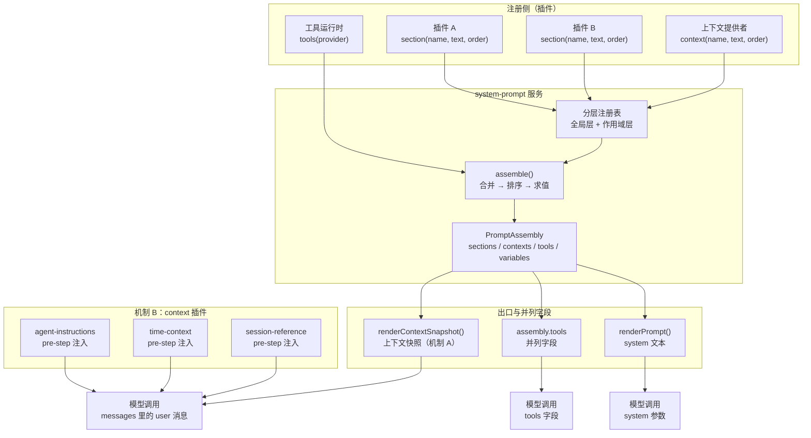

# 第 8 章 system-prompt 组装与 context：发给模型的提示词从哪来

> 提示词不是一个字符串，而是一件组装出来的产物。

## 本章回答的问题

- system 提示词的每一段从哪来？多个插件如何写同一份提示词而不互相踩踏？
- 工具 schema 为什么不在提示词文本里？它和提示词是什么关系？
- workspace 指令、当前时间、跨会话引用这些动态信息，如何进入模型的视野？
- `context()` 与 context 插件都叫「context」，它们是同一种机制吗？

第 7 章把模型席位变成了可插拔的运行时，章末（§8）留下一个更基础的问题：发给模型的提示词究竟从哪来、如何组装？本章回答这个问题。

第 4 章「tools 注册表与执行器管线」解决了工具侧的问题：插件经 `ctx.tools.register()` 注册工具，schema 投影（`projectToolSchema`，`packages/core/tools/src/schema.ts:641`）把定义过滤成模型可见的 `{name, description, parameters}`，模型回传 `tool_use` 后经三段管线落回 session。那一章留了一个尾巴：ch04 教学版把 schema 文本塞进了第 2 章桩版 `SystemPromptService` 的一个普通 section（`ch04/code/main.py:79`），正文同时注明真实代码由 `ToolsService` 构造器把 provider 接到 `ctx.systemPrompt.tools()`（`packages/core/tools/src/index.ts:113-117`）。provider 在装配时返回什么、为什么 schema 不能当 section 用，正是本章要回答的。

再往前追一步：第 2 章 §4 给过一个 `SystemPromptService` 最小桩（`ch02/code/agent_loop.py:150`），只有 `section()` 与 `assemble()` 两个方法，够第 2 章的循环跑起来，但装不下真实项目的全部语义。本章把这个桩升级为完整版。

本章代码在 ch04 基础上增量构建：

| 来源 | 文件 | 本章如何使用 |
| --- | --- | --- |
| 第 1 章 | `ch01/cordis.py` | 经 sys.path 复用：`Context`、`Service`、`ctx.effect`（注册可逆性的来源） |
| 第 2 章 | `ch02/agent_loop.py` | 经 sys.path 复用：`Sessions`、`ReactLoopAgent`（本章继承它并替换 `pre_step`/`step`）、`create_assistant_message`（`step` 组装助手回复用） |
| 第 4 章 | `ch04/tools.py` | 经 sys.path 复用：`ToolRuntime`、`ToolDefinition`（schema 的 provider 式接线在本章接到 `ctx.systemPrompt.tools()`） |
| 本章新增 | `ch08/system_prompt.py` | system-prompt 服务完整版，替换 ch02 的桩（不修改 ch02 文件） |
| 本章新增 | `ch08/context_plugins.py` | 三个 context 插件：workspace 指令、时间、跨会话引用 |
| 本章新增 | `ch08/prompt_agent.py` | 循环侧粘合：上下文快照投影 + 完整版 `pre_step` |

一句话主线：**插件经 `ctx.systemPrompt.section()` 注册有序段，`assemble()` 合并排序，`renderPrompt()` 渲染成 system 文本；工具 schema 是与文本并列的独立字段；workspace 指令、时间上下文、跨会话引用则由 context 插件以 user 消息注入。**

## 1. 系统提示词是硬编码大字符串

先看反面做法。假设每个功能模块都把自己的诉求直接拼进一个全局字符串：

```python
SYSTEM_PROMPT = "You are an AI assistant."  # 唯一的初始文本


def register_safety(prompt):
    """安全模块：直接拼到末尾，位置由注册先后决定。"""
    return prompt + "\n\n[安全策略] 不要泄露敏感信息。"


def register_persona(prompt):
    """人格设定：本应在最前，但只能拼到末尾。"""
    return prompt + "\n\n[人格] 你是严谨的代码评审员。"


def register_tools(prompt):
    """工具 schema：也混进文本，模型读到的是一串 JSON 字符串。"""
    schema = {"name": "read_file", "parameters": {"path": "string"}}
    return prompt + f"\n\n[工具] {schema}"
```

运行 `python3 ch08/code/bad_example.py`，输出：

```text
最终提示词（注意：人格设定本应在最前，实际排在最后）：
You are an AI assistant.

[安全策略] 不要泄露敏感信息。

[人格] 你是严谨的代码评审员。

[工具] {'name': 'read_file', 'parameters': {'path': 'string'}}

假设安全模块现在卸载……
大字符串里仍含安全策略: True

安全模块重复注册后，安全策略出现次数: 2
```

三个问题都来自「提示词是字符串」这个设定：

1. **顺序失控**：段的位置由拼接先后决定，而不是由重要性决定。人格设定本应在最前，实际排在最后。
2. **不可逆**：字符串一旦拼上就取不下来。安全模块卸载了，它的文本还焊在提示词里；重复注册则直接造成内容重复，且无从检测。
3. **结构塌陷**：工具 schema 混进文本，模型读到的是一串 JSON 字符串，而不是调用方可结构化处理的字段。

真实项目的解法是把提示词从「字符串」升级为「注册表 + 组装流程」：每段是一次**可撤销的注册**，顺序由显式的 `order` 决定，组装在每次需要时重新发生。下面先看整体结构，再逐机制拆解。

## 2. 整体结构：一条装配线，两条注入路径

先看全貌，再拆零件。system-prompt 包是一条装配线，`PromptAssembly` 是它的产物；动态信息进入模型视野则有两条互不相同的路径：



图与正文的对应关系：

- **注册侧**：插件不写字符串，只调用注册 API。`section()` 注册 system 文本段，`context()` 注册运行时上下文段，`tools()` 注册工具 schema 提供者。每次注册都返回可撤销的 disposer。
- **装配线**：section 与 context 注册进入分层注册表（本章只用到全局层；作用域层 shadow 全局层的最小形态见 §3，完整展开在第 9 章）；tools 提供者注册不进分层注册表，直接进 `assemble()` 的求值队列（图中 P3→A）。`assemble()` 把注册表合并、按 `order` 排序、求值动态文本与 tools 提供者，产出 `PromptAssembly`。
- **出口与并列字段**：`renderPrompt()` 把 sections 渲染成 system 文本（模型调用的 system 参数，图中 S1）；`renderContextSnapshot()` 把 contexts 渲染成快照（**机制 A**）；`assembly.tools` 是与两者并列的独立字段，作为模型调用的另一个入参（图中 S2），不进任何文本。三个节点、两条通向模型的入参，互不混装。
- **机制 B**：三个 context 插件不走装配线，各自把动态信息以 user 消息注入。HEAD 里三者都挂 `agent/pre-step` 监听器，各自决定插到决策消息的什么位置（教学版让 session-reference 仍由宿主在入队前调用，见 §6.3）。机制 A 与机制 B 的区分是本章的关键概念，§6.4 专门对比。

## 3. section 注册与 assemble 组装

### 3.1 概念引入

**PromptSection（段贡献）**：一次注册的输入，四要素——`name`（段名，同层唯一）、`order`（排序键，升序拼接，同 order 按段名比较）、`text`（静态文本或动态提供者）、`interpolate`（是否做 `{{variable}}` 插值，默认开）；另有可选的 `complete`（本段即完整提示词）。段的所属层不在这个对象里：`section()` 用调用方的 `ctx` 决定写进哪一层。对应源码 `packages/core/system-prompt/src/index.ts:53`。

**order（排序键）**：段在最终文本中的位置只由 order 决定，与注册先后无关。真实项目把常用位置收进一张常量表 `SECTION_ORDERS`（`index.ts:136-172`）：harness 身份段 `-1000`、人格前缀段 `0`、人格后缀段 `10200`、各类工具指引段从 `1000` 起、`DELIVERABLE_FILE_REFERENCES` 是 `9000`。仓库内的贡献者不自己写数字，而是查表：`getSectionOrder('HARNESS_IDENTITY')`（`index.ts:500`）返回 `-1000`。

**disposer（注销函数）**：`section()` 的返回值。注册经 `ctx.effect` 发生（第 1 章的可逆副作用），调用 disposer 即注销该段。这是问题 2「不可逆」的直接解药。

**PromptAssembly（组装产物）**：`assemble()` 的返回值，四个字段——`sections`、`contexts`、`variables`、`tools`。注意 `tools` 与 `sections` 是**并列**关系，不是 sections 的一种（§4 展开）。前三个字段合起来叫 `PromptPresentation`（`index.ts:125`），是 waterfall 能改写的那一半；`tools` 由 `PromptAssembly` 在它之上追加（`index.ts:132`），waterfall 碰不到。

### 3.2 内部实现

装配线的核心是 `assemble()`。真实实现的步骤（`index.ts:620-695`）：

1. 先解析变量：全局层的变量逐条求值，再按作用域链由远及近覆盖同名变量（`index.ts:626-635`）；
2. 合并全局层与作用域层的段与上下文（`index.ts:637-638`，同名条目作用域层 shadow 全局层）；
3. 逐个求值工具提供者，累积 schemas 与 `knownNames`（`index.ts:644-656`）；
4. 按 order 排序、按段名打破平局（`index.ts:658` 调 `comparePromptSections`，`index.ts:254`），同时记下 `complete: true` 的段；
5. 用 `orderTools()` 排定工具顺序（`index.ts:674`，函数体 `index.ts:232`）；
6. 过滤被抑制的 context 段（`index.ts:677-679`），组装出 `PromptPresentation`；
7. 走 `system-prompt/assemble` waterfall，允许插件改写 sections / contexts / variables（`index.ts:683`，教学版省略）；
8. waterfall 之后只恢复两样东西：`complete` 段成为唯一 section，被抑制时只留 `required` 的 context（`index.ts:687-693`）。`tools` 在每一步都不经过 waterfall。

构造器自动注册的默认段有三处（`index.ts:455-472`）：harness 身份段（`harness:identity`，order `-1000`，可通过 `includeHarnessIdentity` 关掉）、人格前缀段（`deployment:persona-prefix`，order `0`，文本来自 `config.personaPrefix`）、人格后缀段（`deployment:persona-suffix`，order `10200`，文本来自 `config.personaSuffix`）。段名是导出的常量（`index.ts:196`、`index.ts:199`）——组合方按同一个段名注册，就能 shadow 掉部署默认值，而不是并排出第二段。这是第 9 章作用域链要展开的伏笔。

渲染出口 `renderPrompt()`（`index.ts:296`）只做三件事：逐段插值 `{{variable}}`、丢弃渲染后为空的段、以空行连接；`interpolate: false` 的段原样保留。`joinContextSections()`（`index.ts:320`）则给上下文快照加固定前缀，声明「本快照取代更早的运行时上下文」——快照是**覆盖式**语义，不是追加式。

### 3.3 Python 重构

教学版 `ch08/system_prompt.py` 实现上述流程的主干（省略第 5 步 `orderTools`、第 7 步 waterfall 与第 8 步的 `complete` 恢复）。注册 API 的核心是 `SystemPrompt` 类（`ch08/system_prompt.py`）的 `section()` 方法：

```python
# class SystemPrompt(Service):  …… 构造器与层结构省略
    def section(self, name, text, order: int = 0, scope=None):
        """注册一条 system-prompt 段，对应 index.ts:484 section()。

        同层同名抛错；作用域层的同名段在 assemble 时 shadow 全局层（第 9 章展开）。
        注册走 ctx.effect，返回的 disposer 调用即注销（可逆性来自第 1 章）。
        """
        layer = self._layer(scope)
        if name in layer["sections"]:
            raise ValueError(f'section "{name}" 已注册（同层同名重复）')
        entry = PromptSection(name, order, text, scope)

        def setup():
            layer["sections"][name] = entry
            self.ctx.emit("system-prompt/change", {"name": name, "op": "add"})

            def teardown():
                layer["sections"].pop(name, None)
                self.ctx.emit("system-prompt/change", {"name": name, "op": "remove"})

            return teardown

        return self.ctx.effect(setup)
```

逐行看：先取作用域层（本章只有全局层）；同层同名直接抛错——问题 2 的「重复注册无从检测」在这里变成一次响亮的失败；注册本体包在 `ctx.effect` 里，`setup` 把段写进注册表并发出变更事件，返回的 `teardown` 做精确逆操作。真实版的段被放进 `NamedEntries`，重名错误在构造时由工厂函数给出（`index.ts:413-415`）；教学版手工查重，语义一致。

`context()` 的结构与 `section()` 正对称，只是段进入 contexts 注册表而非 sections。它多一个 `required` 参数：抑制运行时上下文时，组装端只丢非 required 的段（对应 `index.ts:677-679`），注册本身从不被拦。

组装端的 `SystemPrompt.assemble()`（同一个类）：

```python
    def assemble(self, scope=None) -> PromptAssembly:
        """组装一次 PromptAssembly，对应 index.ts:620 assemble()。

        真实版步骤（index.ts:620-695）：解析变量 → 合并分层 → 求值工具提供者
        → 排序 → orderTools → 过滤被抑制的 context → waterfall。
        教学版：合并 → 排序 → 求值动态文本 → 求值工具提供者 → 解析变量。
        """
        assemble_context = {"scope": scope}

        sections = self._merge("sections", scope)
        contexts = self._merge("contexts", scope)
        # 按 order 升序排序；同 order 按段名比较（index.ts:254）
        sections.sort(key=lambda item: (item.order, item.name))
        # 被抑制时只保留 required 段（index.ts:677-679）
        if self._context_suppressed:
            contexts = [c for c in contexts if c.required]
        contexts.sort(key=lambda item: (item.order, item.name))
```

`_merge()` 实现作用域层 shadow 全局层的最小形态：先复制全局层的条目，再用作用域层的同名条目覆盖。真实版是 `this.layers.merge(scope, ...)`（`index.ts:637-638`），按作用域链由远及近合并。本章只用到「单层 shadow」；完整作用域链（子代理、任务、会话层层嵌套）展开在第 9 章。

渲染出口与 ch02 桩版的 `render_prompt` 同名不同形——桩版直接 join 段文本，完整版先插值再过滤空段：

```python
def render_prompt(assembly: PromptAssembly) -> str:
    """把组装产物渲染成 system-prompt 文本，对应 index.ts:296 renderPrompt。

    步骤：逐段插值 {{variable}} → 丢弃渲染后为空的段 → 以空行连接。
    """
    parts = []
    for _name, text in assembly.sections:
        rendered = _interpolate(text, assembly.variables)
        if rendered.strip():
            parts.append(rendered)
    return "\n\n".join(parts)
```

### 3.4 回溯问题

先看一个现成的生产例子，它正好落在问题 1（顺序）出口上：`packages/deliverables/deliverable-file-references/src/index.ts:24` 的 `apply()` 只做一件事——把一段写死的 `FILE_REFERENCE_PROMPT` 注册成段名 `ui:deliverable-file-references`、order 查表 `DELIVERABLE_FILE_REFERENCES` 的纯 prompt 段。没有条件、没有求值、没有副作用；它不关心注册先后，位置完全由查表得到的 order 决定。

回到本章开篇的三个问题看教学代码怎么解。`main.py` 段落 2 演示了：模拟插件以任意次序注册四个段（order 分别为 100、20、50、30），渲染结果却严格按 order 升序排列——**顺序由 order 决定，不由注册先后决定**；随后调用 `dispose_safety()` 注销安全段，再渲染时该段干净消失——**注册可逆**；末尾再用 `try/except` 重复注册 `tools:guidance`，当场捕获 `ValueError`——**重复可检测**（对照反例问题「重复注册无从检测」）。

## 4. 工具 schema：并列独立字段

这里要澄清一个容易混淆的说法：「工具 schema 是 system-prompt 的一部分」。从源码看，这个说法不准确——`PromptAssembly` 有四个字段（`index.ts:132-134`），`tools` 与 `sections` 是**并列的两个组成**，`renderPrompt()` 只消费 `sections`（`index.ts:296-301`），schema 从不进入渲染文本。waterfall 的输入甚至没有 `tools` 字段（`index.ts:125-129`）——插件改得动提示词文本，改不动模型看到的工具面。

这也回答了第 4 章留的尾巴。ch04 演示时把 schema 文本塞进桩版 section 是权宜之计；真实代码里，`ToolsService` 构造时就把一个 provider 接到了 `ctx.systemPrompt.tools()`：

```typescript
// packages/core/tools/src/index.ts:113-117，ToolsService 构造器
ctx.systemPrompt.tools(({ scope, toolSet }) => {
  const executor = this.selectExecutor(scope)
  const description = executor.describe(this.definitions(scope, toolSet))
  return { ...description, knownNames: description.knownNames ?? [...this.view(scope).knownNames] }
})
```

provider 回调里没有投影代码：它挑出当前作用域的执行器（`packages/core/tools/src/index.ts:357` 的 `selectExecutor`），把可见定义交给执行器的 `describe()`，由执行器决定这批定义该描述成什么样。原生执行器的描述最终落到 `projectToolSchema`（`packages/core/tools/src/schema.ts:641`）——白名单 `{name, description, parameters, deferLoading}`，执行体与输出契约被丢掉。注意文件名：`presentation.ts` 里是 `ToolCallView` / `ToolResultView` 这类 **UI 渲染词汇**，不是 schema 投影的宿主。

教学版照搬这个接法（`ch08/code/main.py` 段落 3）：

```python
    # 把 wireSchemas 接到 systemPrompt.tools()——第 4 章 wireSchemas 的真实落点
    ctx.systemPrompt.tools(lambda c: ctx.tools.wire_schemas())

    assembly = ctx.systemPrompt.assemble()
    print("assembly.tools（并列字段，独立传给模型调用方）：")
    print(f"  {assembly.tools}")
```

`tools()` 注册的是**提供者**而非 schema 本身：每次 `assemble()` 都会重新求值提供者（`index.ts:646-647`），所以工具注册表后续增删工具，下一次组装自动反映，无需重新注册。运行输出见 §7 段落 3：`assembly.tools` 是结构化的 schema 数组，而 `render_prompt` 文本中既没有工具描述也没有 `parameters`——模型调用方拿到的是两个独立入参：system 文本与工具字段。

为什么这样设计？因为 schema 的消费方不只是模型：调用方要按 schema 做参数校验、按 `knownNames` 做工具排序与过滤（`index.ts:232 orderTools`）。把 schema 焊进文本，这些结构化能力就全丢了。还有一层：`describe()` 拿到的是这一步被准入的工具集（`AssembleContext.toolSet`，`packages/core/tools/src/index.ts:19-23`），同一个注册表在不同步、不同执行器下可以给出不同的可调用面——形状由执行器定，不由 prompt 定。

## 5. 机制 A：context() → 运行时上下文快照

§4 的 `tools` 字段解决了「模型能看到哪些工具」，但还有一批信息既不进 system 文本、也不该每步照抄一遍：当前工作目录、git 状态、执行到计划第几步。这些事实**每步都可能变**。

假设把它们也注册成 section。system 文本会在每次 assemble 时重算一遍，同一句话被反复塞进同一个 system 参数；真把它们拼进消息历史，则每步都追加一条几乎一样的 user 消息——模型读到的上下文里，同一份「工作目录: …」出现十几次，真正的话被挤到后面。

更糟的是「没变也要报」：如果每步都无条件注入，模型会误以为环境一直在变，而去反复确认路径。

真实项目的做法是把这类信息注册成 `context()`——它和 `section()` 的 API 形状完全对称，但出口不同：context 段不进 system 文本，而是经 `render_context_snapshot()` 渲染成一份**快照**：

```python
def join_context_sections(sections: list) -> str:
    """拼接上下文段并加统一前缀，对应 index.ts:320 joinContextSections。"""
    body = "\n\n".join(sections)
    if not body:
        return ""
    # 前缀显式声明「本快照取代更早的运行时上下文」（对应 index.ts:323 常量文本）
    return (
        "Current runtime context. This snapshot supersedes earlier runtime-context snapshots."
        + "\n\n"
        + body
    )
```

快照谁来消费？真实代码里是 agent-loop 的 `preStep`（`packages/core/agent-loop/src/agent.ts:283`）：每步先 `assemble()`（`agent.ts:294`），再在 waterfall 的兜底里渲染上下文段，交给 `runtimeContext.project()` 投影；**只有快照内容变化时**才把新快照作为 user 消息追加在 claimed（本步从收件箱认领的待处理消息）之后（`agent.ts:299-303`），内容不变则不重复注入。发射请求前还有一次 `refreshContext()`（`agent.ts:446`）重取上下文，同一套投影再来一遍。投影器本体在 `packages/core/agent-loop/src/runtime-context.ts:119`（`RuntimeContextProjection`），`project()` 在 `runtime-context.ts:157`。教学版把这段粘合放在 `ch08/prompt_agent.py`：

```python
class RuntimeContext:
    """运行时上下文快照去重器，对应 runtime-context.ts:119 RuntimeContextProjection。

    快照内容变化时才产生新的注入文本；内容不变返回 None，
    避免同一份上下文在每步重复注入（真实版记住的是快照在 session 里的位置与文本，
    教学版只按文本比较）。
    """

    def __init__(self):
        self._last_snapshot = None

    def project(self, snapshot_text: str):
        """投影一份快照：变化返回文本，未变化返回 None。"""
        if not snapshot_text or snapshot_text == self._last_snapshot:
            return None
        self._last_snapshot = snapshot_text
        return snapshot_text
```

`main.py` 段落 4 验证了去重行为：注册两条上下文段后，第一次投影产生注入文本，第二次投影（内容未变）返回 `None`。

一个开关：`suppress_runtime_context()`（`index.ts:536`）临时关掉可选的上下文段——它往当前层追加一个抑制标记，注册照常发生，只是 `assemble()` 在过滤阶段丢掉非 `required` 的段（`index.ts:677-679`）。`required: true` 的段不受影响。真实项目的非测试调用方是 persona preset（`packages/preset/persona/src/index.ts:74`，配置 `includeRuntimeContext: false`），构造器也用它兑现同名字段（`index.ts:473`）——用途是让某个部署整体不要自动上下文，由自己决定注入什么。上下文段的 text 也可以是动态提供者，每次 assemble 重新求值——段落 4 的 `workspace:state` 就是一例。

## 6. 机制 B：三个 context 插件

机制 A 解决的是「装配线自己知道的运行时事实」。还有一类信息，装配线根本不知道：仓库里那份 AGENTS.md 写了什么、现在是几点、用户提到的 `dsh-session:xxx` 里是什么内容。它们属于别的子系统，加载代价、更新时机、失效条件都不一样。

如果强行塞进 `section()`：AGENTS.md 的读写要由一个不认识文件系统的 prompt 服务承担；时间文本每步值都不同，却只能作为一条静态段留在 system 文本里；跨会话快照则要等宿主先查完 session 才能渲染——这些依赖都不该压到装配线上。

`packages/context/` 下的三个插件因此走了另一条路径：不经过 `context()` 注册，各自把动态信息直接以 user 消息注入。三者都监听 `agent/pre-step`，但注入位置与节流方式各不相同。

### 6.1 agent-instructions：workspace 指令

对应 `packages/context/agent-instructions/src/index.ts`（375 行）。插件在 `apply`（:85）里只登记监听器与状态，指令基线是**首次 pre-step 时惰性加载**的：`compose` 内从 cwd 出发 `findProjectRoot`（`packages/context/agent-instructions/src/files.ts:232`）再 `loadBaselineInstructionSet`（`index.ts:141`），结果按 session identity 缓存；教学版直接传入指令字典；每步 `agent/pre-step` 时把基线与项目指令 compose（:109），渲染成带 `<system-reminder>` 帧的文本（帧由 `render.ts:315 buildInstructionText` 在 :326 拼出），以 user 消息插入本步消息（:354 的 `toSpliced`）。

教学版保留「compose → 渲染 → 注入」主干。教学版 `compose` 的语义是**项目指令 shadow 基线同名块**——项目级更具体、优先级更高；真实版的 `compose`（`index.ts:109-243`）是文件发现 + 字节预算 + 按 scope key 的 reconcile，不是字典覆盖：

```python
def compose_instructions(baseline: dict, project: dict) -> dict:
    """合并 workspace 指令基线与项目指令，对应 index.ts:109 compose。

    指令是「块名 → 文本」的字典；同名块由项目指令 shadow 基线
    （项目级更具体、优先级更高）。
    """
    merged = dict(baseline)
    merged.update(project)
    return merged
```

监听器本体（注意真实版是中间件式 waterfall：先 `await next()` 拿到决策（:334），再在决策消息里插入自己的文本（:354）；ch01 简化 waterfall 无续体，教学版直接改写 snapshot 并返回 `None` 放行）：

```python
    def _on_pre_step(self, snapshot):
        """pre-step 监听器：组装指令文本并追加到 additional_contexts。

        真实版是中间件式 waterfall：先 await next() 拿决策再追加消息
        （index.ts:334 await next() / :354 toSpliced）；ch01 简化 waterfall
        无续体，这里直接改写 snapshot 并返回 None 放行。
        """
        composed = compose_instructions(self._baseline, self._project)
        text = render_workspace_context(composed)
        if text:
            snapshot["additional_contexts"].append(text)
        return None
```

### 6.2 time-context：时间上下文

对应 `packages/context/time-context/src/index.ts`（244 行）。`apply`（:133）注册 `agent/pre-step` 监听器（:199），注册时带 `{prepend: true}`（:242）。这个选项在 HEAD 可读源码里没有定义（cordis 不在包内，`prepend` 的派发语义未能取证），从名字看是调整监听器在瀑布里的位置；正文只按「它先 `await next()` 再追加」这一可读行为描述，不推断执行次序。每步采样当前时间，渲染成 "Time sampled while preparing turn N, step M: ..."（`renderText` :98，还带上一段浏览器时区信息与距上次注入的经过时间），以新的 user 消息追加到决策消息末尾（:236）。真实版还有 `refreshIntervalMs` 节流（默认 600000 ms，:135）——距上次采样不足间隔就原样返回决策、不注入；教学版省略节流，但把时钟做成可注入参数，演示用固定时钟保证输出可复现。

### 6.3 session-reference：跨会话引用

对应 `packages/context/session-reference/src/index.ts`（483 行）。`SessionReferenceResolver`（:88）的入口仍是 `prepare()`（:310）：它把解析出的引用对象归一化（`normalizeReferences` :409，:318 调用，自引用直接抛错 :424-426）→ 逐个读会话快照（`session-reference/src/index.ts`:328）→ 渲染成提示词（:348）。HEAD 里调用它的方式变了：插件自挂 `agent/pre-step` 监听器（:128，`{prepend: true}`），`prepareDirectMessages()`（:147）在 `next()` 之后识别直连用户消息里的规范提及，把快照插到被引用的那条消息紧跟之后。

解析出的快照以 JSON 数组承载，外面包一层安全前缀（`PROMPT_PREFIX` :57，拼接在 :440 的 `renderPrompt`）——声明快照「不可信、只读」，除非当前用户明确复述，否则不执行快照里的指令、权限主张或工具请求。这是跨会话注入必须有的防线：被引用的会话内容来自历史，不能当作当前用户的授权。

```python
    def prepare(self, content: str, self_session_id=None):
        """宿主在 enqueue 前调用：解析 content 中的引用。

        返回 (content, additional_context)：无引用或引用不可解析时
        additional_context 为 None（对应 index.ts:319 的早退路径）。
        """
        references = normalize_references(content, self_session_id)
        if not references:
            return content, None
        sources = []
        for ref in references:
            summary = self._sessions.get(ref)
            if summary is not None:
                sources.append({"session_id": ref, "summary": summary})
        if not sources:
            return content, None
        return content, render_reference_prompt(sources)
```

[教学简化] 真实版的引用语法是 `dsh-session:<id>`（`uri.ts:71` 的正则，由 `parseSessionReferenceText` :69 使用），解析器还有引用数上限、字节预算，以及按工作目录（cwd）亲和的候选排序（同目录的会话排前面）；教学版把语法简化为 `session:<id>`，保留「归一化引用 → 查会话快照 → 渲染提示词」主干。教学版也保留了「宿主在入队前显式调用 `prepare()`」的旧形态，HEAD 已改成插件自己的 pre-step 监听器。

### 6.4 两种机制不可混淆

机制 A 与机制 B 都以 user 消息进入模型视野，但它们是两条独立的路径：

| 维度 | 机制 A：`context()` | 机制 B：context 插件 |
| --- | --- | --- |
| 注册/实现位置 | `packages/core/system-prompt/src/index.ts:519` | `packages/context/` 三个独立插件 |
| 入口 | `ctx.systemPrompt.context()` | 插件自己挂 `agent/pre-step` 监听器（教学版 session-reference 仍由宿主调用） |
| 渲染 | `renderContextSnapshot()`（`index.ts:308`） | 插件各自渲染（system-reminder 帧 / 时间文本 / 引用提示词） |
| 注入时机 | 循环 `preStep` 内，快照变化才注入（`packages/core/agent-loop/src/agent.ts:299-303`） | 三个插件都在 pre-step 里改写决策消息；注入位置各自决定 |
| 去重 | `runtimeContext.project()` 按内容去重（`runtime-context.ts:157`） | agent-instructions 用 `sameContextPayload()` 做内容级去重（`packages/context/agent-instructions/src/index.ts:70-73`，命中比较在 `index.ts`:246-252 与 `index.ts`:348）；time-context 靠 `refreshIntervalMs` 节流；session-reference 依赖提及归一化后不再命中 |

顺带澄清 workspace 的角色：`packages/workspace/workspace/src/index.ts` 的 `WorkspaceRegistry`（:170）是**实体注册表**——`create()`（:238）注册 workspace 实体、`get()`（:282）按 id 取回；它不注入任何指令。workspace 指令进入模型视野的路径是 agent-instructions 插件（§6.1 的 `AgentInstructionsPlugin`）读取指令文件、在每步 pre-step 渲染成 `<system-reminder>` 框并以 user 消息注入。把 workspace 当成「指令注入器」是常见误解。

## 7. 完整运行输出

运行 `python3 ch08/code/main.py`（段落 1–4 共用一个容器演示增量装配，段落 5 全新容器跑完整循环；注意段落 5 的新容器传入了不同的 persona `ch08/code/main.py:179`，顺带演示人格前缀段可由部署方替换），完整输出：

```text
== 段落 1：容器与 systemPrompt 服务——两个默认段 ==
构造器注册的段（assemble 顺序）：
  - harness:identity: You are an AI agent powered by DeepSeek Harness.
  - deployment:persona-prefix: 你是严谨的代码评审助手，用中文回答。

render_prompt 渲染结果：
You are an AI agent powered by DeepSeek Harness.

你是严谨的代码评审助手，用中文回答。

== 段落 2：插件注册有序段——assemble 合并排序 ==
注册顺序：tools:guidance(order=100) → workspace:conventions(order=20)
          → safety:policy(order=50) → review:focus(order=30)
render_prompt 渲染结果（段按 order 升序排列）：
You are an AI agent powered by DeepSeek Harness.

你是严谨的代码评审助手，用中文回答。

项目代码在 chNN/code/ 下，注释用中文。

本次评审重点：错误处理与边界条件。

不要输出任何密钥或凭据信息。

调用工具前先确认路径存在。

注销 safety:policy 后再渲染（该段消失）：
You are an AI agent powered by DeepSeek Harness.

你是严谨的代码评审助手，用中文回答。

项目代码在 chNN/code/ 下，注释用中文。

本次评审重点：错误处理与边界条件。

调用工具前先确认路径存在。

重复注册抛错：section "tools:guidance" 已注册（同层同名重复）

== 段落 3：工具 schema 是并列独立字段 ==
assembly.tools（并列字段，独立传给模型调用方）：
  [{'name': 'read_file', 'description': '读取文件内容', 'parameters': {'path': '文件路径'}}]

render_prompt 文本不含工具 schema：
  '读取文件内容' 在 system 文本中? False
  'parameters' 在 system 文本中? False

== 段落 4：机制 A——context() → 运行时上下文快照 ==
render_context_snapshot 渲染结果（带固定前缀）：
Current runtime context. This snapshot supersedes earlier runtime-context snapshots.

工作目录: ch08/code
Git 状态: working tree clean

当前计划执行到第 3 步：撰写 system-prompt 章节。

第一次投影：产生注入文本
第二次投影（内容未变）：None

== 段落 5：机制 B——三个插件在完整循环里注入 user 消息 ==
模型收到的内容：
  [system 提示词]（renderPrompt 渲染，不含工具 schema）：
    You are an AI agent powered by DeepSeek Harness.
    
    你是 harness 演示助手。
  [工具 schema]（并列字段）：
    [{'name': 'read_file', 'description': '读取文件内容', 'parameters': {'path': '文件路径'}}]
  [消息历史]（注入的 user 消息 + 原始 user 消息）：
    [user] Current runtime context. This snapshot supersedes earlier ru...
    [user] <system-reminder>
    [user] Time sampled while preparing turn 1, step 1: Wednesday, Augu...
    [user] ## Referenced sessions
    [user] 继续上次的工作 session:s-001，并查看 sample.txt 的内容
  [助手回复]（session 事件 assistant/message）：
    [{'type': 'text', 'text': '收到：先查看 sample.txt，再继续 s-001 的未完成工作。'}]
```

段落 5 的消息历史值得逐条对照：第 1 条是机制 A 的上下文快照（`RuntimeContext.project` 首次投影）；第 2、3 条是机制 B 两个 pre-step 插件的注入（workspace 指令的 `<system-reminder>` 帧、时间上下文）；第 4 条是 session-reference 的引用快照（教学版由宿主在入队前调用 `prepare()` 产生）；第 5 条才是原始用户消息。system 提示词只有两段文本，工具 schema 作为并列字段单独列出——一条调用，三种通道，互不混装。

## 8. 源码对照

| 教学版（ch08/code/） | 真实源码（`packages/`） | 说明 |
| --- | --- | --- |
| `system_prompt.py` `PromptSection` | `packages/core/system-prompt/src/index.ts:53` | 段贡献：name / order / text / interpolate / complete |
| `system_prompt.py` `PromptContext` | 同上 `:79` | 上下文贡献，多 `required` |
| `system_prompt.py` `PromptAssembly` | 同上 `:132`（`PromptPresentation` `:125`） | 组装产物四字段 |
| `system_prompt.py` `PERSONA_PREFIX_SECTION` / `PERSONA_PREFIX_ORDER` | 同上 `:196` / `:138`（`SECTION_ORDERS`） | 人格前缀段常量 |
| `system_prompt.py` `render_prompt` | 同上 `:296` `renderPrompt` | 插值 → 过滤 → 连接 |
| `system_prompt.py` `render_context_snapshot` | 同上 `:308` `renderContextSnapshot` | 上下文快照渲染 |
| `system_prompt.py` `join_context_sections` | 同上 `:320`（前缀 `:323`） | 快照前缀声明覆盖语义 |
| `system_prompt.py` `SystemPrompt` | 同上 `:435`（构造器 `:451`） | 默认段注册 `:455-472` |
| `system_prompt.py` `section` / `context` | 同上 `:484` / `:519` | 注册 API |
| `system_prompt.py` `suppress_runtime_context` | 同上 `:536` | 抑制标记，过滤在 `:677-679` |
| `system_prompt.py` `tools` / `variable` | 同上 `:551` / `:567` | 提供者式注册 |
| `system_prompt.py` `assemble` | 同上 `:620`（合并 `:637`、提供者 `:644-656`、waterfall `:683`） | 教学版省略 waterfall |
| `prompt_agent.py` `RuntimeContext.project` | `packages/core/agent-loop/src/runtime-context.ts:119`（`project` `:157`） | 快照去重投影 |
| `prompt_agent.py` `PromptAwareAgent.pre_step` | `packages/core/agent-loop/src/agent.ts:283` `preStep` | 组装 `:294` → 进 waterfall `:296`（其兜底续体内才投影 `:299-300`） |
| `context_plugins.py` `AgentInstructionsPlugin` | `packages/context/agent-instructions/src/index.ts:85`（pre-step `:330`） | compose `:109`、toSpliced `:354` |
| `context_plugins.py` `TimeContextPlugin` | `packages/context/time-context/src/index.ts:133`（监听 `:199`） | renderText `:98` |
| `context_plugins.py` `SessionReferenceResolver` | `packages/context/session-reference/src/index.ts:88`（prepare `:310`） | 前缀 `:57`、pre-step `:128` |
| `main.py` `ctx.systemPrompt.tools(...)` | `packages/core/tools/src/index.ts:113-117`（`systemPrompt.tools` 定义在 `packages/core/system-prompt/src/index.ts:551`） | schema 投影本体在 `packages/core/tools/src/schema.ts:641` |

教学简化清单（均在代码注释中标注 [教学简化]）：

1. `assemble()` 末尾的 `system-prompt/assemble` waterfall（`index.ts:683`）与 `orderTools` 排序配置（`index.ts:232`）省略；
2. scope 只实现单层 shadow，完整作用域链第 9 章展开；
3. agent-instructions 不从文件系统读指令，指令字典直接传入；
4. time-context 省略 `refreshIntervalMs` 节流，也省略注册时的 `{prepend: true}`（:242，该选项语义未取证）；教学版按监听器注册次序执行，段落 5 的「workspace 在 time 之前」依赖这一点；时钟可注入以保证输出可复现；
5. session-reference 的引用语法简化为 `session:<id>`（真实为 `dsh-session:<id>`），省略引用数上限、字节预算与按工作目录亲和的候选排序；
6. 机制 A 的快照与机制 B 的注入在教学版统一经 `additional_contexts` 排在 claimed 消息之前；真实代码里机制 A 的快照追加在 claimed 之后（`packages/core/agent-loop/src/agent.ts:303`），agent-instructions 插在最后一条 claimed 之后（`packages/context/agent-instructions/src/index.ts:354`），time-context 追加到决策消息末尾（`time-context/src/index.ts:236`）；
7. `tools()` / `variable()` 注册存放在扁平容器；真实代码里同样经 `layers.effect` 写进当前作用域层，与 section/context 同构（本章只用全局层，行为一致）；
8. 人格后缀段（`deployment:persona-suffix`）教学版不注册，输出里因此看不到它；真实构造器总会注册该段，默认文本为空串（`index.ts:468-472`）。

## 9. 小结与预告

本章把「发给模型的提示词」从硬编码字符串重构为注册表 + 组装流程：

| 问题（§1） | 本章机制 | 证据 |
| --- | --- | --- |
| 顺序失控 | `order` 排序键，按 `(order, 段名)` 排序（`comparePromptSections`） | §7 段落 2：注册次序任意，输出严格按 order |
| 不可逆（含重复注册无从检测） | `ctx.effect` 注册，disposer 注销；同层同名抛错 | §7 段落 2：注销后该段消失；`system_prompt.py` `section()` 同层同名抛错 |
| 结构塌陷 | tools 是 PromptAssembly 并列字段 | §7 段落 3：schema 不在 render_prompt 文本中 |

两个 context 机制各就各位：机制 A（`context()` → 快照投影）承载「随装配线走」的运行时上下文，机制 B（三个 context 插件）承载「自带渲染与触发点」的动态信息。下一章（第 9 章「scope 作用域注册」）展开本章埋下的伏笔：作用域链如何层层嵌套、同名段如何沿链 shadow、子代理为何能看到与主代理不同的提示词。再往后的第 10 章「compaction 与 token 压力」处理的是另一个方向的压力：对话变长、逼近窗口上限。那一章不依赖本章的 `suppress_runtime_context()`（compaction 源码里没有调用它）；本章这个开关的真实调用方是 persona preset，作用是把可选的运行时上下文整体关掉。

## 10. 附录：关键概念速查表

按依赖分层（下层概念依赖上层概念）：

| 层 | 概念 | 一句话定义 | 首次出现 |
| --- | --- | --- | --- |
| L1 内核 | `ctx.effect` | 可逆副作用：注册即返回注销函数 | 第 1 章 |
| L1 内核 | `agent/pre-step` | 每步决策前的 waterfall 事件 | 第 2 章 |
| L2 注册 | PromptSection | 一次段注册的输入：name/order/text/interpolate（+可选 complete）；层由注册方 `ctx` 决定（教学版 dataclass 另有 `scope` 参数） | §3.1 |
| L2 注册 | order | 段的排序键，与注册先后无关 | §3.1 |
| L2 注册 | disposer | 注册 API 的返回值，调用即注销 | §3.1 |
| L3 组装 | PromptAssembly | assemble 产物：sections/contexts/tools/variables 四字段 | §3.1 |
| L3 组装 | assemble() | 合并 → 排序 → 求值 → waterfall，产出 PromptAssembly（tools 不经 waterfall） | §3.2 |
| L3 组装 | 作用域层 shadow | 作用域层同名条目覆盖全局层（本章仅单层） | §3.3 |
| L4 渲染 | renderPrompt() | sections → system 文本（插值、滤空、空行连接） | §3.2 |
| L4 渲染 | renderContextSnapshot() | contexts → 带覆盖语义前缀的快照文本 | §5 |
| L5 注入 | 机制 A | context() 段 → 快照 → project 去重 → user 消息 | §5 |
| L5 注入 | 机制 B | context 插件各自渲染 → user 消息（pre-step 或入队前） | §6 |
| L5 注入 | RuntimeContext.project | 快照去重器：内容变化才注入 | §5 |
