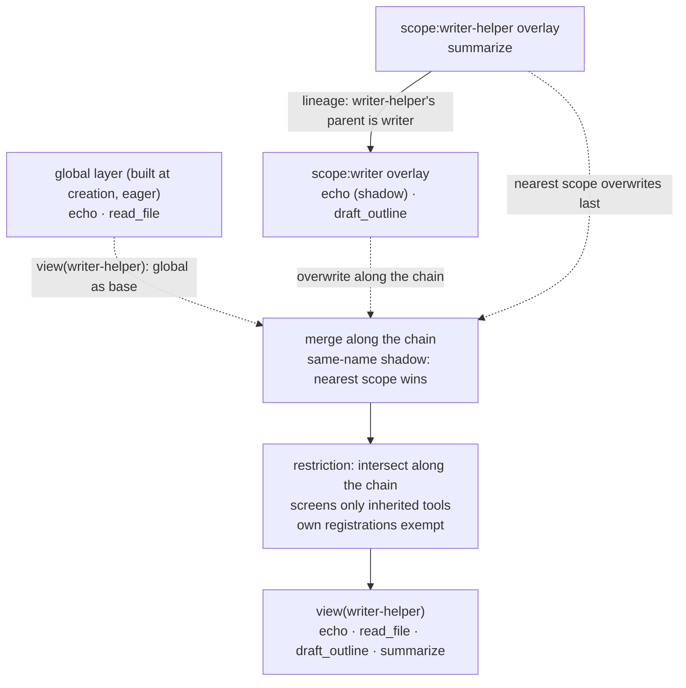

# Chapter 9: Scoped Registration: How Multiple Agents in One Process Isolate Their Capabilities

> Under one roof, each has its own room.

## Questions this chapter answers

1. When several agents share one process, how do you keep the tools they register from polluting each other? What is a "scope", and what does it mean to register a tool under a particular agent's name? (Such registration is reversible too.)
2. If a tool with the same name is registered both globally and in a scope, which one does the agent end up using? (shadowing)
3. Why can a subagent see the tools its parent agent registered? (the lineage scope chain)
4. How do you hide a tool from one agent only, leaving every other agent untouched? (restriction)

At the end of Chapter 8 we left a thread hanging: how the scope chain nests layer by layer, how same-name content shadows along the chain, and why a subagent sees something different from the main agent. The full mechanism lives in the `packages/core/scope` package, and its most concrete consumer is Chapter 4's tool registry. This chapter returns to Chapter 4 and lands the general scope mechanism on tools. Split the thread in two: "how the scope chain works" is the mechanism itself, and this chapter explains it through tools; "why a subagent sees different prompts" is that mechanism applied in the system-prompt domain — the real system-prompt registry uses the same `ScopedLayers` (`packages/core/system-prompt/src/index.ts:445`), and Chapter 8's `_merge` "single-layer shadow" is its minimal form. The end of §5 joins the two halves back together.

Recall Chapter 4: the teaching `ToolRuntime` keeps only a **single global `ToolLayer`** — every tool goes into one table, with no boundary on who registers it or who can see it. In the real code, `ToolsService` (exported under the alias `ToolRuntime`, `packages/core/tools/src/index.ts:99`) holds a `ScopedLayers` from the start (`packages/core/tools/src/index.ts:106`), and the global layer is merely its first layer; the teaching version dropped the extra tables. This chapter puts that shape back.

This chapter's code builds on the two earlier blocks:

| Dependency | Source | Usage in this chapter |
| --- | --- | --- |
| `Context` / `Service` / `effect` | `ch01/code/cordis.py` | Assembly container, registration-as-effect, disposer |
| `ToolDefinition` / `ToolExecution` / `ToolResult` / `ToolLayer` / `ToolRuntime` | `ch04/code/tools.py` | Tool definitions, execution request and result, layer structure, execution pipeline |
| `ScopedLayers` / `ScopedToolRuntime` | `ch09/code/scope.py` (new in this chapter) | Scope layering and a scope-aware runtime |

## 1. One Global Table, Agents Stepping on Each Other

Start with the situation without scopes. The code below simulates Chapter 4's tool table with a single global dict shared by three agents (main / writer / research):

```python
# ch09/code/bad_example.py（模块级全局变量与函数）
GLOBAL_TOOLS = {}  # 唯一的全局工具表：没有作用域、没有 shadow、没有 restrict


def register(name, fn):
    """注册工具：一旦注册，所有 agent 可见。"""
    GLOBAL_TOOLS[name] = fn


def view():
    """任何 agent 看到的都是同一张表。"""
    return dict(GLOBAL_TOOLS)


def main():
    # main agent 注册一个通用 echo
    register("echo", lambda args: f"[global] {args['text']}")
    print("main 注册 echo 后，writer 也看见了:", sorted(view()))

    # writer 想要一个带写作口吻的 echo，但只能覆盖全局——main 的 echo 一起没了
    register("echo", lambda args: f"[writer] {args['text']}")
    print("writer 覆盖 echo 后，执行到的是:", view()["echo"]({"text": "hi"}))

    # research 想禁用 echo，只能全局删除——writer 的 echo 也跟着消失
    del GLOBAL_TOOLS["echo"]
    print("research 全局删除 echo 后:", sorted(view()))
    print("结论：一张全局表，没法让每个 agent「有自己的工具」")


if __name__ == "__main__":
    main()
```

Run `python3 bad_example.py`:

```text
main 注册 echo 后，writer 也看见了: ['echo']
writer 覆盖 echo 后，执行到的是: [writer] hi
research 全局删除 echo 后: []
结论：一张全局表，没法让每个 agent「有自己的工具」
```

(The program prints in Chinese; the output above is shown verbatim.)

Take the problems apart. The first three are exposed directly by bad_example; the last two are hidden — problem 4 lives in multi-agent collaboration and problem 5 in lifecycle management. bad_example never surfaces either, but a real project hits them on day one:

1. **Registration has no boundary**: the `echo` main registers is immediately visible to writer. The tool table is a global singleton, so any agent's registration is visible to everyone.
2. **Same name means overwrite**: to get its own `echo`, writer has to write the same key and displace main's implementation — "I want a different version" and "I want to overwrite yours" collapse into one act.
3. **Hiding means deleting globally**: to make `echo` unavailable to itself, research can only `del` it, and writer's `echo` disappears too. There is no "hide it from me only".
4. **Subagents must re-register parent tools** (hidden): this pain only appears once you want per-agent boundaries. Keep everyone on the global table and a subagent does see the parent's tools — but that falls back to problem 1; want a boundary, and the subagent has to re-register a copy of each parent tool (which can then drift from the parent's version). The global table has no third path called inheritance.
5. **Registration is irreversible** (hidden): there is no paired unregistration, so taking a tool back means `del`-ing it from the global table (straight back to problem 3). "Whoever registers, reclaims" is out of reach.

There is one root cause: **the tool table has no "who owns it" dimension**. The fix is to give the registry scopes.

## 2. Overall Shape: Global Layer + One Layer per Agent + One Lineage Chain

The root cause in §1 is "the tool table has no 'who owns it' dimension". This section adds it back: no code yet — first stand up the terms layer, scope, overlay and lineage, plus the action "registration", then look at the overall picture.

**Step one: from one table to one table per agent — layers and scope.** Chapter 4's `ToolLayer` is one tool table holding "name → tool definition" plus the restriction entries attached to it (the allow/deny lists saying which inherited tools must stay hidden); bad_example's flaw is that three agents are crammed into one table. The fix is direct: keep one shared table globally as the base and hand each agent a separate table of its own. These tables are collectively **layers** — the global one is the global layer, and the one under each agent's name is that agent's own layer. With several tables, registration must also say which table to write into: give each agent a name, pass it in at registration time, and look up the table by that name. The name is the **scope** — not a new mechanism, just a stand-in for "which agent", a key from an agent to its table. The teaching version uses strings (`"writer"`); in the real code the scope is the agent object itself, typed `ScopeKey` (`packages/core/scope/src/index.ts:15`, §8 simplification 1).

**Step two: your own table lies over the global one — overlay.** An agent's table is not used in isolation: when reading, it is **laid over** the global layer — global underneath, your own table stacked on top. Hence the name **overlay**, stressing "stacked with the global layer, merged on read" rather than two unrelated tables.

**Step three: the three in one sentence.** **Registration** is the action — writing a tool definition into some layer; **scope** is the name of "which agent", used to locate that layer; **overlay** is that agent's own layer. "Register under writer" = take `scope="writer"`, find writer's overlay, write into it; pass no scope and you write into the global layer — that is the whole difference between "scoped registration" and Chapter 4's "global registration".

**Step four: a subagent wants its parent's table — lineage.** A subagent (writer-helper) wants not only the global tools but the parent agent's (writer's) tools directly. So record one more relation, "whose parent is whom", and when reading, the subagent folds the parent's layer into the merge along that relation. This parent-child chain is the **lineage**.

**Now the whole picture.** With the terms in place, land the structure on the example that runs through §3–§7: the global layer registers `echo` and `read_file`; writer registers a same-name `echo` in its overlay (shadowing the global one) plus an exclusive `draft_outline`; writer-helper is writer's child scope and has its own `summarize`. How `view(writer-helper)` — the tools writer-helper finally sees — takes shape:



Every node now maps to something: `GL`/`WL`/`HL` are three **layers** (`WL` and `HL` are the agents' **overlays**); the solid arrow `HL → WL` is the **lineage** (recording that writer-helper's parent is writer); the dashed lines converging on `MG` are the **read merge** — global as the base, overwritten layer by layer from far to near along the lineage chain, with the nearest scope winning a same-name tool (this same-name overwrite is called **shadow**, expanded in §4); `FT` then applies restriction: every layer on the chain must admit a tool for it to stay visible, while tools registered in your own layer are exempt from your own filter (§6); `VW` is writer-helper's final tool view.

Against this picture, the chapter's three paths are plain:

- **Write path** `register(def, scope)`: write the definition into `scope`'s own overlay (its own only, no ancestors mixed in; `scope=None` writes to the global layer) and emit a `tools/change` event. Whose name it hangs under is whose it is.
- **Lineage** `bind_scope_parent(key, parent)`: record "whose parent is whom" in `scope_parents`. When a child scope reads, it folds the ancestors' layers in.
- **Read path** `view(scope)`: lay global down first, overwrite layer by layer from far to near along the parent chain (same-name shadow, nearest wins), then apply the chain's restrictions to the inherited tools.

`ScopedToolRuntime` is the scope-aware upgrade of Chapter 4's `ToolRuntime`: it holds a `ScopedLayers` (the container for the layer + scope + lineage set above; §3 gives its code) and makes registration / view / definition lookup / execution all scope-aware. The rest of the chapter takes them in order: registration → shadow → lineage → restriction.

## 3. Mechanism One: ScopedLayers and per-agent Registration

**Concept introduction**. A scope is a registration boundary: one per agent, with registrations hung under its own name. `ScopedLayers` expresses this with three things — an **eagerly constructed** global layer: the global layer is created the moment the `ScopedLayers` is constructed, not lazily on first use; a "scope → overlay" table; and a lineage table recording parent-child relations. The first two are fields of `ScopedLayers` itself; the third is not — the parent relation lives in a module-level `scopeParents` (`packages/core/scope/src/index.ts:39`) that `ScopedLayers` merely calls. The layer type has a minimal contract, `ScopeLayer`: it only requires `isEmpty()`, which is what empties are checked against when a layer is reclaimed (`packages/core/scope/src/store.ts:12`):

```python
class ScopedLayers:
    # ... for_scope 见本节下文；effective_tools 见 §4；lineage 三方法见 §5；restriction 在 ToolLayer 上 ...

    def __init__(self, create_layer):
        self.create_layer = create_layer      # 层工厂（tools 传 ToolLayer）
        self.global_layer = create_layer()     # 全局层（packages/core/scope/src/store.ts:161）
        self.scoped = {}                       # scope -> overlay（packages/core/scope/src/store.ts:163）
        self.scope_parents = {}                # scope -> parent scope（lineage，packages/core/scope/src/index.ts:39）
```

Note that `create_layer` is a factory: `ScopedLayers` does not care what a layer holds. Tools passes `ToolLayer`; another seam can pass its own layer type. That is exactly the split between "general scope mechanism" and "concrete consumer".

**Layer lookup is chain-blind**. The overlay fetched on write looks at the exact scope only and never mixes in ancestors — this is what keeps "a registration belongs to you alone":

```python
class ScopedLayers:
    # ... __init__ 见本节上文；effective_tools 见 §4；lineage 三方法见 §5 ...

    def for_scope(self, scope):
        """取 exact-scope overlay：None 返回全局层，否则返回（必要时创建）该 scope 的层。

        对应 packages/core/scope/src/store.ts:180 peek（刻意 chain-blind，写入不掺祖先）
        + effect 内首次创建（packages/core/scope/src/store.ts:239-247）。
        """
        if scope is None:
            return self.global_layer
        if scope not in self.scoped:
            self.scoped[scope] = self.create_layer()
        return self.scoped[scope]
```

**Registration is an effect**. `ScopedToolRuntime.register` writes the definition into the matching overlay, emits a `tools/change` event, and returns a disposer through Chapter 1's `ctx.effect` — registration itself is a reversible effect:

```python
class ScopedToolRuntime(ToolRuntime):
    # ... __init__ 见本节下文；view / get / defined_in / execute / _dispatch_body 见 §4；restrict 见 §6 ...

    def register(self, definition, scope=None):
        """注册工具到指定作用域，返回 disposer（注册即可逆，第 1 章 ctx.effect）。

        对应 packages/core/scope/src/store.ts:226 effect：scope=None 写全局层，
        否则写该 scope 的 exact overlay；层空后回收（packages/core/scope/src/store.ts:257-259）。
        注册即效应：写入 tools 表 + 发 tools/change 事件。
        """
        layer = self._layers.for_scope(scope)

        def setup():
            layer.tools[definition.name] = definition
            self.ctx.emit("tools/change",
                          {"name": definition.name, "scope": scope, "op": "add"})

            def teardown():
                layer.tools.pop(definition.name, None)
                self.ctx.emit("tools/change",
                              {"name": definition.name, "scope": scope, "op": "remove"})

            return teardown

        return self.ctx.effect(setup)
```

`ScopedToolRuntime` reuses the global layer as the parent class's `_layer` at construction, so registration and execution "without a scope" behave exactly as in Chapter 4; scopes are pure increment:

```python
class ScopedToolRuntime(ToolRuntime):
    # ... register 见本节上文；view / get / defined_in / execute / _dispatch_body 见 §4；restrict 见 §6 ...

    def __init__(self, ctx, config=None):
        super().__init__(ctx, config)
        # 用 ScopedLayers 取代「单一全局层」的视角；全局层直接复用父类的 _layer，
        # 使「不传 scope」的注册 / 执行与 ch04 行为完全一致。
        self._layers = ScopedLayers(create_layer=ToolLayer)
        self._layers.global_layer = self._layer
```

**Problem retrospective**: problem 1 (registration without boundaries) is gone — writer's registration lands in `scoped["writer"]`, main's in the global layer, physically isolated, neither polluting the other. Problem 5 (registration irreversible) is solved too: registration happens through `ctx.effect`, and the returned disposer is its paired off switch (verified in §7 segment 6).

## 4. Mechanism Two: shadowing and the Read Path

**Concept introduction**. Isolation is not the goal; "both shared and your own version" is. shadowing supplies the answer: global layer as the base, scope layers stacked on top, **for a same-name tool the nearest scope wins**. The merge is "lay down global, then overwrite along the chain":

```python
class ScopedLayers:
    # ... __init__ / for_scope 见 §3；chain_layers 见 §5；restriction 在 ToolLayer 上，见 §6 ...

    def effective_tools(self, scope):
        """有效工具集：global 打底 + 沿父链覆盖，最近 scope 同名胜出（shadowing）。

        对应 packages/core/scope/src/store.ts:208 merge。
        """
        merged = dict(self.global_layer.tools)
        if scope is not None:
            for layer in self.chain_layers(scope):
                merged.update(layer.tools)  # 同名覆盖：最近 scope 胜出
        return merged
```

`view` then applies restriction to the merged result to get the tools one agent actually sees. The filter has two sides: **inherited tools** (the global layer and ancestor layers) must pass every layer's restriction on the chain; **tools registered in the scope's own layer** are exempt from its own restriction. That exemption is not a detail — the delegation runtime registers machinery tools such as structured output into the child scope's own context (`packages/subagent/subagent/src/structured.ts:83`), and a subagent's allow list arrives as a filter inherited from its parent; without the exemption, the parent's allow list would also strip the subagent's reply channel:

```python
class ScopedToolRuntime(ToolRuntime):
    # ... __init__ / register 见 §3；get / defined_in / execute / _dispatch_body 见本节；restrict 见 §6 ...

    def view(self, scope=None):
        """某作用域可见的工具定义：链上合并 → 链上 restriction 取交集 → 自己层豁免。

        对应 packages/core/tools/src/index.ts:199-227 view：restriction 过滤的是
        「继承来的」表面（全局层 + 祖先层），本作用域自己注册的工具不受自己过滤。
        """
        layers = self._layers.chain_layers(scope)
        own = self._layers.scoped.get(scope) if scope is not None else None
        visible = {}
        for name, definition in self._layers.effective_tools(scope).items():
            if own is not None and name in own.tools:
                visible[name] = definition          # 自己注册的：豁免自己的 restriction
            elif all(layer.admits(name) for layer in layers):
                visible[name] = definition          # 继承来的：链上每层都要放行
        return list(visible.values())
```

The view does scope work and nothing else. What shape the tools take when they reach the model is a different path: on construction, `ToolsService` registers a provider with `ctx.systemPrompt.tools()`; the callback picks the nearest executor on the scope and calls its `describe(definitions)` (`packages/core/tools/src/index.ts:113-117`). Projection happens inside concrete executors: the native executor's `describe` calls **schema projection** `projectToolSchema(definition, false)` on each definition (`packages/core/tool-executor-native/src/index.ts:15-17`) — the `ToolExecutor` interface itself only requires `describe` to return the model-facing shape and does not force implementers to project (`packages/core/tools/src/executor.ts:64-72`). The projection destructures `{name, description, parameters, deferLoading}` and carries `deferLoading` through only when it is `true`; when `detachParameters` is set it first deep-copies `parameters` with `snapshotJsonValue`, throwing if that snapshot fails (`packages/core/tools/src/schema.ts:641-646`). Projection is orthogonal to scopes; this chapter does not expand it, and Chapter 4's §3 and §5 cover that chain fully. `presentation.ts` is only UI render vocabulary (what card a result is drawn as); it plays no part in visibility decisions.

**Definition lookup and execution follow the same shadow chain**. `get` searches only the visible view, so "blocked by restriction" and "never registered" read as the same absence; `defined_in` says which layer the hit came from, as evidence of shadow resolution:

```python
class ScopedToolRuntime(ToolRuntime):
    # ... __init__ / register 见 §3；view 见本节上文；execute / _dispatch_body 见本节下文；restrict 见 §6 ...

    def get(self, name, scope=None):
        """按作用域取工具定义：只从可见视图里找（被限制的工具读起来就是缺席）。"""
        for definition in self.view(scope):
            if definition.name == name:
                return definition
        return None

    def defined_in(self, name, scope=None):
        """有效定义所在的层（shadow 解析的证据）：exact scope -> 祖先 -> global。"""
        if self.get(name, scope) is None:
            return None
        if scope is not None:
            for key in self._layers.scope_chain_of(scope):
                layer = self._layers.scoped.get(key)
                if layer is not None and name in layer.tools:
                    return f"scope:{key}"
        if name in self._layer.tools:
            return "global"
        return None
```

How does a scope reach the execution side? `ScopedToolRuntime` overrides `execute`: it writes the scope into the instance attribute `_exec_scope` before execution and resets it to `None` in `finally` afterwards — no leak into the next execution whether the call succeeds or throws. `_dispatch_body` reads it and swaps "fetch the tool from the single global layer" for "fetch the visible tool by scope" (`get`); Chapter 4's guard pipeline is reused unchanged — the excerpt omits ch04's `run_code` / `wants_exec` branch (the teaching version mounts no PTC executor, so that branch is never reached):

```python
class ScopedToolRuntime(ToolRuntime):
    # ... __init__ / register 见 §3；view / get / defined_in 见本节上文；restrict 见 §6 ...

    def execute(self, exec, scope=None):
        """作用域感知执行：按 scope 沿链解析有效工具后走 ch04 守卫管线。

        scope=None 时与 ch04 行为一致（全局层）。
        [教学简化] 用实例属性把 scope 透传给 _dispatch_body；真实代码把
        agent 显式放进 ToolExecutionInput.agent（packages/core/tools/src/contracts.ts:187）。
        """
        self._exec_scope = scope
        try:
            return super().execute(exec)
        finally:
            self._exec_scope = None

    def _dispatch_body(self, exec):
        """覆盖 ch04：从可见视图（作用域链 shadow + restriction）解析工具。"""
        scope = getattr(self, "_exec_scope", None)
        tool = self.get(exec.name, scope)
        if tool is None:
            return ToolResult(content=f"工具 {exec.name} 未注册", is_error=True)
        try:
            content = tool.execute(exec.arguments)
            return ToolResult(content=str(content))
        except Exception as e:  # noqa: BLE001  教学版统一兜底
            return ToolResult(content=f"工具执行失败：{e}", is_error=True)
```

So a scoped execution call looks like this — segment 3 of `ch09/code/main.py` is exactly these two calls (indentation trimmed):

```python
# ch09/code/main.py 的 main() 内（第 3 段）
print("3. 全局执行 echo:",
      runtime.execute(ToolExecution(call_id="e1", name="echo",
                                    arguments={"text": "hi"})).content)
print("   writer 执行 echo:",
      runtime.execute(ToolExecution(call_id="e2", name="echo",
                                    arguments={"text": "hi"}),
                      scope="writer").content)
```

Two calls, one pipeline, one tool name; the only difference is the second one carries `scope="writer"`: `execute` sets `_exec_scope` to `"writer"`, and `_dispatch_body` resolves to writer's own `echo`. The outputs are `[global] hi` and `[writer] hi` (full output in §7 segment 3).

Two notes. First, Python allows binding attributes to an instance inside a method (not only in `__init__`); it is a legitimate language feature, and `_dispatch_body` uses `getattr(self, "_exec_scope", None)` to cover "never executed with a scope". Production code normally declares such state in `__init__` or keeps it in an explicit context; the teaching version stays simple. Second, the real code does take the explicit-context route: the caller puts the agent into `ToolExecutionInput.agent` (`packages/core/tools/src/contracts.ts:187`), and the registry reads the scope off the Cordis context with `scopeOf(ctx)` (`packages/core/scope/src/store.ts:231`); the agent and its scope are bound at agent-loop creation by `createScope(ctx, this)` (`packages/core/agent-loop/src/agent.ts:147`).

The most concrete payoff of a scope is resource teardown. `browser-use-runtime` mints a `createScope(ctx, agent)` for every live Agent and closes its MCP client and tools inside that child scope (`packages/experimental/browser-use-runtime/src/mcp.ts:134`) — when the Agent goes away, subscriptions and the client unload with it. In Chapter 13 this pattern has a fixed name — **per-Agent scope**: a scope whose lifetime is bound to one Agent instance, with resources inside, so closing the Agent unloads the scope and its resources together. This chapter only uses it as an instance of "a scope is the unit of teardown"; Chapter 13 has the details.

**Problem retrospective**: problem 2 (same name means overwrite) is replaced by shadowing — writer registering its own `echo` no longer displaces the global one; writer hits its own version, main still hits the global one. A same name goes from "conflict" to "each gets what it wants".

## 5. Mechanism Three: the lineage Scope Chain

**Concept introduction**. Agents often stand in parent-child relations: the main agent spawns subagents to do work. A subagent ought to see its parent's tools — that is what lineage expresses: `bind_scope_parent(key, parent)` records "whose parent is whom", and reads collect upward along the chain. In the real code the binding is done by `createScope` in passing: pass it a `parent` option and the parent link is wired at mint time (`packages/core/scope/src/index.ts:137-138`).

Binding a parent is one-time and cycle-checked (otherwise reading along the chain would loop forever):

```python
class ScopedLayers:
    # ... scope_chain_of / chain_layers 见本节；其余成员见 §3、§4、§6 ...

    def bind_scope_parent(self, key, parent):
        """一次性绑定 key 的父 scope，带环检测。对应 packages/core/scope/src/index.ts:72 bindScopeParent。"""
        if key in self.scope_parents:
            raise ValueError(f"scope {key!r} 已绑定父级，重链需走 rebind 句柄")
        cursor = parent
        while cursor is not None:  # 沿 parent 向上走，遇到 key 即成环（packages/core/scope/src/index.ts:54）
            if cursor == key:
                raise ValueError("scope 父链将成环")
            cursor = self.scope_parents.get(cursor)
        self.scope_parents[key] = parent
```

The binding is one-time: re-binding a key that already has a parent throws, and moving it requires the `rebind` handle returned by the original bind (`packages/core/scope/src/index.ts:72-81`) — so only the original binder can move that family relation.

Reading the chain means walking `scope_parents` upward:

```python
class ScopedLayers:
    # ... bind_scope_parent / chain_layers 见本节；其余成员见 §3、§4、§6 ...

    def scope_chain_of(self, key):
        """从 key 到根的链：[key, parent, grandparent, ...]。对应 packages/core/scope/src/index.ts:98 scopeChainOf。"""
        chain = []
        cursor = key
        while cursor is not None:
            chain.append(cursor)
            cursor = self.scope_parents.get(cursor)
        return chain
```

The merge must overwrite "ancestors first, nearest last" so that the nearest scope wins; `chain_layers` reverses the chain and keeps the overlays that exist:

```python
class ScopedLayers:
    # ... bind_scope_parent / scope_chain_of 见本节上文；其余成员见 §3、§4、§6 ...

    def chain_layers(self, scope):
        """沿父链取已存在的 overlay：最远祖先在前、exact scope 最后。

        对应 packages/core/scope/src/store.ts:192 chainLayers = scopeChainOf(scope).reverse() 过滤存在的 overlay。
        """
        layers = []
        for key in reversed(self.scope_chain_of(scope)):  # 祖先 -> 最近
            layer = self.scoped.get(key)
            if layer is not None:
                layers.append(layer)
        return layers
```

In the real code the parent relation hangs off a `WeakMap` named `scopeParents` (`packages/core/scope/src/index.ts:39`); its keys are scope objects rather than strings, so an edge does not keep a scope alive once nothing else references it.

So §4's `effective_tools` inherits across levels for free: `writer-helper`'s view = global + writer + writer-helper stacked. That answers Chapter 8's foreshadowed scope-chain mechanism: a subagent sees something different from the main agent because it stands on a different scope chain. The system-prompt domain is the same mechanism applied directly — the real system-prompt registry also holds a `ScopedLayers` (`packages/core/system-prompt/src/index.ts:445`) and merges sections and contexts along the chain with `merge(scope, …)` (`packages/core/system-prompt/src/index.ts:637-638`); swap "tools" here for Chapter 8's "prompt sections", shadow along the chain, and a subagent naturally sees different prompts from the main agent.

**Problem retrospective**: problem 4 (subagents must re-register parent tools) never shows up directly in bad_example; it is the hidden need behind "multi-agent collaboration" — once you want per-agent boundaries, the global table can neither stay shared (that is problem 1 again) nor offers inheritance, so subagents must re-register every parent tool; with lineage, inheritance happens on its own and the subagent sees the parent's registrations straight along the chain.

## 6. Mechanism Four: restriction as a Chain Intersection

**Concept introduction**. Sometimes you do not want "a different version" but "hide this tool from this agent". restriction is an allow/deny filter attached to a layer: on read, every layer on the chain must admit the tool for it to be visible, while tools registered in your own layer are not touched by your own filter.

Writing one requires a scope — the real source throws "context-global restriction would mask every agent" here, and the teaching version likewise rejects a global restriction. Restriction entries live on the layer (`ToolLayer.restrictions`, `packages/core/tools/src/index.ts:65`), and writing returns a disposer that lifts that one entry:

```python
class ScopedToolRuntime(ToolRuntime):
    # ... view / get 见 §4；其余成员见 §3 ...

    def restrict(self, names, scope):
        """把若干工具加入某作用域的 deny 过滤（只能收紧，解除靠返回的 disposer）。

        对应 packages/core/tools/src/index.ts:162-189 restrict：限制条目存在层上
        （ToolLayer.restrictions，packages/core/tools/src/index.ts:65），按 AnonymousEntries 追加。
        [教学还原] 真实 restrict 强制要求 scope 存在，否则 throw
        「context-global restriction would mask every agent」（packages/core/tools/src/index.ts:164-166）。
        """
        if scope is None:
            raise ValueError("context-global restriction 会遮蔽所有 agent，必须指定 scope")
        layer = self._layers.for_scope(scope)
        compiled = {"deny": set(names)}

        def setup():
            layer.restrictions.append(compiled)
            for name in names:
                self.ctx.emit("tools/change",
                              {"name": name, "scope": scope, "op": "restrict"})

            def teardown():
                layer.restrictions.remove(compiled)

            return teardown

        return self.ctx.effect(setup)
```

The decision sits on the layer: one restriction hides a tool if the allow list lacks it or the deny list names it (`admits`, `packages/core/tools/src/index.ts:79-85`). Stacked layers intersect — any layer whose allow list does not admit, or whose deny list names, blocks an inherited tool. This reuses Chapter 4's `ToolLayer.admits` (Chapter 4 `tools.py:134`, real implementation `packages/core/tools/src/index.ts:79-85`):

```python
# ch04/code/tools.py 的 ToolLayer.admits（restrictions 对应 packages/core/tools/src/index.ts:65）
class ToolLayer:
    # ... tools / restrictions / guards 字段见第 4 章 ...

    def admits(self, name):
        """restriction 判定：allow 名单里没有或 deny 名单里点名，都算不可见（packages/core/tools/src/index.ts:79–85）。"""
        for f in self.restrictions:
            if "allow" in f and name not in f["allow"]:
                return False
            if "deny" in f and name in f["deny"]:
                return False
        return True
```

"Restrictions travel down the chain but only screen the inherited surface" is easy to get backwards. When writer restricts `read_file`, its child scope writer-helper also stops seeing `read_file` — restriction filters precisely the surface the child inherits from its ancestors. Two boundaries deserve spelling out:

- **own-layer exemption**: writer's own `echo` is unaffected by writer's own restriction (the `own` branch in §4's `view`). A restriction says "of what you inherit, which may not be used", not "everything under your name is void".
- **No upward propagation**: a restriction a child adds never reaches the parent. The parent's view walks the parent's own chain only.

**Problem retrospective**: problem 3 (hiding means global deletion) is replaced by restriction along the chain — for research to make a tool unavailable to itself, `restrict([...], scope="research")` is enough; the global table and other agents do not move at all, and its child scopes obey as well, which is exactly the default a parent constraining its descendants wants.

## 7. Full Run Output

Run the six segments in sequence. The full code is `ch09/code/main.py` (the six segments map in order to the §3–§6 APIs; the execution-side call shape was given in §4), and every line of output can be traced:

```text
1. 全局 view: ['echo', 'read_file']
2. 全局 view: ['echo', 'read_file']
   writer view: ['echo', 'read_file', 'draft_outline']
3. 全局执行 echo: [global] hi
   writer 执行 echo: [writer] hi
   writer 的 echo 定义在: scope:writer
   writer 的 read_file 定义在: global
4. writer-helper 谱系链: ['writer-helper', 'writer']
   writer-helper view（继承 writer + 全局）: ['echo', 'read_file', 'draft_outline', 'summarize']
5. restrict 后 writer view: ['echo', 'draft_outline']
   restrict 后 writer-helper view（祖先限制沿链生效）: ['echo', 'draft_outline', 'summarize']
   restrict 后全局 view: ['echo', 'read_file']
   再 restrict echo 后 writer view: ['echo', 'draft_outline']
   再 restrict echo 后 writer-helper view: ['draft_outline', 'summarize']
6. 注册 temp_tool 后 writer view: ['echo', 'draft_outline', 'temp_tool']
   调用 disposer 后 writer view: ['echo', 'draft_outline']
tools/change 事件数: 9
dispose 后全局 view: []
```

(The program prints in Chinese; the output above is shown verbatim.)

Segment by segment:

- **Segment 1**: `scope=None` registers into the global layer (§3), and `view()` sees `echo` and `read_file`.
- **Segment 2**: after writer registers a same-name `echo` and an exclusive `draft_outline`, the global view is unchanged (isolation holds) and writer's view gains `draft_outline`; `echo` appears only once, and whether its implementation is now writer's is proven by segment 3.
- **Segment 3**: one `echo`, yet global execution yields `[global] hi` and writer execution yields `[writer] hi` — shadow takes effect on the execution side; `defined_in` adds the evidence: writer's `echo` lives at `scope:writer`, while `read_file` falls back to `global` (§4).
- **Segment 4**: `bind_scope_parent("writer-helper", "writer")` establishes the lineage, and `scope_chain_of` reads `['writer-helper', 'writer']`; writer-helper's view automatically inherits everything from writer and global, plus its own `summarize` (§5).
- **Segment 5**: after writer `restrict`s `read_file`, both writer's and writer-helper's views lose it (the restriction travels down the chain), while the global view is unaffected; then `restrict`-ing `echo` leaves writer's view with `echo` (own registrations are exempt from their own filter) but removes `echo` from writer-helper's view (to it, the tool is inherited). The two lines together exercise both directions of restriction (§6).
- **Segment 6**: the disposer returned by `register` is called and `temp_tool` leaves writer's view — registration is reversible (§3).
- **Event count 9**: five adds for echo/read_file/echo(writer)/draft_outline/summarize, two restricts, and one add plus one remove for temp_tool — 9 `tools/change` entries.
- **Last line**: `ctx.dispose()` fires every disposer collected in Chapter 1 and empties the global layer — scoped registrations are reclaimed along with the container lifecycle.

## 8. Source Mapping

How the teaching code maps onto `packages/core/scope` (package `@deepseek-ai/dsh-scope`) and `packages/core/tools` (package `@deepseek-ai/dsh-tools`):

| Teaching code (`ch09/code/scope.py`) | Source | Notes |
| --- | --- | --- |
| `ScopedLayers` (:36) | `packages/core/scope/src/store.ts:159` | Scope layering: global layer + per-scope overlay |
| `global_layer` (:55) | `packages/core/scope/src/store.ts:161 global` | The eagerly built global layer (created at construction) |
| `scoped` (:56) | `packages/core/scope/src/store.ts:163 scoped` | scope → exact-scope overlay |
| `for_scope` (:86) | `packages/core/scope/src/store.ts:180 peek` (+ `:239-247` first-time creation) | Fetch the exact overlay (chain-blind) |
| `chain_layers` (:98) | `packages/core/scope/src/store.ts:192 chainLayers` | Layers along the parent chain (ancestors first) |
| `effective_tools` (:113) | `packages/core/scope/src/store.ts:208 merge` | Global as base + overwrite along the chain (shadow) |
| `register` (:156) | `packages/core/scope/src/store.ts:226 effect` | Registration as an effect, returns a disposer, reclaims the empty layer (`:257-259`) |
| `scope_parents` (:57) | `packages/core/scope/src/index.ts:39 scopeParents` | Lineage storage (WeakMap) |
| `bind_scope_parent` (:61) | `packages/core/scope/src/index.ts:72 bindScopeParent` | Bind a parent (cycle-checked, `:54 linkScopeParent`) |
| `scope_chain_of` (:72) | `packages/core/scope/src/index.ts:98 scopeChainOf` | Read the lineage chain |
| `restrict` (:181) | `packages/core/tools/src/index.ts:162-189 restrict` | Append a restriction entry on the layer, returns a disposer |
| `ToolLayer.restrictions` (ch04 `tools.py`) | `packages/core/tools/src/index.ts:65` | Real restriction entries live on the layer (`AnonymousEntries`) |
| `view` (:210) | `packages/core/tools/src/index.ts:199-227` | Merge along the chain + intersect restrictions + own-layer exemption (`:214`, `:219-225`) |
| `ToolLayer.admits` (ch04 `tools.py`) | `packages/core/tools/src/index.ts:79-85` | allow/deny decision, intersected across layers |
| `ScopedToolRuntime` (:125) | `packages/core/tools/src/index.ts:99` (`ToolsService`) | There is no separate `ScopedToolRuntime` class; the registry holds its own `ScopedLayers` (`:106`) |
| `ToolLayer` as a layer | `packages/core/tools/src/index.ts:63` | `class ToolLayer implements ScopeLayer`; `ScopeLayer` only requires `isEmpty()` (`packages/core/scope/src/store.ts:12`) |
| — (cross-domain) system-prompt registry | `packages/core/system-prompt/src/index.ts:445` / `:637-638` | The same `ScopedLayers` and `merge`, with the consumer swapped to prompt sections (end of §5) |

**Teaching simplification list** (items 1 and 6 are marked `[Teaching simplification]` in the body; the rest are collected here. Item 7 is not a simplification but the state of the real source, kept here for cross-reference):

1. **scope keys are strings**: real scope keys are opaque objects (`ScopeKey`, usually the Agent itself, `packages/core/scope/src/index.ts:15`) compared by identity; the teaching version uses strings so they print easily (the end of §2 step one points here).
2. **scope minting not implemented**: the real code uses `createScope` (`packages/core/scope/src/index.ts:137`) to mint a Scope per agent and `scopeOf` (`packages/core/scope/src/index.ts:154`) to read the nearest one; the teaching version passes scope names directly.
3. **scoped event routing not implemented**: the real `scopeTarget` (`packages/core/scope/src/index.ts:170`, contract in the JSDoc at `:158-169`, filter implemented at `:172-180`) returns a carrier typed `Scoped<T>` so that an ancestor receives a descendant's events but not the reverse; the teaching version only emits plain `tools/change`.
4. **restriction uses a name set**: the real one is compiled `{allow?, deny?}` entries (`packages/core/tools/src/contracts.ts:376` `ToolRestriction`) intersected together; the teaching version's deny set is enough.
5. **scoped executor selection not implemented**: the real `ToolsService` picks the nearest executor on the scope (`setExecutor`/`selectExecutor`), and that choice decides the shape the tools are shown in; the teaching version (following Chapter 4) mounts a single executor and omits this.
6. **scope passed through an instance attribute**: the real code puts the agent into `ToolExecutionInput.agent` (`packages/core/tools/src/contracts.ts:187`) and reads the scope off the context with `scopeOf(ctx)`; the teaching version simplifies with `_exec_scope` (§4's `execute`).
7. **【State of the source, not a simplification】Invariants are asserted at test time only**: cross-layer consistency (for example "an empty layer is reclaimed" or "restriction entries never vanish") is now asserted by `packages/core/scope/tests/` and `packages/core/tools/tests/`, and the runtime no longer carries the `invariant.ts` double check. The teaching version matches the real code here; it is listed because the previous version of this chapter described it as "omitted in the teaching version".

## 9. Summary and Preview

This chapter upgrades Chapter 4's "one global tool table" to "global layer + one layer per agent + one lineage chain", with a problem-to-mechanism pairing. The table below is ordered by when each mechanism appears (problem 4's lineage comes before problem 3's restriction), not by problem number:

| Problem (§1) | Mechanism | Run evidence (§7) |
| --- | --- | --- |
| Problem 1: registration without boundaries, mutual pollution | per-agent scoped registration (`for_scope` exact overlay) | Segment 2: after writer registers, the global view is unchanged |
| Problem 2: same name means overwrite | shadowing (`effective_tools`, nearest scope wins) | Segment 3: one `echo` name executing to two different implementations |
| Problem 4: subagents must re-register parent tools | lineage (`bind_scope_parent` + `chain_layers`) | Segment 4: writer-helper inherits writer + global automatically |
| Problem 3: hiding means global deletion | restriction (intersected along the chain, own-layer exemption, no upward propagation) | Segment 5: writer restricted, child scopes obey too, global untouched |
| Problem 5: registration irreversible | registration as an effect (`ctx.effect` returns a disposer) | Segment 6: after the disposer is called, temp_tool disappears |

In one line: **a scope = the ownership boundary of registration + the merge rules of reading**. Write under whose name it belongs (exact overlay); read by merging along the lineage chain, shadowing same names, then applying the chain's restriction to inherited tools — isolation and sharing at the same time.

The next chapter (Chapter 10, "compaction and token pressure") changes the dimension: this chapter solved "multiple agents not stepping on each other", while the next solves "one agent's own context growing longer as the conversation goes on" — when a session approaches the token limit, how the harness triggers compaction, trims tool results, and frees room to keep talking.

## 10. Appendix: Key Concepts at a Glance

| Concept | Teaching symbol | Source symbol | One line |
| --- | --- | --- | --- |
| Scope | `scope` (string key) | `ScopeKey` (§8 simplification 1) / `Scoped<T>` (§8 simplification 3, the event carrier) | A registration boundary, one per agent |
| Scope layering | `ScopedLayers` | `ScopedLayers` | Global layer + per-scope overlay + lineage |
| exact-scope overlay | `for_scope` / `scoped` | `peek` / `scoped` | A layer belonging to one scope; writes do not inherit |
| shadowing | `effective_tools` | `merge` | For a same-name tool, the nearest scope wins |
| Lineage / scope chain | `bind_scope_parent` / `scope_chain_of` | `bindScopeParent` / `scopeChainOf` | A child scope inherits its ancestors' registrations |
| Scope restriction | `restrict` / `ToolLayer.restrictions` | `restrict` / `admits` | Intersected along the chain; screens only inherited tools (own registrations exempt) |
| Scope-aware runtime | `ScopedToolRuntime` | `ToolsService` (`ToolRuntime`) | The tool registry that holds its own `ScopedLayers` |
| Registration as an effect | `register` returns a disposer | `ScopedLayers.effect` | Registration is reversible and reclaimed with the container lifecycle |
| Scope as the unit of teardown | — (no teaching counterpart) | `createScope(ctx, agent)` + per-Agent scope (`packages/experimental/browser-use-runtime/src/mcp.ts:134`) | Resources live inside a child scope and unload when the Agent goes away; this chapter uses it only as an example, see Chapter 13 |
