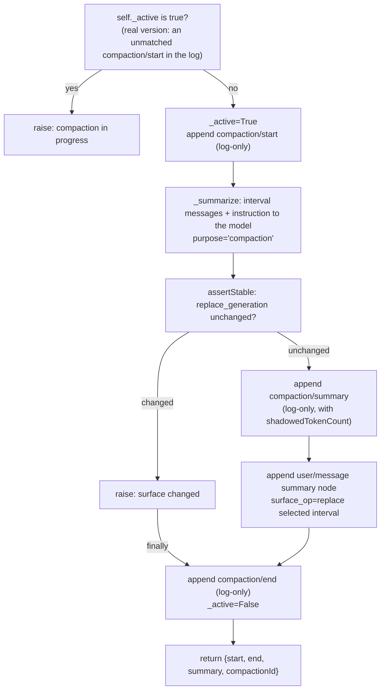

# Chapter 10: compaction and token pressure

> The window is finite, the conversation goes on; forgetting is not deletion, but summarization.

## Questions this chapter answers

- Chapter 7's `estimate_message` folds history into a token count, but the conversation only grows — what happens when the accumulated tokens hit the window limit?
- Chapter 3's persistence requires `log` to be complete and never deleted, yet the model can only see what fits inside the window — how does compaction make both true at once?
- Chapter 4's tool pipeline already lets the model emit tool calls and receive their results — when compaction compresses a stretch of history, why can't it start compressing from an arbitrary position?

Chapter 9 solved "which tools each of multiple agents can see" — scope split a single global tool table into layered, inheritable, restrictable scopes. That is **horizontal** resource isolation: at the same moment, different agents see different tool sets.

This chapter turns to a **vertical** kind of finite resource: the context window. It treats all agents the same — no matter how scope is sliced, the total number of tokens a single session can stuff into the model has an upper limit. And conversation is, unfortunately, monotonically growing: every question asked, every tool called, makes the history a little thicker.

In fact, we planted the foreshadowing long ago. Chapter 7's `estimate_message` already folds each message into tokens, and the real `TokenMeter.measure(session)` can replay the session log into a full measurement (a total plus per-node pricing, exact or estimated) — but those numbers were merely **measured**; nobody **responded** to them. This chapter gives that string of numbers a pair of hands: when pressure approaches the window, automatically compress a stretch of old history into a summary so the conversation can continue.

This chapter's teaching code builds on **Chapter 7** (reusing `estimate_message` from `token_meter.py` and `LlmRuntime` / `LlmAdapter` / `BlockAssembler` from `llm_runtime.py`), and extends on top of Chapter 2's `Session` / `Sessions`. The new code lives in `ch10/code/`.

## 1. An Ever-Growing Session Inevitably Hits the Wall

The model has one hard constraint: the **context window**. The total number of input tokens a single call can receive must not exceed it. Yet the way an agent works is exactly "bring the entire history along every turn" — so token pressure only goes up, never down.

The following bad example does no compaction at all; it just honestly prints the accumulated token count of each turn (reusing Chapter 7's `estimate_message`). To make the process easy to see, `[teaching simplification]` shrinks the window to 500:

```python
# ch10/code/bad_example.py(excerpt)
def main():
    # ... 横幅与说明输出省略 ...
    context_window = 500  # 教学示例把窗口缩小，便于看清过程
    # ... 两行说明输出省略 ...

    total = 0
    turn = 0
    while total < context_window:
        turn += 1
        user_msg = {"role": "user", "content": f"问题{turn}：" + "细节 " * 20}
        assistant_msg = {"role": "assistant", "content": f"回答{turn}：" + "分析 " * 20}
        total += estimate_message(user_msg) + estimate_message(assistant_msg)
        print(f"  第{turn:>2}轮：累计 tokens = {total:>4} / 窗口 = {context_window}")
    # ... 结尾输出省略（完整运行见下方输出块） ...
```

Run `python3 ch10/code/bad_example.py` (output excerpt, showing only head and tail):

```text
==============================================================
反面示例：无限增长的会话，必然撞上上下文窗口的墙
==============================================================

假设上下文窗口只有 500 tokens。
对话一轮轮进行，每轮追加一问一答：

  第 1轮：累计 tokens =   48 / 窗口 = 500
  ...
  第10轮：累计 tokens =  482 / 窗口 = 500
  第11轮：累计 tokens =  532 / 窗口 = 500

→ 第 11 轮后，累计 tokens 532 已超过窗口 500。
  此刻模型拒绝接收输入：这一轮之后的对话再也进行不下去。
  而之前说过的所有内容，也因为装不进窗口而无法交给模型。

这就是 compaction 要解决的问题：
  上下文窗口是有限的，但对话必须继续。
```

The problem is exposed precisely: **the window is finite, but the conversation must continue.** Each question-and-answer round costs about 48 tokens, so eleven rounds fill a 500-token window. We need a mechanism that, without losing history, shrinks "what the model will see" back inside the window.

Here a pair of contradictions immediately surfaces, and it is this chapter's design pivot:

- **`log` must be complete**: the session event stream is a factual record (Chapter 3 persists exactly this), and it cannot be genuinely deleted.
- **The model can only see what fits in the window**: the messages handed to the model must be few enough.

The solution is to split these two concerns into **two layers**: the append-only `log` stays untouched, and a **replaceable** `surface` is built on top — the view the model actually sees. The mechanism in the next section unfolds from here.

## 2. Mechanism One: surface — a Replaceable Ordered View

### 2.1 Concept

`surface` is an **ordered view** of a session: it lists the sequence numbers of "events that produce LLM messages", and the model, when called, fetches messages in that order. Not every event enters surface. The real version declares this twice: the **type** `SurfaceEventType` lists five message events (`packages/core/session/src/types.ts:447-453`), and the **runtime** constant `SURFACE_EVENT_TYPES` is a `Set` of the same five (`packages/core/session/src/surface.ts:49-56`). Both mean the same thing: `system/message`, `developer/message`, `user/message`, `assistant/message`, `tool/result`. The teaching version implements only the last three:

```python
# ch10/code/surface.py
SURFACE_EVENT_TYPES = ("user/message", "assistant/message", "tool/result")
```

Process events such as `compaction/*` do **not** enter surface (the model doesn't need to know "I am being compacted"); they only go into log.

surface and `surface_op` are not a native ability of Chapter 2's `Session`: that chapter's `Session.append` omitted them wholesale and noted they were deferred to this one. This chapter fulfills that reserved slot.

The key difference between surface and log: log only appends, while surface can be **replaced wholesale**. A replacement is described by a `surface_op`:

```python
# ch10/code/surface.py
class SurfaceSession(Session):
    """带 surface 的会话：在 ch02 Session 之上加一层有序 surface 视图。

    两层结构（这是理解 compaction 的关键）：
    - log（继承自 Session）：追加式全量历史，compaction/* 事件只进这里；
    - surface（本章新增）：产生 LLM 消息的事件的有序视图，是模型真正「看到」的内容。

    压缩时不动 log，只在 surface 上把一段区间替换成一个摘要节点——
    历史可回溯（log 完整），模型上下文变小（surface 变短）。
    """

    def __init__(self, ctx, session_id):
        super().__init__(ctx, session_id)
        self.surface = []            # 有序 surface 节点列，元素是事件 seq
        self.replace_generation = 0  # 每次 replace +1，压缩事务的稳定性断言用

    def append(self, type, payload=None, surface_op=None):
        """追加事件；若是 surface 事件，按 surface_op 更新 surface。

        surface_op 两种形态（SurfaceOp，packages/core/session/src/types.ts:470-472）：
        - None（等价 'append'）：追加到 surface 尾部（默认）；
        - {'op': 'replace', 'start': i, 'end': j}：用本事件这一个节点
          替换 surface[i:j] 整段区间（压缩摘要落盘就走这条）。
        [教学简化] 真实版写作 {op:'replace', startSeq, endSeq}，两端是 surface 上的
        seq 闭区间，而且这条新事件还必须用 sourceEventSeqs 列出被它顶替的全部节点
        （packages/core/session/src/types.ts:464-468）；教学版 surface 就是位置索引，
        所以直接用下标，也不记 sourceEventSeqs。
        """
        event = super().append(type, payload)
        if type in SURFACE_EVENT_TYPES:
            if isinstance(surface_op, dict) and surface_op.get("op") == "replace":
                start, end = surface_op["start"], surface_op["end"]
                # 把 [start, end) 区间替换为这一个节点（压缩摘要节点）
                self.surface[start:end] = [event.seq]
                self.replace_generation += 1
            else:
                self.surface.append(event.seq)
        # 非 surface 事件（compaction/* 等）只进 log、不进 surface
        return event
```

Note three design points:

1. **`super().append` runs first**: no matter how surface changes, the event always enters log first. This is the bottom-level guarantee of "log completeness".
2. **replace is a slice assignment**: `self.surface[start:end] = [event.seq]` swaps the old sequence numbers in `[start, end)` for the single sequence number of the new event — the view is "displaced", while those old events in log still lie there intact.
3. **the `replace_generation` counter**: incremented on every replace. Compaction is a multi-step transaction; if someone silently changes surface during it, the counter won't match — it is the basis for the **stability assertion** at transaction close (§4.3 uses it).

### 2.2 Wrap-up

surface decouples "historical completeness" from "model visibility": log is responsible for remembering everything, surface for deciding what the model sees right now. What compaction has to do is **safely replace one segment of surface**.

## 3. Mechanism Two: token-meter Pressure Measurement and Threshold Decision

### 3.1 Concept

To decide "should we compact?", we must first measure "how full are we right now?". This step reuses Chapter 7's measurement ability, folding the whole session's surface messages into tokens and keeping a per-node ledger:

```python
# ch10/code/compaction.py
def measure_session(session):
    """测量会话 surface 的 token 压力 → TokenMeasurement。

    扩展第 7 章计量缝：真实源 tokenMeter.measure(session)
    （packages/llm/token-meter/src/index.ts:151）先经 _sync 回放会话日志（:231），
    返回 totalTokens + 逐节点计价 nodes；精确/估算的判定在投影层
    （measurement-projection.ts:61-75），不在 _foldEvent 里。
    教学版复用第 7 章 estimate_message，对每个 surface 节点逐一计价。
    返回 {'total_tokens': int, 'nodes': [{'seq': int, 'tokens': int}]}.
    """
    nodes = []
    total = 0
    for seq in session.surface:
        event = session.log[seq]
        message = event.payload.get("message", {})
        tokens = estimate_message(message)
        nodes.append({"seq": seq, "tokens": tokens})
        total += tokens
    return {"total_tokens": total, "nodes": nodes}
```

After measuring total pressure, we still need a **policy** to decide "when to trigger, how much to keep". `resolve_compact_spec` converts the window size into two thresholds:

```python
# ch10/code/compaction.py
def resolve_compact_spec(context_window, threshold_ratio=0.8, retain_ratio=0.16):
    """解析压缩参数（resolveCompactSpec，packages/compaction/compaction-basic/src/config.ts:153）。

    - threshold：触发压缩的压力阈值 = context_window × threshold_ratio（默认 0.8）；
    - retain_tokens：压缩时尾部保留的 token 数 = context_window × retain_ratio（默认 0.16）。
    """
    return {
        "threshold": int(context_window * threshold_ratio),
        "retain_tokens": int(context_window * retain_ratio),
    }
```

The two ratios each do their own job: `threshold` answers "**when** to compact", `retain_tokens` answers "**how much to keep** after compacting".

`[Teaching simplification]` multiplies window by ratio directly. The real version (`resolveCompactSpec` at `packages/compaction/compaction-basic/src/config.ts:153`) does three steps: first subtract the output reservation for this request (`maxTokens`); then subtract a stretch of headroom (the margin left for fixed overhead such as the system prompt and tool schemas); finally take `min(window × thresholdRatio, remaining budget)` and check `retainTokens < thresholdTokens`. The two ratios themselves are still the defaults 0.8 / 0.16 (`config.ts:20`, `:23`).

### 3.2 Threshold Decision

With the spec in hand, `compact_if_needed` can make the decision — measure pressure, compare against the threshold, and only actually compact when it is reached:

```python
    # ch10/code/compaction.py(BasicCompactionEngine)
    def compact_if_needed(self, session, trigger="pressure"):
        """压力触发：测 token 压力，达阈值才压缩；未达返回 None。"""
        measurement = measure_session(session)
        spec = resolve_compact_spec(self.context_window,
                                    self.threshold_ratio, self.retain_ratio)
        if measurement["total_tokens"] < spec["threshold"]:
            return None  # 压力未达，不压
        return self._compact(session, measurement, spec, trigger)
```

The `trigger` parameter marks the origin of this compaction. The source distinguishes two trigger semantics (`CompactionTrigger` at `packages/compaction/compaction/src/index.ts:32`): `'pressure'` is the **active** threshold strategy that slows down before hitting the wall; `'context-overflow'` is the **passive** recovery strategy after a call has already been rejected for being too long — the last line of defense.

The two paths branch inside `compactIfNeeded` (`packages/compaction/compaction-basic/src/index.ts:292`). The overflow path first runs one model-free prune pass (`toolResultPruner`), then selects a range with `retainTokens = 0` — it ignores the threshold and compacts as much as it can.

`[Teaching simplification]` The teaching version writes `trigger` into the `compaction/start` event so the output shows which kind of trigger this was. The real `compaction/start` records only `compactionId` / `sourceCommandId` / `turn` (`packages/compaction/compaction/src/types.ts:24`); `trigger` only decides which policy branch runs. The teaching version demonstrates the threshold-decision path via `compact_if_needed`; overflow recovery reuses the same compaction transaction, differing only in range selection and origin.

### 3.3 Wrap-up

token-meter turns "how full the context is" into a comparable number, `resolve_compact_spec` turns the window into the "when to compact, how much to keep" policy, and `compact_if_needed` makes the threshold decision on top of that. The number finally has an action that responds to it.

## 4. Mechanism Three: the compaction seam and the Compaction Transaction

### 4.1 The Seam's Three Roles

compaction is a standard capability seam (Chapter 5's three roles appear here again):

```mermaid
flowchart LR
    subgraph SD["Service Definition<br/>compaction/"]
        CE["CompactionEngine (abstract interface)<br/>compactIfNeeded / compactNow / compactRegion"]
    end
    subgraph SP["Service Provider<br/>compaction-basic/"]
        BCE["BasicCompactionEngine<br/>(calls the model to summarize)"]
    end
    subgraph CS["Consumer<br/>command-compact/ and automatic policy"]
        CMD["/compact command (manual)"]
        AUTO["pressure / overflow trigger (automatic)"]
    end
    BCE -.implements.-> CE
    CMD -.consumes ctx.compaction.-> CE
    AUTO -.consumes ctx.compaction.-> CE
```

- **Service Definition**: the `CompactionEngine` abstract interface, defining three verbs.
- **Service Provider**: `BasicCompactionEngine`, the implementation that actually calls the model to generate a summary.
- **Consumer**: the `/compact` command (manual) and the pressure/overflow trigger (automatic) both consume the same `ctx.compaction`.

The diagram uses the source's camelCase method names (`compactIfNeeded` etc.); the table below and the teaching code use snake_case (`compact_if_needed`) — the teaching version renames them following Python conventions, and they are the same three verbs.

Why a seam rather than three plain functions? Because "when to compact, how much to keep, which model summarizes" are all replaceable policy, while only "replace one surface range with a summary node" is stable. Consumers depend on that stable action and providers decide their own policy; Chapter 4's tool executor and Chapter 5's shell divide labor the same way.

The three verbs correspond to three trigger postures:

| verb | semantics | triggerer |
|------|-----------|-----------|
| `compact_if_needed` | compact only when pressure is reached | automatic (pressure) |
| `compact_now` | compact now, ignoring pressure | manual (`/compact`) |
| `compact_region` | compact a specified region | precise control |

In the teaching code, `CompactionEngine` pins down these three verbs with an abstract base class:

```python
# ch10/code/compaction.py
class CompactionEngine(ABC):
    """compaction 服务定义（CompactionEngine，packages/compaction/compaction/src/index.ts:119）。

    三动词：compact_if_needed / compact_now / compact_region。
    抽象类自身不注册服务——ctx.compaction 是否存在由提供者决定，
    消费者须先判存在（这正是 seam 三角色的「定义不保证实现」）。
    [教学简化] 真实版三动词接收 agent + AbortSignal（信号作取消），教学版只传 session。
    """

    @abstractmethod
    def compact_if_needed(self, session, trigger):
        """压力触发：测压力、达阈值才压（index.ts:136）。"""

    @abstractmethod
    def compact_now(self, session, trigger):
        """立即压缩：/compact 命令走这条（index.ts:162）。"""

    @abstractmethod
    def compact_region(self, session, region, trigger):
        """压缩指定区间（index.ts:187）。"""
```

`BasicCompactionEngine` implements these three verbs one by one. Its `__init__` takes the context window and the two ratios, initializes the compaction lock, and calls `ctx.provide("compaction", self)` to mount itself on the seam for consumers:

```python
    # ch10/code/compaction.py(BasicCompactionEngine)
    def __init__(self, ctx, context_window, threshold_ratio=0.8, retain_ratio=0.16):
        self.ctx = ctx
        self.context_window = context_window
        self.threshold_ratio = threshold_ratio
        self.retain_ratio = retain_ratio
        self._active = False  # 压缩锁（assertCompactionInactive，packages/compaction/compaction-basic/src/region.ts:308）
        ctx.provide("compaction", self)
```

Of the three verbs, `compact_if_needed` (already shown in §3.2) measures pressure first and compacts only when the threshold is reached; `compact_now` compacts directly **without looking at pressure** — the `/compact` command goes through this one, measuring then entering `_compact` straight away, with no threshold gate (this is what `ctx.compaction.compactNow(...)` at `packages/compaction/command-compact/src/index.ts:67` lands on):

```python
    # ch10/code/compaction.py(BasicCompactionEngine)
    def compact_now(self, session, trigger="manual"):
        """立即压缩（/compact 命令走这条，packages/compaction/command-compact/src/index.ts:67）。"""
        measurement = measure_session(session)
        spec = resolve_compact_spec(self.context_window,
                                    self.threshold_ratio, self.retain_ratio)
        return self._compact(session, measurement, spec, trigger)
```

Placing the two side by side makes the difference visible: `compact_if_needed` has one more gate than `compact_now` — the `if measurement["total_tokens"] < spec["threshold"]: return None` line; `compact_now` has no such gate, so it "compacts now". The implementation of the third verb `compact_region` appears below in "the compaction transaction".

### 4.2 Choosing the Interval: the Cut Point Must Land on a Pairing Balance Point

The first step of compaction is to choose "which stretch to compact". Intuition says "keep the tail of `retain_tokens`, compact everything before it", but there is a trap: **the cut point cannot fall between a tool call and its result**. The model protocol requires tool-call and tool-result to appear in pairs — slicing them apart yields messages that are illegal to send to the model.

For this we introduce the **tool pairing balance**: scanning from the head of surface to some position, accumulate "tool calls encountered minus tool results encountered". A balance of 0 means every call up to this point has been paired, and this is a safe cut point.

The real version turns this into a boolean check: `toolPairingBalancedBefore` (`packages/compaction/compaction/src/tool-pairing.ts:112`) asks "is the cut before this seq balanced", while `toolPairingBalancedAfter` (`:124`) asks "is the cut after this seq balanced". It adds two stricter rules: a negative balance (more tool results than tool calls) throws immediately, because the surface itself is corrupt; and the balance state is cached per `replaceGeneration`, so any replacement forces a full rebuild. The teaching version returns the integer balance so the output can show "how many pairs short".

```python
# ch10/code/compaction.py
def count_tool_calls(message):
    """统计一条 assistant 消息里 tool-call 内容块的个数。"""
    content = message.get("content")
    if not isinstance(content, list):
        return 0
    return sum(1 for block in content
               if isinstance(block, dict) and block.get("type") == "tool-call")


def tool_pairing_balanced_before(session, index):
    """工具配对余额（toolPairingBalancedBefore，packages/compaction/compaction/src/tool-pairing.ts:112）：
    surface[:index] 内 assistant 工具调用数 − tool/result 数。

    == 0：切点之前的工具调用都有成对结果，可在此安全切开；
    != 0：切点落在一对工具调用/结果中间，必须回退。
    [教学简化] 真实版返回布尔（且余额为负视为 surface 损坏、直接抛错），
    教学版返回整数余额；真实版还按 replaceGeneration 缓存这个扫描。
    """
    balance = 0
    for seq in session.surface[:index]:
        event = session.log[seq]
        if event.type == "assistant/message":
            balance += count_tool_calls(event.payload.get("message", {}))
        elif event.type == "tool/result":
            balance -= 1
    return balance
```

With the balance check in place, `select_compactable_range` can pick a safe interval:

```python
# ch10/code/compaction.py
def select_compactable_range(session, measurement, retain_tokens):
    """选出可压缩区间（selectCompactableRange，packages/compaction/compaction-basic/src/region.ts:117）。

    步骤：
    1. 保留尾部：从尾向前累计 retain_tokens 的节点作为「保留尾」；
    2. 把切点回退到工具配对平衡点（balance == 0），避免切断工具调用/结果对；
    3. 返回待压缩区间 {'start': 0, 'end': cut}；无可压缩返回 None。
    """
    nodes = measurement["nodes"]
    n = len(nodes)
    if n == 0:
        return None
    # 1. 保留尾部：从尾向前累计，再加一个就超 retain_tokens 时停下
    tail_tokens = 0
    cut = n
    for i in range(n - 1, -1, -1):
        if tail_tokens + nodes[i]["tokens"] > retain_tokens:
            break
        tail_tokens += nodes[i]["tokens"]
        cut = i
    # 2. 回退到工具配对平衡点：balance(cut) != 0 就继续回退
    while cut > 0 and tool_pairing_balanced_before(session, cut) != 0:
        cut -= 1
    if cut <= 0:
        return None  # 无可压缩
    return {"start": 0, "end": cut}
```

The two loops each handle one thing: the `for` loop accumulates `retain_tokens` from the tail backward to get a tentative cut point; the `while` loop checks that cut point's pairing balance and keeps falling back until it lands on a balance point. Falling back means **compacting a little less** — better to keep more than to slice a tool pair apart.

The real version has one more boundary the teaching version lacks: if the surface head is a `system/message` (the system prompt), it never enters the compacted interval, and the selection starts from the second node (`systemHead` at `packages/compaction/compaction-basic/src/region.ts:99`, used at `:131`). The summary works by appending one user message to displace the old interval; sweeping the system prompt into it would leave no system prompt for the next turn.

### 4.3 The Compaction Transaction: One Atomic Replacement

Compaction is not an instantaneous statement. The summary waits for the model to stream back, and that stretch is a **window**: during it, surface can absolutely be changed by some other writer. Without a line of defense, two things happen:

- The range is computed as `[0, 11)`, the summary runs for a dozen seconds, and meanwhile a new conversation turn arrives or another triggerer compacts first. By the time the summary comes back, `[0, 11)` points at a different set of nodes — replacing with the stale cut at best displaces the wrong content, at worst erases the messages just added.
- `/compact` and the pressure trigger arrive at the same time: two transactions each `_summarize` and each commit, surface is replaced twice, and the second `start/end` is based on positions from before the first. The old messages get displaced twice and the summary nodes overwrite each other.

So the transaction must answer two questions: **only one compaction may run at a time** (mutual exclusion), and **the selected range must be confirmed unchanged before commit** (stability assertion). First the thin wrapper `_compact` — pick the range, then delegate to `compact_region`:

```python
    # ch10/code/compaction.py(BasicCompactionEngine)
    def _compact(self, session, measurement, spec, trigger):
        """选区间并执行压缩事务；无可压缩区间返回 None。"""
        region = select_compactable_range(session, measurement, spec["retain_tokens"])
        if region is None:
            return None
        return self.compact_region(session, region, trigger)
```

The real transaction is in `compact_region`, the core flow of this chapter:



The `X → G` edge means "whether it succeeds or throws, execution still reaches this point": `finally` appends `compaction/end` and resets `_active`.

The corresponding code:

```python
    # ch10/code/compaction.py(BasicCompactionEngine)
    def compact_region(self, session, region, trigger):
        """单次压缩事务（compactSurfaceRegion，packages/compaction/compaction-basic/src/region.ts:173）。

        上锁 → compaction/start → 摘要 → 稳定性断言 → compaction/summary
        → 提交（user/message + surfaceOp replace）→ compaction/end → 解锁。

        关键协议：compaction/* 事件全部 log-only（只进 log、不进 surface），
        真正替换 surface 的是最后那条携带 surfaceOp 的 user/message。
        """
        if self._active:
            raise RuntimeError("compaction already in progress (assertCompactionInactive)")
        start, end = region["start"], region["end"]
        compaction_id = f"compact-{len(session.log):04d}"  # 真实版是 randomUUID()（CompactionId 品牌）
        self._active = True
        # compaction/start 的持久化存在本身就是锁：真实版靠「有未配对的 start」判断忙
        session.append("compaction/start",
                       {"compactionId": compaction_id, "trigger": trigger})
        try:
            gen_before = session.replace_generation
            summary, shadow_price = self._summarize(session, region)
            # 稳定性断言（assertStable，packages/compaction/compaction-basic/src/region.ts:211-213）：
            # 摘要期间 surface 不得发生 replace。教学版同步单线程恒成立，真实异步场景是防线。
            if session.replace_generation != gen_before:
                raise RuntimeError("surface changed during compaction (assertStable)")
            # compaction/summary：log-only，携带摘要文本与被顶替节点的影子价
            # 真实字段名是 shadowedRange / shadowedSeqs / shadowedTokenCount
            session.append("compaction/summary",
                           {"summary": summary, "shadowedTokenCount": shadow_price})
            # 提交：追加携带 surfaceOp replace 的 user/message，真正替换 surface
            checkpoint_message = {
                "role": "user",
                "content": f"[对话摘要] {summary}",
                "checkpointSource": compact_checkpoint_source(compaction_id),
            }
            session.append("user/message", {"message": checkpoint_message},
                           surface_op={"op": "replace", "start": start, "end": end})
        finally:
            session.append("compaction/end", {"compactionId": compaction_id})
            self._active = False
        return {"start": start, "end": end, "summary": summary,
                "compactionId": compaction_id}
```

Stepping through a few non-obvious design points:

- **the compaction lock (assertCompactionInactive)**: compaction is an exclusive operation; a second one starting mid-flight raises immediately, preventing two compactions from concurrently modifying surface. The teaching version uses one boolean, `_active`, reset in `finally` regardless of outcome. The real version stores no boolean; it looks in the log for an **unmatched `compaction/start`** (`packages/compaction/compaction-basic/src/region.ts:308`, `:566-600`) and compares it against the most recent `session/end-seed`. Only a start later than that boundary counts as "in progress" and reports `busy`; one earlier than the boundary is stale evidence from a previous process lifecycle and is let through. That boundary matters — when a session is restored and the log tail is not a `session/end-seed`, `core/session/src/index.ts:699-700` appends one, so an orphan start left by a crash cannot lock the new process forever. On failure the real version also appends a matching `compaction/end`, carrying an `error` field (`region.ts:242`).
- **`compaction/*` events are log-only**: `compaction/start`, `compaction/summary`, `compaction/end` all go through `session.append`, but their types are not in `SURFACE_EVENT_TYPES`, so they enter only log, never surface. They are "records about compaction", not "conversation content", so the model should not see them; but the complete trail left in log lets you audit afterward "this stretch of history was compacted into what, when, and by whom". All three events share one `compactionId`, the thread that ties them into a single transaction.
- **`assertStable` (the `replace_generation` assertion)**: this is the defense for the window described at the start. After `_summarize` returns, compare the counter before committing. The real version has two granularities (`packages/compaction/compaction-basic/src/region.ts:211-213`): `whole-surface` compares the entire surface, while `selected-span` — used for manual compaction — requires only that **the selected stretch** still exists, is contiguous, and prices the same (`:447`); nodes added elsewhere during the summary do not affect this transaction. The teaching version approximates the former with a single `replace_generation` counter.
- **`checkpointSource`**: the summary node's message carries a source marker saying this user message was not written by a real human but is the product of compaction. The HEAD shape is `{kind:'compact-checkpoint', compactionId, sourceCommandId?}` (`packages/compaction/compaction/src/checkpoint.ts:33`), and every summary carries its own `compactionId`; together with the `isCompactCheckpointSource` predicate (`:49`), replay, debugging and re-compaction can all tie it back to the transaction that produced it. The teaching version uses the same shape, simplified to `{kind:'compact-checkpoint', compactionId}`.
- **shadow price (`shadowedTokenCount`)**: the `compaction/summary` event records the token count this compaction "displaced". The real field names are `shadowedRange` / `shadowedSeqs` / `shadowedTokenCount` (`packages/compaction/compaction/src/types.ts:34-43`), and it also records the `provider` / `model` that wrote the summary plus the `usage` of this auxiliary call — "which model wrote this summary" has a definite answer in the log, for later cost accounting.

The transaction also uses two module-level helpers, given together:

```python
# ch10/code/compaction.py
COMPACTION_INSTRUCTION = (
    "请把上面的对话压缩成一份简明摘要：保留关键决策、结论、工具执行结果与未完成任务，"
    "使对话可以基于这份摘要继续。"
)

# ... measure_session / resolve_compact_spec / 配对余额与区间选择等函数省略（见 §3、§4） ...

def compact_checkpoint_source(compaction_id):
    """检查点来源标记（compactCheckpointSource，packages/compaction/compaction/src/checkpoint.ts:33）。

    真实版返回 {kind: 'compact-checkpoint', compactionId, sourceCommandId?}，并 deepFreeze。
    每条摘要消息都带自己的 compactionId，消费方据此把摘要与那次压缩事务对上号。
    """
    return {"kind": "compact-checkpoint", "compactionId": compaction_id}
```

`COMPACTION_INSTRUCTION` pins down "what a summary must retain" — key decisions, conclusions, tool execution results, unfinished tasks; it is the instruction that `_summarize` appends for the model. The real instruction is far longer: it asks the model to emit fixed Markdown sections (Primary Request, Key Technical Concepts, Files and Code, Errors and Fixes, Pending Jobs, Current Work, Next Step, Critical Context) one by one, writing `(none)` for an empty section instead of omitting it — so the structure of a summary read by the next compaction stays stable (`packages/compaction/compaction-basic/src/summarizer.ts:32-60`). `compact_checkpoint_source(compaction_id)` returns `{kind:'compact-checkpoint', compactionId}`, the source marker used by `checkpointSource` above.

The summary itself reuses Chapter 7's streaming pipeline — the interval messages plus the compaction instruction are handed to `ctx.llm.stream` (`purpose="compaction"` is passed through `**options`), and `BlockAssembler` assembles the chunk stream into text:

```python
    # ch10/code/compaction.py(BasicCompactionEngine)
    def _summarize(self, session, region):
        """生成摘要（summarizeWithLlm，packages/compaction/compaction-basic/src/summarizer.ts:120）。

        把压缩区间消息 + COMPACTION_INSTRUCTION 交给 LLM，purpose='compaction'。
        返回 (summary_text, shadow_price)。

        [教学简化] 真实源会先重放 system/tools/messages 前缀再追加指令（复用
        KV-cache，降低摘要调用成本）；教学版只发压缩区间消息 + 指令。
        影子价 = 压缩区间 token 数（摘要「对冲」掉的部分）。
        """
        start, end = region["start"], region["end"]
        region_messages = []
        for seq in session.surface[start:end]:
            event = session.log[seq]
            message = event.payload.get("message")
            if message is not None:
                region_messages.append(message)
        shadow_price = sum(estimate_message(m) for m in region_messages)
        request_messages = region_messages + [
            {"role": "user", "content": COMPACTION_INSTRUCTION}
        ]
        assembler = BlockAssembler()
        for chunk in self.ctx.llm.stream(request_messages, purpose="compaction"):
            assembler.push(chunk)
        summary = "".join(
            block.get("text", "") for block in assembler.blocks
            if block.get("type") == "text"
        )
        return summary, shadow_price
```

`purpose='compaction'` (`packages/compaction/compaction-basic/src/summarizer.ts:160`) is the auxiliary-call marker on `GenerateOptions` (`packages/llm/llm/src/types.ts:605`); adapters may map it to model-hidden transport metadata (billing classification, cache hints), and ordinary conversation requests leave it unset. More important is the KV-cache point: the real version puts the conversation's own system prompt, tool table and history messages ahead of the instruction unchanged (`summarizer.ts:26-31`, `:145-151`), so this auxiliary call becomes a prefix extension of the previous main request and the provider's cache carries over. The teaching `FakeCompactionAdapter` returns a fixed summary directly; `purpose` is passed but never consumed — the stub only serves the offline demo.

### 4.4 Wrap-up

The compaction seam pins down the trigger postures with three verbs; `select_compactable_range` uses the pairing balance to guarantee a safe cut point (the real version also keeps the `system/message` head out of the interval; the teaching version does not implement that); `compact_region` uses one transaction — locked, stability-asserted, with complete log-only events — to atomically replace a stretch of surface with a summary. **Not a single word of log was deleted, yet what the model sees got slimmer** — the §1 contradiction is hereby resolved.

## 5. Mechanism Four: tool-result-pruner — Lightweight Pruning Without the Model

### 5.1 Concept

Not all slimming needs the model. One kind of token hog is especially common: **overlong tool results** — reading a big file or fetching a web page can make a single `tool/result` eat thousands of tokens. For content that is "redundant in the middle, useful at both ends", you can skip the model and prune at the character level:

```python
# ch10/code/compaction.py
PRUNE_MARKER = "\n…[中段已修剪]…\n"  # 真实源是 "\n\n[... tool result middle pruned ...]\n\n"（config.ts:7）


def prune_tool_result(text, keep_chars=20):
    """无模型修剪（ToolResultPruner，packages/compaction/compaction-tool-result-pruner/src/index.ts:44）。

    是什么：不调用 LLM，直接把超大的 tool/result 文本「掐头去尾留中间标记」。
    解决什么：单个工具结果（如读一个大文件）就可能撑爆上下文，为它专门跑一次
    摘要 LLM 调用既贵又慢；无模型修剪零成本、即时生效。

    [教学简化] 真实版：门槛 thresholdChars=8192、留头 headChars=4096、留尾
    tailChars=1024（config.ts:11-13），按 Unicode code point 而非 UTF-16 计长，
    逐条扫描当前 surface 上的 tool/result；每条替换前先 append 一条
    compaction/prune 影子价事件，再用 surfaceOp replace 落一条新的 tool/result
    （index.ts:160-168）。教学版只对单个字符串演示掐头去尾，不改 surface。
    """
    if len(text) <= keep_chars * 2:
        return text  # 不够大，不修剪
    return text[:keep_chars] + PRUNE_MARKER + text[-keep_chars:]
```

**No model call, shrink a single tool result in place** — that is its essence.

In the real system it is an independent **Service**: `ctx.toolResultPruner` (`packages/compaction/compaction-tool-result-pruner/src/index.ts:44`), with `static inject = ['tokenMeter']`. It is **not** a provider of the compaction seam; the two merely share the `compaction/*` event protocol.

`BasicCompactionEngine` fetches it optionally through `ctx.get('toolResultPruner')` and skips it when it is absent. When present, both paths prune first: the pressure path calls `pruneSession` **before** choosing a summary range (`packages/compaction/compaction-basic/src/index.ts:342-352`), and the overflow path calls it as its very first statement (`:303`).

It persists through the same protocol as the main compaction: for every pruned result, append a `compaction/prune` shadow-price event (carrying `shadowedSeqs` and `shadowedTokenCount`), then append a new `tool/result` with `surfaceOp: {op:'replace', startSeq, endSeq}` and `sourceEventSeqs` (`index.ts:160-168`). The old result stays in log and surface carries the pruned version — structurally identical to the summary replacement of the main compaction.

### 5.2 Division of Labor with compaction

| | tool-result-pruner | compaction |
|---|---|---|
| calls the model? | no (pure character-level) | yes (generates a summary) |
| operates on | a single tool result | a whole stretch of conversation history |
| cost | extremely low | one model call |
| how information is lost | truncates the middle | condenses into a summary |

In practice, prune first then compact: do the cheapest trimming first, and only escalate to a model summary if the pressure still exceeds the threshold.

The source hard-codes that order in the pressure path: threshold exceeded → `pruneSession` → **re-measure** → still above threshold, only then select a range for summarization (`packages/compaction/compaction-basic/src/index.ts:342-352`). If pruning brings pressure below the threshold, this round makes no model call at all.

### 5.3 Wrap-up

The pruner reminds us: **compression has degrees of severity.** If character-level pruning can solve it, don't escalate to a model summary. The seam's design lets these two means be registered independently and combined on demand.

## 6. Complete Run Output

Assemble the first three mechanisms and run once: surface, token-meter pressure measurement, the compaction seam. `main.py`'s assembly is exactly the seam's three roles from §4: `SurfaceSessions` provides the session, `LlmRuntime + FakeCompactionAdapter` provide the summarization ability, and `BasicCompactionEngine` serves as the provider of `ctx.compaction`. The fourth mechanism, tool-result-pruner, is an independent Service (§5); `main.py` neither imports nor calls it, and its persistence protocol is covered separately in §5.

Two components that haven't appeared before need to be explained first:

- **`SurfaceSessions`**: a session **service** that inherits Chapter 2's `Sessions` and only overrides `create` — so the sessions it creates are `SurfaceSession` (with a surface) rather than plain `Session`. `main.py` uses its `create()` to produce the demo session; `SurfaceSession` is the session object that gets created (shown in §2).
- **`FakeCompactionAdapter`**: a fake implementation (stub) of Chapter 7's `LlmAdapter`. Its `stream` always returns a piece of **fixed summary text** — the only caller in this demo is compaction, so it does not need to dispatch on `purpose`. The summary is not produced by a real model but emitted by the stub per contract, so the whole demo runs offline. It is mounted with Chapter 7's revised signature: `runtime.register_adapter(["fake"], FakeCompactionAdapter())` — a route name first, then the adapter (registration checks that `provider_info(provider)["id"]` equals that route name exactly).

Run `python3 ch10/code/main.py`:

```text
==============================================================
第 10 章：compaction 与 token 压力
==============================================================

装配：context_window=500  threshold=400  retain_tokens=80

[压缩前：会话已增长]
  surface 节点数=12  token 压力=504  replace_generation=0
  模型将看到的消息：
    - user: 问题0：请讲解模块0的设计 细节 细节 细节 细节 细节 细节 细节 细节 细节 细
    - assistant: 回答0：模块0的设计如下 分析 分析 分析 分析 分析 分析 分析 分析 分析 分析
    - user: 问题1：请讲解模块1的设计 细节 细节 细节 细节 细节 细节 细节 细节 细节 细
    - assistant: 回答1：模块1的设计如下 分析 分析 分析 分析 分析 分析 分析 分析 分析 分析
    - user: 问题2：请讲解模块2的设计 细节 细节 细节 细节 细节 细节 细节 细节 细节 细
    - assistant: 回答2：模块2的设计如下 分析 分析 分析 分析 分析 分析 分析 分析 分析 分析
    - user: 问题3：请讲解模块3的设计 细节 细节 细节 细节 细节 细节 细节 细节 细节 细
    - assistant: 回答3：模块3的设计如下 分析 分析 分析 分析 分析 分析 分析 分析 分析 分析
    - user: 问题4：请讲解模块4的设计 细节 细节 细节 细节 细节 细节 细节 细节 细节 细
    - assistant: 回答4：模块4的设计如下 分析 分析 分析 分析 分析 分析 分析 分析 分析 分析
    - user: 问题5：请讲解模块5的设计 细节 细节 细节 细节 细节 细节 细节 细节 细节 细
    - assistant: 回答5：模块5的设计如下 分析 分析 分析 分析 分析 分析 分析 分析 分析 分析

[压力触发] engine.compact_if_needed(session, trigger='pressure')
  压缩完成：区间 [0, 11) 被替换为摘要节点
  摘要内容：压缩了 11 条对话：讨论了项目方案，确认了技术选型，决定继续推进任务。

[压缩后：surface 被替换]
  surface 节点数=2  token 压力=61  replace_generation=1
  模型将看到的消息：
    - user: [对话摘要] 压缩了 11 条对话：讨论了项目方案，确认了技术选型，决定继续推进任务
    - assistant: 回答5：模块5的设计如下 分析 分析 分析 分析 分析 分析 分析 分析 分析 分析

[log 完整] log 中的事件（compaction/* 只进 log、不进 surface）：
  seq= 0  user/message         (已移出 surface)
  seq= 1  assistant/message    (已移出 surface)
  seq= 2  user/message         (已移出 surface)
  seq= 3  assistant/message    (已移出 surface)
  seq= 4  user/message         (已移出 surface)
  seq= 5  assistant/message    (已移出 surface)
  seq= 6  user/message         (已移出 surface)
  seq= 7  assistant/message    (已移出 surface)
  seq= 8  user/message         (已移出 surface)
  seq= 9  assistant/message    (已移出 surface)
  seq=10  user/message         (已移出 surface)
  seq=11  assistant/message    (surface)
  seq=12  compaction/start     (log-only)
  seq=13  compaction/summary   (log-only)
  seq=14  user/message         (surface)
  seq=15  compaction/end       (log-only)

[工具配对余额] 切点必须落在配对平衡点
  surface 有 4 个节点，各节点 tokens=[10, 4, 14, 13]
  retain_tokens=27 → tentative 切点=2（工具调用与它的结果之间）
  balance(2)=1（≠0，落在工具对中间）
  回退后切点 end=1，balance(1)=0（安全）
  → 压缩 [0, 1)，保留工具调用/结果对完整

==============================================================
运行完成
```

The output confirms the chapter's mechanisms section by section:

- **Pressure trigger**: before compaction there are 12 nodes and 504 tokens, above `threshold=400`, so `compact_if_needed` fires; after compaction there are 2 nodes and 61 tokens, and `replace_generation` goes from 0 to 1. The 61 remaining tokens are the summary node (19) plus the last assistant answer (42). Tail retention accumulates backward against `retain_tokens=80`: the last two nodes (42 + 42 = 84) already exceed it, so only one is kept and the cut stops at index 11.
- **Log completeness**: the old conversation at seq 0–10 is **moved out of surface** (but kept in log without a word deleted); the three process events `compaction/start|summary|end` are **log-only by type** (they never enter surface). These two kinds of "only in log" have different origins: the former are surface-type events replaced out, the latter are event types that never enter surface in the first place.
- **Pairing balance**: in the focused example the tentative cut=2 lands exactly between a tool call and its result (balance=1), so the algorithm falls back to end=1 (balance=0) — preferring to compact a little less than to slice a tool pair apart.

## 7. Source Code Mapping

> All paths are relative to the upstream repository root (HEAD `8bd0733`).

| teaching code (`ch10/code/`) | source location | how the teaching version differs |
|---|---|---|
| `surface.py` `SurfaceSession.surface` | `packages/core/session/src/surface.ts:247` (the `nodes` field) | the teaching version builds surface explicitly as a seq list; the real one is a read-only `SessionSurface` projection maintained by incremental folding |
| `SURFACE_EVENT_TYPES` (three) | `packages/core/session/src/types.ts:447-453` (`SurfaceEventType`, five) | the teaching version drops `system/message` and `developer/message` |
| `surface_op` replace form | `packages/core/session/src/types.ts:470-472` (`SurfaceOp`), `:464-468` (`sourceEventSeqs` must cover the displaced nodes) | the real one uses closed `startSeq`/`endSeq` intervals and mandates `sourceEventSeqs`; the teaching one uses subscripts and records no source |
| `replace_generation` | `packages/core/session/src/surface.ts:571` (+1 per replacement), `:649` (read) | a plain integer attribute in the teaching version; part of the fold state in the real one |
| `measure_session` | `packages/llm/token-meter/src/index.ts:151` (`measure`); exact-vs-estimate at `measurement-projection.ts:61-75` | the teaching version only estimates; no precise usage, no image/file pricing |
| `resolve_compact_spec` | `packages/compaction/compaction-basic/src/config.ts:153` | the real one subtracts the output reservation and headroom first, then takes `min` and checks retain < threshold |
| `CompactionEngine` (ABC) | `packages/compaction/compaction/src/index.ts:119` | the real verbs take an `Agent` plus an `AbortSignal`; the teaching version passes the session |
| `BasicCompactionEngine` | `packages/compaction/compaction-basic/src/index.ts:112` | the real one also registers three automatic policies (step pressure / model switch / overflow) |
| `tool_pairing_balanced_before` | `packages/compaction/compaction/src/tool-pairing.ts:112` | the real one returns a boolean, throws on a negative balance, and caches per `replaceGeneration` |
| `select_compactable_range` | `packages/compaction/compaction-basic/src/region.ts:117` | the real one keeps the `system/message` head node and checks that meter and surface agree |
| `compact_region` transaction | `packages/compaction/compaction-basic/src/region.ts:173` (`compactSurfaceRegion`), lock at `:308` | the real lock is an unmatched `compaction/start` later than the newest `session/end-seed`; stability comes in `whole-surface` and `selected-span` granularities (`:211-213`) |
| `compact_checkpoint_source` | `packages/compaction/compaction/src/checkpoint.ts:33` | the real one carries `kind:'compact-checkpoint'` and `sourceCommandId`, and deep-freezes the result |
| shadow price `shadowedTokenCount` | `packages/compaction/compaction/src/types.ts:34-43` | the real one also records `shadowedRange`, `shadowedSeqs`, `provider`, `model`, and the summarization call's `usage` |
| `purpose='compaction'` | `packages/compaction/compaction-basic/src/summarizer.ts:160`; the type at `packages/llm/llm/src/types.ts:605` | the teaching stub passes it but never consumes it |
| `_summarize` | `packages/compaction/compaction-basic/src/summarizer.ts:120` | the real one replays the system/tools/history prefix; the instruction is a fixed Markdown template (`:32-60`) |
| `prune_tool_result` | `packages/compaction/compaction-tool-result-pruner/src/index.ts:44` (`ToolResultPruner`), `:136` (`pruneSession`) | the real one prunes in place and lands `compaction/prune` + `tool/result` replace; the teaching version only demos on a string |
| (not implemented) | `packages/compaction/compaction-image-offload/src/index.ts:25` (`apply`) | image offload: when a request fails with `IMAGE_OFFLOAD_REQUIRED`, replace the oldest retained images with placeholders and retry; see the §9 cheat sheet |

## 8. Summary and Preview

This chapter gave the token numbers buried in Chapter 7 a hand to respond to them. Core takeaways:

1. **Two-layer model**: log is append-only and remembers everything, surface is a replaceable ordered view. compaction only touches surface, never log.
2. **Pressure decision**: `measure_session` measures pressure, `resolve_compact_spec` converts the window into `threshold` and `retain_tokens`, `compact_if_needed` makes the threshold decision; the source additionally uses the overflow trigger as a fallback, and after crossing the threshold it prunes without a model, re-measures, and only calls the model if still above threshold.
3. **Safe cut point**: the tool pairing balance guarantees the cut point doesn't fall between a tool-call and its result, falling back when necessary; the real version also keeps the system prompt at the surface head on the retained side (not implemented in the teaching version).
4. **Compaction transaction**: locked (a boolean `_active` in the teaching version; in the real one an unmatched `compaction/start` in the log, bounded by `session/end-seed`), with a stability assertion, and `compaction/*` events log-only, atomically replacing a stretch of surface with a summary node.
5. **Division of labor**: tool-result-pruner handles overlong tool results with character-level pruning, so not everything has to call the model.

Next chapter (Chapter 11) enters **subagent delegation**: when a task is too big and too messy, the main agent no longer carries it alone, but spawns child agents to work on separate pieces. We will see how this chapter's surface/compaction mindset continues to work between "parent and child sessions" — a child agent has its own independent context window, which is yet another divide-and-conquer over token pressure.

## 9. Appendix: Key Concepts Cheat Sheet

| concept | one-liner | first appears |
|---|---|---|
| surface | the ordered view of "events that produce LLM messages" in a session, replaceable in whole stretches | §2 |
| log / surface two layers | log is append-only and kept complete, surface decides what the model sees right now | §2 |
| `replace_generation` | counter incremented on every surface replacement, used by the compaction transaction for the stability assertion | §2 |
| token pressure | the total token count folded from the session's surface messages | §3 |
| threshold / retain_tokens | the pressure threshold that triggers compaction / the tail tokens kept at minimum after compaction | §3 |
| pressure trigger | active compaction when pressure approaches the window (threshold strategy) | §3 |
| context-overflow trigger | passive recovery compaction after overflow has already happened | §3 |
| compaction seam | Service Definition (interface) / Provider (implementation) / Consumer (command) three roles | §4 |
| three verbs | `compact_if_needed` / `compact_now` / `compact_region` | §4 |
| tool pairing balance | "tool calls − tool results" when scanning to some position; 0 means a safe cut point | §4 |
| compaction transaction | lock → start → summarize → assertStable → summary → replace → end; the start/summary/end events share one `compactionId` | §4 |
| compaction lock | the unmatched `compaction/start` in the log (busy only if later than the newest `session/end-seed`; anything earlier is stale evidence of a previous lifecycle) | §4 |
| shadowed / shadow price | the nodes and token count displaced by compaction, recorded into compaction/summary | §4 |
| `compaction/*` log-only | compaction process events go only into log, never surface | §4 |
| `purpose='compaction'` | auxiliary-request marker for compaction calls, letting adapters map transport metadata and reuse the KV-cache | §4 |
| checkpoint source | summary-node source marker `{kind:'compact-checkpoint', compactionId}` | §4 |
| tool-result-pruner | no model call, character-level pruning of overlong tool results; an independent Service mounted at `ctx.toolResultPruner` | §5 |
| compaction-image-offload | when the model reports `IMAGE_OFFLOAD_REQUIRED`, replace the oldest retained images with placeholder text, log one `image/offload` decision, and retry; mentioned only in tables here | §7 table / §9 |
