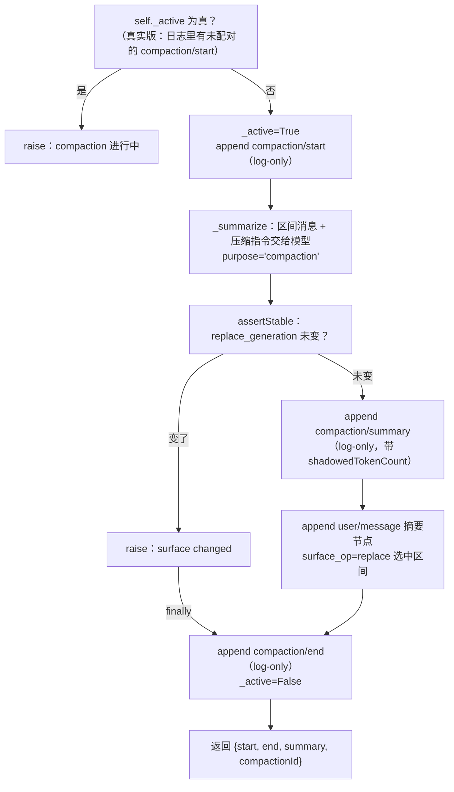

# 第 10 章 compaction 与 token 压力

> 窗口有限，对话不止；忘记不是删除，而是摘要。

## 本章回答的问题

- 第 7 章的 `estimate_message` 能把历史折算成 token 数，但对话只增不减——累计 token 撞上窗口上限时会发生什么？
- 第 3 章的持久化要求 `log` 完整、不能删除，模型却只能看见窗口内的内容——compaction 如何让两件事同时成立？
- 第 4 章的工具管线已经让模型发出工具调用、收回结果——compaction 压缩一段历史时，为什么不能从任意位置开始压？

第 9 章解决了「多个 agent 各自能看到哪些工具」——scope 把一张全局工具表拆成了分层、可继承、可限制的作用域。那是**横向**的资源隔离：同一时刻，不同 agent 看到的工具集合不同。

本章转向一种**纵向**的有限资源：上下文窗口。它对所有 agent 一视同仁——无论 scope 怎么切，单个会话能塞进模型的 token 总量是有上限的。而对话偏偏是单调增长的：每问一轮、每调一次工具，历史就厚一分。

其实我们早就埋好了伏笔。第 7 章的 `estimate_message` 已经能把每条消息折算成 token，真实版的 `TokenMeter.measure(session)` 能从会话日志回放出一份完整计量（总量 + 逐节点计价，精确值或估算值）——但那些数字只是被**计量**了，没有人**响应**它们。本章就是给这串数字装上一双手：当压力逼近窗口，自动把一段旧历史压缩成摘要，让对话得以继续。

本章教学代码以**第 7 章**为扩展基座（复用 `token_meter.py` 的 `estimate_message` 与 `llm_runtime.py` 的 `LlmRuntime`/`LlmAdapter`/`BlockAssembler`），并回到第 2 章的 `Session`/`Sessions` 之上做扩展。新增代码集中在 `ch10/code/`。

## 1. 无限增长的会话，必然撞墙

模型有一个硬性约束：**上下文窗口**。一次调用能接收的输入 token 总量不能超过它。而 agent 的工作方式恰恰是「每一轮都把全部历史带上」——于是 token 压力只涨不跌。

下面这个反面示例不做任何压缩，只是诚实地把每一轮的累计 token 数打印出来（复用第 7 章的 `estimate_message`）。为了看清过程，`[教学简化]` 把窗口缩小到 500：

```python
# ch10/code/bad_example.py（节选）
def main():
    # ... 横幅与说明输出省略 ...
    context_window = 500  # 教学示例把窗口缩小，便于看清过程
    # ... 两行说明输出省略 ...

    total = 0
    turn = 0
    while total < context_window:
        turn += 1
        user_msg = {"role": "user", "content": f"问题{turn}：" + "细节 " * 20}
        assistant_msg = {"role": "assistant", "content": f"回答{turn}：" + "分析 " * 20}
        total += estimate_message(user_msg) + estimate_message(assistant_msg)
        print(f"  第{turn:>2}轮：累计 tokens = {total:>4} / 窗口 = {context_window}")
    # ... 结尾输出省略（完整运行见下方输出块） ...
```

运行 `python3 ch10/code/bad_example.py`（输出节选，仅示首尾）：

```text
==============================================================
反面示例：无限增长的会话，必然撞上上下文窗口的墙
==============================================================

假设上下文窗口只有 500 tokens。
对话一轮轮进行，每轮追加一问一答：

  第 1轮：累计 tokens =   48 / 窗口 = 500
  ...
  第10轮：累计 tokens =  482 / 窗口 = 500
  第11轮：累计 tokens =  532 / 窗口 = 500

→ 第 11 轮后，累计 tokens 532 已超过窗口 500。
  此刻模型拒绝接收输入：这一轮之后的对话再也进行不下去。
  而之前说过的所有内容，也因为装不进窗口而无法交给模型。

这就是 compaction 要解决的问题：
  上下文窗口是有限的，但对话必须继续。
```

问题被精确地暴露出来：**窗口有限，但对话必须继续。** 每轮一问一答约 48 token，十一轮就把 500 的窗口填满。我们需要一种机制，在不丢失历史的前提下，把「模型将看到的内容」瘦回窗口之内。

这里立刻浮现出一对矛盾，也是本章的设计支点：

- **log 必须完整**：会话事件流是事实记录（第 3 章持久化的就是它），不能真的删。
- **模型只能看到窗口内的内容**：送进模型的消息必须足够少。

解法是把这两件事拆成**两层**：append-only 的 `log` 一层不动，另建一个**可以被替换**的 `surface`——模型真正看到的视图。下一节的机制就从这里展开。

## 2. 机制一：surface——可被替换的有序视图

### 2.1 概念

`surface` 是会话的一个**有序视图**：它列出「会产生 LLM 消息的事件」的序号，模型调用时就按这个顺序取消息。并非所有事件都进 surface。真实版有两处相关声明：**类型** `SurfaceEventType` 列了五种消息事件（`packages/core/session/src/types.ts:447-453`），**运行时**常量 `SURFACE_EVENT_TYPES` 是同样这五项的 `Set`（`packages/core/session/src/surface.ts:49-56`）。两者含义一致：`system/message`、`developer/message`、`user/message`、`assistant/message`、`tool/result`。教学版只实现后三种：

```python
# ch10/code/surface.py
SURFACE_EVENT_TYPES = ("user/message", "assistant/message", "tool/result")
```

`compaction/*` 这类过程性事件**不进** surface（模型不需要知道「我正在被压缩」），只进 log。

surface 与 `surface_op` 不是第 2 章 `Session` 的原生能力：那一章的 `Session.append` 把它们整体省略，并注明留到本章。本章就来兑现这个预留的槽位。

surface 与 log 的关键差异在于：log 只追加，surface 可以被**整段替换**。替换通过一个 `surface_op` 描述：

```python
# ch10/code/surface.py
class SurfaceSession(Session):
    """带 surface 的会话：在 ch02 Session 之上加一层有序 surface 视图。

    两层结构（这是理解 compaction 的关键）：
    - log（继承自 Session）：追加式全量历史，compaction/* 事件只进这里；
    - surface（本章新增）：产生 LLM 消息的事件的有序视图，是模型真正「看到」的内容。

    压缩时不动 log，只在 surface 上把一段区间替换成一个摘要节点——
    历史可回溯（log 完整），模型上下文变小（surface 变短）。
    """

    def __init__(self, ctx, session_id):
        super().__init__(ctx, session_id)
        self.surface = []            # 有序 surface 节点列，元素是事件 seq
        self.replace_generation = 0  # 每次 replace +1，压缩事务的稳定性断言用

    def append(self, type, payload=None, surface_op=None):
        """追加事件；若是 surface 事件，按 surface_op 更新 surface。

        surface_op 两种形态（SurfaceOp，packages/core/session/src/types.ts:470-472）：
        - None（等价 'append'）：追加到 surface 尾部（默认）；
        - {'op': 'replace', 'start': i, 'end': j}：用本事件这一个节点
          替换 surface[i:j] 整段区间（压缩摘要落盘就走这条）。
        [教学简化] 真实版写作 {op:'replace', startSeq, endSeq}，两端是 surface 上的
        seq 闭区间，而且这条新事件还必须用 sourceEventSeqs 列出被它顶替的全部节点
        （packages/core/session/src/types.ts:464-468）；教学版 surface 就是位置索引，
        所以直接用下标，也不记 sourceEventSeqs。
        """
        event = super().append(type, payload)
        if type in SURFACE_EVENT_TYPES:
            if isinstance(surface_op, dict) and surface_op.get("op") == "replace":
                start, end = surface_op["start"], surface_op["end"]
                # 把 [start, end) 区间替换为这一个节点（压缩摘要节点）
                self.surface[start:end] = [event.seq]
                self.replace_generation += 1
            else:
                self.surface.append(event.seq)
        # 非 surface 事件（compaction/* 等）只进 log、不进 surface
        return event
```

注意三个设计点：

1. **`super().append` 先执行**：无论 surface 怎么变，事件永远先进 log。这是「log 完整」的底层保证。
2. **replace 是切片赋值**：`self.surface[start:end] = [event.seq]` 把 `[start, end)` 这一段旧序号，换成新事件的单个序号——视图被「顶替」，log 里那些旧事件依然原样躺着。
3. **`replace_generation` 计数器**：每次替换自增。压缩是一个跨多步的事务，期间若有人偷偷改了 surface，计数就会对不上——它是事务收尾时的**稳定性断言**依据（§4.3 会用到）。

### 2.2 小结

surface 把「历史完整性」与「模型可见性」解耦：log 负责记住一切，surface 负责决定模型此刻看到什么。compaction 要做的，就是**安全地替换 surface 的一段**。

## 3. 机制二：token-meter 压力测量与阈值决策

### 3.1 概念

要决定「该不该压缩」，先得量出「现在有多满」。这一步复用第 7 章的计量能力，把整个会话的 surface 消息折算成 token，并给每个节点记账：

```python
# ch10/code/compaction.py
def measure_session(session):
    """测量会话 surface 的 token 压力 → TokenMeasurement。

    扩展第 7 章计量缝：真实源 tokenMeter.measure(session)
    （packages/llm/token-meter/src/index.ts:151）先经 _sync 回放会话日志（:231），
    返回 totalTokens + 逐节点计价 nodes；精确/估算的判定在投影层
    （measurement-projection.ts:61-75），不在 _foldEvent 里。
    教学版复用第 7 章 estimate_message，对每个 surface 节点逐一计价。
    返回 {'total_tokens': int, 'nodes': [{'seq': int, 'tokens': int}]}.
    """
    nodes = []
    total = 0
    for seq in session.surface:
        event = session.log[seq]
        message = event.payload.get("message", {})
        tokens = estimate_message(message)
        nodes.append({"seq": seq, "tokens": tokens})
        total += tokens
    return {"total_tokens": total, "nodes": nodes}
```

量出总压力后，还需要一条**策略**来决定「何时触发、保留多少」。`resolve_compact_spec` 把窗口大小换算成两个阈值：

```python
# ch10/code/compaction.py
def resolve_compact_spec(context_window, threshold_ratio=0.8, retain_ratio=0.16):
    """解析压缩参数（resolveCompactSpec，packages/compaction/compaction-basic/src/config.ts:153）。

    - threshold：触发压缩的压力阈值 = context_window × threshold_ratio（默认 0.8）；
    - retain_tokens：压缩时尾部保留的 token 数 = context_window × retain_ratio（默认 0.16）。
    """
    return {
        "threshold": int(context_window * threshold_ratio),
        "retain_tokens": int(context_window * retain_ratio),
    }
```

两个比例各司其职：`threshold` 回答「**何时**压」，`retain_tokens` 回答「压完**留多少**」。

`[教学简化]` 用「窗口 × 比例」直乘。真实版（`packages/compaction/compaction-basic/src/config.ts:153` 的 `resolveCompactSpec`）要做三步：先从窗口里扣掉本次请求的输出预留（`maxTokens`）；再扣一段 headroom（留给系统提示、工具 schema 等固定开销的余量）；最后取 `min(窗口 × thresholdRatio, 剩余额度)`，并校验 `retainTokens < thresholdTokens`。两个比例本身仍是默认值 0.8 / 0.16（`config.ts:20`、`:23`）。

### 3.2 阈值决策

有了 spec，`compact_if_needed` 就能做决策——测压力、比阈值，达标才真正去压：

```python
    # ch10/code/compaction.py（BasicCompactionEngine）
    def compact_if_needed(self, session, trigger="pressure"):
        """压力触发：测 token 压力，达阈值才压缩；未达返回 None。"""
        measurement = measure_session(session)
        spec = resolve_compact_spec(self.context_window,
                                    self.threshold_ratio, self.retain_ratio)
        if measurement["total_tokens"] < spec["threshold"]:
            return None  # 压力未达，不压
        return self._compact(session, measurement, spec, trigger)
```

`trigger` 参数标明这次压缩的来由。源码区分两种触发语义（`packages/compaction/compaction/src/index.ts:32` 的 `CompactionTrigger`）：`'pressure'` 是压力逼近窗口的**主动**阈值策略，在撞墙前减速；`'context-overflow'` 是调用已因超长被拒后的**被动**恢复策略，是最后的兜底。

两条路在 `compactIfNeeded` 里分叉（`packages/compaction/compaction-basic/src/index.ts:292`）。溢出那条先跑一遍无模型修剪（`toolResultPruner`），再以 `retainTokens = 0` 选区间——不看阈值、能压多少压多少。

`[教学简化]` 教学版把 `trigger` 写进了 `compaction/start` 事件，方便在输出里看出这次是哪种触发。真实版的 `compaction/start` 只记 `compactionId`/`sourceCommandId`/`turn`（`packages/compaction/compaction/src/types.ts:24`），`trigger` 只决定走哪条策略分支。教学版用 `compact_if_needed` 演示阈值决策这条常态路径；溢出恢复复用同一套压缩事务，只是选区与来由不同。

### 3.3 小结

token-meter 把「上下文有多满」变成一个可比较的数字，`resolve_compact_spec` 把窗口换算成「何时压、留多少」的策略，`compact_if_needed` 据此做阈值决策。数字终于有了响应它的动作。

## 4. 机制三：compaction seam 与压缩事务

### 4.1 seam 三角色

compaction 是一个标准的 capability seam（第 5 章的三角色在这里再次登场）：

```mermaid
flowchart LR
    subgraph SD["Service Definition<br/>compaction/"]
        CE["CompactionEngine（抽象接口）<br/>compactIfNeeded / compactNow / compactRegion"]
    end
    subgraph SP["Service Provider<br/>compaction-basic/"]
        BCE["BasicCompactionEngine<br/>（调模型做摘要的实现）"]
    end
    subgraph CS["Consumer<br/>command-compact/ 与自动策略"]
        CMD["/compact 命令（手动）"]
        AUTO["压力 / 溢出触发（自动）"]
    end
    BCE -.实现.-> CE
    CMD -.消费 ctx.compaction.-> CE
    AUTO -.消费 ctx.compaction.-> CE
```

- **Service Definition**：`CompactionEngine` 抽象接口，定义三个动词。
- **Service Provider**：`BasicCompactionEngine`，真正调模型生成摘要的实现。
- **Consumer**：`/compact` 命令（手动）与压力/溢出触发（自动）都消费同一个 `ctx.compaction`。

图里用的是源码的 camelCase 方法名（`compactIfNeeded` 等），下表与教学代码用 snake_case（`compact_if_needed`）——教学版按 Python 习惯改名，两者是同一组动词。

为什么做成 seam 而不是三个函数？因为「什么时候压、保留多少、用哪个模型摘要」都是可替换的策略，只有「把一段 surface 换成摘要节点」这个动作是稳定的。消费者依赖稳定的那个动作，提供者各自决定策略，第 4 章的执行器、第 5 章的 shell 都是同一套分工。

三个动词对应三种触发姿态：

| 动词 | 语义 | 触发方 |
|------|------|--------|
| `compact_if_needed` | 压力到了才压 | 自动（pressure） |
| `compact_now` | 现在就压，不看压力 | 手动（`/compact`） |
| `compact_region` | 压指定区间 | 精确控制 |

教学代码里，`CompactionEngine` 用抽象基类钉住这三个动词：

```python
# ch10/code/compaction.py
class CompactionEngine(ABC):
    """compaction 服务定义（CompactionEngine，packages/compaction/compaction/src/index.ts:119）。

    三动词：compact_if_needed / compact_now / compact_region。
    抽象类自身不注册服务——ctx.compaction 是否存在由提供者决定，
    消费者须先判存在（这正是 seam 三角色的「定义不保证实现」）。
    [教学简化] 真实版三动词接收 agent + AbortSignal（信号作取消），教学版只传 session。
    """

    @abstractmethod
    def compact_if_needed(self, session, trigger):
        """压力触发：测压力、达阈值才压（index.ts:136）。"""

    @abstractmethod
    def compact_now(self, session, trigger):
        """立即压缩：/compact 命令走这条（index.ts:162）。"""

    @abstractmethod
    def compact_region(self, session, region, trigger):
        """压缩指定区间（index.ts:187）。"""
```

`BasicCompactionEngine` 逐一实现这三个动词。`__init__` 收下上下文窗口与两个比例、初始化压缩锁，并 `ctx.provide("compaction", self)` 把自己挂到 seam 上供消费者使用：

```python
    # ch10/code/compaction.py（BasicCompactionEngine）
    def __init__(self, ctx, context_window, threshold_ratio=0.8, retain_ratio=0.16):
        self.ctx = ctx
        self.context_window = context_window
        self.threshold_ratio = threshold_ratio
        self.retain_ratio = retain_ratio
        self._active = False  # 压缩锁（assertCompactionInactive，packages/compaction/compaction-basic/src/region.ts:308）
        ctx.provide("compaction", self)
```

三个动词里，`compact_if_needed`（§3.2 已示）先测压力、达阈值才压；`compact_now` 则**不看压力、直接压**——`/compact` 命令走的就是这条，它测量后径直进 `_compact`，没有那道阈值闸（`packages/compaction/command-compact/src/index.ts:67` 的 `ctx.compaction.compactNow(...)` 落到的就是它）：

```python
    # ch10/code/compaction.py（BasicCompactionEngine）
    def compact_now(self, session, trigger="manual"):
        """立即压缩（/compact 命令走这条，packages/compaction/command-compact/src/index.ts:67）。"""
        measurement = measure_session(session)
        spec = resolve_compact_spec(self.context_window,
                                    self.threshold_ratio, self.retain_ratio)
        return self._compact(session, measurement, spec, trigger)
```

两段并排看即见差异：`compact_if_needed` 比 `compact_now` 多一道 `if measurement["total_tokens"] < spec["threshold"]: return None` 的闸；`compact_now` 没有这道闸，所以「现在就压」。第三个动词 `compact_region` 的实现见下文「压缩事务」。

### 4.2 选区间：切点必须落在配对平衡点

压缩第一步是选出「压哪一段」。直觉是「保留尾部 `retain_tokens`，前面全压」，但有一个陷阱：**切点不能落在一次工具调用和它的结果之间**。模型协议要求 tool-call 与 tool-result 成对出现——切开它们，送进模型的消息就是非法的。

为此引入**工具配对余额**：从 surface 头部扫到某个位置，累计「遇到的工具调用数 − 遇到的工具结果数」。余额为 0，说明到此处为止所有调用都已配对，是安全切点。

真实版把这件事做成布尔判定：`toolPairingBalancedBefore`（`packages/compaction/compaction/src/tool-pairing.ts:112`）问「这个 seq 之前的那一刀是否平衡」，另有 `toolPairingBalancedAfter`（`:124`）问「这个 seq 之后的那一刀」。它还有两个额外的严格性：余额一旦变成负数（tool/result 多于 tool/call）直接抛错——这说明 surface 本身已经损坏；平衡状态按 `replaceGeneration` 缓存，替换一旦发生就整体重算。教学版返回余额整数，便于在输出里看到「差几对」。

```python
# ch10/code/compaction.py
def count_tool_calls(message):
    """统计一条 assistant 消息里 tool-call 内容块的个数。"""
    content = message.get("content")
    if not isinstance(content, list):
        return 0
    return sum(1 for block in content
               if isinstance(block, dict) and block.get("type") == "tool-call")


def tool_pairing_balanced_before(session, index):
    """工具配对余额（toolPairingBalancedBefore，packages/compaction/compaction/src/tool-pairing.ts:112）：
    surface[:index] 内 assistant 工具调用数 − tool/result 数。

    == 0：切点之前的工具调用都有成对结果，可在此安全切开；
    != 0：切点落在一对工具调用/结果中间，必须回退。
    [教学简化] 真实版返回布尔（且余额为负视为 surface 损坏、直接抛错），
    教学版返回整数余额；真实版还按 replaceGeneration 缓存这个扫描。
    """
    balance = 0
    for seq in session.surface[:index]:
        event = session.log[seq]
        if event.type == "assistant/message":
            balance += count_tool_calls(event.payload.get("message", {}))
        elif event.type == "tool/result":
            balance -= 1
    return balance
```

有了余额判定，`select_compactable_range` 就能选出安全区间：

```python
# ch10/code/compaction.py
def select_compactable_range(session, measurement, retain_tokens):
    """选出可压缩区间（selectCompactableRange，packages/compaction/compaction-basic/src/region.ts:117）。

    步骤：
    1. 保留尾部：从尾向前累计 retain_tokens 的节点作为「保留尾」；
    2. 把切点回退到工具配对平衡点（balance == 0），避免切断工具调用/结果对；
    3. 返回待压缩区间 {'start': 0, 'end': cut}；无可压缩返回 None。
    """
    nodes = measurement["nodes"]
    n = len(nodes)
    if n == 0:
        return None
    # 1. 保留尾部：从尾向前累计，再加一个就超 retain_tokens 时停下
    tail_tokens = 0
    cut = n
    for i in range(n - 1, -1, -1):
        if tail_tokens + nodes[i]["tokens"] > retain_tokens:
            break
        tail_tokens += nodes[i]["tokens"]
        cut = i
    # 2. 回退到工具配对平衡点：balance(cut) != 0 就继续回退
    while cut > 0 and tool_pairing_balanced_before(session, cut) != 0:
        cut -= 1
    if cut <= 0:
        return None  # 无可压缩
    return {"start": 0, "end": cut}
```

两段循环各管一件事：`for` 从尾部往前凑够 `retain_tokens`，得到 tentative 切点；`while` 检查该切点的配对余额，不为 0 就继续回退，直到落在平衡点。回退意味着**少压一点**——宁可保留得多一些，也不能切开工具对。

真实版还有一条教学版没有的边界：surface 头节点若是 `system/message`（系统提示），它永远不进入压缩区间，选区从第 2 个节点起算（`packages/compaction/compaction-basic/src/region.ts:99` 的 `systemHead`，用法在 `:131`）。摘要是靠追加一条 user 消息顶替旧区间，把系统提示也卷进去，下一轮就没有系统提示可发了。

### 4.3 压缩事务：一次原子的替换

压缩不是一条瞬时语句。摘要要等模型流式返回，这段时间是一个**窗口**：期间 surface 完全可能被别的写入改掉。假设没有防线，会发生两件事：

- 选区间时算出 `[0, 11)`，摘要跑了十几秒，期间又进来一轮新对话、或者另一个触发者先压了一次。等摘要回来，`[0, 11)` 指的已经是另一批节点——拿旧切点去替换，轻则顶错内容，重则把刚加入的新消息一起抹掉。
- `/compact` 与压力触发同时到达：两个事务各自 `_summarize`、各自提交，surface 被替换两次，第二次的 `start/end` 基于第一次之前的位置。旧消息被顶替了两遍，摘要节点互相覆盖。

所以这个事务必须回答两个问题：**同一时刻只允许一个压缩在跑**（互斥），**提交前确认选区没被别人动过**（稳定性断言）。下面先看薄封装 `_compact`——选区间、委托给 `compact_region`：

```python
    # ch10/code/compaction.py（BasicCompactionEngine）
    def _compact(self, session, measurement, spec, trigger):
        """选区间并执行压缩事务；无可压缩区间返回 None。"""
        region = select_compactable_range(session, measurement, spec["retain_tokens"])
        if region is None:
            return None
        return self.compact_region(session, region, trigger)
```

真正的事务在 `compact_region`，它是本章的核心流程：



图里的 X→G 边表示「无论成功还是抛错，都会走到这里」：`finally` 里补写 `compaction/end` 并复位 `_active`。

对应代码：

```python
    # ch10/code/compaction.py（BasicCompactionEngine）
    def compact_region(self, session, region, trigger):
        """单次压缩事务（compactSurfaceRegion，packages/compaction/compaction-basic/src/region.ts:173）。

        上锁 → compaction/start → 摘要 → 稳定性断言 → compaction/summary
        → 提交（user/message + surfaceOp replace）→ compaction/end → 解锁。

        关键协议：compaction/* 事件全部 log-only（只进 log、不进 surface），
        真正替换 surface 的是最后那条携带 surfaceOp 的 user/message。
        """
        if self._active:
            raise RuntimeError("compaction already in progress (assertCompactionInactive)")
        start, end = region["start"], region["end"]
        compaction_id = f"compact-{len(session.log):04d}"  # 真实版是 randomUUID()（CompactionId 品牌）
        self._active = True
        # compaction/start 的持久化存在本身就是锁：真实版靠「有未配对的 start」判断忙
        session.append("compaction/start",
                       {"compactionId": compaction_id, "trigger": trigger})
        try:
            gen_before = session.replace_generation
            summary, shadow_price = self._summarize(session, region)
            # 稳定性断言（assertStable，packages/compaction/compaction-basic/src/region.ts:211-213）：
            # 摘要期间 surface 不得发生 replace。教学版同步单线程恒成立，真实异步场景是防线。
            if session.replace_generation != gen_before:
                raise RuntimeError("surface changed during compaction (assertStable)")
            # compaction/summary：log-only，携带摘要文本与被顶替节点的影子价
            # 真实字段名是 shadowedRange / shadowedSeqs / shadowedTokenCount
            session.append("compaction/summary",
                           {"summary": summary, "shadowedTokenCount": shadow_price})
            # 提交：追加携带 surfaceOp replace 的 user/message，真正替换 surface
            checkpoint_message = {
                "role": "user",
                "content": f"[对话摘要] {summary}",
                "checkpointSource": compact_checkpoint_source(compaction_id),
            }
            session.append("user/message", {"message": checkpoint_message},
                           surface_op={"op": "replace", "start": start, "end": end})
        finally:
            session.append("compaction/end", {"compactionId": compaction_id})
            self._active = False
        return {"start": start, "end": end, "summary": summary,
                "compactionId": compaction_id}
```

逐步拆解几个不那么显然的设计：

- **压缩锁（assertCompactionInactive）**：压缩是独占操作，进行中再来一次直接 raise，防止两次压缩并发改 surface。教学版用 `_active` 一个布尔位，`finally` 里无论成败都复位。真实版不存布尔位，而是在日志里找**未配对的 `compaction/start`**（`packages/compaction/compaction-basic/src/region.ts:308`、`:566-600`），并拿它和最近一条 `session/end-seed` 比先后：start 晚于边界才算「进行中」，报 `busy`；早于边界的属于上一个进程生命周期的陈旧证据，直接放行。这条边界很重要——恢复会话时若日志尾不是 `session/end-seed`，`core/session/src/index.ts:699-700` 会补写一条，于是崩溃遗留的 orphan start 不会把新进程永久锁死。真实版失败时也补一条配对的 `compaction/end`，带 `error` 字段（`region.ts:242`）。
- **`compaction/*` 事件 log-only**：`compaction/start`、`compaction/summary`、`compaction/end` 都走 `session.append`，但它们的类型不在 `SURFACE_EVENT_TYPES` 里，于是只进 log、不进 surface。它们是「关于压缩的记录」，不是「对话内容」，模型不该看到；但 log 里留下完整痕迹，事后可审计「这段历史是什么时候、被谁、压成了什么」。三条事件共享同一个 `compactionId`，这是把它们串成一次事务的线索。
- **`assertStable`（`replace_generation` 断言）**：就是开头那个窗口的防线。`_summarize` 返回后，先比对计数器再提交。真实版有两种粒度（`packages/compaction/compaction-basic/src/region.ts:211-213`）：`whole-surface` 比对整条 surface，手动压缩用的 `selected-span` 只要求**被选中的那段**仍存在、连续、计价相同（`:447`）——期间别处新增的节点不影响这次摘要。教学版用 `replace_generation` 一个计数器近似前者。
- **`checkpointSource`**：摘要节点的 message 带一个来源标记，表明这条 user 消息不是真人说的，而是压缩产物。HEAD 的形状是 `{kind:'compact-checkpoint', compactionId, sourceCommandId?}`（`packages/compaction/compaction/src/checkpoint.ts:33`），每条摘要带自己的 `compactionId`；配合 `isCompactCheckpointSource` 谓词（`:49`），回放、调试、再次压缩都能把它和产生它的那次事务对上。教学版沿用同样的形状，但简化为 `{kind:'compact-checkpoint', compactionId}`。
- **影子价（shadowedTokenCount）**：`compaction/summary` 事件记下这次压缩「顶替」掉的 token 数。真实字段名是 `shadowedRange` / `shadowedSeqs` / `shadowedTokenCount`（`packages/compaction/compaction/src/types.ts:34-43`），同时还记下写这条摘要的 `provider`/`model` 与这次辅助调用的 `usage`——「这条摘要由哪个模型写的」在日志里有确定答案，供后续成本核算。

事务里还用到两个模块级助手，一并给出：

```python
# ch10/code/compaction.py
COMPACTION_INSTRUCTION = (
    "请把上面的对话压缩成一份简明摘要：保留关键决策、结论、工具执行结果与未完成任务，"
    "使对话可以基于这份摘要继续。"
)

# ... measure_session / resolve_compact_spec / 配对余额与区间选择等函数省略（见 §3、§4） ...

def compact_checkpoint_source(compaction_id):
    """检查点来源标记（compactCheckpointSource，packages/compaction/compaction/src/checkpoint.ts:33）。

    真实版返回 {kind: 'compact-checkpoint', compactionId, sourceCommandId?}，并 deepFreeze。
    每条摘要消息都带自己的 compactionId，消费方据此把摘要与那次压缩事务对上号。
    """
    return {"kind": "compact-checkpoint", "compactionId": compaction_id}
```

`COMPACTION_INSTRUCTION` 钉住了「摘要要保留什么」——关键决策、结论、工具执行结果、未完成任务，它就是 `_summarize` 追加给模型的那条指令。真实版的指令要长得多：它要求模型按固定的 Markdown 章节（Primary Request、Key Technical Concepts、Files and Code、Errors and Fixes、Pending Jobs、Current Work、Next Step、Critical Context）逐节输出，空节写 `(none)` 而不是省略——这样下一次压缩读到的摘要结构仍然稳定（`packages/compaction/compaction-basic/src/summarizer.ts:32-60`）。`compact_checkpoint_source(compaction_id)` 返回 `{kind:'compact-checkpoint', compactionId}`，即上面 `checkpointSource` 用的来源标记。

摘要本身复用第 7 章的流式管线——把区间消息加上压缩指令，交给 `ctx.llm.stream`（`purpose="compaction"` 经 `**options` 传入），用 `BlockAssembler` 把 chunk 流组装成文本：

```python
    # ch10/code/compaction.py（BasicCompactionEngine）
    def _summarize(self, session, region):
        """生成摘要（summarizeWithLlm，packages/compaction/compaction-basic/src/summarizer.ts:120）。

        把压缩区间消息 + COMPACTION_INSTRUCTION 交给 LLM，purpose='compaction'。
        返回 (summary_text, shadow_price)。

        [教学简化] 真实源会先重放 system/tools/messages 前缀再追加指令（复用
        KV-cache，降低摘要调用成本）；教学版只发压缩区间消息 + 指令。
        影子价 = 压缩区间 token 数（摘要「对冲」掉的部分）。
        """
        start, end = region["start"], region["end"]
        region_messages = []
        for seq in session.surface[start:end]:
            event = session.log[seq]
            message = event.payload.get("message")
            if message is not None:
                region_messages.append(message)
        shadow_price = sum(estimate_message(m) for m in region_messages)
        request_messages = region_messages + [
            {"role": "user", "content": COMPACTION_INSTRUCTION}
        ]
        assembler = BlockAssembler()
        for chunk in self.ctx.llm.stream(request_messages, purpose="compaction"):
            assembler.push(chunk)
        summary = "".join(
            block.get("text", "") for block in assembler.blocks
            if block.get("type") == "text"
        )
        return summary, shadow_price
```

`purpose='compaction'`（`packages/compaction/compaction-basic/src/summarizer.ts:160`）是 `GenerateOptions` 上的辅助调用标记（`packages/llm/llm/src/types.ts:605`），供适配器把它映射成模型看不见的传输元数据（比如账单分类、缓存提示），普通对话请求则不带这个字段。更重要的是 KV-cache 那一点：真实版把会话自己的 system prompt、工具表和历史消息前缀原样放在指令前面（`summarizer.ts:26-31`、`:145-151`），这条辅助调用就成了上一次主请求的前缀延伸，provider 的缓存能续上。教学版的 `FakeCompactionAdapter` 直接返回固定摘要，`purpose` 传了但没被消费——桩只服务于离线演示。

### 4.4 小结

compaction seam 用三个动词钉住触发姿态；`select_compactable_range` 用配对余额保证切点安全（真实版还会把 `system/message` 头挡在区间外，教学版未实现）；`compact_region` 用一次带锁、带稳定性断言、log-only 事件齐全的事务，把一段 surface 原子地替换成摘要。**log 一字未删，模型看到的内容却瘦了下来**——§1 的矛盾就此化解。

## 5. 机制四：tool-result-pruner——不调模型的轻量修剪

### 5.1 概念

并非所有瘦身都要请模型。有一类 token 大户特别常见：**超长的工具结果**——读一个大文件、抓一页网页，单次 `tool/result` 就能占掉几千 token。对这种「中段冗余、头尾有用」的内容，可以不调模型、直接做字符级修剪：

```python
# ch10/code/compaction.py
PRUNE_MARKER = "\n…[中段已修剪]…\n"  # 真实源是 "\n\n[... tool result middle pruned ...]\n\n"（config.ts:7）


def prune_tool_result(text, keep_chars=20):
    """无模型修剪（ToolResultPruner，packages/compaction/compaction-tool-result-pruner/src/index.ts:44）。

    是什么：不调用 LLM，直接把超大的 tool/result 文本「掐头去尾留中间标记」。
    解决什么：单个工具结果（如读一个大文件）就可能撑爆上下文，为它专门跑一次
    摘要 LLM 调用既贵又慢；无模型修剪零成本、即时生效。

    [教学简化] 真实版：门槛 thresholdChars=8192、留头 headChars=4096、留尾
    tailChars=1024（config.ts:11-13），按 Unicode code point 而非 UTF-16 计长，
    逐条扫描当前 surface 上的 tool/result；每条替换前先 append 一条
    compaction/prune 影子价事件，再用 surfaceOp replace 落一条新的 tool/result
    （index.ts:160-168）。教学版只对单个字符串演示掐头去尾，不改 surface。
    """
    if len(text) <= keep_chars * 2:
        return text  # 不够大，不修剪
    return text[:keep_chars] + PRUNE_MARKER + text[-keep_chars:]
```

「**不调模型、就地缩短单个工具结果**」是它的本质。

真实系统里它是一个独立的 **Service**：`ctx.toolResultPruner`（`packages/compaction/compaction-tool-result-pruner/src/index.ts:44`），`static inject = ['tokenMeter']`。它**不是** compaction seam 的 provider，两者只是共享 `compaction/*` 事件协议。

`BasicCompactionEngine` 用 `ctx.get('toolResultPruner')` 可选地取它，取不到就跳过。取到的话，两条路径都会先修剪：压力路径在挑摘要区间**之前**调 `pruneSession`（`packages/compaction/compaction-basic/src/index.ts:342-352`），溢出路径在第一句就调（`:303`）。

它落盘的方式和主压缩用的是同一套协议：每条被修剪的结果，先 append 一条 `compaction/prune` 影子价事件（带 `shadowedSeqs` 与 `shadowedTokenCount`），再 append 一条新的 `tool/result`，带 `surfaceOp: {op:'replace', startSeq, endSeq}` 与 `sourceEventSeqs`（`index.ts:160-168`）。旧结果留在 log 里，surface 上换成修剪版——和主压缩的摘要替换是同构的。

### 5.2 与 compaction 的分工

| | tool-result-pruner | compaction |
|---|---|---|
| 是否调模型 | 否（纯字符级） | 是（生成摘要） |
| 作用对象 | 单个工具结果 | 一整段对话历史 |
| 成本 | 极低 | 一次模型调用 |
| 信息损失方式 | 截断中段 | 摘要浓缩 |

实践中往往先 prune 再 compact：先把最廉价的修剪做掉，若压力仍超阈值，才动用模型摘要。

源码把这条顺序写死在压力路径里：过阈值 → `pruneSession` → **重新计量** → 仍过阈值才选区间做摘要（`packages/compaction/compaction-basic/src/index.ts:342-352`）。修剪之后压力降到阈值以下，这次就一次模型调用都不发。

### 5.3 小结

pruner 提醒我们：**压缩有轻重之分**。能用字符级修剪解决的，就不必升级到模型摘要。seam 的设计让这两种手段可以独立注册、按需组合。

## 6. 完整运行输出

把前三个机制装配起来跑一遍：surface、token-meter 压力测量、compaction seam。`main.py` 的装配关系正是 §4 的 seam 三角色：`SurfaceSessions` 提供会话、`LlmRuntime + FakeCompactionAdapter` 提供摘要能力、`BasicCompactionEngine` 作为 `ctx.compaction` 提供者。第四个机制 tool-result-pruner 是独立 Service（§5），`main.py` 不 import 也不调用它，它的落盘协议由 §5 单独交代。

装配里有两个此前未露面的组件，先交代清楚：

- **`SurfaceSessions`**：继承第 2 章 `Sessions`、只覆写 `create` 的会话**服务**——让它创建出来的会话是带 surface 的 `SurfaceSession`（而非普通 `Session`）。`main.py` 正是用它 `create()` 出演示会话的；`SurfaceSession` 则是被创建出来的那个会话对象（§2 已示）。
- **`FakeCompactionAdapter`**：第 7 章 `LlmAdapter` 的假实现（桩）。它的 `stream` 一律返回一段**固定摘要文本**——演示里唯一的调用方就是压缩，所以不必按 `purpose` 分派。摘要并非真实模型生成，而是桩按约定吐出来的，整个演示可离线运行。挂载它用的是第 7 章修订后的签名：`runtime.register_adapter(["fake"], FakeCompactionAdapter())`，先给一条路由名，再给 adapter（注册时 runtime 会校验 `provider_info(provider)["id"]` 与该路由名逐字相同）。

运行 `python3 ch10/code/main.py`：

```text
==============================================================
第 10 章：compaction 与 token 压力
==============================================================

装配：context_window=500  threshold=400  retain_tokens=80

[压缩前：会话已增长]
  surface 节点数=12  token 压力=504  replace_generation=0
  模型将看到的消息：
    - user: 问题0：请讲解模块0的设计 细节 细节 细节 细节 细节 细节 细节 细节 细节 细
    - assistant: 回答0：模块0的设计如下 分析 分析 分析 分析 分析 分析 分析 分析 分析 分析
    - user: 问题1：请讲解模块1的设计 细节 细节 细节 细节 细节 细节 细节 细节 细节 细
    - assistant: 回答1：模块1的设计如下 分析 分析 分析 分析 分析 分析 分析 分析 分析 分析
    - user: 问题2：请讲解模块2的设计 细节 细节 细节 细节 细节 细节 细节 细节 细节 细
    - assistant: 回答2：模块2的设计如下 分析 分析 分析 分析 分析 分析 分析 分析 分析 分析
    - user: 问题3：请讲解模块3的设计 细节 细节 细节 细节 细节 细节 细节 细节 细节 细
    - assistant: 回答3：模块3的设计如下 分析 分析 分析 分析 分析 分析 分析 分析 分析 分析
    - user: 问题4：请讲解模块4的设计 细节 细节 细节 细节 细节 细节 细节 细节 细节 细
    - assistant: 回答4：模块4的设计如下 分析 分析 分析 分析 分析 分析 分析 分析 分析 分析
    - user: 问题5：请讲解模块5的设计 细节 细节 细节 细节 细节 细节 细节 细节 细节 细
    - assistant: 回答5：模块5的设计如下 分析 分析 分析 分析 分析 分析 分析 分析 分析 分析

[压力触发] engine.compact_if_needed(session, trigger='pressure')
  压缩完成：区间 [0, 11) 被替换为摘要节点
  摘要内容：压缩了 11 条对话：讨论了项目方案，确认了技术选型，决定继续推进任务。

[压缩后：surface 被替换]
  surface 节点数=2  token 压力=61  replace_generation=1
  模型将看到的消息：
    - user: [对话摘要] 压缩了 11 条对话：讨论了项目方案，确认了技术选型，决定继续推进任务
    - assistant: 回答5：模块5的设计如下 分析 分析 分析 分析 分析 分析 分析 分析 分析 分析

[log 完整] log 中的事件（compaction/* 只进 log、不进 surface）：
  seq= 0  user/message         (已移出 surface)
  seq= 1  assistant/message    (已移出 surface)
  seq= 2  user/message         (已移出 surface)
  seq= 3  assistant/message    (已移出 surface)
  seq= 4  user/message         (已移出 surface)
  seq= 5  assistant/message    (已移出 surface)
  seq= 6  user/message         (已移出 surface)
  seq= 7  assistant/message    (已移出 surface)
  seq= 8  user/message         (已移出 surface)
  seq= 9  assistant/message    (已移出 surface)
  seq=10  user/message         (已移出 surface)
  seq=11  assistant/message    (surface)
  seq=12  compaction/start     (log-only)
  seq=13  compaction/summary   (log-only)
  seq=14  user/message         (surface)
  seq=15  compaction/end       (log-only)

[工具配对余额] 切点必须落在配对平衡点
  surface 有 4 个节点，各节点 tokens=[10, 4, 14, 13]
  retain_tokens=27 → tentative 切点=2（工具调用与它的结果之间）
  balance(2)=1（≠0，落在工具对中间）
  回退后切点 end=1，balance(1)=0（安全）
  → 压缩 [0, 1)，保留工具调用/结果对完整

==============================================================
运行完成
```

输出逐段印证了本章机制：

- **压力触发**：压缩前 12 节点、504 token，超过 threshold=400，`compact_if_needed` 触发；压缩后 2 节点、61 token，`replace_generation` 从 0 变 1。留下的 61 token 是摘要节点（19）加最后那条 assistant 回答（42）。尾部保留是按 `retain_tokens=80` 从后往前凑的：最后两条（42 + 42 = 84）已经超额，于是只留一条，切点停在 index 11。
- **log 完整**：seq 0–10 的旧对话**已移出 surface**（但一字未删地留在 log 里）；`compaction/start|summary|end` 三条过程事件则是**类型 log-only**（从不进 surface）。两种「只在 log」来源不同：前者是 surface 类型事件被替换出去，后者是事件类型本就不进 surface。
- **配对余额**：聚焦示例里 tentative 切点=2 恰好落在工具调用与结果之间（balance=1），算法回退到 end=1（balance=0），宁可少压也不切开工具对。

## 7. 源码对照

> 路径均相对上游仓库根（HEAD `8bd0733`）。

| 教学代码（`ch10/code/`） | 源码位置 | 教学版差异 |
|---|---|---|
| `surface.py` `SurfaceSession.surface` | `packages/core/session/src/surface.ts:247`（`nodes` 字段） | 教学版把 surface 显式建成 seq 列表；真实版是 `SessionSurface` 只读投影，由增量折叠维护 |
| `SURFACE_EVENT_TYPES`（三种） | `packages/core/session/src/types.ts:447-453`（`SurfaceEventType` 五种） | 教学版省掉 `system/message`、`developer/message` |
| `surface_op` replace 形态 | `packages/core/session/src/types.ts:470-472`（`SurfaceOp`）、`:464-468`（`sourceEventSeqs` 须覆盖被顶替节点） | 真实版用 `startSeq`/`endSeq` 闭区间并强制 `sourceEventSeqs`，教学版用下标、不记来源 |
| `replace_generation` | `packages/core/session/src/surface.ts:571`（每次替换 +1）、`:649`（读取） | 教学版是普通整数属性，真实版在折叠状态里 |
| `measure_session` | `packages/llm/token-meter/src/index.ts:151`（`measure`）；精确/估算判定在 `measurement-projection.ts:61-75` | 教学版只用估算，无 precise usage、无图片/文件定价 |
| `resolve_compact_spec` | `packages/compaction/compaction-basic/src/config.ts:153` | 真实版先扣输出预留与 headroom，再取 `min` 并校验 retain < threshold |
| `CompactionEngine`（ABC） | `packages/compaction/compaction/src/index.ts:119` | 真实版三动词接收 `Agent` + `AbortSignal`，教学版传 session |
| `BasicCompactionEngine` | `packages/compaction/compaction-basic/src/index.ts:112` | 真实版还注册三条自动策略（step pressure / model switch / overflow） |
| `tool_pairing_balanced_before` | `packages/compaction/compaction/src/tool-pairing.ts:112` | 真实版返回布尔、余额为负抛错、按 `replaceGeneration` 缓存 |
| `select_compactable_range` | `packages/compaction/compaction-basic/src/region.ts:117` | 真实版保留 `system/message` 头节点、校验 meter 与 surface 对齐 |
| `compact_region` 事务 | `packages/compaction/compaction-basic/src/region.ts:173`（`compactSurfaceRegion`），锁在 `:308` | 真实版锁 = 未配对且晚于最近 `session/end-seed` 的 `compaction/start`；稳定性断言分 `whole-surface`/`selected-span` 两种（`:211-213`） |
| `compact_checkpoint_source` | `packages/compaction/compaction/src/checkpoint.ts:33` | 真实版带 `kind:'compact-checkpoint'` 与 `sourceCommandId`，并 deepFreeze |
| 影子价 `shadowedTokenCount` | `packages/compaction/compaction/src/types.ts:34-43` | 真实版还记 `shadowedRange`、`shadowedSeqs`、`provider`、`model`、摘要调用的 `usage` |
| `purpose='compaction'` | `packages/compaction/compaction-basic/src/summarizer.ts:160`；类型在 `packages/llm/llm/src/types.ts:605` | 教学桩传了但不消费 |
| `_summarize` | `packages/compaction/compaction-basic/src/summarizer.ts:120` | 真实版重放 system/tools/历史前缀，指令是固定 Markdown 模板（`:32-60`） |
| `prune_tool_result` | `packages/compaction/compaction-tool-result-pruner/src/index.ts:44`（`ToolResultPruner`）、`:136`（`pruneSession`） | 真实版流式修剪并落 `compaction/prune` + `tool/result` replace；教学版只对字符串演示 |
| （未实现） | `packages/compaction/compaction-image-offload/src/index.ts:25`（`apply`） | 图片卸载：请求失败报 `IMAGE_OFFLOAD_REQUIRED` 时把最早保留的图片替换成占位并重试；见 §9 速查表 |

## 8. 小结与预告

本章给第 7 章埋下的 token 数字装上了响应它的手。核心收获：

1. **两层模型**：log append-only 记住一切，surface 是可被替换的有序视图。compaction 只动 surface，不碰 log。
2. **压力决策**：`measure_session` 量出压力，`resolve_compact_spec` 换算出 threshold 与 retain_tokens，`compact_if_needed` 做阈值决策；源码另以 overflow 触发作溢出兜底，而且过阈值后先做无模型修剪、重测、仍超标才请模型摘要。
3. **安全切点**：工具配对余额保证切点不落在 tool-call 与 tool-result 之间，必要时回退；真实版还会把 surface 头部的系统提示留在保留侧（教学版未实现）。
4. **压缩事务**：带锁（教学版用 `_active`；真实版用日志里的未配对 `compaction/start`，并以 `session/end-seed` 为生命周期边界）、带稳定性断言、`compaction/*` 事件 log-only，把一段 surface 原子地替换成摘要节点。
5. **轻重分工**：tool-result-pruner 用字符级修剪处理超长工具结果，不必事事都请模型。

下一章（第 11 章）进入 **subagent 委派**：当一个任务太大、太杂，主 agent 不再独自扛，而是派生出子 agent 分头去做。我们会看到本章的 surface/compaction 心智如何在「父子会话」之间继续发挥作用——子 agent 有自己独立的上下文窗口，正是对 token 压力的又一次分治。

## 9. 附录：关键概念速查表

| 概念 | 一句话 | 首次出现 |
|---|---|---|
| surface | 会话中「会产生 LLM 消息的事件」的有序视图，可被整段替换 | §2 |
| log / surface 两层 | log append-only 完整保留，surface 决定模型此刻看到什么 | §2 |
| `replace_generation` | 每次 surface 替换自增的计数，供压缩事务做稳定性断言 | §2 |
| token 压力 | 会话 surface 消息折算出的总 token 数 | §3 |
| threshold / retain_tokens | 触发压缩的压力阈值 / 压缩后至少保留的尾部 token | §3 |
| pressure 触发 | 压力逼近窗口的主动压缩（阈值策略） | §3 |
| context-overflow 触发 | 已溢出后的被动恢复压缩 | §3 |
| compaction seam | Service Definition（接口）/ Provider（实现）/ Consumer（命令）三角色 | §4 |
| 三动词 | `compact_if_needed` / `compact_now` / `compact_region` | §4 |
| 工具配对余额 | 扫描到某位置时「工具调用数 − 工具结果数」，为 0 才是安全切点 | §4 |
| 压缩事务 | 锁 → start → summarize → assertStable → summary → replace → end；start/summary/end 三条事件由同一个 `compactionId` 串起 | §4 |
| 压缩锁 | 日志里的未配对 `compaction/start`（晚于最近 `session/end-seed` 才判忙；更早的是上一生命周期的陈旧证据） | §4 |
| shadowed / 影子价 | 压缩顶替掉的节点与 token 数，记入 compaction/summary | §4 |
| `compaction/*` log-only | 压缩过程事件只进 log、不进 surface | §4 |
| `purpose='compaction'` | 压缩调用的辅助请求标记，供适配器映射传输元数据、复用 KV-cache | §4 |
| checkpoint source | 摘要节点的来源标记 `{kind:'compact-checkpoint', compactionId}` | §4 |
| tool-result-pruner | 不调模型、字符级修剪超长工具结果；作为独立 Service 注册在 `ctx.toolResultPruner` | §5 |
| compaction-image-offload | 模型报 `IMAGE_OFFLOAD_REQUIRED` 时，把最早保留的图片替换成占位文本、记一条 `image/offload` 决定，然后重试；本章只在表格里提一句 | §7 表 / §9 |
