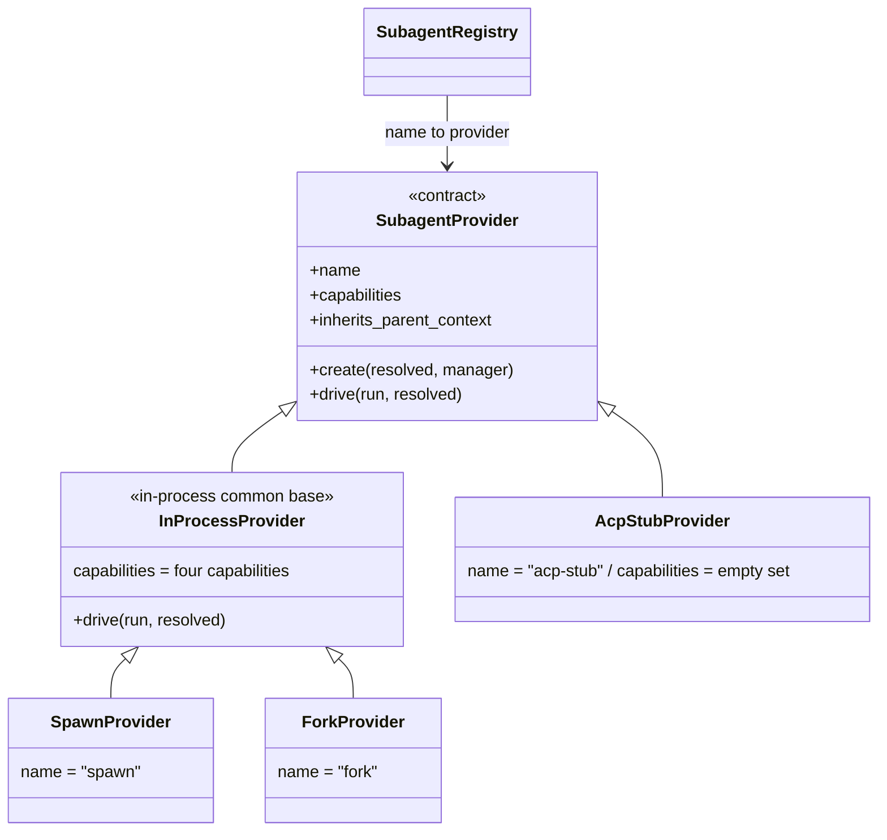
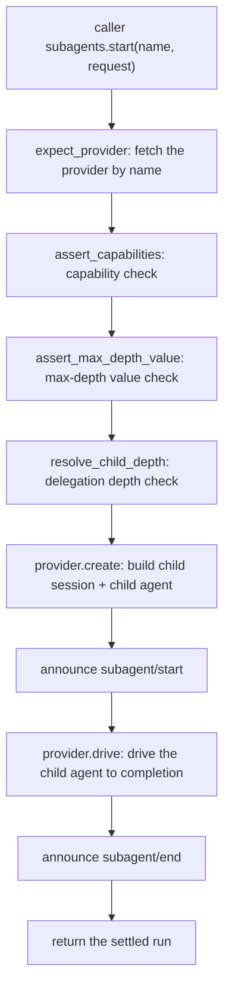

# Chapter 11: subagent Delegation: Giving a Subtask Its Own Session

> Delegate the task, not the conversation.

## Questions this chapter answers

1. Chapter 2's agent loop is a one-session-per-agent closed loop — why should a subtask run in its own session instead of directly inside the main agent's conversation?
2. Chapter 5's seam abstracts capabilities into contracts with implementations registered into them — how do multiple delegation transports share a single entry point?
3. Chapter 4's tools are all registered into `ctx.tools` and invoked by the model — how does the model trigger delegation on its own?

Chapter 2 built the minimal agent-loop: `Sessions` opens sessions, `AgentLoop` assembles a `ReactLoopAgent`, and the agent advances turn by turn in its own session. But that closed loop only serves **one** agent — when the main agent wants to hand off a subtask like "investigate module A", Chapter 2's code has no entry point for it.

This chapter adds that entry point: the main agent **delegates** a subtask to a **subagent** — the child agent executes independently in its own session, and only the result returns to the main conversation when done. The child agent's creation reuses Chapter 2's `AgentLoop.create` (one agent per session), the delegation tools register into Chapter 4's `ctx.tools`, and the seam's three roles (definition layer / implementation layer / consumer layer) reuse Chapter 5's terminology. This chapter reuses `ch01/cordis.py`, `ch02/agent_loop.py`, and `ch04/tools.py`; the new code lives in `ch11/code/`.

## 1. Three Pits of Inline Subtasks

First, the counter-example: the subtask is processed inline, directly in the main session.

```python
# ch11/code/bad_example.py（核心部分，完整文件见代码目录）
MAIN_SESSION = []  # 主会话：全局唯一，主对话与所有子任务共用


def run_subtask_inline(task, depth=0):
    """内联执行子任务：过程事件直接追加进主会话（坑①），调用方式焊死（坑②）。"""
    pad = "  " * depth
    MAIN_SESSION.append(f"{pad}[子任务] 开始 {task}")
    MAIN_SESSION.append(f"{pad}[子任务] 探索步骤 1：读日志……")
    MAIN_SESSION.append(f"{pad}[子任务] 探索步骤 2：复现失败……")
    if depth == 0:
        # 子任务再嵌套子任务：递归没有任何深度约束（坑③）
        run_subtask_inline(f"{task} 的子模块排查", depth + 1)
    result = f"{task} 的结论"
    MAIN_SESSION.append(f"{pad}[子任务] 结束 → {result}")
    return result


def main():
    MAIN_SESSION.append("[主对话] user: 总结一下项目进展")
    answer = run_subtask_inline("排查模块 A")
    MAIN_SESSION.append(f"[主对话] assistant: 项目进展正常（{answer}）")
```

Run it:

```text
$ python3 bad_example.py
主会话共 10 条事件，属于主对话的只有 2 条：
  [主对话] user: 总结一下项目进展
  [子任务] 开始 排查模块 A
  ……（8 条中间事件：探索步骤，以及嵌套「子模块排查」的全过程）
  [主对话] assistant: 项目进展正常（排查模块 A 的结论）
想把「排查」换成独立进程执行？只能改 run_subtask_inline 的每一个调用点。
```

Three pits:

1. **Context drowning**: only 2 of the main session's 10 events belong to the main conversation. The subtask's exploration process — in a real system, tool calls, intermediate output, and error retries too — all flood into the main conversation, and the main agent's context gets dirtier with every step. Yet all the main agent actually needs is that one "conclusion" line.
2. **Hard-wired execution style**: `run_subtask_inline` is a bare function call. To switch to "let the child agent carry the main conversation's history" or "throw it into a separate process", you'd have to edit the function body and every call site. What's missing is a replaceable abstraction for "how a child agent is created".
3. **Depth out of control**: a subtask can nest another subtask, with no bound on the recursion. In a real system a child agent can delegate again, and the delegation chain grows without limit — every layer consumes resources, yet nobody can say which layer we're on.

The three pits point at the same set of gaps: the delegation transport must be **registrable**, the subtask must be **isolatable**, and the delegation chain must be **countable**. The sections below fill them in that order.

## 2. SubagentRegistry: Delegation Transports Are Registered In, Not Hard-Coded

### 2.1 The provider Contract: First Define What a "Delegation Transport" Looks Like

Pit ② says the execution style is hard-wired. The cure is the same road as Chapter 5's capability seam: abstract "how a child agent is created" into a contract, have each concrete transport implement the contract and register in, and let callers face only a unified entry point. Each implementation of the contract is called a **provider** — reusing Chapter 5's usage: a named capability provider, except that what it provides here is not a shell command but a "transport for a child agent".

The contract itself (teaching symbol `SubagentProvider`, corresponding to `SubagentProvider` in `packages/subagent/subagent/src/types.ts:302`):

```python
# ch11/code/subagent_runtime.py（模块级，完整文件见代码目录）
class SubagentProvider(ABC):
    """传输 provider 契约：name + capabilities + inherits_parent_context + create/drive。"""

    name = ""                          # 传输名，注册表的键（spawn/fork/……）
    capabilities = frozenset()         # 该传输支持的能力集合（2.3 详述）
    inherits_parent_context = False    # 子 agent 是否继承父上下文

    @abstractmethod
    def create(self, resolved, manager):
        """建子会话 + 子 agent，返回运行上下文（尚未驱动）。"""

    @abstractmethod
    def drive(self, run, resolved):
        """把子 agent 驱动到完成，返回结算结果。"""
```

The four members each do one thing: `name` is the registry key; `capabilities` declares "which features this transport supports"; `inherits_parent_context` answers "whether the child agent inherits the parent conversation's history"; `create`/`drive` are the two actions — create the child agent, drive the child agent. [teaching decision G1] The real contract has three members plus two optional methods: `start` (external execution, returning a run handle with a Promise) and `prepareContinuable` (contributing exactly one creation input — whether to seed parent history; see `packages/subagent/subagent/src/types.ts:302-344`). The teaching version synchronizes this by splitting into `create` + `drive`, with the seam broadcasting lifecycle events between the two steps, keeping the event order identical to the real version.

First look at what a concrete provider looks like: `SpawnProvider` declares `name="spawn"` and `inherits_parent_context=False` — the child agent starts from zero; its `create` is a single line calling `start_in_process_run(resolved, manager, self.name)` (full implementation in §3.3, where its two siblings `fork` and `acp-stub` also appear together). At that point this chapter's seam three-role mapping is complete: the definition layer is the `SubagentProvider` contract, the implementation layer is the three concrete providers `SpawnProvider`/`ForkProvider`/`AcpStubProvider`, and the consumer layer is the model-facing `SubagentTool` (§5) and `SubagentControlTool` (§5.3).

In the real source, "one transport" is not a big class but a small package: `SpawnInProcessProvider` (`packages/subagent/subagent-spawn-in-process/src/index.ts:38`) and `ForkInProcessProvider` (`packages/subagent/subagent-fork-in-process/src/index.ts:60`) each have a single `apply` that registers the instance into `ctx.subagents`. The difference between the two providers collapses to one line: the former contributes no seed, the latter returns the parent session's completed-turn prefix from `prepareContinuable`. Both are mounted in `packages/bundle/base/cordis.patch.yml:374-381`.

### 2.2 Inside the Registry: Register by Name, Reject Duplicates, Roll Back the Effect

The **provider registry** (teaching symbol `SubagentRegistry`, corresponding to the `providers` Map inside `SubagentRuntime` at `packages/subagent/subagent/src/index.ts:195`) is a "name → provider" table with three rules: register by name, reject duplicates, and registration is a reversible effect.

```python
# ch11/code/subagent_runtime.py（模块级）
class SubagentRegistry:
    """provider 注册表（SubagentRuntime 的 providers Map，packages/subagent/subagent/src/index.ts:195）。"""

    def __init__(self, ctx):
        self.ctx = ctx
        self._providers: dict[str, SubagentProvider] = {}

    def register_provider(self, provider):
        """按名注册 + 重名拒绝 + 效应回滚（registerProvider，packages/subagent/subagent/src/index.ts:475）。"""
        name = provider.name
        if name in self._providers:
            raise SubagentError("DUPLICATE_PROVIDER", f"provider 重名: {provider.name}")
        self._providers[name] = provider
        self.ctx.emit("subagent/provider-added", {"name": provider.name})

        def unregister():
            self._providers.pop(name, None)

        # effect 立即执行 lambda 并收集其返回的清理函数（cordis.py:167）：卸载即注销
        return self.ctx.effect(lambda: unregister)

    # ... expect_provider（按名取，缺失抛 UNKNOWN_PROVIDER——真实版是 NO_PROVIDER，expectProvider 同文件 :513）
    # ... list_providers 在教学版里用 sorted(_providers) 代替（真实版没有 listProviders，名字只进 provider-added 事件）
```

The registry family — one contract, three implementations — looks like this:



Two behaviors are worth demonstrating on the spot. A duplicate registration is rejected immediately (the error carries a machine-readable code):

```text
被拒: DUPLICATE_PROVIDER: provider 重名: spawn
```

Registration is a reversible effect: `register_provider` returns a disposer, and calling it deregisters — this is Chapter 1's effect paradigm (registration itself is a revocable effect):

```text
回滚后 provider 列表: ['fork', 'spawn']   # acp-stub 已被注销
```

### 2.3 Capability Whitelist: the First Gate Before start

The **capabilities** a provider declares are the set of features it supports. The teaching version defines four: `output_schema` (structured output), `depth_limit` (depth limiting), `tool_filter` (tool filtering), and `persona` (role persona). The real `SubagentCapabilities` (`packages/subagent/subagent/src/types.ts:113-119`) has four fields: `agentOptions`/`agentPreset`/`outputSchema`/`depthLimit` — `persona` and `toolFilter` have moved out of the contract and are now carried by the Agent Preset (`packages/subagent/tool-subagent/src/index.ts:150-154` rejects these two config keys at load time). In-process transports support all four (the real version likewise has all four true, except `agentPreset` is false on fork — a fork must inherit the parent's composition); out-of-process transports (the four siblings acp/codex/claude-code/dsh-sdk) launch a separate OS process via `ctx.subprocess.spawn` (the out-of-process world is Chapter 6), and precisely because they are not in this process, none of the in-process fine-grained controls are possible — all four capabilities are false.

The seam checks item by item before creating the child agent: whichever feature the request uses, the provider must declare the corresponding capability:

```python
# ch11/code/subagent_runtime.py（模块级）
ALL_CAPABILITIES = ("output_schema", "depth_limit", "tool_filter", "persona")

# 请求字段 -> 所需能力：output_schema→output_schema、max_depth→depth_limit、
# tool_filter→tool_filter、persona→persona（REQUEST_CAPABILITY，完整字典见代码文件）


def assert_capabilities(provider, request):
    """能力检查（assertCapabilities，packages/subagent/subagent/src/index.ts:533）：缺能力抛 UNSUPPORTED_CAPABILITY。"""
    for field_name, capability in REQUEST_CAPABILITY.items():
        if field_name in request and capability not in provider.capabilities:
            raise SubagentError(
                "UNSUPPORTED_CAPABILITY",
                f"provider '{provider.name}' 不支持能力 '{capability}'（请求使用了 {field_name}）")
```

The check happens before the child agent is created. Delegate a task carrying `persona` to the out-of-process transport `acp-stub`, and it is rejected immediately:

```text
被拒: UNSUPPORTED_CAPABILITY: provider 'acp-stub' 不支持能力 'persona'（请求使用了 persona）
```

This is the design intent of the capability whitelist: not "fail after it starts running", but the seam rejects unsupported requests at the entry — the caller gets a clear error code, and the child agent is never created.

### 2.4 Wrap-up

Pit ② solved: delegation transports are registered in, the caller faces only the registry, and swapping a transport only swaps a name. But the entry point itself isn't built yet — how exactly does a subtask run in its own session, and how does the result come back? See §3.

## 3. One-Shot Delegation: SubagentManager.start

### 3.1 The start Pipeline at a Glance

First define two words used throughout the chapter. **One-shot**: the child agent finishes the task in one go, settles immediately, and the run ends — the simplest form of delegation (the "continuable" form is §5.3). **Settle**: a run reaches a terminal state (`completed`/`killed`), and its result is fixed.

The entry point is `SubagentManager` — the Service registered as `ctx.subagents` (the teaching version of `SubagentRuntime`, whose class definition is at `packages/subagent/subagent/src/index.ts:189`). From the user's perspective the minimal example is one line:

```python
# 主 agent 把任务委派给 spawn 传输的子 agent，拿回结算后的运行上下文
run = subagents.start("spawn", {"parent": main_agent, "prompt": "排查模块 A 的测试为什么失败"})
print(run.result.text)   # 子的最终回复
```

Behind this one line is the seam's start pipeline:



The division of labor is clear: everything before `provider.create` (fetch the provider, capability check, depth check) and the two lifecycle broadcasts are done by the seam; the provider only handles "create the child agent, drive the child agent". `subagent/start` and `subagent/end` are broadcast by the seam via `ctx.emit` (corresponding to `createLifecycleEmitter`, `packages/subagent/subagent/src/lifecycle.ts:40`), which any listener can subscribe to — the output in §7 shows these two events.

### 3.2 SubagentRunContext and the start Pipeline Code

The identity and settlement state of one delegation are carried by the **run context** (teaching symbol `SubagentRunContext`, the teaching version of `SubagentRun` + `SubagentRunInfo`, `packages/subagent/subagent/src/types.ts:276/76`):

```python
# ch11/code/subagent_runtime.py（模块级）
class SubagentRunContext:
    """一次运行的身份与结算状态。"""

    def __init__(self, run_id, provider_name, parent_session, child_agent, depth):
        self.id = run_id
        self.provider = provider_name
        self.parent_session = parent_session
        self.child_agent = child_agent              # ↔ SubagentRun.localAgent
        self.child_session = child_agent.session.id
        self.depth = depth
        self.status = "running"                     # running -> completed | killed
        self.result = None                          # 结算后填入 SubagentResult
```

The pipeline itself:

```python
# ch11/code/subagent_runtime.py
class SubagentManager(Service):
    """ctx.subagents seam：注册表 + 运行生命周期（SubagentRuntime 的教学版，packages/subagent/subagent/src/index.ts:189）。"""

    inject = ["agent_loop"]

    def __init__(self, ctx, config=None):
        super().__init__(ctx, "subagents")
        self.registry = SubagentRegistry(ctx)
        self.runs = {}           # run_id -> SubagentRunContext
        self.session_meta = {}   # 子会话 id -> lineage meta（§4.1）
        self._next_run_id = 0

    def start(self, provider_name, request):
        """一次性委派（startActivation，packages/subagent/subagent/src/index.ts:261）：校验 → 建子 → 广播 start → 驱动到完成 → 广播 end。"""
        provider, resolved = self._prepare(provider_name, request)
        run = provider.create(resolved, self)
        self.runs[run.id] = run
        self.announce("subagent/start", self._start_info(run))  # observeRun：立即广播 start
        try:
            run.result = provider.drive(run, resolved)
            run.status = "completed"
        finally:
            self.announce("subagent/end", self._end_info(run))  # observeRun：结算后广播 end
        return run

    # ... _prepare（校验四步：expect_provider → assert_capabilities →
    # ... assert_max_depth_value → resolve_child_depth，index.ts:262-267）
    # ... announce（经 ctx.emit 广播，emitLifecycle lifecycle.ts:40）
    # ... make_run / start_continuable / followup / kill / wait_for_idle / list_children
    # ... 见代码文件，分别对应 §3.3、§4.2、§5.3 ...
```

[teaching simplification] The real version is an async pipeline: when `startActivation` returns, the child agent has just been built and `subagent/start` has already been broadcast; `SubagentRun.result` is a Promise (`packages/subagent/subagent/src/types.ts:286`), and `subagent/end` is published only after the run truly settles and its resources are released (`packages/subagent/subagent/src/manager.ts:1013`). The teaching version is synchronous: `start()` returns only after the child agent has settled, with the event order unchanged.

Note that `start` returns the run context rather than the result: the caller reads settlement from `run.result` (`SubagentResult`: the child's final assistant output + stop reason). The real read happens in `captureLocalResult` (`packages/subagent/subagent/src/activation.ts:147`): it slices the event suffix produced by this execution, takes the text of the last `assistant/message` via `finalAssistantOutput` (`packages/subagent/subagent/src/assistant-output.ts:67`), then decides the terminal state — `completed`/`aborted`/`error`/`refusal` — via `epochStopReason` (`packages/subagent/subagent/src/lifecycle.ts:81`). The run also carries identity — who the child agent is, how deep — and §4's depth check and lineage query both rely on it to locate the child agent.

### 3.3 How a provider "creates a child agent": the lifecycle Pipeline

Pit ②'s answer is more radical in the real source than in the teaching version: the provider barely "creates" anything. `startActivation` (`packages/subagent/subagent/src/index.ts:261`) first fetches the provider, checks capabilities, and validates depth, then hands the work to the manager. There is exactly one fork — whether the provider has `prepareContinuable`:

- It does (in-process transports such as spawn/fork): go through `manager.startLocal` (`packages/subagent/subagent/src/manager.ts:294`), and the provider only returns a `ContinuableCreateSpec`, whose entire content is "whether to seed";
- It does not (out-of-process transports such as ACP): go through `manager.startExternal` (`packages/subagent/subagent/src/manager.ts:396`), and the provider returns a `SubagentRun` handle itself.

The child session, the child Agent, the child depth, the lineage meta, and the initial message delivery are all done by `startLocal`. The teaching version folds `startLocal`'s child-building work into `provider.create` (`start_in_process_run` only builds the child session and records lineage), and puts driving and settlement in `provider.drive`, scheduled by the seam in §3.1's order:

```python
# ch11/code/providers.py（模块级）
def start_in_process_run(resolved, manager, provider_name):
    """建子 agent 并登记行（startLocal 的教学版，manager.ts:294）。"""
    parent = resolved["parent"]
    # 子的 options 带上深度：子再委派时 delegation_depth_of 读得到（§4.1）
    child_options = dict(resolved.get("child_options", {}))
    child_options["subagent_depth"] = resolved["child_depth"]
    child = parent.ctx.agent_loop.create(**child_options)
    return manager.make_run(provider_name, parent, child, resolved["child_depth"])
```

The real pipeline's order is worth remembering, because the event order follows it: `resolveChildDepth` computes the depth → `resolveChildAgentOptions` writes the depth into the child's options (`packages/subagent/subagent/src/child-agent.ts:98`) → `childSessionMeta` produces the persistent meta (same file :135) → the agent is built inside the child-session lock and the initial message is delivered → `emitLifecycle('subagent/start')` (`packages/subagent/subagent/src/manager.ts:826`). Only after settlement and resource release is `subagent/end` published (same file :1013) — a teardown failure never rewrites already-failed work as success.

The three sibling providers appear here, differing in only two places — whether they inherit the parent context, and whether they are in-process:

```python
# ch11/code/providers.py（模块级）
class InProcessProvider(SubagentProvider):
    """in-process 传输公共基类：drive 统一为「发任务 → 同步到 idle → 读结算」。"""
    capabilities = frozenset(ALL_CAPABILITIES)

    def drive(self, run, resolved):
        # followup = send + wake_driver（ch02）：把任务作为 user 消息发给子 agent
        run.child_agent.followup(resolved["prompt"])
        return read_result(run.child_agent.session)

class SpawnProvider(InProcessProvider):
    """spawn：子会话从零开始（适合不需要父上下文的排查）。"""
    name = "spawn"
    inherits_parent_context = False

    def create(self, resolved, manager):
        return start_in_process_run(resolved, manager, self.name)

class ForkProvider(InProcessProvider):
    """fork：子会话继承父的已完成回合前缀（适合需要上下文的后续任务）。"""
    name = "fork"
    inherits_parent_context = True

    def create(self, resolved, manager):
        run = start_in_process_run(resolved, manager, self.name)
        seed_prefix(resolved["parent"].session, run.child_agent.session)
        return run

# AcpStubProvider 如 §2.1 骨架：capabilities 空集；真实版 create 经 ctx.subprocess.spawn 起独立 OS 进程（第 6 章）
```

fork inherits the **completed turn prefix**: all events of the parent session up to and including the last `turn/end` (`completedTurnPrefix`, `packages/subagent/subagent-fork-in-process/src/index.ts:46`) — a half-finished turn is not inherited, because it is an unbalanced tool-call turn that cannot be replayed as a valid child session. Seeding means handing these events to session creation as the seed:

```python
# ch11/code/providers.py（模块级）
def seed_prefix(parent_session, child_session):
    """把父会话的已完成回合前缀播种进子会话（fork 的 seed）。"""
    for ev in completed_turn_prefix(parent_session):
        child_session.append(ev.type, ev.payload)
```

[teaching simplification] The real seed is handed to the session as a creation argument in one go (inside `startLocal`'s lock, `packages/subagent/subagent/src/manager.ts:334-360`); ch02's `Sessions.create` takes no arguments, so the teaching version appends them one by one after creation and before the first turn drives, copying the payload as-is.

Look at the evidence: the main agent first completes one round of sync, then delegates via fork; the first 9 events of the child session are exactly the parent's completed turn (why one turn is 9 events, see Chapter 2):

```text
子会话事件序列（18 条）: ['turn/start', 'step/start', 'user/message', 'assistant/chunk', 'assistant/chunk', 'assistant/chunk', 'assistant/message', 'step/end', 'turn/end', 'turn/start', 'step/start', 'user/message', 'assistant/chunk', 'assistant/chunk', 'assistant/chunk', 'assistant/message', 'step/end', 'turn/end']
```

### 3.4 Wrap-up

Pit ① solved: the child agent has its own session — §7 segment 3 shows the main session has 0 events, the child session 9, and only the settlement result returns to the caller. But note how the child agent is created: `agent_loop.create` — the child agent is a complete agent-loop, and it can delegate too. When a child delegates again, who counts the depth?

## 4. Delegation Depth and Lineage

### 4.1 How Depth Is Computed: the Monotonic Lower Bound and "parent depth + 1"

Pit ③ says the delegation chain grows without limit and nobody can say which layer we're on. The cure needs two numbers: **which layer am I on**, and **can I create another child agent**.

```python
# ch11/code/subagent_runtime.py（模块级）
def delegation_depth_of(agent, session_meta):
    """agent 所处委派深度（delegationDepthOf，packages/subagent/subagent/src/depth.ts:28）：lineage meta 与 options 取大者。

    持久 header 是权威下界，运行时的 subagent_depth 只能加深、不能减小（depth.ts:15-21）。
    """
    meta = session_meta.get(agent.session.id, {})
    session_depth = meta.get("delegation_depth", 0)
    option_depth = agent.options.get("subagent_depth", 0)
    return max(session_depth, option_depth)


def resolve_child_depth(parent, max_depth, session_meta):
    """子深度 = 父深度 + 1（resolveChildDepth，packages/subagent/subagent/src/child-agent.ts:49）。超过 max_depth 抛 MAX_DEPTH。"""
    child_depth = delegation_depth_of(parent, session_meta) + 1
    if child_depth > max_depth:
        raise SubagentDepthError(child_depth, max_depth)
    return child_depth
```

Two design points. First, **the monotonic lower bound**: the session lineage meta and the options carried at creation are two sources, and the larger wins — at runtime an agent's depth can only increase, never decrease. Second, **block before creation**: `resolve_child_depth` sits among the four validation steps of `_prepare` (§3.2), so a child agent that exceeds the limit is never created.

Where does lineage meta come from? `make_run` writes the child session's lineage — parent session / origin / depth (`childSessionMeta`, `packages/subagent/subagent/src/child-agent.ts:135`) — into `manager.session_meta` when opening the run. [teaching simplification] The real version writes into the session's persistent meta (`session.header`); ch02's Session has no header field, so the teaching version stores it in a table keyed by session id.

Look at segment 5's evidence: the child (depth=1) delegates again, and the second-level child is created at depth=2; when that second-level child tries to delegate again, depth 3 is blocked:

```text
二级子运行: depth=2 child=session-0004
深度拦截: MAX_DEPTH: 委派深度 3 超过上限 max_depth=2
```

The delegation chain thereby becomes a countable, blockable lineage tree:

```text
session-0001（主，depth=0）
├── session-0002（spawn，depth=1）── session-0004（depth=2）── ✗ depth=3 被拦
└── session-0003（fork，depth=1）
```

### 4.2 Querying Child Sessions Along the Lineage

With the lineage table, any session can look up its children (`listChildren`, `packages/subagent/subagent/src/list-children.ts:31`; the service-level `listDescendants` aggregates them layer by layer at `packages/subagent/subagent/src/index.ts:380`, the teaching version scans `session_meta` directly, see Chapter 9):

```text
主会话的子会话: ['session-0002', 'session-0003']
session-0002 的子会话: ['session-0004']
```

### 4.3 Wrap-up

Pit ③ solved: depth is countable (monotonic lower bound), blockable (MAX_DEPTH), and queryable (the lineage table). One last question remains: everything above is invoked by code — the model doesn't write Python, so how does it trigger delegation on its own?

## 5. SubagentTool: a Delegation Tool for the Model

### 5.1 apply: Register "delegation" as a Tool

Chapter 4's tool pipeline gives the answer: register "delegation" as a tool in `ctx.tools`, and the model invokes it with a tool-call. The delegation tool is exactly the seam's consumer face (the teaching version of the `tool-subagent` package):

```python
# ch11/code/tool_subagent.py
class SubagentTool:
    name = "subagent"

    def apply(self):
        """把工具定义注册进 ctx.tools（apply，packages/subagent/tool-subagent/src/index.ts:149），返回注销 disposer。"""
        definition = ToolDefinition(
            name=self.name,
            description="把一个任务委派给子 agent 独立执行，返回它的结果",
            parameters={"provider": "传输名（spawn/fork）", "prompt": "任务描述"},
            execute=self.execute,
        )
        return self.ctx.tools.register(definition)
```

Note the tool parameters are only the transport name and the task description: the tool doesn't care how the child agent is created or driven, it only faces the seam's single entry point.

### 5.2 execute: Translate Tool Arguments into a start Request

The tool body is a one-line translation (`execute`, `packages/subagent/tool-subagent/src/index.ts:269`):

```python
# ch11/code/tool_subagent.py —— SubagentTool.execute
class SubagentTool:
    # ... apply 见 §5.1，其余成员省略 ...

    def execute(self, args):
        provider_name = args.get("provider", "spawn")
        request = {"parent": args["parent"], "prompt": args["prompt"]}
        run = self.ctx.subagents.start(provider_name, request)
        return f"子 agent（{run.result.stop_reason}）：{run.result.text}"
```

The settlement text returns to the model context as the tool result — the main agent "gets only the result, not the process". Segment 7's output:

```text
工具结果: 子 agent（end_turn）：收到问题「验证部署脚本」。这是一个最小闭环：chunk 逐条到达，拼成完整回复。
主会话事件数仍为: 9（委派不污染主会话）
```

[teaching simplification] The real version validates tool arguments against a JSON schema and learns "which agent issued the call" from the execution context (`exec.agent`, `packages/subagent/tool-subagent/src/index.ts:270`); ch04's ToolExecution carries no caller, so the teaching version passes it explicitly via `args["parent"]`. The real `execute` also returns `{kind: 'activation', subagentId}` immediately after calling `ctx.subagents.startActivation` (`packages/subagent/tool-subagent/src/index.ts:321`), so the child's settlement never blocks that tool-call round — the result arrives later as a completion notice.

### 5.3 Continuable Child Agents and the Control Tool

One-shot delegation isn't enough: sometimes you want the child agent to stay alive across multiple turns. The real version has no separate `startContinuable` method: `startActivation` goes through `startLocal` whenever the provider has `prepareContinuable` (`packages/subagent/subagent/src/index.ts:273-279`), a `ContinuationManager` holds the live child, and later messages reach it via `sendMessage` (`packages/subagent/subagent/src/index.ts:321`) while interruption goes through `interrupt` (same file :345). The teaching version keeps the plainer name `start_continuable`: it builds the child but doesn't drive it, leaving the run in the runs table waiting for messages; `followup` drives one turn per message, and `kill` interrupts and settles:

```python
# ch11/code/subagent_runtime.py
def followup(self, run_id, message):
    """向存活子 agent 发一条消息并驱动一轮（sendMessage → deliver，packages/subagent/subagent/src/manager.ts:554）。"""
    run = self._expect_run(run_id)
    run.child_agent.followup(message)      # ch02：send + wake_driver，同步驱动到 idle
    return read_result(run.child_agent.session)

def kill(self, run_id):
    """中断并结算存活子 agent（interrupt，packages/subagent/subagent/src/index.ts:345）。"""
    run = self._expect_run(run_id)
    self.ctx.agent_loop.agents.pop(run.child_session, None)   # 从 agent 注册表移除（对应 dispose）
    run.status = "killed"
    run.result = SubagentResult(text="", stop_reason="killed")
    self.announce("subagent/end", self._end_info(run))
```

[teaching simplification] The real interrupt goes through the driver's abort path, and `wait_for_idle` asynchronously waits for the child agent to stop; ch02 has no abort state and the teaching version is synchronous — kill is "remove from the agent registry + settle the run", and `wait_for_idle` always returns immediately.

Segment 6's output — the child agent survives two turns then gets interrupted:

```text
第 1 轮回复: 收到问题「先统计测试用例数量」。这是一个最小闭环：chunk 逐条到达，拼成完整回复。
第 2 轮回复: 收到问题「再列出失败的用例」。这是一个最小闭环：chunk 逐条到达，拼成完整回复。
存活且 idle 的运行: ['subagent-run-4']
kill 之后: status=killed stop_reason=killed
```

The matching consumer tools are `send_message`/`interrupt_agent` (`SubagentControlTool`, `packages/subagent/tool-subagent-control/src/index.ts:46/126`): the former is a one-line wrapper around `ctx.subagents.sendMessage` (`packages/subagent/tool-subagent-control/src/index.ts:81`), the latter calls `ctx.subagents.interrupt` (same file :159, inside `interrupt_agent`'s `execute`). Both take the caller from `exec.agent` — the sender of a message and the authority for an interrupt are both "the agent that issued this tool call", not a model-supplied argument.

### 5.4 Wrap-up

The full chain closes the loop: model → tool-call → `SubagentTool.execute` → `ctx.subagents.start` → provider builds and drives the child → settlement returns to the tool result → back to the model. All three pits are solved: registrable (§2), isolatable (§3), countable (§4).

But one slot is still empty: when several child agents run at the same time, who does what and which piece must wait for which other is all left to conversational convention. The next section moves that "collaboration state" onto the log as well.

## 6. Team: a Shared Task Board Above Delegation

### 6.1 Three Child Agents Grabbing the Same Thing

The mechanisms so far solve "how one task is handed out". In real work the more common shape is the reverse: the main agent sends out several teammates to share one refactor.

Without shared state they hit three walls. **Duplicate work**: two teammates both infer "fix the build first" from the conversation history, so each fixes it, and the later write overwrites the earlier one. **Wrong ordering**: the teammate responsible for tests starts before the module under repair is fixed, and every test is red. **Nobody claims it**: each one assumes "upgrade the dependency" is someone else's job, and in the end nobody has touched it.

Messaging each other can mitigate this, but messages are transient: a teammate that joins later cannot see earlier assignments, and a teammate that was interrupted and reopened remembers nothing. What is needed is a piece of shared state that **every member can read, whose changes are comparable, and which survives a power cut**.

### 6.2 Team Owns No Agent

First, be clear about what Team is not. It has no scheduler, no member objects, and no mailbox — `packages/team/agent-team/README.md` says it plainly: "Team owns no Agent: teammates remain under the subagent runtime". A teammate is an ordinary child agent built by `startActivation` in the previous section; creation, addressing, messaging, and interruption all remain the subagent package's job.

Team's only authority over membership comes from two runtime queries:

- `rootOf(caller)` (`packages/subagent/subagent/src/index.ts:294`) — walk the runtime ownership up to the root of this subagent tree, which is the Team's **Lead**;
- `listDescendants(rootSessionId)` (`packages/subagent/subagent/src/index.ts:380`) — start from the root's session and list every reachable member layer by layer.

One trap is worth flagging when reading the source: `packages/team/agent-team/src/types.ts:50` still exports `TeamMemberSnapshot` and `:175` still declares the `team/member` event type, but both are marked Historical and there is no write path anywhere in the current `src` — they are leftover schema from the old Team, kept only for cold-reading historical logs.

Team itself remembers exactly one thing: which root session has Team mode enabled. That decision is a single line inside `isEnabled` (`packages/team/agent-team/src/index.ts:94`) — call `rootOf(caller)` first, then read whether that root session's projection has `enabled === true`. So there is no roster file answering "who are my teammates"; the answer is always the live structure of the subagent tree.

### 6.3 The Task Board: Whole Snapshot + revision CAS

The **task board** is a task DAG hung on the root session's log: each task is a complete snapshot, and a change does not patch it but commits a new snapshot with `revision` incremented by one.

That is where the race is solved. `update` requires the caller to carry the `expectedRevision` it read (the request field at `packages/team/agent-team/src/task-board.ts:121`); if the current revision has moved, it throws `TEAM_TASK_STALE_REVISION` (`packages/team/agent-team/src/task-board.ts:128-133`) instead of merging the two edits. Two teammates read revision 1 at the same time; whoever commits first gets revision 2, and the later one must re-read and decide again — exactly compare-and-swap (CAS) semantics.

Four fields of a task snapshot are worth remembering: `status` (`pending`/`in_progress`/`completed`/`deleted`), `ownerId`, `blockedBy`, and `writeScopes`. The last two each do one job:

- **`blockedBy` is a cycle-free dependency edge**. Claiming requires every blocker to be completed first (`taskReady`, `packages/team/agent-team/src/task-view.ts:22`); after every write the whole graph is re-validated, and a cycle throws `TEAM_TASK_DEPENDENCY_CYCLE` (`packages/team/agent-team/src/task-graph.ts:26-69`).
- **`writeScopes` is only a warning, not a lock**. When two in-progress tasks have overlapping write scopes, the view gains a `writeScopeWarnings` entry (`packages/team/agent-team/src/task-view.ts:35-55`), but nobody is stopped. The prompt section given to the model says it plainly: "Write-scope overlap is advisory, not a lock" (`packages/team/tool-agent-team/src/index.ts:29`).

Authorization is narrow too: anyone can initiate a `claim`, but it only takes effect on a task that is unowned and whose dependencies are ready (`packages/team/agent-team/src/task-board.ts:142-150`); other changes require the owner or the Lead; only the Lead can `reassign`, and the target must be the root itself or some continuable descendant (`resolveAssignee`, `packages/team/agent-team/src/task-board.ts:229-234`).

### 6.4 The Log Is the Truth, the Projection Is Derived

The task board's state lives not in memory but in the root session's log. Every commit is two actions: append a `team/task` event to the root session, then flush (`TeamJournal.appendAndFlush`, `packages/team/agent-team/src/journal.ts:62-74`).

Whether the flush succeeded has to be read separately. After the append the task is already visible to readers, but the promise "this is durable" has not been made good. So when the flush fails or no listener participates, what is thrown is `TEAM_TASK_PERSISTENCE_UNCONFIRMED`, and the error message explicitly requires "read that task back before retrying" (`packages/team/agent-team/src/journal.ts:67-72`) — a retry may submit twice, reading back is the safe move.

Transactions on the same root session also have to serialize: `TeamJournal.transact` keeps one Promise queue per Lead (`packages/team/agent-team/src/journal.ts:44-54`), so the whole read-check-append sequence runs queued; otherwise two operations would read the same old revision.

The read path is a projection: `teamProjectionDefinition` (`packages/team/agent-team/src/projection.ts:205`) incrementally replays `team/task` and `team/mode` from the log to produce the current board. When the projection fails, the last valid state is retained, reads and writes are both rejected, but the mode selection can still change. Chapter 3 already covered this "events are the truth, views are derived" pattern in full: there the session log's writes are funneled through a handle contract, and `flush` is the durability barrier — resolving means the data is committed, failing means an exception, with no boolean return value. Team reuses the same barrier: when the flush fails or nobody confirms, it throws `TEAM_TASK_PERSISTENCE_UNCONFIRMED`; at that point the task event is visible, but durability is not promised. Team only swaps "session state" for "team collaboration state".

### 6.5 The Tool Surface and Three Boundaries

The model sees four tools (`packages/team/tool-agent-team/src/index.ts:112/138/170/184`, counted by the line where `ctx.tools.register(defineTool({` starts): `team_task_create`, `team_task_list`, `team_task_get`, `team_task_update`. All four are conditionally registered with `when: ({agent}) => enabled(agent)` — in a session with Team off, these tools are simply not visible. The same switch also controls the `team:policy` prompt section (`packages/team/tool-agent-team/src/index.ts:107-111`), which teaches the model the standard flow: list → get → claim with the current revision → do the work → complete.

The last paragraph of that prompt section deserves to be pulled out on its own; it draws three boundaries: a task change **does not end a `wait_agent` call, does not add an inbox message, and does not wake an idle agent** (`packages/team/tool-agent-team/src/index.ts:31-33`). `wait_agent` is the control tool that waits for every dispatched child agent to come to rest: the teaching version is §5.3's `wait_for_idle`, the real version corresponds to `waitForTreeWork` in the §8 mapping table. In other words, the task board will not wake anyone for you; to get a teammate moving you still go through §5.3's `send_message`. This is also the boundary between this chapter and Chapter 14: Team produces no approvals and no questions — it is only shared state.

[teaching simplification] The teaching version demonstrates only the board itself and CAS: none of the four `team_task_*` tools nor the `team:policy` prompt section is implemented in `ch11/code/`; segment 8 calls `TeamTaskBoard` methods directly. The real version wraps the same operations as tools and hangs them on the prompt and tool table under the `enabled(agent)` condition (teaching difference ⑧ in §8).

The teaching version shrinks this chain to the minimum — no Agent objects, teammates just reuse the child agents started earlier:

```python
# ch11/code/task_board.py（节选，完整文件见代码目录）
def update(self, caller, root, task_id, expected_revision, action, **fields):
    def operation():
        state = self._state(root)                       # 重放根会话日志（projection.ts:205）
        current = state["tasks"].get(task_id)
        if current["revision"] != expected_revision:    # 整块快照 CAS（task-board.ts:128-133）
            raise TeamError("TEAM_TASK_STALE_REVISION", ...)
        ...
        nxt["revision"] = current["revision"] + 1
        self._assert_graph(state, nxt)                  # 依赖无环（task-graph.ts:26-69）
        self.journal.append_and_flush(root, nxt)        # 日志即真相（journal.ts:62-74）
        return project_task_view(state, nxt)            # 视图派生（task-view.ts:35）
    return self.journal.transact(root.session.id, operation)
```

In segment 8 two teammates grab the same task, and the outcome is decided on the CAS line:

```text
两人同时读到 revision: [1, 1]
session-0007 认领: revision=2 status=in_progress
session-0008 用同一 revision 认领: 被拒 TEAM_TASK_STALE_REVISION
```

Who wins matters less than what the loser gets: not "you were slow" but "your snapshot is stale" — so it knows it must re-read. That is why CAS suits multi-agent work better than first-come-first-served: with no central arbiter, conflicts are still discovered deterministically.

## 7. Complete Run Output

Run `python3 ch11/code/main.py` (depends on the ch01/ch02/ch04 teaching code, no third-party libraries). Full output:

```text
=== 段 1：装配 ===
已注册 provider: ['acp-stub', 'fork', 'spawn']
主 agent 会话: session-0001

=== 段 2：能力检查与注册回滚 ===
被拒: UNSUPPORTED_CAPABILITY: provider 'acp-stub' 不支持能力 'persona'（请求使用了 persona）
被拒: DUPLICATE_PROVIDER: provider 重名: spawn
回滚后 provider 列表: ['fork', 'spawn']

=== 段 3：一次性委派（spawn） ===
  [事件] subagent/start subagent-run-1 provider=spawn parent=session-0001 child=session-0002 depth=1
  [事件] subagent/end   subagent-run-1 stop_reason=end_turn
结算: status=completed stop_reason=end_turn
子的回复: 收到问题「排查模块 A 的测试为什么失败」。这是一个最小闭环：chunk 逐条到达，拼成完整回复。
主会话事件数: 0；子会话 session-0002 事件数: 9

=== 段 4：fork 继承历史 ===
  [事件] subagent/start subagent-run-2 provider=fork parent=session-0001 child=session-0003 depth=1
  [事件] subagent/end   subagent-run-2 stop_reason=end_turn
子会话事件序列（18 条）: ['turn/start', 'step/start', 'user/message', 'assistant/chunk', 'assistant/chunk', 'assistant/chunk', 'assistant/message', 'step/end', 'turn/end', 'turn/start', 'step/start', 'user/message', 'assistant/chunk', 'assistant/chunk', 'assistant/chunk', 'assistant/message', 'step/end', 'turn/end']
子的回复: 收到问题「基于同步的上下文给出追赶计划」。这是一个最小闭环：chunk 逐条到达，拼成完整回复。

=== 段 5：委派深度与谱系 ===
  [事件] subagent/start subagent-run-3 provider=spawn parent=session-0002 child=session-0004 depth=2
  [事件] subagent/end   subagent-run-3 stop_reason=end_turn
二级子运行: depth=2 child=session-0004
深度拦截: MAX_DEPTH: 委派深度 3 超过上限 max_depth=2
主会话的子会话: ['session-0002', 'session-0003']
session-0002 的子会话: ['session-0004']

=== 段 6：可续委派与控制 ===
  [事件] subagent/start subagent-run-4 provider=spawn parent=session-0001 child=session-0005 depth=1
第 1 轮回复: 收到问题「先统计测试用例数量」。这是一个最小闭环：chunk 逐条到达，拼成完整回复。
第 2 轮回复: 收到问题「再列出失败的用例」。这是一个最小闭环：chunk 逐条到达，拼成完整回复。
存活且 idle 的运行: ['subagent-run-4']
  [事件] subagent/end   subagent-run-4 stop_reason=killed
kill 之后: status=killed stop_reason=killed

=== 段 7：模型视角——经工具调用委派 ===
  [事件] subagent/start subagent-run-5 provider=spawn parent=session-0001 child=session-0006 depth=1
  [事件] subagent/end   subagent-run-5 stop_reason=end_turn
工具结果: 子 agent（end_turn）：收到问题「验证部署脚本」。这是一个最小闭环：chunk 逐条到达，拼成完整回复。
主会话事件数仍为: 9（委派不污染主会话）

=== 段 8：Team——两个 teammate 抢同一任务 ===
  [事件] subagent/start subagent-run-6 provider=spawn parent=session-0001 child=session-0007 depth=1
  [事件] subagent/end   subagent-run-6 stop_reason=end_turn
  [事件] subagent/start subagent-run-7 provider=spawn parent=session-0001 child=session-0008 depth=1
  [事件] subagent/end   subagent-run-7 stop_reason=end_turn
任务板开局: task-1 revision=1 ready=True
两人同时读到 revision: [1, 1]
session-0007 认领: revision=2 status=in_progress
session-0008 用同一 revision 认领: 被拒 TEAM_TASK_STALE_REVISION
依赖任务: task-2 blockedBy=['task-1'] ready=False
反向依赖: 被拒 TEAM_TASK_DEPENDENCY_CYCLE
完成后: task-1 status=completed；task-2 ready=True
根会话日志里 team/task 事件 4 条，投影出 2 个任务
持久化未确认: TEAM_TASK_PERSISTENCE_UNCONFIRMED
```

Read segment by segment: segments 1–2 are assembly and contract validation (§2); segments 3–4 are the two creation transports and isolation (§3); segment 5 is depth and lineage (§4); segment 6 is continuability and control (§5.3); segment 7 is the model's perspective (§5.2); segment 8 is the Team task board (§6).

## 8. Source Code Mapping

| teaching symbol | real symbol | location |
|---|---|---|
| `SubagentRegistry` / `register_provider` | `SubagentRuntime.registerProvider` | `packages/subagent/subagent/src/index.ts:475` |
| `expect_provider` | `expectProvider` (no `listProviders`; the name only reaches the `provider-added` event) | `packages/subagent/subagent/src/index.ts:513` |
| `assert_capabilities` | `assertCapabilities` | `packages/subagent/subagent/src/index.ts:533` |
| `SubagentManager.start` | `startActivation` (internally `startLocal` / `startExternal`) | `packages/subagent/subagent/src/index.ts:261`, `packages/subagent/subagent/src/manager.ts:294/396` |
| `start_continuable` / `followup` / `kill` | `startActivation` (local-continuable when `prepareContinuable` is present) / `sendMessage` / `interrupt` | `packages/subagent/subagent/src/index.ts:261/321/345` |
| `wait_for_idle` | `waitForTreeWork` (there is no `waitForIdle`) | `packages/subagent/subagent/src/index.ts:304` |
| `delegation_depth_of` / `resolve_child_depth` | `delegationDepthOf` / `resolveChildDepth` | `packages/subagent/subagent/src/depth.ts:28` / `packages/subagent/subagent/src/child-agent.ts:49` |
| `child_session_meta` | `childSessionMeta` | `packages/subagent/subagent/src/child-agent.ts:135` |
| `completed_turn_prefix` | `completedTurnPrefix` | `packages/subagent/subagent-fork-in-process/src/index.ts:46` |
| `read_result` | `captureLocalResult` + `finalAssistantOutput` + `epochStopReason` | `packages/subagent/subagent/src/activation.ts:147`, `packages/subagent/subagent/src/assistant-output.ts:67`, `packages/subagent/subagent/src/lifecycle.ts:81` |
| `SubagentTool.apply` / `execute` | the `apply` in `packages/subagent/tool-subagent` / the tool's `execute` | `packages/subagent/tool-subagent/src/index.ts:149/269` |
| `SubagentControlTool` | `send_message` / `interrupt_agent` in `packages/subagent/tool-subagent-control` | `packages/subagent/tool-subagent-control/src/index.ts:46/126` |
| `subagent/start` / `subagent/end` | the two `LifecycleEmitter` edges (plus `subagent/provider-removed`) | `packages/subagent/subagent/src/lifecycle.ts:25-29`, `packages/subagent/subagent/src/manager.ts:826/1013` |
| `TeamJournal` / `append_and_flush` | `TeamJournal.transact` / `appendAndFlush` | `packages/team/agent-team/src/journal.ts:44/62` |
| `TeamTaskBoard` / CAS | `TeamTaskBoard.update`'s `expectedRevision` comparison (request field at `:121`, check and error at `:128-133`) | `packages/team/agent-team/src/task-board.ts:117-133` |
| task dependencies are acyclic | `assertTaskGraphCandidate` | `packages/team/agent-team/src/task-graph.ts:26-69` |
| task view projection | `taskReady` / `projectTaskView` / `teamProjectionDefinition` | `packages/team/agent-team/src/task-view.ts:22/35`, `packages/team/agent-team/src/projection.ts:205` |
| the four `team_task_*` tools | `team_task_create/list/get/update` | `packages/team/tool-agent-team/src/index.ts:112/138/170/184` (the `register(defineTool({` start line) |

Teaching differences: ① synchronous driving instead of async (ch02's driver is synchronous); ② kill = deregister + settle (ch02 has no abort path); ③ lineage stored in the `session_meta` table (ch02 Session has no header); ④ capabilities use the four teaching strings (the real version has four boolean fields `agentOptions`/`agentPreset`/`outputSchema`/`depthLimit`, while `persona`/`toolFilter` have moved to the Agent Preset); ⑤ tool arguments pass parent explicitly (ch04 ToolExecution has no caller); ⑥ the provider contract splits into `create`+`drive` (the real version is two optional methods, `start` / `prepareContinuable`); ⑦ the teaching version keeps `wait_for_idle` / `list_providers` as convenience symbols with no real counterpart; ⑧ the four `team_task_*` tools and the `team:policy` prompt section are not implemented, the teaching version calls board methods directly; ⑨ the team board runs `transact` synchronously and replays the log on demand, while the real version uses an async queue plus a Session projection.

## 9. Summary and Preview

Back to the opening question: "having someone else do it" is not a function call but a seam — the registry makes transports pluggable and failures rollback-able; the manager makes creation countable and runs controllable; the tool lets the model reach delegation.

| mechanism | problem it solves |
|---|---|
| registry + effect rollback | hard-wired transport, garbage left on failed registration |
| capability declaration + pre-consumption validation | consumer blindly calls an unsupported transport |
| independent session + read_result | child process drowns the main context |
| monotonic depth lower bound + MAX_DEPTH | delegation chain grows without limit |
| SubagentTool / ControlTool | the model can't delegate and control on its own |
| shared task board + revision CAS | several teammates duplicate work, run out of order, or nobody claims it |
| log as truth + projection | collaboration state is lost in messages; new members cannot see assigned work |

The Team section is this chapter's closing move: delegation solves "handing work out", the task board solves "not stepping on each other afterwards". And it writes almost no new code itself — members come from the subagent tree, events from Chapter 3's session log, tool registration from Chapter 4, and the prompt section from Chapter 8.

The next chapter turns in a different direction: instead of letting the agent plan tasks itself, a human writes a **reusable capability package** in advance — a skill. It answers the question "when the same process is used over and over, how do you package the prompt, scripts, and reference material so the agent loads them on demand".

## 10. Appendix: Key Concepts Cheat Sheet

| concept | one-liner | first appears | depends on |
|---|---|---|---|
| `SubagentProvider` | transport contract: `create` builds the child + `drive` drives it | §2/§3 | ch02 `AgentLoop` |
| capabilities | the capability set a provider declares, validated before consumption | §2 | registry |
| `SubagentRegistry` | provider registry: duplicate rejection, capability validation, effect rollback | §2 | ch01 `effect` |
| `SubagentRunContext` | the creation snapshot of one delegation | §3 | — |
| `read_result` | extract the settlement text from the child session's last turn | §3 | ch02 event structure |
| `SubagentManager` | lifecycle service: start/followup/kill/wait_for_idle | §3 | registry + agent_loop |
| delegation depth | monotonic lower bound, child = parent + 1, MAX_DEPTH on exceed | §4 | lineage |
| lineage | parent session/origin/depth lineage, queryable for children | §4 | `session_meta` |
| `SubagentTool` | the consumer face that registers delegation as a tool | §5 | ch04 `ToolRuntime` |
| `SubagentControlTool` | the send_message/interrupt_agent control consumer face | §5.3 | manager |
| task board | a task DAG hung on the tree-root session log, whole snapshot + revision CAS | §6 | ch03 event log |
| claim / reassign / blockedBy | claiming, reassigning (Lead only), dependency edges (must be acyclic) | §6.3 | task board |
| TeamJournal | one serial transaction queue per Lead; a `team/task` append + flush is the confirmation | §6.4 | task board |
| `team:policy` | a prompt section injected by the Team switch, stating the board wakes nobody and adds no inbox message | §6.5 | ch08 prompt assembly |
