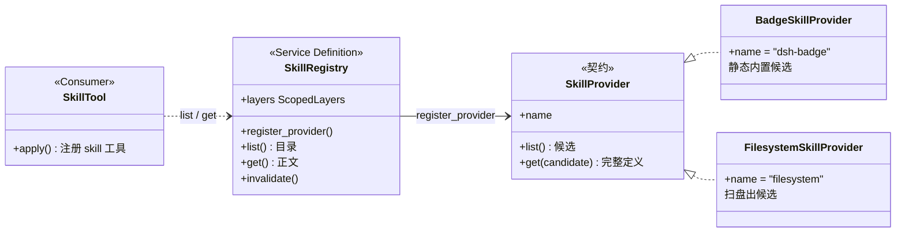

# Chapter 12: skill Loading: Capabilities Are Registered In, Loaded On Demand

> Skills hang on the wall, not welded into the body; take one down when needed, put it back when done.

## Questions this chapter answers

- Chapter 2's `SystemPromptService` assembles the system prompt sent to the model, but why can't a skill body just be welded straight into the system prompt?
- Chapter 5's shell seam picks one of two at composition time, but a skill's multiple sources must all be present at once — how does a seam accommodate "multiple implementations present simultaneously"?
- Chapter 4's tools pipeline lets the model call tools by name, but how can the model load a skill's body on demand?

Chapter 5 laid out the three-role skeleton of a seam and gave the first seam shape: the shell-style "method-call / pick-one-at-composition-time" — `createShell` selects a single implementation (`node` or `local`) at composition time, after which consumers only call the method. This chapter looks at the second shape: skill loading in `packages/skill`. A skill's sources are not one but many (disk directories, bundled Office workflows, an experimental badge provider, third-party packages …), and they are **registered together** into a layered registry; reading merges them by scope layer and, within the same layer, dedupes by rank. This is the "provider registry" seam: implementations can coexist, stack, and shadow one another.

The teaching code for this chapter lives in `ch12/code/`, run with `python3 ch12/code/main.py` (depends on ch01/ch02/ch04/ch09 teaching code, no third-party libraries). The teaching code and its printed output are in Chinese; the excerpts below and the output in §6 are reproduced verbatim, so paths, line references and printed lines match what the reader sees when running the files.

The three seam roles established in Chapter 5 (Service Definition / Service Provider / Consumer) are all reused here, but the seam's **shape** changes:

| | Chapter 5 shell seam | This chapter's skill seam |
|---|---|---|
| Implementation count | pick one at composition time (node / local) | multiple providers registered side by side |
| Consumption style | direct method call (`shell.exec`) | read through the registry (`ctx.skills.list/get`) |
| Conflict problem | doesn't exist (only one implementation) | same name, who wins: same-layer rank, cross-layer shadowing |
| Lifecycle | assembled once with the Context | registration is an effect, returns a disposer to undo it |

Reuse list (no re-implementation; direct import or isomorphic borrowing):

- Chapter 1 `Service` (`ch01/code/cordis.py`): construction-is-registration, `SkillRegistry(ctx)` auto-binds `ctx.skills`;
- Chapter 2 `Session` (`ch02/code/agent_loop.py`): the skill catalog is injected into the session as an append-only event;
- Chapter 4 `ToolRuntime` / `ToolDefinition` (`ch04/code/tools.py`): the skill tool is an ordinary tool in the tools pipeline;
- Chapter 9 `ScopedLayers` (`ch09/code/scope.py`): the layered container of a global layer + per-scope overlay layers + the parent-chain lineage, imported and reused directly here.

All new code lives in `ch12/code/`: `skill_registry.py` (definition layer), `skill_providers.py` (implementation layer), `tool_skill.py` (consumer layer), `bad_example.py` (problem demonstration), `main.py` (staged demonstration).

## 1. Welding Skills into the System Prompt

First look at the counter-example `ch12/code/bad_example.py`: it concatenates the full bodies of three skills straight into the system prompt.

```python
# 三个「技能」的正文：真实项目里这类专门步骤会越积越多。
SKILLS = {
    "commit-message": (
        "步骤：1. 读 git diff 归纳主题；2. 选 type：feat/fix/docs/refactor；"
        "3. 输出 type(scope): 描述，祈使句、不超过 72 字符。"
    ),
    "code-review": (
        "评审要点：1. 错误处理是否完整；2. 边界条件是否覆盖；"
        "3. 命名是否表达意图；4. 是否有重复代码可抽取。"
    ),
    "release-notes": (
        "步骤：1. 汇总上次 tag 以来的 PR；2. 按 feat/fix/breaking 分类；"
        "3. 渲染成面向用户的 release notes。"
    ),
}


def build_system_prompt():
    """把全部技能正文焊进系统提示词：不管本次任务用不用得上，全量常驻。"""
    parts = ["你是一个编码助手。以下是你必须随时记住的全部专业技能："]
    for name, body in SKILLS.items():
        parts.append(f"[技能 {name}] {body}")
    return "\n".join(parts)


def main():
    system_prompt = build_system_prompt()
    task = "帮我把这次改动写一条提交信息。"

    print("=== 反例：技能全量焊进系统提示词 ===")
    print(f"系统提示词长度：{len(system_prompt)} 字符（含全部 {len(SKILLS)} 个技能正文）")
    print(f"本次任务：{task}")
    print("→ 任务只需要 commit-message，但 code-review / release-notes 的正文也全程常驻。")
    print()
    print("--- 实际发给模型的系统提示词 ---")
    print(system_prompt)
    print()
    print("坑：")
    print("1. 全量常驻：用不上的技能正文也占上下文，技能越多、会话越长，滚得越大。")
    print("2. 不可发现：模型不知道有哪些能力、何时该用，只能靠提示词硬灌。")
    print("3. 不可插拔：加 / 删一个技能要改系统提示词（甚至改代码）重新装配。")
```

Run `python3 ch12/code/bad_example.py`:

```text
=== 反例：技能全量焊进系统提示词 ===
系统提示词长度：306 字符（含全部 3 个技能正文）
本次任务：帮我把这次改动写一条提交信息。
→ 任务只需要 commit-message，但 code-review / release-notes 的正文也全程常驻。

--- 实际发给模型的系统提示词 ---
你是一个编码助手。以下是你必须随时记住的全部专业技能：
[技能 commit-message] 步骤：1. 读 git diff 归纳主题；2. 选 type：feat/fix/docs/refactor；3. 输出 type(scope): 描述，祈使句、不超过 72 字符。
[技能 code-review] 评审要点：1. 错误处理是否完整；2. 边界条件是否覆盖；3. 命名是否表达意图；4. 是否有重复代码可抽取。
[技能 release-notes] 步骤：1. 汇总上次 tag 以来的 PR；2. 按 feat/fix/breaking 分类；3. 渲染成面向用户的 release notes。

坑：
1. 全量常驻：用不上的技能正文也占上下文，技能越多、会话越长，滚得越大。
2. 不可发现：模型不知道有哪些能力、何时该用，只能靠提示词硬灌。
3. 不可插拔：加 / 删一个技能要改系统提示词（甚至改代码）重新装配。
```

Three skills already occupy 306 characters, and every turn pays that cost again. Three pits can be extracted:

1. **All-resident**: every skill body stays resident in context alongside the system prompt. The more skills and the longer their bodies, the greater the token cost, while a single task usually uses only one of them;
2. **Undiscoverable**: the system prompt does hard-code three skill names, but that list is **frozen** — nothing can enumerate "what skills exist right now" at runtime, and the model has no right to ask for a body by name. "Undiscoverable" here means the discovery capability is missing, not that the names are literally invisible: adding or removing a skill requires editing this assembly code;
3. **Non-pluggable**: the skill source is welded in place — there is no place to hook in a "read skills from a disk directory" source, or to give a subagent its own set of skills.

The three pits all point to one missing set of mechanisms: sources must be **registerable** (fixes pit 3), the catalog must be **discoverable** (fixes pit 2), and bodies must be **loaded on demand** (fixes pit 1). These are exactly the three jobs of the skill seam.

## 2. Service Definition: Skill Sources Are Registered In

### 2.1 The Three Roles and the Contract

First the full picture (the three files `skill_registry.py` / `skill_providers.py` / `tool_skill.py` under `ch12/code/`):



- **Service Definition**: `SkillRegistry`, bound to `ctx.skills`. It does not produce skills; it only accepts registrations, merges the catalog, and fetches bodies on demand;
- **Service Provider**: sources implementing the `SkillProvider` contract. The teaching version gives two: `BadgeSkillProvider` (static bundled, corresponding to the experimental package `packages/experimental/skill-badge`) and `FilesystemSkillProvider` (disk scan, corresponding to the stable package family `packages/skill/skill-filesystem`);
- **Consumer**: `SkillTool` — turns `ctx.skills` into a model-callable `skill` tool (via the Chapter 4 tools pipeline), plus `inject_catalog` to inject the catalog into the session.

The contract itself is one `name` property plus two methods, `list()` / `get()` (`ch12/code/skill_registry.py`, corresponding to `packages/skill/skill/src/index.ts:247`):

```python
class SkillProvider(ABC):
    """skill provider 契约（index.ts:247）：list() 出候选、get() 按候选加载全文。

    这是「provider 注册表」型 seam 的实现侧接口：多个实现并存注册，注册表读取时
    合并去重；而不是第 5 章 shell 那种「组合期选定唯一实现」的方法调用式 seam。
    [教学简化 1] 真实契约没有 watch 方法：注册表在 registerProvider 时把
    control.invalidate / control.signal 交给 provider（index.ts:270-276），
    provider 自行择机触发失效；教学版省略 control，靠手动 invalidate。
    """

    name: str = ""

    @abstractmethod
    def list(self) -> list[SkillCandidate]:
        """列出本 provider 的候选（元数据，无正文）（index.ts:251）。"""
        raise NotImplementedError

    @abstractmethod
    def get(self, candidate: SkillCandidate) -> SkillDefinition | None:
        """按候选加载完整定义（含正文）（index.ts:257）。"""
        raise NotImplementedError
```

The contract has no third member, but registration hands the provider one extra object, a `control` (`SkillProviderControl`: `signal` + `invalidate`, see the start of §2.2) — that is a tool the registry lends out, not part of the contract.

Note the two methods return different types: `list()` returns only **metadata**, `get()` returns the **body**. This is not arbitrary — it bakes "catalog is cheap, body is expensive" into the contract. Around this dividing line, the definition layer gives three tiers of vocabulary types (`packages/skill/skill/src/index.ts:57` / `:77` / `:87`):

```python
@dataclass(frozen=True)
class SkillSummary:
    """目录条目：渲染用元数据，无正文（index.ts:57）。list() 返回它。"""

    name: str
    description: str
    provider: str
    source: str


@dataclass(frozen=True)
class SkillCandidate(SkillSummary):
    """候选：Summary + 同层优先级 rank（index.ts:77）。provider.list() 返回它。

    [教学简化 1] 真实候选还携带不透明 locator（index.ts:77-82，供 get 定位正文）；
    教学版由 provider 自持定位。
    """

    rank: int = BUNDLED_SKILL_RANK


@dataclass(frozen=True)
class SkillDefinition:
    """完整定义：带正文，按需加载（index.ts:87）。provider.get() 返回它。"""

    name: str
    provider: str
    content: str
    source: str = "bundled"
    description: str = ""
    model_invocable: bool = True  # [教学简化 2] 真实为 invocation.modelInvocable（index.ts:49-54）
    user_invocable: bool = True   # [教学简化 2] 真实为 invocation.userInvocable（index.ts:49-54）
```

The three tiers each handle one stretch: `SkillSummary` is the catalog entry (the menu shown to the model), `SkillCandidate` is the candidate (Summary plus same-layer priority rank, the internal shape a provider hands to the registry), and `SkillDefinition` is the full definition (the body is present, appearing only on `get`). The vocabulary types live in the definition-layer file so provider and consumer share the same word set — the same idea as putting `ToolDefinition`/`ToolResult` in `tools.py` back in Chapter 4.

### 2.2 register_provider: Registration Is an Effect

How does the registry accept a provider? (`packages/skill/skill/src/index.ts:390`) The real `registerProvider` takes a **factory function**, not a ready-made provider object: the registry creates a `control` (`SkillProviderControl` — the two tools handed to that one registration: `signal` aborts when the registration fails or is disposed, `invalidate` lets the provider announce "my catalog changed"), passes the `control` to the factory, and gets the provider back (`:394-404`). The teaching version drops that layer: it takes the provider object directly and omits both tools (see `[teaching simplification 1]` below).

```python
# ch12/code/skill_registry.py — SkillRegistry.register_provider (excerpt)
    def register_provider(self, provider: SkillProvider, scope=None):
        """把 provider 注册进 scope 对应层（index.ts:390）。注册是 effect：返回 disposer。

        scope 为 None 落 global 层（宿主级）；否则落该作用域叠加层。
        [教学简化] 真实 registerProvider 收工厂 (control) => provider，只拒绝保留名
        runtime（index.ts:406-408）；同层重名由 layer.providers.insert 抛出
        （index.ts:414 → packages/core/scope/src/store.ts:45）。
        """
        layer = self.layers.for_scope(scope)
        if provider.name in layer.providers:
            raise ValueError(f"skill provider already registered: {provider.name}")
        # 写入 provider 并立即失效缓存：注册改变了后续读取的结果。
        layer.providers[provider.name] = provider
        self.invalidate()

        def dispose():
            # 撤销注册并再次失效，对应真实 disposer（undo insert + invalidateCache）。
            layer.providers.pop(provider.name, None)
            self.invalidate()

        return dispose
```

Four details, each mapping to a real problem:

1. **Land by scope**: `scope=None` lands in the global layer (host-level, visible to every session), otherwise in that scope's overlay layer. The layered container `self.layers` reuses Chapter 9's `ScopedLayers` (`ch09/code/scope.py`) directly — a global layer + one layer per scope + the parent-chain lineage, i.e. what the real class docs call "the host+per-scope shape the tools registry established" (`packages/skill/skill/src/index.ts:344-355`). Those docs add the second half: host rows and repository plugins land in the global layer, while a plugin mounted by an agent preset's standing composition lands in that preset's own layer — "package a whole capability set per session" is Chapter 15's topic; here it is enough to remember that **the calling context's scope** decides which layer a registration lands in;
2. **Same-layer duplicate names**: the real source has three cases. First, the reserved name `runtime` (`RUNTIME_PROVIDER`, `:24`) throws outright (`:406-408`). Second, any other provider with a duplicate name is rejected by the provider table's own insert (`:414` → `packages/core/scope/src/store.ts:45`), with the error text supplied by the duplicate Error that `SkillLayer` hands its table (`packages/skill/skill/src/index.ts:334-336`). Third, a runtime skill registered through `register` (`:439`) does *not* throw on a duplicate — it is **warn+noop**, logging a warning and returning an empty disposer (`:443-446`). [teaching simplification] The teaching `register_provider` folds all three into "same-layer duplicate name throws", making the rule "don't let one source silently replace another" explicit;
3. **Registration invalidates the cache**: right after writing it calls `invalidate()`, because registration changes the result of every subsequent read — without invalidation the new provider would hide behind the stale cache and never be seen. In the real source, `ScopedLayers.effect` fires one change notification after the registration completes (`packages/core/scope/src/store.ts:262`), and `SkillRegistry` wires it to `invalidateCache` (`packages/skill/skill/src/index.ts:362-365`); a provider can also trigger it itself through `control.invalidate` (`:396-401`). [teaching simplification] The teaching version has none of that indirection and folds every entry point into one explicit call;
4. **Returns a disposer**: registration is an effect (Chapter 1 terminology) — the call returns an undo function; `dispose()` removes the provider and invalidates the cache again. Skills brought in by a third-party package take effect on assembly and vanish on teardown — this is the antidote to pit 3 "non-pluggable".

`SkillRegistry` itself subclasses Chapter 1's `Service`: `super().__init__(ctx, "skills")` registers onto `ctx.skills` at construction (`ch01/code/cordis.py:248-252`), corresponding to the real source's `declare('skills')` context extension (`packages/skill/skill/src/index.ts:283-286`). Same pattern as Chapter 4's `ToolRuntime(ctx)` and Chapter 9's `ScopedToolRuntime(ctx)`.

### 2.3 Two Provider Examples

The implementation layer `ch12/code/skill_providers.py` gives two providers with sharply different shapes. The simplest is the badge — a static candidate table plus bundled bodies. It lives in `packages/experimental/skill-badge`: an **experimental provider**, not declared by the default composition; using it means installing the package and inserting a plugin line explicitly (corresponding to `packages/experimental/skill-badge/src/index.ts:36`, the whole file is only 60 lines; being experimental also means it may move or disappear between versions, so this chapter treats it as a sample of "the minimal provider", not as a stable API):

```python
class BadgeSkillProvider(SkillProvider):
    """内置最简 provider（packages/experimental/skill-badge/src/index.ts:36）：
    静态候选 + 内置正文。

    真实 badge 只内置一个技能 dsh-badge（CANDIDATE:25，source='bundled'，
    rank=BUNDLED_SKILL_RANK:32），list() 静态返回 Promise.resolve([CANDIDATE])，
    get() 读资源文件。它是实验 provider：默认组合不声明，部署方要显式插行。
    [教学决策 3] 教学版内置两个技能，其中 code-review 的 bundled 版与 filesystem 的
    项目版同名，用于演示同层 rank 决胜。
    """

    name = "dsh-badge"  # PROVIDER_NAME（packages/experimental/skill-badge/src/index.ts:17）

    def __init__(self):
        # 内置正文直接写在代码里（skill-creator / code-review 两段）；全文见代码文件
        self._bodies = {...}

    def list(self):
        """静态返回内置候选（对应 list:()=>[CANDIDATE]，packages/experimental/skill-badge/src/index.ts:38）。"""
        return [
            SkillCandidate(
                name="skill-creator",
                description="指导如何创建一个新的技能包",
                provider=self.name,
                source="bundled",
                rank=BUNDLED_SKILL_RANK,
            ),
            SkillCandidate(
                name="code-review",
                description="通用代码评审清单（内置兜底）",
                provider=self.name,
                source="bundled",
                rank=BUNDLED_SKILL_RANK,
            ),
        ]

    def get(self, candidate):
        """按候选读内置正文（对应 get:readFile，packages/experimental/skill-badge/src/index.ts:39-49）。"""
        content = self._bodies.get(candidate.name)
        if content is None:
            return None
        return SkillDefinition(
            name=candidate.name,
            provider=self.name,
            content=content,
            source="bundled",
            description=candidate.description,
        )
```

The badge lives under `packages/experimental/`, the filesystem under `packages/skill/` — the location states the positioning. The experimental package's README describes the badge's observable behavior as "the provider is immutable, discovery always succeeds with exactly one skill, and it never reports partial results": it scans no disk, watches nothing, and cannot half-succeed, which makes it a natural "minimal sample". The price is that it sits in the experimental zone — an upgrade may move or remove it, so a deployment depending on it must insert the plugin line explicitly (see above). Only the stable package family's filesystem takes on multi-root discovery, change watching, and failure tolerance.

The disk provider adds one more parse step: a skill file is a `.md` file of "frontmatter metadata + Markdown body" (corresponding to `parseSkillFile` at `packages/skill/skill-filesystem/src/index.ts:811`):

```python
def parse_skill_file(path: Path):
    """parse 一个 SKILL.md：frontmatter（name/description）+ 正文。

    对应 parseSkillFile（packages/skill/skill-filesystem/src/index.ts:811）与
    parseFrontmatter（:931）。返回 (name, description, content)；
    无 frontmatter 或缺 name 则返回 None。
    [教学简化 6] 真实 parseFrontmatter 支持任意字段 + invocation policy 解析
    （parseInvocationPolicy:1014）；教学版只取 name/description 两个字段。
    """
    text = path.read_text(encoding="utf-8")
    if not text.startswith("---"):
        return None
    # 从首个 --- 之后找闭合分隔线，切出 frontmatter 与正文两段。
    end = text.find("\n---", 3)
    if end == -1:
        return None
    frontmatter = text[3:end].strip()
    content = text[end + 4:].strip()
    # 逐行按冒号切键值，得到 frontmatter 字段表。
    fields = {}
    for line in frontmatter.splitlines():
        if ":" in line:
            key, _, value = line.partition(":")
            fields[key.strip()] = value.strip()
    name = fields.get("name")
    if not name:
        return None
    return name, fields.get("description", ""), content
```

`FilesystemSkillProvider` splits "scan the disk" and "read the body" into the contract's two methods (corresponding to `packages/skill/skill-filesystem/src/index.ts:149`):

```python
class FilesystemSkillProvider(SkillProvider):
    """目录扫描 provider（packages/skill/skill-filesystem/src/index.ts:149）：扫 root 下
    *.md 并 parse。

    真实 filesystem 经 roots:251 枚举六类根（project-dsh / project-agents / custom /
    user-dsh / user-agents / bundled）、discoverRoot:737 发现，list:185 汇总候选、
    get:216 用候选携带的 locator 读文件 parse 出正文。
    [教学简化 5] 教学版只扫单一 root、不 watch；正文定位用「name.md」约定代替 locator。
    """

    name = "filesystem"  # Config.providerName 默认 'filesystem'（packages/skill/skill-filesystem/src/index.ts:76）

    def __init__(self, root):
        self.root = Path(root)
        # 教学用计数器：统计 list() 真实扫盘次数，用于演示注册表缓存命中。
        self.scan_count = 0

    def list(self):
        """扫描 root 下全部 *.md，parse 出候选（对应 list:185 + roots:251）。"""
        self.scan_count += 1  # 每次被调用都真实扫盘；缓存命中时注册表不会调到这里
        candidates = []
        for path in sorted(self.root.glob("*.md")):
            parsed = parse_skill_file(path)
            if parsed is None:
                continue
            name, description, _content = parsed
            candidates.append(
                SkillCandidate(
                    name=name,
                    description=description,
                    provider=self.name,
                    source="project",
                    rank=PROJECT_SKILL_RANK,
                )
            )
        return candidates

    def get(self, candidate):
        """按「name.md」约定读文件并 parse 出正文（对应 get:216 + parseSkillFile:811）。"""
        path = self.root / f"{candidate.name}.md"
        if not path.exists():
            return None
        parsed = parse_skill_file(path)
        if parsed is None:
            return None
        name, description, content = parsed
        return SkillDefinition(
            name=name,
            provider=self.name,
            content=content,
            source="project",
            description=description,
        )
```

Note that `list()` only parses the frontmatter into candidates; the body is read in full only when `get()` is called — the "catalog is cheap, body is expensive" dividing line in the contract is, in the implementation, two file reads of different granularity.

**Wrap-up**: pit 3 "non-pluggable" from §1 is now solved — a skill source is no longer a welded dict but a pluggable component that implements the `SkillProvider` contract and registers onto `ctx.skills` via `register_provider`; registration is an effect and can be undone. But the moment the registry opens up to multiple sources, a new problem appears: the badge has a `code-review` and the filesystem also has a `code-review` — which one should appear in the catalog?

## 3. Merging the Catalog: Same-Layer Rank Decides, Nearer Layer Shadows

### 3.1 The Main Merge Flow

`list()` is the registry's main read entry point (`packages/skill/skill/src/index.ts:470`): in the real implementation it is a thin shell over `snapshot()` (`:481`), where winners are projected into `SkillSummary`, sorted by name, and the result goes into the cache; the cache key folds in `cwd`, the scope chain, and the revision (`:519-549`). [teaching simplification] The teaching version reverses the dependency — `snapshot()` calls `list()`, which is the sole implementation (see `snapshot` in `ch12/code/skill_registry.py`) — and drops the `cwd` and revision dimensions of the cache key. The real merge logic lives in three internal methods — cross-layer, within-a-layer, and provider gathering (`:551-565` / `:567-582` / `:584`):

```python
# ch12/code/skill_registry.py — SkillRegistry, internal layer-merge methods (excerpt)
    def _layer_chain(self, scope):
        """生效层链：global 打底 + scope 父链（祖先在前、最近层在后）（index.ts:556）。"""
        layers = [self.layers.global_layer]
        if scope is not None:
            layers.extend(self.layers.chain_layers(scope))
        return layers

    def _collect(self, scope) -> dict:
        """跨层合并：层链由远及近遍历，近层同名覆盖远层（shadowing）（index.ts:551-565）。"""
        merged: dict = {}
        for layer in self._layer_chain(scope):
            for name, entry in self._collect_layer(layer).items():
                merged[name] = entry  # 后写的近层覆盖先写的远层
        return merged

    def _collect_layer(self, layer: SkillLayer) -> dict:
        """单层：汇齐各 provider 候选，按 rank 排序（小者胜），同名去重（index.ts:567-582）。"""
        indexed = []
        for provider in layer.providers.values():
            for candidate in provider.list():
                indexed.append((candidate, provider))
        # 按 rank 升序稳定排序：rank 小者排前，同 rank 保留注册序（真实还比 providerOrder / localOrder）。
        indexed.sort(key=lambda pair: pair[0].rank)
        winning: dict = {}
        for candidate, provider in indexed:
            if candidate.name not in winning:  # 同层同名：首个（rank 最小）胜，其余丢弃
                winning[candidate.name] = {"candidate": candidate, "provider": provider}
        return winning
```

The two rules each cure one kind of conflict, and their directions are exactly opposite:

- **Same-layer same name → rank decides (smallest wins)**: `_collect_layer` gathers every provider's candidates in a layer, stable-sorts by rank ascending, and the first wins while the rest are dropped. The rank ladder is taken from the real source ([teaching simplification 4] only the two ends): `PROJECT_SKILL_RANK = 100` (project skills, high priority), `BUNDLED_SKILL_RANK = 600` (bundled skills, low priority). **A smaller number wins**; the real ladder has 7 tiers, listed from highest to lowest priority:

  | Source | rank | Supplied by |
  |---|---|---|
  | project-dsh | 100 | `packages/skill/skill-filesystem/src/index.ts:35` |
  | project-agents | 200 | same file `:36` |
  | runtime | 250 | `packages/skill/skill/src/index.ts:25` |
  | custom | 300 | `packages/skill/skill-filesystem/src/index.ts:37` |
  | user-dsh | 400 | same file `:38` |
  | user-agents | 500 | same file `:39` |
  | bundled | 600 | `packages/skill/skill/src/index.ts:28` |

  rank is a **number every candidate carries itself**, not something the registry imposes by provider name — the provider decides which tier its candidates sit in, and the registry only compares. Losing duplicates do not vanish silently: the real `collectLayer` logs a warning for every same-name candidate it drops (`packages/skill/skill/src/index.ts:575`); [teaching simplification] the teaching version keeps only "smaller rank wins" and logs nothing when dropping;
- **Cross-layer same name → a nearer layer shadows the farther one wholesale**: `_collect` walks the layer chain far to near (global as base, scope overlay layers after); a nearer layer writing the same-name key directly overwrites the farther one — not a field merge but a wholesale winner replacement. This follows the same rule as Chapter 9's tools scope shadowing, because the layered container is the same `ScopedLayers`.

### 3.2 The Two Conflicts in Action

`main.py` stage 2 and stage 3 each demonstrate one. Stage 2: badge and filesystem both register in the global layer; their two `code-review`s meet in the **same layer** — filesystem's rank=100 beats badge's rank=600, so `code-review` in the catalog is provided by filesystem. Stage 3: register a `ReviewBotSkillProvider` into `scope="review-bot"`, which also provides `code-review` — this time they meet **across layers**; the review-bot layer's candidate shadows the global layer's winner wholesale, but reading the catalog from review-bot still sees the global layer's remaining skills (`skill-creator`, `commit-message`) inherited through.

**Wrap-up**: "which one wins when multiple sources coexist" now has a definite answer — same layer compares rank (smallest wins), cross-layer compares distance (nearer layer shadows). But note that `list()` always returns only `SkillSummary`: name, description, source, no body. Where is the body?

## 4. Loading On Demand: The Body Is Read Only When Needed

### 4.1 get: Delegate to the Winner's Provider to Load the Body

`get(name)` is the body's only entry point (`packages/skill/skill/src/index.ts:500`): first merge out the winning candidate by scope, then **delegate that candidate's own provider** to load the body, handing back the locator the candidate carries untouched (`:506-509`):

```python
# ch12/code/skill_registry.py — SkillRegistry.get(name, scope) (excerpt)
    def get(self, name: str, scope=None) -> SkillDefinition | None:
        """按名加载取胜者的完整定义（含正文）（index.ts:500），带缓存。"""
        key = (scope, name)
        if key in self._get_cache:
            return self._get_cache[key]
        entry = self._collect(scope).get(name)
        # 命中取胜候选后，委托它的 provider 加载正文；未命中则为 None。
        # [教学简化 1] 真实调用是 provider.get(candidate, options)：候选自带 locator，
        # 注册表原样交回（index.ts:506-509）；教学版候选无 locator，由 provider 自持定位。
        definition = entry["provider"].get(entry["candidate"]) if entry else None
        self._get_cache[key] = definition
        return definition
```

The registry itself never reads a body: the badge's winner goes back to the bundled table, the filesystem's winner goes back to read the file on disk. "Which source a body comes from" is decided by the winning candidate's provider field — the merge rule (§3) and the load action (§4) are thereby decoupled. The real implementation also hands the candidate's **locator** back to the provider untouched (`match.provider.get(match.candidate, options)` at `packages/skill/skill/src/index.ts:506-509`): the locator is the provider's own opaque handle (for filesystem it is `{ path, directory }`, see `packages/skill/skill-filesystem/src/index.ts:118-121`), and the registry never touches it. The teaching candidate has no locator field, so its provider assembles the path itself from the "name.md" convention.

The real implementation also validates the definition after loading (`validateDefinition`, `:511`): if the name changed or is no longer valid, it invalidates that entry and treats the load as a failure (`:512-515`), so a stale candidate cannot hand the model a body from the wrong slot; [teaching simplification] the teaching version skips this step.

### 4.2 Cache and Invalidation

Both the catalog and the body go through caches (`_list_cache` / `_get_cache` / `_snapshot_cache`); invalidation is concentrated in one method (`packages/skill/skill/src/index.ts:621` clears the caches + `:648` broadcasts):

```python
# ch12/code/skill_registry.py — SkillRegistry.invalidate (excerpt)
    def invalidate(self):
        """清空全部读缓存并广播 skills/change（index.ts:621 + :648）。"""
        self._revision += 1
        self._list_cache.clear()
        self._get_cache.clear()
        self._snapshot_cache.clear()
        self.ctx.emit("skills/change", {})
```

Three call sites trigger it: `register_provider` on registration, the disposer on undo, and external manual calls. Invalidation does two things: clears all read caches (the next `list`/`get` re-collects), and broadcasts the `skills/change` event — in the real source this event is dispatched by `notifyChange` (`packages/skill/skill/src/index.ts:648`, `dispatch('emit', ['skills/change'])`), and each listener is wrapped individually so one failing listener cannot veto the registration itself (`:649-660`), for components that care about catalog changes to subscribe and consume on their own. `_revision` is an invalidation counter, corresponding to the real revision mechanism: the real cache key carries a revision, and `collect` retries once if the revision moved during a read, returning an uncached result if it is still unstable (`:519-549`); the teaching version simplifies this to "clear the whole table".

In the real world, most invalidation is triggered by the provider itself: the filesystem provider hands "how to invalidate" to the registry in `apply` (`packages/skill/skill-filesystem/src/index.ts:135-138`, where the registry-supplied `control.invalidate` is taken over by `SkillWatchManager`, `:169`), and Chokidar observing a directory change or `ctx.on('fs/observed')` (`:142`) seeing a tool write fires it; [teaching simplification 1] the teaching version has no such loop and relies on manual `invalidate()`.

`main.py` stage 7 uses filesystem's `scan_count` to turn cache behavior into visible numbers: the first `list()` actually scans the disk (+1), the second `list()` hits the cache (scan count unchanged); after adding a new skill file, calling `list()` directly still hits the stale cache — only after `invalidate()` does it re-scan and the new skill appear.

**Wrap-up**: pit 1 "all-resident" from §1 is now solved — the body is loaded by the winner's provider only when `get` is called; `list` always returns only metadata; the cache spares repeated disk scans, and invalidation makes registration changes immediately visible. But so far every call has been issued by this demo code — how does the model know what skills are available?

## 5. Model Consumption: the skill Tool + Catalog Injection

The consumer layer `ch12/code/tool_skill.py` does two things, corresponding to the real tool-skill's two consumption paths: inject the skill catalog into the session (the model "knows what exists"), and register the `skill` tool into the Chapter 4 tools pipeline (the model "fetches a body on demand").

### 5.1 The Two Render Functions

First prepare the two output shapes (corresponding to `renderSkillContent` at `packages/skill/skill/src/index.ts:170` and `renderCatalogMessage` at `packages/skill/tool-skill/src/index.ts:258`):

```python
def render_skill_content(definition):
    """把技能正文渲染成 <skill_content> 规范块（packages/skill/skill/src/index.ts:170
    renderSkillContent）。

    模型读到这个块即「技能已加载」，正文里的步骤成为它接下来的操作指引。
    [教学简化] 真实块的结构是 <skill_content name="..."> 包 <skill_resources>（相对资源
    基址提示）再加 <skill_instructions> 正文（index.ts:172-182）；开标签上没有 provider
    属性，provider 只出现在 skill_resources 的兜底提示文字里（index.ts:188-190）。
    教学版在 <skill_content> 上多渲染了 provider="..."，只为让输出直接看出取胜者；
    正文也没有 <skill_instructions> 外壳。
    """
    return (
        f'<skill_content name="{definition.name}" provider="{definition.provider}">\n'
        f"{definition.content}\n"
        f"</skill_content>"
    )


def render_catalog_message(summaries):
    """把技能目录渲染成注入会话的文本（packages/skill/tool-skill/src/index.ts:258
    renderCatalogMessage）。

    目录只含 name + description（元数据），不含正文；正文留到模型用 skill 工具按需加载。
    """
    if not summaries:
        return ""
    lines = ["可用技能（用 skill 工具按名加载正文）："]
    for summary in summaries:
        lines.append(f"- {summary.name}: {summary.description}")
    return "\n".join(lines)
```

### 5.2 SkillTool: the skill Tool Goes Through the tools Pipeline

`SkillTool.apply` registers a tool named `skill` into `ctx.tools` ([teaching decision 4] same shape as Chapter 5's tool-bash: a tool = the seam's model-side consumption surface); the executor reads `ctx.skills` back internally (corresponding to `apply` at `packages/skill/tool-skill/src/index.ts:80`, `defineTool` at `:84`, `execute` at `:130`, `ctx.tools.register` at `:165`):

```python
class SkillTool:
    """skill 工具的装配与执行（packages/skill/tool-skill/src/index.ts:80 apply）。

    消费 ctx.skills：把注册表里的技能变成模型可调用的 skill 工具。
    """

    def __init__(self, ctx):
        self.ctx = ctx

    def apply(self):
        """注册 skill 工具进 ctx.tools（index.ts:84 defineTool + :165 register）。"""
        definition = ToolDefinition(
            name="skill",
            description="按名加载一个技能的完整指引正文",
            parameters={
                "type": "object",
                "properties": {
                    "name": {"type": "string", "description": "要加载的技能名"},
                },
                "required": ["name"],
            },
            execute=self._execute,
        )
        return self.ctx.tools.register(definition)

    def _execute(self, arguments):
        """按名加载技能（index.ts:130 execute）：先 list 校验存在，再 get 加载正文。

        出错分支（未知技能 / 正文加载失败 / 不可模型调用）返回错误文本：
        真实 tool-skill 在这些分支直接 throw；第 4 章教学管线的 _dispatch_body
        也有 try/except 兜底，会把任何异常渲染成 "tool failed: ..."（is_error=True，
        ch04/code/tools.py:423-430）。教学版选择自己返回 "error: ..." 文案，
        让模型看到 skill 自己的错误措辞（[教学简化 8]）。
        """
        name = arguments.get("name")
        # 在目录里找该技能，对应 ctx.skills.list(lookup).find(...)（index.ts:138）。
        summary = next((s for s in self.ctx.skills.list() if s.name == name), None)
        if summary is None:
            return f'error: skill "{name}" is unknown or no longer available'
        # 加载完整定义，对应 ctx.skills.get(name, lookup)（index.ts:145）。
        definition = self.ctx.skills.get(name)
        if definition is None:
            return f'error: skill "{name}" is unknown or no longer available'
        # 校验模型可调用，对应 isModelInvocable(summary)（index.ts:142）。
        if not definition.model_invocable:
            return f'error: skill "{name}" is not available for model invocation'
        # 渲染成 <skill_content> 规范块返回给模型。
        return render_skill_content(definition)
```

The executor follows the real execute's main path (list → get → invocability check → render): first `isSkillName` validates the name (`:131`), then `list` verifies the skill exists and returns the summary (`:138`), then `get` loads the body (`:145`), checking model-invocability twice (`isModelInvocable(summary)` at `:142`, `isModelInvocable(skill)` at `:149`), and finally renders the canonical `<skill_content>` block. The teaching version drops the entry check and checks once. One tool call by the model exchanges for a full guide — the body goes from "resident in the prompt" to "enters context only when called".

There is one more scope detail: the real execute's `lookup` carries `scope: exec.agent` (`:135-137`), so the skill catalog is read along **the calling agent's** layer chain, not process-globally. [teaching simplification] The teaching version drops this; its `list()` / `get()` always read global plus an explicitly passed scope.

### 5.3 inject_catalog: the Catalog Enters the Session

A tool alone is not enough — the model must first know what's on the menu. `inject_catalog` renders the catalog into a user message and appends it to the session (corresponding to the pre-step #2 catalog-publication listener at `packages/skill/tool-skill/src/index.ts:217`). A pre-step is a hook that runs before every model request, while the session is being assembled; #1 and #2 are two listeners the same plugin installs. **#1** handles a `/skill-name` typed by the user and only recognizes `userInvocable` skills; **#2** publishes the catalog and lists only `modelInvocable` skills — together they map exactly onto the two invocation switches from §2.1:

```python
# ch12/code/tool_skill.py — module-level function inject_catalog
def inject_catalog(session, summaries):
    """把技能目录作为 user 消息注入会话（pre-step #2 目录发布，index.ts:217）。

    复用第 2 章 Session 的 append-only 事件日志（ch02/code/agent_loop.py:71 append）：
    目录以一条 user/message 事件进会话，消息源标记为 'skill-catalog'
    （SkillCatalogSource:35），与用户真实输入区分开。
    返回注入的消息 dict；目录为空则不注入并返回 None。
    """
    text = render_catalog_message(summaries)
    if not text:
        return None
    message = {"role": "user", "content": text, "source": "skill-catalog"}
    session.append("user/message", {"message": message})
    return message
```

Reuses Chapter 2's `Session` append-only event log: the catalog enters the session as a `user/message` event with `source` marked `skill-catalog`, distinct from the user's real input. The model reads "Available skills (use the skill tool to load a body by name): …" in context, and gets both the menu and the way to order.

Beyond these demos, the real version does several things that all change what the model sees:

- **The catalog prose has a fixed frame.** `renderCatalogMessage` (`packages/skill/tool-skill/src/index.ts:258`) wraps it in `<system-reminder>` + `<available_skills>`, renders each entry as `` - `name`: description `` (`:339-341`), and appends an instruction "do not follow a summary before loading the skill"; empty or incomplete discovery gets different wording (`:263-283`).
- **The catalog is replaced, not accumulated.** The first publication goes through `renderCatalogMessage`; once the catalog changes it goes through `renderCatalogUpdate` (`:289`), whose prose states explicitly that this new catalog replaces every earlier available-skills list in the session, so the model cannot cling to a stale list; if neither entries nor digest changed, no message is emitted at all (`:231-256`).
- **Catalog visibility is tied to the tool.** Before publishing, the listener checks whether this agent can see the exact `skill` tool this plugin registered (`:225-227`); if not, it publishes an empty catalog — when the tool is shadowed away by scope, the menu disappears with it, and the model never sees "a menu it cannot order from".

All three are real behavior, and the teaching version implements none of them: it renders a single "Available skills" line plus entries, publishes only once ([teaching simplification 7]), and has no "don't publish when the tool is invisible" linkage.

**Wrap-up**: pit 2 "undiscoverable" from §1 is now solved — catalog injection lets the model see what skills exist, and the skill tool lets it fetch a body by name. All three pits are closed: sources registerable (§2), catalog discoverable (§5), body loaded on demand (§4); the merge rule (§3) guarantees a definite result when multiple sources coexist.

## 6. Complete Run Output

Run `python3 ch12/code/main.py` (depends on ch01/ch02/ch04/ch09 teaching code, no third-party libraries); the stage numbers in the output correspond one-to-one with `main.py`'s stages. The program prints in Chinese and is reproduced verbatim below:

```text
========================================================================
段 1 —— 装配：ctx.skills provider 注册表
========================================================================
ctx.skills 类型：SkillRegistry（Service，构造即注册）
已注册 provider：['dsh-badge', 'filesystem']
注册触发的 skills/change 事件数：2

========================================================================
段 2 —— 目录合并 + 同层 rank 决胜（小者胜）
========================================================================
- code-review     provider=filesystem source=project
- commit-message  provider=filesystem source=project
- skill-creator   provider=dsh-badge  source=bundled
code-review 取胜者：filesystem（项目 rank=100 < 内置 rank=600，小者胜）

========================================================================
段 3 —— 分层 shadowing：review-bot 作用域遮蔽 global
========================================================================
global 读 code-review：filesystem
review-bot 读 code-review：review-bot（本层更近，整体遮蔽 global）
review-bot 目录技能数：3（继承 global + 本层覆盖）

========================================================================
段 4 —— 按需加载全文：get('commit-message')
========================================================================
provider=filesystem source=project
# commit-message

1. 读 git diff，归纳本次变更的主题。
2. 选择 type：feat / fix / docs / refactor / test / chore。
3. 输出 `type(scope): 描述`，描述用祈使句、不超过 72 字符。

========================================================================
段 5 —— tool-skill 消费：skill 工具（走第 4 章 tools 管线）
========================================================================
ctx.tools 可见工具：['skill']
skill(commit-message) is_error=False：
<skill_content name="commit-message" provider="filesystem">
# commit-message

1. 读 git diff，归纳本次变更的主题。
2. 选择 type：feat / fix / docs / refactor / test / chore。
3. 输出 `type(scope): 描述`，描述用祈使句、不超过 72 字符。
</skill_content>
skill(no-such-skill) → 工具返回错误文本：error: skill "no-such-skill" is unknown or no longer available

========================================================================
段 6 —— 会话目录注入：skill-catalog 消息进会话
========================================================================
注入消息 source=skill-catalog，会话事件数=1
可用技能（用 skill 工具按名加载正文）：
- code-review: 项目代码评审清单
- commit-message: 按 Conventional Commits 生成提交信息
- skill-creator: 指导如何创建一个新的技能包

========================================================================
段 7 —— 缓存与失效
========================================================================
第一次 list()：3 个技能，扫盘 +1（真实扫盘）
第二次 list()：3 个技能，扫盘 +1（缓存命中，未新增）
新增 release-notes.md 后直接 list()：['code-review', 'commit-message', 'skill-creator']（仍命中旧缓存）
invalidate() 后 list()：['code-review', 'commit-message', 'release-notes', 'skill-creator']（重新扫盘）
全程 skills/change 事件数：5
```

### 6.1 Stage-by-Stage Reading

- **stage 1**: `ctx.skills` is a `SkillRegistry` (Service, registered at construction). Registering two providers triggers 2 `skills/change` events — the teaching version explicitly calls `invalidate()` on every `register_provider`; the real version fires the same broadcast from two entry points, the `ScopedLayers.effect` change notification and `control.invalidate` (see §2.2 point 3);
- **stage 2**: after the catalog merge there are 3 skills. The `code-review` name conflict is decided by rank: filesystem (project rank=100) beats badge (bundled rank=600); `skill-creator` is provided only by badge and is admitted directly;
- **stage 3**: after the `review-bot` scope registers its own `code-review`, reading from that scope has the nearer layer shadow the global winner wholesale; the catalog is still 3 — `skill-creator` and `commit-message` are inherited from global;
- **stage 4**: `get('commit-message')` delegates to the winner filesystem to read the disk and returns a `SkillDefinition` with the body;
- **stage 5**: the skill tool runs through Chapter 4's `ctx.tools.execute` — a successful call returns the canonical `<skill_content>` block; an unknown skill is answered by the tool body itself with an `error: ...` text (the real version throws and the framework renders an error result; the Chapter 4 teaching pipeline would also wrap it as `tool failed: ...`, see [teaching simplification 8]). The `provider="filesystem"` attribute in the output is an extra the teaching version adds; the real opening tag carries only `name` (see the [teaching simplification] in §5.1);
- **stage 6**: the catalog enters the session as a user/message event with `source=skill-catalog`; the body has only name + description;
- **stage 7**: on a cache hit `scan_count` does not increase; a new file on disk is not automatically visible — only after `invalidate()` does a re-scan make the new skill appear. The "scan +1" printed by the second `list()` is the cumulative increment relative to the baseline (total +1), not a fresh scan this time — this call actually hits the cache and adds 0 new scans. Total 5 `skills/change` events: 2 registrations (stage 1) + 1 review-bot registration (stage 3) + 2 manual invalidations (stage 7).

## 7. Source Code Mapping

Symbol correspondence between the teaching code and the real source:

| Teaching symbol (ch12/code/) | Real symbol | Source location |
|---|---|---|
| `skill_registry.py` `SkillSummary` / `SkillCandidate` / `SkillDefinition` | `SkillSummary` / `SkillCandidate` / `SkillDefinition` | `packages/skill/skill/src/index.ts:57` / `:77` / `:87` |
| `SkillProvider` (contract) | `SkillProvider` | `packages/skill/skill/src/index.ts:247` |
| `SkillLayer` | `SkillLayer` | `packages/skill/skill/src/index.ts:327` |
| `SkillRegistry` (a `Service` subclass, bound to `ctx.skills`) | `SkillRegistry extends Service` + `declare('skills')` | `packages/skill/skill/src/index.ts:356` / `:283-286` |
| `register_provider` (takes a provider object, returns a disposer) | `registerProvider` (takes a factory `(control) => provider`) | `packages/skill/skill/src/index.ts:390` |
| `list` / `snapshot` / `get` | `list` (delegates to `snapshot`) / `snapshot` / `get`; **the teaching version reverses the direction**: `snapshot` calls `list` | `packages/skill/skill/src/index.ts:470` / `:481` / `:500` |
| `_layer_chain` + `_collect` | `collectFresh` (cross-layer merge) + `collect` (cache and retry wrapper) | `packages/skill/skill/src/index.ts:551-565` / `:519-549` |
| `_collect_layer` | `collectLayer` (sort + dedupe) + `listLayerCandidates` (gathering) | `packages/skill/skill/src/index.ts:567-582` / `:584` |
| `invalidate` (revision + skills/change) | `invalidateCache` + `notifyChange` | `packages/skill/skill/src/index.ts:621` / `:648` |
| `PROJECT_SKILL_RANK` / `BUNDLED_SKILL_RANK` | the rank ladder constants | `packages/skill/skill-filesystem/src/index.ts:35-39` + `packages/skill/skill/src/index.ts:25` / `:28` |
| `skill_providers.py` `BadgeSkillProvider` | `provider` (**experimental package**, not declared by the default composition) | `packages/experimental/skill-badge/src/index.ts:36` (whole file 60 lines) |
| `FilesystemSkillProvider.list` / `.get` | `FileSystemSkillProvider.list` / `.get` | `packages/skill/skill-filesystem/src/index.ts:185` / `:216` |
| `parse_skill_file` | `parseSkillFile` + `parseFrontmatter` (+ `parseInvocationPolicy`) | `packages/skill/skill-filesystem/src/index.ts:811` / `:931` / `:1014` |
| `tool_skill.py` `SkillTool.apply` | `apply` | `packages/skill/tool-skill/src/index.ts:80` |
| the `skill` tool definition | `skillTool` (`defineTool({name:'skill'})`) | `packages/skill/tool-skill/src/index.ts:84` |
| `_execute` | `execute` | `packages/skill/tool-skill/src/index.ts:130` |
| `ctx.tools.register` | `ctx.tools.register(skillTool)` | `packages/skill/tool-skill/src/index.ts:165` |
| `inject_catalog` | pre-step #2 session catalog publication | `packages/skill/tool-skill/src/index.ts:217` |
| `render_catalog_message` | `renderCatalogMessage` (+ replacement rendering `renderCatalogUpdate`) | `packages/skill/tool-skill/src/index.ts:258` / `:289` |
| `render_skill_content` | `renderSkillContent` | `packages/skill/skill/src/index.ts:170` |

Teaching differences list (numbers correspond one-to-one with the code comments):

**Teaching decisions** (active choices, not made hard for the sake of it):

1. **[teaching decision 1]** The skill seam is positioned as a "provider registry" seam: multiple providers register side by side, and reads merge by layer + rank; contrasted with Chapter 5's shell "method-call / pick-one-at-composition-time". Layered shadowing reuses Chapter 9's `ScopedLayers` (skill_registry.py module docstring);
2. **[teaching decision 2]** badge and filesystem two providers co-exist, demonstrating multiple implementations side by side (skill_providers.py module docstring);
3. **[teaching decision 3]** The badge bundles two skills (`skill-creator` + the bundled `code-review`), making the bundled and project `code-review` share a name in the same layer to demonstrate rank tiebreak (skill_providers.py `BadgeSkillProvider` docstring);
4. **[teaching decision 4]** tool-skill is implemented as a tool in the Chapter 4 tools pipeline, same shape as Chapter 5's tool-bash (tool_skill.py module docstring).

**Teaching simplifications** (the real mechanism is more complex; the teaching version downgrades):

1. **[teaching simplification 1]** The real `SkillProvider` has no `watch` method: the registry hands `control.invalidate` / `control.signal` to the provider inside `registerProvider` (`packages/skill/skill/src/index.ts:270-276`), and the provider triggers invalidation on its own schedule; a candidate also carries an opaque locator for `get` to locate the body (`:77-82`). The teaching version drops the control loop, uses manual `invalidate` to trigger refresh, and body location degrades to provider-held (skill_registry.py contract / candidate comments);
2. **[teaching simplification 2]** The real `SkillInvocationPolicy` is two booleans, `{ modelInvocable, userInvocable }` (`packages/skill/skill/src/index.ts:49-54`), with separate readers `isModelInvocable` / `isUserInvocable` (`:126` / `:135`); the teaching version flattens them into two fields on `SkillDefinition` and omits the readers (skill_registry.py `SkillDefinition`);
3. **[teaching simplification 3]** The real `collectLayer` sort key is rank→providerOrder→localOrder (`compareIndexedCandidates`, `packages/skill/skill/src/index.ts:569` / `:807-811`); the teaching version sorts only by rank, stable sorting makes registration order the implicit secondary key for equal rank, and it logs nothing when dropping same-name candidates (skill_registry.py module docstring / `_collect_layer`);
4. **[teaching simplification 4]** The rank ladder takes only the two ends 100/600; the real one has 7 tiers (skill_registry.py constant comments);
5. **[teaching simplification 5]** The real filesystem enumerates six root classes via `roots:251` (project-dsh / project-agents / custom / user-dsh / user-agents / bundled) plus Chokidar watch (`SkillWatchManager`, `packages/skill/skill-filesystem/src/index.ts:294`); the teaching version only scans a single root, does not watch, and locates bodies by the "name.md" convention (skill_providers.py module docstring / `FilesystemSkillProvider` docstring);
6. **[teaching simplification 6]** The real `parseFrontmatter` (`packages/skill/skill-filesystem/src/index.ts:931`) supports arbitrary fields and `parseInvocationPolicy` (`:1014`) parses invocation policy; the teaching version only takes name/description (skill_providers.py `parse_skill_file`);
7. **[teaching simplification 7]** The real tool-skill also has the pre-step #1 `/name` gesture for explicit invocation (`packages/skill/tool-skill/src/index.ts:181`, scanning only `source.kind === 'user'` messages; for a skill with `modelInvocable: false`, i.e. `disable-model-invocation`, this is the only entry through which the model never sees it but the user can still load it by hand) and replacement catalog rendering `renderCatalogUpdate` (`:289`); the teaching version only does "one-shot catalog injection + skill tool loading" (tool_skill.py module docstring);
8. **[teaching simplification 8]** The real tool-skill `throw`s directly on branches like unknown skill and lets the framework render an error result; the Chapter 4 teaching pipeline's `_dispatch_body` also has a `try/except Exception` fallback that renders any exception as `tool failed: ...` (`is_error=True`, `ch04/code/tools.py:423-430`). The teaching version returns `error: ...` text instead; the difference is only who owns the wording — the model sees the skill's own text rather than the pipeline's generic wrapper (tool_skill.py `_execute`).

## 8. Summary and Preview

This chapter reconstructs "skills" from strings welded into the prompt into a three-role seam:

| Mechanism | Corresponding symbol | Which pit it cures |
|---|---|---|
| provider contract + registration is an effect | `SkillProvider` / `register_provider` | pit 3 non-pluggable |
| same-layer rank tiebreak + cross-layer nearer shadows | `_collect_layer` / `_collect` | determinism when multiple sources coexist |
| catalog returns only metadata, body delegated for loading | `list` / `get` | pit 1 all-resident |
| cache + invalidate + skills/change | `invalidate` | registration changes immediately visible |
| skill tool + catalog injection into the session | `SkillTool` / `inject_catalog` | pit 2 undiscoverable |

Where a source sits also states its job: `packages/skill/` is the stable package family (`skill` defines, `skill-filesystem` discovers, `skill-office` ships Office workflows, `tool-skill` consumes, `tool-workspace-dependencies` reports interpreter paths), while `packages/experimental/skill-badge` is an experimental single-skill provider. Under one contract, the stable packages take on discovery, merging, watching and failure tolerance, and the experimental package only demonstrates "the minimal implementation"; adding or removing a source requires touching neither the registry, the consumer, nor the other sources.

Compared with Chapter 5, this chapter gives the second seam shape: shell is "pick a single implementation at composition time, then only call its method", skill is "multiple implementations registered side by side, merged by rule on read". The latter splits "who can provide" from "who wins" — providing is a registered fact, winning is a result computed at read time.

The next chapter looks at the two big external capabilities of retrieval and code semantics: `ctx.web` (search/fetch) and `ctx.lsp` (normalized four-operation query), corresponding to `packages/web` and `packages/lsp`. That same chapter also reaches the other end of the registry family: the **single-slot exclusive** shape of `ctx.computerUse` / browser-use — only one provider fits at composition time and the capability method surface is empty, which is exactly the right boundary check for this chapter's "provider registry".

**Two additions to the teaching-simplification list (unnumbered local differences)**: delegating to `provider.get()` without a locator (§4.1), and skipping `validateDefinition` after loading (§4.1); the fixed catalog frame, the replacement semantics, and "don't publish when the tool is invisible" (§5.3) likewise keep only the teaching shape.

## 9. Appendix: Key Concepts Cheat Sheet

| Concept | One sentence | Teaching code | Real source |
|---|---|---|---|
| `ctx.skills` | the layered skill provider registry (Service Definition) | `skill_registry.py` `SkillRegistry` | `packages/skill/skill/src/index.ts:356` |
| `SkillProvider` | source contract: `list()` returns candidates, `get()` returns the body | `skill_registry.py` | `packages/skill/skill/src/index.ts:247` |
| `SkillSummary` / `SkillCandidate` / `SkillDefinition` | catalog entry / candidate (+rank+locator) / full definition (+body) | `skill_registry.py` | `packages/skill/skill/src/index.ts:57` / `:77` / `:87` |
| `register_provider` | registers by scope into the layer, returns a disposer | `skill_registry.py` | `packages/skill/skill/src/index.ts:390` |
| rank ladder | within a layer the smallest wins (teaching version takes the two ends 100 / 600) | `PROJECT_SKILL_RANK` etc. | `packages/skill/skill-filesystem/src/index.ts:35-39` |
| cross-layer shadowing | a nearer layer's same-name entry overwrites the farther one wholesale (reuses `ScopedLayers`) | `_collect` | `packages/skill/skill/src/index.ts:551-565` |
| `invalidate` | clears caches + revision + broadcasts skills/change | `skill_registry.py` | `packages/skill/skill/src/index.ts:621` / `:648` |
| badge provider | **experimental provider**: static bundled candidates + bundled bodies, not declared by the default composition | `skill_providers.py` `BadgeSkillProvider` | `packages/experimental/skill-badge/src/index.ts:36` |
| filesystem provider | scans six root classes for candidates, reads bodies on demand | `skill_providers.py` `FilesystemSkillProvider` | `packages/skill/skill-filesystem/src/index.ts:149` |
| `parse_skill_file` | frontmatter metadata + Markdown body | `skill_providers.py` | `packages/skill/skill-filesystem/src/index.ts:811` |
| skill tool | a tool in the tools pipeline, fetches the body by name and renders `<skill_content>` | `tool_skill.py` `SkillTool` | `packages/skill/tool-skill/src/index.ts:84` / `:130` |
| catalog injection | the catalog enters the session as a user message with source=skill-catalog | `tool_skill.py` `inject_catalog` | `packages/skill/tool-skill/src/index.ts:217` |
| `render_skill_content` | renders the body into the canonical `<skill_content>` block | `tool_skill.py` | `packages/skill/skill/src/index.ts:170` |
| office provider | ships seven Office routing / authoring / operations skills (office / office-docx / office-pptx / office-xlsx / office-render / office-recalculate / office-export-pdf, list at `:13`); the catalog lists summaries and bodies load on demand; the three operation skills get interpreter and CLI absolute paths appended to their body (whitelist and concatenation at `:90-91`) | — (not covered in this chapter) | `packages/skill/skill-office/src/index.ts:13` / `:90-91` / `:94` (`apply` registers the `dsh-office` provider) |
| workspace dependencies tool | a sibling tool of the skills: `load_workspace_dependencies` reports the absolute paths and versions of the bundled Python / Node.js / pnpm without changing `PATH`; the Office skills reference it by name for the default interpreter | — (not covered in this chapter) | `packages/skill/tool-workspace-dependencies/src/index.ts:294-295` |
