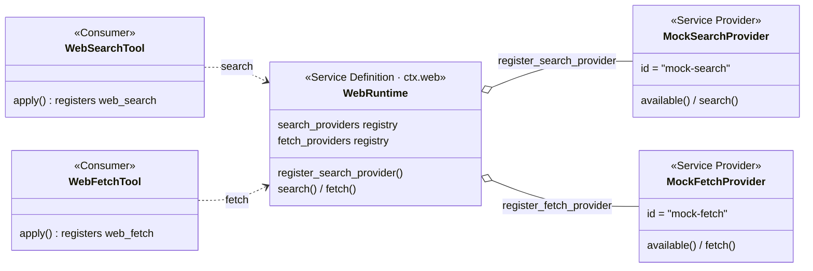
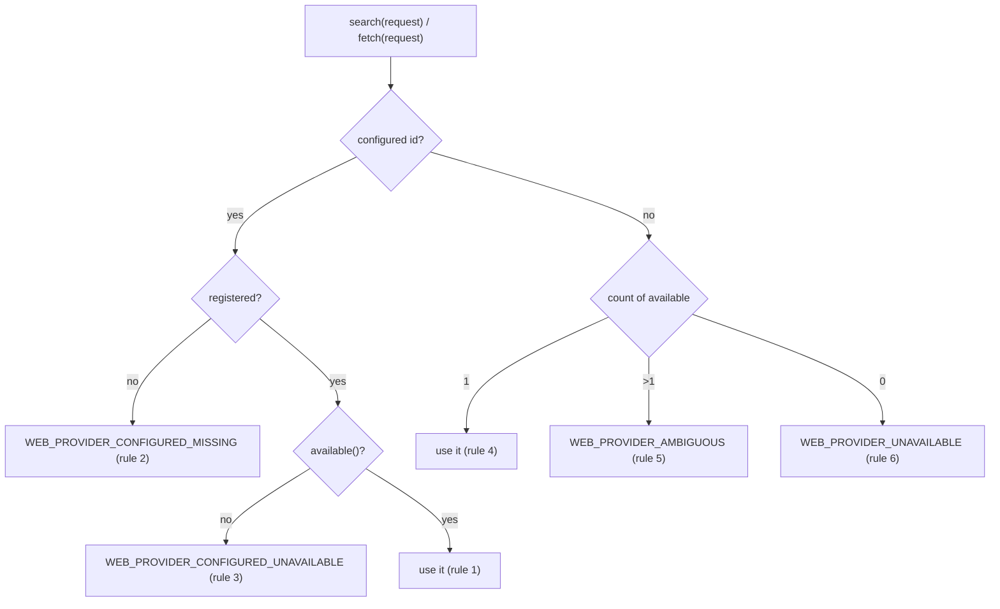
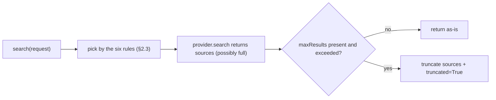
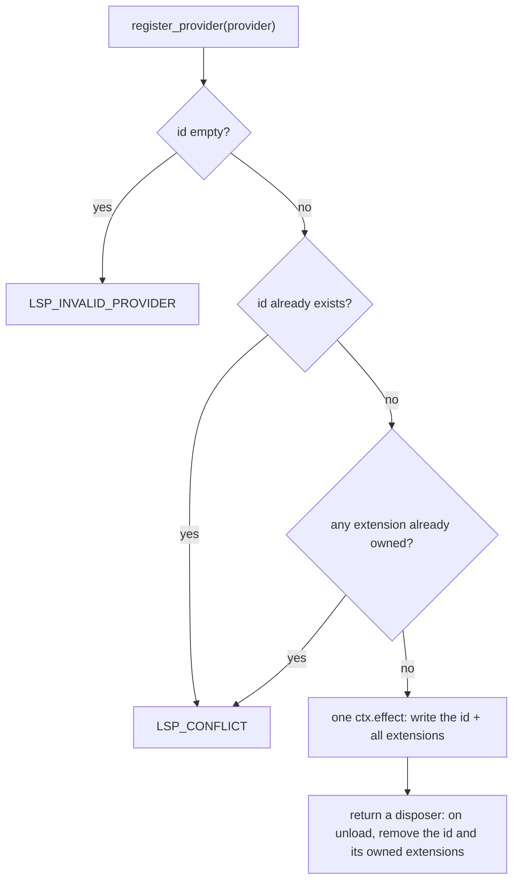
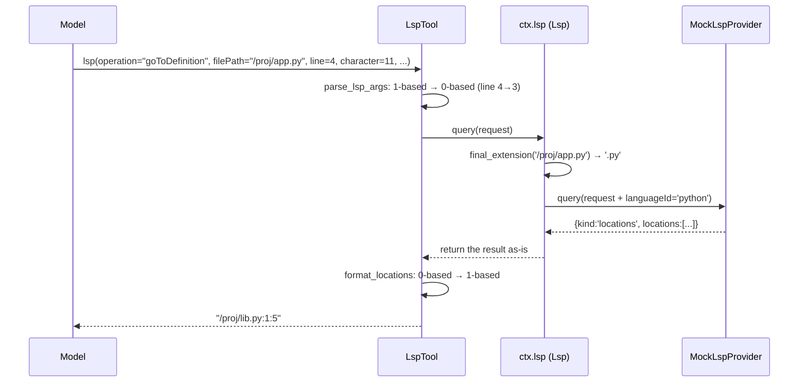

# Chapter 13: web / lsp and Exclusive Capabilities: Who Serves Is Decided at Execution Time

> Visitors check in first; who answers the call is decided at execution time; and some seats hold only one.

## Questions this chapter answers

- Chapter 5 established that a capability's implementation is a registered provider, but why can't a search / fetch just write the specific engine call directly into the function?
- Chapter 12's skill merges multiple sources before reading them out, but web picks exactly one provider at execution time — which one?
- Chapter 12's `register_provider` registers one provider at a time, but one lsp provider covers multiple extensions — how do you avoid the "half-registered" intermediate state?
- If a capability is globally exclusive — one desktop, one browser — what should its registry look like? What responsibilities does it still carry?

Chapter 5 set up the three-role skeleton of the capability seam and gave the first shape: shell's "pick-one-at-composition-time"; Chapter 12 gave the second shape: skill's provider registry — multiple sources registered side by side, merged by rule on read. This chapter looks at three more shapes in the same provider-registry family:

- `ctx.web` (search / fetch): on every execution it picks **one** provider from the registry by rule and normalizes the result into a unified structure;
- `ctx.lsp` (code semantic query): it routes a request to the **single** provider by file extension and normalizes the results of four operations into a closed union;
- `ctx.computerUse` / `ctx.browserUse` (desktop / browser operation): there is only one slot, first come wins, and a second registration throws — the registry answers only "who is present", never "what it can do" (§5).

The first two share their origin with skill — implementations are all registered providers, only the "read" rules change; the third pushes the same proposition to its null solution: no selection at runtime, and no normalization either. (The word "shape" carries two numbering bases in this chapter: when talking about capability seams, shell is first and skill is second; when talking about the registry family, counting starts at Chapter 12's skill, which is why §5 is the fourth shape.)

The teaching code for this chapter is in `ch13/code/`, run with `python3 ch13/code/main.py` (depends on ch01/ch04 teaching code, no third-party libraries).

The three seam roles from Chapter 5 (Service Definition / Service Provider / Consumer) are all reused here; the seam shape advances one step further on top of Chapter 12:

| | Chapter 5 shell seam | Chapter 12 skill seam | This chapter's web / lsp (§2–§4) | This chapter's computer / browser (§5) |
|---|---|---|---|---|
| Implementation count | pick one at composition time | multiple providers registered side by side | multiple providers registered side by side | exactly one per deployment |
| Consumption style | direct method call | read the registry, merge by rule | pick one by rule at execution time (web) / route by extension (lsp) | no capability method to call, only "who holds the slot" |
| Result shape | provider returns as-is | merged catalog / body | normalized: unified structure + seam cap (web) / closed union (lsp) | none (the provider carries all capability) |
| Conflict handling | none | same-name same-layer side by side, cross-layer shadowing | web: multiple available → error, never implicitly pick; lsp: extension conflict → reject wholesale | a second registration (even the same name) → `already registered` |

Reuse list (no re-implementation; direct import):

- Chapter 1 `Context` / `Service` (`ch01/code/cordis.py`): construction-is-registration — `WebRuntime(ctx)` auto-binds as `ctx.web`, `Lsp(ctx)` auto-binds as `ctx.lsp`; registration always goes through `ctx.effect`, teardown via the returned disposer;
- Chapter 4 `ToolRuntime` / `ToolDefinition` / `ToolExecution` (`ch04/code/tools.py`): the three tools `web_search` / `web_fetch` / `lsp` are all ordinary tools in the tools pipeline.

All new code lives in `ch13/code/`: `web_runtime.py` (web definition layer), `web_providers.py` (web implementation layer), `lsp_runtime.py` (lsp definition layer), `lsp_providers.py` (lsp implementation layer), `tool_web.py` / `tool_lsp.py` (consumer layer), `bad_example.py` (problem counter-example), `main.py` (staged demonstration). The §5 single-slot exclusive registry is 48 lines in total, explained inline below, with no new teaching files.

## 1. Hard-Wiring the External Capability into the Caller

First the counter-example `ch13/code/bad_example.py` — for "search", the engine is written directly into the function body:

```python
def engine_brave_search(query):
    """引擎 A（模拟真实搜索 API）：返回自己的私有格式。"""
    return {"links": [{"t": f"brave:{query}", "u": f"https://brave.example/{query}"}]}


def engine_mock_search(query):
    """引擎 B（模拟测试桩）：返回另一种私有格式。"""
    return {"sources": [{"title": f"mock:{query}", "url": f"https://mock.example/{query}"}]}


def web_search(query, engine="brave"):
    # 坑 1：实现写死 —— 引擎以分支形式出现在函数体里
    # 坑 2：选择分散 —— 用哪个引擎是调用方传参决定，没有统一规则
    if engine == "brave":
        return engine_brave_search(query)
    return engine_mock_search(query)


def render_for_model(raw):
    # 坑 3：结果不归一 —— 调用方必须认识每种引擎的格式
    if "links" in raw:
        items = [(x["t"], x["u"]) for x in raw["links"]]
    else:
        items = [(x["title"], x["url"]) for x in raw["sources"]]
    return "\n".join(f"- {title} {url}" for title, url in items)
```

The file's `__main__` part has two callers each calling `web_search`; run `python3 ch13/code/bad_example.py` for output:

The script prints in Chinese, so the block below is reproduced as-is. Note: the **return values** of the two calls are two completely different structures (`{'links': ...}` vs `{'sources': ...}`) — the two output segments below look identical precisely because `render_for_model` writes one format-recognition branch per engine; same output shape does not mean the structure is normalized.

```text
调用方 1（写死 brave）：
- brave:seam https://brave.example/seam

调用方 2（想换 mock，得改调用参数，并确认格式化分支认得 mock 的格式）：
- mock:seam https://mock.example/seam

想加第三个引擎？要改 web_search 的分支、render_for_model 的格式识别，
以及每一个调用点 —— 而它们本来只想要「搜一下」这件事。
```

Three pits:

1. **Hard-wired implementation**: the engine appears as branches in `web_search`'s body. Swapping an engine = editing the function body, and every caller is affected;
2. **Scattered choice**: "which engine" is decided by each caller writing its own argument, with no unified rule. When multiple engines are available at once, different callers may make different choices, and behavior is inconsistent;
3. **Result not normalized**: engine A returns `links`, engine B returns `sources`, and `render_for_model` must recognize every format; adding an engine means adding a format-recognition branch.

The three pits point to one missing set of mechanisms: implementations should be **registered** rather than hard-wired (fixes pit 1), choice should be **concentrated into one set of rules** (fixes pit 2), and results should be **normalized into a unified structure** (fixes pit 3). These are exactly the three jobs of the web seam.

## 2. web seam: Registration Is an Effect, Selection Happens at Execution Time

### 2.1 The Three Roles: Assembly First

The overall assembly (corresponding to `ch13/code/web_runtime.py`, `web_providers.py`, `tool_web.py`):



- **Service Definition**: `WebRuntime`, bound as `ctx.web`. It never touches the network itself; it only manages two things: who is present (two registries) and who is picked (the selection rule at execution time). The set of methods it exposes — `search` / `fetch` — is called the **method surface** in the code comments, the concretization of Chapter 5's contract surface in this chapter;
- **Service Provider**: objects implementing the provider contract — the `id` + `available()` + `search()`/`fetch()` trio. The teaching version gives four deterministic mocks (`MockSearchProvider` / `EchoSearchProvider` / `PremiumSearchProvider` / `MockFetchProvider`);
- **Consumer**: `WebSearchTool` / `WebFetchTool` — register `web_search` / `web_fetch` into Chapter 4's `ctx.tools`; the execute body only calls `ctx.web`.

Before taking it apart, first run the minimal example (inline example, runnable in the `ch13/code/` directory):

```python
from web_runtime import WebRuntime          # import 时顺带注册 ch01 路径
from web_providers import MockSearchProvider
from cordis import Context                  # 第 1 章上下文容器

ctx = Context()
web = WebRuntime(ctx)                       # 构造即注册，ctx.web 可用
web.register_search_provider(MockSearchProvider())
print(web.search({"query": "seam"})["sources"][0]["title"])
ctx.dispose()
# 输出：Capability seam
```

Register a provider, search once, get back a normalized `sources` — the rest of this chapter answers "what happens behind that one line".

### 2.2 Two Registries and the Registration Effect

Why two registries? Search and fetch are two completely independent capabilities: an engine that can search may not be able to fetch pages, and one that can fetch may not be able to search. So `WebRuntime` stores them in separate tables and picks from each separately (excerpt from `web_runtime.py`):

```python
class WebRuntime(Service):
    # ... 类 docstring 从略（其末行写明选择语义：「执行时解析，绝不依赖注册顺序」，`packages/web/web/src/index.ts:69-81`）...

    def __init__(self, ctx, config=None):
        super().__init__(ctx, "web")
        config = config or {}
        # 配置的提供者 id（`packages/web/web/src/index.ts:88-91`）；真实版还可被环境变量覆盖（`packages/web/web/src/index.ts:100-101`）
        self.configured_search = config.get("searchProvider")
        self.configured_fetch = config.get("fetchProvider")
        self.search_providers = {}  # search 注册表（`packages/web/web/src/index.ts:93`）
        self.fetch_providers = {}   # fetch 注册表（`packages/web/web/src/index.ts:94`）

    def register_search_provider(self, provider):
        """注册 search 提供者（`packages/web/web/src/index.ts:113-115`）。"""
        return self._register_provider(self.search_providers, provider)

    def register_fetch_provider(self, provider):
        """注册 fetch 提供者（`packages/web/web/src/index.ts:124-126`）。"""
        return self._register_provider(self.fetch_providers, provider)

    def _register_provider(self, registry, provider):
        """注册是 effect：注册写表、卸载还原（`packages/web/web/src/index.ts:128-144`）。"""
        if provider.id in registry:
            raise WebError("WEB_DUPLICATE_PROVIDER",
                           f"duplicate web provider id: {provider.id}")

        def setup():
            registry[provider.id] = provider  # ctx.effect 体（`packages/web/web/src/index.ts:133-140`）

            def dispose():
                if registry.get(provider.id) is provider:
                    del registry[provider.id]

            return dispose

        return self.ctx.effect(setup)
```

Three details:

1. A duplicate id is rejected outright (`WEB_DUPLICATE_PROVIDER`) — one provider is not allowed to quietly replace another;
2. The registration action is wrapped in Chapter 1's `ctx.effect`: setup writes the table, dispose removes from the table, and on removal it first confirms the slot still holds itself (if the slot changed hands, don't wrongly delete);
3. The return value is a disposer — registration is undoable, same shape as Chapter 12's `SkillRegistry.register_provider`.

The provider contract's `available()` has one convention: **only do local checks, never make a network call** — it is called on every selection at execution time, so its cost must be bounded (`packages/web/web/src/types.ts:131`). The six selection rules look only at `available()`; whether a tool is visible to a particular model request is answered by a separate optional `ready(llmProvider)` ("does the model route this request uses have credentials", likewise no network; `packages/web/tool-web/src/search.ts:414`).

`PremiumSearchProvider` demonstrates the "registered but unavailable" case (excerpt from `web_providers.py`):

```python
class PremiumSearchProvider:
    """模拟「API key 未配置」的提供者：已注册但 available() 返回 False。

    用于演示规则 3/6：seam 绝不把请求交给不可用提供者。
    """

    id = "premium-search"

    def __init__(self, api_key=None):
        self.api_key = api_key

    def available(self):
        """只查本地配置（对应 DeepSeekSearchProvider.available 的语义）。"""
        return self.api_key is not None

    # ... search 省略：永不到达这里，seam 规则 3/6 会先过滤 ...
```

**Review**: pit 1 "hard-wired implementation" is cured here — an engine is no longer branches in a function body but a provider registered into the registry. But once multiple providers coexist, "who to pick" becomes a new problem — exactly pit 2.

### 2.3 Selection at Execution Time: Six Rules

When `search` is called it does not look at the registry directly, but first picks a provider by rule. **Selection at execution time** means: on every call the seam picks one provider out of the registry by its own rules, independent of registration order — like a front desk dispatching visitors by the duty roster, not by familiarity.

```python
    def search(self, request):
        """search 方法面：按规则选人 → provider.search → cap_sources（`packages/web/web/src/index.ts:185-188`）。"""
        provider = self._resolve_provider(self.search_providers,
                                          self.configured_search)
        result = provider.search(request)
        return cap_sources(result, request.get("maxResults"))

    def fetch(self, request):
        """fetch 方法面：按规则选人 → provider.fetch（`packages/web/web/src/index.ts:219-221`）。"""
        provider = self._resolve_provider(self.fetch_providers,
                                          self.configured_fetch)
        return provider.fetch(request)

    def _resolve_provider(self, registry, configured_id):
        """执行时选人：六条规则，绝不依赖注册顺序（`packages/web/web/src/index.ts:275-297`）。"""
        if configured_id is not None:
            provider = registry.get(configured_id)
            if provider is None:
                # 规则 2：配置 id 未注册
                raise WebError("WEB_PROVIDER_CONFIGURED_MISSING",
                               f"configured provider not registered: {configured_id}")
            if not provider.available():
                # 规则 3：配置 id 已注册但不可用
                raise WebError("WEB_PROVIDER_CONFIGURED_UNAVAILABLE",
                               f"configured provider unavailable: {configured_id}")
            return provider  # 规则 1：配置 id 已注册且可用
        usable = [p for p in registry.values() if p.available()]
        if len(usable) == 1:
            return usable[0]  # 规则 4：未配置且恰有一个可用
        if len(usable) > 1:
            # 规则 5：多个可用 → 报错，绝不隐式选「先注册的那个」
            ids = ", ".join(sorted(p.id for p in usable))
            raise WebError("WEB_PROVIDER_AMBIGUOUS",
                           f"multiple providers available, configure one: {ids}")
        # 规则 6：无可用
        raise WebError("WEB_PROVIDER_UNAVAILABLE", "no web provider available")
```

The six rules fall into two halves: with a configured id, rules 1–3 apply (registered and available → use it; not registered → `CONFIGURED_MISSING`; registered but unavailable → `CONFIGURED_UNAVAILABLE`); without one, rules 4–6 apply (exactly one available → use it; multiple available → `AMBIGUOUS` error; none available → `UNAVAILABLE` error).



The most counter-intuitive is rule 5: when multiple providers are available at once, the seam does not pick one — it errors directly. Why not implicitly pick "the first registered one"? Because that would make behavior depend on registration order — an accidental factor invisible to the caller. Erroring forces the user to write the choice explicitly into config, making the choice deterministic from then on. `main.py` stage 2 runs all six rules one by one on an isolated `ctx`; for rule 4 it deliberately registers the unavailable `premium-search` first and then the available `mock-search`, and the picked one is still `mock-search` — the selection is independent of registration order.

**Review**: pit 2 "scattered choice" is cured here — the selection logic lives only in `_resolve_provider`, and all callers face the same set of rules. Pit 3 remains: each provider's returned result still has its own format.

## 3. Normalizing Results: the Cap Lives in the seam, the body Is a Union

### 3.1 capSources: Providers Are Not Trusted to Enforce the Cap

If "at most how many results" is left to each provider to enforce, two things go wrong: swap a provider and the same request returns a different number of results — the model's context budget drifts with it; add a provider that forgets the cap and it returns hundreds of sources while the caller keeps reading based on the last assumption. Without a uniform cap this is not "some implementation did it badly" but **a recalibration on every provider swap**.

The fix is to put the cap on the seam side rather than trusting providers: `maxResults` still travels with the request (a provider may use it to save traffic), but the seam truncates once more on the way back. Even a provider that ignores the field, or never checks it, produces bounded output (a module-level function, called at the end of §2.3's `search`):

```python
def cap_sources(result, max_results):
    """seam 强制 maxResults：截断 sources 并置 truncated（`packages/web/web/src/index.ts:300-303`）。

    提供者可以自己提前应用上限以省流量，但 seam 不依赖它 —— 返回后一律再截断。
    """
    sources = result["sources"]
    if max_results is None or len(sources) <= max_results:
        return result
    return {
        "query": result["query"],
        "sources": sources[:max_results],
        "truncated": True,
    }
```



Two benefits: a new provider need not implement truncation and benefits automatically; the cap semantics are concentrated in one place, so providers cannot implement it inconsistently. In the real source `maxResults` is just an ordinary field of `WebSearchRequest`, passed straight through by `search()` (`packages/web/web/src/types.ts:28-38`, `packages/web/web/src/index.ts:186-187`), and `capSources` is only a backstop — "does not depend on" rather than "does not forward". `main.py` stage 3: searching `"seam"` without `maxResults` returns 5 sources; `maxResults=3` returns 3 and `truncated=True`.

### 3.2 fetch Results: statusCode Is Data, body Is a Union

The search result is already normalized (`{"query", "sources"}`, `packages/web/web/src/types.ts:50-57` / `packages/web/web/src/types.ts:65-74`); the fetch result also has a unified structure `{"url", "statusCode", "body", "truncated"}` (`packages/web/web/src/types.ts:92-101`), where `body` is a union — either `{"kind": "text", "text"}` or `{"kind": "html", "html"}` (`packages/web/web/src/types.ts:112-114`), and the consumer just branches on `kind`. Look at `MockFetchProvider` (excerpt from `web_providers.py`):

```python
class MockFetchProvider:
    """确定性 fetch 提供者：固定 URL→页面表（对应 HttpFetchProvider 的角色）。"""

    id = "mock-fetch"

    # ... PAGES 页面表省略：text / html / binary 三个 URL ...

    def available(self):
        return True

    def fetch(self, request):
        """返回 WebFetchResult：url + statusCode + body（`packages/web/web/src/types.ts:92-101`）；
        body 是 html|text 并集（`packages/web/web/src/types.ts:112-114`）。"""
        url = request["url"]
        page = self.PAGES.get(url)
        if page is None:
            return {"url": url, "statusCode": 404,
                    "body": {"kind": "text", "text": "not found"}}
        if page["kind"] == "binary":
            # 真实 HttpFetchProvider 在此拒绝不支持的内容类型
            raise WebError("WEB_UNSUPPORTED_CONTENT_TYPE",
                           f"unsupported content: {url}")
        return {"url": url, "statusCode": 200, "body": page}
```

(The excerpt above matches `ch13/code/web_providers.py` word for word; [teaching simplification] the return value omits the `truncated` field — the real `WebFetchResult` carries it, while the teaching version does not simulate a byte cap.)

Note the boundary between error and return value: 404 is not an exception but a normal return value (the `statusCode` field) — "page does not exist" is one of the business outcomes; only contract violations like "unsupported content type" throw `WebError`. `main.py` stage 4 fetches four URLs in a row: a text page, an html page (`body.kind='html'`), a missing page (404), and a binary resource (throws `WEB_UNSUPPORTED_CONTENT_TYPE`, the caller catches it and prints the error code).

**Review**: pit 3 "result not normalized" is cured here — search returns the unified `{"query", "sources"}`, fetch returns the unified `{"url", "statusCode", "body", "truncated"}`, and the `render_for_model`-style format-recognition branches are gone. The web seam is closed; but external capability is not just "going online" — the model also needs to "understand code".

## 4. lsp seam: Extension Routing, Atomic Registration, and the Closed Union

Code-semantic queries (go-to-definition, find-references) depend on a language server, and a single language server only understands one language family. So the lsp seam's selection dimension differs from web's: it is not "pick one out of many by rule" but **routing by file extension** — a `.py` file goes to the Python provider, a `.ts` file goes to the TypeScript provider. Each extension belongs to at most one provider, so there is no ambiguity by construction. `Lsp` is likewise Chapter 1's `Service`, bound as `ctx.lsp`; the routing table is a map from extension → (provider, language_id) (`packages/lsp/lsp/src/index.ts:84`).

### 4.1 Atomic Registration: Validate Everything First, Then Write the Table Once

A provider often covers multiple extensions (e.g. `.ts` + `.tsx`). If you write the routing table extension by extension, you might only discover a conflict on the second one after the first is already written in — leaving a "half-registered" intermediate state. The lsp seam's answer is **atomic registration** (all-or-nothing): finish all validation first, then write the table in one shot; like a bank transfer, the debit and credit sides either both succeed or both take no effect.

```python
class Lsp(Service):
    """ctx.lsp 服务：扩展名 → 路由表 + 原子注册（`packages/lsp/lsp/src/index.ts:82`）。

    seam 只管「哪个扩展名归哪个提供者」：
    - register_provider：先全量校验，再一次性写表，失败不留痕
    - query：按文件扩展名路由，透传 languageId 给提供者
    """

    def __init__(self, ctx):
        super().__init__(ctx, "lsp")
        self.routes = {}  # 扩展名 -> (provider, language_id)（`packages/lsp/lsp/src/index.ts:84`）
        self.provider_ids = set()

    def register_provider(self, provider):
        """原子注册：先全量校验，再一次性写表（`packages/lsp/lsp/src/index.ts:90-141`）。

        三项校验：空 id → LSP_INVALID_PROVIDER；重复 id 或扩展名冲突 →
        LSP_CONFLICT。全部通过后才用一个 ctx.effect 写入 id + 全部扩展名
        （`packages/lsp/lsp/src/index.ts:130-137`），因此不存在「注册了一半」的中间态。
        """
        if not provider.id:
            raise LspError("LSP_INVALID_PROVIDER", "provider id must be non-empty")
        if provider.id in self.provider_ids:
            raise LspError("LSP_CONFLICT", f"duplicate provider id: {provider.id}")
        for ext in provider.extensions:
            ext = normalize_extension(ext)
            owner = self.routes.get(ext)
            if owner is not None:
                raise LspError("LSP_CONFLICT",
                               f"extension {ext} already owned by provider {owner[0].id}")

        def setup():
            self.provider_ids.add(provider.id)
            for ext in provider.extensions:
                self.routes[normalize_extension(ext)] = (provider, provider.language_id)

            def dispose():
                self.provider_ids.discard(provider.id)
                owned = [e for e, route in self.routes.items() if route[0] is provider]
                for ext in owned:
                    del self.routes[ext]

            return dispose

        return self.ctx.effect(setup)
```



The three checks (empty id / duplicate id / extension conflict) all complete before any table-writing action; only after all pass does **one** `ctx.effect` write `provider_ids` and all extensions — either everything is written, or not a single extension is. `main.py` stage 5 verifies each case: duplicate id → `LSP_CONFLICT`; a new id but `.py` already owned → `LSP_CONFLICT`; the `rust-py` provider declares two extensions `(.rs, .py)` and `.py` conflicts → rejected wholesale, and afterwards `routes` has no `.rs` either; then registering the single-extension `mock-ts` succeeds, and calling the disposer rolls back `mock-ts` along with its extension.

### 4.2 query: Route by Extension, Pass languageId Through

```python
    def query(self, request):
        """查询入口：按文件扩展名路由，未命中 → LSP_UNAVAILABLE（`packages/lsp/lsp/src/index.ts:143-149`）。"""
        ext = final_extension(request["filePath"])
        route = self.routes.get(ext)
        if route is None:
            raise LspError("LSP_UNAVAILABLE",
                           f"no lsp provider for extension: {ext or '<none>'}")
        provider, language_id = route
        # seam 透传 languageId：提供者不必自己从扩展名猜语言
        return provider.query({**request, "languageId": language_id})
```

Two module-level helper functions: `final_extension` takes the extension after the last path separator — `'a/b.py'` → `'.py'`; `'a.d/b'` → `''` (the dot is before the separator, so it does not count); `'.hidden'` → `''` (a leading dot is a hidden file, not an extension); `normalize_extension` lowercases uniformly, so `.PY` and `.py` route to the same provider. One detail: when routing, the seam injects `languageId` into the request before passing it through — the language attribution is already fixed at registration time, so the provider need not guess.

### 4.3 Four Operations and the Closed Union

lsp has four operations: `goToDefinition` / `findReferences` / `goToImplementation` / `hover` (`packages/lsp/lsp/src/types.ts:17`). The results of the four operations are normalized into a **closed union** — a result can only fit into one of two drawers: `locations` (zero or more locations) or `hover` (hover information), with no third shape; a consumer branching on `kind` with two cases exhausts every possibility.

```python
class MockLspProvider:
    """确定性 lsp 提供者：按位置取标识符，再查符号表。

    保留真实提供者契约（`packages/lsp/lsp/src/types.ts:95-107`）：id、extensions、language_id、query。
    """

    # ... __init__ 省略：持有 id / extensions / language_id / documents / symbols ...

    def query(self, request):
        """四种操作返回闭并集（`packages/lsp/lsp/src/types.ts:85-87`）：`locations` 或 `hover`。"""
        word = self._word_at(request["filePath"], request["position"])
        info = self.symbols.get(word) if word else None
        if request["operation"] == "hover":
            hover = ({"contents": info["hover"], "range": None} if info
                     else {"contents": None, "range": None})
            return {"kind": "hover", "hover": hover}
        if info is None:
            locations = []
        elif request["operation"] == "goToDefinition":
            locations = [info["definition"]]
        elif request["operation"] == "findReferences":
            locations = list(info["references"])
        elif request["operation"] == "goToImplementation":
            locations = [info["implementation"]]
        else:
            raise LspError("LSP_UNSUPPORTED_OPERATION",
                           f"unsupported operation: {request['operation']}")
        return {"kind": "locations", "locations": locations,
                "resolvedWorkspaceUri": request.get("workspaceUri")}
```

The semantics of the four operations: `goToDefinition` returns the single definition location; `findReferences` returns zero or more reference locations; `goToImplementation` returns the implementation location; `hover` returns the symbol's documentation info (may be empty). `locations` uniformly holds `{uri, range}` structures, where `range`'s line/column are **zero-based** UTF-16 coordinates (`packages/lsp/lsp/src/types.ts:20-25`) — this is the LSP protocol convention, and the coordinate conversion on the model side is left to the tool layer (§6.2). The teaching provider uses `_word_at` to take the identifier at a position from a fixed document, then looks up a fixed symbol table, reproducing the two-step "locate → query" action; the real backend is a language-server process, see §8 Source Code Mapping.

## 5. The Fourth Shape in the Registry Family: the Single-Slot Exclusive Registry

The first four sections read the Python teaching version in `ch13/code/`; from here on we read the upstream TypeScript source directly — the mechanism is only 48 lines, so reading beats rewriting. When you meet a generator effect like `ctx.effect(function* () { yield … })`, read it as "each `yield` of a disposer registers one cleanup, and on unload those run in reverse registration order" (that is what Chapter 1 §6 covers).

A **single-slot exclusive registry** means: a globally exclusive capability (one desktop, one browser) admits exactly one provider into its slot; registration returns a disposer, and a second registration — even with the same name — throws immediately and names the current holder. It selects nobody, normalizes nothing; it maintains a single admission constraint.

### 5.1 The Pain: One Desktop, Two Drivers

The previous two seams both assume "multiple providers can be present at once": web errors when more than one is usable, lsp rejects the whole registration when extensions overlap — but the registry can always hold several providers. Desktop and browser operation do not satisfy that assumption: they drive **globally shared physical resources**, and with two drivers holding the same desktop at once, nobody can say which one clicked what.

```python
# 行内示例（非教学文件）
class SharedDesktopRegistry:
    """反例：注册表不设排他，后注册的那个悄悄生效。"""

    def __init__(self):
        self.providers = {}

    def register(self, provider):
        self.providers[provider.name] = provider      # 后来者覆盖先到者
        return lambda: self.providers.pop(provider.name, None)

registry = SharedDesktopRegistry()
registry.register(McpDriver("cua-driver-native"))
registry.register(McpDriver("cua-driver-mcp"))        # 无声接管，调用方毫不知情
```

The problem is not "overwrite" but **silence**: both drivers believe they hold the desktop, the click the model emits lands on whichever side depends on registration order, and when something goes wrong the log cannot even say "which driver is serving right now". The fix is not a lock but making the second registration **fail, and name the holder**.

### 5.2 The 48-Line Registry: It Only Records a Name

The real implementation is short enough to read end to end — 48 lines for the whole file, class body `:16-46`. `ComputerUseRegistry` in `packages/computer-use/computer-use/src/index.ts`:

```ts
export class ComputerUseRegistry extends Service {
  private registration: ComputerUseProviderName | undefined

  constructor(ctx: Context) {
    super(ctx, 'computerUse')
  }

  get providerName(): ComputerUseProviderName | undefined {
    return this.registration
  }

  register(name: ComputerUseProviderName): () => Promise<void> {
    if (this.registration !== undefined) {
      throw new Error(`computer use provider "${this.registration}" is already registered`)
    }
    return this.ctx.effect(() => {
      this.registration = name
      return () => {
        this.registration = undefined
      }
    }, 'computerUse.register()')
  }
}
```

(`ComputerUseRegistry` in `packages/computer-use/computer-use/src/index.ts`, excerpt dropping imports and JSDoc.) `BrowserUseRegistry` in `packages/browser-use/browser-use/src/index.ts:16-46` is line-for-line isomorphic, changing only the service name and the error string to `browserUse`. Three claims are worth pointing out one by one:

1. **No capability method surface.** The class has only the `providerName` getter and `register` (a registration entry), no `click`, `open`, `screenshot`, and no dispatch method. Compare §2's `WebRuntime` with `search` / `fetch`, and §4's `Lsp` with `query` — for this family the Service Definition has no capability methods; **its capability method surface is empty**;
2. **No provider object.** What sits in the slot is a branded name (`ComputerUseProviderName`), not an object with capability; that is why it fits in 48 lines;
3. **A second registration (even the same name) throws**, and the message carries the current holder's name. The registry's test checks both facts with two `expect`s in the same case: after registering `cua-driver-mcp`, registering the same name again hits `toThrow('already registered')`, while registering `cua-driver-native` hits `toThrow('cua-driver-mcp')` (`packages/computer-use/computer-use/tests/registry.spec.ts:17-18`).

Registration goes through `ctx.effect` and returns that fiber's disposer: the provider plugin unloads → the slot empties. The `Fiber.effect` comment in `vendor/cordis` confirms this ownership — disposers run when the fiber unloads, and calling a disposer twice is a no-op (`vendor/cordis/src/fiber.ts:412-416`). The README states outright that "a repeated disposer cannot remove a later registration" — the slot belongs to **this** registration, not to the name (`packages/computer-use/computer-use/README.md:46`).

The name is wrapped in a brand:

```ts
export type ComputerUseProviderName = Branded<'ComputerUseProviderName'>

export function ComputerUseProviderName(name: string): ComputerUseProviderName {
  return name as ComputerUseProviderName
}
```

(`packages/computer-use/computer-use/src/brand.ts:6-15`.) The **ProviderName brand** is this pattern: `ComputerUseProviderName = Branded<'ComputerUseProviderName'>` declares a nominal type, and a same-named factory function does nothing but an `as` cast (same file `:13-15`). It is a type-level marker only, **validating nothing at runtime** — an empty string or a plain `string` passes just as well. Its value is at diagnostic entry points: wherever a provider name should appear, this type is required, so slipping in a plain string surfaces at compile time.

### 5.3 Release Order: One Effect, Not Two

The slot is returned via `ctx.effect`, which raises an ordering question: on provider unload the sequence should be "stop admitting tool calls → close the child process → release the slot". Any step happening early can let another driver grab the slot while resources are not yet closed. "Stop admitting tool calls" is the provider's own responsibility — the registry's JSDoc states it as the first convention (`packages/computer-use/computer-use/src/index.ts:30-31`); the code below handles the order of the last two. `packages/experimental/computer-use-cua-driver-mcp/src/index.ts:62-69` shows the upstream approach:

```ts
// One effect orders child shutdown before release; separate fiber effects
// unload concurrently and could otherwise admit another live driver.
let child!: Fiber
ctx.effect(function* () {
  yield ctx.computerUse.register(ComputerUseProviderName('cua-driver-mcp'))
  child = ctx.plugin(McpClient, connection)
  yield child.dispose
}, 'computer-use-cua-driver-mcp.connection')
```

(End of `apply()` in `packages/experimental/computer-use-cua-driver-mcp/src/index.ts`.) One generator effect yields two things in order: the disposer produced by registration, and the child fiber's `dispose`. As Chapter 1 explained, Cordis unwinds effects in reverse registration order on unload — so "close the child process" comes before "release the slot", with no gap to slip through. The comment spells out the opposite: split into two independent effects, unload runs them **concurrently**, the slot empties first while the child process is still closing, and another driver may sneak in.

This ordering is a **convention, not enforced by code** — the registry does not know whether you hold a child process, nor whether your tools have stopped; it only guarantees "the slot is not given away until you fully let go".

### 5.4 Where Capability Comes From: Entirely Delegated to the Provider

The registry registers no tools, so how does the model ever see "click on the desktop"? The answer lives on the provider side. `cua-driver-mcp` first uses an MCP client (MCP is a protocol for talking to an external tool service over standard input/output; the details belong to Chapter 6's process tree) to launch a stdio child process (`McpClient.Config({ transport: 'stdio', serverName: 'cua-driver-mcp', ... })`, `:53-61`), and the tool list discovered from the server enters `ctx.tools`; the registry knows nothing about it. To see how a child process is managed into a process tree, go back to Chapter 6's `ctx.subprocess` — this chapter does not unpack the MCP protocol, and confirms only one thing: **the provider mounts a stdio child process through `McpClient` to bring capability in; `ctx.computerUse` only answers "which provider is it"**.

The `computer-use` README captures this boundary in one line: `Model Experience: None, as this registry only records provider names` (`packages/computer-use/computer-use/README.md:65-67`). Registry changes do not affect any prefix of the model request.

The browser-use provider takes one extra step of session isolation: `experimental/browser-use-runtime` gives every live Agent a `createScope(ctx, agent)` (`packages/experimental/browser-use-runtime/src/mcp.ts:134`), and the MCP client plus browser resources live inside that child scope. The resource table is called **SessionResources** in the source — it lazily creates one resource per live Agent instance (not per durable session id, which would point at a stale object after an Agent restart), attached exclusively; `closeEntry` aborts in-flight work first and then awaits resource closure (`packages/experimental/browser-use-runtime/src/index.ts:185`). This is a live use of "a scope is the unit of teardown"; the mechanism itself was covered in Chapter 9, so two lines suffice here: **per-Agent scope + abort first, await after**. The whole arrangement (`browser-use-runtime` and the providers above it) lives under `packages/experimental/`, and upstream states for the CUA family that it stays experimental "until Windows support and platform validation permit promotion to the `computer-use` group" (`packages/experimental/cua/README.md:125`); it will drift, so this chapter does not walk it line by line.

### 5.5 The Four Quadrants: the Registry Family Closes Here

Placing Chapter 12's shape next to this chapter's three. Numbering in the registry family starts at Chapter 12's skill: skill (first shape) → web / lsp (second, third) → computer / browser (fourth). "Method surface" here means only the **capability dispatch methods** (what a consumer calls to get work done); registration entries (`register` / `register_provider`) are counted separately, for all four rows alike.

| Shape | Representative | Where selection happens | When several are present | Result normalization | Capability method surface (registration entries excluded) |
|---|---|---|---|---|---|
| Multi-source merge | skill (Chapter 12) | at read time, by layer / rank | same-name same-layer side by side, cross-layer near-layer shadowing | merged catalog / body | `list` / `get` |
| Pick at execution time (no ranking; more than one usable is an error) | web (§2–§3) | every call, by the six rules | multiple usable → `WEB_PROVIDER_AMBIGUOUS` | seam-unified structure and cap | `search` / `fetch` |
| Dimension routing | lsp (§4) | every call, by extension | extension conflict → reject wholesale | closed union (`locations` / `hover`) | `query` |
| Single-slot exclusive registry | computer-use / browser-use (§5) | **composition time**, the moment of registration | a second registration → `already registered` | none | **empty** |

The last row is this family's negative space: a Service Definition's capability method surface can be empty. It produces no results and selects nothing; it maintains one admission constraint — a globally exclusive resource admits exactly one provider per deployment — while capability and lifecycle are carried entirely by the provider. This also answers "why are the two packages line-for-line duplicates instead of sharing a base class": each owns its registration rule independently, and folding them into a generic `ExclusiveSlot<T>` would strip both names of their diagnostic and type-level provenance.

## 6. The Consumption Layer: Three Tools Enter the tools Pipeline

The model never touches `ctx.web` / `ctx.lsp` directly — what it faces are three tools registered into Chapter 4's `ctx.tools`, all going through the same `ToolRuntime` pipeline.

### 6.1 tool-web: execute Only Calls the seam

```python
WEB_SEARCH_MAX_RESULTS = 8  # 真实常量在 `packages/web/tool-web/src/search.ts:20`（上游默认 10）


class WebSearchTool:
    """web_search 工具：execute 只调 ctx.web.search（`packages/web/tool-web/src/search.ts:403-414`）。"""

    inject = ["tools", "web"]

    def __init__(self, ctx):
        self.ctx = ctx

    # ... apply() 注册 ToolDefinition 进 ctx.tools，与第 12 章 SkillTool 同构 ...

    def _execute(self, args):
        query = args.get("query")
        if not query:
            return "web_search failed: query is required"
        max_results = args.get("maxResults") or WEB_SEARCH_MAX_RESULTS
        max_results = min(int(max_results), WEB_SEARCH_MAX_RESULTS)
        try:
            result = self.ctx.web.search({"query": query,
                                          "maxResults": max_results})
        except WebError as err:
            return f"web_search failed: {err.code}: {err}"
        return format_search_output(result)
```

(Module-level constant and class definition, excerpted from `tool_web.py`.) The `inject` declaration matches actual usage: `apply` reads `ctx.tools`, `_execute` reads `ctx.web`; the real version also injects `systemPrompt` to write a prompt section, which the teaching version does not introduce ([teaching decision], see §8). Note the division of labor between the two caps: the tool layer clamps the model-supplied `maxResults` to ≤8 (teaching version; the real cap is the `searchMaxResults` config, default 10 upstream), and the seam layer's `cap_sources` then truncates the provider's output — two checkpoints that do not trust each other. `format_search_output` renders the normalized result into plain text for the model (a numbered list + a truncation notice). `web_fetch` is isomorphic: `_execute` only calls `ctx.web.fetch`, then uses `render_body` to render `body` — text is returned as-is, html is naively tag-stripped ([teaching simplification], the real version uses turndown to convert to markdown, see §8).

### 6.2 tool-lsp: One Tool Carries Four Operations

The real source registers only one `lsp` tool, with the four operations distinguished by an `operation` parameter (`packages/lsp/tool-lsp/src/render.ts:15`). For the model, one tool + a parameter is cheaper than four tools — the tool description occupies only one share of context, and the four operations' parameters (file + position) are identical. The key at the tool layer is coordinate conversion: the line numbers the model sees when reading a file usually start at 1, while the LSP protocol uses 0-based, and `parse_lsp_args` does the conversion at the entry (excerpted from `tool_lsp.py`):

```python
LSP_OPERATIONS = ("goToDefinition", "findReferences",
                  "goToImplementation", "hover")  # `packages/lsp/tool-lsp/src/render.ts:15`


def parse_lsp_args(args):
    """模型侧 1 基行列 → 协议 0 基（`packages/lsp/tool-lsp/src/render.ts:46-59`，换算在 :57）。"""
    operation = args.get("operation")
    if operation not in LSP_OPERATIONS:
        raise LspError("LSP_UNSUPPORTED_OPERATION",
                       f"unknown operation: {operation}")
    file_path = args.get("filePath")
    if not file_path:
        raise LspError("LSP_UNAVAILABLE", "filePath is required")
    line = args.get("line")
    character = args.get("character")
    if (not isinstance(line, int) or not isinstance(character, int)
            or line < 1 or character < 1):
        raise LspError("LSP_UNAVAILABLE",
                       "line/character must be 1-based positive integers")
    return {
        "operation": operation,
        "filePath": file_path,
        # 1 基 → 0 基换算（`packages/lsp/tool-lsp/src/render.ts:57`）
        "position": {"line": line - 1, "character": character - 1},
        "workspaceUri": args.get("workspaceUri"),
    }
```

(Module-level constant and function.) `LspTool._execute` does four things in order: first `parse_lsp_args` (argument validation + coordinate conversion), then check `workspaceUri` (no workspace → `LSP_WORKSPACE_REQUIRED`, `packages/lsp/tool-lsp/src/index.ts:186`), then `ctx.lsp.query` (`packages/lsp/tool-lsp/src/index.ts:188-193`), and finally render by `kind` — `locations` goes to `format_locations`, which renders `file:line:column` (adding 1 back to line/column), and `hover` goes to `format_hover`, which renders documentation text. The complete path of one query:



**Review**: all three pits from §1 are closed — implementation registration (§2.2), centralized selection (§2.3), normalized results (§3, §4.3); the model faces three tools, and the seam and providers are completely invisible to the model.

## 7. Complete Run Output

Run `python3 ch13/code/main.py` (depends on ch01/ch04 teaching code, no third-party libraries); the stage numbers in the output correspond one-to-one with `main.py`'s seven stages. `main.py` prints in Chinese, so the block below is reproduced as-is:

```text
========================================================================
段 1 —— 装配：两条 seam + 三个工具
========================================================================
ctx.web 提供者：{'search': ['mock-search', 'premium-search'], 'fetch': ['mock-fetch']}
ctx.lsp 提供者：['mock-python']
ctx.tools 可见工具：['web_search', 'web_fetch', 'lsp']

========================================================================
段 2 —— web 执行时选择：六条规则
========================================================================
  规则 1：配置 id 已注册且可用 -> 正常返回，5 条来源
  规则 2：配置 id 未注册 -> WEB_PROVIDER_CONFIGURED_MISSING
  规则 3：配置 id 已注册但不可用 -> WEB_PROVIDER_CONFIGURED_UNAVAILABLE
  规则 4：未配置，恰有一个可用（不可用者先注册也不选它） -> 正常返回，5 条来源
  规则 5：未配置，多个可用 -> WEB_PROVIDER_AMBIGUOUS
  规则 6：未配置，无可用 -> WEB_PROVIDER_UNAVAILABLE

========================================================================
段 3 —— search 方法面：capSources 强制 maxResults
========================================================================
不带 maxResults：5 条来源，truncated=False
maxResults=3：3 条来源，truncated=True
第一条来源：Capability seam

========================================================================
段 4 —— fetch 方法面：body 是 html|text 并集
========================================================================
  https://docs.example/seam -> [200] body.kind=text
  https://docs.example/guide -> [200] body.kind=html
  https://docs.example/missing -> [404] body.kind=text
  https://docs.example/logo.png -> WEB_UNSUPPORTED_CONTENT_TYPE

========================================================================
段 5 —— lsp 原子注册：先全量校验，再一次性写表
========================================================================
  重复 id mock-python -> LSP_CONFLICT: duplicate provider id: mock-python
  扩展名 .py 冲突（id 是新的） -> LSP_CONFLICT: extension .py already owned by provider mock-python
  多扩展名、.py 冲突（应整体拒绝） -> LSP_CONFLICT: extension .py already owned by provider mock-python
  拒绝后 .rs 未注册：routes=['.py']
  注册 mock-ts 后：providers=['mock-python', 'mock-ts']
  disposer 回滚后：providers=['mock-python']

========================================================================
段 6 —— lsp 查询：按扩展名路由 + 四种操作闭并集
========================================================================
  goToDefinition     -> ['/proj/lib.py:0:4']
  findReferences     -> ['/proj/app.py:3:10']
  goToImplementation -> ['/proj/lib.py:0:4']
  hover              -> hover: 'def helper() -> str\n返回问候语'
  .rs 无提供者 -> LSP_UNAVAILABLE

========================================================================
段 7 —— 模型视角：三个工具走第 4 章 tools 管线
========================================================================
web_search ->
search: seam
1. Capability seam
   https://docs.example/seam
   seam 定义契约，不定义实现
2. Provider registry
   https://docs.example/registry
   提供者运行时注册
（结果已按 maxResults 截断）

web_fetch ->
[200] https://docs.example/guide
guide
先注册，再在执行时选择。

lsp（模型侧 1 基 line=4 character=11） ->
/proj/lib.py:1:5
```

Stage-by-stage reading:

- **stage 1**: `WebRuntime(ctx)` / `Lsp(ctx)` are registered at construction, bound as `ctx.web` / `ctx.lsp`; the three tools are already in `ctx.tools`;
- **stage 2**: the six rules each run through. Rule 4 registers the unavailable `premium-search` first, and the outcome is "normal return, 5 sources" — what gets picked is the only available one `mock-search`; an unavailable one registered first is still not picked;
- **stage 3**: `cap_sources` truncates at the seam; the provider does not need to know the cap;
- **stage 4**: 404 is a normal return value; only a contract violation (binary) goes through an error code;
- **stage 5**: atomic registration — if `.py` conflicts then `.rs` is not written either; the disposer rollback removes the extensions along with it;
- **stage 6**: four operations, one entry, and the result has only two shapes `locations` / `hover`; note the coordinates are 0-based (`/proj/lib.py:0:4`) — this is the seam's and provider's view;
- **stage 7**: the model passes 1-based coordinates (`line=4, character=11`), the tool layer converts then queries, and adds 1 back when rendering (`/proj/lib.py:1:5`) — for the same query, the coordinates in stage 6 and stage 7 differ by 1, which is exactly the round-trip conversion of `parse_lsp_args` and `format_locations`.

## 8. Source Code Mapping

The correspondence between this chapter's teaching code and the real source:

| Teaching code | Real source |
|---|---|
| `web_runtime.py` `WebRuntime` | `packages/web/web/src/index.ts:82` `WebRuntime extends TypertRemoteService` |
| `WebRuntime.__init__` the two registries | `packages/web/web/src/index.ts:93-94` `searchProviders` / `fetchProviders` |
| `_register_provider` registration is an effect | `packages/web/web/src/index.ts:128-144` `registerProvider` |
| `_resolve_provider` the six rules | `packages/web/web/src/index.ts:275-297` `resolveProvider` |
| `cap_sources` | `packages/web/web/src/index.ts:300-303` `capSources` |
| `WebError` + error codes | `packages/web/web/src/types.ts:202` `WebError` (the code is `HarnessError`'s open-string `code`) |
| `web_providers.py` the four mock providers | `packages/web/web-fetch-http/src/provider.ts:33` `HttpFetchProvider`, `packages/web/web-search-deepseek/src/provider.ts:204` `DeepSeekSearchProvider` |
| `lsp_runtime.py` `Lsp` | `packages/lsp/lsp/src/index.ts:82` `Lsp` |
| `Lsp.register_provider` atomic registration | `packages/lsp/lsp/src/index.ts:90-141` |
| `Lsp.query` extension routing | `packages/lsp/lsp/src/index.ts:143-149` |
| `final_extension` / `normalize_extension` | `packages/lsp/lsp/src/index.ts:60-67` / `packages/lsp/lsp/src/index.ts:153-156` |
| `LspError` + error codes | `packages/lsp/lsp/src/index.ts:50` `LspError` (codes in that line's JSDoc) |
| `lsp_providers.py` `MockLspProvider` | `packages/lsp/lsp-stdio/src/index.ts:217` `LocalLspProvider` (`query` :260-315, `enqueue` from :318) |
| `tool_web.py` `WebSearchTool` / `WebFetchTool` | `packages/web/tool-web/src/search.ts:403` / `packages/web/tool-web/src/fetch.ts:501` |
| `WEB_SEARCH_MAX_RESULTS` | `packages/web/tool-web/src/search.ts:20` (default 10 upstream; the teaching version keeps the old value 8) |
| `tool_lsp.py` `LspTool` | `packages/lsp/tool-lsp/src/index.ts:96-231` (`apply`; `defineTool` :108) |
| `parse_lsp_args` 1-based → 0-based | `packages/lsp/tool-lsp/src/render.ts:46-59` (conversion at :57) |
| `LSP_OPERATIONS` the four operations | `packages/lsp/tool-lsp/src/render.ts:15`, `packages/lsp/lsp/src/types.ts:17` `LspOperation` |
| §5 single-slot exclusive registry (inline, no teaching file) | `packages/computer-use/computer-use/src/index.ts:16-46` `ComputerUseRegistry`; `packages/browser-use/browser-use/src/index.ts:16-46` `BrowserUseRegistry` |
| §5 brand names (inline) | `packages/computer-use/computer-use/src/brand.ts:6-15` / `packages/browser-use/browser-use/src/brand.ts:6-15` |
| §5 single-effect ordered release (inline) | `packages/experimental/computer-use-cua-driver-mcp/src/index.ts:62-69` |
| §5 SessionResources (four sentences, not expanded) | `packages/experimental/browser-use-runtime/src/index.ts:60-196` `SessionResources` (`closeEntry` from :185) |
| `bad_example.py` | no correspondence (teaching counter-example) |

**Teaching decisions** (active choices):

1. All providers are deterministic mocks — no network requests, no language-server process, output reproducible (`main.py`, `web_providers.py`, `lsp_providers.py` docstrings);
2. `tool_web` / `tool_lsp` do not introduce `systemPrompt` injection, only registering the tools into `ctx.tools`, handled the same as Chapter 12's `tool_skill` (`tool_web.py`, `tool_lsp.py` docstrings);
3. Keep the model-side 1-based line/column ↔ protocol 0-based conversion — this is the real source's actual behavior, not a simplification (`tool_lsp.py` docstring).

**Teaching simplifications** (downgrades):

1. `render_body`: the real version uses turndown to convert HTML to markdown (`packages/web/tool-web/src/fetch.ts:242` `renderBody`), the teaching version naively strips tags (`tool_web.py` `render_body`);
2. `render_uri`: the real version has URI rendering logic (`packages/lsp/tool-lsp/src/render.ts:138-164`), the teaching version returns it as-is (`tool_lsp.py` `render_uri`).

## 9. Summary and Preview

| Mechanism | Symbol | Which pit it cures / what problem it solves |
|---|---|---|
| Implementation registration | `_register_provider` / `Lsp.register_provider` | pit 1: hard-wired implementation |
| Selection at execution time (six rules) | `_resolve_provider` | pit 2: scattered selection |
| Normalized result + seam cap | `cap_sources`, `{"url","statusCode","body","truncated"}` | pit 3: non-normalized result |
| Atomic registration | `Lsp.register_provider` | the "half-registered" intermediate state of multi-extension registration |
| Extension routing + languageId pass-through | `Lsp.query` | multi-language providers each manage their own |
| Closed union | `MockLspProvider.query` | the result shapes of the four operations are bounded |
| Tool-layer coordinate conversion | `parse_lsp_args` | model 1-based vs protocol 0-based |
| Single-slot exclusive registry | `ComputerUseRegistry.register` / `BrowserUseRegistry.register` | a globally exclusive resource admits one provider; a second registration names the holder and errors |
| Ordered release | `cua-driver-mcp`'s single effect | "close the child process" precedes "release the slot", leaving no gap on unload |

The web/lsp seams inherit Chapter 5's triple-role skeleton and Chapter 12's provider-registry shape, adding four mechanisms relative to Chapters 5 and 12: **selection at execution time** (who is chosen is decided at call time, not registration time), **normalized results** (the seam unifies structure and cap), **atomic registration** (multi-extension registration has no intermediate state), and the **closed union** (multiple operations share one entry, result shapes are bounded). §5 pushes the same proposition to its null solution: the **single-slot exclusive registry** — a globally exclusive resource has its single provider fixed at composition time, the registry degrades into an admission constraint, and the Service Definition's capability method surface is empty.

The next chapter turns to human collaboration: the `ask` branch in Chapter 4's tool pipeline has nobody to ask and can only degrade to deny, which calls for an approval seam; which calls should not be let through, and who authorizes them; and how a multi-turn conversation's goal state survives compaction. That is exactly what Chapter 14, "Interaction, Permission, and Collaborative Planning", answers.

## 10. Appendix: Key Concepts Cheat Sheet

Lower layer (contracts and errors):

| Concept | Location | One sentence |
|---|---|---|
| Provider contract | `web_providers.py` / `lsp_providers.py` | `id` + `available()` + capability methods; `available` only does local checks |
| `WebError` / `LspError` | `web_runtime.py` / `lsp_runtime.py` | unified errors with a machine-readable code |
| Closed union | `lsp_providers.py` `query` | the result has only two shapes: `locations` / `hover` |

Middle layer (seams, depend on the lower layer):

| Concept | Location | One sentence |
|---|---|---|
| `WebRuntime` (`ctx.web`) | `web_runtime.py` | two registries + six-rule selection at execution time + `cap_sources` |
| `Lsp` (`ctx.lsp`) | `lsp_runtime.py` | extension routing + atomic registration + `languageId` pass-through |
| The six rules | `WebRuntime._resolve_provider` | configured → rules 1-3, not configured → rules 4-6; multiple usable always errors |
| Atomic registration | `Lsp.register_provider` | validate everything first, then write the table once, leaving no trace on failure |

Upper layer (tools, depend on the middle layer):

| Concept | Location | One sentence |
|---|---|---|
| `web_search` / `web_fetch` | `tool_web.py` | execute only calls `ctx.web`; the tool layer clamps `maxResults` ≤8 (real default 10) |
| `lsp` | `tool_lsp.py` | one tool carries four operations; 1-based ↔ 0-based conversion |

Exclusive (a capability fixed at composition time):

| Concept | Location | One sentence |
|---|---|---|
| Single-slot exclusive registry | `packages/computer-use/computer-use/src/index.ts` / `packages/browser-use/browser-use/src/index.ts` | the slot admits one provider; a second registration (even the same name) throws `already registered` and names the holder |
| ProviderName brand | `packages/computer-use/computer-use/src/brand.ts` | a type-level name marker; the factory only casts with `as` and validates nothing at runtime |
| Ordered release | `packages/experimental/computer-use-cua-driver-mcp/src/index.ts:62-69` | a single `ctx.effect` makes "close the child process" precede "release the slot" |
