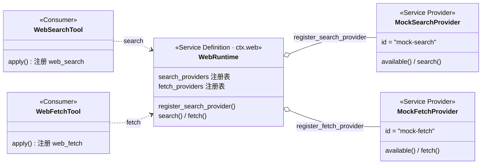
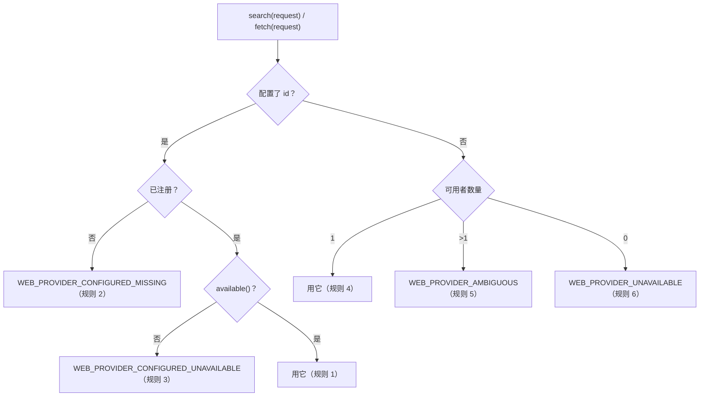
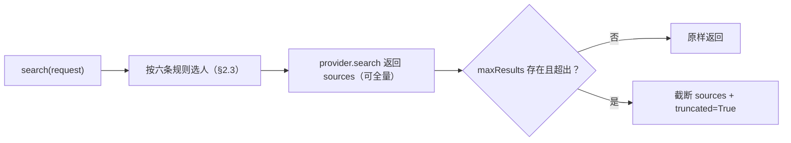
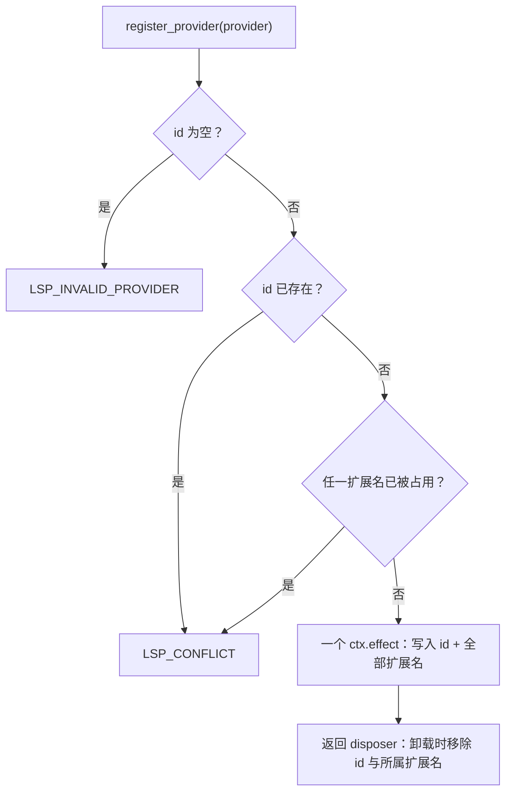
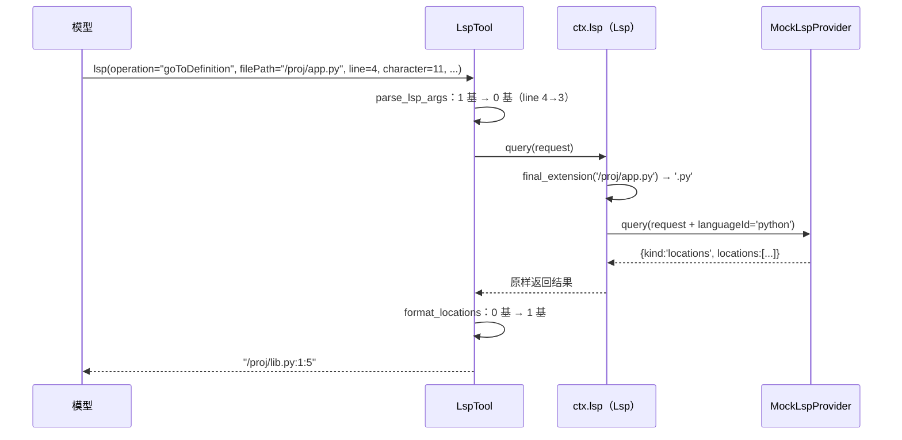

# 第 13 章 web / lsp 与独占能力：选谁在执行时决定

> 来客先报名；谁来应差，执行时定；有些位置，只容一人就座。

## 本章回答的问题

- 第 5 章确立了能力实现是注册进来的提供者，但搜索 / 抓取为什么不能把具体引擎调用直接写进函数？
- 第 12 章的 skill 把多个来源合并后读出，但 web 在执行时只选一个提供者，选谁？
- 第 12 章的 `register_provider` 一次注册一个提供者，但一个 lsp 提供者覆盖多个扩展名，怎么避免「注册了一半」的中间态？
- 如果一种能力是全局独占的——一张桌面、一个浏览器——注册表该长什么样？它还剩哪些职责？

第 5 章立下了能力 seam 的三角色骨架，并给出第一种形态：shell 的「组合时二选一」；第 12 章给出第二种形态：skill 的 provider 注册表——多来源并存注册、读取时按规则合并。本章看同属 provider 注册表一族的另外三种形态：

- `ctx.web`（搜索 / 抓页）：每次执行时按规则从注册表里选出**一个**提供者，并把结果归一化成统一结构；
- `ctx.lsp`（代码语义查询）：按文件扩展名把请求路由到**唯一**的提供者，并把四种操作的结果归一成一个闭并集；
- `ctx.computerUse` / `ctx.browserUse`（桌面 / 浏览器操作）：槽位只有一个，先到先得，第二个注册直接抛错——注册表只回答「谁在场」，不回答「能做什么」（§5）。

前两条与 skill 同源——实现都是注册进来的 provider，只是「读取」的规则变了；第三条把同一个命题推到空解：运行期没有选择，也没有归一化。（本章的「形态」编号有两套基数：讲 capability seam 时，shell 是第一、skill 是第二；讲注册表一族时从第 12 章的 skill 算起，§5 因此是第四形态。）

本章教学代码在 `ch13/code/`，运行 `python3 ch13/code/main.py`（依赖 ch01/ch04 教学代码，无第三方库）。

第 5 章的能力 seam 三角色（Service Definition / Service Provider / Consumer）在本章全部复用；seam 形态在第 12 章的基础上再进一步：

| | 第 5 章 shell seam | 第 12 章 skill seam | 本章 web / lsp（§2–§4） | 本章 computer / browser（§5） |
|---|---|---|---|---|
| 实现数量 | 组合时二选一 | 多提供者并存注册 | 多提供者并存注册 | 整个部署只允许一个 |
| 消费方式 | 直接方法调用 | 读注册表、按规则合并 | 执行时按规则选一个（web）/ 按扩展名路由（lsp） | 没有能力方法可调，只有「谁占着槽位」 |
| 结果形态 | 提供者原样返回 | 合并后的目录 / 正文 | 归一化：统一结构 + seam 上限（web）/ 闭并集（lsp） | 无（能力全部由 provider 自己承担） |
| 冲突处理 | 无 | 同名同层并列、跨层遮蔽 | web：多个可用 → 报错，绝不隐式选；lsp：扩展名冲突 → 整体拒绝 | 第二个注册（含同名）→ 抛 `already registered` |

复用清单（不重新实现，直接 import）：

- 第 1 章 `Context` / `Service`（`ch01/code/cordis.py`）：构造即注册——`WebRuntime(ctx)` 自动绑定为 `ctx.web`，`Lsp(ctx)` 自动绑定为 `ctx.lsp`；注册一律走 `ctx.effect`，卸载靠返回的 disposer；
- 第 4 章 `ToolRuntime` / `ToolDefinition` / `ToolExecution`（`ch04/code/tools.py`）：`web_search` / `web_fetch` / `lsp` 三个工具都是 tools 管线里的普通工具。

新代码全部位于 `ch13/code/`：`web_runtime.py`（web 定义层）、`web_providers.py`（web 实现层）、`lsp_runtime.py`（lsp 定义层）、`lsp_providers.py`（lsp 实现层）、`tool_web.py` / `tool_lsp.py`（消费层）、`bad_example.py`（问题反例）、`main.py`（分段演示）。§5 的单槽排他注册表整个文件 48 行，正文内联讲完，不新增教学文件。

## 1. 把外部能力硬连线进调用方

先看反例 `ch13/code/bad_example.py`——「搜索」这件事，引擎直接写进了函数体：

```python
def engine_brave_search(query):
    """引擎 A（模拟真实搜索 API）：返回自己的私有格式。"""
    return {"links": [{"t": f"brave:{query}", "u": f"https://brave.example/{query}"}]}


def engine_mock_search(query):
    """引擎 B（模拟测试桩）：返回另一种私有格式。"""
    return {"sources": [{"title": f"mock:{query}", "url": f"https://mock.example/{query}"}]}


def web_search(query, engine="brave"):
    # 坑 1：实现写死 —— 引擎以分支形式出现在函数体里
    # 坑 2：选择分散 —— 用哪个引擎是调用方传参决定，没有统一规则
    if engine == "brave":
        return engine_brave_search(query)
    return engine_mock_search(query)


def render_for_model(raw):
    # 坑 3：结果不归一 —— 调用方必须认识每种引擎的格式
    if "links" in raw:
        items = [(x["t"], x["u"]) for x in raw["links"]]
    else:
        items = [(x["title"], x["url"]) for x in raw["sources"]]
    return "\n".join(f"- {title} {url}" for title, url in items)
```

文件的 `__main__` 部分以两个调用方分别调用 `web_search`，运行 `python3 ch13/code/bad_example.py` 输出：

注意：两次调用的**返回值**是两种完全不同的结构（`{'links': ...}` vs `{'sources': ...}`）——下面两段输出长得一样，恰是 `render_for_model` 为每种引擎各写一条格式识别分支的结果；输出同形，不等于结构归一。

```text
调用方 1（写死 brave）：
- brave:seam https://brave.example/seam

调用方 2（想换 mock，得改调用参数，并确认格式化分支认得 mock 的格式）：
- mock:seam https://mock.example/seam

想加第三个引擎？要改 web_search 的分支、render_for_model 的格式识别，
以及每一个调用点 —— 而它们本来只想要「搜一下」这件事。
```

三个坑：

1. **实现写死**：引擎以分支形式出现在 `web_search` 的函数体里。换引擎 = 改函数体，所有调用方跟着受影响；
2. **选择分散**：「用哪个引擎」由每个调用方各写各的参数决定，没有统一规则。多个引擎同时可用时，不同调用方可能做出不同选择，行为不一致；
3. **结果不归一**：引擎 A 返回 `links`，引擎 B 返回 `sources`，`render_for_model` 必须认识每一种格式；加一个引擎就要加一个格式识别分支。

三个坑指向同一组缺失的机制：实现应该**注册**而不是写死（治坑 1），选择应该**集中到一套规则**（治坑 2），结果应该**归一成统一结构**（治坑 3）。这正是 web seam 要做的三件事。

## 2. web seam：注册是 effect，选择在执行时

### 2.1 三角色：先看装配

整体装配（对应 `ch13/code/web_runtime.py`、`web_providers.py`、`tool_web.py` 三个文件）：



- **Service Definition**：`WebRuntime`，绑定为 `ctx.web`。它自己不碰网络，只管两件事：谁在场（两张注册表）、选谁（执行时的选择规则）。它对外暴露的方法集合——`search` / `fetch`——代码注释里称为**方法面**，是第 5 章契约面在本章的具体化；
- **Service Provider**：实现提供者契约的对象——`id` + `available()` + `search()`/`fetch()` 三件套。教学版给四个确定性 mock（`MockSearchProvider` / `EchoSearchProvider` / `PremiumSearchProvider` / `MockFetchProvider`）；
- **Consumer**：`WebSearchTool` / `WebFetchTool`——把 `web_search` / `web_fetch` 注册进第 4 章的 `ctx.tools`，execute 体只调 `ctx.web`。

拆开内部之前，先跑通最小例子（行内示例，在 `ch13/code/` 目录下可运行）：

```python
from web_runtime import WebRuntime          # import 时顺带注册 ch01 路径
from web_providers import MockSearchProvider
from cordis import Context                  # 第 1 章上下文容器

ctx = Context()
web = WebRuntime(ctx)                       # 构造即注册，ctx.web 可用
web.register_search_provider(MockSearchProvider())
print(web.search({"query": "seam"})["sources"][0]["title"])
ctx.dispose()
# 输出：Capability seam
```

注册一个提供者、搜一次、拿到归一化的 `sources`——本章剩余内容都在回答「这一行背后发生了什么」。

### 2.2 两张注册表与注册 effect

为什么是两张注册表？搜索与抓取是两种完全独立的能力：会搜索的引擎未必会抓页面，会抓页面的未必会搜索。所以 `WebRuntime` 分表存放、各自选人（摘录自 `web_runtime.py`）：

```python
class WebRuntime(Service):
    # ... 类 docstring 从略（其末行写明选择语义：「执行时解析，绝不依赖注册顺序」，`packages/web/web/src/index.ts:69-81`）...

    def __init__(self, ctx, config=None):
        super().__init__(ctx, "web")
        config = config or {}
        # 配置的提供者 id（`packages/web/web/src/index.ts:88-91`）；真实版还可被环境变量覆盖（`packages/web/web/src/index.ts:100-101`）
        self.configured_search = config.get("searchProvider")
        self.configured_fetch = config.get("fetchProvider")
        self.search_providers = {}  # search 注册表（`packages/web/web/src/index.ts:93`）
        self.fetch_providers = {}   # fetch 注册表（`packages/web/web/src/index.ts:94`）

    def register_search_provider(self, provider):
        """注册 search 提供者（`packages/web/web/src/index.ts:113-115`）。"""
        return self._register_provider(self.search_providers, provider)

    def register_fetch_provider(self, provider):
        """注册 fetch 提供者（`packages/web/web/src/index.ts:124-126`）。"""
        return self._register_provider(self.fetch_providers, provider)

    def _register_provider(self, registry, provider):
        """注册是 effect：注册写表、卸载还原（`packages/web/web/src/index.ts:128-144`）。"""
        if provider.id in registry:
            raise WebError("WEB_DUPLICATE_PROVIDER",
                           f"duplicate web provider id: {provider.id}")

        def setup():
            registry[provider.id] = provider  # ctx.effect 体（`packages/web/web/src/index.ts:133-140`）

            def dispose():
                if registry.get(provider.id) is provider:
                    del registry[provider.id]

            return dispose

        return self.ctx.effect(setup)
```

三个细节：

1. 重复 id 直接拒绝（`WEB_DUPLICATE_PROVIDER`）——不允许一个提供者悄悄顶掉另一个；
2. 注册动作包在第 1 章的 `ctx.effect` 里：setup 写表，dispose 摘表，且摘表时先确认槽位里还是自己（槽位已易主就不误删）；
3. 返回值是 disposer——注册可撤销，与第 12 章 `SkillRegistry.register_provider` 同形态。

提供者契约里的 `available()` 有一条约定：**只做本地检查、绝不发网络调用**——它在每次执行时选择都会被调，代价必须可控（`packages/web/web/src/types.ts:131`）。六条选择规则只看 `available()`；工具对某条模型请求是否可见，另由一个可选的 `ready(llmProvider)` 回答（「这条请求所用的模型路由有没有凭据」，同样不发网络；`packages/web/tool-web/src/search.ts:414`）。

`PremiumSearchProvider` 演示「注册了、但不可用」这一档（摘录自 `web_providers.py`）：

```python
class PremiumSearchProvider:
    """模拟「API key 未配置」的提供者：已注册但 available() 返回 False。

    用于演示规则 3/6：seam 绝不把请求交给不可用提供者。
    """

    id = "premium-search"

    def __init__(self, api_key=None):
        self.api_key = api_key

    def available(self):
        """只查本地配置（对应 DeepSeekSearchProvider.available 的语义）。"""
        return self.api_key is not None

    # ... search 省略：永不到达这里，seam 规则 3/6 会先过滤 ...
```

**回顾**：坑 1「实现写死」在这里被治掉——引擎不再是函数体里的分支，而是注册进注册表的提供者。但多个提供者并存后，「选谁」成了新问题——正是坑 2。

### 2.3 执行时选择：六条规则

`search` 被调用时并不直接看注册表，而是先按规则选人。**执行时选择**指：每次调用时，seam 依据自身规则从注册表里选出一个提供者，与注册先后无关——就像前台按值班表分派来客，而不是凭脸熟。

```python
    def search(self, request):
        """search 方法面：按规则选人 → provider.search → cap_sources（`packages/web/web/src/index.ts:185-188`）。"""
        provider = self._resolve_provider(self.search_providers,
                                          self.configured_search)
        result = provider.search(request)
        return cap_sources(result, request.get("maxResults"))

    def fetch(self, request):
        """fetch 方法面：按规则选人 → provider.fetch（`packages/web/web/src/index.ts:219-221`）。"""
        provider = self._resolve_provider(self.fetch_providers,
                                          self.configured_fetch)
        return provider.fetch(request)

    def _resolve_provider(self, registry, configured_id):
        """执行时选人：六条规则，绝不依赖注册顺序（`packages/web/web/src/index.ts:275-297`）。"""
        if configured_id is not None:
            provider = registry.get(configured_id)
            if provider is None:
                # 规则 2：配置 id 未注册
                raise WebError("WEB_PROVIDER_CONFIGURED_MISSING",
                               f"configured provider not registered: {configured_id}")
            if not provider.available():
                # 规则 3：配置 id 已注册但不可用
                raise WebError("WEB_PROVIDER_CONFIGURED_UNAVAILABLE",
                               f"configured provider unavailable: {configured_id}")
            return provider  # 规则 1：配置 id 已注册且可用
        usable = [p for p in registry.values() if p.available()]
        if len(usable) == 1:
            return usable[0]  # 规则 4：未配置且恰有一个可用
        if len(usable) > 1:
            # 规则 5：多个可用 → 报错，绝不隐式选「先注册的那个」
            ids = ", ".join(sorted(p.id for p in usable))
            raise WebError("WEB_PROVIDER_AMBIGUOUS",
                           f"multiple providers available, configure one: {ids}")
        # 规则 6：无可用
        raise WebError("WEB_PROVIDER_UNAVAILABLE", "no web provider available")
```

六条规则分两段：配置了 id 走规则 1–3（已注册且可用 → 用；未注册 → `CONFIGURED_MISSING`；已注册但不可用 → `CONFIGURED_UNAVAILABLE`）；没配置走规则 4–6（恰一个可用 → 用；多个可用 → `AMBIGUOUS` 报错；无可用 → `UNAVAILABLE` 报错）。



最反直觉的是规则 5：多个提供者同时可用时，seam 不挑一个，而是直接报错。为什么不隐式选「先注册的那个」？因为那会让行为依赖注册顺序——一个调用方看不见的偶然因素。报错逼迫使用者把选择显式写进配置，选择从此确定。`main.py` 段 2 在独立 `ctx` 上逐条跑通六条规则；其中规则 4 特意先注册不可用的 `premium-search`、再注册可用的 `mock-search`，选出的仍是 `mock-search`——选择与注册顺序无关。

**回顾**：坑 2「选择分散」在这里被治掉——选择逻辑只存在于 `_resolve_provider`，所有调用方面对同一套规则。还剩坑 3：各提供者返回的结果仍各有各的格式。

## 3. 归一化结果：上限写在 seam，body 是并集

### 3.1 capSources：提供者不被信任执行上限

如果「最多返回几条」交给每个提供者自己执行，会出两类岔子：换一个提供者，同一个请求返回的条数就变了——模型的上下文预算跟着漂；新加一个提供者忘了写上限，返回几百条来源，而调用方只会照着上一次的假设读结果。没有统一上限时，这不是「某家实现得不好」，而是**每换一次 provider 就要重新校准一次**。

修法是把上限写在 seam 这一侧，而不是信任提供者：`maxResults` 照常随请求转发（提供者可以用它省流量），但返回后 seam 一律再截断一次。这样即使提供者不认这个字段、或者根本不检查，输出也有界（模块级函数，在 §2.3 的 `search` 末尾调用）：

```python
def cap_sources(result, max_results):
    """seam 强制 maxResults：截断 sources 并置 truncated（`packages/web/web/src/index.ts:300-303`）。

    提供者可以自己提前应用上限以省流量，但 seam 不依赖它 —— 返回后一律再截断。
    """
    sources = result["sources"]
    if max_results is None or len(sources) <= max_results:
        return result
    return {
        "query": result["query"],
        "sources": sources[:max_results],
        "truncated": True,
    }
```



两个好处：新加提供者不必实现截断，也自动受益；上限语义集中在一处，不会各提供者实现得不一样。真实源码里 `maxResults` 本来就是 `WebSearchRequest` 的普通字段、`search()` 原样透传（`packages/web/web/src/types.ts:28-38`、`packages/web/web/src/index.ts:186-187`），`capSources` 只是事后兜底——「不依赖」而非「不转发」。`main.py` 段 3：不带 `maxResults` 搜 `"seam"` 返回 5 条来源；`maxResults=3` 返回 3 条且 `truncated=True`。

### 3.2 fetch 结果：statusCode 是数据，body 是并集

search 的结果已经归一（`{"query", "sources"}`，`packages/web/web/src/types.ts:50-57` / `packages/web/web/src/types.ts:65-74`）；fetch 的结果也有统一结构 `{"url", "statusCode", "body", "truncated"}`（`packages/web/web/src/types.ts:92-101`），其中 `body` 是一个并集——要么 `{"kind": "text", "text"}`，要么 `{"kind": "html", "html"}`（`packages/web/web/src/types.ts:112-114`），消费方按 `kind` 分支即可。看 `MockFetchProvider`（摘录自 `web_providers.py`）：

```python
class MockFetchProvider:
    """确定性 fetch 提供者：固定 URL→页面表（对应 HttpFetchProvider 的角色）。"""

    id = "mock-fetch"

    # ... PAGES 页面表省略：text / html / binary 三个 URL ...

    def available(self):
        return True

    def fetch(self, request):
        """返回 WebFetchResult：url + statusCode + body（`packages/web/web/src/types.ts:92-101`）；
        body 是 html|text 并集（`packages/web/web/src/types.ts:112-114`）。"""
        url = request["url"]
        page = self.PAGES.get(url)
        if page is None:
            return {"url": url, "statusCode": 404,
                    "body": {"kind": "text", "text": "not found"}}
        if page["kind"] == "binary":
            # 真实 HttpFetchProvider 在此拒绝不支持的内容类型
            raise WebError("WEB_UNSUPPORTED_CONTENT_TYPE",
                           f"unsupported content: {url}")
        return {"url": url, "statusCode": 200, "body": page}
```

（以上与 `ch13/code/web_providers.py` 逐字一致；[教学简化] 返回值省略了 `truncated` 字段——真实 `WebFetchResult` 带它，教学版不模拟字节上限。）

注意错误与返回值的分界：404 不是异常而是正常返回值（`statusCode` 字段）——「页面不存在」是业务结局之一；只有「内容类型不支持」这类契约违反才抛 `WebError`。`main.py` 段 4 连抓四个 URL：text 页、html 页（`body.kind='html'`）、不存在的页（404）、二进制资源（抛 `WEB_UNSUPPORTED_CONTENT_TYPE`，调用方捕获后打印错误码）。

**回顾**：坑 3「结果不归一」在这里被治掉——search 返回统一 `{"query", "sources"}`，fetch 返回统一 `{"url", "statusCode", "body", "truncated"}`，`render_for_model` 式的格式识别分支消失了。web seam 闭环；但外部能力不止「上网」——模型还要「看懂代码」。

## 4. lsp seam：扩展名路由、原子注册与闭并集

代码语义查询（跳转定义、查找引用）依赖语言服务器，而一个语言服务器只懂一族语言。所以 lsp seam 的选择维度与 web 不同：不是「多个里按规则选一个」，而是**按文件扩展名路由**——`.py` 文件归 Python 提供者，`.ts` 文件归 TypeScript 提供者。每个扩展名至多归一个提供者，天然没有歧义。`Lsp` 同样是第 1 章的 `Service`，绑定为 `ctx.lsp`；路由表是 扩展名 → (provider, language_id) 的映射（`packages/lsp/lsp/src/index.ts:84`）。

### 4.1 原子注册：先全量校验，再一次性写表

一个提供者常常覆盖多个扩展名（如 `.ts` + `.tsx`）。如果逐个扩展名写路由表，写到第二个才发现冲突，第一个已经写进去了——出现「注册了一半」的中间态。lsp seam 的答案是**原子注册**（all-or-nothing）：先做完全部校验，再一次性写表；就像银行转账，借贷两边要么都成功、要么都不生效。

```python
class Lsp(Service):
    """ctx.lsp 服务：扩展名 → 路由表 + 原子注册（`packages/lsp/lsp/src/index.ts:82`）。

    seam 只管「哪个扩展名归哪个提供者」：
    - register_provider：先全量校验，再一次性写表，失败不留痕
    - query：按文件扩展名路由，透传 languageId 给提供者
    """

    def __init__(self, ctx):
        super().__init__(ctx, "lsp")
        self.routes = {}  # 扩展名 -> (provider, language_id)（`packages/lsp/lsp/src/index.ts:84`）
        self.provider_ids = set()

    def register_provider(self, provider):
        """原子注册：先全量校验，再一次性写表（`packages/lsp/lsp/src/index.ts:90-141`）。

        三项校验：空 id → LSP_INVALID_PROVIDER；重复 id 或扩展名冲突 →
        LSP_CONFLICT。全部通过后才用一个 ctx.effect 写入 id + 全部扩展名
        （`packages/lsp/lsp/src/index.ts:130-137`），因此不存在「注册了一半」的中间态。
        """
        if not provider.id:
            raise LspError("LSP_INVALID_PROVIDER", "provider id must be non-empty")
        if provider.id in self.provider_ids:
            raise LspError("LSP_CONFLICT", f"duplicate provider id: {provider.id}")
        for ext in provider.extensions:
            ext = normalize_extension(ext)
            owner = self.routes.get(ext)
            if owner is not None:
                raise LspError("LSP_CONFLICT",
                               f"extension {ext} already owned by provider {owner[0].id}")

        def setup():
            self.provider_ids.add(provider.id)
            for ext in provider.extensions:
                self.routes[normalize_extension(ext)] = (provider, provider.language_id)

            def dispose():
                self.provider_ids.discard(provider.id)
                owned = [e for e, route in self.routes.items() if route[0] is provider]
                for ext in owned:
                    del self.routes[ext]

            return dispose

        return self.ctx.effect(setup)
```



三项校验（空 id / 重复 id / 扩展名冲突）全部在任何写表动作之前完成；全部通过后才用**一个** `ctx.effect` 写入 `provider_ids` 与全部扩展名——要么都写入，要么一个扩展名都没写。`main.py` 段 5 逐条验证：重复 id → `LSP_CONFLICT`；新 id 但 `.py` 已被占用 → `LSP_CONFLICT`；`rust-py` 提供者声明 `(.rs, .py)` 两个扩展名、`.py` 冲突 → 整体拒绝，事后 `routes` 里也没有 `.rs`；随后注册单扩展名的 `mock-ts` 成功，调用 disposer 后 `mock-ts` 连同扩展名一起回滚。

### 4.2 query：按扩展名路由，透传 languageId

```python
    def query(self, request):
        """查询入口：按文件扩展名路由，未命中 → LSP_UNAVAILABLE（`packages/lsp/lsp/src/index.ts:143-149`）。"""
        ext = final_extension(request["filePath"])
        route = self.routes.get(ext)
        if route is None:
            raise LspError("LSP_UNAVAILABLE",
                           f"no lsp provider for extension: {ext or '<none>'}")
        provider, language_id = route
        # seam 透传 languageId：提供者不必自己从扩展名猜语言
        return provider.query({**request, "languageId": language_id})
```

两个模块级辅助函数：`final_extension` 取最后一个路径分隔符之后的扩展名——`'a/b.py'` → `'.py'`；`'a.d/b'` → `''`（点在分隔符前，不算）；`'.hidden'` → `''`（点开头是隐藏文件，不是扩展名）；`normalize_extension` 统一小写，`.PY` 与 `.py` 路由到同一个提供者。一个细节：seam 路由时把 `languageId` 注入请求再透传——语言归属在注册时就已确定，提供者不必自己猜。

### 4.3 四种操作与闭并集

lsp 有四种操作：`goToDefinition` / `findReferences` / `goToImplementation` / `hover`（`packages/lsp/lsp/src/types.ts:17`）。四种操作的结果被归一成**闭并集**——结果只能装进两个抽屉：`locations`（零或多个位置）或 `hover`（悬停信息），没有第三种形态；消费方按 `kind` 分支两种写法就穷尽了所有可能。

```python
class MockLspProvider:
    """确定性 lsp 提供者：按位置取标识符，再查符号表。

    保留真实提供者契约（`packages/lsp/lsp/src/types.ts:95-107`）：id、extensions、language_id、query。
    """

    # ... __init__ 省略：持有 id / extensions / language_id / documents / symbols ...

    def query(self, request):
        """四种操作返回闭并集（`packages/lsp/lsp/src/types.ts:85-87`）：`locations` 或 `hover`。"""
        word = self._word_at(request["filePath"], request["position"])
        info = self.symbols.get(word) if word else None
        if request["operation"] == "hover":
            hover = ({"contents": info["hover"], "range": None} if info
                     else {"contents": None, "range": None})
            return {"kind": "hover", "hover": hover}
        if info is None:
            locations = []
        elif request["operation"] == "goToDefinition":
            locations = [info["definition"]]
        elif request["operation"] == "findReferences":
            locations = list(info["references"])
        elif request["operation"] == "goToImplementation":
            locations = [info["implementation"]]
        else:
            raise LspError("LSP_UNSUPPORTED_OPERATION",
                           f"unsupported operation: {request['operation']}")
        return {"kind": "locations", "locations": locations,
                "resolvedWorkspaceUri": request.get("workspaceUri")}
```

四种操作的语义：`goToDefinition` 返回唯一定义位置；`findReferences` 返回零或多个引用位置；`goToImplementation` 返回实现位置；`hover` 返回符号的文档信息（可为空）。`locations` 里统一是 `{uri, range}` 结构，`range` 的行列是**零基** UTF-16 坐标（`packages/lsp/lsp/src/types.ts:20-25`）——这是 LSP 协议的约定，与模型侧的坐标换算留给工具层（§6.2）。教学版提供者用 `_word_at` 从固定文档里按位置取标识符、再查固定符号表，复现「定位 → 查询」的两步动作；真实后端是语言服务器进程，见 §8 源码对照。

## 5. 注册表家族的第四形态：单槽排他注册表

前四节读的是 `ch13/code/` 里的 Python 教学版；这一节起直接读上游 TypeScript 源码——机制只有 48 行，直读比改写更省事。碰到 `ctx.effect(function* () { yield … })` 这样的生成器 effect 时，把它读成「每 `yield` 一个 disposer 就登记一项清理，卸载时按登记逆序回收」即可（第 1 章 §6 讲的就是这套）。

**单槽排他注册表**指：全局独占的能力（一张桌面、一个浏览器）只允许一个 provider 占位；注册返回 disposer，第二次注册——哪怕同名——直接抛错并点名当前占位者。它不选人、不归一化，只维护一条准入约束。

### 5.1 痛点：一张桌面，两个司机

前面两条 seam 都假设「多个提供者可以同时在场」：web 因为多可用无法判断而报错，lsp 因为扩展名重叠而整体拒绝——但注册表里始终可以躺着多个提供者。桌面操作与浏览器操作不满足这个假设：它们操作的是**全局共享的物理资源**，两个 driver 同时接管同一张桌面，谁点了哪个按钮就说不清了。

```python
# 行内示例（非教学文件）
class SharedDesktopRegistry:
    """反例：注册表不设排他，后注册的那个悄悄生效。"""

    def __init__(self):
        self.providers = {}

    def register(self, provider):
        self.providers[provider.name] = provider      # 后来者覆盖先到者
        return lambda: self.providers.pop(provider.name, None)

registry = SharedDesktopRegistry()
registry.register(McpDriver("cua-driver-native"))
registry.register(McpDriver("cua-driver-mcp"))        # 无声接管，调用方毫不知情
```

问题不在「覆盖」，在**无声**：两个 driver 都以为自己持有桌面，模型发出的点击落在哪一边取决于注册顺序；出错时，日志里连「现在是哪个 driver 在服务」都查不到。修法不是加一把锁，而是让第二次注册**失败，并说出占位者的名字**。

### 5.2 48 行的注册表：只登记名字

真实实现短到可以整段读完——整个文件 48 行，类体 `:16-46`。`packages/computer-use/computer-use/src/index.ts` 的 `ComputerUseRegistry`：

```ts
export class ComputerUseRegistry extends Service {
  private registration: ComputerUseProviderName | undefined

  constructor(ctx: Context) {
    super(ctx, 'computerUse')
  }

  get providerName(): ComputerUseProviderName | undefined {
    return this.registration
  }

  register(name: ComputerUseProviderName): () => Promise<void> {
    if (this.registration !== undefined) {
      throw new Error(`computer use provider "${this.registration}" is already registered`)
    }
    return this.ctx.effect(() => {
      this.registration = name
      return () => {
        this.registration = undefined
      }
    }, 'computerUse.register()')
  }
}
```

（`packages/computer-use/computer-use/src/index.ts` 的 `ComputerUseRegistry` 类，节选去掉了 import 与 JSDoc。）`packages/browser-use/browser-use/src/index.ts:16-46` 的 `BrowserUseRegistry` 与它逐行同构，只把服务名和报错字符串换成 `browserUse`。三个断言值得逐个指认：

1. **没有能力方法面**。类上只有 `providerName` getter 与 `register`（注册入口），没有 `click`、`open`、`screenshot`，也没有派发方法。对比 §2 的 `WebRuntime` 有 `search` / `fetch`、§4 的 `Lsp` 有 `query`——这一族的 Service Definition 没有能力方法，**能力方法面是空的**；
2. **没有提供者对象**。槽位里存的是一个带品牌的名字（`ComputerUseProviderName`），不是带能力的对象；这也是它短到 48 行的原因；
3. **第二次注册（含同名）直接抛错**，消息里带着当前占位者的名字。注册表的测试在同一个用例里用两条 `expect` 分别验证这两件事：先注册 `cua-driver-mcp` 后，同一名字再注册命中 `toThrow('already registered')`，换 `cua-driver-native` 再注册则命中 `toThrow('cua-driver-mcp')`（`packages/computer-use/computer-use/tests/registry.spec.ts:17-18`）。

注册经 `ctx.effect` 完成，返回的是这个 fiber 的 disposer：provider 插件卸载 → 槽位清空。`vendor/cordis` 的 `Fiber.effect` 注释确认了这条所有权——disposer 在 fiber 卸载时运行，重复调用是 no-op（`vendor/cordis/src/fiber.ts:412-416`）。README 明说「重复调用 disposer 不会摘掉后来的注册」——槽位归**这一次**注册所有，不归名字所有（`packages/computer-use/computer-use/README.md:46`）。

名字外面还套了一层品牌：

```ts
export type ComputerUseProviderName = Branded<'ComputerUseProviderName'>

export function ComputerUseProviderName(name: string): ComputerUseProviderName {
  return name as ComputerUseProviderName
}
```

（`packages/computer-use/computer-use/src/brand.ts:6-15`。）**ProviderName 品牌**指这种写法：`ComputerUseProviderName = Branded<'ComputerUseProviderName'>` 起一个名义类型，再加一个只做 `as` 转换的同名工厂函数（同文件 `:13-15`）。它只是类型层标记，**运行时不校验任何东西**——传空字符串、传一个普通 `string` 都能通过。价值在诊断入口：凡是该出现提供者名字的位置都要求这个类型，把普通字符串误传进来会在编译期暴露。

### 5.3 释放顺序：一个 effect，而不是两个

槽位靠 `ctx.effect` 归还，于是出现一个顺序问题：provider 卸载时应当「先停工具调用 → 再关子进程 → 最后释放槽位」。任何一步提前，都可能让另一个 driver 在资源还没关干净时抢进槽位。其中「停工具调用」是 provider 自己的责任——注册表的 JSDoc 把它写成第一条约定（`packages/computer-use/computer-use/src/index.ts:30-31`）；下面这段代码负责的是后两步的先后。`packages/experimental/computer-use-cua-driver-mcp/src/index.ts:62-69` 给出上游的写法：

```ts
// One effect orders child shutdown before release; separate fiber effects
// unload concurrently and could otherwise admit another live driver.
let child!: Fiber
ctx.effect(function* () {
  yield ctx.computerUse.register(ComputerUseProviderName('cua-driver-mcp'))
  child = ctx.plugin(McpClient, connection)
  yield child.dispose
}, 'computer-use-cua-driver-mcp.connection')
```

（`packages/experimental/computer-use-cua-driver-mcp/src/index.ts` 的 `apply()` 末尾。）一个生成器 effect 里按顺序 `yield` 两样东西：注册产生的 disposer、子 fiber 的 `dispose`。第 1 章讲过，卸载时 Cordis 按注册逆序回收——「关子进程」排在「释放槽位」之前，中间没有可插入的空档。注释点明了反面：拆成两个独立 effect，卸载会**并发**执行，槽位先空、子进程还在关，另一个 driver 就可能趁虚而入。

这条顺序是**约定而非代码强制**——注册表并不知道你手里有没有子进程，也不知道工具有没有停；它只保证「槽位在你彻底放手之前不会给别人」。

### 5.4 能力从哪来：完全下沉给 provider

注册表不注册工具，那模型怎么看见「点桌面」这件事？答案在 provider 一侧。`cua-driver-mcp` 先用 MCP 客户端（MCP 是「通过标准输入输出与外部工具服务对话」的协议，细节归第 6 章的进程树）拉起一个 stdio 子进程（`McpClient.Config({ transport: 'stdio', serverName: 'cua-driver-mcp', ... })`，:53-61），工具清单由服务端发现后进入 `ctx.tools`；注册表对此一无所知。想看子进程怎么被管进进程树，回到第 6 章的 `ctx.subprocess`——本章不展开 MCP 协议，只确认一件事：**provider 用 `McpClient` 挂一个 stdio 子进程把能力带进来，`ctx.computerUse` 只负责「谁是那个 provider」**。

`computer-use` 的 README 把这条边界写成了一句话：`Model Experience: None, as this registry only records provider names`（`packages/computer-use/computer-use/README.md:65-67`）。注册表改动不影响模型请求的任何前缀。

browser-use 的 provider 多走了一步会话隔离：`experimental/browser-use-runtime` 给每个活着的 Agent 一个 `createScope(ctx, agent)`（`packages/experimental/browser-use-runtime/src/mcp.ts:134`），MCP 客户端与浏览器资源关在这个子作用域里。资源表在源码里叫 **SessionResources**——按活着的 Agent 实例（不是持久化的会话 id，那样在 Agent 重启后会指向旧对象）懒创建一项资源，独占 attach；`closeEntry` 先 abort 在途操作，再 await 资源关闭（`packages/experimental/browser-use-runtime/src/index.ts:185`）。这是「作用域即卸载单位」的实战用例，机制本身在第 9 章讲过，这里只记两句：**per-Agent scope + 先 abort 后 await**。这一整套（`browser-use-runtime` 及其上层 provider）都位于 `packages/experimental/`，上游对 CUA 系列写明「Windows 支持与平台验证通过后才晋升到 `computer-use` 组」（`packages/experimental/cua/README.md:125`），版本会漂，本章不逐行展开。

### 5.5 四象限：注册表家族到这里闭合

把第 12 章与本章四种形态并排放。注册表一族的编号从第 12 章的 skill 算起：skill（第一形态）→ web / lsp（第二、第三形态）→ computer / browser（第四形态）。表里的「方法面」只指**能力派发方法**（消费者调它去干活），注册入口（`register` / `register_provider`）另计，四行都一样。

| 形态 | 代表 | 选择发生在 | 多者并存时 | 结果归一化 | 能力方法面（注册入口另计） |
|---|---|---|---|---|---|
| 多源合并 | skill（第 12 章） | 读取时按层 / rank 合并 | 同名同层并列、跨层近层遮蔽 | 合并后的目录 / 正文 | `list` / `get` |
| 执行时择优（不排名；多可用即报错） | web（§2–§3） | 每次调用按六条规则 | 多个可用 → `WEB_PROVIDER_AMBIGUOUS` | seam 统一结构与上限 | `search` / `fetch` |
| 维度路由 | lsp（§4） | 每次调用按扩展名 | 扩展名冲突 → 整体拒绝 | 闭并集（`locations` / `hover`） | `query` |
| 单槽排他注册表 | computer-use / browser-use（§5） | **组合期**，注册那一刻 | 第二次注册 → `already registered` | 无 | **空** |

最后一行是这一族的负空间：一个 Service Definition 的能力方法面可以为空。它不生产结果、不做选择，只维护一条准入约束——全局独占资源，整个部署只容一个 provider；能力面与生命周期全部由 provider 自己承担。这也回答了「两个包逐行重复，为什么不抽公共基类」：它们各自独立拥有注册规则，合并成通用的 `ExclusiveSlot<T>` 会让两个名字在诊断与类型上失去来源。

## 6. 消费层：三个工具进 tools 管线

模型不直接碰 `ctx.web` / `ctx.lsp`——它面对的是注册进第 4 章 `ctx.tools` 的三个工具，走同一条 `ToolRuntime` 管线。

### 6.1 tool-web：execute 只调 seam

```python
WEB_SEARCH_MAX_RESULTS = 8  # 真实常量在 `packages/web/tool-web/src/search.ts:20`（上游默认 10）


class WebSearchTool:
    """web_search 工具：execute 只调 ctx.web.search（`packages/web/tool-web/src/search.ts:403-414`）。"""

    inject = ["tools", "web"]

    def __init__(self, ctx):
        self.ctx = ctx

    # ... apply() 注册 ToolDefinition 进 ctx.tools，与第 12 章 SkillTool 同构 ...

    def _execute(self, args):
        query = args.get("query")
        if not query:
            return "web_search failed: query is required"
        max_results = args.get("maxResults") or WEB_SEARCH_MAX_RESULTS
        max_results = min(int(max_results), WEB_SEARCH_MAX_RESULTS)
        try:
            result = self.ctx.web.search({"query": query,
                                          "maxResults": max_results})
        except WebError as err:
            return f"web_search failed: {err.code}: {err}"
        return format_search_output(result)
```

（模块级常量与类定义，摘录自 `tool_web.py`。）`inject` 声明与实际使用一致：`apply` 读 `ctx.tools`，`_execute` 读 `ctx.web`；真实版还注入 `systemPrompt` 写 prompt section，教学版不引入（[教学决策]，见 §8）。注意两道上限的分工：工具层把模型传来的 `maxResults` 钳到 ≤8（教学版；真实版的上限是 `searchMaxResults` 配置，上游默认 10），seam 层的 `cap_sources` 再对提供者输出截断——两道关卡互不信任。`format_search_output` 把归一化结果渲染成给模型的纯文本（编号列表 + 截断提示）。`web_fetch` 同构：`_execute` 只调 `ctx.web.fetch`，再用 `render_body` 渲染 `body`——text 原样返回，html 朴素去标签（[教学简化]，真实版用 turndown 转 markdown，见 §8）。

### 6.2 tool-lsp：一个工具承载四种操作

真实源码只注册一个 `lsp` 工具，四种操作用 `operation` 参数区分（`packages/lsp/tool-lsp/src/render.ts:15`）。对模型来说，一个工具 + 参数比四个工具更省——工具描述只占一份上下文，且四种操作的参数（文件 + 位置）完全相同。工具层的关键是坐标换算：模型读文件时看到的行号通常从 1 开始，而 LSP 协议用 0 基，`parse_lsp_args` 在入口处完成换算（摘录自 `tool_lsp.py`）：

```python
LSP_OPERATIONS = ("goToDefinition", "findReferences",
                  "goToImplementation", "hover")  # `packages/lsp/tool-lsp/src/render.ts:15`


def parse_lsp_args(args):
    """模型侧 1 基行列 → 协议 0 基（`packages/lsp/tool-lsp/src/render.ts:46-59`，换算在 :57）。"""
    operation = args.get("operation")
    if operation not in LSP_OPERATIONS:
        raise LspError("LSP_UNSUPPORTED_OPERATION",
                       f"unknown operation: {operation}")
    file_path = args.get("filePath")
    if not file_path:
        raise LspError("LSP_UNAVAILABLE", "filePath is required")
    line = args.get("line")
    character = args.get("character")
    if (not isinstance(line, int) or not isinstance(character, int)
            or line < 1 or character < 1):
        raise LspError("LSP_UNAVAILABLE",
                       "line/character must be 1-based positive integers")
    return {
        "operation": operation,
        "filePath": file_path,
        # 1 基 → 0 基换算（`packages/lsp/tool-lsp/src/render.ts:57`）
        "position": {"line": line - 1, "character": character - 1},
        "workspaceUri": args.get("workspaceUri"),
    }
```

（模块级常量与函数。）`LspTool._execute` 依次做四件事：先 `parse_lsp_args`（参数校验 + 坐标换算），再查 `workspaceUri`（无工作区 → `LSP_WORKSPACE_REQUIRED`，`packages/lsp/tool-lsp/src/index.ts:186`），然后 `ctx.lsp.query`（`packages/lsp/tool-lsp/src/index.ts:188-193`），最后按 `kind` 渲染——`locations` 交给 `format_locations` 渲染成 `文件:行:列`（行列加回 1 基），`hover` 交给 `format_hover` 渲染成文档文本。一次查询的完整路径：



**回顾**：§1 的三个坑全部闭环——实现注册（§2.2）、选择集中（§2.3）、结果归一（§3、§4.3）；模型面对的是三个工具，seam 与提供者对模型完全不可见。

## 7. 完整运行输出

运行 `python3 ch13/code/main.py`（依赖 ch01/ch04 教学代码，无第三方库），输出的段号与 `main.py` 的七段一一对应：

```text
========================================================================
段 1 —— 装配：两条 seam + 三个工具
========================================================================
ctx.web 提供者：{'search': ['mock-search', 'premium-search'], 'fetch': ['mock-fetch']}
ctx.lsp 提供者：['mock-python']
ctx.tools 可见工具：['web_search', 'web_fetch', 'lsp']

========================================================================
段 2 —— web 执行时选择：六条规则
========================================================================
  规则 1：配置 id 已注册且可用 -> 正常返回，5 条来源
  规则 2：配置 id 未注册 -> WEB_PROVIDER_CONFIGURED_MISSING
  规则 3：配置 id 已注册但不可用 -> WEB_PROVIDER_CONFIGURED_UNAVAILABLE
  规则 4：未配置，恰有一个可用（不可用者先注册也不选它） -> 正常返回，5 条来源
  规则 5：未配置，多个可用 -> WEB_PROVIDER_AMBIGUOUS
  规则 6：未配置，无可用 -> WEB_PROVIDER_UNAVAILABLE

========================================================================
段 3 —— search 方法面：capSources 强制 maxResults
========================================================================
不带 maxResults：5 条来源，truncated=False
maxResults=3：3 条来源，truncated=True
第一条来源：Capability seam

========================================================================
段 4 —— fetch 方法面：body 是 html|text 并集
========================================================================
  https://docs.example/seam -> [200] body.kind=text
  https://docs.example/guide -> [200] body.kind=html
  https://docs.example/missing -> [404] body.kind=text
  https://docs.example/logo.png -> WEB_UNSUPPORTED_CONTENT_TYPE

========================================================================
段 5 —— lsp 原子注册：先全量校验，再一次性写表
========================================================================
  重复 id mock-python -> LSP_CONFLICT: duplicate provider id: mock-python
  扩展名 .py 冲突（id 是新的） -> LSP_CONFLICT: extension .py already owned by provider mock-python
  多扩展名、.py 冲突（应整体拒绝） -> LSP_CONFLICT: extension .py already owned by provider mock-python
  拒绝后 .rs 未注册：routes=['.py']
  注册 mock-ts 后：providers=['mock-python', 'mock-ts']
  disposer 回滚后：providers=['mock-python']

========================================================================
段 6 —— lsp 查询：按扩展名路由 + 四种操作闭并集
========================================================================
  goToDefinition     -> ['/proj/lib.py:0:4']
  findReferences     -> ['/proj/app.py:3:10']
  goToImplementation -> ['/proj/lib.py:0:4']
  hover              -> hover: 'def helper() -> str\n返回问候语'
  .rs 无提供者 -> LSP_UNAVAILABLE

========================================================================
段 7 —— 模型视角：三个工具走第 4 章 tools 管线
========================================================================
web_search ->
search: seam
1. Capability seam
   https://docs.example/seam
   seam 定义契约，不定义实现
2. Provider registry
   https://docs.example/registry
   提供者运行时注册
（结果已按 maxResults 截断）

web_fetch ->
[200] https://docs.example/guide
guide
先注册，再在执行时选择。

lsp（模型侧 1 基 line=4 character=11） ->
/proj/lib.py:1:5
```

逐段对照：

- 段 1：`WebRuntime(ctx)` / `Lsp(ctx)` 构造即注册，绑定为 `ctx.web` / `ctx.lsp`；三个工具已进 `ctx.tools`；
- 段 2：六条规则逐条跑通。规则 4 先注册不可用的 `premium-search`，结局是「正常返回，5 条来源」——选出的是唯一可用者 `mock-search`，不可用者先注册也不选它；
- 段 3：`cap_sources` 在 seam 截断，提供者不感知上限；
- 段 4：404 是正常返回值，只有契约违反（binary）走错误码；
- 段 5：原子注册——`.py` 冲突则 `.rs` 也不写入；disposer 回滚连扩展名一起摘除；
- 段 6：四种操作一个入口，结果只有 `locations` / `hover` 两种形态；注意坐标是 0 基（`/proj/lib.py:0:4`）——这是 seam 与提供者的视角；
- 段 7：模型传 1 基坐标（`line=4, character=11`），工具层换算后查询，渲染时加回 1 基（`/proj/lib.py:1:5`）——同一次查询，段 6 与段 7 的坐标差 1，正是 `parse_lsp_args` 与 `format_locations` 的往返换算。

## 8. 源码对照

本章教学代码与真实源码的对应：

| 教学代码 | 真实源码 |
|---|---|
| `web_runtime.py` `WebRuntime` | `packages/web/web/src/index.ts:82` `WebRuntime extends TypertRemoteService` |
| `WebRuntime.__init__` 两张注册表 | `packages/web/web/src/index.ts:93-94` `searchProviders` / `fetchProviders` |
| `_register_provider` 注册是 effect | `packages/web/web/src/index.ts:128-144` `registerProvider` |
| `_resolve_provider` 六条规则 | `packages/web/web/src/index.ts:275-297` `resolveProvider` |
| `cap_sources` | `packages/web/web/src/index.ts:300-303` `capSources` |
| `WebError` + 错误码 | `packages/web/web/src/types.ts:202` `WebError`（错误码是 `HarnessError` 的 open-string `code`） |
| `web_providers.py` 四个 mock 提供者 | `packages/web/web-fetch-http/src/provider.ts:33` `HttpFetchProvider`、`packages/web/web-search-deepseek/src/provider.ts:204` `DeepSeekSearchProvider` |
| `lsp_runtime.py` `Lsp` | `packages/lsp/lsp/src/index.ts:82` `Lsp` |
| `Lsp.register_provider` 原子注册 | `packages/lsp/lsp/src/index.ts:90-141` |
| `Lsp.query` 扩展名路由 | `packages/lsp/lsp/src/index.ts:143-149` |
| `final_extension` / `normalize_extension` | `packages/lsp/lsp/src/index.ts:60-67` / `packages/lsp/lsp/src/index.ts:153-156` |
| `LspError` + 错误码 | `packages/lsp/lsp/src/index.ts:50` `LspError`（错误码在该行 JSDoc） |
| `lsp_providers.py` `MockLspProvider` | `packages/lsp/lsp-stdio/src/index.ts:217` `LocalLspProvider`（`query` :260-315，`enqueue` :318 起） |
| `tool_web.py` `WebSearchTool` / `WebFetchTool` | `packages/web/tool-web/src/search.ts:403` / `packages/web/tool-web/src/fetch.ts:501` |
| `WEB_SEARCH_MAX_RESULTS` | `packages/web/tool-web/src/search.ts:20`（上游默认 10；教学版沿用旧值 8） |
| `tool_lsp.py` `LspTool` | `packages/lsp/tool-lsp/src/index.ts:96-231`（`apply`；`defineTool` :108） |
| `parse_lsp_args` 1 基 → 0 基 | `packages/lsp/tool-lsp/src/render.ts:46-59`（换算在 :57） |
| `LSP_OPERATIONS` 四种操作 | `packages/lsp/tool-lsp/src/render.ts:15`，`packages/lsp/lsp/src/types.ts:17` `LspOperation` |
| §5 单槽排他注册表（正文内联，无教学文件） | `packages/computer-use/computer-use/src/index.ts:16-46` `ComputerUseRegistry`；`packages/browser-use/browser-use/src/index.ts:16-46` `BrowserUseRegistry` |
| §5 品牌名（正文内联） | `packages/computer-use/computer-use/src/brand.ts:6-15` / `packages/browser-use/browser-use/src/brand.ts:6-15` |
| §5 单 effect 顺序释放（正文内联） | `packages/experimental/computer-use-cua-driver-mcp/src/index.ts:62-69` |
| §5 SessionResources（正文四句，不展开） | `packages/experimental/browser-use-runtime/src/index.ts:60-196` `SessionResources`（`closeEntry` 自 :185 起） |
| `bad_example.py` | 无对应（教学反例） |

教学决策（主动选择）：

1. 全部提供者为确定性 mock——不发网络请求、不起语言服务器进程，输出可复现（`main.py`、`web_providers.py`、`lsp_providers.py` docstring）；
2. `tool_web` / `tool_lsp` 不引入 `systemPrompt` 注入，只把工具注册进 `ctx.tools`，与第 12 章 `tool_skill` 同处理（`tool_web.py`、`tool_lsp.py` docstring）；
3. 保留模型侧 1 基行列 ↔ 协议 0 基的换算——这是真实源码的真实行为，不是简化（`tool_lsp.py` docstring）。

教学简化（降级）：

1. `render_body`：真实版用 turndown 把 HTML 转 markdown（`packages/web/tool-web/src/fetch.ts:242` `renderBody`），教学版朴素去标签（`tool_web.py` `render_body`）；
2. `render_uri`：真实版有 URI 渲染逻辑（`packages/lsp/tool-lsp/src/render.ts:138-164`），教学版原样返回（`tool_lsp.py` `render_uri`）。

## 9. 小结与预告

| 机制 | 符号 | 治哪个坑 / 解什么问题 |
|---|---|---|
| 实现注册 | `_register_provider` / `Lsp.register_provider` | 坑 1：实现写死 |
| 执行时选择（六条规则） | `_resolve_provider` | 坑 2：选择分散 |
| 归一化结果 + seam 上限 | `cap_sources`、`{"url","statusCode","body","truncated"}` | 坑 3：结果不归一 |
| 原子注册 | `Lsp.register_provider` | 多扩展名注册的「半注册」中间态 |
| 扩展名路由 + languageId 透传 | `Lsp.query` | 多语言提供者各管各的 |
| 闭并集 | `MockLspProvider.query` | 四种操作的结果形态有界 |
| 工具层坐标换算 | `parse_lsp_args` | 模型 1 基 vs 协议 0 基 |
| 单槽排他注册表 | `ComputerUseRegistry.register` / `BrowserUseRegistry.register` | 全局独占资源只容一个 provider，第二次注册点名占位者报错 |
| 顺序释放 | `cua-driver-mcp` 的单 effect | 「关子进程」排在「释放槽位」之前，卸载无空档 |

web/lsp 承接了第 5 章的三角色骨架与第 12 章的 provider 注册表形态，相对第 5、12 章新增四个机制：**执行时选择**（选谁在调用时决定，不在注册时决定）、**归一化结果**（seam 统一结构与上限）、**原子注册**（多扩展名注册没有中间态）、**闭并集**（多操作共用一个入口、结果形态有界）。§5 把同一个命题推到空解：**单槽排他注册表**——全局独占资源在组合期就选定了唯一的 provider，注册表退化成一条准入约束，Service Definition 的能力方法面为空。

下一章转向人类协作：第 4 章工具管线里的 `ask` 分支没人可问、只能降级成 deny，这需要一个审批接缝；哪些调用不该放行、由谁授权；多轮对话的目标状态又如何在压缩之后仍然存活。这正是第 14 章「交互、权限与协同规划」要回答的问题。

## 10. 附录：关键概念速查表

底层（契约与错误）：

| 概念 | 位置 | 一句话 |
|---|---|---|
| 提供者契约 | `web_providers.py` / `lsp_providers.py` | `id` + `available()` + 能力方法；`available` 只做本地检查 |
| `WebError` / `LspError` | `web_runtime.py` / `lsp_runtime.py` | 带机器可读 code 的统一错误 |
| 闭并集 | `lsp_providers.py` `query` | 结果只有 `locations` / `hover` 两种形态 |

中层（seam，依赖底层）：

| 概念 | 位置 | 一句话 |
|---|---|---|
| `WebRuntime`（`ctx.web`） | `web_runtime.py` | 两张注册表 + 六规则执行时选择 + `cap_sources` |
| `Lsp`（`ctx.lsp`） | `lsp_runtime.py` | 扩展名路由 + 原子注册 + `languageId` 透传 |
| 六条规则 | `WebRuntime._resolve_provider` | 配置了走规则 1-3，没配置走规则 4-6；多可用必报错 |
| 原子注册 | `Lsp.register_provider` | 先全量校验，再一次性写表，失败不留痕 |

上层（工具，依赖中层）：

| 概念 | 位置 | 一句话 |
|---|---|---|
| `web_search` / `web_fetch` | `tool_web.py` | execute 只调 `ctx.web`；工具层钳 `maxResults` ≤8（真实默认 10） |
| `lsp` | `tool_lsp.py` | 一个工具承载四种操作；1 基 ↔ 0 基换算 |

排他（组合期选定的独占能力）：

| 概念 | 位置 | 一句话 |
|---|---|---|
| 单槽排他注册表 | `packages/computer-use/computer-use/src/index.ts` / `packages/browser-use/browser-use/src/index.ts` | 槽位只容一个 provider；第二次注册（含同名）抛 `already registered`，报错点名占位者 |
| ProviderName 品牌 | `packages/computer-use/computer-use/src/brand.ts` | 纯类型层名字标记，工厂函数只 `as` 转换、运行时不校验 |
| 顺序释放 | `packages/experimental/computer-use-cua-driver-mcp/src/index.ts:62-69` | 单个 `ctx.effect` 让「关子进程」先于「释放槽位」 |
