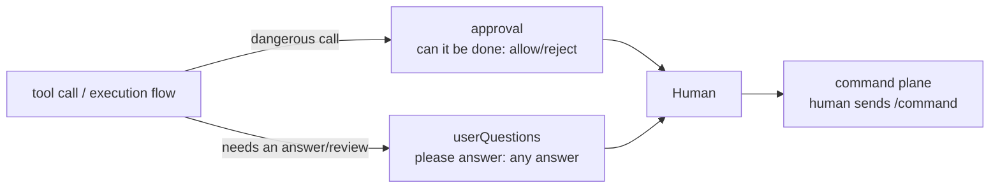
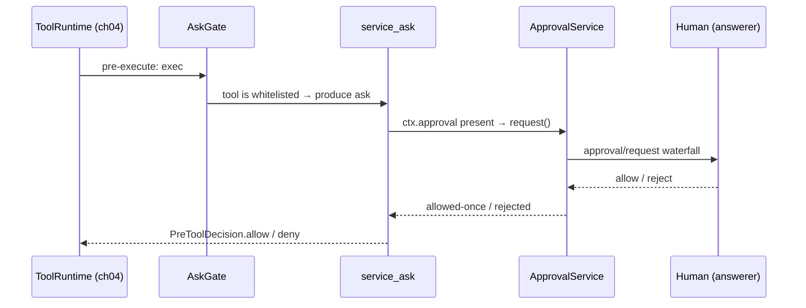

# Chapter 14: Interaction, Permission, and Collaborative Planning — Bringing the Human into the Loop

> Ask before doing; plan before proceeding.

## Questions this chapter answers

- Chapter 4's tools pipeline left an `ask` branch for "ask the human before executing" — where does that branch lead in HEAD?
- Chapter 4's three-state decision already answered "let through or intercept" — but which calls need to ask a human, and who decides?
- If the goal only lives in the chat history, one compression in Chapter 10 could lose it — in multi-turn dialogue, how do you keep the goal from being "forgotten"?

A tools pipeline with no human involvement is a runaway car: the more capable it is, the more dangerous. This chapter fits the pipeline with three devices — the approval seam, permission presets, and collaborative planning.

In Chapter 4 we built the tools pipeline's three-stage flow: pre-execute decision, execution, post-execute decision. This chapter adds three things on top: wiring the `ask` decision to a real human, handing "which calls to ask about" to permission presets, and giving "what the multi-turn dialogue is for" to goal state and plan mode.

How this chapter's code relates to the extended foundation chapter (Chapter 4):

- Reuses `waterfall_wrap` (Chapter 4) to carry the approval waterfall — the middleware assembly is the same, but the fallback differs: the tools waterfall falls back to allow, the approval waterfall falls back to `unavailable`;
- Reuses `PreToolDecision` / `ToolRuntime` (Chapter 4) — the ask branch is consumed at ch04's pre-execute listener seat;
- Reuses `Context` / `Service` (Chapter 1) — every service here follows the "construction is registration" convention.

## 1. What Happens Without These Mechanisms

### 1.1 Scenario One: Dangerous Calls Execute Directly

Without an approval seam, tool dispatch is "execute whatever comes in" (`ch14/code/bad_example.py`, scenario one):

```python
tool_calls = [
    {"name": "shell", "args": {"cmd": "make build"}},
    {"name": "shell", "args": {"cmd": "rm -rf /"}},  # 危险调用
]
for call in tool_calls:
    # 朴素分派：拿到调用直接执行，没有「问人」这一步
    print(f"  执行 {call['name']}: {call['args']['cmd']} → 完成")
```

Run output:

```text
场景一：没有审批接缝
  执行 shell: make build → 完成
  执行 shell: rm -rf / → 完成
  → 危险命令直接执行了，人没有机会拦
```

`make build` and `rm -rf /` get exactly the same treatment — there is no "ask the human" seat in the pipeline.

### 1.2 Scenario Two: Multi-Turn Dialogue Loses Its Direction

Without goal state, the goal only lives in the chat history (`bad_example.py`, scenario two):

```text
场景二：没有 goal 状态
  用户：完成 utils 模块重构
  agent：好的，开始……
  用户：（打断）先帮我看个 bug
  agent：bug 修好了。
  用户：继续刚才的任务
  agent：刚才的任务是什么来着？（目标只存在于聊天记录，压缩后就丢了）
```

One interruption and the goal is gone — the pipeline has no idea "what the multi-turn dialogue is for".

### 1.3 This Chapter's Three Groups of Mechanisms

| Mechanism | What it solves | Teaching entry |
| --- | --- | --- |
| approval seam (§2) | who signs off on a dangerous call | `ApprovalService` |
| userQuestions seam (§2) | ask the human to answer/review | `UserQuestionService` |
| command plane (§2) | the human issues commands proactively | `CommandRuntime` |
| serviceAsk back-link + presets (§3) | how the ask branch is consumed, how wide the authorization is | `service_ask` / `presets` |
| goal event sourcing + continuation rounds + plan-mode (§4) | where the multi-turn dialogue is heading | `GoalService` / `GoalRoundDriver` / `PlanMode` |

## 2. Mechanism One: Intervention — Two Channels That Ask the Human

### 2.1 Two Channels at a Glance: "Can It Be Done" and "Please Answer/Review"

An **intervention channel** is the standardized path by which the harness asks the human a question mid-execution and collects the answer. Why two channels? Because there are two kinds of questions, with different answer shapes:

- **approval** asks "**can it be done**": the answer is binary — allow or reject. Like the confirmation dialog before deleting a file, where you can only click confirm or cancel.
- **userQuestions** asks "**please answer/review**": the answer is arbitrary text or a selection. Like an IDE asking "which file should I refactor first?", waiting for open-ended content.

The two channels sit side by side and do not replace each other; there is also a third form — the **command plane**: the human does not wait to be asked but issues a command such as `/permission`. The overall relationship:



### 2.2 The approval Waterfall: the Entry Owns the Audit, the Adjudication Owns the Semantics

The **approval service** `ApprovalService` is registered as `ctx.approval` (`packages/interaction/user-approval/src/index.ts`); it receives approval requests, asks the human, and returns the result. Start with the minimal loop (self-contained and runnable, path setup as in `main.py`):

```python
# 行内示例：审批服务的最小循环（出自 ch14/code/，依赖 approval.py）
from cordis import Context
from approval import ApprovalService, ApprovalRequest, ALLOWED_ONCE

ctx = Context()
ApprovalService(ctx)  # 构造即注册：ctx.approval 可用了

def respond(req, next):
    # 应答者是 approval/request 瀑布的监听器：渲染问题、收集回答
    print(f"批准 `{req.tool_name}`？")
    return ALLOWED_ONCE  # 模拟人点了「放行」

ctx.approval.on_request(respond)
print(ctx.approval.request(ApprovalRequest("shell")))
```

The caller only calls `request()`; "how to ask the human" lives entirely in the waterfall. Run output:

```text
批准 `shell`？
allowed-once
```

**Inside request()** there are exactly three jobs: check the turn, append the audit events, and hand the decision to the private `decide()`. The teaching version mirrors that split:

```python
# 出自 ch14/code/approval.py 的 ApprovalService
# 其余成员（set_policy/effective_policy/on_request）见本节与 §3
class ApprovalService(Service):
    # ... 本类其余成员省略 ...

    def request(self, req):
        """审批请求（index.ts:242）：回合检查 → 落 asked → decide → 落 decided。"""
        self._seq += 1
        req.request_id = self._seq
        self.ctx.emit("approval/asked", req)  # 审计事件（L252）
        outcome = self._decide(req)
        self.ctx.emit("approval/decided", {"request_id": req.request_id, "outcome": outcome})  # L259
        return outcome

    def _decide(self, req):
        """私有裁决（index.ts:293）：取消短路 → never 短路 → 瀑布 → 归一。"""
        if getattr(req, "cancelled", False):
            return CANCELLED  # 已中止（L295）：不问人，直接取消
        if self.effective_policy() == "never":
            return REJECTED  # never 短路（L301）：任何监听器都不能把它翻成放行
        try:
            outcome = waterfall_wrap(
                self._request_listeners, (req,), fallback=lambda: UNAVAILABLE
            )  # approval/request 环绕瀑布（L306-310）：兜底 unavailable
        except Exception:
            outcome = UNAVAILABLE  # 应答者抛错：问题侧 fail-closed（L317）
        return outcome if outcome in OUTCOMES else UNAVAILABLE  # 非法返回值归一（L314）
```

The real entry also runs a **turn-enclosure** check (`packages/interaction/user-approval/src/index.ts:244`): an approval request must land inside an open turn. A turn is the commit boundary of the log; if the audit pair lands between two turns, a crash-and-replay sees two orphan records that nothing claims — the source calls this a "crash tail", so it throws on the spot instead. The teaching version has no turn model and omits the check.

Note the boundary of `decide()`: apart from short-circuiting the `never` policy to `rejected` before the waterfall ever runs (that is not folding a listener's answer — it is never asking), it folds no answer into rejected. It does exactly three things — abort becomes `cancelled`, an invalid answer or an exception becomes `unavailable`, every other valid value passes through untouched. The rule "anything that is not an allow becomes a deny" belongs to the tools layer in HEAD; see §3.1.

The four outcome values (`ApprovalOutcome`, `packages/interaction/user-approval/src/types.ts:32`): `allowed-once` (allow this once), `rejected` (rejected), `cancelled` (the question was cancelled), `unavailable` (nobody answered). Only `allowed-once` grants; the other three all become denials at the tools layer, each with a different reason so the model can tell "the human said no" from "there is no approval channel at all".

[Teaching decision] The real approval/request waterfall rides the container's `ctx.waterfall` (`packages/interaction/user-approval/src/index.ts:306-310`); the teaching version uses Chapter 4's `waterfall_wrap` over an internal listener list, with the same semantics.

**Who answers?** In the real project the answerers are downstream authorizers registered on the approval/request waterfall — in HEAD those are the SDK server (`packages/sdk/server/src/server.ts:123`), ACP (`packages/acp/acp/src/index.ts:158`), and the web client (`packages/client/ui-approval/src/client/index.ts:107`). A listener answers by returning an outcome. The teaching version uses a scripted "human" (`ScriptedHuman` in `main.py`, [Teaching decision]) as a plain waterfall listener. Every adjudication (including a `never` short-circuit) leaves a pair of audit events, `approval/asked` + `approval/decided`, because the pair is appended in the entry `request()`. Segment 2's output shows the two policy states and three outcomes:

```text
── 2. approval 瀑布：审计对照落 + fail-closed 在工具层 ─────────────────
policy=never：短路拒绝，审计对同样落下
  [审计] approval/asked #1 shell
  [审计] approval/decided #1 → rejected
  结果 → rejected

policy=ask，人批准
  [审计] approval/asked #2 shell
  [人] 批准 `shell`？→ allow
  [审计] approval/decided #2 → allowed-once
  结果 → allowed-once

policy=ask，人拒绝
  [审计] approval/asked #3 shell
  [人] 批准 `shell`？→ deny
  [审计] approval/decided #3 → rejected
  结果 → rejected

policy=ask，无人应答
  [审计] approval/asked #4 shell
  [审计] approval/decided #4 → unavailable
  结果 → unavailable （unavailable 原样返回）
```

Three things to notice. With `policy=never` the audit pair **still lands** — the short-circuit happens inside `decide()` (`packages/interaction/user-approval/src/index.ts:301`), but `asked` and `decided` are appended around it. When nobody answers, `decide()` returns `unavailable` and does no folding; the last line shows that turning `unavailable` into a denial happens at the tools layer, not in the approval service. The policy is set through `setPolicy()` (`packages/interaction/user-approval/src/index.ts:211`), which in the real version also injects a "policy changed from X to Y" user message (`packages/interaction/user-approval/src/index.ts:215-221`); the effective policy is read through `effectivePolicy()` (`packages/interaction/user-approval/src/index.ts:270`), in the order "session override ?? configured default ?? `ask`".

### 2.3 userQuestions: a Composable Answerer Waterfall

The **question service** `UserQuestionService` is registered as `ctx.userQuestions` (`packages/interaction/user-questions/src/index.ts`) and issues open-ended questions. `ask()` (`packages/interaction/user-questions/src/index.ts:291`) runs four checks first — signal already aborted, empty question list, the calling agent is not the exact live instance in the registry (`packages/interaction/user-questions/src/index.ts:137`), intent labels that name none of the options (`packages/interaction/user-questions/src/index.ts:300-337`) — and then hands the request to the `user-questions/request` waterfall (`packages/interaction/user-questions/src/index.ts:343-351`); with no answerer taking it, it throws `NO_PROVIDER`. The teaching version keeps only two steps — emit an event, delegate to an answerer:

```python
# 出自 ch14/code/questions.py 的 UserQuestionService
# 其余成员（__init__/set_provider）见本节
class UserQuestionService(Service):
    # ... 本类其余成员省略 ...

    def ask(self, content, intent="answer"):
        """发起提问（index.ts:291）。"""
        if not content.strip():
            raise UserQuestionError("ask 至少需要一个非空问题")  # 空问题检查（index.ts:295）
        self._seq += 1
        question = UserQuestion(id=self._seq, content=content, intent=intent)
        self.ctx.emit("userQuestions/asked", question)  # [教学决策] 事件名
        if self._provider is None:
            # 无人接受请求：真实版抛 code=NO_PROVIDER（index.ts:343）
            raise UserQuestionError("no user-questions answerer accepted the request")
        return self._provider(question)  # 交给应答者：渲染→收集回答（教学版只有一个）
```

**The answerer is a composable waterfall chain**: the service does not care how a question is rendered or where the answer comes from — it delegates. The real `user-questions/request` is a waterfall (`packages/interaction/user-questions/src/index.ts:344-352`): one listener can `next()` the request downstream, and several answerers can be mounted at once — HEAD has at least the SDK server (`packages/sdk/server/src/user-questions.ts:20`), the web client (`packages/client/ui-user-questions/src/client/index.ts:401`), and remote forwarding (`packages/api/remotes/src/remote-events.ts:57`), and the official test verifies delegation to the next answerer (`packages/interaction/user-questions/tests/user-questions.spec.ts:81-96`). [Teaching simplification] The teaching version keeps a single `set_provider` that replaces wholesale rather than delegating layer by layer. `intent` labels the purpose; the most important one is `plan-review` — plan review, which plan-mode in §4 reuses.

### 2.4 The Command Plane: the Human Intervenes Proactively

The third form of intervention does not wait to be asked — the human types a command starting with `/`. `parseCommand` (`packages/interaction/commands/src/index.ts:125`) parses such input; `CommandRuntime` handles registration (`packages/interaction/commands/src/index.ts:285`) and dispatch (`packages/interaction/commands/src/index.ts:361`):

```python
# 行内示例：命令平面（自包含可运行，出自 ch14/code/commands.py）
from cordis import Context
from commands import CommandRuntime

ctx = Context()
CommandRuntime(ctx)  # 构造即注册：ctx.commands
ctx.commands.register("hello", lambda args: f"hello, {args or 'stranger'}")
print(ctx.commands.execute("/hello ch14"))
print(ctx.commands.execute("not a command"))
```

Run output:

```text
hello,  ch14
不是命令：'not a command'
```

Parsing is stricter than "starts with a slash": the name must start with a lowercase letter and be followed by whitespace or end of line, and the tail input is kept verbatim (`packages/interaction/commands/src/index.ts:126`) — so `/hello ch14` hands the handler `" ch14"` with its leading space, which is why the output has two spaces. [Teaching simplification] The real version also mints a command id per execution (`mintCommandId`, `packages/interaction/commands/src/index.ts:446`) to pair `command/run` with `command/done`; the teaching version keeps only register + parse → dispatch. §3 will show the first real command — `/permission`.

### 2.5 Backtrack: What Is Still Missing

Approval answers "how to ask the human", userQuestions answers "how to ask an open question", and the command plane gives the human initiative. But look back at scenario one: dangerous calls ran directly not because "there was no way to ask", but because **nobody called `approval.request()` at the right moment** — ch04's ask branch still dangles. Who picks it up?

## 3. Mechanism Two: Authorization — Wiring the ask Branch to a Human

### 3.1 serviceAsk: the Consumption Point of the ask Branch

Chapter 4 covered the three-state decision: allow / deny / ask. Once the tools layer receives `ask`, it hands the decision to `serviceAsk` — whose host in HEAD is `packages/core/tools/src/pipeline.ts:432` (it moved out of `index.ts` when the pipeline was split). The call site is `prepare()` (`pipeline.ts:203-205`): only a pre-execute waterfall that returns `ask` gets here.

The skeleton of serviceAsk is an **opportunistic consumption** of `ctx.get('approval')` (`pipeline.ts:436`). Opportunistic consumption means the consumer does not require the service to exist — use it if present, degrade if not:

- `ctx.approval` exists (as with the `ApprovalService` registered in this chapter) → hand the decision to `approval.request()` (`pipeline.ts:449`);
- it does not exist → degrade to deny (`pipeline.ts:437-442`);
- there is a request but no agent → degrade to deny as well (`pipeline.ts:443-448`) — no agent means no session to audit to and no UI to route to.

This is what the seam means: ch04 does not know who will implement approval; this chapter's ApprovalService is that implementation.

```python
# 出自 ch14/code/ask_gate.py 的 service_ask（模块级函数）
def service_ask(ctx, exec):
    """serviceAsk（pipeline.ts:432）：机会消费 approval 接缝。"""
    approval = getattr(ctx, "approval", None)  # 机会消费（pipeline.ts:436）：可能不存在
    if approval is None:
        return PreToolDecision.deny("approval 服务未实现，降级为 deny")
    outcome = approval.request(
        ApprovalRequest(tool_name=exec.name, arguments=dict(exec.arguments))
    )
    if outcome == ALLOWED_ONCE:
        return PreToolDecision.allow()
    if outcome == CANCELLED:
        return PreToolDecision.deny("approval for tool was cancelled")
    return PreToolDecision.deny(f"approval 结果：{outcome}")
```

[Teaching simplification] The real version has a third degradation: a request without an agent is denied too (`pipeline.ts:443-448`) — no agent means no session to audit to and no UI to route to. The teaching version has no agent object, so the excerpt omits that branch.

**"Non-allow means deny" lives in these few lines**: `allowed-once` allows, and the other three each become a deny with a different reason (`pipeline.ts:457-471`). This is also the division of labor between the two layers: the approval service only reports the four values honestly, and the tools layer interprets "not an allow" as a denial.

### 3.2 AskGate: Completing the ask Path in the Teaching Version

[Teaching decision] In the real source, ask decisions are produced by listeners on the `tools/pre-execute` waterfall — for example auto-review's risk review (`packages/experimental/auto-review/src/index.ts:715`) and Claude Code hooks' PreToolUse (`packages/experimental/hooks-claude-code/src/index.ts:247`). Guards cannot produce an ask: their type only allows a denial reason or `undefined` (`packages/core/tools/src/contracts.ts:384-391`, `packages/core/tools/src/index.ts:393-401`). Chapter 4's teaching version has no ask producer, so the teaching version uses `AskGate` (a hard-coded whitelist) to simulate the "ask decision point", registered as a ch04 pre-execute listener:

```python
# 出自 ch14/code/ask_gate.py 的 AskGate
class AskGate:
    """[教学决策] ask 决策点：工具在白名单内 → 产生 ask，交给 service_ask 消费。"""

    def __init__(self, ctx, ask_tools=()):
        self._ctx = ctx
        self.ask_tools = set(ask_tools)

    def __call__(self, exec, next):
        if exec.name in self.ask_tools:
            return service_ask(self._ctx, exec)
        return next()
```

Segment 3's output shows three situations — no implementation, implementation present, nobody answering:

```text
── 3. ch04 回链：serviceAsk 消费 ask 分支 ─────────────────────────
无 approval 服务：降级为 deny
  结果 → Error: approval 服务未实现，降级为 deny (is_error=True)

有 approval 服务，人批准
  [人] 批准 `shell`？→ allow
  结果 → 已执行: make clean (is_error=False)

有 approval 服务，人拒绝
  [人] 批准 `shell`？→ deny
  结果 → Error: approval 结果：rejected (is_error=True)

有 approval 服务，无人应答
  结果 → Error: approval 结果：unavailable (is_error=True)
```

The first container has no ApprovalService — the ask branch degrades to deny and the tool never runs; the second has one — approval lets it through, rejection blocks it; the last line is where fail-closed lands: an unanswered `unavailable` becomes a denial at the tools layer. The ask branch no longer dangles: **it ends at a real human**.



The diagram draws only the `allowed-once` and `rejected` returns; `cancelled` and `unavailable` also converge to deny, with a different deny reason (see the excerpt in §3.1 and the fourth line of segment 3).

### 3.3 permission-presets: One Name, One Bundle of Policies

serviceAsk answered "how an ask is consumed"; the remaining question is **whether these asks should reach a human at all**. The approval policy has only two settings, and both act at the adjudication entry: `ask` delegates to the answerers, `never` rejects outright. The trouble is that it never travels alone — a whole sandbox fence sits right next to it. Configure them independently and you soon hit this: you add a tool, fix its sandbox permission, forget to bring the approval policy back to `ask`, and the call is rejected by `never` with nothing but a one-line reason. Or the reverse: you widen file access but leave approval at its strictest, so every write needs a confirmation click. The subtlest case is a half-applied switch: sandbox is open, approval is still `never`, `derive` reads `'custom'`, and the UI shows neither `workspace-write` nor `danger-full-access` — nobody can tell what posture the session is in.

**Permission presets** exist for exactly this: one preset name decides both the sandbox half and the approval half, and a switch moves both together. It does **not** decide which calls ask — that is the pre-execute listeners' job (§3.2); it decides whether those asks, once they reach the adjudication entry, are handed to a human or rejected outright by `never`.

First, the two functions pull in opposite directions (the example comes from `ch14/code/presets.py`; the teaching version reduces the `sandbox` half to a mode string):

- `resolve()` (`packages/interaction/permission-presets/src/index.ts:372`) goes "name → bundle": a table lookup that throws on an unknown name;
- `derive()` (`packages/interaction/permission-presets/src/index.ts:348`) goes the other way, "current knob values → name": when nothing matches it returns `'custom'`.

`apply()` (`packages/interaction/permission-presets/src/index.ts:403`) does the landing: it first records the `permission/preset` identity, then writes the sandbox and approval knobs one by one. The configuration entry is `Config.presets` (`packages/interaction/permission-presets/src/index.ts:153`), and the default table has just two rows (`packages/interaction/permission-presets/src/index.ts:177-189`): `workspace-write` is `workspace-write + ask`, `danger-full-access` is `danger-full-access + never`. `pinInitialPermission()` (`packages/interaction/permission-presets/src/index.ts:429`) fills in missing permission facts when an agent is created.

```python
# 出自 ch14/code/presets.py（模块级）
PRESETS = {
    "workspace-write": {"sandbox": "workspace-write", "approval": "ask"},
    "danger-full-access": {"sandbox": "danger-full-access", "approval": "never"},
}

def derive(ctx):
    """derive（index.ts:348）：由当前旋钮值反推 preset 名；对不上返回 'custom'。"""
    sandbox = getattr(ctx, "sandbox_mode", "workspace-write")
    approval = ctx.approval.effective_policy()
    for name, spec in PRESETS.items():
        if spec["sandbox"] == sandbox and spec["approval"] == approval:
            return name
    return CUSTOM_PRESET

def apply(ctx, preset):
    """apply（index.ts:403）：先记 preset 身份，再逐项写 sandbox / approval 旋钮。"""
    spec = resolve(preset)
    if getattr(ctx, "current_preset", None) != preset:
        ctx.emit("permission/preset", preset)  # index.ts:416
    ctx.current_preset = preset
    ctx.sandbox_mode = spec["sandbox"]
    ctx.approval.set_policy(spec["approval"])
    return spec
```

One thing is easy to read backwards: `danger-full-access`'s approval is **never**. `never` means "**never ask**" — every ask is deterministically rejected at the adjudication layer (`packages/interaction/user-approval/src/index.ts:64`, `:301`); it is not "allow everything". The preset only feels permissive because its sandbox half already grants full file access, so few calls ever need approval; when one does, the preset has **no** room to negotiate. That is the point of the pair: sandbox decides "can I touch it", approval decides "do I ask before touching", and bundling the two is what makes it a posture.

[Teaching simplification] The sandbox half is only a mode string in the teaching version, not wired to Chapter 6's SandboxProvider (the real behavior goes through the sandbox fence; see Chapter 6). The `/permission` command (`packages/interaction/permission-presets/src/index.ts:254-276`) exposes the preset switch to the human: no argument lists the current value, an argument switches. Segment 4's output:

```text
── 4. permission-presets：捆绑 resolve/apply/derive/pin + /permission
PRESETS[workspace-write]    → {'sandbox': 'workspace-write', 'approval': 'ask'}
PRESETS[danger-full-access] → {'sandbox': 'danger-full-access', 'approval': 'never'}
pinInitialPermission → approval=ask
derive(当前旋钮) → workspace-write
/permission → current preset workspace-write (available: workspace-write, danger-full-access)
/permission danger-full-access → preset danger-full-access
切换后 derive(当前旋钮) → danger-full-access
切换后执行 shell → Error: approval 结果：rejected (is_error=True)
```

The last two lines are the evidence: after switching to `danger-full-access`, `derive` immediately reads `danger-full-access` (both knobs moved), and the shell call, going through `service_ask`, is rejected by `never` — one name changed both the sandbox and approval halves, so the behavior changed as a whole. This "one name decides a group of settings" is the forerunner of ch15's bundle idea (packaging several capabilities into one unit that can be mounted as a whole; see Chapter 15).

### 3.4 Backtrack: the Authorization Loop Closes

The authorization loop now closes: pre-execute listeners decide "which calls produce an ask", presets decide "whether those asks go to a human or are rejected outright by never" (both sandbox and approval halves switch together), serviceAsk decides "how the ask branch is consumed" (opportunistic consumption, deny on absence), and approval decides "how the human is asked" (waterfall + an honest four values). Scenario one is solved. Back to scenario two: a goal is lost after one interruption — authorization cannot answer "what the conversation is for". That is §4's job.

## 4. Mechanism Three: Collaborative Planning — Giving Multi-Turn Dialogue a Sense of Direction

### 4.1 goal Event Sourcing: State Is Folded Out

**Event sourcing** is a way to store state: instead of storing "the current state", you store "the history of events that happened", and the current state is folded out of that history on the spot. Think of a bank statement — you never edit the balance, you append transactions, and the balance is always computed from the record. Why use it? The goal in scenario two was lost because it lived somewhere that gets erased (the chat history); an event history is append-only, so even a cold start can re-fold it.

The key structures in the goal domain (`packages/goal/goal/src/`):

- **GoalRef** (`types.ts:20`): the goal coordinate `{id, revision}`; revision is the handle for the **CAS** optimistic lock — CAS means "compare before writing": before writing, check that the version you hold still matches the current one, and treat a mismatch as a conflict.
- **GoalPhase** (`types.ts:45`): the four goal phases `active/paused/blocked/complete`.
- **GoalActivation** (`types.ts:72`): `armed/disarmed`, **process-local** and never persisted — expanded in §4.2.
- **Whole-value events**: every `goal/change` session event carries a complete snapshot (phase/objective/revision), not a delta — folding needs no accumulation, each event is self-sufficient. Once the snapshot is committed, `commit()` emits a separate in-process `goal/changed` event (`packages/goal/goal/src/index.ts:624`); [Teaching simplification] the teaching version calls both `goal/changed`, and renames the folded field from `objective` to `text`.

Folding and committing:

```python
# 出自 ch14/code/goal.py 的 fold_goal（模块级）与 GoalService
# GoalService 其余成员（state/ref/create/edit/pause/...）见本节与 §4.2
def fold_goal(events):
    """foldGoal（fold.ts:339）：从事件流重折整值；activation 不在返回值里。"""
    state = None
    for event in events:
        if event["kind"] == "cleared":
            state = None
        else:  # 整值快照：直接覆盖整值
            state = GoalState(phase=event["phase"], text=event["text"], revision=event["revision"])
    return state


class GoalService(Service):
    # ... 本类其余成员省略 ...

    def _commit(self, kind, text, phase, armed, fresh=False):
        """commit（index.ts:608）：追加整值事件 → 重折 → 发 goal/changed。

        armed=None 表示保持当前激活态（edit 用）；fresh=True 表示新 goal 从 revision 1 起。
        """
        state = self.state()
        revision = 1 if fresh else ((state.revision + 1) if state else 1)
        event = {"kind": kind, "text": text, "phase": phase, "revision": revision}
        self._history.append(event)
        if armed is not None:
            self._set_activation("armed" if armed else "disarmed")  # index.ts:497
        new_state = fold_goal(self._history)  # 从头重折，不缓存
        self.ctx.emit("goal/changed", GoalRef(id=self._goal_id, revision=revision))
        return new_state
```

The write-side operations create/edit/pause/resume/complete/block/clear are spread across `packages/goal/goal/src/index.ts:305-449`: create at `:305` (new id, revision starts at 1), edit at `:331`, pause at `:354`, resume at `:366`, complete at `:393`, block at `:411`, clear at `:435`. Every write other than create runs a CAS check first (`packages/goal/goal/src/index.ts:458`):

```python
# 出自 ch14/code/goal.py
class GoalService(Service):
    # ... 本类其余成员（state/ref/写面操作/_commit）见本节 ...

    def _check_cas(self, ref):
        """CAS 校验（index.ts:458）：ref.id/revision 必须与当前一致（types.ts:20）。"""
        state = self.state()
        current = state.revision if state else 0
        if ref.id != self._goal_id or ref.revision != current:
            raise GoalConflictError(ref, current)
```

Segment 5's output (first half):

```text
── 5. goal 事件溯源：整值事件 + CAS + 进程本地 activation ───────────────
  [激活] activation → armed
  [事件] goal/changed → GoalRef(id='goal-1', revision=1)
create revision → 1
  [事件] goal/changed → GoalRef(id='goal-1', revision=2)
edit 后 activation → armed
  [CAS] goal 冲突：ref revision 1 已过期，当前 2
  [激活] activation → disarmed
  [事件] goal/changed → GoalRef(id='goal-1', revision=3)
pause 后 activation → disarmed
  [激活] activation → armed
  [事件] goal/changed → GoalRef(id='goal-1', revision=4)
当前状态 → GoalState(phase='active', text='完成 utils 模块重构（含测试）', revision=4)
activation → armed
activation 文本 → [当前目标] 完成 utils 模块重构（含测试）
```

The events after the third line are the CAS conflict: the caller's ref is still at revision 1 while edit pushed the version to 2 — the stale write is rejected and the two sides can renegotiate. That is what the optimistic lock buys: no locking, just a version check at write time. Note `activation after edit → armed`: edit only changes the objective text, not the activation state (the source's `commitCurrent(..., runtime.activation)` carries the current activation into that commit unchanged, `packages/goal/goal/src/index.ts:344`).

### 4.2 activation Lives in the Process, Not in the Log

**activation** is neither a persistent goal state nor its output text: it says "may this live process continue the goal automatically right now" (`types.ts:72`'s comment puts it bluntly: never persisted). `foldGoal()` deliberately omits it from the return value (`fold.ts:339`), so a process re-fold only recovers the durable state; `GoalService` keeps it in its own runtime map, starting at `disarmed` (`packages/goal/goal/src/index.ts:484`). The real change path is one hop longer than it looks: `commit()` first records this commit's target activation in `pendingActivation` (`packages/goal/goal/src/index.ts:610`), the `session/event` listener folds it out once the log entry lands (`packages/goal/goal/src/index.ts:261-269`), and then hands it to `setActivation()`; that returns immediately when the value did not change (`packages/goal/goal/src/index.ts:499`) and only emits `goal/activation-changed` when it did (emit at `packages/goal/goal/src/index.ts:504`). [Teaching simplification] The teaching version calls `_set_activation` directly inside `_commit`, skipping that log callback.

```python
# 出自 ch14/code/goal.py
class GoalService(Service):
    # ... 本类其余成员见 §4.1 ...

    def _set_activation(self, value):
        """只改进程本地态，并在真正变化时发 goal/activation-changed（index.ts:497）。"""
        if self._activation == value:
            return
        self._activation = value
        self.ctx.emit("goal/activation-changed", {"activation": value})
```

Which operations flip it? create/resume set `armed`, edit leaves it alone, pause/complete/block/clear set `disarmed`. The second half of segment 5's output confirms it:

```text
  [激活] activation → disarmed
  [事件] goal/changed → GoalRef(id='goal-1', revision=5)
complete 后 activation → disarmed
  [事件] goal/changed → None
clear 后状态 → None
```

The key judgement: **after a cold start activation is always disarmed**. The log can restore the goal's phase, but it cannot decide on the human's behalf whether this process should keep going automatically — that decision has to be made again by a human (resume). This design separates "state" from "authorization": state can be replayed, authorization cannot.

### 4.3 goal-round-driver: Event-Triggered Continuation Rounds

The goal is still active but a dialogue turn has ended — what now? **Continuation**: goal-round-driver (`packages/goal/goal-round-driver/src/`) is woken by goal events — `ctx.on('goal/changed')` at `packages/goal/goal-round-driver/src/index.ts:302`; the trigger is coalesced onto one serialized driver (`requestDrive()`, `packages/goal/goal-round-driver/src/index.ts:224`). `drive()` (`packages/goal/goal-round-driver/src/index.ts:146`) first confirms the goal is drivable (`packages/goal/goal-round-driver/src/index.ts:106`: phase=active and activation=armed). Before starting a round it passes a **checkpoint**: it flushes the session log to confirm the goal state is durable and that no other mutation slipped in meanwhile (`packages/goal/goal-round-driver/src/index.ts:150-162`) — start a round without that, and the model reads a stale objective. Past the checkpoint, if the round budget is not exhausted (`packages/goal/goal-round-driver/src/index.ts:182`) it starts a round and queues the `<goal_round>` prompt through `agent.followup()` (`packages/goal/goal-round-driver/src/index.ts:208`).

The keyword is **event-triggered, not polled** — the driver does not check on a timer; it is woken by events.

```python
# 出自 ch14/code/goal_round.py
class GoalRoundDriver(Service):
    # ... 本类其余成员（__init__/_on_goal_changed/reserve/render_round_prompt）从略 ...

    def drive(self, attempt):
        """drive（index.ts:146）：预约有效 + 仍有轮次预算 → 起新轮。"""
        if not self.valid_reservation(attempt):
            return False  # 过期预约：goal 已变（edit/pause/complete）或被新预约顶掉
        round_no = self.ctx.goal.start_round()
        if round_no is None:
            return False  # 预算到顶：start_round 已把 goal block 掉（index.ts:182）
        self._round = round_no
        self.ctx.emit("goal/round-start", {"round": round_no})  # [教学决策] 事件名
        return True

    def valid_reservation(self, attempt):
        """validReservation（index.ts:372）：预约必须仍对应当前 active revision。"""
        state = self.ctx.goal.state()
        return (
            attempt is not None
            and self._attempt is attempt
            and state is not None
            and state.phase == "active"
            and self.ctx.goal.activation() == "armed"
            and attempt.revision == state.revision
            and attempt.round == self.ctx.goal.rounds_started() + 1
        )
```

A **reservation** is bound to "one goal revision + one round number" (`RoundAttempt` at `packages/goal/goal-round-driver/src/index.ts:200-206`). It is not a global "only the newest wins" counter but the identity card of one round: once the goal is edited/paused/completed, the revision changes and the old reservation dies naturally; a new reservation replaces the old object, so the old token dies too; the round number must be exactly the next one. Fail any of the three and `validReservation()` says no (`packages/goal/goal-round-driver/src/index.ts:372`). The real version also uses the same fence in `agent/pre-step` to reject stale rounds, and `renderGoalRoundPrompt` (`prompt.ts:12`) renders the continuation prompt.

[Teaching simplification] The real event wiring covers more than goal/changed — agent/status, the inbox state machine, and more (`packages/goal/goal-round-driver/src/index.ts:261-430`); the teaching version subscribes only to goal/changed. [Teaching decision] goal/round-start is a teaching-version event name.

Segment 6 manufactures a trigger equivalent to "a round ended" out of goal mutations: the real version requests continuation when a turn winds down (turn end, blocked), while the teaching version has no turn model and lets `goal/changed` stand for "recompute whether to continue". The scenario runs in five steps: (1) create sets a goal → `goal/changed` wakes the driver, which starts round 1; (2) complete finishes it → `goal/changed` still fires, but the goal is not active so no round starts; (3) create a new goal (the old one is complete, so it can be replaced) → the new goal starts at revision 1 with its rounds reset, and its round 1 starts automatically; (4) reserve twice in a row — the new reservation replaces the old, the old token returns False and the new one returns True and starts round 2; (5) drive again after the budget is spent: no round, and the goal is blocked. Segment 6's output:

```text
── 6. goal-round-driver：事件触发续轮 + reservation 围栏 + 轮次预算 ─────
  [轮次] 自动起第 1 轮
goal complete 后 → goal/changed 仍发，非 active 不续轮
  [轮次] 自动起第 1 轮
新 goal → GoalState(phase='active', text='新目标', revision=1)
旧 reservation drive → False
  [轮次] 自动起第 2 轮
新 reservation drive → True
续轮 prompt →
<goal_round>
Objective: '新目标'
Round: 2/3
Continue working toward the objective in this same session.
</goal_round>
  [轮次] 自动起第 3 轮
再 requestDrive → True （第 3 轮）
再 requestDrive（预算到顶）→ False
被 block 后 phase → blocked
```

"Goal changes → a round starts" is the complete event-driven loop. The `Round: 2/3` in step 3 is the new goal's own round 2, not a cumulative round 4 — rounds follow the goal, and a new goal resets them. The old token, outcompeted by the new one, makes drive return False — the fence caught a stale driver; and when the budget runs out the loop does not continue forever but marks the goal blocked, so a human can see where it stopped. This "keep going while the objective is unfinished" shape is the local form of ch17's Ralph loop (the driving loop that keeps an agent iterating toward an objective until it is done; see Chapter 17).

### 4.4 plan-mode: Plan First, Get Human Review, Then Execute

The last piece is **plan mode** (`packages/plan/plan-mode/src/`): the agent produces a plan first, and only leaves the planning phase for execution after a human reviews and approves it. Plan mode is **per-agent collaboration state**, folded from the session log's `plan/mode` events (`planProjectionDefinition`, `packages/plan/plan-mode/src/index.ts:135`); while it is active, each model request carries an extra `plan:policy` guidance section (`packages/plan/plan-mode/src/index.ts:198-203`).

The `exit_plan_mode` tool is registered at `packages/plan/plan-mode/src/index.ts:280`, with its body at `:301-362`: it asks for review over the userQuestions channel with a `plan-review` intent — the only options are `Approve` and `Keep planning` (`packages/plan/plan-mode/src/index.ts:318-330`), reusing exactly the question channel from §2.3. Only selecting `Approve` exits; otherwise it throws and carries the human's feedback back to the model to revise the plan (`packages/plan/plan-mode/src/index.ts:352-357`). `set()` (`packages/plan/plan-mode/src/index.ts:431`) sets plan mode and returns one of four semantics: `committed` (logged now), `queued` (committed at the next accepted turn), `cancelled` (an opposite pending selection was cleared), `noop` (already in that state).

```python
# 出自 ch14/code/plan_mode.py 的 PlanMode
# 其余成员（__init__/set）见本节
class PlanMode(Service):
    # ... 本类其余成员省略 ...

    def exit_via_review(self, plan_text):
        """exit_plan_mode（index.ts:280，执行体 :301-362）：经 userQuestions 请人复核计划。"""
        if not plan_text.lstrip().startswith("#"):
            # 真实版要求计划是一份完整 markdown，且以 # 标题开头（index.ts:308）
            raise ValueError("exit_plan_mode 需要以 # 标题开头的完整 markdown 计划")
        answer = self.ctx.userQuestions.ask(plan_text, intent=INTENT_PLAN_REVIEW)
        approved = str(answer).strip() == APPROVE_LABEL  # 只认一个精确标签（index.ts:352）
        if approved:
            self.set(False)  # 退出照样走 set，拿 noop/queued/committed 的一致语义
        else:
            # 真实版抛错，把用户的反馈带回模型继续改计划（index.ts:354-357）
            self.ctx.emit("plan-mode/keep-planning", {"feedback": str(answer)})  # [教学决策] 事件名
        return approved
```

[Teaching simplification] In the real version the state is folded from `plan/mode` events (`packages/plan/plan-mode/src/index.ts:135`), and while a turn is open a selection queues until the next turn boundary — that is where `set()`'s `queued` and `cancelled` values come from; the teaching version uses a single active flag, so `set()` only ever returns `committed` or `noop`. Segment 7's output:

```text
── 7. userQuestions 与 plan-review：「请回答/复核」通道 ───────────────
  [事件] plan/mode → active=True
  [事件] userQuestions/asked #1 intent=answer
  [人] 问题 #1（answer）→ utils.py
普通提问 → utils.py
  [事件] userQuestions/asked #2 intent=plan-review
  [人] 问题 #2（plan-review）→ Keep planning
第一次复核 → 批准=False，仍在 plan mode=True
  [事件] userQuestions/asked #3 intent=plan-review
  [人] 问题 #3（plan-review）→ Approve
  [事件] plan/mode → active=False
第二次复核 → 批准=True，仍在 plan mode=False
```

One userQuestions channel carries two intents: an ordinary question (intent=answer) and a plan review (intent=plan-review). The first review chose Keep planning, so the session stays in the planning phase; the second approved and left plan mode. Scenario two is now solved: the goal lives in the event history (it cannot be lost), continuation keeps the dialogue circling the objective (it never breaks off), and plan-mode makes the human sign off at the key moment (it does not drift).

## 5. Running Panorama

`ch14/code/main.py`'s seven demos each assemble their own cordis Context (`assemble()`) and run in order (segments 1-7: assembly, the approval waterfall, the serviceAsk back-link, presets, goal sourcing, continuation, plan-review). Run `python3 ch14/code/main.py` (or `python3 main.py` from `ch14/code/`); segment 1's output is:

```text
── 1. 装配 ───────────────────────────────────────────────────
已注册服务: approval, commands, goal, goalRoundDriver, planMode, tools, userQuestions
两条问人通道：approval=「能否做」，userQuestions=「请回答/复核」
```

The other six segments' output is already posted under its mechanism, and every line there is program output:

| Segment | Content | See |
| --- | --- | --- |
| 2 | approval waterfall: audit pair + three outcomes | §2.2 |
| 3 | ch04 back-link: serviceAsk consumes the ask branch | §3.2 |
| 4 | permission-presets: resolve/derive/apply/pin + `/permission` | §3.3 |
| 5 | goal event sourcing: whole-value events + CAS + process-local activation | §4.1 / §4.2 |
| 6 | goal-round-driver: continuation + reservation fence + round budget | §4.3 |
| 7 | userQuestions and plan-review | §4.4 |

## 6. Source Mapping

Line numbers refer to HEAD `8bd073392`. The table has 15 rows, one mechanism each, so any row can be checked on its own.

| Teaching code | Upstream source | Notes |
| --- | --- | --- |
| `ApprovalService` | `packages/interaction/user-approval/src/index.ts` | registered as ctx.approval |
| `ApprovalService.request` / `_decide` | `packages/interaction/user-approval/src/index.ts:242` / `:293` | request: turn-enclosure check L244 + audit pair L252/L259; decide: cancel short-circuit L295, never short-circuit L301, waterfall L306-310, invalid-value normalization L314 |
| `ApprovalService.effective_policy` / `set_policy` | `packages/interaction/user-approval/src/index.ts:270` / `:211` | effective policy (override ?? default ?? ask); set folds approval/policy and injects a notice (L215-221) |
| `ALLOWED_ONCE` and the other four values / `INTENT_PLAN_REVIEW` | `packages/interaction/user-approval/src/types.ts:32` / `packages/plan/plan-mode/src/index.ts:329` | ApprovalOutcome; the plan-review intent |
| `resolve` / `derive` / `apply` / `pin_initial_permission` / `/permission` | `packages/interaction/permission-presets/src/index.ts:372` / `:348` / `:403` / `:429` / `:254-276` | name→bundle / knobs→name / landing / fill initial facts / command |
| `presets` default table | `packages/interaction/permission-presets/src/index.ts:177` | workspace-write+ask / danger-full-access+never |
| `parse_command` / `CommandRuntime` | `packages/interaction/commands/src/index.ts:125` | command plane (register :285, execute :361, mintCommandId :446) |
| `UserQuestionService.ask` | `packages/interaction/user-questions/src/index.ts:291` | live-root check :137, intent validation :300-337, answerer waterfall :343-351 |
| `service_ask` | `packages/core/tools/src/pipeline.ts:432` | opportunistic ctx.get('approval'); no implementation → deny :437-442; no agent → deny :443-448; four-value mapping :457-471 |
| `fold_goal` / `GoalService._commit` | `packages/goal/goal/src/fold.ts:339` / `packages/goal/goal/src/index.ts:608` | foldGoal (single-step applyGoalEvent :313); commit emits goal/changed |
| `GoalService` write-side operations | `packages/goal/goal/src/index.ts:305-449` | create/edit/pause/resume/complete/block/clear; CAS check :458 |
| `GoalRef` / `GoalPhase` / `GoalActivation` | `packages/goal/goal/src/types.ts:20` / `:45` / `:72` | CAS coordinate / four phases / process-local activation |
| `GoalRoundDriver.drive` / `render_round_prompt` | `packages/goal/goal-round-driver/src/index.ts:146` / `packages/goal/goal-round-driver/src/prompt.ts:12` | drivable :106, budget :182, enqueue :208, requestDrive :224, validReservation :372, event wiring :302 |
| `PlanMode.set` / `exit_via_review` | `packages/plan/plan-mode/src/index.ts:431` / `:280` | set / exit_plan_mode (body :301-362, throw at :352-357; projection :135) |
| `ScriptedHuman` / `AskGate` | — ([Teaching decision] new) | a scripted human / ask decision-point simulation |

## 7. Summary and What Comes Next

This chapter wired ch04's dangling ask branch to a real human and gave multi-turn dialogue a sense of direction:

1. **Intervention**: two channels that ask the human — approval asks "can it be done" (audit pair + never short-circuit + an honest four values), userQuestions asks "please answer/review" (a composable answerer waterfall); the command plane lets the human step in proactively.
2. **Authorization**: serviceAsk (`packages/core/tools/src/pipeline.ts:432`) opportunistically consumes `ctx.approval` — this chapter's ApprovalService is the seam implementation, absent means deny, and "non-allow means deny" happens at the tools layer; permission-presets bundles the sandbox and approval policies under one name.
3. **Collaborative planning**: goal event sourcing makes state append-only and re-foldable (whole-value events + CAS + process-local activation); goal-round-driver triggers continuation rounds on events and bounds them with the reservation fence and the round budget; plan-mode makes the plan wait for human review.

The epigraph pays off here: "ask before doing" — serviceAsk hands every dangerous call to a human, and a non-allow becomes a denial at the tools layer; "plan before proceeding" — plan-review does not leave the planning phase before approval, and goal continuation keeps circling the objective.

The next chapter (Chapter 15) turns to bundles and capability composition: this chapter's preset bundle is already a forerunner — one name deciding both sandbox and approval. Chapter 15 shows how the harness packages more capabilities into units that can be mounted as a whole, and why "one process running several compositions" needs revision-based isolation.

## 8. Appendix: Key Concepts Quick Reference

Layered by dependency (bottom to top):

| Layer | Concept | One-line definition | Code entry |
| --- | --- | --- | --- |
| bottom | ApprovalOutcome | the four approval outcomes; allowed-once is the only grant | `approval.py` constants |
| bottom | audit pair | approval/asked + approval/decided appended together at the entry | `ApprovalService.request` |
| bottom | never short-circuit | with policy never, adjudication returns rejected directly | `ApprovalService._decide` |
| bottom | whole-value event | an event carrying a complete snapshot, not a delta | `goal.py` `_commit` |
| bottom | CAS | an optimistic lock that compares the version before writing | `GoalService._check_cas` |
| bottom | activation | armed/disarmed, process-local and never persisted | `GoalService.activation` |
| middle | approval waterfall | the "can it be done" channel: audit at the entry → waterfall → normalize | `ApprovalService` |
| middle | userQuestions seam | the "please answer/review" channel: a composable answerer waterfall | `UserQuestionService` |
| middle | event sourcing | state folded on the spot from the event history | `fold_goal` |
| middle | permission preset | one name bundling the sandbox + approval policies | `presets.resolve/apply` |
| middle | reservation | a round's identity card: bound to a goal revision and a round number | `GoalRoundDriver.valid_reservation` |
| top | opportunistic consumption | use the service if present, degrade if absent | `service_ask` |
| top | non-allow means deny | the four values map one-to-one at the tools layer, each with its own reason | `service_ask` |
| top | continuation round | when goal/changed arrives and the goal is drivable, start the next round automatically | `GoalRoundDriver.drive` |
| top | plan-review | the plan leaves the planning phase only after human approval | `PlanMode.exit_via_review` |
