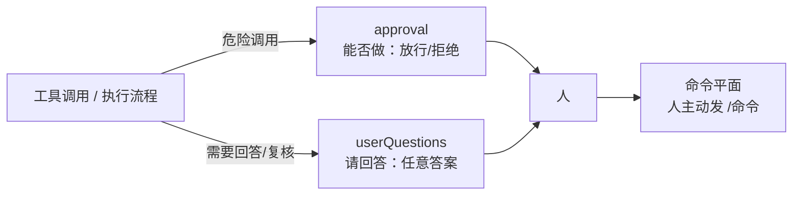
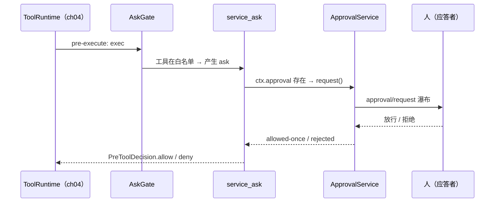

# 第 14 章 交互、权限与协同规划：让人进入回路

> 先问后做，先规划后推进。

## 本章回答的问题

- 第 4 章的工具流水线留了一条「问人后再执行」的 `ask` 分支——这条分支在 HEAD 里接到了谁？
- 第 4 章的三态决策已经回答了「放行还是拦截」——但哪些调用需要问人，由谁决定？
- 如果 goal 只存在于聊天记录里，第 10 章的压缩一次就可能把它弄丢——多轮对话里，如何让目标不被「忘掉」？

没有人介入的工具流水线是一辆失控的车：能力越强，越危险。本章给流水线装上三套装置——审批接缝、授权预设、协同规划。

第 4 章我们完成了工具流水线的三段管线：调用前决策、调用、调用后决策。本章在它之上新增三样东西：把 `ask` 决策接到真实的「人」、把「哪些调用要问」交给权限预设、把「多轮对话为了什么」交给 goal 与 plan mode。

本章代码与延伸基础章（第 4 章）的关系：

- 复用 `waterfall_wrap`（第 4 章）承载审批瀑布——中间件装配方式相同，兜底语义不同：工具瀑布兜底放行，审批瀑布兜底 `unavailable`；
- 复用 `PreToolDecision` / `ToolRuntime`（第 4 章）——ask 分支在 ch04 的 pre-execute 监听器席位上被消费；
- 复用 `Context` / `Service`（第 1 章）——本章所有服务遵循「构造即注册」约定。

## 1. 没有这些机制会发生什么

### 1.1 场景一：危险调用直接执行

没有审批接缝时，工具分派是「来什么执行什么」（`ch14/code/bad_example.py` 场景一）：

```python
tool_calls = [
    {"name": "shell", "args": {"cmd": "make build"}},
    {"name": "shell", "args": {"cmd": "rm -rf /"}},  # 危险调用
]
for call in tool_calls:
    # 朴素分派：拿到调用直接执行，没有「问人」这一步
    print(f"  执行 {call['name']}: {call['args']['cmd']} → 完成")
```

运行输出：

```text
场景一：没有审批接缝
  执行 shell: make build → 完成
  执行 shell: rm -rf / → 完成
  → 危险命令直接执行了，人没有机会拦
```

`make build` 与 `rm -rf /` 得到完全相同的待遇——流水线里没有「问人」的席位。

### 1.2 场景二：多轮对话失去方向

没有目标状态时，目标只存在于聊天记录里（`bad_example.py` 场景二）：

```text
场景二：没有 goal 状态
  用户：完成 utils 模块重构
  agent：好的，开始……
  用户：（打断）先帮我看个 bug
  agent：bug 修好了。
  用户：继续刚才的任务
  agent：刚才的任务是什么来着？（目标只存在于聊天记录，压缩后就丢了）
```

一次打断，目标就丢了——流水线不知道「多轮对话为了什么」。

### 1.3 本章的三组机制

| 机制 | 解决什么 | 教学入口 |
| --- | --- | --- |
| approval 接缝（§2） | 危险调用谁拍板 | `ApprovalService` |
| userQuestions 接缝（§2） | 请人回答/复核 | `UserQuestionService` |
| 命令平面（§2） | 人主动发指令 | `CommandRuntime` |
| serviceAsk 回链 + presets（§3） | ask 分支怎么被消费、授权范围多大 | `service_ask` / `presets` |
| goal 事件溯源 + 续轮 + plan-mode（§4） | 多轮对话的方向 | `GoalService` / `GoalRoundDriver` / `PlanMode` |

## 2. 机制一：介入——两条「问人」通道

### 2.1 两条通道总览：「能否做」与「请回答/复核」

**介入通道**指 harness 在执行过程中向人提问、并收集人的回答的标准化路径。为什么要分两条？因为有两类问题，答案形态不同：

- **approval** 问「**能否做**」：答案是二元的——放行或拒绝。像删除文件前的确认弹窗，只能点「确认/取消」。
- **userQuestions** 问「**请回答/复核**」：答案是任意文本或选择。像 IDE 问你「想先重构哪个文件？」，等待开放内容。

两条通道并列、互不替代；此外还有第三种形态——**命令平面**：人不等待被问，而是主动发出指令（如 `/permission`）。整体关系：



### 2.2 approval 瀑布：入口管审计，裁决管语义

**审批服务** `ApprovalService` 注册为 `ctx.approval`（`packages/interaction/user-approval/src/index.ts`），负责接收审批请求、问人、返回结果。先看最小循环（自包含可运行，路径设置同 `main.py`）：

```python
# 行内示例：审批服务的最小循环（出自 ch14/code/，依赖 approval.py）
from cordis import Context
from approval import ApprovalService, ApprovalRequest, ALLOWED_ONCE

ctx = Context()
ApprovalService(ctx)  # 构造即注册：ctx.approval 可用了

def respond(req, next):
    # 应答者是 approval/request 瀑布的监听器：渲染问题、收集回答
    print(f"批准 `{req.tool_name}`？")
    return ALLOWED_ONCE  # 模拟人点了「放行」

ctx.approval.on_request(respond)
print(ctx.approval.request(ApprovalRequest("shell")))
```

调用场景：调用方只管调 `request()`，「怎么问人」全在瀑布里。运行输出：

```text
批准 `shell`？
allowed-once
```

**request() 的内部**只做三件事：检查回合、落审计事件、把裁决转给私有 `decide()`。教学版这两段对应源码的分工：

```python
# 出自 ch14/code/approval.py 的 ApprovalService
# 其余成员（set_policy/effective_policy/on_request）见本节与 §3
class ApprovalService(Service):
    # ... 本类其余成员省略 ...

    def request(self, req):
        """审批请求（index.ts:242）：回合检查 → 落 asked → decide → 落 decided。"""
        self._seq += 1
        req.request_id = self._seq
        self.ctx.emit("approval/asked", req)  # 审计事件（L252）
        outcome = self._decide(req)
        self.ctx.emit("approval/decided", {"request_id": req.request_id, "outcome": outcome})  # L259
        return outcome

    def _decide(self, req):
        """私有裁决（index.ts:293）：取消短路 → never 短路 → 瀑布 → 归一。"""
        if getattr(req, "cancelled", False):
            return CANCELLED  # 已中止（L295）：不问人，直接取消
        if self.effective_policy() == "never":
            return REJECTED  # never 短路（L301）：任何监听器都不能把它翻成放行
        try:
            outcome = waterfall_wrap(
                self._request_listeners, (req,), fallback=lambda: UNAVAILABLE
            )  # approval/request 环绕瀑布（L306-310）：兜底 unavailable
        except Exception:
            outcome = UNAVAILABLE  # 应答者抛错：问题侧 fail-closed（L317）
        return outcome if outcome in OUTCOMES else UNAVAILABLE  # 非法返回值归一（L314）
```

真实入口还有一道**回合封装**（turn-enclosure）检查（`packages/interaction/user-approval/src/index.ts:244`）：审批请求必须落在某个打开中的回合里。回合是日志的提交边界；一对审计事件如果落在两个回合之间，进程崩溃后重放时会看到两条谁也不认领的孤立记录——源码把这叫「崩溃尾巴」（crash tail），所以宁可当场抛错。教学版没有回合模型，省略该检查。

注意 `decide()` 的边界：除了在进瀑布之前把 `never` 策略短路成 `rejected`（这不是对监听器答复的折叠，而是压根不问），它不把任何答复折叠成 rejected。它只做三件事——中止 → `cancelled`、非法答复或异常 → `unavailable`、其余合法值原样返回。「任何非放行一律折叠为 rejected」这条规则在 HEAD 里归工具层，见 §3.1。

结果四值（`ApprovalOutcome`，`packages/interaction/user-approval/src/types.ts:32`）：`allowed-once`（放行这一次）、`rejected`（拒绝）、`cancelled`（提问被取消）、`unavailable`（无人应答）。其中 `allowed-once` 是唯一的授权值——另外三个都会被工具层判成拒绝，只是拒绝理由不同，好让模型能区分「人说不」和「根本没有审批通道」。

[教学决策] 真实源码的 approval/request 瀑布经容器的 `ctx.waterfall` 承载（`packages/interaction/user-approval/src/index.ts:306-310`）；教学版用第 4 章的 `waterfall_wrap` 与内部监听器列表承载，语义不变。

**谁来应答？**真实项目里，应答者是注册进 approval/request 瀑布的下游授权器——HEAD 里的实现是 SDK server（`packages/sdk/server/src/server.ts:123`）、ACP（`packages/acp/acp/src/index.ts:158`）与 Web 客户端（`packages/client/ui-approval/src/client/index.ts:107`）；监听器直接返回 outcome 即完成应答；教学版用脚本化的「人」（`main.py` 的 `ScriptedHuman`，[教学决策]）做纯瀑布监听器。每次裁决（包括 `never` 短路）都落一对审计事件 `approval/asked` + `approval/decided`，因为这对事件是在入口 `request()` 里落下的。段 2 输出展示策略两态与三种结局：

```text
── 2. approval 瀑布：审计对照落 + fail-closed 在工具层 ─────────────────
policy=never：短路拒绝，审计对同样落下
  [审计] approval/asked #1 shell
  [审计] approval/decided #1 → rejected
  结果 → rejected

policy=ask，人批准
  [审计] approval/asked #2 shell
  [人] 批准 `shell`？→ allow
  [审计] approval/decided #2 → allowed-once
  结果 → allowed-once

policy=ask，人拒绝
  [审计] approval/asked #3 shell
  [人] 批准 `shell`？→ deny
  [审计] approval/decided #3 → rejected
  结果 → rejected

policy=ask，无人应答
  [审计] approval/asked #4 shell
  [审计] approval/decided #4 → unavailable
  结果 → unavailable （unavailable 原样返回）
```

注意三点：`policy=never` 时审计对**照样落**——短路发生在 `decide()`（`packages/interaction/user-approval/src/index.ts:301`），但 `asked`/`decided` 在它之前之后各落一条；无人应答时 `decide()` 返回 `unavailable`，不做折叠；最后一行说明 unavailable 被变成拒绝这件事发生在工具层，不在审批服务里。策略由 `setPolicy()`（`packages/interaction/user-approval/src/index.ts:211`）设置，真实版还会顺手给 agent 注入一条「策略已从 X 变为 Y」的用户消息（`packages/interaction/user-approval/src/index.ts:215-221`）；生效策略经 `effectivePolicy()`（`packages/interaction/user-approval/src/index.ts:270`）读取，顺序是「会话覆盖 ?? 配置默认 ?? `ask`」。

### 2.3 userQuestions：可组合的应答者瀑布

**提问服务** `UserQuestionService` 注册为 `ctx.userQuestions`（`packages/interaction/user-questions/src/index.ts`），负责发起开放式提问。`ask()`（`packages/interaction/user-questions/src/index.ts:291`）先做四道检查——信号已中止、问题为空、调用的 agent 不是注册表里的同一个活实例（`packages/interaction/user-questions/src/index.ts:137`）、intent 标签与 options 对不上（`packages/interaction/user-questions/src/index.ts:300-337`）——然后把请求交给 `user-questions/request` 瀑布（`packages/interaction/user-questions/src/index.ts:343-351`）；没有应答者接手就抛 `NO_PROVIDER`。教学版核心只有两步——发事件、委托应答者：

```python
# 出自 ch14/code/questions.py 的 UserQuestionService
# 其余成员（__init__/set_provider）见本节
class UserQuestionService(Service):
    # ... 本类其余成员省略 ...

    def ask(self, content, intent="answer"):
        """发起提问（index.ts:291）。"""
        if not content.strip():
            raise UserQuestionError("ask 至少需要一个非空问题")  # 空问题检查（index.ts:295）
        self._seq += 1
        question = UserQuestion(id=self._seq, content=content, intent=intent)
        self.ctx.emit("userQuestions/asked", question)  # [教学决策] 事件名
        if self._provider is None:
            # 无人接受请求：真实版抛 code=NO_PROVIDER（index.ts:343）
            raise UserQuestionError("no user-questions answerer accepted the request")
        return self._provider(question)  # 交给应答者：渲染→收集回答（教学版只有一个）
```

**应答者是一条可组合的瀑布链**：服务本身不关心问题怎么渲染、答案从哪来，全部委托出去。真实 `user-questions/request` 是 waterfall（`packages/interaction/user-questions/src/index.ts:344-352`）：一个监听器可以 `next()` 把请求交给下游，链上可以同时挂多个应答者——HEAD 里非测试实现至少有 SDK server（`packages/sdk/server/src/user-questions.ts:20`）、Web 客户端（`packages/client/ui-user-questions/src/client/index.ts:401`）与 remote 转发（`packages/api/remotes/src/remote-events.ts:57`），官方测试也专门验证了「委托给下一个应答者」（`packages/interaction/user-questions/tests/user-questions.spec.ts:81-96`）。[教学简化] 教学版只留一个 `set_provider`，整体替换而非逐层委托。`intent` 标注意图，其中最重要的是 `plan-review`——计划复核，§4 的 plan-mode 会复用它。

### 2.4 命令平面：人主动介入

第三种介入形态不等待被问——人主动输入以 `/` 开头的命令。`parseCommand`（`packages/interaction/commands/src/index.ts:125`）解析这类输入，`CommandRuntime` 负责注册（`packages/interaction/commands/src/index.ts:285`）与分发（`packages/interaction/commands/src/index.ts:361`）：

```python
# 行内示例：命令平面（自包含可运行，出自 ch14/code/commands.py）
from cordis import Context
from commands import CommandRuntime

ctx = Context()
CommandRuntime(ctx)  # 构造即注册：ctx.commands
ctx.commands.register("hello", lambda args: f"hello, {args or 'stranger'}")
print(ctx.commands.execute("/hello ch14"))
print(ctx.commands.execute("not a command"))
```

运行输出：

```text
hello,  ch14
不是命令：'not a command'
```

解析规则比「以 / 开头」严格：名字必须是小写字母打头、后接空白或行尾，尾部输入原样保留（`packages/interaction/commands/src/index.ts:126`）——所以 `/hello ch14` 传进 handler 的是 `" ch14"`（带前导空格），输出里因此是两个空格。[教学简化] 真实版每次执行还分配一个命令 id（`mintCommandId`，`packages/interaction/commands/src/index.ts:446`）用于配对 `command/run` 与 `command/done`；教学版只保留 register + parse → dispatch。§3 会看到第一个真实命令——`/permission`。

### 2.5 回溯：还缺什么

approval 解决了「怎么问人」，userQuestions 解决了「怎么问开放问题」，命令平面给了人主动权。但回看场景一：危险调用之所以直接执行，不是因为「没有办法问人」，而是因为**没有人在正确的时机调用 `approval.request()`**——ch04 的 ask 分支还悬空着。谁来接？

## 3. 机制二：授权——把 ask 分支接到「人」

### 3.1 serviceAsk：ask 分支的消费点

第 4 章讲过三态决策：allow / deny / ask。工具层拿到 `ask` 之后，会把决策转给 `serviceAsk`——它在 HEAD 里的宿主是 `packages/core/tools/src/pipeline.ts:432`（管线拆分后从 `index.ts` 迁出），调用点在 `prepare()`（`pipeline.ts:203-205`）：pre-execute 瀑布返回 `ask` 才进来。

serviceAsk 的骨架是**机会消费** `ctx.get('approval')`（`pipeline.ts:436`）。机会消费指消费方不要求服务必须存在——存在就用，不存在就降级：

- `ctx.approval` 存在（如本章注册的 `ApprovalService`）→ 把决策交给 `approval.request()`（`pipeline.ts:449`）；
- 不存在 → 降级为 deny（`pipeline.ts:437-442`）；
- 有请求但没有 agent → 同样降级 deny（`pipeline.ts:443-448`）——没有 agent 就没有会话可审计，也没有 UI 可路由。

这正是接缝的含义：ch04 不知道谁会实现 approval，本章的 ApprovalService 正是那个实现方。

```python
# 出自 ch14/code/ask_gate.py 的 service_ask（模块级函数）
def service_ask(ctx, exec):
    """serviceAsk（pipeline.ts:432）：机会消费 approval 接缝。"""
    approval = getattr(ctx, "approval", None)  # 机会消费（pipeline.ts:436）：可能不存在
    if approval is None:
        return PreToolDecision.deny("approval 服务未实现，降级为 deny")
    outcome = approval.request(
        ApprovalRequest(tool_name=exec.name, arguments=dict(exec.arguments))
    )
    if outcome == ALLOWED_ONCE:
        return PreToolDecision.allow()
    if outcome == CANCELLED:
        return PreToolDecision.deny("approval for tool was cancelled")
    return PreToolDecision.deny(f"approval 结果：{outcome}")
```

[教学简化] 真实版还有第三条降级：请求上没有 agent 时同样 deny（`pipeline.ts:443-448`）——没有 agent 就没有会话可审计、也没有 UI 可路由。教学版没有 agent 对象，摘录里省略这支。

**「非放行即拒绝」就在这几行里**：`allowed-once` 放行，其余三个各自变成 deny，并带上不同 reason（`pipeline.ts:457-471`）。这也是两层职责的分界：审批服务只负责给出诚实的四值，工具层负责把「非放行」解释成拒绝。

### 3.2 AskGate：教学版里补全 ask 路径

[教学决策] 真实源码中 ask 决策由 `tools/pre-execute` 瀑布上的监听器产生——例如 auto-review 的风险复核（`packages/experimental/auto-review/src/index.ts:715`）与 Claude Code hooks 的 PreToolUse（`packages/experimental/hooks-claude-code/src/index.ts:247`）。guards 产生不了 ask：它的类型只允许返回拒绝理由或 `undefined`（`packages/core/tools/src/contracts.ts:384-391`，`packages/core/tools/src/index.ts:393-401`）。第 4 章教学版没有 ask 产生方，故教学版用 `AskGate`（写死的白名单）模拟「ask 决策点」，注册为 ch04 的 pre-execute 监听器：

```python
# 出自 ch14/code/ask_gate.py 的 AskGate
class AskGate:
    """[教学决策] ask 决策点：工具在白名单内 → 产生 ask，交给 service_ask 消费。"""

    def __init__(self, ctx, ask_tools=()):
        self._ctx = ctx
        self.ask_tools = set(ask_tools)

    def __call__(self, exec, next):
        if exec.name in self.ask_tools:
            return service_ask(self._ctx, exec)
        return next()
```

段 3 输出展示「无实现」「有实现」「无人应答」三种局面：

```text
── 3. ch04 回链：serviceAsk 消费 ask 分支 ─────────────────────────
无 approval 服务：降级为 deny
  结果 → Error: approval 服务未实现，降级为 deny (is_error=True)

有 approval 服务，人批准
  [人] 批准 `shell`？→ allow
  结果 → 已执行: make clean (is_error=False)

有 approval 服务，人拒绝
  [人] 批准 `shell`？→ deny
  结果 → Error: approval 结果：rejected (is_error=True)

有 approval 服务，无人应答
  结果 → Error: approval 结果：unavailable (is_error=True)
```

第一个容器没装 ApprovalService——ask 分支降级为 deny，工具没有执行；第二个容器装了——人批准则执行，人拒绝则拦截；最后一行是 fail-closed 的落点：无人应答的 `unavailable` 在工具层变成拒绝。ask 分支不再悬空：**它的终点是一个真实的人**。



图中只画了 `allowed-once` 与 `rejected` 两条归途；`cancelled` 与 `unavailable` 同样收敛成 deny，只是 deny 的 reason 不同（§3.1 的摘录与段 3 第四行）。

### 3.3 permission-presets：一个名字，一捆策略

serviceAsk 回答了「ask 怎么被消费」，还差一个问题：**这些 ask 到底要不要问人**。审批策略只有两档，且都在裁决入口生效：`ask` 委托给应答者，`never` 直接拒绝。可麻烦在于它从来不是单独存在的——它旁边还有一整套 sandbox 围栏。如果两者各配各的，你很快就会遇到：新加一个工具，改完 sandbox 权限忘了把 approval 策略调回 `ask`，结果调用被 `never` 直接拒掉、模型只看到一句拒绝理由；或者反过来，扩了文件访问范围却把审批仍留在最严档，每次写盘都要点一次确认。更隐蔽的是切了一半的场景：sandbox 已放开，approval 还停在 `never`，`derive` 读出 `'custom'`，界面上既不显示 `workspace-write` 也不显示 `danger-full-access`，没人知道当前是什么姿态。

**权限预设**就是为这件事存在的：一个 preset 名字同时决定 sandbox 半与 approval 策略半，切换时两半一起走。它**不**决定哪些调用会 ask——那是 pre-execute 监听器的事（§3.2）；它决定这些 ask 到了裁决入口之后，是被交给人、还是被 `never` 直接拒。

先看清两个函数的分工，它们的方向相反（下例取自 `ch14/code/presets.py`，教学版把 `sandbox` 半简化为一个模式串）：

- `resolve()`（`packages/interaction/permission-presets/src/index.ts:372`）是「名字 → 捆绑」：查表，未知名字抛错；
- `derive()`（`packages/interaction/permission-presets/src/index.ts:348`）是反过来的「当前旋钮值 → 名字」：当前值对不上任何表项，返回 `'custom'`。

`apply()`（`packages/interaction/permission-presets/src/index.ts:403`）负责落地：先写 `permission/preset` 身份，再逐项写 sandbox 与 approval 两个旋钮。配置入口是 `Config.presets`（`packages/interaction/permission-presets/src/index.ts:153`），默认表只有两行（`packages/interaction/permission-presets/src/index.ts:177-189`）：`workspace-write` 是 `workspace-write + ask`，`danger-full-access` 是 `danger-full-access + never`。`pinInitialPermission()`（`packages/interaction/permission-presets/src/index.ts:429`）在 agent 创建时补齐缺失的权限事实。

```python
# 出自 ch14/code/presets.py（模块级）
PRESETS = {
    "workspace-write": {"sandbox": "workspace-write", "approval": "ask"},
    "danger-full-access": {"sandbox": "danger-full-access", "approval": "never"},
}

def derive(ctx):
    """derive（index.ts:348）：由当前旋钮值反推 preset 名；对不上返回 'custom'。"""
    sandbox = getattr(ctx, "sandbox_mode", "workspace-write")
    approval = ctx.approval.effective_policy()
    for name, spec in PRESETS.items():
        if spec["sandbox"] == sandbox and spec["approval"] == approval:
            return name
    return CUSTOM_PRESET

def apply(ctx, preset):
    """apply（index.ts:403）：先记 preset 身份，再逐项写 sandbox / approval 旋钮。"""
    spec = resolve(preset)
    if getattr(ctx, "current_preset", None) != preset:
        ctx.emit("permission/preset", preset)  # index.ts:416
    ctx.current_preset = preset
    ctx.sandbox_mode = spec["sandbox"]
    ctx.approval.set_policy(spec["approval"])
    return spec
```

这里有个容易读反的地方：`danger-full-access` 的 approval 是 **never**。`never` 的语义是「**永不询问**」——任何 ask 都在裁决层被确定性判成 `rejected`（`packages/interaction/user-approval/src/index.ts:64`、`:301`），它不是「全都放行」。这条预设之所以显得宽松，靠的是 sandbox 半已经给了全盘文件访问，需要审批的调用本来就少；真遇到需要审批的调用，它反而**没有**商量的余地。这正是 pair 设计的用意：sandbox 决定「能不碰」，approval 决定「碰之前问不问」，两者捆在一起才叫一个姿态。

[教学简化] sandbox 半在教学版里只是模式串，不接第 6 章的 SandboxProvider（真实行为走 sandbox 围栏，详见第 6 章）。`/permission` 命令（`packages/interaction/permission-presets/src/index.ts:254-276`）把 preset 切换暴露给人：无参列出当前值、带参切换。段 4 输出：

```text
── 4. permission-presets：捆绑 resolve/apply/derive/pin + /permission
PRESETS[workspace-write]    → {'sandbox': 'workspace-write', 'approval': 'ask'}
PRESETS[danger-full-access] → {'sandbox': 'danger-full-access', 'approval': 'never'}
pinInitialPermission → approval=ask
derive(当前旋钮) → workspace-write
/permission → current preset workspace-write (available: workspace-write, danger-full-access)
/permission danger-full-access → preset danger-full-access
切换后 derive(当前旋钮) → danger-full-access
切换后执行 shell → Error: approval 结果：rejected (is_error=True)
```

最后两行是这条设计的证据：切到 `danger-full-access` 后 `derive` 立刻读出 `danger-full-access`（两个旋钮同时变了），而 shell 调用走 `service_ask` 时被 `never` 判成 `rejected`——一个名字同时改了 sandbox 与 approval 两半，行为随之整体改变。这种「一个名字决定一组配置」正是 ch15 bundle 组合思想的先导（把多项能力捆成一个可整体挂载的单元，详见第 15 章）。

### 3.4 回溯：授权闭环

至此授权闭环：pre-execute 监听器决定「哪些调用产生 ask」、presets 决定「这些 ask 是去问人还是被 never 直接拒」（sandbox + approval 两半一起切换）、serviceAsk 决定「ask 分支怎么被消费」（机会消费、无实现降级 deny）、approval 决定「怎么问人」（瀑布 + 四值诚实返回）。场景一彻底解决。回看场景二：多轮对话的目标一次打断就丢——授权回答不了「对话为了什么」，这是 §4 的事。

## 4. 机制三：协同规划——给多轮对话方向感

### 4.1 goal 事件溯源：状态是折出来的

**事件溯源**是一种状态存储方式：不存「当前状态」，而存「发生过的事件历史」，当前状态由历史现场折叠得出。像银行流水——不直接改余额，只追加一笔笔交易记录，余额永远从记录现场算出。为什么用它？场景二的目标之所以丢，是因为它存在「会被抹掉的地方」（聊天记录）；事件历史只追加，冷启动也能重折恢复。

goal 域（`packages/goal/goal/src/`）的几个关键结构：

- **GoalRef**（`types.ts:20`）：goal 坐标 `{id, revision}`，revision 是 **CAS** 乐观锁的把手——CAS 即「先比较再写」：写入时先核对自己持有的版本号与当前版本是否一致，不一致即冲突。
- **GoalPhase**（`types.ts:45`）：goal 四态 `active/paused/blocked/complete`。
- **GoalActivation**（`types.ts:72`）：`armed/disarmed` 两态，**进程本地**、不持久化——§4.2 展开。
- **整值事件**：每个 `goal/change` 会话事件携带完整快照（phase/objective/revision），不是增量（delta）——折叠无需累积增量，每个事件自足。快照落账后由 `commit()` 再发一条 `goal/changed` 进程内事件（`packages/goal/goal/src/index.ts:624`）；[教学简化] 教学版把两者都记作 `goal/changed`，折叠字段也从 `objective` 改叫 `text`。

折叠与提交：

```python
# 出自 ch14/code/goal.py 的 fold_goal（模块级）与 GoalService
# GoalService 其余成员（state/ref/create/edit/pause/...）见本节与 §4.2
def fold_goal(events):
    """foldGoal（fold.ts:339）：从事件流重折整值；activation 不在返回值里。"""
    state = None
    for event in events:
        if event["kind"] == "cleared":
            state = None
        else:  # 整值快照：直接覆盖整值
            state = GoalState(phase=event["phase"], text=event["text"], revision=event["revision"])
    return state


class GoalService(Service):
    # ... 本类其余成员省略 ...

    def _commit(self, kind, text, phase, armed, fresh=False):
        """commit（index.ts:608）：追加整值事件 → 重折 → 发 goal/changed。

        armed=None 表示保持当前激活态（edit 用）；fresh=True 表示新 goal 从 revision 1 起。
        """
        state = self.state()
        revision = 1 if fresh else ((state.revision + 1) if state else 1)
        event = {"kind": kind, "text": text, "phase": phase, "revision": revision}
        self._history.append(event)
        if armed is not None:
            self._set_activation("armed" if armed else "disarmed")  # index.ts:497
        new_state = fold_goal(self._history)  # 从头重折，不缓存
        self.ctx.emit("goal/changed", GoalRef(id=self._goal_id, revision=revision))
        return new_state
```

写面操作 create/edit/pause/resume/complete/block/clear 分布在 `packages/goal/goal/src/index.ts:305-449`：create 在 `:305`（新 id、revision 从 1 起）、edit 在 `:331`、pause 在 `:354`、resume 在 `:366`、complete 在 `:393`、block 在 `:411`、clear 在 `:435`。除 create 外的写操作都先过 CAS 校验（`packages/goal/goal/src/index.ts:458`）：

```python
# 出自 ch14/code/goal.py
class GoalService(Service):
    # ... 本类其余成员（state/ref/写面操作/_commit）见本节 ...

    def _check_cas(self, ref):
        """CAS 校验（index.ts:458）：ref.id/revision 必须与当前一致（types.ts:20）。"""
        state = self.state()
        current = state.revision if state else 0
        if ref.id != self._goal_id or ref.revision != current:
            raise GoalConflictError(ref, current)
```

段 5 输出（前半程）：

```text
── 5. goal 事件溯源：整值事件 + CAS + 进程本地 activation ───────────────
  [激活] activation → armed
  [事件] goal/changed → GoalRef(id='goal-1', revision=1)
create revision → 1
  [事件] goal/changed → GoalRef(id='goal-1', revision=2)
edit 后 activation → armed
  [CAS] goal 冲突：ref revision 1 已过期，当前 2
  [激活] activation → disarmed
  [事件] goal/changed → GoalRef(id='goal-1', revision=3)
pause 后 activation → disarmed
  [激活] activation → armed
  [事件] goal/changed → GoalRef(id='goal-1', revision=4)
当前状态 → GoalState(phase='active', text='完成 utils 模块重构（含测试）', revision=4)
activation → armed
activation 文本 → [当前目标] 完成 utils 模块重构（含测试）
```

第三行之后那组事件是 CAS 冲突：调用方手里的 ref 还停在 revision 1，而 edit 已把版本推到 2——过期写入被拒绝，双方可以重新协调。这就是乐观锁的意义：不加锁，只在写入时核对版本。注意 `edit 后 activation → armed`：edit 只改目标文本，不动激活态（源码 `commitCurrent(..., runtime.activation)` 把当前激活态原样带进这次提交，`packages/goal/goal/src/index.ts:344`）。

### 4.2 activation 活在进程里，不活在日志里

**activation** 既不是 goal 的持久状态，也不是它的输出文本：它表示「这个存活进程当下是否允许自动续轮」（`types.ts:72` 的注释写得很直白：never persisted）。`foldGoal()` 的返回值里故意没有它（`fold.ts:339`），进程重折只能得到持久态；`GoalService` 把它放在自己的运行时映射里，初始一律 `disarmed`（`packages/goal/goal/src/index.ts:484`）。真实版的变更路径比看上去绕一层：`commit()` 先把这次提交的目标激活态写进 `pendingActivation`（`packages/goal/goal/src/index.ts:610`），`session/event` 监听器在日志落地后把它折出来（`packages/goal/goal/src/index.ts:261-269`），再交给 `setActivation()`；后者在值没变时直接 return（`packages/goal/goal/src/index.ts:499`），变了才发 `goal/activation-changed`（emit 在 `packages/goal/goal/src/index.ts:504`）。[教学简化] 教学版在 `_commit` 里直接调 `_set_activation`，省掉这层日志回调。

```python
# 出自 ch14/code/goal.py
class GoalService(Service):
    # ... 本类其余成员见 §4.1 ...

    def _set_activation(self, value):
        """只改进程本地态，并在真正变化时发 goal/activation-changed（index.ts:497）。"""
        if self._activation == value:
            return
        self._activation = value
        self.ctx.emit("goal/activation-changed", {"activation": value})
```

哪些操作会翻转它？create/resume 变 `armed`，edit 保持原状，pause/complete/block/clear 变 `disarmed`。段 5 输出的后半程印证了这一点：

```text
  [激活] activation → disarmed
  [事件] goal/changed → GoalRef(id='goal-1', revision=5)
complete 后 activation → disarmed
  [事件] goal/changed → None
clear 后状态 → None
```

关键判断：**冷启动后 activation 一定是 disarmed**。日志能还原 goal 的 phase，却不能替人决定「这个进程该不该自动接着跑」——那个决定要重新由人做出（resume）。这条设计把「状态」与「授权」分开了：状态可以重放，授权不能重放。

### 4.3 goal-round-driver：事件触发续轮

goal 还 active、一轮对话却结束了，怎么办？**续轮**：goal-round-driver（`packages/goal/goal-round-driver/src/`）被 goal 事件唤醒——`ctx.on('goal/changed')` 在 `packages/goal/goal-round-driver/src/index.ts:302`，收到触发后合并到一条串行驱动器上（`requestDrive()`，`packages/goal/goal-round-driver/src/index.ts:224`）；`drive()`（`packages/goal/goal-round-driver/src/index.ts:146`）先确认 goal 可驱动（`packages/goal/goal-round-driver/src/index.ts:106`：phase=active 且 activation=armed）。起轮前还要过一个**检查点**：先 `flush` 会话日志，确认目标状态已经落盘、且这期间没有被别的改动插进来（`packages/goal/goal-round-driver/src/index.ts:150-162`）——不落盘就起轮，模型会读到一份过期的目标。检查点过了，若轮次预算未到顶（`packages/goal/goal-round-driver/src/index.ts:182`）就起一轮，把 `<goal_round>` 提示经 `agent.followup()` 入队（`packages/goal/goal-round-driver/src/index.ts:208`）。

关键词是**事件触发，非轮询**——driver 不周期检查，而是被事件唤醒。

```python
# 出自 ch14/code/goal_round.py
class GoalRoundDriver(Service):
    # ... 本类其余成员（__init__/_on_goal_changed/reserve/render_round_prompt）从略 ...

    def drive(self, attempt):
        """drive（index.ts:146）：预约有效 + 仍有轮次预算 → 起新轮。"""
        if not self.valid_reservation(attempt):
            return False  # 过期预约：goal 已变（edit/pause/complete）或被新预约顶掉
        round_no = self.ctx.goal.start_round()
        if round_no is None:
            return False  # 预算到顶：start_round 已把 goal block 掉（index.ts:182）
        self._round = round_no
        self.ctx.emit("goal/round-start", {"round": round_no})  # [教学决策] 事件名
        return True

    def valid_reservation(self, attempt):
        """validReservation（index.ts:372）：预约必须仍对应当前 active revision。"""
        state = self.ctx.goal.state()
        return (
            attempt is not None
            and self._attempt is attempt
            and state is not None
            and state.phase == "active"
            and self.ctx.goal.activation() == "armed"
            and attempt.revision == state.revision
            and attempt.round == self.ctx.goal.rounds_started() + 1
        )
```

**reservation**（一轮的预约凭证）绑死的是「goal 的某个 revision + 第几轮」（`packages/goal/goal-round-driver/src/index.ts:200-206` 的 `RoundAttempt`）。它不是「最新的才有效」的全局计数器，而是一轮对话的身份证：goal 一被 edit/pause/complete，revision 就变了，旧预约自然失效；新预约顶掉旧预约对象，旧凭证也失效；轮号必须正好是下一轮。三者任一不满足，`validReservation()` 判否（`packages/goal/goal-round-driver/src/index.ts:372`）。真实版还在 `agent/pre-step` 里用同一道围栏把过期轮次拒掉，`renderGoalRoundPrompt`（`prompt.ts:12`）渲染续轮提示。

[教学简化] 真实版事件接线不止 goal/changed，还有 agent/status、inbox 状态机等（`packages/goal/goal-round-driver/src/index.ts:261-430`）；教学版只订阅 goal/changed。[教学决策] goal/round-start 为教学版事件名。

段 6 用 goal 变更来制造与「一轮结束」等价的触发点：真实版在一轮收尾（turn 结束、被 block）时请求续跑，教学版没有回合模型，就借 `goal/changed` 代表「该重算一次要不要续轮了」。场景脚本分五步：① create 设定目标 → `goal/changed` 唤醒 driver，自动起第 1 轮；② complete 完成该目标 → `goal/changed` 照发，但 goal 非 active 不续轮；③ 再 create 一个新目标（旧 goal 已 complete，可以替换）→ 新 goal 从 revision 1 起、轮次也从头计，自动起它的第 1 轮；④ 连续申请两个预约，新预约顶掉旧预约——旧凭证驱动返回 False，新凭证返回 True 并起第 2 轮；⑤ 轮次预算用完后再驱动：不续轮，goal 被 block。段 6 输出：

```text
── 6. goal-round-driver：事件触发续轮 + reservation 围栏 + 轮次预算 ─────
  [轮次] 自动起第 1 轮
goal complete 后 → goal/changed 仍发，非 active 不续轮
  [轮次] 自动起第 1 轮
新 goal → GoalState(phase='active', text='新目标', revision=1)
旧 reservation drive → False
  [轮次] 自动起第 2 轮
新 reservation drive → True
续轮 prompt →
<goal_round>
Objective: '新目标'
Round: 2/3
Continue working toward the objective in this same session.
</goal_round>
  [轮次] 自动起第 3 轮
再 requestDrive → True （第 3 轮）
再 requestDrive（预算到顶）→ False
被 block 后 phase → blocked
```

「goal 变更 → 自动起轮」是事件驱动的完整闭环。第 3 步里 `Round: 2/3` 的 2 是新 goal 自己的第 2 轮，不是累计第 4 轮——轮次跟着 goal 走，换 goal 就归零。旧凭证被新凭证顶掉后 drive 返回 False——围栏拦住了过期驱动；预算到顶后不是无限续，而是把 goal 标成 blocked，让人看见它停在哪。这个「目标未完成就自动再来一轮」的形态，正是 ch17 Ralph 循环（让 agent 围绕目标持续迭代直至完成的驱动循环，详见第 17 章）的局部形态。

### 4.4 plan-mode：先计划、经人复核、再执行

最后一块是**计划模式**（`packages/plan/plan-mode/src/`）：agent 先产出计划，经人复核批准后才退出计划阶段进入执行。plan mode 是**逐 agent 记录的协作状态**，由 session 日志的 `plan/mode` 事件折叠（`planProjectionDefinition`，`packages/plan/plan-mode/src/index.ts:135`）；激活期间模型请求里会多一段 `plan:policy` 指引（`packages/plan/plan-mode/src/index.ts:198-203`）。

`exit_plan_mode` 工具在 `packages/plan/plan-mode/src/index.ts:280` 注册，执行体在 `:301-362`：它经 userQuestions 通道、带 `plan-review` 意图请人复核——选项只有 `Approve` 与 `Keep planning` 两个（`packages/plan/plan-mode/src/index.ts:318-330`），复用的正是 §2.3 的提问通道。只有选中 `Approve` 才退出；否则抛错，把人的反馈带回模型继续改计划（`packages/plan/plan-mode/src/index.ts:352-357`）。`set()`（`packages/plan/plan-mode/src/index.ts:431`）设置 plan mode，返回四种语义之一：`committed`（已落日志）、`queued`（等下一个被接受的回合提交）、`cancelled`（相反的选择被清掉）、`noop`（本来就是这个状态）。

```python
# 出自 ch14/code/plan_mode.py 的 PlanMode
# 其余成员（__init__/set）见本节
class PlanMode(Service):
    # ... 本类其余成员省略 ...

    def exit_via_review(self, plan_text):
        """exit_plan_mode（index.ts:280，执行体 :301-362）：经 userQuestions 请人复核计划。"""
        if not plan_text.lstrip().startswith("#"):
            # 真实版要求计划是一份完整 markdown，且以 # 标题开头（index.ts:308）
            raise ValueError("exit_plan_mode 需要以 # 标题开头的完整 markdown 计划")
        answer = self.ctx.userQuestions.ask(plan_text, intent=INTENT_PLAN_REVIEW)
        approved = str(answer).strip() == APPROVE_LABEL  # 只认一个精确标签（index.ts:352）
        if approved:
            self.set(False)  # 退出照样走 set，拿 noop/queued/committed 的一致语义
        else:
            # 真实版抛错，把用户的反馈带回模型继续改计划（index.ts:354-357）
            self.ctx.emit("plan-mode/keep-planning", {"feedback": str(answer)})  # [教学决策] 事件名
        return approved
```

[教学简化] 真实版的状态由 `plan/mode` 事件折叠（`packages/plan/plan-mode/src/index.ts:135`），且在有打开回合时选择先排队、下一回合边界才提交——所以 `set()` 的 `queued` 与 `cancelled` 两值都来自这个排队机制；教学版用单个 active 标志，`set()` 只会返回 `committed` 或 `noop`。段 7 输出：

```text
── 7. userQuestions 与 plan-review：「请回答/复核」通道 ───────────────
  [事件] plan/mode → active=True
  [事件] userQuestions/asked #1 intent=answer
  [人] 问题 #1（answer）→ utils.py
普通提问 → utils.py
  [事件] userQuestions/asked #2 intent=plan-review
  [人] 问题 #2（plan-review）→ Keep planning
第一次复核 → 批准=False，仍在 plan mode=True
  [事件] userQuestions/asked #3 intent=plan-review
  [人] 问题 #3（plan-review）→ Approve
  [事件] plan/mode → active=False
第二次复核 → 批准=True，仍在 plan mode=False
```

同一个 userQuestions 通道承载两种意图：普通提问（intent=answer）与计划复核（intent=plan-review）。第一次复核选了 Keep planning——留在计划阶段；第二次批准——退出 plan mode。场景二至此解决：目标活在事件历史里（丢不了），续轮让对话围着目标转（不断线），plan-mode 让人在关键节点拍板（不跑偏）。

## 5. 运行全景

`ch14/code/main.py` 的七个演示各自装配一个 cordis Context（`assemble()`），按顺序跑完（段 1-7：装配、approval 瀑布、serviceAsk 回链、presets、goal 溯源、续轮、plan-review）。运行 `python3 ch14/code/main.py`（或在 `ch14/code/` 下 `python3 main.py`），段 1 的输出是：

```text
── 1. 装配 ───────────────────────────────────────────────────
已注册服务: approval, commands, goal, goalRoundDriver, planMode, tools, userQuestions
两条问人通道：approval=「能否做」，userQuestions=「请回答/复核」
```

其余六段的输出已按主题贴在各自的机制小节里，逐行都是程序打印：

| 段 | 内容 | 见 |
| --- | --- | --- |
| 2 | approval 瀑布：审计对 + 三种结局 | §2.2 |
| 3 | ch04 回链：serviceAsk 消费 ask 分支 | §3.2 |
| 4 | permission-presets：resolve/derive/apply/pin + `/permission` | §3.3 |
| 5 | goal 事件溯源：整值事件 + CAS + 进程本地 activation | §4.1 / §4.2 |
| 6 | goal-round-driver：续轮 + reservation 围栏 + 轮次预算 | §4.3 |
| 7 | userQuestions 与 plan-review | §4.4 |

## 6. 源码对照

行号基于 HEAD `8bd073392`。表格 15 行，每行一个机制，可单独回查。

| 教学代码 | 原项目源码 | 说明 |
| --- | --- | --- |
| `ApprovalService` | `packages/interaction/user-approval/src/index.ts` | 注册为 ctx.approval |
| `ApprovalService.request` / `_decide` | `packages/interaction/user-approval/src/index.ts:242` / `:293` | request：回合封装检查 L244 + 审计对 L252/L259；decide：取消短路 L295、never 短路 L301、瀑布 L306-310、非法值归一 L314 |
| `ApprovalService.effective_policy` / `set_policy` | `packages/interaction/user-approval/src/index.ts:270` / `:211` | 生效策略（覆盖 ?? 默认 ?? ask）；set 折入 approval/policy 并注入提示（L215-221） |
| `ALLOWED_ONCE` 等四值 / `INTENT_PLAN_REVIEW` | `packages/interaction/user-approval/src/types.ts:32` / `packages/plan/plan-mode/src/index.ts:329` | ApprovalOutcome；plan-review 意图 |
| `resolve` / `derive` / `apply` / `pin_initial_permission` / `/permission` | `packages/interaction/permission-presets/src/index.ts:372` / `:348` / `:403` / `:429` / `:254-276` | 名字→捆绑 / 旋钮→名字 / 落地 / 补初始事实 / 命令 |
| `presets` 默认表 | `packages/interaction/permission-presets/src/index.ts:177` | workspace-write+ask / danger-full-access+never |
| `parse_command` / `CommandRuntime` | `packages/interaction/commands/src/index.ts:125` | 命令平面（register :285，execute :361，mintCommandId :446） |
| `UserQuestionService.ask` | `packages/interaction/user-questions/src/index.ts:291` | 活根检查 :137，intent 校验 :300-337，应答者瀑布 :343-351 |
| `service_ask` | `packages/core/tools/src/pipeline.ts:432` | 机会消费 ctx.get('approval')；无实现降级 :437-442；无 agent 降级 :443-448；四值映射 :457-471 |
| `fold_goal` / `GoalService._commit` | `packages/goal/goal/src/fold.ts:339` / `packages/goal/goal/src/index.ts:608` | foldGoal（单步 applyGoalEvent :313）；commit 发 goal/changed |
| `GoalService` 写面操作 | `packages/goal/goal/src/index.ts:305-449` | create/edit/pause/resume/complete/block/clear；CAS 校验 :458 |
| `GoalRef` / `GoalPhase` / `GoalActivation` | `packages/goal/goal/src/types.ts:20` / `:45` / `:72` | CAS 坐标 / 四态 / 进程本地激活态 |
| `GoalRoundDriver.drive` / `render_round_prompt` | `packages/goal/goal-round-driver/src/index.ts:146` / `packages/goal/goal-round-driver/src/prompt.ts:12` | drivable :106，预算 :182，入队 :208，requestDrive :224，validReservation :372，事件接线 :302 |
| `PlanMode.set` / `exit_via_review` | `packages/plan/plan-mode/src/index.ts:431` / `:280` | set / exit_plan_mode（执行体 :301-362，抛错在 :352-357；投影 :135） |
| `ScriptedHuman` / `AskGate` | —（[教学决策] 新造） | 脚本化的「人」/ ask 决策点模拟 |

## 7. 小结与预告

本章把 ch04 悬空的 ask 分支接到了「人」，并给多轮对话装上了方向感：

1. **介入**：两条问人通道——approval 问「能否做」（审计对 + never 短路 + 四值诚实返回），userQuestions 问「请回答/复核」（可组合的应答者瀑布）；命令平面让人主动介入。
2. **授权**：serviceAsk（`packages/core/tools/src/pipeline.ts:432`）机会消费 `ctx.approval`——本章的 ApprovalService 正是接缝实现方，无实现降级 deny，「非放行即拒绝」在工具层完成；permission-presets 用一个名字捆绑 sandbox 与 approval 策略。
3. **协同规划**：goal 事件溯源让状态只追加、可重折（整值事件 + CAS + 进程本地 activation）；goal-round-driver 事件触发续轮、用 reservation 围栏和轮次预算收口；plan-mode 让计划经人复核后才执行。

开篇题记在此兑现：「先问后做」——serviceAsk 把每次危险调用交给人拍板，非放行在工具层落成拒绝；「先规划后推进」——plan-review 批准前不退出计划阶段，goal 续轮围着目标转。

下一章（第 15 章）进入 bundle 与能力组合：本章的 preset 捆绑已是先导——一个名字同时决定 sandbox 与 approval。下一章看 harness 如何把更多能力捆成可整体挂载的单元，以及为什么「一个进程跑多套组合」需要 revision 这种隔离。

## 8. 附录：关键概念速查表

按依赖分层（底层→上层）：

| 层 | 概念 | 一句话定义 | 代码入口 |
| --- | --- | --- | --- |
| 底层 | ApprovalOutcome | 审批结果四值，allowed-once 是唯一授权 | `approval.py` 常量 |
| 底层 | 审计对 | approval/asked + approval/decided 在入口成对落下 | `ApprovalService.request` |
| 底层 | never 短路 | 策略 never 时裁决层直接返回 rejected | `ApprovalService._decide` |
| 底层 | 整值事件 | 携带完整快照的事件，非增量 | `goal.py` `_commit` |
| 底层 | CAS | 先比较版本号再写入的乐观锁 | `GoalService._check_cas` |
| 底层 | activation | armed/disarmed，进程本地、不持久化 | `GoalService.activation` |
| 中层 | approval 瀑布 | 「能否做」通道：入口审计 → 瀑布 → 归一 | `ApprovalService` |
| 中层 | userQuestions 接缝 | 「请回答/复核」通道：可组合的应答者瀑布 | `UserQuestionService` |
| 中层 | 事件溯源 | 状态由事件历史现场折叠得出 | `fold_goal` |
| 中层 | 权限预设 | 一个名字捆绑 sandbox+approval 策略 | `presets.resolve/apply` |
| 中层 | reservation | 一轮对话的预约凭证：绑死 goal 的 revision 与轮号 | `GoalRoundDriver.valid_reservation` |
| 上层 | 机会消费 | 服务存在就用、不存在就降级 | `service_ask` |
| 上层 | 非放行即拒绝 | 四值在工具层一对一映射，各带不同 reason | `service_ask` |
| 上层 | 续轮 | goal/changed 到来且 goal 可驱动时自动起下一轮 | `GoalRoundDriver.drive` |
| 上层 | plan-review | 计划经人复核批准才退出计划阶段 | `PlanMode.exit_via_review` |
