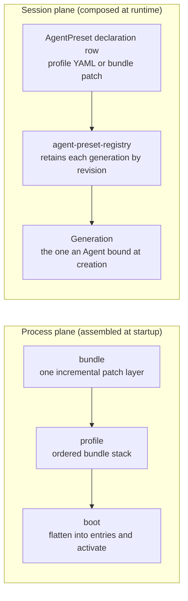
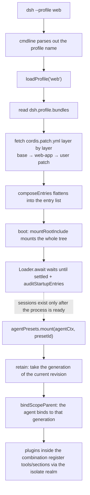

# Chapter 15: The preset / bundle / profile Combination — Assembling Loose Parts into Reusable Product Forms

> Assemble, not duplicate: each Agent keeps the generation it was created under; the process stacks incremental patch layers one on top of another.

## Questions This Chapter Answers

- How can multiple agent sessions **reuse** the same model-facing plugin combination — and finish a combination upgrade without interrupting sessions that are already running?
- How can the process-startup service list be **incrementally customized** per product form (headless / web), instead of overwriting the whole configuration?
- Which layer does each of `preset`, `bundle`, and `profile` own? And why is the `preset` here not the same thing as Chapter 14's `permission-presets` despite the shared name?
- Mounting one preset declaration runs a batch of plugins; how do we guarantee the mounted combination is complete, and that no session-level service leaks to the process level?

In Chapter 12 we made capabilities register as providers: several skill sources coexisting, merged by scope layer, with bodies loaded on demand. This chapter packs those capabilities — together with persona, tools, and prompt sections — **into a per-session preset**: instead of picking one capability at a time, a session installs a whole combination, and different sessions each run their own. The container primitives are reused from earlier chapters: Chapter 1's `Context`/`Service` (`Context` is the assembly container; `Service` registers itself upon construction, see `ch01/code/cordis.py`), plus Chapter 5's three roles of the capability seam. This chapter's teaching code reuses Chapter 1's `Context`/`Service` (`PresetService` in `ch15/code/preset.py` directly inherits from `cordis.Service`), and adds four new modules: `patch.py`/`bundle.py`/`profile.py`/`preset.py`.

This chapter uses **scope** — the name of "which agent," used to locate that agent's generation of the composition. The concept was defined in Chapter 9; here we only back-link to it and do not expand.

## 1. The Same Parts, Reassembled Every Time

You are maintaining a harness. It must run as different **product forms** (command-line headless, web UI) while simultaneously supporting **multiple agent sessions**, each of which needs a full set of model-facing plugins (persona, tools, prompt sections). Without a composition mechanism, you hit two dilemmas.

**Problem one (session level)**: every agent session needs that set of model plugins. If each session mounts its own copy, there are N plugin instances — updating the set means editing N places, and behavior consistency is hard to guarantee:

```python
# Inline example: no composition mechanism, each session mounts its own copy (illustrative, not this chapter's code)
for session in ("writer session", "reviewer session", "translator session"):
    mount_model_plugins(session)   # Result: 3 instances, 3 places to maintain
```

Sharing one mount is only the first ambition. Keep running and you hit the second layer: the maintainer changes the `writer` combination in the Web UI (adds a `tool-web` row), while three sessions are still running. If that shared instance is replaced in place, the running sessions suddenly gain a tool on the next turn, and their prompt sections shift too — the context cache is invalidated, and what the model sees no longer matches the previous turn. **What you want is "new sessions use the new combination, old sessions keep the old one," not "everyone switches at once."**

**Problem two (process level)**: you have a base configuration that runs well, and you want to derive a web variant — change the theme, add a server, turn off headless startup. The most intuitive approach is "whole-segment merge," but it is a pitfall at every turn (`ch15/code/bad_example.py`, runnable):

```python
# ch15/code/bad_example.py（节选）
def merge_configs(base, overlay):
    """整段 merge：overlay 出现的每个 key，整段覆盖 base 里的值。"""
    merged = dict(base)
    for key, value in overlay.items():
        merged[key] = value      # 整段替换：不是增量，也不保留 base 的其余字段
    return merged


def main():
    # base：一份跑得好好的配置（每个 key 是一个服务的 config）
    base = {
        "settings": {"theme": "light", "lang": "zh"},
        "headless-startup": {"provider": "headless"},
    }

    # 目标：theme 改 dark、加 server、关掉 headless-startup。
    overlay = {
        "settings": {"theme": "dark"},     # 只写了 theme，没带 lang
        "server": {"port": 8080},
        # merge 没有办法表达「关掉 headless-startup」
    }

    merged = merge_configs(base, overlay)
    print("== 反例：整段 merge 的三个痛 ==")
    print(f"痛 1：只想改 theme，却得整段重写 settings；漏写 lang，它丢了 -> {merged['settings']}")
    print(f"痛 2：merge 没有『禁用』，headless-startup 关不掉，仍在 -> {'headless-startup' in merged}")
    print("痛 3：settings 被整段替换，看不出『只是改了 theme』还是『换掉了整个配置』")
```

Running `python3 bad_example.py` prints:

```text
== 反例：整段 merge 的三个痛 ==
痛 1：只想改 theme，却得整段重写 settings；漏写 lang，它丢了 -> {'theme': 'dark'}
痛 2：merge 没有『禁用』，headless-startup 关不掉，仍在 -> True
痛 3：settings 被整段替换，看不出『只是改了 theme』还是『换掉了整个配置』
```

The problems reduce to two: ① sessions each mount their own, so plugin instances number N and cannot be reused — and once the combination needs an upgrade there is no way forward; ② deriving a product variant can only be done by whole-segment merge — change one thing, lose another; cannot disable; not traceable. This chapter introduces mechanisms one by one to solve them.

**Look at the overall map before decomposing**: this chapter's four concepts split into two planes — the **process plane** assembles at startup "which services the process loads," and the **session plane** composes at runtime "the model-facing plugins of a given agent session."



In the diagram: `bundle`/`profile`/`boot` feed one layer into the next, ultimately producing the process's service list; declaration rows go through the registry and become generation after `Generation`, and each Agent keeps the one that existed when it was created. Below we decompose them one by one in the order `preset → bundle → profile → boot`; precise definitions of each concept are given in the corresponding subsections.

## 2. Mechanism One: preset — Session-Level Composition and Revision Retention

### 2.1 First Distinguish: This preset Is Not Chapter 14's permission-presets

**preset (agent-preset)**: an agent session's **model-facing plugin combination** — it is one declaration row (an `@deepseek-ai/dsh-agent-preset` plugin row) whose `config.plugins` lists the plugins to mount into the child context, managed by the registry in the `preset/agent-preset-registry` package. It answers "which plugins should this session mount for the model."

Be sure to distinguish it from Chapter 14's **permission-presets**: those bundle **sandbox and approval policies** into named permission configurations, governing "what is allowed"; this chapter's preset governs "which plugins to install for the model." The two share the name `preset` and are both "a named set of presets," but one lives on the permission side and the other on the model side — **they are not the same thing**. Every `preset` in the rest of this chapter refers to agent-preset.

### 2.2 What a preset Is: One Declarative Row, Not a Directory

preset is now **declarative**: you write one `@deepseek-ai/dsh-agent-preset` row in profile YAML or a bundle patch, and it registers itself into the registry. The declaration row's implementation is only 30 lines — `class AgentPreset` at `packages/preset/agent-preset/src/index.ts:12`, `:13` statically injects `agentPresets`, and `:27`-`:29` hands `config` to `ctx.agentPresets.register(...)` inside `[Service.init]`. It builds no combination itself; it only hands the definition over.

The registry is `AgentPresetRegistry` (`packages/preset/agent-preset-registry/src/index.ts:54`, `extends TypertRemoteService`, `:55` injects `loader`/`sessionProjections`/`agents`), exposed under the service name `agentPresets` (the `super(ctx, 'agentPresets')` at `index.ts:68`). Its README states the boundary plainly: `packages/preset/agent-preset-registry/README.md:46` — "Definitions are ordinary plugin rows; the registry neither scans directories nor accepts preset paths."

This is the big change from the previous mechanism: a preset used to be a directory (`$DSH_HOME/.agent-presets/<id>/` holding `preset.yml` and `agent.cordis.yml`) discovered by scanning. Nothing reads that directory any more (`packages/preset/agent-preset/skills/editing-cordis-compositions/SKILL.md:70` says "Nothing reads that directory any more" and gives the migration recipe: make a bundle that rewrites the directory contents into a declaration row's `config`). Today the official way to add a preset is **one bundle patch**: `insert` a `dsh-agent-preset` row, or patch by that row's id. The four shipped presets are installed exactly this way — `packages/bundle/web-app/presets/standard.patch.yml:4-9` is one `insert`, with `config.id: standard` and the whole combination in `config.plugins`.

Which preset a session uses is recorded in the session's own **projection** (a projection: read-only state derived from the session event log, see Chapter 3), not merely in the header written at creation: `packages/preset/agent-preset-registry/src/session.ts:37`-`:46` defines the `agentPreset` projection (`init` reads the header, `apply` consumes `agent-preset/selected` events), and the reason is in the file header — a blank session may switch presets before its first turn, and that choice must reach the log, otherwise a restored session is not the one that actually ran. The read entry point is `presetForSession` (`index.ts:89-91`), which reads the projection state synchronously.

### 2.3 Revision Retention: Each Agent Keeps the Generation It Was Created Under (the crux)

First define **revision**: the version number of one preset's definition, incremented on every change. It does not record "how many presets exist at once" but "which edition of the same preset this is." The mechanism below circles one question: should an Agent follow the definition, or follow the version?

The previous crux was "one preset mounted once, many agents join one copy." That answer solved reuse but left a blunt edge: when the combination needs upgrading, what happens to the shared instance? Edit it in place and running sessions have their tools and prompts swapped; leave it alone and new sessions never get the new combination. §1's second-layer pain is exactly this.

The answer now is **revision retention** (an Agent follows the version, not the definition). Once a version is mounted it becomes a **Generation**: the live combination mounted from that definition (a plugin subtree plus its own scope). The registry keeps a `definitions` table (`index.ts:62`), and each definition carries an optional `generation` (`index.ts:44`); `Generation` (`index.ts:33`-`:39`) has the fields `{ scope, key, mount, users, retired }` — the generation's own scope, its scope key, the mounted tree, the number of holders, and whether it has been retired. The entry point for taking a combination is `retain` (`index.ts:248`): it audits the diagnostic inside a `while` loop (`index.ts:250`-`index.ts:254`), confirms the definition was not swapped during the `await` (`index.ts:255`), then does `generation.users++` (`index.ts:261`) and returns that generation.

So: **Agents created within the same revision reuse the same generation**; **when the definition changes (declaration row replaced / patch override), the new declaration eagerly mounts a new generation inside `register`** (`index.ts:114`-`index.ts:115`, `record.ready = this.activate(record)`), and the next `retain` merely fetches `record.generation`; Agents already bound to the old generation keep running it. The README puts it in one line: existing Agents retain the composition they already use (`packages/preset/agent-preset-registry/README.md:2`). The old generation is not destroyed immediately: as long as `users` is non-zero it stays, and only when the count reaches zero does `collect` release it (`index.ts:164`-`index.ts:168`; the `finally` at `index.ts:302`-`index.ts:305` does `users--`).

The binding lives on the **scope chain**, not in a global "who uses which mount" table: `mount(ctx, id?)` (`packages/preset/agent-preset-registry/src/index.ts:297`) calls `retain` and then `bind`; the first binding goes through `join` (`index.ts:281`), which uses `bindScopeParent(key, generation.key)` (`index.ts:282`) to point the Agent's scope key at that generation's key. **Subagents** take the other path: `composeFrom(ctx, parent)` (`index.ts:313`) does not re-resolve the current revision by id; it finds the parent context's generation and joins it directly — parent and child must share one generation, otherwise the parent sees different tools than the child. `packages/subagent/subagent/src/child-agent.ts:201` calls exactly this.

Python reconstruction (`ch15/code/preset.py` excerpt; `Service` inherited from Chapter 1's `cordis.py`):

```python
# ch15/code/preset.py（PresetService 的 revision 保留核心，节选：省略 `_materialize`/`_mount_one`/`_guard`）
    def retain(self, preset_id):
        """取当前 revision 的那一代，引用计数 +1（对应 retain，index.ts:248）。

        [教学简化] 真实实现 register 时就 eager 挂载成一代（index.ts:114-115），
        retain 只拿 record.generation；教学版推迟到第一次取才物化。无论哪种，
        同一 revision 内反复取拿到的都是同一代——「复用」由此而来，
        但它不再是全局单例：换代之后就是另一代了。
        """
        self._check(preset_id)
        generation = self._current.get(preset_id)
        if generation is None or generation.revision != self._defs[preset_id]["revision"]:
            generation = self._materialize(preset_id)   # 未挂载 / 已换代：新挂一代
        generation.users += 1
        return generation

    def release(self, generation):
        """归还一次 retain 的引用（对应 index.ts:302-305 的 finally 里的 users--）。"""
        generation.users -= 1

    def mount(self, agent_scope_key, preset_id=None):
        """把一个 Agent 绑到「当前 revision」的那一代（对应 mount，index.ts:297）。

        返回该代；agent 之后一直用这一代，哪怕定义再改也不迁移——
        对应真实实现里的 `bindScopeParent(key, generation.key)`（index.ts:282）。
        """
        self._check(preset_id)
        generation = self.retain(preset_id)
        generation.bindings.append(agent_scope_key)
        self.release(generation)        # 绑定本身持有引用，retain 的临时引用还掉
        return generation

    def compose_from(self, child_scope_key, parent_generation):
        """子代理加入父代理的**同一代**（对应 composeFrom，index.ts:313）。

        关键：子代理不按 id 重新取当前 revision，而是认父代理手里那一代——
        否则父代理还在用旧组合，子代理却跑新组合，父子看到的工具集就会不一致。
        """
        parent_generation.bindings.append(child_scope_key)
        return parent_generation
```

Consumer side: `agent-a` is created at revision 1, then the declaration is changed to revision 2, and only then is `agent-b` created. Output of running `main.py` segment 1 (full output in §7):

```text
agent-a 创建时绑定的 revision: 1
agent-b 创建时绑定的 revision: 2
两代是同一个组合实例吗: False
agent-a 现在仍绑定的 revision: 1
agent-a 的组合里有没有 tool-web: False
agent-b 的组合里有没有 tool-web: True
同一 revision 内 agent-b 与 agent-c 复用同一代: True
agent-a 的子代理与父代理同一代: True
writer 累计真正挂载次数: 2
```

[Teaching simplification] In the real implementation `register` activates a generation on the spot (`index.ts:114`-`index.ts:115`), and `retain` only fetches `record.generation`; the teaching version defers mounting to the first `retain` so that "each generation has its own service instances" is easier to see. Separately, the real `users` count also covers Agents, child agents, and historical reads that hold references; the teaching version books that in `Generation.bindings`, and `users` only demonstrates the `retain`/`release` pairing.

Four things become visible at once: the new revision applies to **new** Agents; old Agents still hold the old generation (no `tool-web`); the same revision still reuses one generation; subagents follow their parent. The mount count is 2 rather than 3 — each of the two revisions mounted once, and `agent-c` reused the second generation (the definition was `update`d only once).

### 2.4 One-Time Selection and Known Boundaries

A blank session may switch presets before its first turn; the entry point is `select` (`packages/preset/agent-preset-registry/src/index.ts:365`, with the `@Remote('select')` decorator at `index.ts:364`). It queues this switch on a per-agent serial chain (`index.ts:366`), first checks the turn boundary (`index.ts:368`-`index.ts:370`; a session that has already started throws `agent-preset/locked`), then swaps in the new combination and does `session.append('agent-preset/selected', ...)` (`index.ts:375`). The comment (`index.ts:358`-`index.ts:359`) spells out the shortcut: if the preset recorded in the log already matches the generation being run, do nothing and log nothing.

Two boundaries are worth stating. **First**, only "old generations inside this process" are retained: the README's Known Limitations say old revision implementations do not survive a process restart (`packages/preset/agent-preset-registry/README.md:99`, "Old revision implementations are not retained across process restarts") — after a restart the session is rebuilt from the logged id using the **current** definition, and the old combination does not come back. **Second**, a preset is not a security sandbox: the plugins in a declaration are plugins that can execute host code (the first sentence of the same Known Limitations entry). It isolates **composition**, not **permission** — permission is the "what is allowed" side, see Chapter 14. The teaching code's `_frozen` only holds retired generations in memory; it writes nothing to disk and does not survive a process, matching the real boundary.

### 2.5 Wrap-up

Revision retention solved Problem one: multiple sessions reuse one generation, and when the combination upgrades, the old and new generations coexist without disturbing each other. But a new question follows — mounting a generation actually runs a batch of plugins; what if one plugin does not start, or a service is published at the wrong level? That is what the next section's guards answer.

## 3. Mechanism Two: Mount Guards — Why Mounting Needs Guards

### 3.1 What Happens Without Guards

Mounting a preset actually runs a batch of plugins, and "mounted" and "started" are two different things.

First failure: the writer session's preset declares `tool-web`, but its provider fails to import, and the whole combination is returned as usual — the mount call succeeds and the session looks fine. Only when the model first tries to search the web does it get `unknown tool`, and the error is swallowed as an ordinary tool failure; by the time the user notices "this session cannot seem to search," a lot of time has passed.

Second failure: a `global-cache` in the preset does not declare its own isolate realm, so its implementation lands directly in the process-level ROOT realm. The translator session then sees it and shares the same cache with the writer session — the two sessions pollute each other's data, and nothing in the code "looks wrong."

Both failures are insidious and must be stopped the moment mounting completes.

First define **realm**: Cordis's registration isolation boundary — the level at which a service is registered is exactly the level at which it is visible. The **ROOT realm** is process-level (shared by all sessions); the **isolate realm** is session-isolation-level. Plugins inside a combination should register their tools/sections into the isolate realm; registering into the ROOT realm is a leak. (realm/Loader/Include are Cordis kernel primitives not expanded in earlier chapters; a working definition of Loader is in §5.2.)

### 3.2 Guard One auditRows / Guard Two leakedServices

`mountPreset` (`packages/preset/agent-preset-registry/src/mount.ts:204`) first confirms it is inside a scope (`mount.ts:205`; an `undefined` `scopeOf(ctx)` throws), then loads the declared rows into a `PresetTree`, waits for the tree to settle, and evaluates two checks (`mount.ts:210` evaluates `auditRows`, `mount.ts:211` evaluates `leakedServices` — both always run, no short-circuit), then throws in a fixed order (`mount.ts:212` checks failed first, `mount.ts:213` checks leaked second):

- **Guard one `auditRows`** (`packages/preset/agent-preset-registry/src/mount.ts:134`): awaits each row's fiber and collects `failed` (never started / import or activation rejected) and `pending` (waiting for a service the combination does not supply); a non-empty `failed` rejects.
- **Guard two `leakedServices`** (`mount.ts:69`): scans every implementation in the registry for service names whose context belongs to this mounted subtree yet sits under a ROOT-realm symbol; non-empty rejects.

If either guard fails, `mountPreset` throws (`mount.ts:212` and `mount.ts:213`, two `throw`s). After it throws, `activate` (`index.ts:119`) catches, records `record.broken`, and disposes this scope (`index.ts:133`-`index.ts:137`); `retain` then sees a record that is broken or has no generation and throws the Remote error `agent-preset/invalid` (`index.ts:257`-`index.ts:260`), so a broken definition can no longer bind any new Agent. Note that `pending` is not a failure: it is waiting for a host service that may come up once the host tree settles, so the registry re-audits every time it reads a diagnostic (`index.ts:151`-`index.ts:162`, `diagnostic`).

The `PresetTree` carrying the subtree inherits from `EntryTree` (`packages/preset/agent-preset-registry/src/mount.ts:9`) — `EntryTree` is the Loader's entry-tree type; `PresetTree` also overrides `commit()` to be empty (`mount.ts:23`) — `commit` is the entry tree's write-back entry point, but a preset is read-only input and must never write back, so the subclass simply makes it a no-op and seals that path.

Python reconstruction (`ch15/code/preset.py`):

```python
# ch15/code/preset.py（PresetService 的挂载守卫，节选：省略 _all_frozen/_check）
    def _guard(self, generation):
        """挂载守卫（对应 mountPreset 挂完后跑 auditRows + leakedServices，mount.ts:210-213）。

        守卫一 auditRows（mount.ts:134）：有行没起来（never started / 激活失败）→
        组合不完整。真实实现把「等 Host 服务」的 pending 行另算、不判失败。
        守卫二 leakedServices（mount.ts:69）：有服务把实现发到了 ROOT realm →
        会话之间会互相看见，必须拦下。
        任一不过即抛 PresetMountError；教学版不缓存失败的那一代。
        """
        failed = [s.id for s in generation.services if not s.activated]
        if failed:
            raise PresetMountError(f"auditRows.failed: {failed} 没有起来的行")
        leaked = [s.id for s in generation.services if s.realm == "ROOT"]
        if leaked:
            raise PresetMountError(f"leakedServices: {leaked} 注册到了进程级 ROOT realm")
```

Running `main.py` segment 2, the two broken presets are each stopped by one of the guards (full output in §7):

```text
broken-inactive: 被守卫拦下 -> PresetMountError: auditRows.failed: ['flaky-tool'] 没有起来的行
broken-leak: 被守卫拦下 -> PresetMountError: leakedServices: ['global-cache'] 注册到了进程级 ROOT realm
```

[Teaching simplification] Upstream HEAD **has no `PresetMountError` class**: the real path is `mountPreset` throwing a plain `Error` (`mount.ts:212`-`mount.ts:213`) → `activate` catching it, recording `record.broken`, and disposing this scope (`index.ts:133`-`index.ts:137`) → `retain` surfacing the Remote error `agent-preset/invalid` (`index.ts:257`-`index.ts:260`). The teaching version uses `PresetMountError` as the single exit for both guard failures, purely so the output shows at a glance that "the guard stopped it." The guard checks themselves are simplified too: the real guards hang off the `PresetTree` subtree and read each row's `fiber` state plus the registry's realm symbols, while the teaching version expresses the same checks through each service's `activated`/`realm` fields and does not cache the failed generation, so every attempt remounts and re-checks.

### 3.3 Wrap-up

The guards guarantee that "the generation a session receives is either complete and isolated, or the mount simply fails" — Problem one is now closed. Turning to Problem two: at process startup, how is the service list incrementally customized per product form?

## 4. Mechanism Three: bundle — Process-Level Incremental patch

### 4.1 What a bundle Is: "an npm Package with Only a Payload"

**bundle**: an **installable patch layer**. It is an npm package with "almost no code" — the TS entry is just a placeholder (`packages/bundle/base/src/index.ts:1`-`packages/bundle/base/src/index.ts:7` is a comment block, `packages/bundle/base/src/index.ts:9` is only `export {}`), and the real logic lives entirely in a `cordis.patch.yml`; `package.json` declares it with `"dsh": {"bundle": {"patch": "./cordis.patch.yml"}}`. The `dsh.bundle.patch` field is the **sole contract** by which the boot side discovers a bundle: `bundlePatchFiles` reads it (`packages/boot/app-boot/src/profile.ts:54`-`packages/boot/app-boot/src/profile.ts:60`; `patch` may be one path or an array of paths), `bundlePatchPaths` turns those into absolute paths (`profile.ts:69`-`profile.ts:71`), and the call site is in `loadProfileDirectory` (`profile.ts:701`). The field may also be an **array**: `packages/bundle/web-app/package.json:48`-`packages/bundle/web-app/package.json:54` lists five files, the first carrying host rows and the other four each inserting one shipped preset.

### 4.2 patch, Not merge (the crux)

The crux of bundle is **patch, not merge**: `cordis.patch.yml` is not another standalone configuration but an **incremental modification** of the **existing configuration** — id-targeted config overrides, disabling of entries, and insertion of new entries. The "entry" here is exactly an **entry**: one unit the process loads — a service/plugin together with its config and switch (id + config + disabled). It genuinely solves three things: **it can disable** (merge has no way to say "turn it off"), **it is traceable** (the entry is still in the list, so you can see who disabled it and in which layer), and **the blast radius is small** (one patch touches only the entry it targets, instead of rewriting the whole configuration).

One thing must be said up front: **a patch override replaces the whole `config`, it does not merge key by key**. The comment at `packages/bundle/base/cordis.patch.yml:6` is blunt — "A patch replaces the targeted row's whole `config` rather than merging into it." That is why every real bundle row that changes config restates every key it owns (`packages/bundle/web-app/README.md:107` explains the same). §1's merge bad example was about "overwriting a whole configuration key by key"; patch narrows the scope to "one entry located by id" — but only the scope shrinks, not the whole-replacement semantics: the targeted entry's `lang` is still lost, and a real patch must write it again. The teaching version writes the override as a key-level shallow merge so that "only theme changes, lang survives" can be demonstrated; that is a [Teaching simplification]: `lang` surviving is the teaching demo's effect, not real patch behavior.

Patch files are "a top-level YAML array whose elements are `PatchOptions`," parsed by `parsePatchList` (`packages/boot/app-boot/src/index.ts:571`). The teaching version models one patch as a dict with an `op` field, in three forms: `insert` / `override` / `disable`. Python reconstruction (`ch15/code/patch.py`, module-level function):

```python
# ch15/code/patch.py（模块级函数 apply_entry_patches，与文件逐字一致）
def apply_entry_patches(entries, patches):
    """把一批 patch 依序作用到 entry 列表上，返回新列表（不改原列表）。

    对应真实代码：include 的 applyEntryPatches——profile 栈拍平成 entry 列表的最后一步
    （packages/boot/app-boot/src/profile.ts:755 composeEntries 调用它）。

    实现要点：
    - 先浅拷贝每个 entry，保证「patch 作用在副本上」，原列表不被污染；
    - 用 by_id 索引定位目标，所以 override/disable 都是「id 定向」的；
    - insert 追加到列表尾部，并同步进索引，供后续 patch 继续定向它。
    """
    entries = [dict(e) for e in entries]          # 副本：不动调用方传入的列表
    by_id = {e["id"]: e for e in entries}         # id -> entry 的索引，供定向查找
    for patch in patches:
        op = patch["op"]
        if op == "insert":
            entry = dict(patch["entry"])          # 新 entry 也拷一份，避免共享引用
            entry.setdefault("config", {})
            entry.setdefault("disabled", False)
            entries.append(entry)                 # 追加到尾部
            by_id[entry["id"]] = entry            # 进索引，后面的 patch 能定向它
        elif op == "override":
            target = by_id.get(patch["id"])
            if target is not None:                # 定向不到就跳过（幂等、不报错）
                # [教学简化] 真实 patch 整段替换该 entry 的 config（base/cordis.patch.yml:6）；
                # 这里按 key 浅合并，只为让 §1 的 lang 留存可见——真实写法必须把 lang 也写上
                target["config"] = {**target["config"], **patch["config"]}
        elif op == "disable":
            target = by_id.get(patch["id"])
            if target is not None:
                target["disabled"] = True         # 只翻禁用位，不删除条目本身
    return entries
```

Running `main.py` segment 3, contrast with §1's merge bad example (full output in §7):

```text
override 只改 theme，lang 保留: settings.config = {'theme': 'dark', 'lang': 'zh'}
disable 只翻禁用位: headless-startup.disabled = True
insert 追加 server 后: ['settings', 'headless-startup', 'server']
```

For the same "change theme, turn off headless, add server," the patch version squeezes the impact to one targeted entry, cleanly disables `headless-startup`, and keeps every entry traceable; that `lang` still survives is purely the [Teaching simplification]'s demo effect — a real patch replaces `settings`' whole config and `lang` must be written out again. Separately, real patches are YAML and allow `!!js` inline functions, and take effect with whole-replacement semantics at configuration time; the teaching version expresses the same semantics with dict + `op`.

### 4.3 Three Patch Layers: base / headless / web-app

Of the bundles shipped with the installation, three carry this chapter's main line, each one patch layer (`packages/bundle/{base,headless,web-app}/cordis.patch.yml`, 548 / 46 / 601 lines). The source side uses **plane** to mean a group of services responsible for one aspect of concerns — unlike §1's lifecycle split into "process plane / session plane," here the split is by concern; the three bundles each own one plane:

- **base** (548 lines): the shared core layer, the first layer of every profile; inserts the harness-plane services (settings, scope, session, agent, system-prompt, etc.). The per-session tool rows (`tool-bash`, `tool-subagent`, and friends) also mount here first, in "one copy for the whole process" form.
- **headless** (46 lines): inserts the `headlessStartup` provider (`packages/bundle/headless/cordis.patch.yml:14`-`packages/bundle/headless/cordis.patch.yml:25`) and the one-shot runner that reads it; it also rewrites two rows inherited from base by id — `system-prompt`'s `personaPrefix` (`packages/bundle/headless/cordis.patch.yml:9`-`packages/bundle/headless/cordis.patch.yml:12`) and `sandbox-policy`'s mode/root (`:28`-`:33`) — and disables four rows that only an interactive surface needs (`:35`-`:46`).
- **web-app** (601 lines): inserts the web-UI plane (server, api-proxy, sdk, etc.) and **disables the per-session tool rows from base one by one** — from `tool-bash` at `packages/bundle/web-app/cordis.patch.yml:498` all the way to `tool-web` at `packages/bundle/web-app/cordis.patch.yml:592` — then inserts the preset registry at `packages/bundle/web-app/cordis.patch.yml:597`-`packages/bundle/web-app/cordis.patch.yml:601`. This is "the agent plane moves behind agent presets" (`packages/bundle/web-app/README.md:103`, whose own wording is "then moves the agent plane behind presets"): the web UI no longer faces the model directly; the group of services responsible for the model side moves behind the presets and is declared by each preset's own `config.plugins`; the process layer only assembles, and the model side is handed to presets.

The teaching version expresses the three layers with a few representative patches (`ch15/code/bundle.py`, excerpt):

```python
# ch15/code/bundle.py（模块级变量，节选）
WEB_APP = Bundle("web-app", [
    {"op": "insert", "entry": make_entry("server", {"port": 8080})},
    {"op": "insert", "entry": make_entry("api-proxy")},
    # 关键：后一层精确禁用前一层留下的条目——merge 做不到，patch 做得到
    {"op": "disable", "id": "headless-startup"},
    # 关键：只按 id 定向这一个 entry（教学版的 override 按键浅合并；真实 patch 会整段换 config）
    {"op": "override", "id": "settings", "config": {"theme": "dark"}},
])
```

### 4.4 Experimental Bundles: A Ten-Line Patch Mounts Another Capability

Bundle granularity fits an "experimental feature" exactly. Under `packages/experimental/` sits a family of **opt-in experimental bundles**: not enabled in the default combination, switched on explicitly in Plugins. Their patch files are only about ten lines each — the three below are just 10, 16, and 12 lines, and the whole file is the complete declaration of that experimental capability.

- `cua-bundle` (10 lines): `packages/experimental/cua-bundle/cordis.patch.yml:1`-`packages/experimental/cua-bundle/cordis.patch.yml:10` is one `insert` adding the computer-use registry, the macOS implementation (`packages/experimental/cua-bundle/cordis.patch.yml:6` switches it off off macOS with `!!js process.platform !== 'darwin'`), and its UI row;
- `ralph-bundle` (16 lines): `packages/experimental/ralph-bundle/cordis.patch.yml:1`-`packages/experimental/ralph-bundle/cordis.patch.yml:16` is one `insert` adding a `cordis:group` that isolates a `workflowEngine` for Ralph (`packages/experimental/ralph-bundle/cordis.patch.yml:6`), with the workflow engine and the `tool-ralph` row inside the group;
- `session-titles-bundle` (12 lines): `packages/experimental/session-titles-bundle/cordis.patch.yml:1`-`packages/experimental/session-titles-bundle/cordis.patch.yml:12` first disables the default title row by id (`:1`-`:2`), then `insert`s the "send every human prompt to title generation" variant.

All of them are in the installation's `OPTIONAL_BUNDLES` list (`packages/util/official-bundles/src/bundles.ts:56`-`packages/util/official-bundles/src/bundles.ts:63`), and no shipped profile template selects any of them (`PROFILE_TEMPLATES` in `packages/util/official-bundles/src/bundles.ts:10`-`packages/util/official-bundles/src/bundles.ts:26` only has the base/web/headless/sdk sets). Install to switch on, remove to switch off — that is how bundle separates "experimental" from "product default." Ralph's own mechanism stays in Chapter 17.

### 4.5 Wrap-up

bundle's "patch, not merge" solved Problem two's "cannot disable," and shrank the "change one thing, lose another" blast radius from the whole configuration to the one targeted entry — though that entry's config still has to be rewritten in full. But a single bundle is only one patch layer — how do multiple bundle layers compose into a product and actually get started? That is profile and boot.

## 5. Mechanism Four: profile + boot — Stack into a Stack, Flatten into Entries

### 5.1 profile: An Ordered bundle Stack

**profile**: the `$DSH_HOME/profiles/<name>` directory (`packages/boot/app-boot/src/profile.ts:39` `PROFILES_DIR`; the resolver is at `packages/boot/app-boot/src/profile.ts:165` `resolveProfileDir`). The `dsh.profile.bundles` in `package.json` is an **ordered list of bundles**, plus the user's own `cordis.patch.yml` (the template at `packages/boot/app-boot/src/profile.ts:174`-`packages/boot/app-boot/src/profile.ts:178`). The shipped web template has only two layers: `['@deepseek-ai/dsh-base', '@deepseek-ai/dsh-web-app']` (`packages/util/official-bundles/src/bundles.ts:14`-`packages/util/official-bundles/src/bundles.ts:16`). `loadProfile` (`packages/boot/app-boot/src/profile.ts:728`) first ensures the profile directory exists — `initProfile` from the template when it does not (`packages/boot/app-boot/src/profile.ts:740`) — then hands off to `loadProfileDirectory` (`packages/boot/app-boot/src/profile.ts:678`) to read the bundles layer by layer, and finally reads the user layer from `PROFILE_PATCH_FILENAME` / `cordis.patch.yml` **last** (`packages/boot/app-boot/src/profile.ts:710`-`packages/boot/app-boot/src/profile.ts:712`), so in application order the user can always override everything.

A word on where the **persona** package sits: the first entry in almost every shipped preset's `config.plugins` is a `persona` row (`packages/bundle/web-app/presets/standard.patch.yml:10`-`packages/bundle/web-app/presets/standard.patch.yml:14`), which adds a persona section to **this one session**. The comment at `packages/preset/persona/src/index.ts:4`-`packages/preset/persona/src/index.ts:8` makes it **scope-only**: `dsh-system-prompt` already registers the global persona section unconditionally at the host layer, so a preset's persona row can only mount inside an Agent's scope, where it shadows that global persona; mounting it globally collides with `dsh-system-prompt`'s own host-layer registration (the same section name registered twice). That is how "a preset can swap even the model's persona without polluting other sessions."

Python reconstruction (`ch15/code/profile.py`, module-level function):

```python
# ch15/code/profile.py（模块级函数 load_profile）
def load_profile(profile, bundle_registry):
    """把 profile 叠成一串 patch：每个 bundle 贡献一层，用户 patch 压在最上层。

    对应 loadProfile（profile.ts:728）→ loadProfileDirectory（profile.ts:678）：
    读 dsh.profile.bundles，逐个 resolveBundleDir 取出 cordis.patch.yml，层层叠加；
    用户 $DSH_HOME/profiles/<name>/cordis.patch.yml 是最上层（profile.ts:174 的模板）。
    返回的列表顺序 = 应用顺序（栈底 → 栈顶）。
    """
    stacked = []
    for bundle_name in profile.bundles:
        bundle = bundle_registry[bundle_name]   # 按名字发现 bundle（类比 resolveBundleDir）
        stacked.extend(bundle.patches)          # 该 bundle 的整层 patch 追加进栈
    stacked.extend(profile.user_patches)        # 用户 patch 永远是最上层，能覆盖一切
    return stacked
```

### 5.2 boot: Flatten into an Entry List and Start

`composeEntries` (`profile.ts:755`) uses `applyEntryPatches` to **flatten** the stacked patches into the final entry list; `boot` (`packages/boot/app-boot/src/index.ts:1200`) then mounts the entries into the container. The real `boot` main chain is: `new Context()` and `provide('dshHomePath')` → `ctx.plugin(Loader)` → `mountRootInclude` (`packages/boot/app-boot/src/index.ts:738`) mounts the whole tree → `loader.await()` waits until all are ready → `auditStartupEntries` (`index.ts:1153`) audits; on failure it throws `StartupError` (`index.ts:1004`) and disposes the entire fiber.

Here we complete the last Cordis kernel primitive: **Loader** is the service that registers and waits for all entries to load/activate (`loader.await()` waits until they are all settled); Include is the upstream form of §3.2's `EntryTree` — the mechanism for "mounting a configuration subtree into a context." `mountRootInclude` mounts the root tree, and §3's `PresetTree` mounts a preset subtree. Python reconstruction (`ch15/code/profile.py`):

```python
# ch15/code/profile.py（模块级函数 compose_entries / boot）
def compose_entries(base_entries, stacked_patches):
    """boot 的第一步：把叠好的 patch 拍平成最终 entry 列表。

    对应 composeEntries（profile.ts:755）：从 base 配置出发，依次应用栈里全部 patch。
    """
    return apply_entry_patches(base_entries, stacked_patches)


def boot(entries):
    """boot 的第二步：加载并激活「未被禁用」的 entry，返回被激活的 entry。

    [教学简化] 真实 boot（index.ts:1200）是：new Context → provide('dshHomePath') →
    ctx.plugin(Loader) → mountRootInclude（index.ts:738）挂整树 → loader.await() →
    auditStartupEntries（index.ts:1153），失败即 dispose 整个 fiber 并抛 StartupError。
    教学版只保留「跳过 disabled、激活其余」这一可观察行为。
    """
    activated = []
    for entry in entries:
        if entry["disabled"]:
            continue                            # 被某层 patch 禁用的条目，boot 不加载
        activated.append(entry)                 # 其余条目逐个激活
    return activated
```

Running `main.py` segment 4: after the web stack is flattened, `headless-startup` is skipped and `settings.theme` is overridden (full output in §7). [Teaching simplification] The teaching boot keeps only the observable behavior "skip disabled, activate the rest," and does not implement Loader/Include's tree mounting or `auditStartupEntries`.

### 5.3 Wrap-up

profile stacks bundles into a stack, and boot flattens the stack into entries and activates them — Problem two is closed: product forms are customized by stacking patches, without touching base and without whole-segment overrides. Both planes are now covered; the next section ties them together with one data-flow diagram.

## 6. Data-Flow Panorama (closing)

The diagram below ties the two planes into one line: the upper half is process startup (boot flattens the profile stack into entries and mounts the tree); the lower half is the runtime session (the registry retains generations by revision, and an Agent keeps the one it was created under). Details (per-step line numbers, guards, counts) were given in the corresponding subsections above; here we look only at the main trunk.



**[Teaching decision]** The diagram abbreviates the web stack as base → web-app, matching the real template (`packages/util/official-bundles/src/bundles.ts:14`-`packages/util/official-bundles/src/bundles.ts:16`); §7's actual run uses the three-layer stack `['base', 'headless', 'web-app']`, keeping the headless layer so that web-app's disabling of the earlier layer's headless-startup has a visible target. The real web template has no headless layer, so that `disable headless-startup` really is a no-op there (`packages/bundle/web-app/cordis.patch.yml` does not contain that disable either) — it changes nothing in the real combination, and the teaching version only uses it to make "a later layer can precisely kill an earlier layer's row" visible. Likewise, the "user patch" layer in the diagram is empty in this demo, so it does not appear in the output.

The process plane produces "which services the process loads," and the session plane produces "which plugins a given agent session mounts for the model"; the former is the stage for the latter — only after the process is ready do sessions mount presets on top of it.

## 7. Complete Run Output

The complete code for this chapter is in `ch15/code/`; run `python3 main.py` (depends on Chapter 1's `cordis.py`; `main.py` already adds `ch01` to `sys.path` automatically). All output below comes from the example code's `print` (no framework logs, no third-party output), and every line is traceable to one of `main.py`'s four demo segments:

```text
== 段 1：preset revision 保留 —— 新 revision 生效，旧 agent 仍用旧组合 ==
agent-a 创建时绑定的 revision: 1
agent-b 创建时绑定的 revision: 2
两代是同一个组合实例吗: False
agent-a 现在仍绑定的 revision: 1
agent-a 的组合里有没有 tool-web: False
agent-b 的组合里有没有 tool-web: True
同一 revision 内 agent-b 与 agent-c 复用同一代: True
agent-a 的子代理与父代理同一代: True
writer 累计真正挂载次数: 2

== 段 2：挂载守卫 —— 为什么挂载要守卫 ==
broken-inactive: 被守卫拦下 -> PresetMountError: auditRows.failed: ['flaky-tool'] 没有起来的行
broken-leak: 被守卫拦下 -> PresetMountError: leakedServices: ['global-cache'] 注册到了进程级 ROOT realm

== 段 3：bundle —— patch 而非 merge ==
override 只改 theme，lang 保留: settings.config = {'theme': 'dark', 'lang': 'zh'}
disable 只翻禁用位: headless-startup.disabled = True
insert 追加 server 后: ['settings', 'headless-startup', 'server']

== 段 4：profile 栈 + boot 拍平 ==
web profile 的 bundle 栈（栈底→栈顶）: ['base', 'headless', 'web-app']
叠好的 patch 总数: 10
compose 出的 entry: ['settings', 'scope', 'session', 'agent', 'system-prompt', 'headless-startup', 'server', 'api-proxy']
boot 激活（跳过被禁用的 headless-startup）: ['settings', 'scope', 'session', 'agent', 'system-prompt', 'server', 'api-proxy']
settings.config（theme 被 web-app 覆盖）: {'theme': 'dark'}
```

Note that segment 4's final `settings.config` contains only `theme`: the teaching version's base-layer settings starts from an empty config (see BASE in `ch15/code/bundle.py`), so after layer-by-layer overrides only the theme written by web-app remains; in segment 3's output lang is kept because segment 3's demo base already wrote lang — the two are not contradictory.

Contrast with the opening epigraph: segment 1's "new revision for new Agents, old Agents keep the old generation, same revision reuses one generation" delivers "each Agent keeps the combination it was created under"; segments 3/4's "disable cleanly disables, layers stack" delivers "the process stacks incremental patch layers one on top of another" — assemble, not duplicate.

## 8. Source Code Mapping

| Mechanism in this chapter | Corresponding source location | Teaching-version difference in brief |
|------|------|------|
| preset declaration row | `packages/preset/agent-preset/src/index.ts:12` (`class AgentPreset`), `:13` (injects `agentPresets`), `:27-29` (`[Service.init]` calls `register`) | The teaching version splits "declare" and "redeclare" into `register`/`update`; the real path replaces the declaration row = a new generation |
| registry + revision retention | `packages/preset/agent-preset-registry/src/index.ts:54` (`AgentPresetRegistry`), `:33` (`Generation`), `:114` (eager `activate` inside `register`), `:248` (`retain`), `:297` (`mount`), `:281-282` (`join` + `bindScopeParent`), `:164` (`collect`), `:313` (`composeFrom`) | The real `register` mounts a generation immediately and `retain` only fetches `record.generation`; the teaching version defers the mount to the first `retain` and books bindings in an explicit `bindings` list instead of a scope parent pointer. Reuse within a revision and coexistence of old/new generations match |
| mount guards | `packages/preset/agent-preset-registry/src/mount.ts:204` (`mountPreset`), `:205` (requires a scope), `:134` (`auditRows`), `:69` (`leakedServices`), `:210-211` (both checks evaluated), `:212-213` (failed then leaked, two throws) | Upstream HEAD **has no `PresetMountError`**: the real flow is a plain `Error` → `activate` records `record.broken` (`index.ts:133-137`) → `retain` throws `agent-preset/invalid` (`:257-260`); the teaching version uses `PresetMountError` as a single exit. Checks use `activated`/`realm` fields instead of `fiber`/realm symbols, and `pending` is folded into one verdict |
| session selection record | `packages/preset/agent-preset-registry/src/session.ts:37-46` (`agentPreset` projection), `index.ts:89-91` (`presetForSession`), `index.ts:364` (`@Remote('select')`) / `index.ts:365` (method body) | The teaching version does not demonstrate the projection or `select`; it only covers "which generation is bound" |
| per-session persona | `packages/preset/persona/src/index.ts:4-8` (why scope-only), `:62` (`apply` registers prefix/suffix sections) | The main text gives one paragraph; in the teaching code persona is an ordinary service placeholder |
| patch application | `packages/boot/app-boot/src/index.ts:571` (`parsePatchList`), `packages/boot/app-boot/src/profile.ts:755` (`composeEntries` calls `applyEntryPatches`) | The teaching version uses dict + `op` and a shallow merge for override; the real one is YAML `PatchOptions`, where override replaces the row's whole config |
| bundle and the three patch layers | `packages/bundle/base/src/index.ts:1-9` (entry is comments + `export {}`), `packages/bundle/{base,headless,web-app}/cordis.patch.yml` (548/46/601 lines), `packages/bundle/web-app/package.json:48-54` (one bundle may list several patches) | The teaching version excerpts only 2–5 representative patches per layer, not the full plugin list |
| opt-in experimental bundle | `packages/experimental/cua-bundle/cordis.patch.yml:1-10`, `packages/experimental/ralph-bundle/cordis.patch.yml:1-16`, `packages/experimental/session-titles-bundle/cordis.patch.yml:1-12`, `packages/util/official-bundles/src/bundles.ts:56-63` (`OPTIONAL_BUNDLES`) | The main text only demonstrates "a ten-line whole patch mounts one capability"; it does not expand each experimental package's plugins |
| profile stack | `packages/boot/app-boot/src/profile.ts:39` (`PROFILES_DIR`), `:165` (`resolveProfileDir`), `:54-60` (`bundlePatchFiles` reads `dsh.bundle.patch`), `:728` (`loadProfile`), `:678` (`loadProfileDirectory`), `:651` (`resolveBundleDir`) | The teaching version fetches bundles by name from an in-memory registry; no directory initialization or `package.json` parsing |
| boot startup | `packages/boot/app-boot/src/index.ts:1200` (`boot`), `:738` (`mountRootInclude`), `:1153` (`auditStartupEntries`), `:1004` (`StartupError`) | The teaching boot only does "skip disabled, activate the rest"; no Loader/Include tree mounting or activation audit |

## 9. Summary and Preview

This chapter assembled loose parts into reusable product forms: **preset** (session level — a declarative row into the registry, revision retention keeping each generation, each Agent bound to the one it was created under, mount guards gating completeness and isolation, a persona row giving each session its identity), **bundle** (process level — incremental patch layers, patch not merge, small enough that one experimental feature is a ten-line patch), **profile + boot** (stack bundles into a stack, flatten into entries, and start). Chapter 16 enters typert — runtime types and object services — to see how these assembled services are safely read and invoked.

## 10. Appendix: Key Concepts Cheat Sheet

| Concept | One-line explanation | Depends on |
|------|-----------|------|
| **entry** | One service/plugin the process loads (id + config + disabled) | — (bottom layer) |
| **patch** | One incremental operation on the entry list (insert / override / disable) | entry |
| **realm** | Registration isolation boundary: ROOT = process level, isolate = session-isolation level | — (bottom layer) |
| **bundle** | One named patch layer ("an npm package with only a payload") | patch |
| **opt-in experimental bundle** | A bundle not enabled in the default combination, mounted explicitly; usually a ten-line patch in full | bundle |
| **profile** | An ordered bundle stack + the user's top-layer patch | bundle |
| **boot** | Flattens the profile stack into an entry list and activates it | profile, patch |
| **preset (agent-preset)** | One declarative row; `config.plugins` is a model-facing plugin combination | — (session plane) |
| **revision (preset)** | +1 on every change to the definition; an Agent binds the revision current at its creation and is not reloaded by a new revision | preset |
| **Generation / retain** | One generation of the combination and its retention entry: `retain(id)` materializes and returns one; old generations keep serving existing Agents | revision |
| **mount guards** | auditRows (rows that did not start) + leakedServices (leaks into the ROOT realm); stop incomplete or leaking mounts | Generation, realm |
| **persona (preset row)** | A scope-only persona-section row; lets one preset swap this session's persona without polluting other sessions | preset |

> Layering: the process plane, bottom-up, is entry → patch → bundle → profile → boot (an opt-in experimental bundle is one use of bundle); the session plane is preset declaration → revision → Generation → mount guards (realm supports the guard checks). Mapping between Python teaching symbols and source symbols: `PresetService`↔`AgentPresetRegistry`, `Generation`↔`Generation`, `retain`↔`retain`, `mount`↔`mount`, `compose_from`↔`composeFrom`, `register`↔the `register` call in `AgentPreset`, `_guard`↔`mountPreset`'s `auditRows` + `leakedServices`, `apply_entry_patches`↔`applyEntryPatches`, `load_profile`↔`loadProfile`, `compose_entries`↔`composeEntries`.
