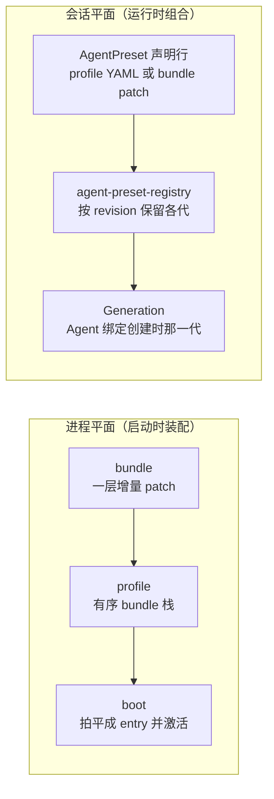
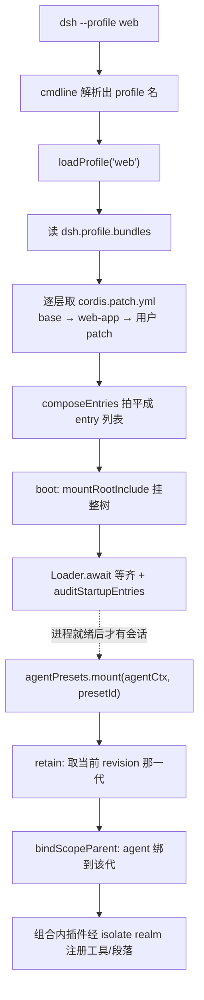

# 第 15 章 preset / bundle / profile 组合：把散装零件装配成可复用的产品形态

> 装配，而非复制：每个 Agent 绑住创建时的那一代组合，进程叠加一层层增量 patch。

## 本章回答的问题

- 同一套面向模型的插件组合，怎么让多个 agent 会话**复用**，又能在组合升级时不打断已经在跑的会话？
- 进程启动时的服务清单，怎么按产品形态（headless / web）**增量定制**，而不是整段覆盖配置？
- `preset`、`bundle`、`profile` 各管哪一层？为什么同名 `preset` 与第 14 章的 `permission-presets` 不是一回事？
- 一份 preset 声明装进去就会运行一批插件，怎么保证挂出来的组合完整、又不把会话级服务漏到进程级？

第 12 章我们让能力以 provider 形式注册：多个 skill 来源并存、按 scope 分层合并、按需加载正文。本章把这些能力连同 persona、工具、prompt 段落**按会话整体打包成 preset**——不再一次选一个能力，而是一次装一整套组合，并让不同的会话各跑各的那一套。复用的容器原语来自更早的章节：第 1 章的 `Context`/`Service`（`Context` 是装配容器，`Service` 构造即注册，见 `ch01/code/cordis.py`），以及第 5 章 capability seam 三角色。本章教学代码复用第 1 章的 `Context`/`Service`（`ch15/code/preset.py` 里 `PresetService` 直接继承 `cordis.Service`），新增 `patch.py`/`bundle.py`/`profile.py`/`preset.py` 四个模块。

本章会用到 **scope（作用域）**——「哪个 agent」的名字、用来定位它那一代组合，概念在第 9 章已定义，此处只做回链，不再展开。

## 1. 同一套零件，每次都要重新拼

你在维护一个 harness。它要跑成不同**产品形态**（命令行 headless、Web 界面），还要同时支撑**多个 agent 会话**，每个会话都需要一套面向模型的插件（persona、工具、prompt 段落）。没有组合机制时，你会撞上两个困境。

**问题一（会话级）**：每个 agent 会话都要那套模型插件。如果各会话各自挂载一遍，插件实例就有 N 份——更新一套要改 N 处，行为也难保一致：

```python
# 行内示例：没有组合机制，每个会话各挂一遍（示意，非本章代码）
for session in ("写手会话", "审稿会话", "翻译会话"):
    mount_model_plugins(session)   # 结果：3 份实例，3 处维护
```

共挂一份只是第一层追求。跑着跑着你会撞上第二层：主持人在 Web 里把 `writer` 这套组合改了一下（多挂一个 `tool-web`），这个时候还有三个会话正在跑。如果那份共享实例被原地替换，正在跑的会话会在下一轮突然多出一个工具、prompt 段落也跟着变——上下文缓存失效，模型看到的东西和上一轮对不上。**要的是「新会话用新组合、老会话用老组合」，而不是「所有人同时换」。**

**问题二（进程级）**：手头有一份跑得好好的 base 配置，想派生一个 Web 变体——改主题、加 server、关掉 headless 启动。最直觉的做法是「整段 merge」，但它处处是坑（`ch15/code/bad_example.py`，可运行）：

```python
# ch15/code/bad_example.py（节选）
def merge_configs(base, overlay):
    """整段 merge：overlay 出现的每个 key，整段覆盖 base 里的值。"""
    merged = dict(base)
    for key, value in overlay.items():
        merged[key] = value      # 整段替换：不是增量，也不保留 base 的其余字段
    return merged


def main():
    # base：一份跑得好好的配置（每个 key 是一个服务的 config）
    base = {
        "settings": {"theme": "light", "lang": "zh"},
        "headless-startup": {"provider": "headless"},
    }

    # 目标：theme 改 dark、加 server、关掉 headless-startup。
    overlay = {
        "settings": {"theme": "dark"},     # 只写了 theme，没带 lang
        "server": {"port": 8080},
        # merge 没有办法表达「关掉 headless-startup」
    }

    merged = merge_configs(base, overlay)
    print("== 反例：整段 merge 的三个痛 ==")
    print(f"痛 1：只想改 theme，却得整段重写 settings；漏写 lang，它丢了 -> {merged['settings']}")
    print(f"痛 2：merge 没有『禁用』，headless-startup 关不掉，仍在 -> {'headless-startup' in merged}")
    print("痛 3：settings 被整段替换，看不出『只是改了 theme』还是『换掉了整个配置』")
```

运行 `python3 bad_example.py` 输出：

```text
== 反例：整段 merge 的三个痛 ==
痛 1：只想改 theme，却得整段重写 settings；漏写 lang，它丢了 -> {'theme': 'dark'}
痛 2：merge 没有『禁用』，headless-startup 关不掉，仍在 -> True
痛 3：settings 被整段替换，看不出『只是改了 theme』还是『换掉了整个配置』
```

问题归为两条：① 会话各挂各的，插件实例 N 份、无法复用，而且组合一升级就无路可走；② 派生产品变体只能整段 merge，改一处丢一处、关不掉、不可追溯。本章逐个引入机制解决它们。

**先看整体地图再拆解**：本章的四个概念分成两个平面——**进程平面**在启动时装配「进程要加载哪些服务」，**会话平面**在运行时组合「某个 agent 会话面向模型的插件」。



图中：`bundle`/`profile`/`boot` 一层喂给一层，最终产出进程的服务清单；声明行经注册表变成一代代 `Generation`，每个 Agent 绑住自己创建时的那一代。下面按 `preset → bundle → profile → boot` 逐一拆解，各概念的准确定义见对应小节。

## 2. 机制一：preset —— 会话级组合与 revision 保留

### 2.1 先分清：此 preset 非第 14 章的 permission-presets

**preset（agent-preset）**：一个 agent 会话**面向模型的插件组合**——它是一行声明（`@deepseek-ai/dsh-agent-preset` 插件行），`config.plugins` 列出要给孩子上下文挂的插件，由 `preset/agent-preset-registry` 包里的注册表管理。它回答「这个会话要给模型挂哪些插件」。

务必与第 14 章的 **permission-presets（权限预设）** 区分：那是把**沙箱与审批策略**捆绑命名的权限配置，管的是「允许做什么」；本章的 preset 管的是「给模型装什么插件」。两者同名 `preset`、同为「可命名的一组预设」，但一个在权限面、一个在模型面，**不是同一个东西**。本章下文所有 `preset` 一律指 agent-preset。

### 2.2 preset 是什么：声明式的一行，而不是一个目录

preset 现在是**声明式**的：在 profile YAML 或 bundle patch 里写一行 `@deepseek-ai/dsh-agent-preset`，由它自己注册进注册表。声明行的实现只有 30 行——`packages/preset/agent-preset/src/index.ts:12` 的 `class AgentPreset`，`:13` 静态注入 `agentPresets`，`:27`-`:29` 在 `[Service.init]` 里把 `config` 交给 `ctx.agentPresets.register(...)`。它自己不建任何组合，只负责「交上去」。

注册表是 `AgentPresetRegistry`（`packages/preset/agent-preset-registry/src/index.ts:54`，`extends TypertRemoteService`，`:55` 注入 `loader`/`sessionProjections`/`agents`），对外服务名是 `agentPresets`（`index.ts:68` 的 `super(ctx, 'agentPresets')`）。它的 README 把边界写得很直白：`packages/preset/agent-preset-registry/README.md:46`「Definitions are ordinary plugin rows; the registry neither scans directories nor accepts preset paths」——注册表不扫目录、也不收路径。

这正是相对上一版机制的重大变化：曾经的 preset 是一个目录（`$DSH_HOME/.agent-presets/<id>/`，内含 `preset.yml` 与 `agent.cordis.yml`），由注册表扫描发现；那个目录现在没有任何代码读取了（`packages/preset/agent-preset/skills/editing-cordis-compositions/SKILL.md:70` 明说「Nothing reads that directory any more」，并给出迁移办法：做一个 bundle，把目录内容改写成声明行的 `config`）。今天新增一套 preset 的官方做法就是**一个 bundle patch**：`insert` 一行 `dsh-agent-preset`，或按该行的 id 打 patch。随附的四套 preset 就是这么装的——`packages/bundle/web-app/presets/standard.patch.yml:4-9` 是一条 `insert`，`config.id: standard`、`config.plugins` 就是整套组合。

会话用哪个 preset，记在会话自己的**投影**里（投影：由会话事件日志派生出的只读状态，见第 3 章），而不是只看创建时写的头部：`packages/preset/agent-preset-registry/src/session.ts:37`-`:46` 定义了 `agentPreset` 投影（`init` 取头部，`apply` 吃 `agent-preset/selected` 事件），原因写在文件头注释里——空白会话可以在首轮之前换 preset，这个选择必须进日志，否则恢复出来的会话就不是当初跑的那一套。读取入口是 `presetForSession`（`index.ts:89-91`），它同步读投影状态。

### 2.3 revision 保留：每个 Agent 绑住创建时的那一代（题眼）

先定义 **revision（preset 的修订）**：一套 preset 的定义每变一次就 +1 的版本号。它记录的不是「几套 preset 同时存在」，而是「同一套 preset 的第几版」。下面要讲的机制围着一个问题转：一个 Agent 应该跟定义走，还是跟版本走？

上一轮的题眼是「一个 preset 只挂一次、多 agent join 一份」。旧答案解决的是复用，却留下一个钝角：组合要升级时，那份共享实例怎么办？原地改，跑着的会话会被换掉工具与 prompt；不改，新会话又拿不到新组合。§1 第二层痛点说的就是这件事。

现在的答案是 **revision 保留**（Agent 跟版本走，不跟定义走）。每一版一旦挂起来，就是一**代 Generation**：同一版定义下挂出来的那套活组合（一棵插件子树 + 它自己的 scope）。注册表维护一个 `definitions` 表（`index.ts:62`），每个定义带一个可选的 `generation`（`index.ts:44`）；`Generation`（`index.ts:33`-`:39`）的字段是 `{ scope, key, mount, users, retired }`——一代自己的 scope、它的 scope key、挂出来的那棵树、还引用它的人数、以及是否已退役。取组合的入口是 `retain`（`index.ts:248`）：先在 `while` 循环里审一遍诊断（`index.ts:250`-`index.ts:254`），再确认 `await` 期间定义没被换掉（`index.ts:255`），然后把 `generation.users++`（`index.ts:261`）并返回那一代。

于是：**同一个 revision 内新建的 Agent 复用同一代**；**定义一改（换声明行 / patch 覆盖），新声明在 `register` 时就 eager 挂出新的一代**（`index.ts:114`-`index.ts:115` 的 `record.ready = this.activate(record)`），下一次 `retain` 只是取回 `record.generation`；而已经绑在旧代上的 Agent 继续跑旧代。README 一句话概括：现有 Agent 保留它们已经在用的组合（`packages/preset/agent-preset-registry/README.md:2`「existing Agents retain the composition they already use」）。旧代不会被立刻销毁：`users` 计数不为零就一直留着，归零才 `collect` 释放（`index.ts:164`-`index.ts:168`；`index.ts:302`-`index.ts:305` 的 `finally` 里 `users--`）。

绑定关系落在**作用域链**上，而不是一张「谁在用哪份挂载」的全局表：`mount(ctx, id?)`（`packages/preset/agent-preset-registry/src/index.ts:297`）先 `retain`，再 `bind`；首次绑定走 `join`（`index.ts:281`），用 `bindScopeParent(key, generation.key)`（`index.ts:282`）把 Agent 的 scope key 的父指针指向该代的 key。**子代理**走的是另一条路：`composeFrom(ctx, parent)`（`index.ts:313`）不按 id 重新取当前 revision，而是找父上下文那一代，直接 join 进去——父子必须在同一代，否则父代理看到的工具和子代理看到的不一样。`packages/subagent/subagent/src/child-agent.ts:201` 正是这么调的。

Python 重构（`ch15/code/preset.py` 节选，`Service` 继承自第 1 章 `cordis.py`）：

```python
# ch15/code/preset.py（PresetService 的 revision 保留核心，节选：省略 `_materialize`/`_mount_one`/`_guard`）
    def retain(self, preset_id):
        """取当前 revision 的那一代，引用计数 +1（对应 retain，index.ts:248）。

        [教学简化] 真实实现 register 时就 eager 挂载成一代（index.ts:114-115），
        retain 只拿 record.generation；教学版推迟到第一次取才物化。无论哪种，
        同一 revision 内反复取拿到的都是同一代——「复用」由此而来，
        但它不再是全局单例：换代之后就是另一代了。
        """
        self._check(preset_id)
        generation = self._current.get(preset_id)
        if generation is None or generation.revision != self._defs[preset_id]["revision"]:
            generation = self._materialize(preset_id)   # 未挂载 / 已换代：新挂一代
        generation.users += 1
        return generation

    def release(self, generation):
        """归还一次 retain 的引用（对应 index.ts:302-305 的 finally 里的 users--）。"""
        generation.users -= 1

    def mount(self, agent_scope_key, preset_id=None):
        """把一个 Agent 绑到「当前 revision」的那一代（对应 mount，index.ts:297）。

        返回该代；agent 之后一直用这一代，哪怕定义再改也不迁移——
        对应真实实现里的 `bindScopeParent(key, generation.key)`（index.ts:282）。
        """
        self._check(preset_id)
        generation = self.retain(preset_id)
        generation.bindings.append(agent_scope_key)
        self.release(generation)        # 绑定本身持有引用，retain 的临时引用还掉
        return generation

    def compose_from(self, child_scope_key, parent_generation):
        """子代理加入父代理的**同一代**（对应 composeFrom，index.ts:313）。

        关键：子代理不按 id 重新取当前 revision，而是认父代理手里那一代——
        否则父代理还在用旧组合，子代理却跑新组合，父子看到的工具集就会不一致。
        """
        parent_generation.bindings.append(child_scope_key)
        return parent_generation
```

消费端：`agent-a` 在 revision 1 创建，随后声明被改成 revision 2，`agent-b` 才创建。运行 `main.py` 段 1 的输出（完整输出见 §7）：

```text
agent-a 创建时绑定的 revision: 1
agent-b 创建时绑定的 revision: 2
两代是同一个组合实例吗: False
agent-a 现在仍绑定的 revision: 1
agent-a 的组合里有没有 tool-web: False
agent-b 的组合里有没有 tool-web: True
同一 revision 内 agent-b 与 agent-c 复用同一代: True
agent-a 的子代理与父代理同一代: True
writer 累计真正挂载次数: 2
```

[教学简化] 真实实现里，`register` 当场就 `activate` 挂出一代（`index.ts:114`-`index.ts:115`），`retain` 只负责取回 `record.generation`；教学版把挂载推迟到首次 `retain`，只为让「每一代都有自己的服务实例」看得更直白。另外，真实 `users` 记录还持有引用的 Agent / 子代理 / 历史读；教学版用 `Generation.bindings` 记账，`users` 只演示 `retain`/`release` 的配对。

四件事一次看清：新 revision 对**新** Agent 生效；旧 Agent 手里还是旧代（没有 `tool-web`）；同一 revision 内仍然复用；子代理跟着父亲走。挂载次数是 2 而不是 3——两个 revision 各挂一次，`agent-c` 复用第二代（只 `update` 过一次定义）。

### 2.4 一次性选择与已知边界

空白会话可以在首轮之前换 preset，入口是 `select`（`packages/preset/agent-preset-registry/src/index.ts:365`，`@Remote('select')` 装饰器在 `index.ts:364`）：它把这次切换排进一条按 agent 串行的队列（`index.ts:366`），先检查 turn 边界（`index.ts:368`-`index.ts:370`，已经开始过的会话直接抛 `agent-preset/locked`），再把新组合换上并 `session.append('agent-preset/selected', ...)`（`index.ts:375`）。注释（`index.ts:358`-`index.ts:359`）说明了捷径：如果日志里记的 preset 和当前跑的那一代本来就一致，就什么都不做、也不记事件。

要说清的两个边界。**其一**，这里保留的只是「这一进程内的旧代」：README 的 Known Limitations 写明旧代实现不跨进程重启保留（`packages/preset/agent-preset-registry/README.md:99`「Old revision implementations are not retained across process restarts」）——重启后按日志里的 id、用**当前**定义重建，旧组合不会复原。**其二**，preset 不是安全沙箱：声明里的插件就是能执行宿主代码的插件（同一段 Known Limitations 的第一句）。它隔离的是**组合**，不是**权限**——权限在「允许做什么」那一面，见第 14 章。教学代码里的 `_frozen` 只是把退役的旧代挂在内存里，不落盘、不跨进程，与真实边界一致。

### 2.5 回溯

revision 保留解决了问题一：多个会话复用同一代，组合升级时新老两代并存、互不打扰。但新的疑问随之而来——挂载一代组合要真正跑起一批插件，如果某个插件没起来、或者把服务发到了错误的层级，会怎样？这就是下一节的守卫要回答的。

## 3. 机制二：挂载守卫 —— 为什么挂载要守卫

### 3.1 没有守卫会怎样

挂载 preset 会真正运行一批插件，而「挂上了」和「跑起来了」是两件事。

第一种故障：写手会话的 preset 声明了 `tool-web`，但它的 provider 导入失败，整条组合照常返回——挂载调用成功，会话看起来没问题。模型第一次想查网页时才报 `unknown tool`，错误被当成一次普通工具失败吞掉；等到用户发现「这个会话好像不会搜索」，已经排查了很久。

第二种故障：preset 里的 `global-cache` 没有声明自己的 isolate realm，实现直接存进了进程级的 ROOT realm。于是翻译会话也能看到它、和写手会话共用同一个缓存——两个会话互相污染数据，却没有任何一处代码「看起来错了」。

这两种故障都隐蔽，必须在挂载完成的那一刻就拦下。

这里先定义 **realm（注册域）**：Cordis 的注册隔离边界——服务注册到哪一层，就只对哪一层可见。**ROOT realm** 是进程级（全体会话共享），**isolate realm** 是会话隔离级。组合里的插件应当把工具/段落注册进 isolate realm；注册到 ROOT realm 就是泄漏。（realm/Loader/Include 是 Cordis 内核原语，前章未展开；Loader 的工作级定义见 §5.2。）

### 3.2 守卫一 auditRows / 守卫二 leakedServices

`mountPreset`（`packages/preset/agent-preset-registry/src/mount.ts:204`）先确认自己在 scope 里（`mount.ts:205`，`scopeOf(ctx)` 为 `undefined` 直接抛），然后把声明的行装进一棵 `PresetTree`、等树稳定，再求两道检查（`mount.ts:210` 求 `auditRows`、`mount.ts:211` 求 `leakedServices`——两条都会执行，不短路），然后按固定顺序抛错（`mount.ts:212` 先判 failed，`mount.ts:213` 再判 leaked）：

- **守卫一 `auditRows`**（`packages/preset/agent-preset-registry/src/mount.ts:134`）：逐行等 fiber，收集 `failed`（从没启动 / 导入或激活拒绝）与 `pending`（在等组合里没提供的服务）；`failed` 非空即拒绝。
- **守卫二 `leakedServices`**（`mount.ts:69`）：扫注册表里的每个实现，找出「上下文属于这棵挂载子树、却存在 ROOT realm 符号下」的服务名；非空即拒绝。

任一守卫不过，`mountPreset` 就抛出（`mount.ts:212` 与 `mount.ts:213` 两条 `throw`）；它抛出去之后，`activate`（`index.ts:119`）在 `catch` 里记下 `record.broken` 并把这块 scope dispose 掉（`index.ts:133`-`index.ts:137`），而 `retain` 见到带 `broken` 或没有代的记录就直接抛 `agent-preset/invalid`（`index.ts:257`-`index.ts:260`），于是坏定义从此绑不上任何新 Agent。注意 `pending` 不算失败：它在等的是宿主服务，宿主树稳定后可能自己好起来，所以注册表每次读诊断都会重审一次（`index.ts:151`-`index.ts:162` 的 `diagnostic`）。

承载子树的 `PresetTree` 继承自 `EntryTree`（`packages/preset/agent-preset-registry/src/mount.ts:9`）——`EntryTree` 是 Loader 的条目树类型；`PresetTree` 还覆写 `commit()` 为空（`mount.ts:23`）——`commit` 本是条目树回写配置的入口，而 preset 是只读输入、绝不回写，子类干脆把它覆写成空实现，堵死回写这条路。

Python 重构（`ch15/code/preset.py`）：

```python
# ch15/code/preset.py（PresetService 的挂载守卫，节选：省略 _all_frozen/_check）
    def _guard(self, generation):
        """挂载守卫（对应 mountPreset 挂完后跑 auditRows + leakedServices，mount.ts:210-213）。

        守卫一 auditRows（mount.ts:134）：有行没起来（never started / 激活失败）→
        组合不完整。真实实现把「等 Host 服务」的 pending 行另算、不判失败。
        守卫二 leakedServices（mount.ts:69）：有服务把实现发到了 ROOT realm →
        会话之间会互相看见，必须拦下。
        任一不过即抛 PresetMountError；教学版不缓存失败的那一代。
        """
        failed = [s.id for s in generation.services if not s.activated]
        if failed:
            raise PresetMountError(f"auditRows.failed: {failed} 没有起来的行")
        leaked = [s.id for s in generation.services if s.realm == "ROOT"]
        if leaked:
            raise PresetMountError(f"leakedServices: {leaked} 注册到了进程级 ROOT realm")
```

运行 `main.py` 段 2，两个坏 preset 分别被两道守卫拦下（完整输出见 §7）：

```text
broken-inactive: 被守卫拦下 -> PresetMountError: auditRows.failed: ['flaky-tool'] 没有起来的行
broken-leak: 被守卫拦下 -> PresetMountError: leakedServices: ['global-cache'] 注册到了进程级 ROOT realm
```

[教学简化] 上游 HEAD **没有 `PresetMountError`** 这个类：真实路径是 `mountPreset` 抛普通 `Error`（`mount.ts:212`-`mount.ts:213`）→ `activate` 捕获、记下 `record.broken` 并 dispose 这块 scope（`index.ts:133`-`index.ts:137`）→ `retain` 对外抛 Remote 错误 `agent-preset/invalid`（`index.ts:257`-`index.ts:260`）。教学版用 `PresetMountError` 作为两类守卫失败的统一出口，只为让输出里一眼看出「被守卫拦下」。守卫本身的判定也是简化的：真实守卫挂在 `PresetTree` 子树上、读的是每行的 `fiber` 状态与注册表里的 realm 符号，教学版用服务的 `activated`/`realm` 两个字段表达同一判定，且不缓存失败的那一代，故每次都会重挂重检。

### 3.3 回溯

守卫保证了「会话拿到的那一代组合要么完整且隔离、要么干脆挂载失败」，问题一就此闭环。现在转向问题二：进程启动时，服务清单怎么按产品形态增量定制？

## 4. 机制三：bundle —— 进程级增量 patch

### 4.1 bundle 是什么：「只有一个 payload 的 npm 包」

**bundle**：一个**可安装的 patch 层**。它是个「几乎没有代码」的 npm 包——TS 入口只是占位（`packages/bundle/base/src/index.ts:1`-`packages/bundle/base/src/index.ts:7` 是一段说明注释，`packages/bundle/base/src/index.ts:9` 只有 `export {}`），真正的逻辑全在一份 `cordis.patch.yml` 里；`package.json` 用 `"dsh": {"bundle": {"patch": "./cordis.patch.yml"}}` 声明，`dsh.bundle.patch` 这个字段就是 boot 侧发现 bundle 的**唯一契约**：读它的是 `bundlePatchFiles`（`packages/boot/app-boot/src/profile.ts:54`-`packages/boot/app-boot/src/profile.ts:60`，`patch` 可以是单个路径或路径数组），拼成绝对路径的是 `bundlePatchPaths`（`profile.ts:69`-`profile.ts:71`），调用点在 `loadProfileDirectory`（`profile.ts:701`）。这个字段也允许是一个**数组**：`packages/bundle/web-app/package.json:48`-`packages/bundle/web-app/package.json:54` 就列了五个文件，第一个是 host 行，后四个各插入一套随附 preset。

### 4.2 patch 而非 merge（题眼）

bundle 的题眼是 **patch 而非 merge**：`cordis.patch.yml` 不是另一份独立配置，而是对**已有配置**的**增量修改**——按 id 定向地覆盖 config、禁用条目、插入新条目。这里的「条目」就是 **entry**：进程要加载的一个单元——一个服务/插件连同它的配置与开关（id + config + disabled）。它真正解决的问题有三个：**能禁用**（没有 merge 能表达的「关掉」语义）、**可追溯**（条目还在列表里，能看出被谁、在哪一层关掉）、**爆炸半径小**（一次 patch 只影响它定向的那个 entry，不再是把整份配置重写一遍）。

要提前说清一件事：**patch 的 override 是整段替换 config，不是按键合并**。`packages/bundle/base/cordis.patch.yml:6` 的注释写得很直白——「A patch replaces the targeted row's whole `config` rather than merging into it」。所以真实 bundle 里凡是改 config 的行，都把该行自己负责的每个键重新写一遍（`packages/bundle/web-app/README.md:107` 也是这么解释的）。§1 那个 merge 反例针对的是「整份配置按 key 覆盖」，patch 把范围缩到了「按 id 定位的一个 entry」；但缩小的只是范围，「整段替换」这一点没变——被定向 entry 的 `lang` 照样会丢，真实写法必须把它也写上。教学版为了让「只改 theme、lang 保留」这一行输出成立，把 override 写成按键浅合并，这属于 [教学简化]：`lang` 保留是教学版的演示效果，不是真实 patch 的行为。

patch 文件是「顶层 YAML 数组，元素为 `PatchOptions`」，由 `parsePatchList`（`packages/boot/app-boot/src/index.ts:571`）解析。教学版把一条 patch 建模为带 `op` 字段的 dict，三种形态：`insert` / `override` / `disable`。Python 重构（`ch15/code/patch.py`，模块级函数）：

```python
# ch15/code/patch.py（模块级函数 apply_entry_patches，与文件逐字一致）
def apply_entry_patches(entries, patches):
    """把一批 patch 依序作用到 entry 列表上，返回新列表（不改原列表）。

    对应真实代码：include 的 applyEntryPatches——profile 栈拍平成 entry 列表的最后一步
    （packages/boot/app-boot/src/profile.ts:755 composeEntries 调用它）。

    实现要点：
    - 先浅拷贝每个 entry，保证「patch 作用在副本上」，原列表不被污染；
    - 用 by_id 索引定位目标，所以 override/disable 都是「id 定向」的；
    - insert 追加到列表尾部，并同步进索引，供后续 patch 继续定向它。
    """
    entries = [dict(e) for e in entries]          # 副本：不动调用方传入的列表
    by_id = {e["id"]: e for e in entries}         # id -> entry 的索引，供定向查找
    for patch in patches:
        op = patch["op"]
        if op == "insert":
            entry = dict(patch["entry"])          # 新 entry 也拷一份，避免共享引用
            entry.setdefault("config", {})
            entry.setdefault("disabled", False)
            entries.append(entry)                 # 追加到尾部
            by_id[entry["id"]] = entry            # 进索引，后面的 patch 能定向它
        elif op == "override":
            target = by_id.get(patch["id"])
            if target is not None:                # 定向不到就跳过（幂等、不报错）
                # [教学简化] 真实 patch 整段替换该 entry 的 config（base/cordis.patch.yml:6）；
                # 这里按 key 浅合并，只为让 §1 的 lang 留存可见——真实写法必须把 lang 也写上
                target["config"] = {**target["config"], **patch["config"]}
        elif op == "disable":
            target = by_id.get(patch["id"])
            if target is not None:
                target["disabled"] = True         # 只翻禁用位，不删除条目本身
    return entries
```

运行 `main.py` 段 3，对照 §1 的 merge 反例（完整输出见 §7）：

```text
override 只改 theme，lang 保留: settings.config = {'theme': 'dark', 'lang': 'zh'}
disable 只翻禁用位: headless-startup.disabled = True
insert 追加 server 后: ['settings', 'headless-startup', 'server']
```

同样「改 theme、关 headless、加 server」，patch 版把影响范围压到一个被定向的 entry、`headless-startup` 被干净禁用、条目可追溯；`lang` 仍然保留则纯粹是 [教学简化] 的演示效果——真实 patch 会整段换掉 `settings` 的 config，`lang` 需要重新写出来。另外，真实 patch 是 YAML 且允许 `!!js` 内联函数，在配置期就按整段语义生效；教学版用 dict + `op` 表达同语义。

### 4.3 三层 patch：base / headless / web-app

真实随附的 bundle 里，支撑本章主线的是三个，各是一层 patch（`packages/bundle/{base,headless,web-app}/cordis.patch.yml`，548 / 46 / 601 行）。源码侧用**平面**（plane）指一组负责某一方面职责的服务——与 §1 按生命周期划分的「进程平面/会话平面」不同，这里按职责面划分；三个 bundle 各管一个平面：

- **base**（548 行）：共享核心层，是每个 profile 的第一层，插入 harness 平面服务（settings、scope、session、agent、system-prompt 等）；逐会话的工具行（`tool-bash`、`tool-subagent` 一类）也先在这里以「全进程一份」的形态挂上。
- **headless**（46 行）：插入 `headlessStartup` 提供者（`packages/bundle/headless/cordis.patch.yml:14`-`packages/bundle/headless/cordis.patch.yml:25`）和读它的一次性 runner；另外按 id 改写两条继承自 base 的行——`system-prompt` 的 `personaPrefix`（`packages/bundle/headless/cordis.patch.yml:9`-`packages/bundle/headless/cordis.patch.yml:12`）与 `sandbox-policy` 的 mode/root（`:28`-`:33`），并禁用 4 条交互态才需要的行（`:35`-`:46`）。
- **web-app**（601 行）：插入 Web 界面平面（server、api-proxy、sdk 等），**并把 base 里那批逐会话工具行逐条禁用**——从 `packages/bundle/web-app/cordis.patch.yml:498` 的 `tool-bash` 一路到 `packages/bundle/web-app/cordis.patch.yml:592` 的 `tool-web`，再在 `packages/bundle/web-app/cordis.patch.yml:597`-`packages/bundle/web-app/cordis.patch.yml:601` 插入 preset 注册表。这就是「agent 平面被移到了 agent presets 身后」（agent plane moves behind agent presets，`packages/bundle/web-app/README.md:103` 的原句是「then moves the agent plane behind presets」）：Web 界面不再直接面向模型，负责面向模型的那组服务被移到 presets 背后，由每套 preset 的 `config.plugins` 自己声明；进程层只管装配，模型面交给 preset。

教学版用少量代表 patch 表达三层（`ch15/code/bundle.py`，节选）：

```python
# ch15/code/bundle.py（模块级变量，节选）
WEB_APP = Bundle("web-app", [
    {"op": "insert", "entry": make_entry("server", {"port": 8080})},
    {"op": "insert", "entry": make_entry("api-proxy")},
    # 关键：后一层精确禁用前一层留下的条目——merge 做不到，patch 做得到
    {"op": "disable", "id": "headless-startup"},
    # 关键：只按 id 定向这一个 entry（教学版的 override 按键浅合并；真实 patch 会整段换 config）
    {"op": "override", "id": "settings", "config": {"theme": "dark"}},
])
```

### 4.4 实验 bundle：一份十来行的 patch 就能多挂一套能力

bundle 的粒度小到一个「实验特性」正好装下。`packages/experimental/` 下有一批 **opt-in 实验 bundle**：默认组合不启用、要在 Plugins 里显式打开。它们的 patch 文件都只有十来行——下面三个分别只有 10、16、12 行，整份文件就是这套实验能力的全部声明。

- `cua-bundle`（10 行）：`packages/experimental/cua-bundle/cordis.patch.yml:1`-`packages/experimental/cua-bundle/cordis.patch.yml:10` 一条 `insert` 插入 computer-use 注册表、macOS 实现（`packages/experimental/cua-bundle/cordis.patch.yml:6` 用 `!!js process.platform !== 'darwin'` 在非 macOS 上关掉）和它的 UI 行；
- `ralph-bundle`（16 行）：`packages/experimental/ralph-bundle/cordis.patch.yml:1`-`packages/experimental/ralph-bundle/cordis.patch.yml:16` 一条 `insert` 插一个 `cordis:group`，给 Ralph 单独隔离一个 `workflowEngine`（`packages/experimental/ralph-bundle/cordis.patch.yml:6`），组里再放 workflow 引擎与 `tool-ralph` 两个子行；
- `session-titles-bundle`（12 行）：`packages/experimental/session-titles-bundle/cordis.patch.yml:1`-`packages/experimental/session-titles-bundle/cordis.patch.yml:12` 先按 id 禁用默认的标题行（`:1`-`:2`），再 `insert` 换成「全部人类提示都送去生成标题」的变体。

它们都在安装侧的 `OPTIONAL_BUNDLES` 名单里（`packages/util/official-bundles/src/bundles.ts:56`-`packages/util/official-bundles/src/bundles.ts:63`），模板自带的 profile 一个都不选它们（同文件 `packages/util/official-bundles/src/bundles.ts:10`-`packages/util/official-bundles/src/bundles.ts:26` 的 `PROFILE_TEMPLATES` 只有 base/web/headless/sdk 那几套）。想开就装、想关就删——这就是 bundle 把「实验特性」与「产品默认」隔开的方式。Ralph 那套的机制本身留在第 17 章讲。

### 4.5 回溯

bundle 用「patch 而非 merge」解决了问题二的「关不掉」，并把「改一处丢一处」的爆炸半径从整份配置缩到被定向的那一个 entry——虽然那个 entry 的 config 仍要整段重写。但单个 bundle 只是一层 patch——怎么把多层 bundle 组成一个产品、再真正启动起来？这就是 profile 与 boot。

## 5. 机制四：profile + boot —— 串成栈、拍平成 entry

### 5.1 profile：有序的 bundle 栈

**profile**：`$DSH_HOME/profiles/<name>` 目录（`packages/boot/app-boot/src/profile.ts:39` `PROFILES_DIR`；解析函数在 `packages/boot/app-boot/src/profile.ts:165` `resolveProfileDir`），`package.json` 的 `dsh.profile.bundles` 是一份**有序的 bundle 名单**，外加用户自己的一份 `cordis.patch.yml`（`packages/boot/app-boot/src/profile.ts:174`-`packages/boot/app-boot/src/profile.ts:178` 的模板）。随附的 web 模板只有两层：`['@deepseek-ai/dsh-base', '@deepseek-ai/dsh-web-app']`（`packages/util/official-bundles/src/bundles.ts:14`-`packages/util/official-bundles/src/bundles.ts:16`）。`loadProfile`（`packages/boot/app-boot/src/profile.ts:728`）先确保 profile 目录存在——没有就按模板 `initProfile`（`packages/boot/app-boot/src/profile.ts:740`）——再交给 `loadProfileDirectory`（`packages/boot/app-boot/src/profile.ts:678`）逐层读取 bundle，最后用 `PROFILE_PATCH_FILENAME`/`cordis.patch.yml` 读用户那一层并读在**最后**（`packages/boot/app-boot/src/profile.ts:710`-`packages/boot/app-boot/src/profile.ts:712`），所以应用顺序上用户总能覆盖一切。

顺带说清 **persona** 这个包的位置：每套随附 preset 的 `config.plugins` 第一条几乎都是 `persona` 行（`packages/bundle/web-app/presets/standard.patch.yml:10`-`packages/bundle/web-app/presets/standard.patch.yml:14`），它给**这一个会话**加人格段。`packages/preset/persona/src/index.ts:4`-`packages/preset/persona/src/index.ts:8` 的注释点明它是 **scope-only**：`dsh-system-prompt` 已经在宿主层无条件注册了全局人格段，preset 里的 persona 行只能在 Agent 的 scope 里挂，用来遮蔽那份全局人格；挂到全局就会与 `dsh-system-prompt` 自己在宿主层注册的那份人格段撞车（同一 section 名被注册两次）。这就是「preset 连模型的人格都能换、但又不会污染别的会话」的实现方式。

Python 重构（`ch15/code/profile.py`，模块级函数）：

```python
# ch15/code/profile.py（模块级函数 load_profile）
def load_profile(profile, bundle_registry):
    """把 profile 叠成一串 patch：每个 bundle 贡献一层，用户 patch 压在最上层。

    对应 loadProfile（profile.ts:728）→ loadProfileDirectory（profile.ts:678）：
    读 dsh.profile.bundles，逐个 resolveBundleDir 取出 cordis.patch.yml，层层叠加；
    用户 $DSH_HOME/profiles/<name>/cordis.patch.yml 是最上层（profile.ts:174 的模板）。
    返回的列表顺序 = 应用顺序（栈底 → 栈顶）。
    """
    stacked = []
    for bundle_name in profile.bundles:
        bundle = bundle_registry[bundle_name]   # 按名字发现 bundle（类比 resolveBundleDir）
        stacked.extend(bundle.patches)          # 该 bundle 的整层 patch 追加进栈
    stacked.extend(profile.user_patches)        # 用户 patch 永远是最上层，能覆盖一切
    return stacked
```

### 5.2 boot：拍平成 entry 列表并启动

`composeEntries`（`profile.ts:755`）用 `applyEntryPatches` 把叠好的 patch **拍平**成最终 entry 列表；`boot`（`packages/boot/app-boot/src/index.ts:1200`）再把 entry 挂进容器。真实 `boot` 主链是：`new Context()` 并 `provide('dshHomePath')` → `ctx.plugin(Loader)` → `mountRootInclude`（`packages/boot/app-boot/src/index.ts:738`）挂整树 → `loader.await()` 等齐 → `auditStartupEntries`（`index.ts:1153`）审计，失败抛 `StartupError`（`index.ts:1004`）并 dispose 整个 fiber。

这里补最后一个 Cordis 内核原语：**Loader** 是登记并等待所有 entry 加载/激活的服务（`loader.await()` 等齐）；Include 是 §3.2 的 `EntryTree` 的上游形态——「把一棵配置子树挂进 context」的机制。`mountRootInclude` 挂根树，§3 的 `PresetTree` 挂 preset 子树。Python 重构（`ch15/code/profile.py`）：

```python
# ch15/code/profile.py（模块级函数 compose_entries / boot）
def compose_entries(base_entries, stacked_patches):
    """boot 的第一步：把叠好的 patch 拍平成最终 entry 列表。

    对应 composeEntries（profile.ts:755）：从 base 配置出发，依次应用栈里全部 patch。
    """
    return apply_entry_patches(base_entries, stacked_patches)


def boot(entries):
    """boot 的第二步：加载并激活「未被禁用」的 entry，返回被激活的 entry。

    [教学简化] 真实 boot（index.ts:1200）是：new Context → provide('dshHomePath') →
    ctx.plugin(Loader) → mountRootInclude（index.ts:738）挂整树 → loader.await() →
    auditStartupEntries（index.ts:1153），失败即 dispose 整个 fiber 并抛 StartupError。
    教学版只保留「跳过 disabled、激活其余」这一可观察行为。
    """
    activated = []
    for entry in entries:
        if entry["disabled"]:
            continue                            # 被某层 patch 禁用的条目，boot 不加载
        activated.append(entry)                 # 其余条目逐个激活
    return activated
```

运行 `main.py` 段 4：web 栈拍平后，`headless-startup` 被跳过、`settings.theme` 被覆盖（完整输出见 §7）。[教学简化] 教学版 boot 只保留「跳过 disabled、激活其余」这一可观察行为，不实现 Loader/Include 的树挂载与 `auditStartupEntries` 审计。

### 5.3 回溯

profile 把 bundle 串成栈、boot 把栈拍平成 entry 并激活，问题二闭环：产品形态靠叠加 patch 定制，不碰 base、不整段覆盖。两个平面都讲完了，下一节用一张数据流图把它们串起来。

## 6. 数据流全景（收尾）

下图把两个平面串成一条线：上半是进程启动（boot 把 profile 栈拍平成 entry 并挂树），下半是运行时会话（注册表按 revision 保留各代，Agent 绑住创建时那一代）。细节（各步行号、守卫、计数）已在前文对应小节给出，此处只看主干。



**[教学决策]** 图中 web 栈简写为 base → web-app，与真实模板一致（`packages/util/official-bundles/src/bundles.ts:14`-`packages/util/official-bundles/src/bundles.ts:16`）；§7 实跑用的是三层栈 `['base', 'headless', 'web-app']`，多留 headless 层是为了给「web-app 禁用前层插入的 headless-startup」提供可见目标。真实 web 模板里没有 headless 层，web-app 那条 `disable headless-startup` 确实落空（`packages/bundle/web-app/cordis.patch.yml` 里也没有这条 disable）——它在真实组合里不产生作用，教学版把它当作「后一层能精确干掉前一层条目」的可见演示。同理，图中的「用户 patch」层在本 demo 里为空，所以输出里不出现。

进程平面产出「进程加载哪些服务」，会话平面产出「某个 agent 会话给模型挂哪些插件」；前者是后者的舞台——进程就绪后，会话才在其上挂载 preset。

## 7. 完整运行输出

本章完整代码在 `ch15/code/`，运行 `python3 main.py`（依赖第 1 章 `cordis.py`，`main.py` 已自动把 `ch01` 加进 `sys.path`）。以下输出全部来自示例代码的 `print`（无框架日志、无第三方输出），逐行可溯源到 `main.py` 四个演示段：

```text
== 段 1：preset revision 保留 —— 新 revision 生效，旧 agent 仍用旧组合 ==
agent-a 创建时绑定的 revision: 1
agent-b 创建时绑定的 revision: 2
两代是同一个组合实例吗: False
agent-a 现在仍绑定的 revision: 1
agent-a 的组合里有没有 tool-web: False
agent-b 的组合里有没有 tool-web: True
同一 revision 内 agent-b 与 agent-c 复用同一代: True
agent-a 的子代理与父代理同一代: True
writer 累计真正挂载次数: 2

== 段 2：挂载守卫 —— 为什么挂载要守卫 ==
broken-inactive: 被守卫拦下 -> PresetMountError: auditRows.failed: ['flaky-tool'] 没有起来的行
broken-leak: 被守卫拦下 -> PresetMountError: leakedServices: ['global-cache'] 注册到了进程级 ROOT realm

== 段 3：bundle —— patch 而非 merge ==
override 只改 theme，lang 保留: settings.config = {'theme': 'dark', 'lang': 'zh'}
disable 只翻禁用位: headless-startup.disabled = True
insert 追加 server 后: ['settings', 'headless-startup', 'server']

== 段 4：profile 栈 + boot 拍平 ==
web profile 的 bundle 栈（栈底→栈顶）: ['base', 'headless', 'web-app']
叠好的 patch 总数: 10
compose 出的 entry: ['settings', 'scope', 'session', 'agent', 'system-prompt', 'headless-startup', 'server', 'api-proxy']
boot 激活（跳过被禁用的 headless-startup）: ['settings', 'scope', 'session', 'agent', 'system-prompt', 'server', 'api-proxy']
settings.config（theme 被 web-app 覆盖）: {'theme': 'dark'}
```

注意段 4 最终的 `settings.config` 只剩 `theme`：教学版 base 层的 settings 从空 config 起步（见 `ch15/code/bundle.py` 的 BASE），逐层 override 之后自然只剩 web-app 写入的 theme；段 3 输出里 lang 能保留，是因为段 3 的演示 base 本来就写了 lang，两处并不矛盾。

对照开篇题记：段 1「新 revision 给新 Agent、旧 Agent 仍用旧代、同一 revision 内复用」兑现了「每个 Agent 绑住创建时的那一代组合」；段 3/4「disable 干净禁用、逐层叠加」兑现了「进程叠加一层层增量 patch」——装配，而非复制。

## 8. 源码对照

| 本章机制 | 对应源码位置 | 教学版差异概括 |
|------|------|------|
| preset 声明行 | `packages/preset/agent-preset/src/index.ts:12`（`class AgentPreset`）、`:13`（注入 `agentPresets`）、`:27-29`（`[Service.init]` 调 `register`） | 教学版把「声明」与「改声明」拆成 `register`/`update` 两个方法；真实路径是重装声明行 = 换代 |
| 注册表 + revision 保留 | `packages/preset/agent-preset-registry/src/index.ts:54`（`AgentPresetRegistry`）、`:33`（`Generation`）、`:114`（`register` 里 eager `activate`）、`:248`（`retain`）、`:297`（`mount`）、`:281-282`（`join` + `bindScopeParent`）、`:164`（`collect`）、`:313`（`composeFrom`） | 真实实现 register 时即挂成一代，`retain` 只取 `record.generation`；教学版把挂载推迟到首次 `retain`，并用显式 `bindings` 列表代替 scope 父指针；同一 revision 内复用、换代后新旧代并存的语义一致 |
| 挂载守卫 | `packages/preset/agent-preset-registry/src/mount.ts:204`（`mountPreset`）、`:205`（要求有 scope）、`:134`（`auditRows`）、`:69`（`leakedServices`）、`:210-211`（两道检查都求值）、`:212-213`（先 failed 后 leaked 两条 throw） | 上游 HEAD **无 `PresetMountError`**：真实流是普通 `Error` → `activate` 记 `record.broken`（`index.ts:133-137`）→ `retain` 抛 `agent-preset/invalid`（`:257-260`）；教学版用 `PresetMountError` 作统一出口。判定也用 `activated`/`realm` 字段替代 `fiber`/realm 符号，`pending` 合并为一条 |
| 会话选定的记录 | `packages/preset/agent-preset-registry/src/session.ts:37-46`（`agentPreset` 投影）、`index.ts:89-91`（`presetForSession`）、`index.ts:364`（`@Remote('select')`）/ `index.ts:365`（方法体） | 教学版不演示投影与 `select`，只讲「绑定哪一代」 |
| 每会话人格 | `packages/preset/persona/src/index.ts:4-8`（scope-only 的原因）、`:62`（`apply` 注册 prefix/suffix 段） | 正文只给一段说明，教学代码里 persona 是一个普通服务占位 |
| patch 应用 | `packages/boot/app-boot/src/index.ts:571`（`parsePatchList`）、`packages/boot/app-boot/src/profile.ts:755`（`composeEntries` 调 `applyEntryPatches`） | 教学版用 dict + `op`，override 做浅合并；真实是 YAML `PatchOptions`，override 整段替换该行 config |
| bundle 与三层 patch | `packages/bundle/base/src/index.ts:1-9`（入口仅注释 + `export {}`）、`packages/bundle/{base,headless,web-app}/cordis.patch.yml`（548/46/601 行）、`packages/bundle/web-app/package.json:48-54`（一个 bundle 可列多个 patch） | 教学版每层只摘 2–5 条代表 patch，不全列插件清单 |
| opt-in 实验 bundle | `packages/experimental/cua-bundle/cordis.patch.yml:1-10`、`packages/experimental/ralph-bundle/cordis.patch.yml:1-16`、`packages/experimental/session-titles-bundle/cordis.patch.yml:1-12`、`packages/util/official-bundles/src/bundles.ts:56-63`（`OPTIONAL_BUNDLES`） | 正文只举证「十来行的整份 patch 即可挂一套」，不展开各实验包的插件细节 |
| profile 栈 | `packages/boot/app-boot/src/profile.ts:39`（`PROFILES_DIR`）、`:165`（`resolveProfileDir`）、`:54-60`（`bundlePatchFiles` 读 `dsh.bundle.patch`）、`:728`（`loadProfile`）、`:678`（`loadProfileDirectory`）、`:651`（`resolveBundleDir`） | 教学版用内存注册表按名字取 bundle，不做目录初始化与 `package.json` 解析 |
| boot 启动 | `packages/boot/app-boot/src/index.ts:1200`（`boot`）、`:738`（`mountRootInclude`）、`:1153`（`auditStartupEntries`）、`:1004`（`StartupError`） | 教学版 boot 只做「跳过 disabled、激活其余」，不实现 Loader/Include 树挂载与激活审计 |

## 9. 小结与预告

本章把散装零件装配成了可复用的产品形态：**preset**（会话级，声明式的一行进注册表，按 revision 保留各代、Agent 绑住创建时那一代，挂载守卫把关完整性与隔离，persona 行给出每会话人格）、**bundle**（进程级，patch 而非 merge 的增量层，小到一个实验特性就是一份十来行的 patch）、**profile + boot**（把 bundle 串成栈、拍平成 entry 并启动）。第 16 章进入 typert——运行时类型与对象服务，看这些装配好的服务如何被安全地取值与调用。

## 10. 附录：关键概念速查表

| 概念 | 一句话解释 | 依赖 |
|------|-----------|------|
| **entry** | 进程要加载的一个服务/插件（id + config + disabled） | —（底层） |
| **patch** | 对 entry 列表的一次增量操作（insert / override / disable） | entry |
| **realm** | 注册隔离边界：ROOT=进程级，isolate=会话隔离级 | —（底层） |
| **bundle** | 一层命名的 patch（「只有一个 payload 的 npm 包」） | patch |
| **opt-in 实验 bundle** | 默认组合不启用、需显式挂载的 bundle；通常整份就是一份十来行的 patch | bundle |
| **profile** | 有序的 bundle 栈 + 用户最上层 patch | bundle |
| **boot** | 把 profile 栈拍平成 entry 列表并激活 | profile、patch |
| **preset（agent-preset）** | 声明式的一行，`config.plugins` 是一套面向模型的插件组合 | —（会话平面） |
| **revision（preset）** | 定义每变一次 revision +1；Agent 绑定创建时的 revision，不随新 revision 重载 | preset |
| **Generation / retain** | 一代组合及其保留入口：`retain(id)` 物化并返回一代，旧代继续服务已存在的 Agent | revision |
| **挂载守卫** | auditRows（行没起来）+ leakedServices（泄漏到 ROOT realm），拦不完整/泄漏的挂载 | Generation、realm |
| **persona（preset 行）** | scope-only 的人格段行，让一套 preset 换掉本会话的人格而不污染别的会话 | preset |

> 分层：进程平面自底向上为 entry → patch → bundle → profile → boot（opt-in 实验 bundle 是 bundle 的一种用法）；会话平面为 preset 声明 → revision → Generation → 挂载守卫（realm 支撑守卫判定）。Python 教学符号与源符号映射：`PresetService`↔`AgentPresetRegistry`、`Generation`↔`Generation`、`retain`↔`retain`、`mount`↔`mount`、`compose_from`↔`composeFrom`、`register`↔`AgentPreset` 的 `register` 调用、`_guard`↔`mountPreset` 的 `auditRows` + `leakedServices`、`apply_entry_patches`↔`applyEntryPatches`、`load_profile`↔`loadProfile`、`compose_entries`↔`composeEntries`。
