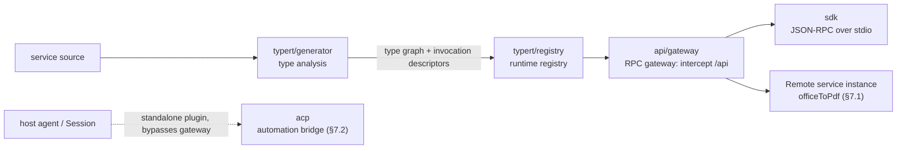
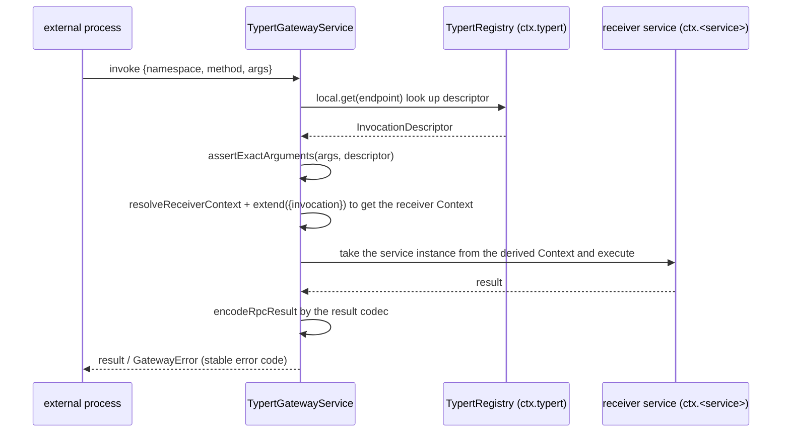

# Chapter 16: typert / api / sdk — The Cross-Process Typed RPC Runtime

> Only contracts cross the boundary, not objects; types are compiled into a graph, and calls are validated against the graph.

## Questions This Chapter Answers

- Chapter 5's capability seam solved in-process reuse — but how do consumers outside the process (CLI, web, automation scripts) call capabilities inside the host process?
- How does a method's type contract (what parameters it takes, what it returns) cross the process boundary and get validated there?
- When adding a new exported method, why is there no need to hand-write routing, serializers, or client stubs?
- What does each of `typert`, `api` (gateway), `sdk`, and `acp` own in this chain?

Chapter 15 assembled loose parts into reusable product forms, and previewed the next stop: typert, watching how assembled services are safely read and invoked. This chapter takes that one step further — not just safe in-process reads, but **safe cross-process calls**.

Chapter 2 built the minimal agent-loop closure: one message in, one reply out, with Session and AgentLoop running inside a single process. What this chapter adds on top of that closure is a **boundary** — the capabilities inside it (run a shell, read a session, call a model) are handed to child processes, browsers, and editors through a typed contract. The closure itself does not change by a single line: what changes is who calls, and from where.

This chapter depends on Chapters 1, 2, and 5: Chapter 1's `Context` / `Service` (the teaching code keeps reusing `ch01/code/cordis.py` via `sys.path`); Chapter 2's minimal closure, which hosts the very capabilities this chapter sends out; Chapter 5's three capability-seam roles — **provider, implementer, consumer** (see Chapter 5). The seam solved "how one capability is defined, implemented, and consumed within a process"; this chapter extends the "consumer" role outside the process. The `service` field in the invocation descriptor below is exactly that `ctx.<key>` from Chapter 5's Service Definition.

This chapter uses five files under `ch16/code/`: `typert.py` (type graph + registry), `gateway.py` (RPC gateway), `sdk.py` (JSON-RPC SDK), `main.py` (runnable entry), and `bad_example.py` (bad example).

## 1. Capabilities Live Inside the Process; Callers Live Outside

A batch of services is assembled inside the harness host process: running shells, managing sessions, calling models. But the consumers of these capabilities are often outside the process — CLI tools, web backends, and automation scripts all want to call `shellExecutor.run`. Without a dedicated mechanism, the most intuitive approach is to hand-write a bridge (`ch16/code/bad_example.py`, runnable):

```python
class ShellHost:
    """宿主进程里的一个服务（业务方）。"""

    def run(self, request):
        return {"exitCode": 0, "stdout": f"[stub] 执行: {request['command']}"}


def hand_written_bridge(host, endpoint, payload):
    """手写转发：一个方法一个分支，没有任何校验 —— 契约只在作者脑子里。"""
    if endpoint == "/api/shell/run":
        return host.run(payload)   # payload 原样当 request：形状错了要到业务代码才炸
    raise KeyError(endpoint)       # 新增方法必须同步在这里加分支
```

Running `python3 bad_example.py` prints:

```text
== 反例：手写跨进程桥接的三个痛 ==
痛 1：拼错参数名不被边界拦下，业务代码深处才炸 -> KeyError('command')
痛 2：非 JSON 值不被边界拦下，序列化时才炸 -> TypeError: Object of type function is not JSON serializable
痛 3：新增方法没同步到桥接，调用时才发现 -> KeyError('/api/shell/start')
```

Three pains. **The contract lives only in the author's head**: only the author knows what parameters a method takes, a misspelled parameter name is not stopped at the boundary, and it blows up deep in business code (`KeyError('command')`). **No boundary validation**: values that cannot be JSON-serialized (say, a function) sneak into the arguments and blow up only when transport serialization happens. **Hand-written one-to-one forwarding**: every new method must be synced by adding a branch on the bridge; forget it and you only find out at call time.

All three share one root cause: **the method's type contract never became data**. If the contract (parameter names, types, result shape) could be compiled into a serializable, queryable structure, the boundary could validate against it and routing would not need hand-writing. That is exactly what this chapter's mechanism chain does.

## 2. The Overall Map

**See the whole before decomposing**: this chapter's source modules form one chain —



In the diagram: the generator compiles service contracts into a **type graph** and registers it into the registry; the gateway validates and dispatches every cross-process call against the registry. The gateway has two downstreams: the SDK carries it onto stdio (§6), and `officeToPdf` is a service instance that subclasses a base class and exports its methods with `@Remote` (§7.1). **ACP connects to the agent and its Session, not to the gateway** — it is a standalone plugin that takes over an agent wholesale through its own protocol (§7.2), which is why the edge is dashed. Below we walk through `typert → gateway → SDK → Remote instance → ACP`; `@Remote` and the `typertRemote` binding are defined in §7.1, and §5.3 points forward when it first uses them.

## 3. The typert Type Graph: Compiling Contracts into a Carrier-Agnostic Model

### 3.1 What the Type Graph Is

**typert** is the source module responsible for "runtime types + object services"; its core artifact is the **type graph**: a carrier-agnostic intermediate model produced by type analysis, made of `TypeGraph` (the whole graph, `packages/typert/generator/src/model.ts:440`) and `TypeNodeModel` (nodes in the graph, `model.ts:356`). `TypeNodeModel` is a union of 20 members — `keyword`, `literal`, `object`, `union`, `mapped`, `template-literal` and so on — covering essentially every shape a TS type expression can take (one by one at `model.ts:356-394`).

Why not use the source language's own types? Because they live only at compile time and inside the process: they cannot cross the process, cannot be looked up at runtime, and cannot be validated at the boundary. The type graph pulls types out of the source and solidifies them into **data** — and once it is data, it can be registered, transported, and validated. This is the first step of dissolving Problem 1: the contract moves out of the author's head into a queryable table.

The component doing this is the generator `WorkspaceTypertGenerator` (`packages/typert/generator/src/workspace.ts:39`): `discover` finds source files (`workspace.ts:60`), `generate` runs type analysis (`workspace.ts:77`), and `validateExport` checks the `./typert` / `./remote` exports (`workspace.ts:116`). On the loader side, the typert-loader plugin scans the `./typert` export (`TYPERT_HOST_EXPORT = './typert'`, `packages/typert/loader/src/index.ts:40`), validates the manifest (`validateTypertManifest`, `packages/typert/loader/src/index.ts:90`), and requires a strict codec (`requireStrictCodec`, `packages/typert/loader/src/index.ts:310`).

**Two-sided compilation**: one method contract compiles into two faces — the host face produces the **invocation description** (how the host method is called), the client face produces the Remote description (`TypertClientRemote`, `packages/typert/protocol/src/types.ts:620`, which mounts host-side contracts for clients through `$mount`); remote results are uniformly wrapped in `RemoteResult<T>` (`packages/typert/protocol/src/types.ts:130`). This chapter focuses on the host face. The client face is its mirror: the SDK in §6 is a hand-written client, and `officeToPdf` in §7.1 shows the host-side authoring while its Client descriptor is mounted by `api/remotes`' client assembly — `officeToPdfRemote` is mounted together with the other Remote contributions via `ctx.remote.$mount` (`packages/api/remotes/src/client/index.ts:205-211`).

### 3.2 InvocationDescriptor: One Call's Carrier-Agnostic Description

The smallest unit the type graph outputs is the **InvocationDescriptor**: the carrier-agnostic description of one exported method. Excerpt from the source (TS, `packages/typert/protocol/src/types.ts:388-442`; `readonly` means the field is read-only, and `kind: 'direct'` is a TS literal type meaning "this field can only take this string"):

```ts
export interface InvocationDescriptor {
  readonly id: string                 // globally stable generated identifier
  readonly service: string            // Cordis service key owning the method
  readonly namespace: string          // wire namespace, defaults to the service key
  readonly method: string             // public instance method name
  readonly implementation?: string    // actual member when the export name is an alias
  readonly mode?: 'stream'            // absent = unary; stream delivers each yielded item
  readonly invocation:
    | { readonly kind: 'direct' }
    | { readonly kind: 'context'; readonly context: string; readonly wire: string; readonly codec: TypertCodec }
  readonly scope?: { readonly context: string; readonly wire: string }  // consuming-Context projection for one direct lookup parameter
  readonly parameters: readonly InvocationParameterDescriptor[]
  readonly uplink?: { readonly codec: TypertCodec }                     // client→host items of the same stream
  readonly cancellation?: { readonly parameter: 'signal' }              // transport cancellation
  readonly result: TypertCodec
  readonly description?: string                                         // method documentation
  readonly sourceLocation?: InvocationSourceLocation
}
```

Field by field: `service` is the Cordis service key owning the method (the `ctx.<key>` of Chapter 5's Service Definition); `namespace` is the wire namespace, defaulting to the service key — **wire**: the serialization line between two processes, carrying JSON text and never live objects; `method` is the public instance method name; `parameters` is the parameter descriptor sequence; `result` is the codec policy for results; `invocation` distinguishes direct calls from context calls. A parameter's `source: 'lookup'` marker says the parameter is a **host object** — a live instance (a session object, say) living inside the host process that cannot be serialized; only its **identity field** (a string standing for it) travels on the wire, and the gateway swaps it back to the object before the call (§5.4).

Two kinds of key are easy to confuse, so we define both: **typertKey** identifies a schema, shaped `<pkg>#<name>` (`typertKey`, `packages/typert/registry/src/service.ts:52`); **typertEndpoint** identifies a callable endpoint, shaped `<namespace>/<method>` (`typertEndpoint`, `packages/typert/registry/src/service.ts:71`). The first answers "what type", the second answers "call whom".

The teaching version models descriptors as two frozen dataclasses, keeping 6 of the real 14 fields (`ch16/code/typert.py`):

```python
# ---------- 调用描述符：一条导出方法的载体无关描述 ----------

@dataclass(frozen=True)
class InvocationParameterDescriptor:
    """导出方法的单个参数：名字 + 指向类型图的 schema + 是否为宿主对象。"""

    name: str
    schema: str                 # 指向类型图里的类型节点（<pkg>#<name> 形式）
    lookup: str | None = None   # None = 普通 JSON 参数（真实 source='json'）；否则是 lookup 种类（如 "agent"）：
                                # wire 上只传身份字段，网关调用前换回宿主对象


@dataclass(frozen=True)
class InvocationDescriptor:
    """一条被导出的 RPC 方法的载体无关描述 ↔ InvocationDescriptor（packages/typert/protocol/src/types.ts:388-442）。

    [教学简化] 真实字段还有 implementation / mode / invocation / scope / uplink /
    cancellation / description / sourceLocation；教学版保留 id / service / namespace /
    method / parameters / result。
    """

    id: str                    # 全局稳定生成标识
    service: str               # 拥有该方法的 Cordis service key（对应第 5 章 Service Definition 的 ctx.<key>）
    namespace: str             # wire 命名空间，默认等于 service key
    method: str                # 公共实例方法名
    parameters: tuple          # InvocationParameterDescriptor 序列
    result: str                # 结果 codec：CODEC_STRICT / CODEC_SRC_JSON
```

[Teaching simplification] The dropped fields are listed in the docstring above. The codec policy corresponds to `TypertCodec` (`packages/typert/protocol/src/types.ts:341`); the teaching version defines it as two constants:

```python
# 编解码策略 ↔ TypertCodec（packages/typert/protocol/src/types.ts:341）
CODEC_STRICT = "strict"        # 严格：按 schema 校验（真实用 Zod v4，packages/typert/loader/src/index.ts:310）
CODEC_SRC_JSON = "src-json"    # 弱解析：只做 JSON 安全校验，用于无生成器场景
```

### 3.3 The Generator: From Service Class to Type Graph

The real generator leans on the compiler to analyze TS source; the teaching version reflects Python signatures with `inspect` and treats the class attribute `typert_exports` as the "./typert export declaration" — corresponding to `validateExport`'s export check (`workspace.ts:116`). The entry point and export validation of `generate_contribution` (`ch16/code/typert.py`, module-level function):

```python
def generate_contribution(cls, package, namespace=None):
    """教学版生成器：反射类的导出方法，产出类型图 + 调用描述符。

    ↔ WorkspaceTypertGenerator：discover（packages/typert/generator/src/workspace.ts:60）
    → generate（:77）→ validateExport（:116，校验 ./typert / ./remote 导出）。
    [教学简化] 教学版用 inspect 反射 Python 签名，并把类属性 typert_exports
    当作「./typert 导出声明」：没声明就拒绝生成，对应真实 validateExport 的校验。
    返回 (contribution, graph)：前者提交给注册表，后者供观察类型图形状。
    """
    exports = getattr(cls, "typert_exports", None)
    if not exports:
        raise TypertError(f"{cls.__name__} 未声明 ./typert 导出（缺 typert_exports）")
```

After export validation, each method's signature is reflected one by one: every parameter gets a `TypeNode` inferred from its annotation (lookup parameters are recorded as host objects), the descriptor is assembled, and everything is returned together with the type graph. What follows is the tail of the function body (indented 8 spaces; full code in `typert.py`):

```python
        invocations.append(InvocationDescriptor(
            id=typert_key(package, f"{cls.__name__}.{method_name}"),
            service=service_key, namespace=namespace, method=method_name,
            parameters=tuple(params), result=CODEC_STRICT,
        ))
    return TypertContribution(package, dict(graph.declarations), invocations), graph
```

The `TypertContribution` in the return value is the **contribution**: everything one package submits to the registry in a single go (package record + schemas + descriptors). The producer side is written like this (the consumer side is §4's registry and §5's gateway). `ShellExecutorStub` in `ch16/code/main.py` echoes the shellExecutor of Chapter 5's capability seam:

```python
class ShellExecutorStub(Service):
    """第 5 章 capability seam 里 shellExecutor 的教学 stub。

    [教学决策] 不 import 第 5 章代码；shell seam 的词汇类型
    （ShellExecRequest / ShellRunResult）用普通 dict 表示，保持本章自包含。
    """

    service_key = "shellExecutor"
    typert_exports = ("run",)  # ./typert 导出声明：哪些方法要跨进程

    def __init__(self, ctx):
        super().__init__(ctx, self.service_key)

    def run(self, request: dict) -> dict:
        return {"exitCode": 0, "stdout": f"[stub] 执行: {request['command']}"}
```

Running `main.py` segment 1 produces (full output in §8):

```text
== 段 1：生成器 —— 把服务契约编译成类型图 ==
类型图节点数: 1，命名声明数: 1
调用描述符: id=demo-shell#ShellExecutorStub.run
  service=shellExecutor endpoint=shellExecutor/run
  参数=[('request', 'demo-shell#ShellExecutorStub.run.request')] 结果 codec=strict
```

The `request` parameter is compiled into a type-graph node, and its schema points at it in typertKey form (`demo-shell#ShellExecutorStub.run.request`); the endpoint is in typertEndpoint form (`shellExecutor/run`). [Teaching simplification] The real `TypeNodeModel` has 20 variants; the teaching `TypeNode` takes only `primitive` / `object` and subdivides with `detail`.

The type graph solved the first half of Problem 1: the contract is now data and can cross the process. But data does not enforce itself — who holds these descriptors at runtime? And when a plugin unloads, how is "all registered or none" guaranteed? That is the registry.

## 4. TypertRegistry: The Runtime Registry

### 4.1 What the Registry Holds

**TypertRegistry (runtime registry)**: the runtime holder of the type graph, a Cordis service (`@typert service typert`, `packages/typert/registry/src/service.ts:508`). It holds five stores (`service.ts:511-515`): `localStore` and `remoteStore`, two `DescriptorStore`s (endpoint → descriptor, the class defined at `service.ts:111`), plus `lookupStore` (`service.ts:220`), `contextStore` (`service.ts:342`), and `resourceStore` (`service.ts:452`); on top of those come two tables, `packages` (package records) and `schemas` (typertKey → type node). Descriptor validation is done by the module-level `validateInvocation` (`service.ts:729`). Outward it exposes five contract-shaped views: `local` / `remotes` / `lookups` / `contexts` / `resources` (`service.ts:531-558`). [Teaching simplification] The teaching version keeps only the local store; lookup moves to §5.4.

### 4.2 Atomic Registration: Commit Inside an effect, Roll Back via the Disposer

The key design is **atomicity**: a contribution must be either wholly visible or wholly invisible — halfway through registration, the gateway could find a descriptor but not its schema. The real implementation puts the commit inside a Cordis effect (Chapter 1: an immediately executed side effect that can register a cleanup function) and yields the cleanup function (`register`, `packages/typert/registry/src/service.ts:568`):

```ts
register(contribution: TypertContribution): TypertDisposer {
  const packageRecord = this.validatePackage(contribution)
  const schemaRecords = this.validateSchemas(contribution)
  const invocations = contribution.invocations
  this.localStore.validate(invocations)
  const owner = {}
  const { schemas, packages, localStore } = this
  return this.ctx.effect(function* () {
    packages.set(packageRecord.key, packageRecord)
    for (const record of schemaRecords) schemas.set(record.key, record)
    localStore.commit(owner, invocations)
    yield () => { /* revoke every record of this contribution */ }
  })
}
```

(TS: `this.ctx.effect(function* () {...})` registers an immediately executed effect; the cleanup function the generator `yield`s is the disposer, invoked on unload. The excerpt omits the three deletions inside the cleanup body and the `, 'typert.register()'` effect name; the real code is at `packages/typert/registry/src/service.ts:568-592`.) Three validations — package record, schemas, local descriptors — must all pass before the effect commits. The teaching version replicates the same shape (`ch16/code/typert.py`, `TypertRegistry.register`, validation part):

```python
    def register(self, contribution):
        """原子注册一个 generated contribution ↔ register（service.ts:568）。

        先做三道校验（对应 validatePackage / validateSchemas / localStore.validate），
        全部通过后才进 ctx.effect 提交：一次性写入 packages / schemas / local，
        并返回 disposer——调用它即撤销本 contribution 的全部记录
        （对应真实 effect 里 yield 的清理函数）。
        """
        if contribution.package in self.packages:
            raise TypertError(f"包已注册: {contribution.package}")
        for descriptor in contribution.invocations:
            endpoint = typert_endpoint(descriptor.namespace, descriptor.method)
            if endpoint in self._local:
                raise TypertError(f"endpoint 已被占用: {endpoint}")
            for param in descriptor.parameters:
                if param.schema not in contribution.schemas:
                    raise TypertError(f"缺少 schema: {param.schema}")
```

Once validation passes, `commit` runs: three tables are written in one go, and a **disposer** comes back (Chapter 1: the effect's cleanup function; calling it revokes this registration). What follows is an excerpt of `commit`, omitting the nested `dispose` closure and its `return dispose`:

```python
        def commit():
            # 走到这里说明校验全过：三张表一次性写入，不出现「写了一半」
            self.packages[contribution.package] = {
                "schemas": len(contribution.schemas),
                "invocations": len(contribution.invocations),
            }
            for key, node in contribution.schemas.items():
                self.schemas[key] = node
            for descriptor in contribution.invocations:
                endpoint = typert_endpoint(descriptor.namespace, descriptor.method)
                self._local[endpoint] = descriptor
                self._seen.add(endpoint)
```

The `dispose` that `commit` returns revokes the contribution's records table by table (package, schemas, local descriptors); then `return self.ctx.effect(commit)` registers `commit` as an effect, and the effect's return value — that `dispose` — goes to the caller. `main.py` segment 2 checks "register — duplicate rejected — dispose rollback — re-register" (full output in §8):

```text
== 段 2：注册表 —— 原子注册与回滚 ==
在册 endpoint: ['sessionService/summarize', 'shellExecutor/run']
重复注册被拒: TypertError: 包已注册: demo-shell
dispose 后 shellExecutor/run -> None
hasSeen 仍记得: True
重新注册后: ['sessionService/summarize', 'shellExecutor/run']
```

Note the demo line `hasSeen` that reads `True`: after dispose the descriptor leaves local, but the fact that it "was once registered" stays in `has_seen`. The gateway consumes it in two places: the claim decision in §5.1, and the strict path in §5.3 — when the descriptor has been withdrawn while `hasSeen` is still true, the gateway refuses to fall back to SRC weak parsing and reports `definition-unavailable` directly.

### 4.3 The Dependency-Inverted Registry Contract

One more design deserves a name: the **dependency-inverted registry contract**. Consumers such as the gateway never `import` the typert package; they depend only on a contract interface — `TypertRegistryContract` divides the capability into five segments: `local` (local descriptors), `remotes` (remote objects), `lookups` (host-object lookup), `contexts` (context calls), `resources` (default wire fields of resource kinds), `packages/typert/protocol/src/types.ts:939-945`; TS's `declare module` then hangs the contract onto cordis's `ctx` (`packages/typert/protocol/src/types.ts:947-957`):

```ts
export interface TypertRegistryContract {
  readonly local: TypertLocalRegistry
  readonly remotes: TypertRemoteRegistry
  readonly lookups: TypertLookupRegistry
  readonly contexts: TypertContextRegistry
  readonly resources: TypertResourceRegistry
}

declare module '@deepseek-ai/cordis' {
  interface Context {
    typert: TypertRegistryContract
    readonly invocation: RemoteInvocation | undefined
  }
}
```

(TS: `declare module '@deepseek-ai/cordis'` means "augment the `Context` type declared by the cordis package with a `typert` field pointing at the registry contract." The second field, `invocation`, lets a service method read "this call" as `this.ctx.invocation`; the gateway attaches it when resolving the receiver in §5.2 — `receiverContext.extend({ invocation })` at `packages/api/gateway/src/index.ts:858`.) Any service can therefore read the registry via `ctx.typert`, and nobody needs the typert package's implementation — the same spirit as Chapter 5's seam, "the consumer depends only on the contract." The teaching gateway consumes only the `local` segment (`get` / `has_seen`); the lookup segment is held by the gateway itself (§5.4).

The registry solved the second half of Problem 1: the contract has a runtime holder, and registration is atomic and reversible. But a contract is still inert data — when a call really crosses the process, who validates arguments against the descriptor? Who swaps the identity field back to a host object? That is the gateway.

## 5. The RPC Gateway: One invoke

### 5.1 Intercepting /api

**RPC gateway**: `TypertGatewayService` of the `api/gateway` package (`packages/api/gateway/src/index.ts:214`), with `static inject = ['typert', 'remoteAccess']` — the registry contract from §4.3, plus an access-control service, `remoteAccess` (not covered here). At construction it intercepts every `/api` endpoint on `connection.rpc` (`packages/api/gateway/src/index.ts:248-255`):

```ts
constructor(ctx: Context, config: Config) {
  super(ctx, 'typertGateway')
  ctx.on('internal/service', () => { this.srcClaims = undefined })
  ctx.inject(['connection'], (connectionCtx) => {
    connectionCtx.connection.rpc.intercept(
      '/api',
      endpoint => this.claimsEndpoint(endpoint),
      (endpoint, payload, signal, peer) => this.dispatchRpc(endpoint, payload, signal, peer),
    )
  })
  // …a second inject(['connection', 'webServer']) follows, mounting the WebSocket mux (omitted)
}
```

(TS: arrow functions are anonymous functions; `intercept(prefix, claim, dispatch)` registers an interceptor. The excerpt omits the WebSocket stream multiplexing and config validation in the second half of the constructor.) Three details stand out: `claim` decides whether to take an endpoint, `dispatch` decides what happens next; and both functions gained a `peer` argument — each Peer has its own identity, and the gateway checks "who is calling" before dispatching.

`claimsEndpoint` (`packages/api/gateway/src/index.ts:380`) is the claim implementation. It first lets through the gateway's own single-segment endpoint `$events/result` (`packages/api/gateway/src/stream-protocol.ts:13`, the result receipt for forwarded events). Every other endpoint must have exactly two segments, and must be either resolvable by `get` in the registry, or present in `hasSeen` (the hook left in §4.2), or present in the SRC binding set. `dispatchRpc` (`packages/api/gateway/src/index.ts:491`) is the dispatch implementation: `$events/result` takes the event-receipt branch, everything else goes to `invokeRpc` (`packages/api/gateway/src/index.ts:771`).

`[Teaching simplification]` The teaching `RpcConnection` (`gateway.py`) reproduces "claim first, then dispatch" and "reject when nobody claims", skipping Peer identity, access control, and the two internal `$events` stream endpoints — which is why an unclaimed endpoint is rejected outright with `invocation-unavailable` in the teaching version. The gateway also exposes itself to consumers in contract form (`TypertGateway` interface, `packages/api/gateway/src/types.ts:154`; `declare module` hangs `ctx.typertGateway`, `packages/api/gateway/src/types.ts:194-199`).

### 5.2 The Five Steps of invoke

The gateway's entry point is `invoke` (`packages/api/gateway/src/index.ts:424`), which hands the real work to `prepareInvocation` (`:793`): resolve the descriptor (`resolveDescriptor`, `:878`) → validate arguments (`assertExactArguments`, `:1630`) → resolve the receiver (`resolveReceiverContext`, `:1014`) → execute (`invokePrepared`, `:428`) → encode the result (`encodeRpcResult`, `:1123`).

"Resolve the receiver" is not simply `ctx.get(service)`. `resolveReceiverContext` returns a **Context**: for `kind: 'direct'` it is the gateway's own ctx; for `kind: 'context'` it first resolves the caller-specified Context through `contexts.getHost`. `prepareInvocation` then calls `extend({ invocation })` on it (`packages/api/gateway/src/index.ts:858`) and takes the service instance from that derived Context — which is exactly where §4.3's `ctx.invocation` lands: what a service method reads as `this.ctx.invocation` is the context of this very call. The sequence (strict-path trunk; the SRC branch is in §5.3, the lookup branch in §5.4):



The teaching `invoke` (`ch16/code/gateway.py`, `TypertGatewayService` method):

```python
    def invoke(self, request):
        """↔ invoke（packages/api/gateway/src/index.ts:424）：解析描述符 → 校验参数 → 取接收者 →
        执行 → 校验结果。

        五步全部通过才返回业务结果；任一步失败都抛带稳定错误码的 GatewayError。
        """
        endpoint = typert_endpoint(request["namespace"], request["method"])
        descriptor = self._resolve_descriptor(endpoint)
        if descriptor is None:
            raise GatewayError("definition-unavailable", f"解析不到 {endpoint} 的描述符")
        self._assert_exact_arguments(request.get("args", {}), descriptor)
        receiver = self._resolve_receiver(descriptor)
        kwargs = {}
        for param in descriptor.parameters:
            kwargs[param.name] = self._resolve_parameter(param, request["args"])
        result = getattr(receiver, descriptor.method)(**kwargs)
        # 结果 codec 校验：教学版 strict / src-json 统一为 JSON 安全检查
        self._assert_json_value(result, "结果", code="result-invalid")
        return result
```

`main.py` segment 3 walks the strict path once (full output in §8):

```text
== 段 3：网关 strict 路径 —— 一次 /api 调用 ==
调用 /api/shellExecutor/run -> {'exitCode': 0, 'stdout': '[stub] 执行: ls -l'}
拼错参数名被边界拦下 -> arguments-invalid: 期望参数 ['request']，实际 ['reqeust']
多传参数被边界拦下 -> arguments-invalid: 期望参数 ['request']，实际 ['request', 'verbose']
网关错误码表共 21 个（见 GATEWAY_ERROR_CODES）
```

Both the misspelling (`reqeust`) and the extra argument (`verbose`) are stopped by `assertExactArguments` (`packages/api/gateway/src/index.ts:1630`) with `arguments-invalid`: it compares the extra fields against the descriptor's wire-field set first, then the missing ones, and only lets the call through when both are empty. Contrast §1's Pain 1: the same mistake, under a hand-written bridge, blows up as `KeyError('command')` deep in business code; here it is caught at the boundary with a stable error code. The other half of this step is the **JSON-safety boundary** (`assertJsonValue`, `packages/api/gateway/src/index.ts:1704`; `decode`, `packages/api/gateway/src/index.ts:1680`): `decode` runs the codec first (strict goes through `codec.create().parse`), then calls `assertJsonValue` to walk the value and reject functions, non-finite numbers, cycles, and sparse arrays — on failure it reports `input-invalid`. Only two codes keep recurring: `arguments-invalid` (wrong shape) and `input-invalid` (a value that cannot cross the wire); from here on the text refers to the bare names. Only JSON-serializable values reach the wire, and Pain 2 is dissolved.

`[Teaching simplification]` The teaching `_assert_json_value` (`ch16/code/gateway.py`) reports `arguments-invalid` by default for input values; the real gateway separates the stages — a failed input decode reports `input-invalid`, a failed result encode reports `result-invalid`.

### 5.3 Two Descriptor-Resolution Paths: strict and src-json

The first step of `invoke` has two paths, for different situations:

- **strict path**: look up the registry's local (`resolveDescriptor`, `packages/api/gateway/src/index.ts:878`). The descriptor comes from the generator, schemas are complete, and the result is validated by the strict codec. Segment 3's `shellExecutor/run` takes it:

```python
    result = connection.call("/api/shellExecutor/run", {"request": {"command": "ls -l"}})
```

- **SRC weak-parsing path**: when the registry lookup misses, go to `resolveSrcDescriptor` (`packages/api/gateway/src/index.ts:891`), then `srcDescriptor` (`packages/api/gateway/src/index.ts:919`). It walks every service and picks the ones carrying a `typertRemote` binding (what that binding is, §7.1 defines). It then matches the method name among the candidate's `@Remote` markers: more than one hit raises `ambiguous-endpoint`, none raises `invocation-unavailable`. Next, `srcDescriptor` **reflects parameter names on the spot** to build the descriptor — `methodParameterNames` (`packages/api/gateway/src/index.ts:1586`) reads the function's source text via `Function.prototype.toString` and extracts the parenthesized parameter list; the teaching version uses `inspect.signature` instead. Finally each name is matched against `typert.lookups.definitions()`, and a hit marks the parameter as a lookup. The result codec drops to `src-json` — in the real code that is `mode: 'src-json'`, represented in the teaching version by the `CODEC_SRC_JSON` constant (`ch16/code/typert.py`). The `src` in the path name means source: the descriptor is not precompiled by the generator but derived live from the source-side binding. Segment 5's call:

```python
    result = connection.call("/api/diagnostics/ping", {"tag": "hello"})
```

Running segment 5 (full output in §8):

```text
== 段 5：SRC 弱解析 —— 无注册表，现场反射出描述符 ==
调用 /api/diagnostics/ping -> {'pong': 'hello'}
未标记方法被拒 -> method-unavailable: diagnostics/internal 未标记 @remote
```

`DiagnosticsBridge.internal` is not marked `@remote` (the teaching marker function `remote` attaches a `__typert_remote__` attribute to the method — attaching attributes to functions is legitimate Python), and the gateway rejects it with `method-unavailable`: the weak-parsing path's export boundary is just as strict.

`[Teaching simplification]` The code name here differs from the real gateway: the real `resolveSrcDescriptor` raises `gateway/invocation-unavailable` when there are no candidates at all (`packages/api/gateway/src/index.ts:909-911`); `gateway/method-unavailable` is raised only when the marker exists but no same-named method is found on the prototype chain (`packages/api/gateway/src/index.ts:1600-1604`).

### 5.4 lookup provider: Swapping the Identity Field Back to the Host Object

The `agent` parameter of `SessionService.summarize` is a host object — JSON cannot carry it. The gateway's approach is to send only the identity field on the wire and swap it back before the call: `resolveParameter` (`packages/api/gateway/src/index.ts:1062`) reads `source: 'lookup'` from the descriptor and resolves the wire value through a **lookup provider** (`LookupStore`, `packages/typert/registry/src/service.ts:220`).

The real wiring lives in the session controller: `ApiSessionAgentController.initialize` (`packages/api/session-controller/src/agent.ts:127`) first injects agent and session identity resolution with `ctx.typert.lookups.configure('agent'/'session', ...)`, then connects the `contexts` segment of §4.3's contract with `ctx.typert.contexts.configureHost('agent', ...)`.

The same layer has a side channel: `api/remotes` forwards host events to remote clients. `apply()` (`packages/api/remotes/src/index.ts:41`) registers the event source through `ctx.typertGateway.registerRemoteEvents`, and the allowlist is `API_REMOTE_FORWARDED_EVENTS` (`packages/api/remotes/src/remote-events.ts:27-58`, 31 events). It has nothing to do with lookup; it sits here because both answer the same question — **how does something inside the host become visible to the remote** — one through identity, the other through events.

The teaching version does it in two steps. Registration (producer side, `main.py` assembly):

```python
    gateway.lookups.configure("agent", agent.identity, agent)
```

Resolution (the gateway's `_resolve_parameter`):

```python
    def _resolve_parameter(self, param, args):
        """↔ resolveParameter（packages/api/gateway/src/index.ts:1062）：普通参数直传；lookup 参数把身份换回宿主对象。"""
        value = args[param.name]
        if param.lookup is not None:
            return self.lookups.resolve(param.lookup, value)
        return value
```

`main.py` segment 4 (full output in §8):

```text
== 段 4：lookup provider —— 身份字段换回宿主对象 ==
wire 上只有身份: args = {'agent': 'agent-1', 'note': '写完第 16 章初稿'}
网关换回宿主对象后调用 -> {'agent': 'writer', 'summary': 'writer: 写完第 16 章初稿'}
未知身份 -> lookup-not-found: 身份 agent:agent-404 查不到宿主对象
```

`args` carries only `'agent-1'` (the identity), yet the business method receives the host object with `name='writer'` — exactly the second half of the opening epigraph: objects stay in the host process, and only identities travel the wire.

`[Teaching simplification]` In the real descriptor this field is `source: 'lookup'` (`packages/typert/protocol/src/types.ts:372`), paired with a `lookup` key pointing at the provider; the teaching version merges them into one `lookup` field, where `None` means an ordinary JSON parameter.

### 5.5 21 Stable Error Codes

Every business failure of the gateway carries a **stable error code**, so consumers branch on the code without parsing message text (`TypertGatewayErrorCode`, `packages/api/gateway/src/types.ts:124-145`), 21 in total, all prefixed with `gateway/`:

```ts
export type TypertGatewayErrorCode =
  | 'gateway/ambiguous-endpoint' | 'gateway/arguments-invalid' | 'gateway/binding-invalid'
  | 'gateway/context-failed' | 'gateway/context-not-found' | 'gateway/context-unavailable'
  | 'gateway/definition-unavailable' | 'gateway/input-invalid' | 'gateway/interactions-forbidden'
  | 'gateway/invocation-unavailable' | 'gateway/lookup-failed' | 'gateway/lookup-not-found'
  | 'gateway/lookup-unavailable' | 'gateway/method-unavailable' | 'gateway/peer-disposed'
  | 'gateway/protocol' | 'gateway/provider-mismatch' | 'gateway/result-invalid'
  | 'gateway/service-unavailable' | 'gateway/signature-invalid' | 'gateway/uplink-overflow'
```

Among them, `interactions-forbidden` (a non-owner Peer touching a stream it has no right to), `peer-disposed`, `protocol`, and `uplink-overflow` (same-stream return items exceeding the receive window) appear only in more recent gateways.

Two more codes share the prefix but do not need to be declared in `TypertGatewayErrorCode`: `gateway/internal` is `rpcFailure`'s fallback (`packages/api/gateway/src/index.ts:1524`), catching any unclassified exception; `gateway/cancelled` is transport cancellation (`packages/api/gateway/src/index.ts:1367`). Neither is a business-branch code, so neither enters the union.

The teaching version lists the same 21 codes one by one in `GATEWAY_ERROR_CODES` (`gateway.py`). `[Teaching simplification]` It drops the `gateway/` prefix, and the text mostly uses the bare names such as `arguments-invalid`; `GatewayError` refuses unknown codes. In the outputs of segments 3/4/5, `arguments-invalid`, `lookup-not-found`, and `method-unavailable` each make an appearance.

The gateway solved Pain 2 and Pain 3: arguments are validated against the descriptor (no hand-written validation), and routing claims by endpoint (no hand-written branches — a new method only needs one more descriptor registered). But so far calls are still "simulated in-process" — how do we really cross the process, letting a CLI or another process call in? That is the SDK.

One boundary, in a sentence: `packages/api/session-controller` and `packages/host/apiproxy` are out of scope here. They are host-side BFFs that reassemble host semantics (session lists, model switching, approvals) from a client's point of view — product surface, not RPC mechanism; this chapter covers only the gateway and descriptors they depend on.

## 6. The JSON-RPC SDK: Carrying the Gateway Out of the Process (In Brief)

**JSON-RPC**: a lightweight remote-call protocol — a request is a JSON object with `method` and `params`, and responses are matched back by `id`. The `sdk` package uses it to expose host capabilities to the world outside the child process; the transport is line-delimited JSON-RPC 2.0 over stdio (`JsonRpcLineTransport`, `packages/sdk/protocol/src/transport.ts:65`): one JSON object per line, an object with `id` is a request, one without is a notification. The `request` method (`transport.ts:126`) sends a request and waits for the response matched by `id`, with AbortSignal cancellation; a missing handler returns `-32601`, a failing handler returns `-32603`. Source excerpt (TS; `AbortSignal` is a "cancellable signal" object — when `signal.aborted` is true the request is rejected immediately; `randomUUID()` generates the unique request `id` used to match responses):

```ts
export class JsonRpcLineTransport implements JsonRpcTransportPeer {
  ...
  request(method: string, params: object, signal?: AbortSignal): Promise<unknown> {
    const id = `req_${randomUUID().replaceAll('-', '')}`
    const message = { jsonrpc: '2.0', id, method, params }
    return new Promise((resolve, reject) => {
      let detach = (): void => {}
      if (signal !== undefined) {
        if (signal.aborted) { reject(abortError(signal.reason)); return }
        const onAbort = (): void => { this.pending.delete(id); reject(abortError(signal.reason)) }
        // ...
      }
      // ...
    })
  }
}
```

The teaching `JsonRpcLineTransport` (`ch16/code/sdk.py`) simulates the stdio pipe pair with two in-process objects, keeping the protocol's three essentials: line framing, id matching, and stable error codes. The receiving side's dispatch:

```python
    def send_line(self, line):
        """收到对端一行 JSON，按形状分发。

        无 method → 响应（按 id 放进 _pending）；
        有 method 有 id → 请求；有 method 无 id → 通知。
        """
        message = json.loads(line)
        if "method" not in message:
            self._pending[message["id"]] = message
        elif "id" in message:
            self._handle_request(message)
        else:
            handler = self._notification_handlers.get(message["method"])
            if handler is not None:
                handler(message.get("params", {}))
```

[Teaching simplification] The real transport is asynchronous stdio I/O and `request` supports AbortSignal; the teaching version is an in-process synchronous call with no timeout or cancellation.

Each end of the protocol has a protagonist. **The server is not a class but a pair**: the Cordis plugin at `packages/sdk/server/src/index.ts` declares `name = 'sdk-jsonrpc-server'` and `inject = ['agents', 'workingDirectory']` (`packages/sdk/server/src/index.ts:20-21`), builds the transport in `apply` (`packages/sdk/server/src/index.ts:45`), and then constructs `HarnessSdkJsonRpcServer` (`packages/sdk/server/src/server.ts:89`). Request dispatch lives in that class's `handleRequest` (`packages/sdk/server/src/server.ts:499`): the contract has 8 requests (`HarnessSdkRequestMap`, `packages/sdk/protocol/src/types.ts:210`: `initialize`, `session/prompt`, `session/query`, `session/resume`, `session/wait`, `session/working-directory/get`, `session/working-directory/set`, `shutdown`), of which the teaching version demonstrates three. Notifications flow server → client, and the contract has 6 (`HarnessSdkNotificationMap`, `packages/sdk/protocol/src/types.ts:194`: `session.event`, `session.status`, `session.query.completed`, `subagent.started`, `subagent.finished`, `user-question.cancelled`).

**The client** `HarnessClient` (`packages/sdk/client/src/client.ts:190`) spawns the child process on `start()` (`packages/sdk/client/src/client.ts:219`); `close()` (`packages/sdk/client/src/client.ts:488`) winds down along the **destruction ladder**: EOF → SIGTERM → SIGKILL — close stdin and wait for the child to exit on its own, then send the termination signal, and only then force-kill, each rung harsher than the last; on Windows signals always force-terminate, so the SIGTERM rung is skipped (`packages/sdk/client/src/dispose.ts:93`). The teaching version renames `close()` to `destroy()` (`ch16/code/sdk.py`) and keeps only "stop escalating once the peer has exited". The high-level API is `DeepSeekHarness` (`packages/sdk/client/src/api.ts:21`, lazily starting the child) and `HarnessSession` (`packages/sdk/client/src/api.ts:225`); `finalResponse` (`packages/sdk/client/src/api.ts:373`) aggregates the final response.

`main.py` segment 6 strings the three together (full output in §8):

```text
== 段 6：JSON-RPC SDK —— 行帧 + 三请求 + 通知 ==
session/prompt 收到的 chunk: ['echo: 跨进程调用', '（完成）']
finalResponse: echo: 跨进程调用（完成）
销毁阶梯: ['EOF']（优雅退出，未升级）
```

`start()` completes `initialize` internally; `session/prompt` first receives streaming chunk notifications, and `finalResponse` aggregates them; after `shutdown` the child exits gracefully and the ladder stops at the first rung, `EOF`, without escalating to SIGTERM/SIGKILL. [Teaching decision] The teaching version spawns no real child process and simulates the pipe in-process; the four names in `SERVER_NOTIFICATIONS` are teaching placeholders and do not correspond to the real 6 notifications above (real ones look like `session.event`, `session.status`). This JSON-RPC line continues into Chapter 17, where the Python SDK drives the same protocol for a runtime end-to-end walk (see Chapter 17).

## 7. Two Different Hookups: Remote Export and ACP

The SDK in §6 takes the "child process → gateway" route: contracts come from the generator, and calls are validated then dispatched by the gateway.

The source has two more hookups that differ from it. The first stays inside the gateway and only changes where the contract comes from: a service class **declares for itself** which methods may cross the process, with no generator involved (`officeToPdf`, §7.1). The second bypasses the typert gateway entirely: an automation client such as an editor wants to **take over** a whole agent through its own protocol, and the gateway cannot help there (ACP, §7.2).

### 7.1 A Remote Service Instance: officeToPdf

§3 to §5 covered how a contract is compiled, registered, and validated — but all those descriptors were produced by a generator. This section looks at the other road: **a service class generates nothing, and declares its cross-process surface with one base class and two decorators**. `packages/document/office-to-pdf` is a ready example: subclass a base class, mark two methods `@Remote`, and the gateway treats them as callable endpoints.

Start with what it solves. The host holds a pile of Office files, and a browser wants to preview them — but the browser process has neither LibreOffice nor handles to the host's files. The old approach had the browser ask the host to "read a file" directly, scattering authorization checks across every call site: who remembers which session a path belongs to, or whether the user ever opened it?

`officeToPdf` separates **authorization** from **conversion**. The conversion service accepts only already-authorized source descriptions — a key, a version, a deferred read callback; it makes no authorization decision of its own. Only the Remote entry `render` goes to `workspaceFiles` for authorization — the service from the `api/workspace-files` package that grants file access per session scope. This tutorial does not cover that package separately; readers only need to know that `readBytes` (`packages/api/workspace-files/src/index.ts:258`) takes "session scope + path" and returns bytes, and that the authorization decision happens at this layer. Here is the class head (TS, `packages/document/office-to-pdf/src/index.ts:101-126`):

```ts
export class OfficeToPdf extends TypertRemoteService {
  static Config = Config
  /** Changes whenever engine, font, or conversion configuration is replaced. */
  readonly generation: OfficeToPdfGeneration = OfficeToPdfGeneration(randomUUID())
  ...
  constructor(ctx: Context, private readonly config: Config) {
    super(ctx, 'officeToPdf')
    ...
    this.queue = new ConversionQueue(config, this.generation, ...)
```

`TypertRemoteService` is the base class (`packages/typert/protocol/src/index.ts:250`). Its constructor does two things: register the Cordis service as usual, then attach a `typertRemote` binding (`packages/typert/protocol/src/index.ts:262` calls `bindTypertRemote`, which returns a frozen `{ service, serviceKey, namespace }` at `packages/typert/protocol/src/index.ts:236`). §5.3's SRC weak parsing relies on exactly this binding to find "which `@Remote` methods this service has".

`generation` is a random UUID standing for **the identity of this generation of converter**. A process restart, a configuration swap, a different font directory — each produces a new generation. It is not for the service's own use; it is what lets a client judge its cache, as we will see.

The two `@Remote` methods (`packages/document/office-to-pdf/src/index.ts:159-175`):

```ts
@Remote
async render(
  workspaceFileScope: WorkspaceFileScope, path: string, priority: OfficeToPdfPriority, signal: AbortSignal,
): Promise<RenderedDocumentBytes> { ... }

@Remote('generation')
getGeneration(signal: AbortSignal): OfficeToPdfGeneration { signal.throwIfAborted(); return this.generation }
```

The first uses the default export name (endpoint `officeToPdf/render`); the second carries an **export name**: the method is `getGeneration` in the class, but its outward endpoint is `officeToPdf/generation`. That is how `@Remote`'s two overloads divide the work — no argument means "the method name is the endpoint name", a string argument swaps in an export name (`packages/typert/protocol/src/index.ts:300-308`). Why does a client need a method that only reports the generation? Because it may be holding a PDF rendered earlier; whether it can be reused depends on whether the server's generation is still that one. Exposing `generation` through its own method means the client does not have to render once just to learn whether its cache is stale.

The first thing `render` does with a file is not convert; it is **authorization probing** (`packages/document/office-to-pdf/src/index.ts:190`):

```ts
const authorized = await files.readBytes(scope, path, { range: { offset: 0, length: 1 } }, signal)
const source = await files.stat(scope, path, signal)
```

It asks for exactly 1 byte. That byte is not about content; it triggers `workspaceFiles`' authorization check on "this session, this workspace, this path" — a rejection happens right here, and not one further byte is read. Once authorized, `render` uses `files.stat` to get the version, then builds `source.key` (sessionId, workspaceRoot, absolute path joined together) and the deferred read callback (`packages/document/office-to-pdf/src/index.ts:200-207`) and hands them to `convert`.

The deferred read callback is the second half: the real `fs.readBytes` happens **after queue admission** (`packages/document/office-to-pdf/src/index.ts:202-212`), rechecking the version before the read and once more after — `assertUnchanged` rejects with `source-changed` as soon as the path or version moved. Between authorization and the end of the read the file may be changed by another process; the three comparisons together confirm "the version you authorized is the version I converted".

Finally, `generation` and the cache. `ConversionQueue` (`packages/document/office-to-pdf/src/queue.ts:28`) uses two tables: `ready` stores converted PDFs, and `aliases` maps "source key + version + extension" to a PDF's content key. A content key looks like `${generation}:${digest}`, where digest is a SHA-256 of the extension and the source bytes (`packages/document/office-to-pdf/src/queue.ts:184`).

**generation is inside the key**, so after a generation swap every old key simply misses — no cache-clearing code is needed, and a whole generation's cache is invalidated.

The rest of the queue is a **bounded admission** scheme: foreground/background quota tiers, a `maxReaders` reader cap, a byte reservation for source capacity, and LRU eviction. The package README and `queue.ts` itself carry the details; this chapter does not expand them.

**[Teaching simplification]** The teaching code does not implement a Remote service instance — `officeToPdf`'s conversion engine is an external npm package (`libreoffice-kit`), which the teaching version cannot reproduce. The point of this subsection is to ground the abstractions of §3 and §5 in a real class: `TypertRemoteService` supplies the binding, `@Remote` decides the export boundary, and the gateway validates against the same descriptors — readers can see the teaching counterpart in `ch16/code/gateway.py`'s SRC path (`bind_src` plus the `remote` marker).

### 7.2 ACP: The Automation Bridge (In Brief)

An editor wants to plug into this harness. Having the editor understand typert's wire is unrealistic: the editor ecosystem has its own protocol (how sessions open, how streaming updates are pushed, how permissions are asked), and a plugin process should not be holding handles to host services anyway. On the other side, the harness agent only knows its own Session and turn semantics. Two sides each speaking their own language — somebody in the middle has to translate.

ACP is that layer. **ACP (Agent Client Protocol)**: the communication protocol between editors/automation tools and agents. In the source it is a standalone plugin, `packages/acp/acp`, which does not go through the typert gateway. `apply()` (`packages/acp/acp/src/index.ts:96`) builds the protocol server with `createAcpAgentApp`, hangs the ACP-side `initialize` / `authenticate` / `session/new` / `session/list` / `session/resume` / `session/close` / `session/prompt` / `session/setConfigOption` onto an implementation object one by one (`packages/acp/acp/src/index.ts:378-390`), and connects it to stdio with `app.connect(stream)` (`packages/acp/acp/src/index.ts:391`).

On the lifecycle side, `quiesce` (`packages/acp/acp/src/index.ts:395`) handles the quiet exit: it sets `closed` synchronously to block further requests, closes each `AcpSession` in turn (the cancellation is synchronous, so cancel first and drain after), and finally aggregates failures into an `AggregateError`; `ctx.effect(() => quiesce, ...)` (`packages/acp/acp/src/index.ts:436`) makes plugin unload take the same road.

The translation between the protocol and harness semantics is thin: `packages/acp/acp/src/codec.ts` is 35 lines in total and holds a single function, `turnEndToStopReason` (`packages/acp/acp/src/codec.ts:14`), which maps a turn's end reason to an ACP stop reason — `completed` and `max-tokens` map as-is, `interrupted` maps to `cancelled`, and everything else (including `aborted`, when a hook aborts the turn) lands on `end_turn`.

Prompt-content admission is not in the codec but in `content.ts`: `supportsAcpImagePrompts` (`packages/acp/acp/src/content.ts:89`) truthfully advertises at initialize time whether this bridge can accept images, and `admitAcpPrompt` (`packages/acp/acp/src/content.ts:123`) validates the wire-format prompt blocks one by one and turns them into core content. The teaching version does not implement ACP; it only draws its two mechanism lines: contract translation (the codec) and lifecycle wind-down (quiesce).

## 8. Complete Run Output

The chapter's full code lives in `ch16/code/`; run `python3 ch16/code/main.py` (it depends on Chapter 1's `cordis.py`, and each module already puts `ch01` on `sys.path`). All output below comes from the example code's `print` (no framework logs, no third-party output) and traces line by line to `main.py`'s six demo segments:

```text
== 段 1：生成器 —— 把服务契约编译成类型图 ==
类型图节点数: 1，命名声明数: 1
调用描述符: id=demo-shell#ShellExecutorStub.run
  service=shellExecutor endpoint=shellExecutor/run
  参数=[('request', 'demo-shell#ShellExecutorStub.run.request')] 结果 codec=strict

== 段 2：注册表 —— 原子注册与回滚 ==
在册 endpoint: ['sessionService/summarize', 'shellExecutor/run']
重复注册被拒: TypertError: 包已注册: demo-shell
dispose 后 shellExecutor/run -> None
hasSeen 仍记得: True
重新注册后: ['sessionService/summarize', 'shellExecutor/run']

== 段 3：网关 strict 路径 —— 一次 /api 调用 ==
调用 /api/shellExecutor/run -> {'exitCode': 0, 'stdout': '[stub] 执行: ls -l'}
拼错参数名被边界拦下 -> arguments-invalid: 期望参数 ['request']，实际 ['reqeust']
多传参数被边界拦下 -> arguments-invalid: 期望参数 ['request']，实际 ['request', 'verbose']
网关错误码表共 21 个（见 GATEWAY_ERROR_CODES）

== 段 4：lookup provider —— 身份字段换回宿主对象 ==
wire 上只有身份: args = {'agent': 'agent-1', 'note': '写完第 16 章初稿'}
网关换回宿主对象后调用 -> {'agent': 'writer', 'summary': 'writer: 写完第 16 章初稿'}
未知身份 -> lookup-not-found: 身份 agent:agent-404 查不到宿主对象

== 段 5：SRC 弱解析 —— 无注册表，现场反射出描述符 ==
调用 /api/diagnostics/ping -> {'pong': 'hello'}
未标记方法被拒 -> method-unavailable: diagnostics/internal 未标记 @remote

== 段 6：JSON-RPC SDK —— 行帧 + 三请求 + 通知 ==
session/prompt 收到的 chunk: ['echo: 跨进程调用', '（完成）']
finalResponse: echo: 跨进程调用（完成）
销毁阶梯: ['EOF']（优雅退出，未升级）
```

Against the opening epigraph: segment 3's "misspelled/extra arguments stopped at the boundary by `arguments-invalid`" delivers "types are compiled into a graph, and calls are validated against the graph"; segment 4's "only the identity `'agent-1'` on the wire, the host object never crossed" delivers "what crosses the process is the contract, not the object".

## 9. Source Mapping

| Mechanism in this chapter | Corresponding source location | How the teaching version differs |
|------|------|------|
| Type graph & generator | `packages/typert/generator/src/model.ts:356/:440` (TypeNodeModel/TypeGraph), `packages/typert/generator/src/workspace.ts:39/:60/:77/:116` (four steps) | The teaching version uses `inspect` to reflect Python signatures instead of compiler analysis; TypeNode keeps only primitive/object (the real one has 20 variants) |
| Invocation descriptor & codec | `packages/typert/protocol/src/types.ts:388-442` (InvocationDescriptor), `packages/typert/protocol/src/types.ts:341` (TypertCodec) | The teaching version keeps 6 of the 14 fields; mode/uplink/invocation/cancellation etc. are not implemented |
| Runtime registry | `packages/typert/registry/src/service.ts:508` (TypertRegistry), `:568` (register), `:52/:71` (two key kinds) | The teaching version keeps only the local DescriptorStore; remote/lookup/context/resource are not implemented |
| Registry contract | `packages/typert/protocol/src/types.ts:939-945` (TypertRegistryContract), `:947-957` (declare module) | The teaching gateway consumes the same contract shape via `ctx.typert` (get/has_seen) |
| RPC gateway | `packages/api/gateway/src/index.ts:214/:248-255/:380/:424/:793/:878/:891/:1014/:1062/:1630/:1680/:1704`, `packages/api/gateway/src/types.ts:124-145` (21 error codes) | The teaching version simulates HTTP/JSON-RPC interception with an in-process `RpcConnection`; no Peer identity or access control; SRC reflection uses `inspect.signature` instead of `Function.prototype.toString` |
| lookup provider | `packages/typert/registry/src/service.ts:220` (LookupStore), `packages/api/session-controller/src/agent.ts:127`, `packages/api/remotes/src/index.ts:41`, `packages/api/remotes/src/remote-events.ts:27-58` (31 forwardable events) | The teaching version's lookup is held by the gateway and implements only the agent identity kind |
| Remote service instance | `packages/document/office-to-pdf/src/index.ts:101/:159/:174/:190/:200-212`, `packages/document/office-to-pdf/src/queue.ts:28/:57/:184`, `packages/typert/protocol/src/index.ts:250/:262/:300-308` | The teaching version implements no conversion; `bind_src` plus the `remote` marker stands in for `TypertRemoteService` + `@Remote` on the SRC discovery side |
| JSON-RPC SDK | `packages/sdk/protocol/src/transport.ts:65/:126`, `packages/sdk/protocol/src/types.ts:194/:210`, `packages/sdk/server/src/server.ts:89`, `packages/sdk/client/src/client.ts:190/:219`, `packages/sdk/client/src/api.ts:21/:225/:373` | The teaching version spawns no child process and simulates stdio with in-process pipes; the ladder keeps only "stop escalating once the peer has exited" |
| ACP bridge | `packages/acp/acp/src/index.ts:96/:378-390/:391/:395/:436`, `packages/acp/acp/src/codec.ts:14`, `packages/acp/acp/src/content.ts:89/:123` | Not implemented in the teaching version; prose only |

## 10. Summary and Preview

This chapter extended Chapter 5's seam "consumer" role outside the process: **typert** compiles method contracts into a carrier-agnostic type graph (generator → InvocationDescriptor), **TypertRegistry** holds those contracts with atomic registration (effect commits, disposer rolls back), and the **RPC gateway** validates and dispatches every `/api` call against them (strict / src-json paths, lookup swapping identities back to host objects, 21 stable error codes). Above the chain sit two more hookups: `officeToPdf` declares its cross-process surface directly with `TypertRemoteService` + `@Remote`, still through the same gateway and SRC path, and uses `generation` so clients can judge their cache; the **SDK** carries the capability out of the process over JSON-RPC stdio; and **ACP** is not in the gateway at all — it is a standalone plugin that takes over an agent through the editor-side protocol. Chapter 17 returns to the main line: the workflow engine hands scripts to the PTC runtime, and the Python SDK drives the same JSON-RPC protocol for a complete runtime end-to-end walk.

## 11. Appendix: Key Concepts Cheat Sheet

| Concept | One-line explanation | Depends on |
|------|-----------|------|
| **type graph** | The carrier-agnostic intermediate model produced by type analysis (TypeGraph + TypeNode) | — (bottom layer) |
| **InvocationDescriptor** | The carrier-agnostic description of one exported method (service/namespace/method/parameters/result) | type graph |
| **typertKey / typertEndpoint** | Schema identifier `<pkg>#<name>` / callable endpoint `<namespace>/<method>` | — (bottom layer) |
| **TypertCodec** | Result codec policy: strict (validate against schema) / src-json (JSON-safety check only) | type graph |
| **TypertRegistry** | Runtime holder of the type graph; atomic registration (effect commits, disposer rolls back) | InvocationDescriptor |
| **registry contract** | TypertRegistryContract: consumers depend only on the contract interface, not the typert package | TypertRegistry |
| **RPC gateway** | TypertGatewayService: intercepts /api, validates against descriptors and dispatches calls | registry contract |
| **lookup provider** | Swaps an identity field on the wire back to the host object | RPC gateway |
| **TypertRemoteService** | A service base class: registers the Cordis service and attaches the `typertRemote` binding so `@Remote` methods are discoverable by the gateway | typert protocol |
| **Remote export name** | The `@Remote` method marker; without an argument the method name is the endpoint name, with a string it swaps in an export name (e.g. `@Remote('generation')`) | TypertRemoteService |
| **officeToPdf / generation** | Bounded Office→PDF conversion service; a configuration swap invalidates a whole generation of cache, and browsers judge their cache by `generation` | Remote export name |
| **bounded admission** | `ConversionQueue`'s admission policy: foreground/background quota tiers + reader cap + content-addressed cache, bytes reserved before the read | officeToPdf |
| **JSON-RPC SDK** | Line-delimited JSON-RPC 2.0 over stdio: line transport + requests/notifications + destruction ladder | RPC gateway |
| **ACP** | Agent Client Protocol automation bridge: contract translation + lifecycle wind-down; standalone plugin, bypasses the typert gateway | — (standalone plugin) |

> Layering: the bottom layer is the type graph and the two key kinds → the middle layer is descriptors, codec, registry and the registry contract → the top layer is the gateway (both the SDK and the Remote service instance go through it) and ACP off to the side. Mapping between Python teaching symbols and source symbols: `generate_contribution`↔`WorkspaceTypertGenerator.generate`, `TypertRegistry`↔`TypertRegistry`, `typert_key`/`typert_endpoint`↔`typertKey`/`typertEndpoint`, `TypertGatewayService`↔`TypertGatewayService`, `RpcConnection`↔`connection.rpc`, `LookupStore`↔`LookupStore`, `JsonRpcLineTransport`↔`JsonRpcLineTransport`, `HarnessClient`↔`HarnessClient`, `remote`↔`@Remote`.
