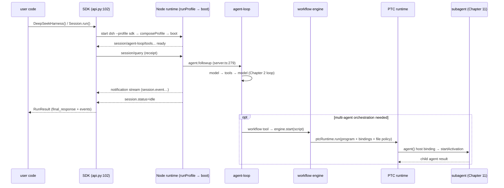

# Chapter 17: workflow / PTC runtime / python end-to-end

> The destination is not a stronger model, but a path that can be walked again.

## Questions This Chapter Answers

- Chapter 5 established the capability seam — so why is the workflow engine that orchestrates multiple agents also "just one seam"?
- Chapter 10 proved that compaction is lossy — so what does Ralph gain by starting a brand-new child agent every round?
- Chapter 16 handed us the high-level API `DeepSeekHarness` — so from constructing it to the model emitting its first token, which services does the request pass through?

In Chapter 16 we walked one typed RPC call: from the SDK protocol to the gateway's `invoke`. This chapter adds two more things on top of that cross-process chain — where a model-written, host-executed **orchestration script** attaches, and how, above that chain, Python, CLI, and Web users share one launcher and one assembly.

The previous 16 chapters built this machine layer by layer: container, loop, session, tools, seam, execution world, model adaptation, prompt, scope, compaction, subagent, skill, Web/LSP, interaction and goal, preset/bundle/profile, typert RPC. This chapter is the final assembly: place the workflow engine and its script host onto the kernel, then wire Python, CLI, and Web users onto the same launcher, and walk one end-to-end path from `import` / command line / browser all the way to the model's answer.

First, pin the previous chapters to the wall with one table. This chapter will not expand them; it only back-links:

| Chapter | Mechanism | One line | How this chapter uses it |
|----|------|--------|-----------|
| 1 | cordis kernel | Context/Service/Fiber, construction registers | §4 the container the four profiles assemble into |
| 2 | agent-loop | model → tools → model loop | §5 the execution core of the SDK surface |
| 3 | session persistence | persisting and restoring session state | §5 session identity and `resume_session` |
| 4 | tools and executors | registry + executor seam | §2 the script host is a sibling of the executor |
| 5 | capability seam | capabilities injected via seams, not hardcoded | §2 workflow is a seam |
| 6 | execution world | processes, files, and isolation policy | §2 the script runs under the Session's file policy |
| 7 | LLM adaptation | unified access to multiple models | §5 FakeModel occupies the model slot |
| 8 | system-prompt | prompt assembly | §3 Ralph registers its own prompt section |
| 9 | scope | scope isolation | Not expanded here (subagent fan-out depends on it implicitly) |
| 10 | compaction | context compaction | §3 the motivation for Ralph's fresh-every-round |
| 11 | subagent | subagent lifecycle | §2/§3 the receiver of fan-out |
| 12 | skill | skill-pack loading | Not expanded here (can be carried by a profile, see Chapter 15) |
| 13 | web/lsp | Web and language services | Not expanded here |
| 14 | interaction/goal | interaction and goal realm | §3 Ralph is independent of goal |
| 15 | preset/bundle/profile | three layers of assembly units | §4 bundles decide the plugin list |
| 16 | typert/api/sdk | cross-process typed RPC | §5 the foundation of SDK communication |

```mermaid
flowchart TB
    subgraph SCENES["three usage scenarios (§4/§5)"]
        PY["Python embedded<br/>--profile sdk"]
        CLI["CLI<br/>dsh --profile headless"]
        WEB["Web<br/>--profile web"]
    end
    subgraph KERNEL["the same cordis plugin tree (Chapter 1)"]
        BOOT["runProfile → composeProfile → boot<br/>(Chapter 15)"]
        SEAM["session / agent-loop /<br/>system-prompt / tools"]
        WF["workflow engine seam (§2)"]
        EXEC["WorkflowExecution<br/>vm.Context + vm.Script"]
        PTC["PTC runtime<br/>process isolation / file policy / cancellation"]
    end
    RALPH["Ralph fixed script<br/>opt-in experimental bundle (§3)"] --> RWFE["Ralph's own workflowEngine<br/>(isolate)"]
    RWFE --> PTC
    PY --> BOOT
    CLI --> BOOT
    WEB --> BOOT
    BOOT --> SEAM
    BOOT --> WF
    BOOT --> PTC
    SEAM --> WF
    WF --> PTC
    WF -->|agent() hook| SUB["subagent (Chapter 11)"]
    PTC --> EXEC
```

## 1. Without an Orchestration Layer, Glue Code Will Eat You Alive

Suppose you want multiple agents to collaborate on a task, and the same kernel must serve three kinds of users: scripts, the command line, and web pages. Without a workflow engine and a shared assembly, you can only hand-write:

```python
def orchestrate_manual(objective, workers):
    """The "orchestration" without a workflow engine: hand-written call order + hand-written error handling.

    Contrast with main.py segment 1: the real engine folds failures into
    result.stopReason=error, and callers only inspect the result object; here exceptions
    are thrown straight out, every call site must wrap its own try/except.
    """
    plan = workers["planner"](f"decompose the objective: {objective}")
    code = workers["coder"](f"implement per [{plan}]: {objective}")
    return {"plan": plan, "code": code}
```

And each entry point maintains its own startup list — drift is almost inevitable:

```python
SDK_SERVICES = ["session", "agent-loop", "system-prompt", "tools",
                "workflowEngine", "ptcRuntime", "sdk-jsonrpc-server"]
HEADLESS_SERVICES = ["session", "agent-loop", "system-prompt", "tools",
                     "workflowEngine", "ptcRuntime", "headless-runner"]
# In some iteration, someone forgot "system-prompt" in the web list — drift happens
WEB_SERVICES = ["session", "agent-loop", "tools",
                "workflowEngine", "ptcRuntime", "webStartup", "connection"]
```

Actually running `python3 ch17/code/bad_example.py`:

```text
============================================================
问题 1  手工编排多 agent
============================================================
  异常直接炸给调用方: 子任务失败（模拟）
  -> 没有 result 对象收口，没有 stopReason，没有事件轨迹，
     每个调用点都得自己包 try/except——这就是缺 workflow seam 的代价。

============================================================
问题 2  每条表面各写一份启动清单
============================================================
         sdk: OK
    headless: OK
         web: 缺失 ['system-prompt']
  -> web 清单漏了 system-prompt：每个入口各自维护清单，必然漂移
  -> 正解：一份 base bundle + 各自的 app bundle（见 main.py 段 3）
```

The two problems point to two mechanisms: a unified **orchestration seam** (§2), and one **shared startup assembly** (§4). The middle question — who actually runs the script — is answered separately in §2: the script is handed to the PTC runtime.

## 2. The workflow Engine: Four Stages, the Script Handed to the PTC Runtime

The positioning of the workflow engine is surprisingly restrained: it is an **abstract Service seam** — each context allows exactly one implementation, and the only abstract method is `start(request): WorkflowRun` (`packages/workflow/workflow/src/index.ts:157`, `packages/workflow/workflow/src/index.ts:168`). It does not prescribe what a script looks like; it only prescribes the contract. The contract has four stages, and the teaching version compresses each into code you can compare against.

**Stage one, synchronous validation.** A request that cannot begin throws here, rather than returning a failed result. The real implementation first validates the meta (`validateMeta`, `packages/workflow/workflow-ptc/src/meta.ts:76`, which names every violating field), then compiles the script body once — compile only, never execute (`assertBodyParses`, `packages/workflow/workflow-ptc/src/index.ts:55`):

```ts
// packages/workflow/workflow-ptc/src/index.ts, the first two lines of start() (index.ts:135-136)
const meta = validateMeta(request.meta)
assertBodyParses(request.script, meta.name)
```

**Stage two, submission.** Only after validation passes does it mint the run id, resolve the provider route and caps, and construct the run (`packages/workflow/workflow-ptc/src/index.ts:139` mints the id, `packages/workflow/workflow-ptc/src/index.ts:158` constructs `PtcWorkflowRun`). From the moment `start()` returns a run, no failure is an exception any more — they all settle into `run.result`.

**Stage three, the event stream.** The six `workflow/*` events are defined at `packages/workflow/workflow/src/index.ts:94`: start / phase / log / agent-start / agent-end / end. They are **observe-only** — listeners receive immutable event payloads, cannot reach the live run, and cannot cancel or rewrite it through an event. Besides the run identity snapshot (`id` + `meta`), each payload carries its own data (`agent-start` carries `seq`/`label`, `log` carries `message`, `end` carries `stopReason`/`agentsStarted`).

**Stage four, the result.** `WorkflowResult` (`packages/workflow/workflow/src/types.ts:72`) has a closed `stopReason` union (`packages/workflow/workflow/src/types.ts:63`): completed | cancelled | error. The `result` on a run promises **never to reject** (`packages/workflow/workflow/src/runtime-types.ts:40`), and `cancel()`/`dispose()` are idempotent.

The teaching version writes these four stages into `workflow.py`:

```python
class WorkflowEngine:
    """The workflow engine seam, corresponding to the abstract WorkflowEngine Service (workflow/src/index.ts:157)."""

    def _validate(self, request):
        # Stage one: per-field meta validation + script must compile; violations throw synchronously
        meta = validate_meta(request.get("meta"))
        script = request.get("script")
        if not callable(script):
            raise WorkflowFailure("workflow script does not parse", "SCRIPT_PARSE")
        return meta, script

    def start(self, request):
        # Stage two: submission. Violations throw before submission; once a run is returned,
        # every failure goes through run.result
        meta, script = self._validate(request)
        run = _WorkflowRun(self, script, meta, request.get("args") or {})
        self._emit("workflow/start", {"id": run.id, "meta": dict(meta)})
        run._drive()
        return run
```

`_WorkflowRun._drive()` folds stages three and four together and demonstrates "never rejects" (the `agent` / `phase` / `log` lambdas are defined just above it, adjacent in `workflow.py`):

```python
class _WorkflowRun:
    def _drive(self):
        """Corresponds to WorkflowExecution.drive() (workflow-ptc/src/runtime.ts:105): never rejects."""
        try:
            value = self._script(agent=agent, args=self._args, phase=phase, log=log)
            value = _materialize_result(value)   # corresponds to materializeResult (runtime.ts:128)
            self.result = {"value": value, "stopReason": STOP_COMPLETED,
                           "agentsStarted": self.agents_started}
        except Exception as e:                   # every failure settles into the result object
            self.result = {"value": None, "stopReason": STOP_ERROR,
                           "error": f"{getattr(e, 'code', 'SCRIPT_ERROR')}: {e}",
                           "agentsStarted": self.agents_started}
        finally:
            # workflow/end carries only outcome data and deliberately omits value (types.ts:124)
            self._engine._emit("workflow/end", {"id": self.id,
                                                "stopReason": self.result["stopReason"],
                                                "agentsStarted": self.result["agentsStarted"]})
```

### 2.1 The Script Host Is the PTC Runtime

The workflow engine's implementation lives in `packages/workflow/workflow-ptc` (the older standalone `workflow-worker-thread` package has been deleted from the repository). The PTC in the name is not an adjective — it stands for **programmatic tool calls** (PTC): the model does not issue tool calls directly; it writes a program and the host runs it. Chapter 4 covered what this looks like on the tool side (the `run_code` tool + `tool-executor-ptc`); this section covers the same runtime when workflow borrows it.

The causal chain has three steps:

1. At assembly time `PtcWorkflowEngine` hard-requires `ptcRuntime.language === 'typescript'`, and otherwise the constructor refuses (`packages/workflow/workflow-ptc/src/index.ts:118`).
2. At submission it resolves the calling Session's **file policy** into a snapshot (`sandboxPolicy.resolve({ session: request.parent.session })`, `packages/workflow/workflow-ptc/src/index.ts:167`); if the runtime cannot enforce that policy and it is not `danger-full-access`, execution fails before it starts (`packages/workflow/workflow-ptc/src/host.ts:285`).
3. The actual execution is one `ctx.ptcRuntime.run(...)` call (`packages/workflow/workflow-ptc/src/host.ts:288`), carrying `program`, a set of `bindings` (the global is named `workflowHost`), the working directory, and `sandboxPolicy`.

The script itself is still compiled with `node:vm` (Node's built-in `vm` module: it opens an isolated JS context **inside the same process**; it is not an OS-level sandbox), but the location changed: it sits inside the Node process PTC launches, and `WorkflowExecution` holds the `vm.Context` and `vm.Script` (`packages/workflow/workflow-ptc/src/runtime.ts:62-63`), with `drive()` (`packages/workflow/workflow-ptc/src/runtime.ts:105`) running it through `runInContext`:

```ts
// packages/workflow/workflow-ptc/src/runtime.ts, the WorkflowExecution constructor (runtime.ts:75-83)
this.compiled = new vm.Script(`(async () => {\n${body}\n})()`, {
  filename: `workflow:${meta.name}`,
  lineOffset: -1,
})
this.context = vm.createContext({}, { name: `workflow:${meta.name}` })
```

Draw one easily-misread line here: **vm is not a security boundary**. `WorkflowExecution` only owns the script's syntax and values; process isolation and cancellation belong to the PTC provider, while the file policy is resolved by the workflow engine and handed to PTC as `sandboxPolicy` for enforcement (`packages/workflow/workflow-ptc/src/host.ts:285-296`). Upstream states this in the module comment at `packages/workflow/workflow-ptc/src/runtime.ts:1-5` and in the File policy section of `packages/workflow/workflow-ptc/README.md:59`. So "can the script read this file" is not answered inside vm; it is answered by the policy from Chapter 6's execution world.

The PTC runtime has three `executionMode` forms, corresponding to three ways of "how the program text is handed to the engine":

| Form | Config | Program format | Process and state |
|---|---|---|---|
| fresh process | `executionMode: per-call` (default) | `function-body`: the function body handed over directly | a new Node process per call; no state retained |
| REPL state holder | `executionMode: persistent-in-memory` | `repl`: interactive evaluation with retained context | keeps a confined REPL per explicit `stateOwner` until `release(owner)` |
| script evaluation | `executionMode: vm-script` | `script`: evaluated as a script | a new process per call; with `scriptPersistence: true`, a context per owner (not a REPL) |

One sentence per format: `function-body` is "a piece of an async function body" and may `return` directly; `repl` is "line-by-line interactive statements" whose variables persist across calls; `script` is "a script" whose last expression (awaited first if it is a Promise) becomes the result.

(`packages/ptc-runtime/ptc-runtime-node/README.md:49` has the configuration table for these rows; `packages/ptc-runtime/ptc-runtime-node/README.md:12` is the summary.)

workflow-ptc does not pick a form; it assembles one of the three program texts on the spot, following the provider's declared `programFormat` (`packages/workflow/workflow-ptc/src/host.ts:289-293`):

```ts
// packages/workflow/workflow-ptc/src/host.ts, the program choice inside drive() (host.ts:289-293)
program: {
  'function-body': PROGRAM,
  repl: `await (async () => {\n${PROGRAM}\n})()`,
  script: `(async () => {\n${PROGRAM}\n})()`,
}[this.runtime.programFormat],
```

The three branches differ only in "who is the container": `function-body` hands `PROGRAM` over directly as an async function body, where top-level `await` and `return` are both legal (`packages/ptc-runtime/ptc-runtime-node/src/execution.ts:149-157` defines the per-call mode this way, and it is also the base bundle's default form); `repl` and `script` wrap the same program in `(async () => { ... })()` and use the IIFE's promise completion value in place of a top-level `return` — because those two formats do not allow top-level `return` (`packages/ptc-runtime/ptc-runtime/src/types.ts:79-81`).

One more peculiarity: workflow-local variables **should not** land in the calling Agent's retained REPL. Upstream notes at `packages/workflow/workflow-ptc/README.md:59` that Node's in-memory executor runs this async wrapper in a temporary environment, so "workflow-local variables never join the Agent's retained REPL".

The `ctx.ptcRuntime` service is defined at `packages/ptc-runtime/ptc-runtime/src/index.ts:105`; `resolve` (`packages/ptc-runtime/ptc-runtime/src/index.ts:159`) validates parameters and fills defaults, and `run` (`packages/ptc-runtime/ptc-runtime/src/index.ts:166`) executes. This one service serves both `tool-executor-ptc` (Chapter 4's programmatic tool calls) and workflow — two consumers, one execution host. That is the "one code execution host" this chapter adds.

Actually running `python3 ch17/code/main.py` segment 1 (full output in §7):

```text
段 1  workflow 引擎：校验 → 提交 → 事件流 → 结果
============================================================
校验失败（未提交）: META_INVALID — invalid meta: meta.name must be a non-empty string
result: {'value': {'plan': '完成(拆解目标: 实现天气...)', 'code': '完成(按 [完成(拆解目标...)'}, 'stopReason': 'completed', 'agentsStarted': 2}
事件轨迹（只观察）:
  workflow/start: {'id': 'run-1', 'meta': {'name': 'demo', 'description': '两步编排演示'}}
  workflow/phase: {'runId': 'run-1', 'title': 'plan'}
  workflow/agent-start: {'runId': 'run-1', 'seq': 1, 'label': '拆解目标: 实现天气查询'}
  workflow/agent-end: {'runId': 'run-1', 'seq': 1, 'outcome': 'completed'}
  workflow/log: {'runId': 'run-1', 'message': 'plan ready'}
  workflow/phase: {'runId': 'run-1', 'title': 'implement'}
  workflow/agent-start: {'runId': 'run-1', 'seq': 2, 'label': '按 [完成(拆解目标: '}
  workflow/agent-end: {'runId': 'run-1', 'seq': 2, 'outcome': 'completed'}
  workflow/end: {'id': 'run-1', 'stopReason': 'completed', 'agentsStarted': 2}

-- 脚本返回不可序列化的终值（set），看 result 如何收口 --
result.stopReason = error
result.error      = RESULT_UNSERIALIZABLE: the workflow's return v...
失败 run 的事件: ['workflow/start', 'workflow/agent-start', 'workflow/agent-end', 'workflow/end']
调用方没有接到异常——失败被折叠进结果对象（result 永不 reject）。
```

The first line is the validation stage: when meta lacks `name`, `start()` throws `WorkflowFailure` directly, and the event trail has not even a `workflow/start` — exactly the boundary between "throw before submission" and "settle after submission". The trail afterwards shows all six of start / phase / log / agent-start / agent-end / end (this script calls both `phase()` and `log()`). The failing run is start → agent-start → agent-end → end: `bad_script` calls `agent()` once first, and `RESULT_UNSERIALIZABLE` only fires when the script returns, so those two agent events are always emitted first. Note that the `workflow/end` payload carries `id`, `stopReason`, and `agentsStarted`, but not `value`: the value stays with the caller holding the run.

## 3. Ralph: A Downgraded Optional Bundle

Imagine a long task like "make all the tests pass", now twenty rounds in and still broken. A single agent carries every round's failure logs, every patch it tried, every hesitation in the conversation: the context grows longer, compaction starts dropping details, and what gets dropped may be exactly "we already tried that". Restart the task once and all that context has to be rebuilt.

What is actually needed is not harder compaction, but **each round starting from a clean state**: every round receives only the immutable objective plus one structured previous report; everything else lives in the shared workspace — files are the long-term memory. Ralph fixes that pattern into a fixed script.

Ralph is not a new engine; it is a fixed foreground workflow on top of the workflow engine. "Foreground" here is relative to background jobs: it blocks this tool call synchronously and returns when done, returning no job handle. It hands the immutable objective to fresh child agents, one after another, until complete, blocked, or the round budget runs out.

Its distribution form is an **opt-in experimental bundle** (not enabled in the default composition; it only appears when explicitly mounted). The package lives at `packages/experimental/tool-ralph/` (the plugin name is still `tool-ralph`, `packages/experimental/tool-ralph/src/index.ts:17`): `packages/workflow/workflow-ptc/README.md:28` says plainly "Ralph remains disabled in shipped defaults", and `packages/bundle/base/cordis.patch.yml` has no ralph row at all (that stretch holds only `ptc-runtime`, `workflow-ptc`, and `tool-workflow`, see `packages/bundle/base/cordis.patch.yml:405`, `packages/bundle/base/cordis.patch.yml:408`, `packages/bundle/base/cordis.patch.yml:413`).

To enable it, mount `packages/experimental/ralph-bundle`. That bundle's patch is only a dozen lines; the core is an isolation group:

```yaml
# packages/experimental/ralph-bundle/cordis.patch.yml
- insert:
    - id: optional-ralph
      name: cordis:group
      group: true
      isolate:
        workflowEngine: true          # brings its own engine; shares none with other workflow tools
      config:
        - id: optional-ralph-workflow
          name: '@deepseek-ai/dsh-workflow-ptc'
        - id: tool-ralph
          name: '@deepseek-ai/dsh-tool-ralph'
```

`isolate: workflowEngine: true` means Ralph starts a workflow engine instance of its own; it neither overrides nor borrows the one in the default composition. That turns "enable Ralph" into pure addition — mounting it changes no existing workflow behavior. It is also listed in the opt-in experimental bundle list at `packages/experimental/README.md:48`.

Once enabled, `apply()` first registers a usage policy into system-prompt (`ctx.systemPrompt.section` at `packages/experimental/tool-ralph/src/index.ts:405`), then registers the tool (`:410`) — that prompt tells the model to use Ralph only when a human explicitly asks for it, and to leave ordinary long-running work to the goal tools.

The mechanism itself is unchanged and still worth reading. `RALPH_SCRIPT` is a hard-coded script (`packages/experimental/tool-ralph/src/index.ts:88`); the ralph tool's `execute` (registered at `packages/experimental/tool-ralph/src/index.ts:410`; its body calls `start` from `:445` on) merely calls `ctx.workflowEngine.start({ script: RALPH_SCRIPT, ... })`, then `await run.result` (`packages/experimental/tool-ralph/src/index.ts:459`) and `await run.dispose()` (`packages/experimental/tool-ralph/src/index.ts:471`). The model supplies only two data items, objective and maxRounds; the script, provider route, and report schema all live on the deployment side. The teaching version compresses the skeleton to:

The module-level function `ralph_script` in `ralph.py` (`_REPORT_SCHEMA` and `_validate_report` are defined in the same file):

```python
def ralph_script(agent, args, phase, log):
    """Skeleton of the fixed RALPH_SCRIPT, corresponding to tool-ralph/src/index.ts:88."""
    phase("Fresh-agent rounds")               # the script's own phase() call (:150)
    previous = None
    rounds_started = 0
    for round_no in range(1, args["maxRounds"] + 1):
        prior = "(none — this is the first round)" if previous is None else repr(previous)
        prompt = (f"Immutable objective:\n{args['objective']}\n\n"
                  f"Ralph round: {round_no} of {args['maxRounds']}.\n\n"
                  f"Previous structured handoff:\n{prior}")
        raw = agent(prompt, {"label": f"Ralph round {round_no}", "schema": _REPORT_SCHEMA})
        if raw is None:                      # child agent failed → settle into the fourth terminal value
            return {"status": "round-failed", "roundsStarted": round_no,
                    "lastReport": previous}
        report = _validate_report(raw, args["maxHandoffChars"])
        rounds_started = round_no
        # [Teaching simplification] the real script uses two separate ifs; merged here, semantically equal
        if report["status"] in ("complete", "blocked"):
            return {"status": report["status"], "roundsStarted": round_no, "report": report}
        previous = report
    return {"status": "budget-limited", "roundsStarted": rounds_started, "report": previous}
```

Three design decisions are worth pausing on:

1. **A fresh child agent every round.** `requireFreshProvider` (`packages/experimental/tool-ralph/src/index.ts:218`) requires a provider that supports structured output and has `inheritsParentContext === false`. Chapter 10 makes the cost clear: a long task's context bloats, and compaction is lossy; rather than letting one agent drag an ever-dirtier context to the finish line, start a clean one every round and hand over only the structured previous report.
2. **The previous report is the only cross-round handoff.** `RalphRoundReport` is a closed structure: `{status, summary, evidence[], nextSteps[], blocker}`. It is validated twice — in-script `validateReport` (`packages/experimental/tool-ralph/src/index.ts:110`), host-side `readReport` (`packages/experimental/tool-ralph/src/index.ts:245`). Workspace files are the only long-term memory across rounds; the report is merely "an index for reading the workspace".
3. **Ralph adds no mode to agent-loop.** It is independent of Chapter 14's goal realm: goal governs "what the user wants"; Ralph governs "repeat one thing until it is done".

The final value is decoded by `readRunResult` (`packages/experimental/tool-ralph/src/index.ts:281`) into four kinds: complete | blocked | budget-limited | round-failed. Exhausting the budget is not an exception; the script itself `return { status: 'budget-limited', ... }` (`packages/experimental/tool-ralph/src/index.ts:174`). The second group in the verification script demonstrates that state:

```text
段 2  Ralph（opt-in 实验 bundle）：固定脚本，每轮全新子 agent
============================================================
  包位置: packages/experimental/tool-ralph；默认组合不启用
  分发形态: packages/experimental/ralph-bundle 的 optional-ralph 组
  [第 1 轮] 全新子 agent 启动 -> status=continue（summary: 搭好骨架，测试未过）
  [第 2 轮] 全新子 agent 启动 -> status=complete（summary: 测试全过）
终值: status=complete，用了 2 轮
跨轮交接只有 previous 报告——工作区才是唯一长期记忆。
  [第 1 轮] 全新子 agent 启动 -> status=continue（summary: 第 1 轮仍在推进）
  [第 2 轮] 全新子 agent 启动 -> status=continue（summary: 第 2 轮仍在推进）
轮数耗尽: status=budget-limited，roundsStarted=2
```

[Teaching simplification] Real Ralph starts a brand-new child-agent session through `subagentProvider`; the teaching version uses a factory that returns a fresh report on every call, and the previous report likewise travels only through the prompt.

## 4. One Launcher, Four Shipped Profiles

Above the orchestration layer is the startup layer. The key fact here is that there is only one command for startup. The upstream README says: "The `dsh` command is the sole supported Node application launcher... SDK and ACP are profiles, not separate public bins" (`apps/cli/README.md:5`).

Two words are easy to confuse. A **shipped profile** is a plugin list that ships with the repository (sdk / web / headless / acp); a **usage scenario** is where a person comes in. The one `dsh` launcher carries every scenario, and each scenario maps to a profile:

| Usage scenario | Profile | Form |
|---|---|---|
| Python embedded (`python/sdk` uses it) | `sdk` | long-running stdio JSON-RPC service |
| one-shot command-line task | `headless` | runs and exits |
| browser UI | `web` | HTTP + WebSocket service |
| automation client (ACP client) | `acp` | ACP stdio service |

So this chapter's "three startup surfaces" are three kinds of **users** sharing one launcher: a Python program starts the `sdk` profile through the SDK, the command line starts `headless`, and the browser connects to `web`. There is also a fifth shipped profile, `sdk-minimal`: it does not layer over base and carries a trimmed tree of its own, for the minimal example; the table below omits it.

The chain has three segments, one function each:

1. `apps/cli/src/bin.ts:29` parses argv; in `profile` mode it calls `runProfile` (`apps/cli/src/bin.ts:35`).
2. `runProfile` (`apps/cli/src/profile-boot.ts:271`) installs the proxy environment (`apps/cli/src/profile-boot.ts:276`), calls `composeProfile` (`apps/cli/src/profile-boot.ts:292`) to compute the layered config, and finally calls `boot` (`apps/cli/src/profile-boot.ts:323`). `composeProfile` itself is defined at `apps/cli/src/profile-boot.ts:224` and only does "load the profile + compute runtime resolution + collect `--patch` overlays" — it instantiates no plugin.
3. `boot` (`packages/boot/app-boot/src/index.ts:1200`) mounts the layered patches over the empty root config. The layer order is: bundle layers → the profile's `cordis.patch.yml` → `$DSH_HOME/cordis.patch.yml` → `--patch` overlays (`apps/cli/README.md:41-44`).

The four profiles' bundle lists live at `packages/util/official-bundles/src/bundles.ts:10-26`: sdk = base + sdk-app, web = base + web-app, headless = base + headless, acp = base + acp-app. The teaching version expresses this with a dict:

```python
# corresponds to PROFILE_TEMPLATES (packages/util/official-bundles/src/bundles.ts:10)
PROFILE_BUNDLES = {
    "sdk": ["@deepseek-ai/dsh-base", "@deepseek-ai/dsh-sdk-app"],
    "web": ["@deepseek-ai/dsh-base", "@deepseek-ai/dsh-web-app"],
    "headless": ["@deepseek-ai/dsh-base", "@deepseek-ai/dsh-headless"],
    "acp": ["@deepseek-ai/dsh-base", "@deepseek-ai/dsh-acp-app"],
    # sdk-minimal skips base: [ "@deepseek-ai/dsh-sdk-minimal" ]; omitted in this example
}
```

```python
def compose_profile(profile: str, patches=()):
    """Corresponds to composeProfile (apps/cli/src/profile-boot.ts:224): compute what to install."""
    if profile not in PROFILE_BUNDLES:
        raise ValueError(f"unknown profile: {profile}")
    entries = []
    for bundle in PROFILE_BUNDLES[profile]:
        entries.extend(BUNDLE_SERVICES[bundle])
    entries.extend(patches)          # the --patch overlay layer applies last
    return entries
```

Here we directly reuse Chapter 1's `Context`/`Service` (`ch01/code/cordis.py`): Service construction registers, and `booted_services()` enumerates via the service table. Actually running segment 3:

```text
段 3  三个使用场景共享同一 boot：四个 shipped profile
============================================================
       sdk: ['session', 'agent-loop', 'system-prompt', 'tools', 'workflowEngine', 'ptcRuntime', 'sdk-jsonrpc-server']
       web: ['session', 'agent-loop', 'system-prompt', 'tools', 'workflowEngine', 'ptcRuntime', 'webStartup', 'connection']
  headless: ['session', 'agent-loop', 'system-prompt', 'tools', 'workflowEngine', 'ptcRuntime', 'headless-runner']
       acp: ['session', 'agent-loop', 'system-prompt', 'tools', 'workflowEngine', 'ptcRuntime', 'acp-bridge']
公共层: @deepseek-ai/dsh-base
四个 profile 的差异只在 base 之后追加的 bundle——内核是同一棵树。
```

[Teaching decision] Each bundle in `BUNDLE_SERVICES` expands to only a few representative service names; real bundles are dozens of lines of `cordis.patch.yml`. But the structure — "base provides workflowEngine and ptcRuntime, app bundles only append their own entry" — matches the real implementation: `packages/bundle/base/cordis.patch.yml:405-414` is exactly `ptc-runtime` / `workflow-ptc` / `tool-workflow` in a row.

This is exactly the answer to §1's Problem 2: there is only one list, and drift has nowhere to happen.

Taking the SDK as an example, one input ultimately lands on the pair "create an agent + deliver a user message": `ctx.agents.create` at `packages/sdk/server/src/server.ts:592` and `agent.followup` at `packages/sdk/server/src/server.ts:279`. Web and CLI each have their own entry plugins, and they too hand input to the same agent service layer (this chapter does not walk their entry files one by one).

## 5. End-to-End: Walking the Python Embedded Surface

We pick the Python embedded surface for the end-to-end demo because it is the thinnest. Its entry is a class, but one run is not "one request, one reply". `DeepSeekHarness` (`python/sdk/src/deepseek_harness/api.py:102`) is the thinnest entry; it can be constructed with a config object or with keyword arguments (`python/sdk/src/deepseek_harness/api.py:110-119`), and `start()` (`python/sdk/src/deepseek_harness/api.py:157`) lazily launches the Node runtime and calls `initialize`.

The real request path adds one concept: a **receipt**. Below is the skeleton of `Session.run` in `api.py` (the command branch and `on_notification` passthrough are omitted; the full implementation is at `python/sdk/src/deepseek_harness/api.py:214`):

```python
class Session:                      # api.py:199
    def run(self, input, *, on_notification=None):     # :214
        # subscribe to notifications → send session/query for the receipt → read until session.status=idle
        self.harness.start()
        with self.harness.client.subscribe_session_notifications(self.id) as subscription:
            response = self.harness.client._query(self.id, input)   # sends session/query
            ...                                                     # command branch omitted
            # _RunActivity collects this run's root events and notifications until idle
            activity = _RunActivity(self.id, "prompt", response)
            while True:
                notification = subscription.next()
                if not activity.record(notification, on_notification):
                    continue
                if (notification.method == "session.status"
                        and notification.payload.get("status") == "idle"):
                    break
        return activity.result()
```

`_query` sends `session/query` (`python/sdk/src/deepseek_harness/client.py:233`), which the server handles at `packages/sdk/server/src/server.ts:505`, returning one of two receipts: the prompt's messageId, or a native command's `CommandExecution`. So "one run" at the protocol level is "one query + one notification stream", not a request/response pair.

`HarnessClient` (`python/sdk/src/deepseek_harness/client.py:42`) starts the Node runtime with `subprocess.Popen` (`python/sdk/src/deepseek_harness/client.py:89`) and speaks newline-delimited JSON-RPC over stdio; the default launch argument is `--profile sdk` (`python/sdk/src/deepseek_harness/client.py:616`). The typed foundation of this inter-process chain is Chapter 16's `invoke`, and the process it starts is exactly the tree §4's `runProfile` assembled.

[Teaching simplification] The teaching version replaces stdio JSON-RPC with an in-process `FakeRuntime` but keeps the protocol shape: `subscribe_session_notifications()` → `_query()` for the receipt → `next()` reads notifications one by one → `session.status=idle` closes the loop → `final_response` / `finish_reason` are read back from the event stream. `RunResult`'s five fields (`session_id / final_response / finish_reason / events / notifications`, `python/sdk/src/deepseek_harness/api.py:45`) are preserved:

```python
class Session:
    def run(self, user_input):
        """Corresponds to python/sdk/src/deepseek_harness/api.py:214."""
        self.harness.start()
        events = []
        notifications = []
        with self.harness.client.subscribe_session_notifications(self.id) as subscription:
            self.harness.client._query(self.id, user_input)   # the session/query receipt
            while True:
                notification = subscription.next()
                notifications.append(notification)
                if notification["method"] == "session.event":
                    events.append(notification["payload"]["event"])
                if (notification["method"] == "session.status"
                        and notification["payload"].get("status") == "idle"):
                    break
        return RunResult(session_id=self.id,
                         final_response=final_response(events),
                         finish_reason=finish_reason(events),
                         events=events, notifications=notifications)
```

`final_response()` (`python/sdk/src/deepseek_harness/api.py:298`) scans backwards for the first `assistant/message`, and `finish_reason()` (`python/sdk/src/deepseek_harness/api.py:318`) scans backwards for `turn/end` and reads `reason.kind` — neither depends on intermediate state. Session identity is passed in explicitly by the caller; the same id handed to `resume_session()` (`python/sdk/src/deepseek_harness/api.py:179`) reattaches the persisted history instead of creating a new session. `FakeRuntime._produce()` is Chapter 2's "model → tools → model" loop written as notifications: each round emits `session.event`, and a final `session.status=idle` closes it. Actually running segment 4:

```text
段 4  Python 内嵌面端到端：回执 → 事件 → idle
============================================================
最终回答: 北京今天晴，25°C。
finish_reason: completed
模型调用次数: 2（第 1 次决定调工具，第 2 次收尾）
通知流: ['session.event', 'session.event', 'session.event', 'session.event', 'session.status']
事件轨迹: ['agent/inbox/spliced', 'tool/result', 'assistant/message', 'turn/end']
```

"model call count: 2" comes from `FakeModel`'s `calls` counter — `generate()` increments it once per call. The notification stream has five entries: four `session.event` messages wrapping events (the receipt landing in the inbox, the tool result, the assistant message, `turn/end`), and the fifth, `session.status`, is the loop's exit. The first entry in the event trail, `agent/inbox/spliced`, is the evidence that the receipt landed in the inbox — in the real implementation `_is_inbox_receipt()` (`python/sdk/src/deepseek_harness/api.py:275`) relies on it to confirm "this input really entered the session".

Stringing the four segments together, the complete path of one real request is:



## 6. Closing the Whole Book: One Startup Path + One Execution Loop + One Execution Host + One Observation Channel

Looking back, the book's main line is really four things:

- **One startup path**: profile/bundle (Chapter 15) decides the patch layers → `composeProfile` computes the layered config → `boot` assembles it in order into the cordis container (Chapter 1) → the four shipped profiles share this path (this chapter).
- **One execution loop**: agent-loop (Chapter 2) turns inside the container; tools (Chapter 4), seams (Chapter 5), the execution world (Chapter 6), compaction (Chapter 10), subagent (Chapter 11), and workflow/Ralph (this chapter) are all mechanisms hung on this loop.
- **One code execution host**: the PTC runtime (this chapter §2). Whatever program the model writes — a tool call or an orchestration script — goes to the same `ctx.ptcRuntime` and runs under the same file policy.
- **One observation channel**: once the system is running, how events leave, who queues them, and who closes them. That is the next chapter's subject.

The remaining chapters support these four things: session/scope/compaction govern "memory and boundaries"; system-prompt/LLM adaptation govern "input and output"; typert/api/sdk govern "cross-process".

## 7. Complete Run Output

The complete actual run output of `python3 ch17/code/main.py` (the first half of segment 1 is quoted in §2; here we start from the end of segment 1):

```text
-- 脚本返回不可序列化的终值（set），看 result 如何收口 --
result.stopReason = error
result.error      = RESULT_UNSERIALIZABLE: the workflow's return v...
失败 run 的事件: ['workflow/start', 'workflow/agent-start', 'workflow/agent-end', 'workflow/end']
调用方没有接到异常——失败被折叠进结果对象（result 永不 reject）。

============================================================
段 2  Ralph（opt-in 实验 bundle）：固定脚本，每轮全新子 agent
============================================================
  包位置: packages/experimental/tool-ralph；默认组合不启用
  分发形态: packages/experimental/ralph-bundle 的 optional-ralph 组
  [第 1 轮] 全新子 agent 启动 -> status=continue（summary: 搭好骨架，测试未过）
  [第 2 轮] 全新子 agent 启动 -> status=complete（summary: 测试全过）
终值: status=complete，用了 2 轮
跨轮交接只有 previous 报告——工作区才是唯一长期记忆。
  [第 1 轮] 全新子 agent 启动 -> status=continue（summary: 第 1 轮仍在推进）
  [第 2 轮] 全新子 agent 启动 -> status=continue（summary: 第 2 轮仍在推进）
轮数耗尽: status=budget-limited，roundsStarted=2

============================================================
段 3  三个使用场景共享同一 boot：四个 shipped profile
============================================================
       sdk: ['session', 'agent-loop', 'system-prompt', 'tools', 'workflowEngine', 'ptcRuntime', 'sdk-jsonrpc-server']
       web: ['session', 'agent-loop', 'system-prompt', 'tools', 'workflowEngine', 'ptcRuntime', 'webStartup', 'connection']
  headless: ['session', 'agent-loop', 'system-prompt', 'tools', 'workflowEngine', 'ptcRuntime', 'headless-runner']
       acp: ['session', 'agent-loop', 'system-prompt', 'tools', 'workflowEngine', 'ptcRuntime', 'acp-bridge']
公共层: @deepseek-ai/dsh-base
四个 profile 的差异只在 base 之后追加的 bundle——内核是同一棵树。

============================================================
段 4  Python 内嵌面端到端：回执 → 事件 → idle
============================================================
最终回答: 北京今天晴，25°C。
finish_reason: completed
模型调用次数: 2（第 1 次决定调工具，第 2 次收尾）
通知流: ['session.event', 'session.event', 'session.event', 'session.event', 'session.status']
事件轨迹: ['agent/inbox/spliced', 'tool/result', 'assistant/message', 'turn/end']
```

## 8. Source Mapping Master Table

The table groups this chapter's `path:line` citations by mechanism; a line quoted more than once within one subsection is listed once.

| Mechanism | Real source location | Teaching difference |
|------|-------------|-----------|
| WorkflowEngine abstract seam | `packages/workflow/workflow/src/index.ts:157`, `packages/workflow/workflow/src/index.ts:168` | the teaching version uses `_validate` + `start` instead of an abstract method declaration |
| WorkflowStartRequest / WorkflowRun | `packages/workflow/workflow/src/runtime-types.ts:19`, `packages/workflow/workflow/src/runtime-types.ts:40` | a dict + `_WorkflowRun`, keeping "result never rejects" |
| WorkflowResult / closed stopReason union | `packages/workflow/workflow/src/types.ts:72`, `packages/workflow/workflow/src/types.ts:63` | the cancelled branch exists in the interface but is not demonstrated |
| WorkflowResultInfo (workflow/end payload) | `packages/workflow/workflow/src/types.ts:124` | the teaching end event carries only id/stopReason/agentsStarted |
| the six workflow/* events | `packages/workflow/workflow/src/index.ts:94` | the teaching version emits all six with the same payload shape |
| PTC language assertion | `packages/workflow/workflow-ptc/src/index.ts:118` | the teaching version has no such check |
| first two lines of start() / id minting / run construction | `packages/workflow/workflow-ptc/src/index.ts:135-136`, `packages/workflow/workflow-ptc/src/index.ts:139`, `packages/workflow/workflow-ptc/src/index.ts:158` | `_validate` + `_WorkflowRun(...)` |
| fail when the file policy cannot be enforced | `packages/workflow/workflow-ptc/src/host.ts:285` | omitted |
| three programFormat branches | `packages/workflow/workflow-ptc/src/host.ts:289-293` | the teaching version runs a Python function directly |
| vm is not a security boundary | `packages/workflow/workflow-ptc/src/runtime.ts:1-5` | no vm in the teaching version |
| workflow locals never join the caller's REPL | `packages/workflow/workflow-ptc/README.md:59` | — |
| PTC three-form config table | `packages/ptc-runtime/ptc-runtime-node/README.md:49`, `packages/ptc-runtime/ptc-runtime-node/README.md:12` | not implemented |
| programFormat semantics (top-level await/return) | `packages/ptc-runtime/ptc-runtime/src/types.ts:79-81` | — |
| sync validation validateMeta | `packages/workflow/workflow-ptc/src/meta.ts:76` | `validate_meta` checks only name/description/unknown fields |
| script parse assertBodyParses | `packages/workflow/workflow-ptc/src/index.ts:55` | "callable" stands in for a `new vm.Script` compile check |
| PtcWorkflowEngine.start | `packages/workflow/workflow-ptc/src/index.ts:134` | the teaching version runs synchronously; the real one returns a pending Promise |
| file-policy snapshot | `packages/workflow/workflow-ptc/src/index.ts:167` | omitted (no real sandbox) |
| PTC execution entry | `packages/workflow/workflow-ptc/src/host.ts:288` | the teaching version calls `script(...)` directly |
| script vm.Context / vm.Script | `packages/workflow/workflow-ptc/src/runtime.ts:62`, `packages/workflow/workflow-ptc/src/runtime.ts:63`, `packages/workflow/workflow-ptc/src/runtime.ts:75` | no vm; a Python function runs directly |
| drive() never rejects | `packages/workflow/workflow-ptc/src/runtime.ts:105` | `_drive` likewise folds exceptions into result |
| agent() hook | `packages/workflow/workflow-ptc/src/runtime.ts:163` | `_run_agent` runs serially with no concurrency slots |
| materialization boundary materializeFromRealm | `packages/workflow/workflow-ptc/src/realm.ts:62` | approximated with `json.dumps` |
| cancel / dispose idempotence | `packages/workflow/workflow-ptc/src/host.ts:151`, `packages/workflow/workflow-ptc/src/host.ts:162` | teaching `cancel`/`dispose` only set flags |
| PTC runtime seam | `packages/ptc-runtime/ptc-runtime/src/index.ts:105`, `packages/ptc-runtime/ptc-runtime/src/index.ts:159`, `packages/ptc-runtime/ptc-runtime/src/index.ts:166` | back-referenced only, not implemented |
| base's three workflow rows | `packages/bundle/base/cordis.patch.yml:405`, `packages/bundle/base/cordis.patch.yml:408`, `packages/bundle/base/cordis.patch.yml:413` | expanded into the two service names `ptcRuntime` / `workflowEngine` |
| RALPH_META / RALPH_SCRIPT | `packages/experimental/tool-ralph/src/index.ts:78`, `packages/experimental/tool-ralph/src/index.ts:88` | `RALPH_META` corresponds segment by segment to the skeleton |
| Ralph's prompt section / package name | `packages/experimental/tool-ralph/src/index.ts:405`, `packages/experimental/tool-ralph/src/index.ts:17` | the systemPrompt registration is omitted |
| budget-limited terminal value | `packages/experimental/tool-ralph/src/index.ts:174` | same shape in the teaching version |
| ralph tool registration / execution | `packages/experimental/tool-ralph/src/index.ts:410`, `packages/experimental/tool-ralph/src/index.ts:445`, `packages/experimental/tool-ralph/src/index.ts:459`, `packages/experimental/tool-ralph/src/index.ts:471` | `run_ralph` keeps start→result→dispose order |
| requireFreshProvider | `packages/experimental/tool-ralph/src/index.ts:218` | omitted (the factory is always fresh) |
| readReport / readRunResult | `packages/experimental/tool-ralph/src/index.ts:245`, `packages/experimental/tool-ralph/src/index.ts:281` | `read_run_result` checks only the field set and round count |
| opt-in experimental bundle | `packages/experimental/ralph-bundle/cordis.patch.yml:2`, `packages/experimental/ralph-bundle/cordis.patch.yml:5`, `packages/experimental/ralph-bundle/cordis.patch.yml:9`, `packages/experimental/ralph-bundle/cordis.patch.yml:12` | structure only; the real bundle is not run |
| Ralph disabled by default / listed in the opt-in experimental bundle list | `packages/workflow/workflow-ptc/README.md:28`, `packages/experimental/README.md:48` | — |
| dsh as the sole launcher / layer order | `apps/cli/README.md:5`, `apps/cli/README.md:41-44` | — |
| argv parse → runProfile | `apps/cli/src/bin.ts:29`, `apps/cli/src/bin.ts:35` | no argv in the teaching version |
| runProfile / composeProfile / boot | `apps/cli/src/profile-boot.ts:271`, `apps/cli/src/profile-boot.ts:224`, `apps/cli/src/profile-boot.ts:323` | the three segments are compressed into one `boot()` |
| proxy environment / calling composeProfile | `apps/cli/src/profile-boot.ts:276`, `apps/cli/src/profile-boot.ts:292` | omitted |
| app-boot's boot | `packages/boot/app-boot/src/index.ts:1200` | no YAML parsing |
| shipped profile bundle lists | `packages/util/official-bundles/src/bundles.ts:10`, `packages/util/official-bundles/src/bundles.ts:10-26` | `PROFILE_BUNDLES` dict, sdk-minimal omitted |
| DeepSeekHarness / Session.run | `python/sdk/src/deepseek_harness/api.py:102`, `python/sdk/src/deepseek_harness/api.py:214` | an in-process `FakeRuntime` reproduces receipt/notifications/idle |
| constructor either-or / start / resume_session | `python/sdk/src/deepseek_harness/api.py:110-119`, `python/sdk/src/deepseek_harness/api.py:157`, `python/sdk/src/deepseek_harness/api.py:179` | same signature |
| reading final_response / finish_reason back from events | `python/sdk/src/deepseek_harness/api.py:298`, `python/sdk/src/deepseek_harness/api.py:318` | same function names |
| receipt recognition | `python/sdk/src/deepseek_harness/api.py:275` | `_produce()` emits it directly |
| RunResult's five fields | `python/sdk/src/deepseek_harness/api.py:45` | all five field names preserved |
| HarnessClient / session/query | `python/sdk/src/deepseek_harness/client.py:42`, `python/sdk/src/deepseek_harness/client.py:233` | `FakeRuntime._query` replaces stdio JSON-RPC |
| Popen / default profile | `python/sdk/src/deepseek_harness/client.py:89`, `python/sdk/src/deepseek_harness/client.py:616` | in-process |
| server-side session/query | `packages/sdk/server/src/server.ts:505` | no server in the teaching version |
| convergence point agents.create / followup | `packages/sdk/server/src/server.ts:592`, `packages/sdk/server/src/server.ts:279` | omitted; only the convergence fact is told |

## 9. Summary

- The workflow engine is a seam: `start()` validates synchronously first (meta + script compiles), then returns a run handle after submission; result never rejects; stopReason is a closed union; events are observe-only.
- The script's host is the PTC runtime: the same program runs under the calling Session's file policy and is compiled and executed by `WorkflowExecution` with `vm.Context`; process isolation and cancellation belong to PTC, not vm.
- Ralph is a fixed script on top of the engine, located under `packages/experimental`, and can only be mounted explicitly through `ralph-bundle`, an opt-in experimental bundle.
- The three usage scenarios converge into one `dsh` command + four shipped profiles; each profile is just `base` plus one or two app bundles; `composeProfile` only computes the list, and `boot` instantiates.
- One Python SDK run is "a query receipt + a notification stream", settling into `RunResult` only when idle is seen.
- The book closes into four things: one startup path, one execution loop, one execution host, one observation channel.

## 10. Appendix: Key Concepts Cheat Sheet

| Concept | Teaching code | Real source | Key contract |
|------|---------|---------|---------|
| workflow seam | `workflow.py` `WorkflowEngine` | `packages/workflow/workflow/src/index.ts:157` | one implementation per context |
| sync validation | `WorkflowEngine._validate` | `packages/workflow/workflow-ptc/src/index.ts:55`, `packages/workflow/workflow-ptc/src/meta.ts:76` | violations throw before submission |
| run handle | `_WorkflowRun` | `packages/workflow/workflow/src/runtime-types.ts:40` | result never rejects |
| stopReason | `STOP_*` constants | `packages/workflow/workflow/src/types.ts:72` | completed/cancelled/error |
| event stream | `WorkflowEngine._emit` | `packages/workflow/workflow/src/index.ts:94` | six types, observe-only |
| event payload has no value | `workflow/end` carries id/stopReason/agentsStarted | `packages/workflow/workflow/src/types.ts:124` | WorkflowResultInfo = result − value |
| script host | in-process call | `packages/workflow/workflow-ptc/src/runtime.ts:56` | WorkflowExecution (vm.Context + vm.Script) |
| program format | — | `packages/workflow/workflow-ptc/src/host.ts:289-293` | function-body / repl / script |
| notification stream and idle | `FakeRuntime._produce` | `python/sdk/src/deepseek_harness/api.py:265-270` | settles only at session.status=idle |
| PTC runtime | — | `packages/ptc-runtime/ptc-runtime/src/index.ts:105` | resolve → run |
| file policy | — | `packages/workflow/workflow-ptc/src/index.ts:167` | the calling Session's policy |
| materialization boundary | `_materialize_result` | `packages/workflow/workflow-ptc/src/realm.ts:62` | the final value must be pure JSON |
| Ralph script | `ralph.py` `ralph_script` | `packages/experimental/tool-ralph/src/index.ts:88` | fixed; the model cannot rewrite it |
| round report | `_validate_report` | `packages/experimental/tool-ralph/src/index.ts:110`, `packages/experimental/tool-ralph/src/index.ts:245` | double-checked, three states + constraints |
| four terminal values | `read_run_result` | `packages/experimental/tool-ralph/src/index.ts:281` | complete/blocked/budget-limited/round-failed |
| fresh child agent | factory creates anew each time | `packages/experimental/tool-ralph/src/index.ts:218` | inheritsParentContext=false |
| opt-in experimental bundle | — | `packages/experimental/ralph-bundle/cordis.patch.yml:5` | disabled by default; isolates workflowEngine |
| startup chain | `boot.py` `boot()` | `apps/cli/src/profile-boot.ts:271`, `apps/cli/src/profile-boot.ts:224` | profile → layering → boot |
| profile difference | `PROFILE_BUNDLES` | `packages/util/official-bundles/src/bundles.ts:10` | shared base, per-app bundle |
| SDK entry | `sdk.py` `DeepSeekHarness` | `python/sdk/src/deepseek_harness/api.py:102`, `python/sdk/src/deepseek_harness/api.py:214` | query receipt + notification stream |

---

*This chapter's teaching code lives in `ch17/code/` (workflow.py, ralph.py, boot.py, sdk.py, main.py, bad_example.py); you can run `python3 ch17/code/main.py` and `python3 ch17/code/bad_example.py` directly.*

The next chapter — Chapter 18 — is about observation: once the system is running, how events leave. Chapter 17 mounts the tree and turns the loop, but "who is watching, and where what they see ends up" has no answer yet — an empty telemetry mount, two independently queued channels, and three shutdown ownerships are what Chapter 18 answers.
