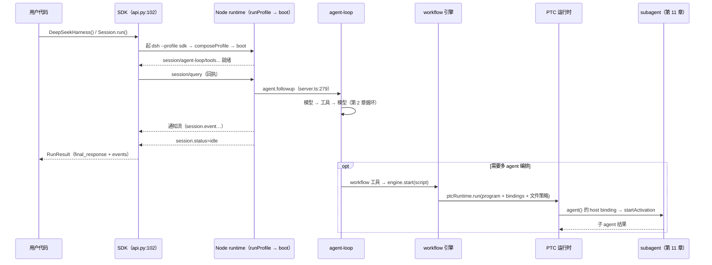

# 第 17 章 workflow / PTC 运行时 / python 端到端

> 终点不是更强的模型，而是一条可以重走的路。

## 本章回答的问题

- 第 5 章建立了 capability seam——那么，让多个 agent 协作的 workflow 引擎，为什么也只是「一个 seam」？
- 第 10 章证明了压缩是有损的——那么，Ralph 每轮都开一个全新的子 agent 图什么？
- 第 16 章给出了高层 API `DeepSeekHarness`——那么，从它构造到模型吐出第一个字，请求穿过哪些服务？

第 16 章我们走通了一次类型化 RPC 调用：从 SDK 协议到 gateway 的 `invoke`。本章在这条跨进程链路上再补两件事——一段由模型写、由宿主跑的编排脚本该挂在哪，以及这条链路之上，Python、CLI、Web 三种使用者如何共用一个启动器、一套装配。

前 16 章我们一层层搭起了这台机器：容器、循环、会话、工具、seam、执行世界、模型适配、提示词、作用域、压缩、子 agent、技能、Web/LSP、交互与 goal、preset/bundle/profile、typert RPC。本章是最后一次装配：把 workflow 引擎与它的脚本宿主放上内核，再把 Python、CLI、Web 三种使用者接到同一个启动器上，走完一条从 `import` / 命令行 / 浏览器到模型回答的端到端路径。

先用一张表把前面的章节钉在墙上。本章不再展开它们，只做回链：

| 章 | 机制 | 一句话 | 本章如何用 |
|----|------|--------|-----------|
| 1 | cordis 内核 | Context/Service/Fiber，构造即注册 | §4 四个 profile 装配的容器 |
| 2 | agent-loop | 模型→工具→模型循环 | §5 SDK 面的执行核心 |
| 3 | session 持久化 | 会话状态落盘与恢复 | §5 会话身份与 resume_session |
| 4 | tools 与执行器 | 注册表 + 执行器 seam | §2 脚本宿主是执行器的同门 |
| 5 | capability seam | 能力以 seam 注入而非硬编码 | §2 workflow 就是 seam |
| 6 | 执行世界 | 进程、文件与隔离策略 | §2 脚本在 Session 的文件策略下跑 |
| 7 | LLM 适配 | 多模型统一接入 | §5 以 FakeModel 占位模型槽 |
| 8 | system-prompt | 提示词组装 | §3 Ralph 注册自己的提示段 |
| 9 | scope | 作用域隔离 | 本章不展开（子 agent 扇出隐含依赖） |
| 10 | compaction | 上下文压缩 | §3 Ralph 每轮全新的动机 |
| 11 | subagent | 子 agent 生命周期 | §2/§3 扇出的承接者 |
| 12 | skill | 技能包加载 | 本章不展开（可由 profile 携带，见第 15 章） |
| 13 | web/lsp | Web 与语言服务 | 本章不展开 |
| 14 | interaction/goal | 交互与目标领域 | §3 Ralph 与 goal 独立 |
| 15 | preset/bundle/profile | 装配单元三层 | §4 bundle 决定插件清单 |
| 16 | typert/api/sdk | 跨进程类型化 RPC | §5 SDK 通信的底座 |

```mermaid
flowchart TB
    subgraph 场景["三个使用场景（§4/§5）"]
        PY["Python 内嵌<br/>--profile sdk"]
        CLI["CLI<br/>dsh --profile headless"]
        WEB["Web<br/>--profile web"]
    end
    subgraph 内核["同一棵 cordis 插件树（第 1 章）"]
        BOOT["runProfile → composeProfile → boot<br/>（第 15 章）"]
        SEAM["session / agent-loop /<br/>system-prompt / tools"]
        WF["workflow 引擎 seam（§2）"]
        EXEC["WorkflowExecution<br/>vm.Context + vm.Script"]
        PTC["PTC 运行时<br/>进程隔离 / 文件策略 / 取消"]
    end
    RALPH["Ralph 固定脚本<br/>opt-in 实验 bundle（§3）"] --> RWFE["Ralph 自带的 workflowEngine<br/>（isolate）"]
    RWFE --> PTC
    PY --> BOOT
    CLI --> BOOT
    WEB --> BOOT
    BOOT --> SEAM
    BOOT --> WF
    BOOT --> PTC
    SEAM --> WF
    WF --> PTC
    WF -->|agent() 钩子| SUB["subagent（第 11 章）"]
    PTC --> EXEC
```

## 1. 没有编排层，胶水代码会吃掉你

假设你要让多个 agent 协作完成一个任务，并且同一套内核要服务脚本、命令行、
网页三种用户。没有 workflow 引擎和共享装配，你只能手写：

```python
def orchestrate_manual(objective, workers):
    """没有 workflow 引擎时的「编排」：手写调用顺序 + 手写错误处理。

    对比 main.py 段 1：真实引擎把失败折叠进 result.stopReason=error，
    调用方只查结果对象；这里异常直接外抛，每个调用点都得自己包 try/except。
    """
    plan = workers["planner"](f"拆解目标: {objective}")
    code = workers["coder"](f"按 [{plan}] 实现: {objective}")
    return {"plan": plan, "code": code}
```

每个入口再各维护一份启动清单，漂移几乎是必然的：

```python
SDK_SERVICES = ["session", "agent-loop", "system-prompt", "tools",
                "workflowEngine", "ptcRuntime", "sdk-jsonrpc-server"]
HEADLESS_SERVICES = ["session", "agent-loop", "system-prompt", "tools",
                     "workflowEngine", "ptcRuntime", "headless-runner"]
# 某次迭代，有人在 web 清单里漏写了 "system-prompt" —— 漂移发生
WEB_SERVICES = ["session", "agent-loop", "tools",
                "workflowEngine", "ptcRuntime", "webStartup", "connection"]
```

实跑 `python3 ch17/code/bad_example.py`：

```text
============================================================
问题 1  手工编排多 agent
============================================================
  异常直接炸给调用方: 子任务失败（模拟）
  -> 没有 result 对象收口，没有 stopReason，没有事件轨迹，
     每个调用点都得自己包 try/except——这就是缺 workflow seam 的代价。

============================================================
问题 2  每条表面各写一份启动清单
============================================================
         sdk: OK
    headless: OK
         web: 缺失 ['system-prompt']
  -> web 清单漏了 system-prompt：每个入口各自维护清单，必然漂移
  -> 正解：一份 base bundle + 各自的 app bundle（见 main.py 段 3）
```

两个问题指向两个机制：一个统一的**编排 seam**（§2），和一份**共享的启动装配**
（§4）。中间那个「谁来跑脚本」的问题，§2 会单独回答：脚本交给 PTC 运行时执行。

## 2. workflow 引擎：四段骨架，脚本交给 PTC 运行时

workflow 引擎的定位出人意料地克制：它是一个**抽象 Service seam**，每个
context 只允许一个实现，唯一抽象方法是 `start(request): WorkflowRun`
（`packages/workflow/workflow/src/index.ts:157`、`packages/workflow/workflow/src/index.ts:168`）。它不规定脚本长什么样，
只规定契约。契约分四段，教学版把每段都压成了可以对照的代码：

**第一段，同步校验。** 请求不能开始就在这里 throw，而不是返回一个失败的结果。
真实实现先校验 meta（`validateMeta`，`packages/workflow/workflow-ptc/src/meta.ts:76`
逐字段报违规名），再把脚本体编译一遍——只编译、不执行
（`assertBodyParses`，`packages/workflow/workflow-ptc/src/index.ts:55`）：

```ts
// packages/workflow/workflow-ptc/src/index.ts 里 start() 的前两行（index.ts:135-136）
const meta = validateMeta(request.meta)
assertBodyParses(request.script, meta.name)
```

**第二段，提交。** 校验通过才铸 run id、解析 provider 路由与上限，再构造 run
（`packages/workflow/workflow-ptc/src/index.ts:139` 铸 id，`packages/workflow/workflow-ptc/src/index.ts:158` 构造 `PtcWorkflowRun`）。从 `start()` 返回 run 这一刻起，任何失败都不再是异常——它们全部收口进 `run.result`。

**第三段，事件流。** 六类 `workflow/*` 事件在 `packages/workflow/workflow/src/index.ts:94`
定义：start / phase / log / agent-start / agent-end / end。它们**只观察**——
监听器拿到的是不可变的事件负载，拿不到 live run，也无法借事件取消或改写它。
负载里除了 `id` + `meta` 的 run 身份快照，还带各自的事件数据（`agent-start` 带
`seq`/`label`，`log` 带 `message`，`end` 带 `stopReason`/`agentsStarted`）。

**第四段，结果。** `WorkflowResult`（`packages/workflow/workflow/src/types.ts:72`）的
`stopReason` 是封闭 union（`packages/workflow/workflow/src/types.ts:63`）：completed | cancelled | error。run 上的
`result` 承诺**永不 reject**（`packages/workflow/workflow/src/runtime-types.ts:40`），
`cancel()`/`dispose()` 幂等。

教学版把这四段写进 `workflow.py`：

```python
class WorkflowEngine:
    """workflow 引擎 seam，对应抽象 WorkflowEngine Service（workflow/src/index.ts:157）。"""

    def _validate(self, request):
        # 第一段：meta 逐字段校验 + 脚本可编译；违规同步 throw
        meta = validate_meta(request.get("meta"))
        script = request.get("script")
        if not callable(script):
            raise WorkflowFailure("workflow script does not parse", "SCRIPT_PARSE")
        return meta, script

    def start(self, request):
        # 第二段：提交。违规在提交前 throw；一旦返回 run，失败全走 run.result
        meta, script = self._validate(request)
        run = _WorkflowRun(self, script, meta, request.get("args") or {})
        self._emit("workflow/start", {"id": run.id, "meta": dict(meta)})
        run._drive()
        return run
```

`_WorkflowRun` 的 `_drive()` 把第三、四段合在一起，演示「永不 reject」
（`agent` / `phase` / `log` 三个 lambda 定义在它上方，`workflow.py` 里紧邻）：

```python
class _WorkflowRun:
    def _drive(self):
        """对应 WorkflowExecution.drive()（workflow-ptc/src/runtime.ts:105）：永不 reject。"""
        try:
            value = self._script(agent=agent, args=self._args, phase=phase, log=log)
            value = _materialize_result(value)   # 对应 materializeResult（runtime.ts:128）
            self.result = {"value": value, "stopReason": STOP_COMPLETED,
                           "agentsStarted": self.agents_started}
        except Exception as e:                   # 一切失败都收口为结果对象
            self.result = {"value": None, "stopReason": STOP_ERROR,
                           "error": f"{getattr(e, 'code', 'SCRIPT_ERROR')}: {e}",
                           "agentsStarted": self.agents_started}
        finally:
            # workflow/end 只带结果数据，刻意省略 value（types.ts:124）
            self._engine._emit("workflow/end", {"id": self.id,
                                                "stopReason": self.result["stopReason"],
                                                "agentsStarted": self.result["agentsStarted"]})
```

### 2.1 脚本宿主是 PTC 运行时

workflow 引擎的实现在 `packages/workflow/workflow-ptc`（旧的独立
`workflow-worker-thread` 包已从仓库删除）。名字里的 PTC 不是一个形容词——它指**程序化工具调用**
（programmatic tool calls，PTC）：模型不直接发工具调用，而是写一段程序，让宿主
代跑。第 4 章讲过它在工具侧的样子（`run_code` 工具 + `tool-executor-ptc`）；
这一节讲的是同一条运行时被 workflow 借走时的样子。

因果链是这样的，三步：

1. `PtcWorkflowEngine` 在装配时硬性要求 `ptcRuntime.language === 'typescript'`，
   否则构造函数直接拒绝（`packages/workflow/workflow-ptc/src/index.ts:118`）。
2. 提交时它把调用方 Session 的**文件策略**解析成一个快照
   （`sandboxPolicy.resolve({ session: request.parent.session })`，`packages/workflow/workflow-ptc/src/index.ts:167`）；
   如果运行时无法执行这套策略、而策略又不是 `danger-full-access`，执行前就失败
   （`packages/workflow/workflow-ptc/src/host.ts:285`）。
3. 真正的执行是一次 `ctx.ptcRuntime.run(...)` 调用
   （`packages/workflow/workflow-ptc/src/host.ts:288`），参数里带着 `program`、
   一组 `bindings`（全局名 `workflowHost`）、工作目录与 `sandboxPolicy`。

脚本本身的编译仍然用 `node:vm`（Node 内置的 `vm` 模块：在**同一进程**里开一个
隔离的 JS 上下文；它不是操作系统级沙箱），但位置变了：它在 PTC 拉起的那个 Node
进程里，由 `WorkflowExecution` 持有 `vm.Context` 与 `vm.Script`
（`packages/workflow/workflow-ptc/src/runtime.ts:62-63`），`drive()`（`packages/workflow/workflow-ptc/src/runtime.ts:105`）
用 `runInContext` 跑出结果：

```ts
// packages/workflow/workflow-ptc/src/runtime.ts 里 WorkflowExecution 的构造函数（runtime.ts:75-83）
this.compiled = new vm.Script(`(async () => {\n${body}\n})()`, {
  filename: `workflow:${meta.name}`,
  lineOffset: -1,
})
this.context = vm.createContext({}, { name: `workflow:${meta.name}` })
```

这里要划一条容易误解的线：**vm 不是安全边界**。`WorkflowExecution` 只负责脚本的
语法与取值；进程隔离、取消由 PTC provider 负责，文件策略则由 workflow 引擎解析后
作为 `sandboxPolicy` 交给 PTC 执行（`packages/workflow/workflow-ptc/src/host.ts:285-296`）——这一点上游在
`packages/workflow/workflow-ptc/src/runtime.ts:1-5` 的模块注释和
`packages/workflow/workflow-ptc/README.md:59` 的 File policy 一节里都写明了。
所以「脚本能不能读这个文件」的答案不在 vm 里，而在第 6 章那套执行世界的策略里。

PTC 运行时按 `executionMode` 有三种形态，对应三种「程序文本怎么交给引擎」：

| 形态 | 配置 | 程序格式 | 进程与状态 |
|---|---|---|---|
| fresh process | `executionMode: per-call`（默认） | `function-body`：直接交出函数体 | 每次调用起一个新 Node 进程，不保留任何状态 |
| REPL 状态持有者 | `executionMode: persistent-in-memory` | `repl`：保留上下文的交互式求值 | 按显式 `stateOwner` 保留一个受限 REPL，直到 `release(owner)` |
| 脚本求值 | `executionMode: vm-script` | `script`：按脚本求值 | 每次新进程；`scriptPersistence: true` 时按 owner 留上下文（不是 REPL） |

三种格式的差别用一句话概括：`function-body` 是「一段 async 函数体」，可以直接
`return`；`repl` 是「一行行交互式语句」，变量跨次保留；`script` 是「一份脚本」，
用最后一个表达式（若是 Promise 则先 await）作为结果。

（`packages/ptc-runtime/ptc-runtime-node/README.md:49` 有这三行的配置表；`packages/ptc-runtime/ptc-runtime-node/README.md:12` 是摘要。）

workflow-ptc 不挑形态，它按 provider 声明的 `programFormat` 现场拼三种程序文本中的
一种（`packages/workflow/workflow-ptc/src/host.ts:289-293`）：

```ts
// packages/workflow/workflow-ptc/src/host.ts 里 drive() 的 program 选择（host.ts:289-293）
program: {
  'function-body': PROGRAM,
  repl: `await (async () => {\n${PROGRAM}\n})()`,
  script: `(async () => {\n${PROGRAM}\n})()`,
}[this.runtime.programFormat],
```

三条分支的区别只在「谁是容器」：`function-body` 把 `PROGRAM` 直接当 async 函数体
交出，顶层 `await` 与 `return` 都合法（`packages/ptc-runtime/ptc-runtime-node/src/execution.ts:149-157`
的 per-call 模式就是这么定义的，也是 base bundle 的默认形态）；`repl` 与 `script`
两支则把同一段程序包进 `(async () => { ... })()`，用 IIFE 的 Promise 完成值
代替顶层 `return`——因为这两种格式本身不允许顶层 `return`
（`packages/ptc-runtime/ptc-runtime/src/types.ts:79-81`）。

还有一处特别的地方：workflow 的局部变量**不应该**落进调用方 Agent 的常驻 REPL。
上游在 `packages/workflow/workflow-ptc/README.md:59` 写明，Node 的内存态执行器会用
临时环境跑这个 async 包装，因此「workflow-local variables never join the Agent's
retained REPL」。

`ctx.ptcRuntime` 的服务定义在 `packages/ptc-runtime/ptc-runtime/src/index.ts:105`，
`resolve`（`packages/ptc-runtime/ptc-runtime/src/index.ts:159`）做参数校验和默认值，`run`（`packages/ptc-runtime/ptc-runtime/src/index.ts:166`）执行。这条服务同时供
`tool-executor-ptc`（第 4 章的程序化工具调用）和 workflow 使用——两个消费者、
一个执行宿主。这就是本章要补的「一个代码执行宿主」。

实跑 `python3 ch17/code/main.py` 段 1（完整输出见 §7）：

```text
段 1  workflow 引擎：校验 → 提交 → 事件流 → 结果
============================================================
校验失败（未提交）: META_INVALID — invalid meta: meta.name must be a non-empty string
result: {'value': {'plan': '完成(拆解目标: 实现天气...)', 'code': '完成(按 [完成(拆解目标...)'}, 'stopReason': 'completed', 'agentsStarted': 2}
事件轨迹（只观察）:
  workflow/start: {'id': 'run-1', 'meta': {'name': 'demo', 'description': '两步编排演示'}}
  workflow/phase: {'runId': 'run-1', 'title': 'plan'}
  workflow/agent-start: {'runId': 'run-1', 'seq': 1, 'label': '拆解目标: 实现天气查询'}
  workflow/agent-end: {'runId': 'run-1', 'seq': 1, 'outcome': 'completed'}
  workflow/log: {'runId': 'run-1', 'message': 'plan ready'}
  workflow/phase: {'runId': 'run-1', 'title': 'implement'}
  workflow/agent-start: {'runId': 'run-1', 'seq': 2, 'label': '按 [完成(拆解目标: '}
  workflow/agent-end: {'runId': 'run-1', 'seq': 2, 'outcome': 'completed'}
  workflow/end: {'id': 'run-1', 'stopReason': 'completed', 'agentsStarted': 2}

-- 脚本返回不可序列化的终值（set），看 result 如何收口 --
result.stopReason = error
result.error      = RESULT_UNSERIALIZABLE: the workflow's return v...
失败 run 的事件: ['workflow/start', 'workflow/agent-start', 'workflow/agent-end', 'workflow/end']
调用方没有接到异常——失败被折叠进结果对象（result 永不 reject）。
```

第一行是校验段：meta 缺 name 时 `start()` 直接抛 `WorkflowFailure`，
事件里连 `workflow/start` 都没有——这正是「提交前 throw」与「提交后收口」的分界。
后面那段轨迹里出现了 start / phase / log / agent-start / agent-end / end
六类中的六种（本例脚本同时调用了 `phase()` 与 `log()`）。失败的那次是
start → agent-start → agent-end → end：`bad_script` 先调了一次 `agent()`，
而 `RESULT_UNSERIALIZABLE` 要等脚本 return 才触发，所以两条 agent 事件一定先发出。
注意 `workflow/end` 的负载里有 `id`、`stopReason`、`agentsStarted`，但没有 `value`：
值留在持有 run 的调用方手上。

## 3. Ralph：已降级的可选 bundle

设想一个「让所有测试通过」这样的长任务，跑了二十轮还在修。单个 agent 每轮都把
上一轮的失败日志、试过的补丁、聊天的犹豫全带在上下文里：越跑越长，compaction
一到就开始丢细节，而丢掉的偏偏可能是「这条路已经试过」。任务中途重启一次，
这些上下文又得重来。

真正需要的不是把上下文压得更狠，而是**让每一轮从干净状态开始**：每轮只拿到
不变的 objective 和一份结构化的上一轮报告，其余全靠共享工作区——文件才是长期
记忆。Ralph 就是把这个模式固化下来的一段固定脚本。

Ralph 不是新引擎，而是 workflow 引擎上的一段固定前台工作流。这里的「前台」是
相对后台 job 说的：同步阻塞住这次工具调用，跑完才返回，不返回 job 句柄。它把
不可变的 objective 依次交给全新子 agent，直到完成、被阻塞或轮数耗尽。

它现在的分发形态是**opt-in 实验 bundle**（默认组合不启用、需要显式挂载才会
出现）。包位于 `packages/experimental/tool-ralph/`（插件名仍是 `tool-ralph`，
`packages/experimental/tool-ralph/src/index.ts:17`）：
`packages/workflow/workflow-ptc/README.md:28` 明说 "Ralph remains disabled in
shipped defaults"，而 `packages/bundle/base/cordis.patch.yml` 里根本没有 ralph 这一行
（那一段只有 `ptc-runtime`、`workflow-ptc`、`tool-workflow`，见 `packages/bundle/base/cordis.patch.yml:405`、`packages/bundle/base/cordis.patch.yml:408`、`packages/bundle/base/cordis.patch.yml:413`）。

要启用它，得挂 `packages/experimental/ralph-bundle`。那个 bundle 的 patch 只有
十几行，核心是一个隔离组：

```yaml
# packages/experimental/ralph-bundle/cordis.patch.yml
- insert:
    - id: optional-ralph
      name: cordis:group
      group: true
      isolate:
        workflowEngine: true          # 自带一个引擎，不与其他 workflow 工具共用
      config:
        - id: optional-ralph-workflow
          name: '@deepseek-ai/dsh-workflow-ptc'
        - id: tool-ralph
          name: '@deepseek-ai/dsh-tool-ralph'
```

`isolate: workflowEngine: true` 的意思是：Ralph 自己起一个 workflow 引擎实例，
不覆盖、也不借用默认组合里的那一个。这让「启用 Ralph」变成一个纯粹的加法——
挂上它不会改变任何已有 workflow 行为。它也被列在 `packages/experimental/README.md:48`
的 opt-in 实验 bundle 清单里。

启用之后，`apply()` 先往 system-prompt 注册一段使用政策
（`packages/experimental/tool-ralph/src/index.ts:405` 的 `ctx.systemPrompt.section`），
再注册工具（`:410`）——这段提示告诉模型「只有人类明确要求 Ralph 时才用，
普通长任务交给 goal 工具」。

机制本身没变，仍然值得看。`RALPH_SCRIPT` 是写死的脚本
（`packages/experimental/tool-ralph/src/index.ts:88`），ralph 工具的 `execute`
（`packages/experimental/tool-ralph/src/index.ts:410` 注册；执行体里 `:445` 起调 `start`）只是调
`ctx.workflowEngine.start({ script: RALPH_SCRIPT, ... })`，然后 `await run.result`
（`packages/experimental/tool-ralph/src/index.ts:459`）、`await run.dispose()`（`packages/experimental/tool-ralph/src/index.ts:471`）。模型提供的数据只有 objective 和
maxRounds 两项，脚本、provider 路由、报告 schema 都在部署侧。教学版把骨架压成：

`ralph.py` 的模块级函数 `ralph_script`（`_REPORT_SCHEMA` 与 `_validate_report`
的定义见同文件）：

```python
def ralph_script(agent, args, phase, log):
    """RALPH_SCRIPT 固定脚本骨架，对应 tool-ralph/src/index.ts:88。"""
    phase("Fresh-agent rounds")               # 脚本自己的 phase() 调用（:150）
    previous = None
    rounds_started = 0
    for round_no in range(1, args["maxRounds"] + 1):
        prior = "(none — this is the first round)" if previous is None else repr(previous)
        prompt = (f"Immutable objective:\n{args['objective']}\n\n"
                  f"Ralph round: {round_no} of {args['maxRounds']}.\n\n"
                  f"Previous structured handoff:\n{prior}")
        raw = agent(prompt, {"label": f"Ralph round {round_no}", "schema": _REPORT_SCHEMA})
        if raw is None:                      # 子 agent 失败 → 收口成第四种终值
            return {"status": "round-failed", "roundsStarted": round_no,
                    "lastReport": previous}
        report = _validate_report(raw, args["maxHandoffChars"])
        rounds_started = round_no
        # [教学简化] 真实脚本用两个独立 if；这里合并，语义等价
        if report["status"] in ("complete", "blocked"):
            return {"status": report["status"], "roundsStarted": round_no, "report": report}
        previous = report
    return {"status": "budget-limited", "roundsStarted": rounds_started, "report": previous}
```

三个设计决策值得停下来看：

1. **每轮全新子 agent**。`requireFreshProvider`（`packages/experimental/tool-ralph/src/index.ts:218`）要求 provider 支持结构化
   输出，且 `inheritsParentContext === false`。回链第 10 章可以看清代价：长任务的
   上下文会膨胀，compaction 是有损的；与其让一个 agent 拖着越来越脏的上下文跑到底，
   不如每轮开一个干净的，只把结构化的上一轮报告递过去。
2. **previous 报告是唯一跨轮交接**。`RalphRoundReport` 是封闭结构：
   `{status, summary, evidence[], nextSteps[], blocker}`。它被校验两次——脚本内
   `validateReport`（`packages/experimental/tool-ralph/src/index.ts:110`），宿主侧 `readReport`（`packages/experimental/tool-ralph/src/index.ts:245`）。工作区文件才是唯一
   跨轮长期记忆，报告只是「读工作区的索引」。
3. **Ralph 不向 agent-loop 加模式**。它与第 14 章 goal 领域独立：goal 管
   「用户想要什么」，Ralph 管「把一件事重复做到完」。

终值经 `readRunResult`（`packages/experimental/tool-ralph/src/index.ts:281`）解码为四种：complete | blocked | budget-limited |
round-failed。预算耗尽不是异常，而是脚本自己
`return { status: 'budget-limited', ... }`（`packages/experimental/tool-ralph/src/index.ts:174`）。验证脚本里第 2 组演示了这一态：

```text
段 2  Ralph（opt-in 实验 bundle）：固定脚本，每轮全新子 agent
============================================================
  包位置: packages/experimental/tool-ralph；默认组合不启用
  分发形态: packages/experimental/ralph-bundle 的 optional-ralph 组
  [第 1 轮] 全新子 agent 启动 -> status=continue（summary: 搭好骨架，测试未过）
  [第 2 轮] 全新子 agent 启动 -> status=complete（summary: 测试全过）
终值: status=complete，用了 2 轮
跨轮交接只有 previous 报告——工作区才是唯一长期记忆。
  [第 1 轮] 全新子 agent 启动 -> status=continue（summary: 第 1 轮仍在推进）
  [第 2 轮] 全新子 agent 启动 -> status=continue（summary: 第 2 轮仍在推进）
轮数耗尽: status=budget-limited，roundsStarted=2
```

[教学简化] 真实 Ralph 经 `subagentProvider` 启动全新子 agent 会话；教学版用一个
工厂函数，每次调用返回一个全新的报告，previous 报告同样只经 prompt 传递。

## 4. 一个启动器，四个 shipped profile

编排层之上是启动层。这里的关键事实是：启动入口只有一个命令。
上游 README 的原话是 "The `dsh` command is the sole supported Node application
launcher... SDK and ACP are profiles, not separate public bins"
（`apps/cli/README.md:5`）。

这里有两个容易混的词。**shipped profile** 是仓库自带的一套插件清单
（sdk / web / headless / acp）；**使用场景**是人从哪里进来。`dsh` 这一个启动器
承载全部场景，每个场景对应一个 profile：

| 使用场景 | profile | 形态 |
|---|---|---|
| Python 内嵌（`python/sdk` 用它） | `sdk` | stdio JSON-RPC 长驻服务 |
| 一次性命令行任务 | `headless` | 跑完即退 |
| 浏览器界面 | `web` | HTTP + WebSocket 服务 |
| 自动化客户端（ACP 客户端） | `acp` | ACP stdio 服务 |

所以本章说的「三条启动面」，是三种**使用者**共用一个启动器：Python 程序经 SDK
起 `sdk` profile，命令行起 `headless`，浏览器连 `web`。另有一个第五个 shipped
profile `sdk-minimal`：它不走 base，自带一棵精简树，供最小示例用；下表省略它。

链路有三段，逐段对应一个函数：

1. `apps/cli/src/bin.ts:29` 解析 argv；`profile` 模式下调 `runProfile`
   （`apps/cli/src/bin.ts:35`）。
2. `runProfile`（`apps/cli/src/profile-boot.ts:271`）装代理环境（`apps/cli/src/profile-boot.ts:276`），
   调 `composeProfile`（`apps/cli/src/profile-boot.ts:292`）算出层叠配置，最后调 `boot`（`apps/cli/src/profile-boot.ts:323`）。
   `composeProfile` 自己的定义在 `apps/cli/src/profile-boot.ts:224`，只做「装载 profile + 计算运行时解析 +
   收集 `--patch` 覆盖」——它不实例化任何插件。
3. `boot`（`packages/boot/app-boot/src/index.ts:1200`）把层叠后的 patch 挂到
   空根配置上。层序是：bundle 层 → profile 的 `cordis.patch.yml` →
   `$DSH_HOME/cordis.patch.yml` → `--patch` 覆盖（`apps/cli/README.md:41-44`）。

四个 profile 各自的 bundle 列表在
`packages/util/official-bundles/src/bundles.ts:10-26`：sdk = base + sdk-app，
web = base + web-app，headless = base + headless，acp = base + acp-app。
教学版用一个字典表达：

```python
# 对应 PROFILE_TEMPLATES（packages/util/official-bundles/src/bundles.ts:10）
PROFILE_BUNDLES = {
    "sdk": ["@deepseek-ai/dsh-base", "@deepseek-ai/dsh-sdk-app"],
    "web": ["@deepseek-ai/dsh-base", "@deepseek-ai/dsh-web-app"],
    "headless": ["@deepseek-ai/dsh-base", "@deepseek-ai/dsh-headless"],
    "acp": ["@deepseek-ai/dsh-base", "@deepseek-ai/dsh-acp-app"],
    # sdk-minimal 不走 base：[ "@deepseek-ai/dsh-sdk-minimal" ]，本例省略
}
```

```python
def compose_profile(profile: str, patches=()):
    """对应 composeProfile（apps/cli/src/profile-boot.ts:224）：算出要装什么。"""
    if profile not in PROFILE_BUNDLES:
        raise ValueError(f"unknown profile: {profile}")
    entries = []
    for bundle in PROFILE_BUNDLES[profile]:
        entries.extend(BUNDLE_SERVICES[bundle])
    entries.extend(patches)          # --patch 覆盖层最后应用
    return entries
```

这里直接复用了第 1 章的 `Context`/`Service`（`ch01/code/cordis.py`）：
Service 构造即注册，`booted_services()` 经服务表枚举。实跑段 3：

```text
段 3  三个使用场景共享同一 boot：四个 shipped profile
============================================================
       sdk: ['session', 'agent-loop', 'system-prompt', 'tools', 'workflowEngine', 'ptcRuntime', 'sdk-jsonrpc-server']
       web: ['session', 'agent-loop', 'system-prompt', 'tools', 'workflowEngine', 'ptcRuntime', 'webStartup', 'connection']
  headless: ['session', 'agent-loop', 'system-prompt', 'tools', 'workflowEngine', 'ptcRuntime', 'headless-runner']
       acp: ['session', 'agent-loop', 'system-prompt', 'tools', 'workflowEngine', 'ptcRuntime', 'acp-bridge']
公共层: @deepseek-ai/dsh-base
四个 profile 的差异只在 base 之后追加的 bundle——内核是同一棵树。
```

[教学决策] `BUNDLE_SERVICES` 里每个 bundle 只展开成几个代表性服务名，
真实 bundle 是几十行的 `cordis.patch.yml`。但「base 提供 workflowEngine 与
ptcRuntime、app bundle 只追加自己的入口」这个结构和真实实现一致：
`packages/bundle/base/cordis.patch.yml:405-414` 就是 `ptc-runtime` /
`workflow-ptc` / `tool-workflow` 连续三行。

这正是 §1 问题 2 的正解：清单只有一份，漂移无处发生。

以 SDK 为例，一次输入最终落到「创建 agent + 投递用户消息」这一对操作：
`packages/sdk/server/src/server.ts:592` 的 `ctx.agents.create` 与
`packages/sdk/server/src/server.ts:279` 的 `agent.followup`。Web 与 CLI 各有自己的
入口插件，最终也把输入交给同一层 agent 服务（本章不逐条展开它们的入口文件）。

## 5. 端到端：Python 内嵌面走一遍

选 Python 内嵌面做端到端演示，因为它最薄。它的入口是一个类，但一次 run 不是
「一个请求等一个回复」。
`DeepSeekHarness`（`python/sdk/src/deepseek_harness/api.py:102`）是最薄入口，
构造时可以传配置对象或以关键字参数启动
（`python/sdk/src/deepseek_harness/api.py:110-119`），`start()`
（`python/sdk/src/deepseek_harness/api.py:157`）懒启动 Node runtime 并 `initialize`。

真正的请求路径多了一个「回执」概念。下面是 `api.py` 里 `Session.run` 的骨架
（命令分支与 `on_notification` 透传省略，完整实现见 `python/sdk/src/deepseek_harness/api.py:214`）：

```python
class Session:                      # api.py:199
    def run(self, input, *, on_notification=None):     # :214
        # 订阅通知 → 发 session/query 拿回执 → 逐条读到 session.status=idle 才收口
        self.harness.start()
        with self.harness.client.subscribe_session_notifications(self.id) as subscription:
            response = self.harness.client._query(self.id, input)   # 发 session/query
            ...                                                     # 命令分支略
            # _RunActivity 收集这次 run 的根事件与通知，直到收到 idle
            activity = _RunActivity(self.id, "prompt", response)
            while True:
                notification = subscription.next()
                if not activity.record(notification, on_notification):
                    continue
                if (notification.method == "session.status"
                        and notification.payload.get("status") == "idle"):
                    break
        return activity.result()
```

`_query` 发的是 `session/query`（`python/sdk/src/deepseek_harness/client.py:233`），
服务端在 `packages/sdk/server/src/server.ts:505` 处理，返回两种回执之一：
prompt 的 messageId，或原生命令的 `CommandExecution`。所以「一次 run」在协议层
是「一次查询 + 一条通知流」，而不是一个请求/响应。

`HarnessClient`（`python/sdk/src/deepseek_harness/client.py:42`）用
`subprocess.Popen`（`python/sdk/src/deepseek_harness/client.py:89`）起 Node runtime，stdio 上跑换行分隔 JSON-RPC；
默认启动参数是 `--profile sdk`（`python/sdk/src/deepseek_harness/client.py:616`）。这条进程间链路的类型化底座就是第 16 章的
`invoke`，而它要启动的那个进程，正是 §4 里 `runProfile` 装配出来的树。

[教学简化] 教学版把 stdio JSON-RPC 换成同进程的 `FakeRuntime`，但保留协议形状：
`subscribe_session_notifications()` → `_query()` 拿回执 → `next()` 逐条读通知 →
`session.status=idle` 收口 → 从事件流反读 `final_response` / `finish_reason`。
`RunResult` 的五个字段（`session_id / final_response / finish_reason / events /
notifications`，`python/sdk/src/deepseek_harness/api.py:45`）原样保留：

```python
class Session:
    def run(self, user_input):
        """对应 python/sdk/src/deepseek_harness/api.py:214。"""
        self.harness.start()
        events = []
        notifications = []
        with self.harness.client.subscribe_session_notifications(self.id) as subscription:
            self.harness.client._query(self.id, user_input)   # session/query 的回执
            while True:
                notification = subscription.next()
                notifications.append(notification)
                if notification["method"] == "session.event":
                    events.append(notification["payload"]["event"])
                if (notification["method"] == "session.status"
                        and notification["payload"].get("status") == "idle"):
                    break
        return RunResult(session_id=self.id,
                         final_response=final_response(events),
                         finish_reason=finish_reason(events),
                         events=events, notifications=notifications)
```

`final_response()`（`python/sdk/src/deepseek_harness/api.py:298`）从后往前找第一条
`assistant/message`，`finish_reason()`（`python/sdk/src/deepseek_harness/api.py:318`）
从后往前找 `turn/end` 读 `reason.kind`——两者都不依赖中间状态。会话身份由调用方
显式传入；同一个 id 交给 `resume_session()`（`python/sdk/src/deepseek_harness/api.py:179`）
就能接上已持久化的历史，而不是新建一个会话。`FakeRuntime` 的
`_produce()` 是第 2 章「模型 → 工具 → 模型」循环的通知化写法：每轮产出
`session.event`，最后补一条 `session.status=idle`。实跑段 4：

```text
段 4  Python 内嵌面端到端：回执 → 事件 → idle
============================================================
最终回答: 北京今天晴，25°C。
finish_reason: completed
模型调用次数: 2（第 1 次决定调工具，第 2 次收尾）
通知流: ['session.event', 'session.event', 'session.event', 'session.event', 'session.status']
事件轨迹: ['agent/inbox/spliced', 'tool/result', 'assistant/message', 'turn/end']
```

「模型调用次数: 2」来自 `FakeModel` 的 `calls` 计数器——`generate()` 每被调用
一次就加 1。通知流五条：四条 `session.event` 包着事件（回执落收件箱、工具结果、
assistant 消息、`turn/end`），第五条 `session.status` 才是循环的出口。事件轨迹里
第一条 `agent/inbox/spliced` 是回执落到收件箱的证据——真实实现里
`_is_inbox_receipt()`（`python/sdk/src/deepseek_harness/api.py:275`）就是靠它确认
「这次输入真的进了会话」。

把四段串起来看，一次真实请求的完整路径是：



## 6. 全书收束：一条启动路径 + 一个执行循环 + 一个执行宿主 + 一条观测通道

回头看，全书的主线其实是四件事：

- **一条启动路径**：profile/bundle（第 15 章）决定 patch 层 → `composeProfile`
  算出层叠配置 → `boot` 按序装配进 cordis 容器（第 1 章）→ 四个 shipped
  profile 共享这条路径（本章）。
- **一个执行循环**：agent-loop（第 2 章）在容器里转，工具（第 4 章）、seam
  （第 5 章）、执行世界（第 6 章）、压缩（第 10 章）、subagent（第 11 章）、
  workflow/Ralph（本章）都是挂在这个循环上的机制。
- **一个代码执行宿主**：PTC 运行时（本章 §2）。模型写的程序——无论是工具调用
  还是编排脚本——都交给同一个 `ctx.ptcRuntime`，在同一个文件策略下跑。
- **一条观测通道**：系统跑起来之后，事件如何出站、由谁排队、由谁关闭。
  这是下一章的主题。

其余章节是这四件事的支撑：session/scope/compaction 管「记忆与边界」，
system-prompt/LLM 适配管「输入输出」，typert/api/sdk 管「跨进程」。

## 7. 完整运行输出

`python3 ch17/code/main.py` 的完整实跑输出（段 1 前半已在 §2 引用，此处从段 1 收尾处起）：

```text
-- 脚本返回不可序列化的终值（set），看 result 如何收口 --
result.stopReason = error
result.error      = RESULT_UNSERIALIZABLE: the workflow's return v...
失败 run 的事件: ['workflow/start', 'workflow/agent-start', 'workflow/agent-end', 'workflow/end']
调用方没有接到异常——失败被折叠进结果对象（result 永不 reject）。

============================================================
段 2  Ralph（opt-in 实验 bundle）：固定脚本，每轮全新子 agent
============================================================
  包位置: packages/experimental/tool-ralph；默认组合不启用
  分发形态: packages/experimental/ralph-bundle 的 optional-ralph 组
  [第 1 轮] 全新子 agent 启动 -> status=continue（summary: 搭好骨架，测试未过）
  [第 2 轮] 全新子 agent 启动 -> status=complete（summary: 测试全过）
终值: status=complete，用了 2 轮
跨轮交接只有 previous 报告——工作区才是唯一长期记忆。
  [第 1 轮] 全新子 agent 启动 -> status=continue（summary: 第 1 轮仍在推进）
  [第 2 轮] 全新子 agent 启动 -> status=continue（summary: 第 2 轮仍在推进）
轮数耗尽: status=budget-limited，roundsStarted=2

============================================================
段 3  三个使用场景共享同一 boot：四个 shipped profile
============================================================
       sdk: ['session', 'agent-loop', 'system-prompt', 'tools', 'workflowEngine', 'ptcRuntime', 'sdk-jsonrpc-server']
       web: ['session', 'agent-loop', 'system-prompt', 'tools', 'workflowEngine', 'ptcRuntime', 'webStartup', 'connection']
  headless: ['session', 'agent-loop', 'system-prompt', 'tools', 'workflowEngine', 'ptcRuntime', 'headless-runner']
       acp: ['session', 'agent-loop', 'system-prompt', 'tools', 'workflowEngine', 'ptcRuntime', 'acp-bridge']
公共层: @deepseek-ai/dsh-base
四个 profile 的差异只在 base 之后追加的 bundle——内核是同一棵树。

============================================================
段 4  Python 内嵌面端到端：回执 → 事件 → idle
============================================================
最终回答: 北京今天晴，25°C。
finish_reason: completed
模型调用次数: 2（第 1 次决定调工具，第 2 次收尾）
通知流: ['session.event', 'session.event', 'session.event', 'session.event', 'session.status']
事件轨迹: ['agent/inbox/spliced', 'tool/result', 'assistant/message', 'turn/end']
```

## 8. 源码对照总表

下表按机制归并本章正文的 `path:line` 引用；同一小节里重复引用的同一行只列一次。

| 机制 | 真实源码位置 | 教学版差异 |
|------|-------------|-----------|
| WorkflowEngine 抽象 seam | `packages/workflow/workflow/src/index.ts:157`、`packages/workflow/workflow/src/index.ts:168` | 教学版用 `_validate` + `start` 两段代替抽象方法声明 |
| WorkflowStartRequest / WorkflowRun | `packages/workflow/workflow/src/runtime-types.ts:19`、`packages/workflow/workflow/src/runtime-types.ts:40` | 教学版用 dict + `_WorkflowRun`，保留「result 永不 reject」 |
| WorkflowResult / stopReason 封闭 union | `packages/workflow/workflow/src/types.ts:72`、`packages/workflow/workflow/src/types.ts:63` | 教学版多保留了 `cancelled` 分支的接口但未演示 |
| WorkflowResultInfo（workflow/end 负载） | `packages/workflow/workflow/src/types.ts:124` | 教学版 end 事件只带 id/stopReason/agentsStarted |
| 六类 workflow/* 事件 | `packages/workflow/workflow/src/index.ts:94` | 教学版六类都按同一负载形状发出 |
| PTC 语言断言 | `packages/workflow/workflow-ptc/src/index.ts:118` | 教学版无此检查 |
| start() 前两行 / 铸 id / 构造 run | `packages/workflow/workflow-ptc/src/index.ts:135-136`、`packages/workflow/workflow-ptc/src/index.ts:139`、`packages/workflow/workflow-ptc/src/index.ts:158` | 教学版 `_validate` + `_WorkflowRun(...)` |
| 文件策略不可执行时失败 | `packages/workflow/workflow-ptc/src/host.ts:285` | 教学版省略 |
| programFormat 三分支 | `packages/workflow/workflow-ptc/src/host.ts:289-293` | 教学版直接执行 Python 函数 |
| vm 不是安全边界 | `packages/workflow/workflow-ptc/src/runtime.ts:1-5` | 教学版无 vm |
| workflow 局部变量不落进调用方 REPL | `packages/workflow/workflow-ptc/README.md:59` | — |
| PTC 三形态配置表 | `packages/ptc-runtime/ptc-runtime-node/README.md:49`、`packages/ptc-runtime/ptc-runtime-node/README.md:12` | 教学版不实现 |
| programFormat 语义（顶层 await/return） | `packages/ptc-runtime/ptc-runtime/src/types.ts:79-81` | — |
| sync 校验 validateMeta | `packages/workflow/workflow-ptc/src/meta.ts:76` | 教学版 `validate_meta` 只查 name/description/未知字段 |
| 脚本解析 assertBodyParses | `packages/workflow/workflow-ptc/src/index.ts:55` | 教学版用「可调用」代替 `new vm.Script` 编译检查 |
| PtcWorkflowEngine.start | `packages/workflow/workflow-ptc/src/index.ts:134` | 教学版同步执行，真实实现返回 pending Promise |
| 文件策略快照 | `packages/workflow/workflow-ptc/src/index.ts:167` | 教学版省略（无真实 sandbox） |
| PTC 执行入口 | `packages/workflow/workflow-ptc/src/host.ts:288` | 教学版直接调 `script(...)` |
| 脚本 vm.Context / vm.Script | `packages/workflow/workflow-ptc/src/runtime.ts:62`、`packages/workflow/workflow-ptc/src/runtime.ts:63`、`packages/workflow/workflow-ptc/src/runtime.ts:75` | 教学版不建 vm，直接执行 Python 函数 |
| drive() 永不 reject | `packages/workflow/workflow-ptc/src/runtime.ts:105` | 教学版 `_drive` 同样把异常折进 result |
| agent() 钩子 | `packages/workflow/workflow-ptc/src/runtime.ts:163` | 教学版 `_run_agent` 串行调用，无并发槽 |
| 实体化边界 materializeFromRealm | `packages/workflow/workflow-ptc/src/realm.ts:62` | 教学版用 `json.dumps` 近似 |
| 取消 / 释放幂等 | `packages/workflow/workflow-ptc/src/host.ts:151`、`packages/workflow/workflow-ptc/src/host.ts:162` | 教学版 `cancel`/`dispose` 只置标志 |
| PTC 运行时 seam | `packages/ptc-runtime/ptc-runtime/src/index.ts:105`、`packages/ptc-runtime/ptc-runtime/src/index.ts:159`、`packages/ptc-runtime/ptc-runtime/src/index.ts:166` | 本章只作回指，未实现 |
| base 的 workflow 三行 | `packages/bundle/base/cordis.patch.yml:405`、`packages/bundle/base/cordis.patch.yml:408`、`packages/bundle/base/cordis.patch.yml:413` | 教学版展开为 `ptcRuntime` / `workflowEngine` 两个服务名 |
| RALPH_META / RALPH_SCRIPT | `packages/experimental/tool-ralph/src/index.ts:78`、`packages/experimental/tool-ralph/src/index.ts:88` | 教学版 `RALPH_META` 与脚本骨架逐段对应 |
| Ralph 的提示段 / 包名 | `packages/experimental/tool-ralph/src/index.ts:405`、`packages/experimental/tool-ralph/src/index.ts:17` | 教学版省略 systemPrompt 注册 |
| budget-limited 终值 | `packages/experimental/tool-ralph/src/index.ts:174` | 教学版同形状 |
| ralph 工具注册 / 执行 | `packages/experimental/tool-ralph/src/index.ts:410`、`packages/experimental/tool-ralph/src/index.ts:445`、`packages/experimental/tool-ralph/src/index.ts:459`、`packages/experimental/tool-ralph/src/index.ts:471` | 教学版 `run_ralph` 保留 start→result→dispose 顺序 |
| requireFreshProvider | `packages/experimental/tool-ralph/src/index.ts:218` | 教学版省略（工厂天然全新） |
| readReport / readRunResult | `packages/experimental/tool-ralph/src/index.ts:245`、`packages/experimental/tool-ralph/src/index.ts:281` | 教学版 `read_run_result` 只校验字段集合与轮数 |
| opt-in 实验 bundle | `packages/experimental/ralph-bundle/cordis.patch.yml:2`、`packages/experimental/ralph-bundle/cordis.patch.yml:5`、`packages/experimental/ralph-bundle/cordis.patch.yml:9`、`packages/experimental/ralph-bundle/cordis.patch.yml:12` | 本章只讲结构，未运行真实 bundle |
| Ralph 默认关闭 / 列在 opt-in 实验 bundle 清单 | `packages/workflow/workflow-ptc/README.md:28`、`packages/experimental/README.md:48` | — |
| dsh 唯一启动器 / 层序 | `apps/cli/README.md:5`、`apps/cli/README.md:41-44` | — |
| argv 解析 → runProfile | `apps/cli/src/bin.ts:29`、`apps/cli/src/bin.ts:35` | 教学版无 argv |
| runProfile / composeProfile / boot | `apps/cli/src/profile-boot.ts:271`、`apps/cli/src/profile-boot.ts:224`、`apps/cli/src/profile-boot.ts:323` | 教学版把三段压成 `boot()` 一个函数 |
| 代理环境 / 调 composeProfile | `apps/cli/src/profile-boot.ts:276`、`apps/cli/src/profile-boot.ts:292` | 教学版省略 |
| app-boot 的 boot | `packages/boot/app-boot/src/index.ts:1200` | 教学版不解析 YAML |
| shipped profile 的 bundle 列表 | `packages/util/official-bundles/src/bundles.ts:10`、`packages/util/official-bundles/src/bundles.ts:10-26` | 教学版用 `PROFILE_BUNDLES` 字典，省略 sdk-minimal |
| DeepSeekHarness / Session.run | `python/sdk/src/deepseek_harness/api.py:102`、`python/sdk/src/deepseek_harness/api.py:214` | 教学版用同进程 `FakeRuntime` 复刻回执/通知/idle |
| 构造二选一 / start / resume_session | `python/sdk/src/deepseek_harness/api.py:110-119`、`python/sdk/src/deepseek_harness/api.py:157`、`python/sdk/src/deepseek_harness/api.py:179` | 教学版同签名 |
| 事件反读 final_response / finish_reason | `python/sdk/src/deepseek_harness/api.py:298`、`python/sdk/src/deepseek_harness/api.py:318` | 教学版同名函数 |
| 回执识别 | `python/sdk/src/deepseek_harness/api.py:275` | 教学版靠 `_produce()` 直接产出 |
| RunResult 五字段 | `python/sdk/src/deepseek_harness/api.py:45` | 教学版保留全部五个字段名 |
| HarnessClient / session/query | `python/sdk/src/deepseek_harness/client.py:42`、`python/sdk/src/deepseek_harness/client.py:233` | 教学版用 `FakeRuntime._query` 代替 stdio JSON-RPC |
| Popen / 默认 profile | `python/sdk/src/deepseek_harness/client.py:89`、`python/sdk/src/deepseek_harness/client.py:616` | 教学版同进程 |
| 服务端 session/query | `packages/sdk/server/src/server.ts:505` | 教学版不实现服务端 |
| 收敛点 agents.create / followup | `packages/sdk/server/src/server.ts:592`、`packages/sdk/server/src/server.ts:279` | 教学版省略，只讲收敛事实 |

## 9. 小结

- workflow 引擎是一个 seam：`start()` 先同步校验（meta + 脚本可编译），
  提交后返回 run 句柄，result 永不 reject，stopReason 封闭 union，事件只观察。
- 脚本的宿主是 PTC 运行时：同一段程序在调用方的 Session 文件策略下、
  由 `WorkflowExecution` 用 `vm.Context` 编译执行；进程隔离与取消归 PTC，不归 vm。
- Ralph 是引擎上的固定脚本，位于 `packages/experimental`，只能通过
  `ralph-bundle` 这个 opt-in 实验 bundle 显式挂载。
- 三个使用场景收敛成一个 `dsh` 命令 + 四个 shipped profile，每个 profile 只是
  `base` 加一两个 app bundle；`composeProfile` 只算清单，`boot` 才实例化。
- Python SDK 的一次 run 是「查询回执 + 通知流」，直到看到 idle 才收口成 `RunResult`。
- 全书收束为四件事：一条启动路径、一个执行循环、一个执行宿主、一条观测通道。

## 10. 附录：关键概念速查表

| 概念 | 教学代码 | 真实源码 | 关键契约 |
|------|---------|---------|---------|
| workflow seam | `workflow.py` `WorkflowEngine` | `packages/workflow/workflow/src/index.ts:157` | 每 context 一个实现 |
| 同步校验 | `WorkflowEngine._validate` | `packages/workflow/workflow-ptc/src/index.ts:55`、`packages/workflow/workflow-ptc/src/meta.ts:76` | 违规提交前 throw |
| run 句柄 | `_WorkflowRun` | `packages/workflow/workflow/src/runtime-types.ts:40` | result 永不 reject |
| stopReason | `STOP_*` 常量 | `packages/workflow/workflow/src/types.ts:72` | completed/cancelled/error |
| 事件流 | `WorkflowEngine._emit` | `packages/workflow/workflow/src/index.ts:94` | 六类，只观察 |
| 事件负载不带值 | `workflow/end` 带 id/stopReason/agentsStarted | `packages/workflow/workflow/src/types.ts:124` | WorkflowResultInfo = result − value |
| 脚本宿主 | 同进程调用 | `packages/workflow/workflow-ptc/src/runtime.ts:56` | WorkflowExecution（vm.Context + vm.Script） |
| 程序格式 | — | `packages/workflow/workflow-ptc/src/host.ts:289-293` | function-body / repl / script |
| 通知流与 idle | `FakeRuntime._produce` | `python/sdk/src/deepseek_harness/api.py:265-270` | session.status=idle 才收口 |
| PTC 运行时 | — | `packages/ptc-runtime/ptc-runtime/src/index.ts:105` | resolve → run |
| 文件策略 | — | `packages/workflow/workflow-ptc/src/index.ts:167` | 调用方 Session 的策略 |
| 实体化边界 | `_materialize_result` | `packages/workflow/workflow-ptc/src/realm.ts:62` | 终值必须纯 JSON |
| Ralph 脚本 | `ralph.py` `ralph_script` | `packages/experimental/tool-ralph/src/index.ts:88` | 固定，模型不可改写 |
| 轮报告 | `_validate_report` | `packages/experimental/tool-ralph/src/index.ts:110`、`packages/experimental/tool-ralph/src/index.ts:245` | 双检，三态 + 约束 |
| 四态终值 | `read_run_result` | `packages/experimental/tool-ralph/src/index.ts:281` | complete/blocked/budget-limited/round-failed |
| 全新子 agent | 工厂每次新建 | `packages/experimental/tool-ralph/src/index.ts:218` | inheritsParentContext=false |
| opt-in 实验 bundle | — | `packages/experimental/ralph-bundle/cordis.patch.yml:5` | 默认不启用；isolate workflowEngine |
| 启动链路 | `boot.py` `boot()` | `apps/cli/src/profile-boot.ts:271`、`apps/cli/src/profile-boot.ts:224` | profile → 层叠 → boot |
| profile 差异 | `PROFILE_BUNDLES` | `packages/util/official-bundles/src/bundles.ts:10` | 共享 base，各自 app bundle |
| SDK 入口 | `sdk.py` `DeepSeekHarness` | `python/sdk/src/deepseek_harness/api.py:102`、`python/sdk/src/deepseek_harness/api.py:214` | 查询回执 + 通知流 |

---

*本章教学代码位于 `ch17/code/`（workflow.py、ralph.py、boot.py、sdk.py、
main.py、bad_example.py），可直接运行 `python3 ch17/code/main.py` 与
`python3 ch17/code/bad_example.py`。*

下一章讲观测：系统跑起来之后，事件怎么出站。第 17 章把树装起来、把循环转起来，
但「谁在看、看的东西去了哪」还没有答案——一个空 mount 的遥测服务、两条各自
排队的通道、三份关停所有权，是第 18 章要回答的问题。
