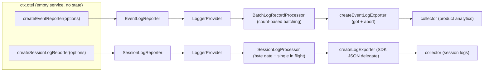
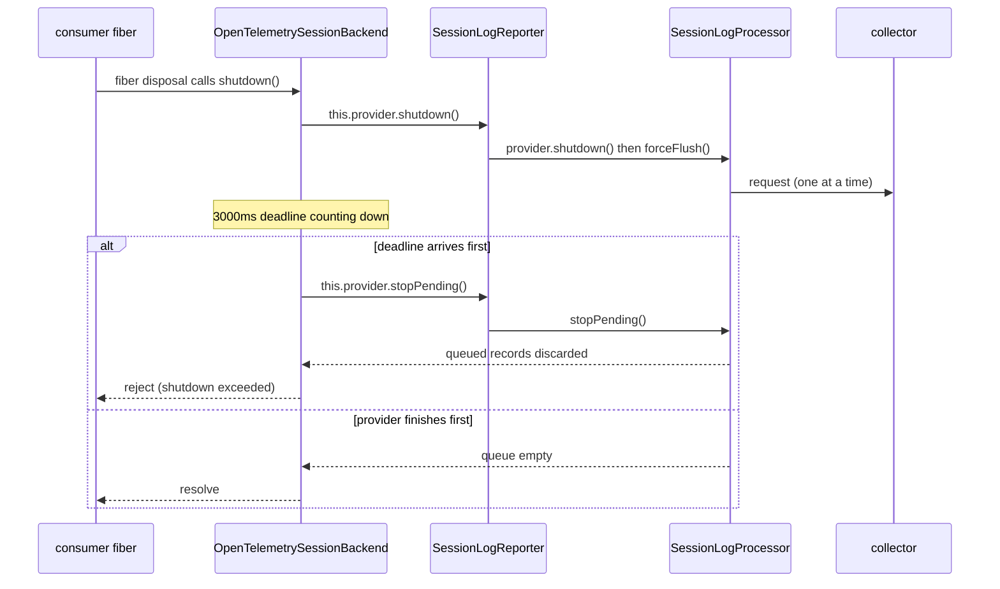

# Chapter 18: The Telemetry Channel — One Empty Service, Two Queues, Three Ownerships

> One empty service, two queues, three ownerships.

## Questions This Chapter Answers

- What does the telemetry service actually create when it is mounted? Why is the answer "nothing at all"?
- Why must ordinary product events and session logs travel on two separate channels, and where do their queueing rules diverge?
- Who decides whether a session event may leave the process — and what is left after redaction?
- The channel belongs to its consumer, so who drains it at shutdown, and who drops the queue after the deadline?

## 0. Carrying Forward

Chapter 17 completed the integration of the book's main line: one profile startup path, one execution loop, one code-execution host. The system genuinely runs. This chapter adds an observation side-path on top of that running system — an **outbound** telemetry channel. It changes none of the agent's capabilities; it only answers "how do the events produced while the system runs leave the process".

The first half of this side-path lives in Chapter 3. Chapter 2's `Session.append` publishes every event onto the `Context` event bus, and Chapter 3 went on to describe how the capture side turns events into telemetry records on the **inbound** side: the default `FEEDBACK_ONLY` (only events the user explicitly gave feedback on are authorized for upload), redaction through a waterfall (a chain of wrappers that can rewrite or withhold a record), and a `sourceEvent` (a reference to the source event; deleting it withholds the record). That section ended with one sentence: "see Chapter 18".

This chapter picks up that sentence and covers three things the capture side does not do: who holds the queue, at what granularity events are batched, and who drains the queue at shutdown. This is the cross-cutting close-out — the main line was tied off in the previous chapter, and this chapter takes the side-path "after the system runs, how each event leaves" to the end, closing on the book's terminology table and three seam lineages.

Code relationships: this chapter creates five files under `ch18/code/`, reusing `Context` and `Service` from `ch01/code/cordis.py`. The event model re-creates Chapter 3's `SessionEvent` with `dict` and **does not import Chapter 3's code** — outbound telemetry and persistence are two orthogonal lines, and dragging the persistence dependency in would only make the example heavier.

## 1. One Global Provider, Four Pits

Start with the counterexample. `ch18/code/bad_example.py` has a module-level singleton: one `GlobalLoggerProvider`, one `queue.Queue(maxsize=8)`, and a single `emit` shared by every consumer.

```python
# ch18/code/bad_example.py lines 21-58 (contiguous excerpt)
class GlobalLoggerProvider:
    """全局单例：一条队列、一个按条攒批的 exporter。"""

    def __init__(self, endpoint: str):
        self.endpoint = endpoint
        self.queue: queue.Queue = queue.Queue(maxsize=8)
        self.dropped = 0
        self.exported = 0
        self.discarded = 0
        self.owner = None

    def emit(self, kind: str, payload: dict) -> bool:
        try:
            self.queue.put_nowait({"kind": kind, "payload": payload})
            return True
        except queue.Full:
            # 坑 1：队列满时静默丢新记录，谁丢的不记名
            self.dropped += 1
            return False

    def drain(self, batch_size: int = 4) -> int:
        sent = 0
        while not self.queue.empty():
            batch = [self.queue.get_nowait() for _ in range(min(batch_size, self.queue.qsize()))]
            self.exported += len(batch)
            sent += len(batch)
        return sent

    def shutdown(self) -> None:
        # 坑 3：关停只把引用置空，排队中的记录被整批丢掉，且没有回执
        self.discarded = self.queue.qsize()
        while not self.queue.empty():
            self.queue.get_nowait()
        self.owner = None
```

Running it (`python3 bad_example.py`; the program prints in Chinese, reproduced as-is):

```text
[坑 1] 一条共享队列（maxsize=8）：session 大事件挤掉产品分析事件
    6 条 session-log 先占位；产品事件只挤进 2/10，其余 dropped=8
    两条通道共用一套按条攒批：谁先来谁占坑，体量差异在这里不起任何作用
[坑 2] 没人负责 drain：单例建在模块级，卸载时不归任何 fiber
    exported=0，队列里压着 8 条
    没有 owner 就没有 effect 清理：容器 dispose() 不会碰这个队列，
    也没有任何代码承诺「什么时候排空」
[坑 3] 关闭时丢数据：shutdown 只是把队列丢掉
    shutdown 前排队 8 条；shutdown 丢弃 8 条，exported 仍是 0
    合计丢失 dropped=8 + discarded=8，调用方既拿不到回执，也不知道丢的是哪一条
[坑 4] 没有授权闸：共享 provider 把整段会话历史直接发走（含 secret）
    没有任何 feedback：uploaded=4，其中含 secret 字段 2 条
    exported=4——「捕获侧不授权」被共享 provider 直接绕过
```

Each pit deserves a name.

**Pit 1: one queue for two orders of magnitude.** A single session event can be tens of kilobytes to megabytes; a product analytics event is a few dozen bytes. They share a `maxsize=8` queue, so whoever arrives first fills the slots and later arrivals are dropped. Count-based batching is worthless here — the size difference never even enters the decision.

**Pit 2: no owner means no drain.** The singleton sits at module level and belongs to no fiber. Container `dispose()` only tears down fibers in reverse order and runs effect cleanup functions (`ch01/code/cordis.py:152`'s `plugin` and `:138`'s `effect`); module-level objects are not in that set. So "when does the queue get flushed" has no answer.

**Pit 3: shutdown loses data, silently.** `shutdown()` throws the whole queue away and leaves behind an internal counter. The caller gets no acknowledgement, and no log says which record was lost.

**Pit 4: the authorization gate is not on this layer at all.** The provider above only asks "does the caller want to send", never "should this be sent". Any code holding its reference can ship the entire session history — including credentials and internal paths inside tool results — in one go. The capture side's default `FEEDBACK_ONLY` decision is bypassed entirely. A real system has to place three checks in the **consumer** (§5); the shared-provider layer has nowhere to put them.

That yields the four things this chapter must solve:

- **Problem 1: the two channels must be physically isolated.** Queue, exporter, and scope may not be shared (§2, §3).
- **Problem 2: two sizes need two queueing rules.** Count-based batching fits small events; large events must be packed by bytes and must not be truncated (§3).
- **Problem 3: the channel must not decide who may leave.** Authorization and the identity check live in the consumer; redaction belongs to the capture side, see Chapter 3 §7.2 (§5).
- **Problem 4: who closes the channel.** Whoever creates it closes it, with a deadline, dropping the queue on expiry (§6).

## 2. ctx.otel: Mounting Builds Nothing

Start with a definition of this chapter's central noun. An **OTel channel (reporter)** is the outbound event channel a consumer receives from a factory: it carries its own exporter, its own instrumentation scope (the name and version that say "who produced these records"), and its own queue, sharing no state with any other channel.

The entire public surface of `packages/telemetry/otel` is three things. First the service's own comment and class declaration:

```ts
// the class declaration at packages/telemetry/otel/src/index.ts:12-14
/** Shared transport provider. Mounting creates no queue, identity, or network connection. */
export default class OTel extends Service {
  constructor(ctx: Context) { super(ctx, 'otel') }
```

The `Service` constructor does exactly one thing: register the instance in the context's service table under the name `otel` (Chapter 1's `Service` registers on construction, `ch01/code/cordis.py:240-245`). No exporter, no `LoggerProvider`, no queue, no identity. The README says the same thing again: "Mounting alone creates no transport or identity and sends nothing" (`packages/telemetry/otel/README.md:12`).

The other two things are factory methods:

```ts
// packages/telemetry/otel/src/index.ts:22 and :30
  createEventReporter(options: EventLogOptions): EventLogReporter { return new EventLogReporter(options) }
  createSessionLogReporter(options: SessionLogOptions): SessionLogReporter { return new SessionLogReporter(options) }
```

Both methods are one line: `new` a channel object and hand it to the caller. Endpoint, request headers, instrumentation scope, resource attributes, queue limits, and the failure callback all come from `options` — supplied explicitly by the consumer. The service provides no deployment defaults at all. The README's phrasing: "the service has no deployment defaults or automatic collection policy of its own" (`packages/telemetry/otel/README.md:26`).

This is easy to place in the seam's three roles (Chapter 5's method): **service definition** is the abstract contract face of a capability, **service implementation** is the layer that actually does the work, and **consumer** is the party calling against the contract. `ctx.otel` is the service definition; the OTel SDK and HTTP are the service implementation, hidden inside the channel; the two adapters are consumers.

But this definition face differs from Chapter 5's. An **empty-definition seam** is a service definition that declares no abstract members and carries no configuration or defaults. It may have a few concrete methods (two factories here), but those methods do not require a provider to implement anything. All semantics — endpoint, identity, queue, authorization — live on the consumer side.

The code confirms it: neither factory is `abstract`, each body is a single `new`, and the `OTel` class has no instance fields. The definition layer only answers "someone provides this name, and provides two ways to open a channel"; it never answers "what happens inside a channel". This is a distant relative of Chapter 13's single-slot exclusive registry (the whole deployment allows exactly one provider to occupy the slot), and the thinnest of the book's three seam lineages.

One class of channel parameters deserves a separate mention: **request headers and TLS identity**. The service will not add an `x-channel` header for you, and will not inherit an ambient `authorization` header or client certificate. The comment on `createLogExporter` reads "without inheriting another collector's headers or TLS identity" (`packages/telemetry/otel/src/transport.ts:22`), and the README repeats it (`packages/telemetry/otel/README.md:32`). This is the same argument as pit 1 in §1: shared credentials are a hidden global queue — the two channels cross wires, and when something breaks you cannot tell whose request it was.

Why make a service this empty? Because "telemetry" is not one capability; it is **one transport face shared by many unrelated capabilities**. Product analytics wants small, frequent batches every 30 seconds; session upload wants whole events, infrequently, possibly several megabytes each. If the service made any decision for the consumer (default endpoint, default queue, default identity), the two channels would fall right back into the shared queue of §1. Empty, so that every parameter of every channel sits in front of the consumer.

[Teaching simplification] The real `OTel` class has no instance fields. The teaching `otel.py` adds three counters — `queues_created`, `connections_created`, `channels_created` — only so the demo can print "zero after mount" as evidence; the real package relies on its README and tests for this (`packages/telemetry/otel/README.md:41` mentions composition tests covering independent channels and service removal). `connections_created` counts "the channel received an egress handle", not a real network connection — the real version only opens a connection when a request is actually sent.

`ch18/code/otel.py` is the minimal re-creation of this section:

```python
# ch18/code/otel.py lines 147-175 (contiguous excerpt)
class OTel(Service):
    """共享传输服务：mount 只注册服务名 `otel`，不建队列、身份或连接。"""

    def __init__(self, ctx):
        super().__init__(ctx, "otel")
        # 三个计数器是可观测证据：mount 之后全为 0，创建通道时才增长。
        # connections_created 计的是「通道拿到了一个出口」，不是真实网络连接
        self.queues_created = 0
        self.connections_created = 0
        self.channels_created = 0

    def create_event_reporter(self, options) -> EventLogReporter:
        """开一条独享队列的普通事件通道；端点/scope/队列参数全由调用方传入。"""
        self.channels_created += 1
        self.queues_created += 1
        if options.get("exporter", {}).get("sink") is not None:
            self.connections_created += 1  # 教学版把「拿到一个 Sink」视为一次出口登记
        return EventLogReporter(options)

    def create_session_log_reporter(self, options) -> SessionLogReporter:
        """开一条独享队列的 session 日志通道；授权在调用方。"""
        self.channels_created += 1
        self.queues_created += 1
        if options.get("exporter", {}).get("sink") is not None:
            self.connections_created += 1
        return SessionLogReporter(options)
```

Problem 1 is only half solved here: the service no longer shares state, but what the two factories produce and how they queue is still untold.

## 3. Two Channels, Two Queueing Philosophies

First the overview. In Figure 1, `ctx.otel` has one channel on each side. Inside each channel, in order: a `LoggerProvider` (the OTel SDK's log provider object, holding a resource and a processor), a processor (the queueing and batching strategy — the one on the right is the byte gate, defined in §3.2), and an exporter (which turns a batch of records into one HTTP request). The arrows end at a collector: the remote service that receives OTLP requests (**OTLP** is the log transport protocol defined by OpenTelemetry, and the collector is the receiving end). Each channel has its own endpoint, and nothing is shared between them. The left side uses the SDK's native count-based batching; the right side lets only one request onto the wire at a time — the constraint called in-flight single (defined in §3.2).



Figure 1: one service, two channels. `EventLogReporter` and `SessionLogReporter` each own a `LoggerProvider`, a processor, and an exporter, so a record from one direction never appears in the other channel's request; the two arrow ends are separate collector endpoints chosen by each consumer's `options`.

### 3.1 Ordinary events: count-based batching

The ordinary-event channel is built in `packages/telemetry/otel/src/event-log.ts:47-66`. It creates an SDK `LoggerProvider` whose processor is the SDK's own `BatchLogRecordProcessor`:

```ts
// the constructor of class EventLogReporter (event-log.ts:40), event-log.ts:50-54 (excerpt: processor construction)
    this.provider = new LoggerProvider({
      resource: resourceFromAttributes(options.resourceAttributes),
      processors: [new BatchLogRecordProcessor({
        ...options.processor,
        exporter: {
```

First, what `BatchLogRecordProcessor` is. It is a batching middle layer shipped with the OTel SDK: records enter an in-memory queue, and once `maxExportBatchSize` records accumulate a batch goes out; if the batch never fills, `scheduledDelayMillis` sends whatever is left on a timer. When the queue reaches `maxQueueSize`, new records are dropped.

What without it? Only two hard choices remain: send one HTTP request per record synchronously (product events are frequent and small — the request count explodes), or have the consumer write its own batching, timer, and drop policy. Neither is something a business team wants to reimplement, so the ordinary channel reuses the SDK directly.

The product analytics consumer's defaults are 512 records per batch, a 2048-record queue, and a 30-second timer (`packages/host/product-telemetry-otel/README.md:47-48`). All of these numbers live in the consumer's `Config`, not in `ctx.otel`.

`processor` is a required field of `EventLogOptions` (`packages/telemetry/otel/src/event-log.ts:35`) with no default. That is deliberate: only the party writing the consumer knows what request size its collector will accept. The README lists this among its known limitations as the user's responsibility — "Ordinary-event channels batch by count; their consumers must select event and batch sizes suitable for the collector" (`packages/telemetry/otel/README.md:67`).

One more detail of the ordinary channel: the exporter is not the SDK's default OTLP exporter but `createEventLogExporter` (`packages/telemetry/otel/src/event-transport.ts:16`). It sends HTTP itself via `got`, merges `signal` with the timeout through `AbortSignal.any` (`packages/telemetry/otel/src/event-transport.ts:32`), retries at most 5 times and only for 429/502/503/504 (`:34`), and cancels the request once the response body exceeds 4×1024×1024 bytes (`:38`). The reason for sending it itself: **cancellation must cut both the in-flight request and the retry wait** — this is the premise of §5's last paragraph and of §6.

### 3.2 Session logs: by bytes, and one event is indivisible

The **byte gate** is the queueing strategy of the session-log channel: measure each record's serialized byte length first, then pack requests by bytes; a single record above the request ceiling is rejected outright. Together with "single in flight" (at most one request on the wire at any moment) it makes up the session channel's entire queueing rule.

The session channel swaps in a different processor. The reason is one sentence: **a complete event cannot be split**. Count-based batching would stuff a 3MB event and 511 small ones into the same request, blowing past the collector's ceiling and failing the whole batch together. Packing by bytes lets the large event stand alone in its own request while the small ones share.

`SessionLogProcessor`'s enqueue path (`packages/telemetry/otel/src/session-log.ts:87-115`) makes four checks:

1. If the queue already holds `maxQueueSize` records (default 2048), reject; do not queue.
2. Serialize this one record alone with `JsonLogsSerializer.serializeRequest([record])` and measure its UTF-8 byte length. A serialization failure also rejects.
3. If the byte count exceeds the ceiling (`SESSION_LOG_MAX_REQUEST_BYTES`, 4,000,000, `packages/telemetry/otel/src/session-log.ts:12`), **reject outright, never truncate**. The diagnostic reads "content was not truncated" (`:102-105`).
4. After enqueueing, if a request is already in flight, just queue (`:108`); otherwise hit the count or byte threshold and start one `forceFlush()`.

These limits are validated once at construction rather than blowing up at runtime: `resolveSessionLogLimits` requires `maxRequestBytes` to be an integer between 1 and 4,000,000, the queue and batch parameters to be positive integers, and `maxExportBatchSize` not to exceed `maxQueueSize` (`packages/telemetry/otel/src/session-log.ts:54-69`). Failing a bad configuration at load time beats losing a batch at three in the morning.

Check 3 is where this processor most differs from generic batching. Truncating an event leaves a record that looks complete but has missing fields; downstream can neither replay it nor raise an error about it. Rejecting at least leaves a traceable failure diagnostic.

The drain path (`packages/telemetry/otel/src/session-log.ts:126-145`) combines two invariants:

- **Pack by the bytes already measured.** Walk from the head, accumulating until `maxExportBatchSize` records or until one more record would exceed `limit`. The request's byte ceiling is therefore guaranteed at construction time; nothing is recomputed before sending.
- **Serial, single in flight.** After each request `await`s to completion, it also `await this.exporter.forceFlush()` (`:142`), waiting for the SDK's concurrent export queue to clear before sending the next. Exactly one request is on the wire at a time.

The `exportTimeoutMillis` watchdog only warns; it never frees the slot (`:147-158`). This limitation is written in the session consumer's README (not the OTel service package): "`exportTimeoutMillis` warns per request but never frees an unsettled transport slot" (`packages/session/session-telemetry-otel/README.md:78`). Not freeing is deliberate: a slow request holds the slot, so later events queue; releasing the next one on timeout would put two requests on the wire and destroy the single-in-flight premise.

[Teaching simplification] The real processor is asynchronous: `onEmit` only enqueues, and either `setTimeout` or a threshold triggers `forceFlush()`, which returns a Promise. The teaching `ByteGateProcessor` starts a background drain thread right inside `on_emit` (the analogue of the real `void this.forceFlush()`), and `force_flush` waits for that drain with a `Condition` (`ch18/code/channels.py:218-260`). The invariant is the same: one request in flight, and no new records accepted after shutdown.

[Teaching simplification] The real byte count is the serialized length of the OTLP JSON request, including the resource/scope envelope. The teaching version approximates it with the length of `json.dumps(...).encode("utf-8")` (`ch18/code/channels.py:37-43`); the order of magnitude and the decision boundary match, though the exact byte count differs slightly.

A word on the exporter difference. The session channel uses `createLogExporter`, which walks the SDK's JSON delegate (an adapter that hands records to the SDK's own OTLP JSON serializer and lets it assemble the request body, `packages/telemetry/otel/src/transport.ts:26`), but its construction explicitly excludes `selfObsMeterProvider` (`:16`), so the channel's own observability metrics are never recorded. The ordinary channel is the same: its exporter construction passes no meter provider. Neither channel observes itself — the trade-off of "telemetry does not observe telemetry", so a failing channel does not produce a second failing telemetry stream.

Problem 2 is now solved: large events no longer squeeze small ones, and an over-limit single record has an explicit rejection path. But both channels answer only "how to queue", not "what may enter". The byte gate can measure 12KB but cannot tell whether those 12KB were user-authorized; count-based batching can count records but cannot tell whether a record is feedback. Queueing is solved; authorization is still open.

## 4. The Second Consumer: product-telemetry-otel

With only one consumer we could not prove the phrase "global face". The **global face** means one service shared by two host-level consumers that do not know each other — not "another consumer added inside one plugin". `packages/host/product-telemetry-otel` supplies the second:

```ts
// packages/host/product-telemetry-otel/src/index.ts:61-63 and :85-91 (excerpt)
export default class ProductTelemetry extends Service {
  static inject = ['otel']
  static Config = Config
  private readonly reporter: EventLogReporter

  constructor(ctx: Context, config: Config) {
    ...
    const reporter = ctx.otel.createEventReporter({
      exporter: {
        url: config.endpoint, headers: { 'x-channel': config.channel }, timeoutMillis: config.timeoutMillis,
```

Its `inject = ['otel']` depends only on the service, on nothing belonging to the session channel. It decides its own endpoint (default `https://dsh-otel-collector.deepseeksvc.com/v1/logs`), its routing header `x-channel`, the resource's `service.name` / `service.version`, its batch and timeout. Its `Config` even spells out "the SDK drops new records when full" (`packages/host/product-telemetry-otel/src/index.ts:31`).

Putting the two consumers side by side is what reveals the service's position:

| | Session-log consumer | Product analytics consumer |
|---|---|---|
| Injection | `['sessions', 'otel']` | `['otel']` |
| Factory used | `createSessionLogReporter` | `createEventReporter` |
| Queueing unit | bytes (4,000,000 per record ceiling) | records (512 per batch by default) |
| Authorization | its own `isFeedback` + identity check (defined in §5.2) | its own `emit` call site |
| Identity | application identity + anonymous user id | application identity, no account or device |
| Shutdown | outer deadline 3000ms + `stopPending()` (defined in §6) | outer deadline 21000ms + abort signal |

[Teaching simplification] The table's 3000ms / 21000ms are the real defaults; the teaching `build_consumers` configures 300ms for the session channel and 5s for the product channel so the demo runs quickly, and §7's output is explained against those two values.

The two channels' independence is not a promise, and there are three places in the code that verify it: each reporter constructs its own `new LoggerProvider` (`packages/telemetry/otel/src/session-log.ts:198`, `packages/telemetry/otel/src/event-log.ts:50`); each holds its own processor instance; each exporter's URL and headers come from its own `options`. So when one channel stalls, the other's queueing and flushing are wholly unaffected: §7's segment 7 emits 5 more product events while the session channel is stuck, and the product channel still emits them in batches.

`ProductTelemetry`'s `inject` contains only `otel`, and that declaration is the source-code proof of the global face: the two channels are not an internal implementation detail of some session plugin but **the transport layer shared by two mutually unaware host-level consumers**. Even the service's dependence on session stops at the type level: `packages/telemetry/otel/package.json:43` lists `@deepseek-ai/dsh-session` under `peerDependencies`, and its only use is the `import type` at `session-log.ts:2`. At runtime it does not know sessions, only records.

The product consumer's shutdown is written in `ctx.effect` (`packages/host/product-telemetry-otel/src/index.ts:99-110`):

```ts
// packages/host/product-telemetry-otel/src/index.ts:99-110
    ctx.effect(() => async () => {
      const cancellation = new AbortController()
      const timer = setTimeout(() => {
        ctx.logger.warn('Product telemetry shutdown deadline exceeded; pending events may be lost')
        cancellation.abort(new Error('Product telemetry shutdown deadline exceeded'))
      }, config.shutdownTimeoutMillis)
      try {
        await reporter.shutdown(cancellation.signal)
      } finally {
        clearTimeout(timer)
      }
    })
```

This is the preview of §6: the channel's shutdown function hangs on the **consumer's own** effect. When the host unloads the plugin the cleanup runs; when the deadline fires, the abort signal reaches `EventLogReporter.shutdown(signal)` and cancels in-flight requests and retry waits.

Problem 1 is now fully solved: the two channels share no queue, exporter, scope, or credential, and one slowing down leaves the other running. But two of §1's four pits remain. Pit 2 asks "who drains" — dsh's answer is the consumer's own fiber, though how the session channel is shut down in production has to wait for §6. Pit 3 asks "what is lost at shutdown" — before that we need to know what should never have entered the queue, which is §5's subject. Pit 4 (no authorization gate) is exactly §5's main line.

## 5. Authorization and Outbound Refusal on the Consumer Side

Go back to pit 4 from §1: a shared provider ships the whole session history together with credentials. Fixing it does not require changing the channel — the channel only transports, and there is no room to put an authorization gate in it. What decides "may this leave" is the **consumer** (`OpenTelemetrySessionBackend`). Redaction is not here; it belongs to the capture side and was covered in Chapter 3 §7.2. This chapter covers only the authorization decision and the outlet through which an authorized record may still be withheld.

Here is how the scenario looks in a real system: the user never clicked "send feedback", yet some plugin obtained a reference to the reporter; with no checks in place it can send the whole history. The three checks below are the entire set of guards against that.

### 5.1 Only two modes remain

The enum keeps only two values:

```ts
// packages/session/session-telemetry-otel/src/index.ts:31-37
export enum SessionTelemetryMode {
  FEEDBACK_ONLY = 'FEEDBACK_ONLY',
  DISABLED = 'DISABLED',
}

/** Default session-sharing policy for schema and direct construction. */
export const DEFAULT_TELEMETRY_MODE = SessionTelemetryMode.FEEDBACK_ONLY
```

The previous version also had `FULL`. HEAD (the upstream repository's current commit) removed it, and the README states "`FULL` is rejected, not an alias" (`packages/session/session-telemetry-otel/README.md:39`). The default also moved from `DISABLED` to `FEEDBACK_ONLY`. The meaning of that choice: **without an explicit user feedback, no session history leaves the process**. The `DISABLED` mode builds no coordinator, provider, processor, or exporter at all, and only warns locally when feedback arrives (`packages/session/session-telemetry-otel/src/index.ts:156-163`).

There is also a `sharing` field whose value is `feedback-only` or `disabled` (`packages/session/session-telemetry-otel/src/index.ts:71-78`, `:150`). It says what this instance's policy is, not that a batch was delivered. The README is explicit: "The `sharing` property reports `feedback-only` or `disabled`, not a delivery receipt" (`packages/session/session-telemetry-otel/README.md:39`). Confusing policy with receipt is the most common misreading in telemetry systems.

### 5.2 Three checks

An event must pass all three gates to leave.

**Gate 1: it must be a feedback event belonging to this session.** `isFeedback` recognizes exactly three event types (`packages/session/session-telemetry-otel/src/index.ts:43-51`). `feedback/record` passes directly; `feedback/message-put` / `feedback/message-delete` additionally require `event.data.sessionId === session.id`, so a feedback pointing at another session cannot authorize by mistake. [Teaching simplification] The teaching version stores these two events' session ownership as a top-level `event["session_id"]` (`ch18/code/backends.py:82-94`); the real version keeps it in `event.data`. Also, `event.seq < session.inheritedEventCount` is rejected outright — a prefix inherited through a fork belongs to the parent session, and the child needs its own fresh feedback.

**Gate 2: it must be the very event on the canonical log.** This gate is called the **identity check**: the criterion is the object itself, not the seq number.

```ts
// the listener registered in the constructor of class OpenTelemetrySessionBackend (index.ts:144), index.ts:223-232
    ctx.on('session/event', (session, event) => {
      if (!isFeedback(session, event)) return
      // Only the canonical appended event authorizes this exact prefix.
      // oxlint-disable-next-line typescript/no-deprecated -- Existing Session history read; migration deferred.
      if (session.eventAt(event.seq) !== event) {
        ctx.logger.warn(NON_CANONICAL_EVENT_WARNING)
        return
      }
      coordinator.captureSession(session, event.seq)
    })
```

`eventAt(seq)` returns the object at that position in the session's committed log, and the comparison is `!==`. A replayed copy, or an object copied onto the event bus, may match on seq but differs in reference, and authorizes nothing. Why so strict? Because authorization means "this feedback authorizes all history before it"; a forged feedback object that could trigger it would send the whole prefix.

**Gate 3: a source event survives redaction.** What `sourceEvent` is and how redaction rules delete it was covered in Chapter 3 §7.2; here we only look at the result once it reaches the consumer's sink:

```ts
// the enqueue inside the constructor of class OpenTelemetrySessionBackend (index.ts:144), index.ts:203-213
    const enqueue: SessionTelemetrySink['emit'] = (record) => {
      if (record.sourceEvent === undefined) {
        ctx.logger.warn('Session log record withheld: redaction removed sourceEvent')
        return
      }
      reporter.reportSessionLog({
        sessionId: record.sourceEvent.sessionId,
        event: { ...record.sourceEvent.envelope, data: record.body },
        severityNumber: SEVERITY[record.severity],
        attributes: record.attributes,
      })
    }
```

A record without `sourceEvent` is withheld. This is the only hand-off between the capture side and the outbound side: a redaction rule erases `sourceEvent` on the capture side, and the consumer stops here on seeing undefined — the rule itself never needs to know how to "refuse upload".

### 5.3 One feedback authorizes a whole prefix

Once all three gates pass, `coordinator.captureSession(session, event.seq)` does not "send this one feedback"; it replays the canonical log from the **handoff cursor** (per session, the highest seq already handed to a backend) up to this seq (`packages/session/session-telemetry/src/coordinator.ts:151`). The cursor lives in a module-level `WeakMap<Session, SessionSeqCursor>` (`packages/session/session-telemetry/src/coordinator.ts:58`; `SessionSeqCursor = SessionSeq | -1`, see `packages/core/session/src/types.ts:63`), keyed by the session object itself.

[Teaching simplification] The real cursor is a module-level `WeakMap` that resumes by session object across plugin reloads; the teaching `SessionLogBackend._cursor` is an instance attribute valid only within the current backend instance — a new backend instance replays from the start.

This explains a line from the README: feedback "release the unhanded prefix through that canonical feedback event; later records wait" (`packages/session/session-telemetry-otel/README.md:36`). When the user submits feedback, what they authorize is **the whole history up to that feedback**, not an isolated rating. Events produced after the feedback do not tag along automatically; the next prefix is released only by the next feedback. §7 segment 5's `enqueued=3` rather than 1 is the direct consequence of this replay rule.

This is the division of labour between Chapter 3 §7.2 and this chapter: **capture and redaction belong to Chapter 3; authorization and outbound belong to this chapter**. In ch03, `sourceEvent` is the integrity marker for "can this still point back to its source after redaction"; here it becomes the only hand-off condition the sink can see.

In §7 segment 5's output, the first record is `assistant/message`, the second-to-last is also an ordinary message, and only the last is the feedback itself — all of them leave in the same replay. This is not "only feedback events are uploaded" but "feedback authorized the whole prefix before it". Do not read the criterion as the former.

### 5.4 The channel does not cover for the consumer

One easy misunderstanding: `OpenTelemetrySessionBackend` overrides `emit`, but it is an empty function (`packages/session/session-telemetry-otel/src/index.ts:246-251`). Calling `ctx.sessionTelemetry.emit(record)` directly does nothing. The README is clear: "Direct `ctx.sessionTelemetry.emit()` calls are no-ops in every mode and cannot bypass feedback authorization" (`packages/session/session-telemetry-otel/README.md:66`).

What can trigger outbound is not a direct `emit` but two paths, both gated on canonical feedback:

1. **Live path**: the `session/event` listener above, replaying the prefix when feedback appears on the bus.
2. **Cold-snapshot path**: `ctx.on('feedback/committed', ...)` (`packages/session/session-telemetry-otel/src/index.ts:233-243`) restores the committed snapshot into a detached session via `Session.fromRestore`, runs `isFeedback` once more, and calls `captureSession` the same way when it passes. This path serves the case "feedback was committed to disk but never crossed the live bus".

Both paths share one private sink and the same set of three checks.

[Teaching simplification] The real `OpenTelemetrySessionBackend`'s `emit` is an empty implementation, and outbound only goes through the private sink; the teaching `SessionLogBackend` exposes `deliver` as a public method so the main program can demonstrate "withhold when sourceEvent is missing" on its own without faking the whole event bus.

The ordinary channel's cancellation chain closes here too. `EventLogReporter.shutdown(signal)` attaches the signal to an internal `AbortController` (`packages/telemetry/otel/src/event-log.ts:83-93`); on abort, `signal.throwIfAborted()` in `createEventLogExporter` (`packages/telemetry/otel/src/event-transport.ts:21`, `:25`) ends both the in-flight request and `got`'s retry waits. §1's pit 3 splits into two layers along this chain: **the deadline decides when to give up**, and **abort decides to stop the retry timers as well**.

## 6. Shutdown Ownership

Whoever creates the channel closes it. The README makes this a hard rule: "The returned channel belongs to the consumer … Register shutdown with the consumer's Cordis fiber and bound the complete drain with its configured deadline" (`packages/telemetry/otel/README.md:28`). It adds a harsher line: "Do not retain a channel after its consumer unloads."

Ownership has one implicit constraint too. `static inject = ['otel']` makes "replacing the service unloads dependent consumers" the container's default (`packages/telemetry/otel/README.md:28`). So a composition must mount `otel` first and the consumers that inject it afterwards; the reverse order leaves consumers stuck in PENDING (Chapter 1's fiber dependency check, `ch01/code/cordis.py:202-210`), and the service never appears on its own. A channel dies with its consumer, so the README requires consumers not to retain a channel after they unload.

The session consumer's implementation is the most complete. At construction it stores the return value of `ctx.otel.createSessionLogReporter(...)` (type `SessionLogReporter`) in `this.provider`, and at shutdown it wraps the provider's shutdown in an outer deadline:

```ts
// the shutdown method of class OpenTelemetrySessionBackend (index.ts:144), index.ts:259-275
  async shutdown(): Promise<void> {
    if (this.provider === undefined) return
    const providerShutdown = this.provider.shutdown()
    let timer: ReturnType<typeof setTimeout> | undefined
    const deadline = new Promise<never>((_resolve, reject) => {
      timer = setTimeout(() => {
        this.provider?.stopPending()
        reject(new Error(`session-telemetry-otel: provider shutdown exceeded ${this.shutdownTimeoutMillis}ms`))
      }, this.shutdownTimeoutMillis)
    })
    try {
      await Promise.race([providerShutdown, deadline])
    } finally {
      /* v8 ignore else -- the Promise executor assigns timer synchronously before this race starts. */
      if (timer !== undefined) clearTimeout(timer)
    }
  }
```

`shutdown()` is not called casually by the main flow: the capture side's coordinator triggers it from its own effect. `SessionTelemetryCoordinator` installs an async cleanup function that first appends one shutdown record per still-adopted session, then `await this.backend.shutdown()`, warning rather than throwing on failure (`packages/session/session-telemetry/src/coordinator.ts:126-137`). The whole chain is therefore: the container unloads the adapter → the coordinator's effect cleanup → `backend.shutdown()` → reporter → processor → collector. **The channel belongs to the consumer, and the container triggers the consumer's unload** — only here does §1's pit 2 close.

[Teaching simplification] The real effect lives on the coordinator (append the shutdown records, then call the backend); the teaching `SessionLogBackend` calls `ctx.effect(self._disposal)` itself, skipping the coordinator layer.

The default deadline is 3000ms (`packages/session/session-telemetry-otel/src/index.ts:125`). For the demo, the session channel is set to 300ms and segment 8 lowers it to 120ms (see §7); a real deployment would not change either default. `Promise.race`'s two branches map to two fates:

- Provider finishes first: the queue drains and the call returns normally.
- Deadline arrives first: `stopPending()` empties the queue (`packages/telemetry/otel/src/session-log.ts:169-175`) and then rejects. Requests already sent may still settle naturally, but queued records will start no new requests.

The "on timeout, in-flight requests survive" semantics is in the README's failure section: "expiry discards the remaining queue and prevents further sends, while an active request may still settle" (`packages/session/session-telemetry-otel/README.md:78`). Teaching code segment 8 counts the two kinds separately: 3 queued records are dropped, and 2 in-flight records arrive at the end.

Figure 2 draws only the session ownership chain; the product channel has the same shape (with abort instead of `stopPending`). The three deadlines are independent: the session channel's overall shutdown deadline (default 3000ms), the product analytics channel's overall shutdown deadline (default 21000ms), and the ordinary channel exporter's per-HTTP-request-plus-retries `timeoutMillis` (default 15000ms).



Figure 2: the shutdown ownership chain. The consumer triggers, the backend keeps time, the processor performs "drain or drop", and the collector sees only requests already sent.

### 6.1 Known limitations, stated honestly

The Known Limitations in `packages/telemetry/otel/README.md:63-67` pull no punches:

- **Best-effort, memory-only.** The queue lives in process memory, with no durable outbox (a pending queue persisted to disk). Kill the process and the queued records are gone.
- **Queue overflow, oversized events, transport failure, and process exit all lose records.** There is no acknowledgement from the warehouse side (the collector and storage), so "enqueued" does not mean "stored".
- **The ordinary channel batches by count.** Consumers must pick record and batch sizes themselves; the collector's ceiling is not something this channel can guess for them.

None of these three is an implementation defect; they are design boundaries. Telemetry must not drag down the main flow: no disk writes, no blocking, no retrying until the end of time. The price is exactly what is left of §1's four pits — data loss can still happen, except that **now it has a name, a counter, and a deadline**.

The product analytics channel's default budget is looser and worth copying: a 30-second batch, a 15-second request timeout, a 20-second processor batch deadline, and a 21-second shutdown deadline (`packages/host/product-telemetry-otel/README.md:55`). The README does its own arithmetic: a queue full at 2048 records needs four 512-record batches and may not drain before 21 seconds; an unreachable collector can delay disposal for the full 21 seconds. Its advice is that "interactive compositions needing a shorter exit should override these budgets", plus a reminder that neither configuration guarantees delivery. Each ownership priced separately is the normal shape of this design, not an oversight.

## 7. Complete Run Output

Only §1 showed output before this point — the counterexample. The mechanism sections carried no run results. Now all eight demo segments in one run; readers can read the results against the segment numbers, then go back to the matching sections to check the mechanism.

Run command: `cd ch18/code && python3 main.py`. The program prints in Chinese; the output below is the actual run result, unedited and reproduced as-is:

```text
$ python3 main.py
[1] mount: ctx.otel 就绪，队列=0 连接=0
    ctx.otel = OTel；queues=0 connections=0
[2] 两条通道: session-log(queue=1) / product-events(queue=1)
    session-log(inject=['sessions', 'otel']) 自持队列 1 条；product-events(inject=['otel']) 自持队列 1 条
    ctx.otel.channels_created=2 queues_created=2 connections_created=2（两条通道互不共享）
[3] product-events 20 条 → 批次 [8, 8, 4]
    批次 [8, 8, 4]；collector 收到 20 条
[4] session-log 一条 5,242,880B 事件 → rejected（> 4,000,000B，不截断）
    [warn] Session log record rejected; content was not truncated: Session log record exceeds maxRequestBytes: 5242917 > 4000000
    量得 5,242,917B -> accepted=False；rejected=1；collector 收到 0 条
[5] session-log 一条 12,400B 事件 → 1 条 record（content 为整条 canonical 事件的 JSON 串）
    enqueued=3（feedback 授权后重放整段前缀，每条事件一条 record）
    第一条 record：eventName='session-log'；event.type='assistant/message'；整条请求 12,535B，content 是 12,397B 的 canonical 事件 JSON
    末条 record 的 seq=2；collector 收到 3 条
[6] 未授权 feedback=False → skipped；sourceEvent 缺失 → refused
    skipped_unauthorized +1（累计 3）；collector 仍收到 3 条
    [warn] Session log record withheld: redaction removed sourceEvent
    deliver(脱敏删掉 sourceEvent) -> False；refused_no_source=1
[7] 慢通道不拖快通道：session-log 卡在请求里，product-events 照常发出
    慢通道卡在单次请求里：block_hits=1，deadline 300ms 内未排空
    阻塞期间产品通道 20 -> 25（+5 条），flush 正常
    session-log status=deadline-exceeded；释放后 collector 收到 2 条（队列里已经没有剩余）
[8] 关停 deadline：stop_pending() 丢弃排队的 3 条，在途请求仍可自然结束
    status=deadline-exceeded dropped=3；在途的 2 条最终送达（collector 收到 2 条）
```

Reading the output segment by segment.

1. **Segment 1 (mount)**: `ctx.otel` resolves, and all three counters are 0 — matching §2's "mount builds no connection, queue, or identity". `OTel`'s constructor only writes one name into the service table.
2. **Segment 2 (two channels)**: the two consumers inject differently (`['sessions','otel']` versus `['otel']`), each opens one channel, giving `channels_created=2`, `queues_created=2`, `connections_created=2`. The two channels' `sink` and queue objects differ — this is §3's physical isolation.
3. **Segment 3 (count-based batching)**: 20 product events with `max_export_batch_size=8` go out as 8 + 8 + 4, three batches. Matches §3.1; the SDK's `BatchLogRecordProcessor` behaves exactly this way.
4. **Segment 4 (reject over-limit)**: a 5,242,880B payload serializes to 5,242,917B, above 4,000,000. The processor prints one warning, increments its counter, and the collector receives nothing. Note there is no "truncated and sent" line — this is §3.2's third check.
5. **Segment 5 (one event, one record)**: the heading refers to the first event (about 12,400B); after feedback triggers the prefix replay this segment produces 3 records in total. The session holds a 12,400B message, a short message, and a feedback in order, and the 3 events each become one record (`enqueued=3`); the first has `event.type` `assistant/message`, `seq=0`, and `content` is the whole canonical event as JSON. This matches §5's first two gates, §5.3's prefix replay, and §3.2's "one event is indivisible".
6. **Segment 6 (authorization)**: append one more ordinary message; `isFeedback` returns False, `skipped_unauthorized` increments, and the collector's record count is unchanged. Then build a record with `sourceEvent` deleted; `deliver` returns False and `refused_no_source=1`. This matches §5.2's first and third gates.
7. **Segment 7 (no cross-blocking)**: the session channel's sink is held by a `threading.Event`, so one request occupies the single-in-flight slot; during that same window the program emits 5 more events to the product channel and calls `force_flush`, and the product channel's count rises from 20 to 25. The session backend's deadline (set to 300ms for this segment) then fires, with status `deadline-exceeded`. This matches §3.2's isolation and §6's deadline.
8. **Segment 8 (drop queued, keep in-flight)**: make one drain stick inside a request, push 3 more records onto the queue, then shut down. On deadline expiry `dropped=3`; release the slow sink and the 2 in-flight records arrive naturally. This matches §6's "expiry discards the remaining queue … while an active request may still settle".

Exercises:

1. Change segment 3's `max_export_batch_size` to 5 and watch the batch count become 4; change it to 25 and 20 records go out in one batch, triggered only by the final `force_flush`.
2. Raise segment 4's `max_request_bytes` to 6,000,000: the teaching version will accept the event because it only checks "positive"; the real `resolveSessionLogLimits` rejects values above 4,000,000 at configuration load time (README: "may only be lowered", `packages/session/session-telemetry-otel/README.md:64`).
3. Set segment 7's `shutdown_timeout_millis` to 2,000, then add `block_gate.set()` before `slow_backend.shutdown()`: the slow sink no longer stalls, the drain completes, and the status becomes `flushed`. Contrast with the original output: the deadline is not there to "guarantee everything is sent" but to "guarantee a return within bounded time".
4. In segment 8, move `drop_gate.set()` above `drop_backend.shutdown()`: the drain is no longer occupied (likewise, moving segment 7's `block_gate.set()` earlier also turns the status into `flushed`), `force_flush` drains the queue, `dropped=0`, status `flushed` — showing that "drop" only happens when the drain is genuinely stuck on one request.

Each module also ships its own self-test, runnable on its own: `python3 ch18/code/otel.py` (all three counters 0 after mount, each factory opens one channel), `python3 ch18/code/channels.py` (7 records as 3 per batch, an over-limit single record rejected, `max_in_flight=1`, `stop_pending` clears 3 records), `python3 ch18/code/backends.py` (the three `isFeedback` cases, fork-prefix rejection, object identity, withholding when `sourceEvent` is missing).

## 8. Source Mapping

> The TypeScript excerpts in this chapter cover only the key branches; every line number can be found in the corresponding HEAD file. Teaching simplifications are scattered across the [Teaching simplification] markers (§2, §3.2, §4, §5.2, §5.3, §5.4, §6) and the last column of the table below, which lists them one by one. Teaching code lives in `ch18/code/` (`otel.py`, `channels.py`, `backends.py`, `main.py`, `bad_example.py`); run `python3 ch18/code/main.py` and `python3 ch18/code/bad_example.py` directly.

| Mechanism | Corresponding source location | Summary of teaching-version differences |
|---|---|---|
| Empty service mount | `packages/telemetry/otel/src/index.ts:13` | The real class has no instance fields; the teaching version adds three counters as evidence |
| Two factories | `packages/telemetry/otel/src/index.ts:22`, `packages/telemetry/otel/src/index.ts:30` | Same signature and semantics; TS typed options → Python dict |
| Ordinary channel count batching | `packages/telemetry/otel/src/event-log.ts:50-66` | The real version uses the SDK's `BatchLogRecordProcessor`; the teaching `CountBatcher` reproduces batch size and queue limits |
| Ordinary channel cancellable export | `packages/telemetry/otel/src/event-transport.ts:16`, `:32-34` | The real version uses `got` + `AbortSignal.any` + bounded retries, with abort cutting both the in-flight request and retry waits; the teaching `Sink` returns synchronously and keeps only the abort-refuses-export branch |
| Session byte ceiling | `packages/telemetry/otel/src/session-log.ts:12` | Both 4,000,000 uncompressed bytes; the teaching version approximates with `json.dumps` length |
| Reject a single over-limit record | `packages/telemetry/otel/src/session-log.ts:102-105` | Same semantics, no truncation; the teaching version copies the warning text verbatim |
| Serial single in flight | `packages/telemetry/otel/src/session-log.ts:126-145` | The real version does `await exporter.forceFlush()` after each request; the teaching version keeps the order and represents in-flight with a `Condition` |
| Reject when the queue is full | `packages/telemetry/otel/src/session-log.ts:87-92` | Both reject new records; the teaching version uses the same `max_queue_size` default of 2048 |
| Discard the queued backlog | `packages/telemetry/otel/src/session-log.ts:169-175` | Both empty the queue; the teaching version explains that stopPending takes no lock, matching the event-loop semantics |
| Session default mode | `packages/session/session-telemetry-otel/src/index.ts:31-37` | The real enum has only `FEEDBACK_ONLY`/`DISABLED`; the teaching version uses the same-named constants |
| Feedback criterion | `packages/session/session-telemetry-otel/src/index.ts:43-51` | The teaching version implements all three: type, session ownership, fork-prefix rejection |
| Identity check | `packages/session/session-telemetry-otel/src/index.ts:227` | The real check is `session.eventAt(seq) !== event`; the teaching version indexes the list and compares with `is` |
| Withhold when sourceEvent is missing | `packages/session/session-telemetry-otel/src/index.ts:204-207` | Same semantics; the teaching version builds the record with `source=False` |
| Shutdown deadline | `packages/session/session-telemetry-otel/src/index.ts:259-275` | The real version uses `Promise.race`; the teaching version uses a background thread + `join(deadline)` |
| Product consumer | `packages/host/product-telemetry-otel/src/index.ts:61-110` | The real `Config` has 11 fields (`packages/host/product-telemetry-otel/src/index.ts:18-41`); the teaching version keeps only batch parameters and the deadline, with fixed resource/scope values |
| Consumer-owned disposal | `packages/host/product-telemetry-otel/src/index.ts:99-110` | The real `ctx.effect` supports async cleanup; the teaching effect collects only synchronous functions, so shutdown starts its own thread |
| Cold-snapshot feedback path | `packages/session/session-telemetry-otel/src/index.ts:233-243` | The real version restores the committed snapshot with `Session.fromRestore` into a detached Session before checking authorization; the teaching version implements only the live path |
| Cross-reload cursor | `packages/session/session-telemetry/src/coordinator.ts:58` | The real one is a module-level `WeakMap<Session, SessionSeqCursor>`; the teaching version uses an instance `_cursor` |
| Session ownership of feedback events | `packages/session/session-telemetry-otel/src/index.ts:48` | The real version reads `event.data.sessionId`; the teaching version reads a top-level `event["session_id"]` |
| Teaching deadline override | `packages/session/session-telemetry-otel/src/index.ts:125` | The real default is 3000ms; the teaching demo uses 300ms / 120ms, and 5000ms for the product channel |

## 9. Summary

Starting from four pits of a single global provider, this chapter split outbound telemetry into three layers, plus one shutdown ownership that runs through all three.

**The service layer is empty.** `ctx.otel` builds no queue, no connection, and no identity when mounted (`packages/telemetry/otel/src/index.ts:12`). The two factories do one thing: turn the parameters the consumer supplies explicitly into a private channel. Empty, so as not to decide for the consumer; the moment the service had a default endpoint or identity, the two channels would be sharing again.

**The channel layer has two queueing rules.** Ordinary events batch by count and leave when full; session logs pack by bytes, reject an over-limit single record outright, never truncate, and keep exactly one request in flight. The difference comes from event size: a complete event is indivisible, and truncation is worse than rejection.

**The authorization layer sits with the consumer.** The default is `FEEDBACK_ONLY`, so only a freshly submitted feedback in this session authorizes a replay; an authorized event must sit at the same position on the canonical log (object identity, not equal seq); a record whose `sourceEvent` redaction removed is withheld. The channel does not cover for the consumer: calling `emit` directly is a no-op.

**Shutdown has three ownerships.** Each consumer closes its own channel in its own fiber disposal; the session backend has a 3000ms outer deadline and drops the queue via `stopPending()` on expiry; the product analytics backend has a 21000ms deadline, and abort cuts in-flight requests and retry waits. Data loss is still possible, but it has a name, a counter, and a cutoff time.

This chapter has no next chapter to preview — it is the last chapter of the book. The close-out lands on the "three seam lineages" rather than on "the next chapter" because Chapter 17 already completed the main-line integration; this chapter is the cross-cutting wrap-up. If the reader wants to go further, the exit is the book-wide terminology table (the terminology naming table at the end of `ch00/outline_zh.md`): put each chapter's recurrent nouns into one of the three positions "definition / implementation / consumption", and then look back at this chapter's two channels to see more clearly which names belong to the service (`ctx.otel`), which to a channel (reporter), and which to a consumer (backend).

Looking back at Chapter 3: that chapter was about **capture** — how events get recorded, how they get redacted, and why a record must keep `sourceEvent`. This chapter is about **outbound** — how the same record leaves the process through two different queues. One chapter covers "what is seen", the other "where it is sent".

Looking back at Chapter 5: the capability seam's three roles appear in full once more here, in the form "the implementation layer is transport". The definition is `ctx.otel`, the implementation is the OTel SDK plus HTTP transport, and the consumers are two adapters that do not know each other. Unlike shell, the definition face here has no abstract methods — `OTel` merely exists, plus two concrete factories.

Using the names already fixed by ch05 and ch04, the book's seams fall into three classes:

- **Method-call style**: the definition layer declares abstract methods, and consumers call them directly in a fixed order. Chapter 5's `ShellExecutor` (`resolve/run/start`) is the prototype; Chapter 4's `ToolExecutor` is also this class — it has `describe` and `execute`, and the consumer calls them directly. Chapter 17's `ctx.ptcRuntime` belongs here too (`resolve`/`run` are abstract methods); it additionally exposes two read-only descriptor fields, `language`/`isolation`, which serve diagnostics and selection only and do not change its classification (`packages/ptc-runtime/ptc-runtime/src/index.ts:105`).
- **Event-waterfall style**: the definition layer is a pipeline of event names (`tools/pre-execute → tools/execute → tools/post-execute`), with the order decided by the listener chain rather than hard-coded in a method signature. Chapter 4's guard pipeline is this class.
- **Empty-definition style**: the definition layer declares no abstract members and carries no configuration or defaults; it may have concrete factories or registration methods, but requires nothing of a provider, and all semantics live with the consumer. Chapter 13's single-slot registry and this chapter's `ctx.otel` are both this class.

To classify a seam, look only at how much the definition layer promises: methods, an event chain, or mere existence.

The book closes here. From the three seam lineages one can walk back through the chapters and put every noun back into the shape it belongs to. Read Chapter 17's startup path again and you will see that every consumer closes, in its own effect, what it opened.

## 10. Appendix: Key Concepts Cheat Sheet

> Ordered by the layers "service → queueing → authorization → shutdown", matching the four-way grouping in §9.

| Concept | One-line explanation | Defined/expanded in |
|---|---|---|
| **OTel channel (reporter)** | The outbound event channel a consumer gets from a factory, with its own exporter / queue / scope | §2 |
| **Empty-definition seam** | The definition layer declares no abstract members and carries no configuration or defaults; it may have concrete factory methods but requires nothing of a provider | §2 |
| **Count-based batching** | The ordinary-event queueing policy: send a batch once enough records accumulate; drop new records when full | §3.1 |
| **Byte gate** | The session-log queueing policy: pack by bytes, reject a single over-limit record outright, single in flight | §3.2 |
| **Single in flight** | At most one transport request on the wire; the next starts only after the previous request and its `forceFlush` complete | §3.2 |
| **Global face** | The fact that two mutually unaware host-level consumers share one `ctx.otel` | §4 |
| **FEEDBACK_ONLY** | The telemetry default mode: only events the user explicitly gave feedback on are authorized for upload | §5.1 |
| **sourceEvent** | The reference to the source event inside a telemetry record; deleting it withholds the record | §5.2 |
| **Identity check** | An authorized event must be the very same object at the same canonical-log position (`!==` comparison) | §5.2 |
| **Channel ownership (shutdown signal)** | Whoever creates the channel closes it: in the consumer's own disposal, with a deadline, dropping the queue on expiry | §6 |
| **stopPending** | On deadline expiry, empties queued records and prevents new requests; in-flight requests may still settle | §6 |
| **Best-effort / memory-only** | The queue lives only in process memory, with no durable outbox, and is lost when the process exits | §6.1 |
