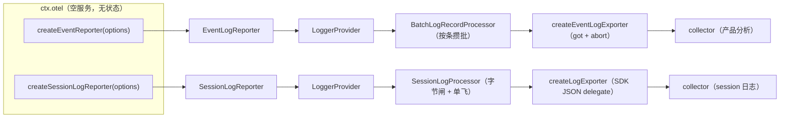
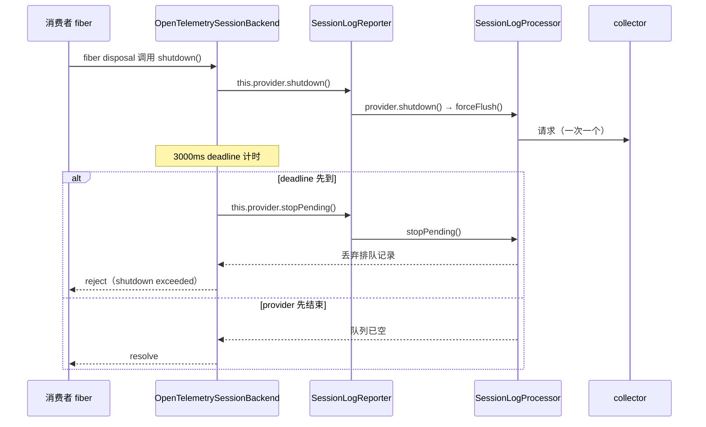

# 第 18 章 遥测通道：一个空服务，两条队列，三份所有权

> 一个空服务，两条队列，三份所有权。

## 本章回答的问题

- 遥测服务在被挂载时到底创建了什么？为什么答案是"什么都没有"？
- 普通产品事件与 session 日志为什么必须走两条通道？两条通道的排队规则差在哪？
- 谁决定一条 session 事件能不能出站？脱敏之后还剩下什么？
- 通道归消费者所有，那么关停时谁负责排空、谁负责在 deadline 之后丢弃？

## 0. 承接

第 17 章我们完成了全书主线的整合：一条 profile 启动路径、一个执行循环、一个代码执行宿主，系统真正跑起来了。本章在这套跑起来的系统之上新增一条观测旁路——**出向**遥测通道：它不改变 agent 的任何能力，只回答"运行中产生的事件各自怎么离开进程"。

这条旁路的前半段在第 3 章。第 2 章的 `Session.append` 把每条事件发到 `Context` 事件总线，第 3 章接着讲了捕获侧怎么在**入向**把事件变成遥测记录：默认 `FEEDBACK_ONLY`（只有用户显式反馈过的事件才授权回传）、脱敏走一条 waterfall（逐层包裹、可改写也可拦截记录的拦截链）、记录里留着 `sourceEvent`（指向源事件的引用，被脱敏删掉即拒发）。那一节结尾只留了一句"见第 18 章"。

本章接住这句话，讲三件捕获侧没有做的事：谁持有队列、按什么粒度攒批、关停时谁负责把队列排空。这是横切面收束——主线在上一章已经合拢，本章把"系统跑起来之后，事件各自出站"这条旁路讲透，结尾收束到全书术语表与三条 seam 谱系。

代码关系：本章新建 `ch18/code/` 五个文件，复用 `ch01/code/cordis.py` 的 `Context` 与 `Service`。事件模型用 `dict` 复刻第 3 章的 `SessionEvent`，**不 import 第 3 章代码**——遥测出站与持久化是两条正交的线，把持久化依赖带进来只会让例子变重。

## 1. 一个全局 provider，四个坑

先看反面示例。`ch18/code/bad_example.py` 里有一个模块级单例：一个 `GlobalLoggerProvider`，一条 `queue.Queue(maxsize=8)`，所有消费者共用一个 `emit`。

```python
# ch18/code/bad_example.py 第 21-58 行（连续摘录）
class GlobalLoggerProvider:
    """全局单例：一条队列、一个按条攒批的 exporter。"""

    def __init__(self, endpoint: str):
        self.endpoint = endpoint
        self.queue: queue.Queue = queue.Queue(maxsize=8)
        self.dropped = 0
        self.exported = 0
        self.discarded = 0
        self.owner = None

    def emit(self, kind: str, payload: dict) -> bool:
        try:
            self.queue.put_nowait({"kind": kind, "payload": payload})
            return True
        except queue.Full:
            # 坑 1：队列满时静默丢新记录，谁丢的不记名
            self.dropped += 1
            return False

    def drain(self, batch_size: int = 4) -> int:
        sent = 0
        while not self.queue.empty():
            batch = [self.queue.get_nowait() for _ in range(min(batch_size, self.queue.qsize()))]
            self.exported += len(batch)
            sent += len(batch)
        return sent

    def shutdown(self) -> None:
        # 坑 3：关停只把引用置空，排队中的记录被整批丢掉，且没有回执
        self.discarded = self.queue.qsize()
        while not self.queue.empty():
            self.queue.get_nowait()
        self.owner = None
```

跑出来是这样（`python3 bad_example.py`）：

```text
[坑 1] 一条共享队列（maxsize=8）：session 大事件挤掉产品分析事件
    6 条 session-log 先占位；产品事件只挤进 2/10，其余 dropped=8
    两条通道共用一套按条攒批：谁先来谁占坑，体量差异在这里不起任何作用
[坑 2] 没人负责 drain：单例建在模块级，卸载时不归任何 fiber
    exported=0，队列里压着 8 条
    没有 owner 就没有 effect 清理：容器 dispose() 不会碰这个队列，
    也没有任何代码承诺「什么时候排空」
[坑 3] 关闭时丢数据：shutdown 只是把队列丢掉
    shutdown 前排队 8 条；shutdown 丢弃 8 条，exported 仍是 0
    合计丢失 dropped=8 + discarded=8，调用方既拿不到回执，也不知道丢的是哪一条
[坑 4] 没有授权闸：共享 provider 把整段会话历史直接发走（含 secret）
    没有任何 feedback：uploaded=4，其中含 secret 字段 2 条
    exported=4——「捕获侧不授权」被共享 provider 直接绕过
```

四个坑值得各自命名。

**坑 1：一条队列装两种体量。** session 日志的一条事件可能是几十 KB 到 MB 级，产品分析事件只有几十字节。它们共用一个 `maxsize=8` 的队列，先到的把位置占满，后来的直接丢。按条攒批在这里完全失效——体量差异根本没有机会进入决策。

**坑 2：没有 owner 就没有排空。** 单例建在模块顶层，不归任何 fiber。容器 `dispose()` 只会逆序卸载 fiber、执行 effect 清理函数（`ch01/code/cordis.py:152` 的 `plugin` 与 `:138` 的 `effect`），模块级对象不在其中。于是"什么时候把队列发出去"没有答案。

**坑 3：关闭时丢数据，而且没人知道。** `shutdown()` 把队列整批扔掉，只留下一个内部计数器。调用方拿不到任何回执，也没有日志说明丢了哪一条。

**坑 4：授权闸根本不在这一层。** 上面那个 provider 只问"调用方想不想发"，不问"这条该不该发"。只要任何代码拿到它的引用，就能把整段会话历史——包括 tool 结果里的凭据、内部路径——一次发走。捕获侧默认 `FEEDBACK_ONLY` 的判断，在这里被完全绕过。真实系统要防住这件事，得在**消费者**手里设三道判据（§5），而共享 provider 这一层根本没有位置放它们。

由此得到本章要解决的四件事：

- **问题 ①：两条通道必须物理隔离。** 队列、exporter、scope 都不能共享（§2、§3）。
- **问题 ②：两种体量需要两种排队规则。** 按条攒批适合小事件；大事件要按字节装箱，且不能截断（§3）。
- **问题 ③：谁能出站不能由通道决定。** 授权与同一性校验在消费者手里；脱敏属于捕获侧，见第 3 章 §7.2（§5）。
- **问题 ④：通道归谁关。** 谁创建谁负责关，带 deadline，超时丢队列（§6）。

## 2. ctx.otel：mount 什么都不建

先给本章的核心名词一个定义。**OTel 通道（reporter）**指消费者用工厂拿到的一条事件出站通道：它自带一份 exporter、一个 instrumentation scope（标识"这批记录是谁产生的"的名字与版本）、一条队列，与其他通道不共享任何状态。

`packages/telemetry/otel` 的全部公共面只有三样东西。先是服务本体的注释与类声明：

```ts
// packages/telemetry/otel/src/index.ts:12-14 的类声明
/** Shared transport provider. Mounting creates no queue, identity, or network connection. */
export default class OTel extends Service {
  constructor(ctx: Context) { super(ctx, 'otel') }
```

`Service` 构造函数只做一件事：把实例注册到上下文的服务表里，注册名是 `otel`（第 1 章的 `Service` 构造即注册，`ch01/code/cordis.py:240-245`）。没有 exporter、没有 `LoggerProvider`、没有队列、没有身份。README 把这句话又写了一遍："Mounting alone creates no transport or identity and sends nothing"（`packages/telemetry/otel/README.md:12`）。

另外两样是工厂方法：

```ts
// packages/telemetry/otel/src/index.ts:22 与 :30
  createEventReporter(options: EventLogOptions): EventLogReporter { return new EventLogReporter(options) }
  createSessionLogReporter(options: SessionLogOptions): SessionLogReporter { return new SessionLogReporter(options) }
```

两个方法都只有一行：`new` 一个通道对象，把它交给调用方。端点、请求头、instrumentation scope、resource 属性、队列上限、失败回调，全部来自 `options`——由消费者显式传入，服务不提供任何部署默认值。README 的说法是"the service has no deployment defaults or automatic collection policy of its own"（`packages/telemetry/otel/README.md:26`）。

这一步在 seam 三角色里的位置很清楚（第 5 章的方法论）：**服务定义**指能力的抽象契约面，**服务实现**指真正做事的那一层，**消费者**指面向契约调用的一方。`ctx.otel` 是服务定义，OTel SDK 与 HTTP 是服务实现，藏在通道内部；两个适配器是消费者。

但这里的定义面和第 5 章不同。**空定义 seam** 指这样一种服务定义：它不声明任何抽象成员，也不带配置与默认值；它可以有几个具体方法（本章是两个工厂），但这些方法不要求 provider 去实现什么。一切语义——端点、身份、队列、授权——都在消费者侧。

看代码就能确认：两个工厂方法不是 `abstract`，方法体就是 `new` 一个对象，`OTel` 类本身没有实例字段。定义层只回答"这个名字有人提供、并且提供两个开通道的入口"，不回答"通道里发生什么"。这是第 13 章那类"单槽排他注册表"（全局只允许一个 provider 占位）的远亲，也是全书三条 seam 谱系里最薄的一条。

通道的参数里有一类值得单独点名：**请求头与 TLS 身份**。服务不会替你加 `x-channel`，也不会继承环境里的 `authorization` 头或客户端证书。`createLogExporter` 的注释写的是"without inheriting another collector's headers or TLS identity"（`packages/telemetry/otel/src/transport.ts:22`），README 也复核了一遍（`packages/telemetry/otel/README.md:32`）。这一条与 §1 的坑 1 是同一个道理：共享的凭据就是一个隐藏的全局队列——两条通道会互相串号，而且出问题时无法判断是谁的请求。

为什么一个服务要做得这么空？因为"遥测"不是一种能力，而是**许多种互不相关的能力共用的一个传输面**。产品分析要小批量、高频、30 秒一次；session 上传要整条事件、低频、可能几 MB。如果服务替消费者做任何决定（默认端点、默认队列、默认身份），两条通道就又回到 §1 的共享队列上了。空，是为了让每条通道的每个参数都摆在消费者眼前。

[教学简化] 真实 `OTel` 类没有任何实例字段。教学版 `otel.py` 加了 `queues_created` / `connections_created` / `channels_created` 三个计数器，只为在演示里把"mount 之后是 0"变成可打印的证据；真实版靠 README 与测试保证这一点（`packages/telemetry/otel/README.md:41` 提到组合测试覆盖独立通道与服务移除）。其中 `connections_created` 计的是"通道拿到了一个出口"，不是真实网络连接——真实版只在实际发请求时才建连接。

`ch18/code/otel.py` 是这段的最小复刻：

```python
# ch18/code/otel.py 第 147-175 行（连续摘录）
class OTel(Service):
    """共享传输服务：mount 只注册服务名 `otel`，不建队列、身份或连接。"""

    def __init__(self, ctx):
        super().__init__(ctx, "otel")
        # 三个计数器是可观测证据：mount 之后全为 0，创建通道时才增长。
        # connections_created 计的是「通道拿到了一个出口」，不是真实网络连接
        self.queues_created = 0
        self.connections_created = 0
        self.channels_created = 0

    def create_event_reporter(self, options) -> EventLogReporter:
        """开一条独享队列的普通事件通道；端点/scope/队列参数全由调用方传入。"""
        self.channels_created += 1
        self.queues_created += 1
        if options.get("exporter", {}).get("sink") is not None:
            self.connections_created += 1  # 教学版把「拿到一个 Sink」视为一次出口登记
        return EventLogReporter(options)

    def create_session_log_reporter(self, options) -> SessionLogReporter:
        """开一条独享队列的 session 日志通道；授权在调用方。"""
        self.channels_created += 1
        self.queues_created += 1
        if options.get("exporter", {}).get("sink") is not None:
            self.connections_created += 1
        return SessionLogReporter(options)
```

到这里问题 ① 只解决了一半：服务不再共享状态，但两个工厂产出的通道长什么样、怎么排队，还没讲。

## 3. 两条通道，两套排队哲学

整体图先给出来。图 1 里，`ctx.otel` 两侧各一条通道。每条通道内部依次是 `LoggerProvider`（OTel SDK 的日志提供者对象，持有 resource 与 processor）、一个 processor（排队与攒批策略，右侧那个是字节闸，§3.2 定义）、一个 exporter（把一批记录变成一个 HTTP 请求）。箭头末端是 collector：接收 OTLP 请求的远端服务（**OTLP** 是 OpenTelemetry 定义的日志传输协议，collector 是接收端）。两条通道各有自己的端点，之间没有任何共享对象。左边走 SDK 原生的按条攒批；右边一次只放一个请求上路，这个约束叫单飞（§3.2 定义）。



图 1：一个服务，两条通道。`EventLogReporter` 与 `SessionLogReporter` 各自有一个 `LoggerProvider`、一个 processor 与一个 exporter，任一方向的记录都不会出现在另一条通道的请求里；两条箭头末端是两个各自独立的 collector 端点，由消费者的 `options` 指定。

### 3.1 普通事件：按条攒批

普通事件通道的构造在 `packages/telemetry/otel/src/event-log.ts:47-66`。它建一个 SDK `LoggerProvider`，processor 是 SDK 原生的 `BatchLogRecordProcessor`：

```ts
// class EventLogReporter（event-log.ts:40）的构造函数，event-log.ts:50-54（节选：processor 的构造）
    this.provider = new LoggerProvider({
      resource: resourceFromAttributes(options.resourceAttributes),
      processors: [new BatchLogRecordProcessor({
        ...options.processor,
        exporter: {
```

先说 `BatchLogRecordProcessor` 是什么。它是 OTel SDK 自带的一个批处理中间层：记录先进入内存队列，攒够 `maxExportBatchSize` 条就发一批；等不到攒满，就由 `scheduledDelayMillis` 定时发剩余。队列满到 `maxQueueSize` 时，新记录被丢弃。

没有它会怎样？只有两个硬选择：每条记录同步发一次 HTTP（产品事件高频、小体量，请求数会爆炸），或者消费者自己写一套攒批、定时与丢弃策略。两者都不是业务方想重复实现的东西，所以普通通道直接复用 SDK。

产品分析消费者的默认值是 512 条一批、2048 条队列、30 秒定时（`packages/host/product-telemetry-otel/README.md:47-48`）。这些数字都写在消费者的 `Config` 里，不在 `ctx.otel` 里。

`processor` 在 `EventLogOptions` 里是必填字段（`packages/telemetry/otel/src/event-log.ts:35`），没有默认值。这是有意的：collector 能接多大的请求，只有写消费者的部署方知道。README 在已知限制里把这条列为使用者的责任——"Ordinary-event channels batch by count; their consumers must select event and batch sizes suitable for the collector"（`packages/telemetry/otel/README.md:67`）。

普通通道还有一处细节：exporter 不是 SDK 默认的 OTLP exporter，而是 `createEventLogExporter`（`packages/telemetry/otel/src/event-transport.ts:16`）。它用 `got` 自己发 HTTP，`signal` 与超时用 `AbortSignal.any` 合并（`packages/telemetry/otel/src/event-transport.ts:32`），重试限制 5 次、只对 429/502/503/504 重试（`:34`），响应体超过 4×1024×1024 字节就取消请求（`:38`）。自己发请求的原因是**取消必须能同时掐断在途请求与重试等待**——这是 §5 最后一段与 §6 的前提。

### 3.2 session 日志：按字节，且一条不可拆

**字节闸**指 session 日志这条通道的排队策略：先量每条记录序列化后的字节数，再按字节装箱成请求；单条超过请求上限直接拒发。它和"单飞"（任意时刻只有一个请求在网络上）一起构成 session 通道的全部排队规则。

session 通道换了一套 processor。理由只有一句：**一条完整事件不可拆**。按条攒批会把一条 3MB 的事件和 511 条小事件塞进同一个请求，请求体直接超过 collector 的上限，整批一起失败。按字节装箱则允许把大事件单独成一个请求，把小的挤在一起。

`SessionLogProcessor` 的入队路径（`packages/telemetry/otel/src/session-log.ts:87-115`）有四道判断：

1. 队列条数到 `maxQueueSize`（默认 2048）就拒收，不排队。
2. 先用 `JsonLogsSerializer.serializeRequest([record])` 把这一条单独序列化，量出 UTF-8 字节数。序列化失败也拒收。
3. 字节数超过上限（`SESSION_LOG_MAX_REQUEST_BYTES`，4,000,000，`packages/telemetry/otel/src/session-log.ts:12`）**直接拒，不截断**。诊断信息原话是"content was not truncated"（`:102-105`）。
4. 入队后若已有请求在飞，就只排队（`:108`）；否则条数或字节到阈值就起一次 `forceFlush()`。

这些上限在构造期就校验一遍，不等运行时才炸：`resolveSessionLogLimits` 要求 `maxRequestBytes` 是 1 到 4,000,000 之间的整数，队列与批次参数是正整数，且 `maxExportBatchSize` 不得大于 `maxQueueSize`（`packages/telemetry/otel/src/session-log.ts:54-69`）。配置错误在加载期失败，比在凌晨三点丢一批数据好排查。

第 3 条是这个 processor 与通用批处理最大的差别。截断一条事件会让它变成一个"看起来完整、实际缺字段"的记录，下游既不能重放也不能报错。拒发至少留下一条可追踪的失败诊断。

排空路径（`packages/telemetry/otel/src/session-log.ts:126-145`）是两个不变量的组合：

- **按已量好的字节装箱。** 从队头开始累加，装到 `maxExportBatchSize` 条或再加一条就超 `limit` 为止。这个请求的字节上限因此是构造时就保证的，不需要发送前再算。
- **串行单飞。** 每个请求 `await` 完成后，还要 `await this.exporter.forceFlush()`（`:142`），等 SDK 的并发导出队列清空，才发下一个。任意时刻只有一个请求在网络上。

`exportTimeoutMillis` 的看门狗只告警，不释放槽位（`:147-158`）。这条限制写在 session 消费者的 README（不是 OTel 服务那个包）："`exportTimeoutMillis` warns per request but never frees an unsettled transport slot"（`packages/session/session-telemetry-otel/README.md:78`）。不释放是有意的：慢请求占着槽位，后面的事件就排队；如果超时就放行下一个，两个请求会同时在网络上，单飞的前提就没了。

[教学简化] 真实 processor 是异步的：`onEmit` 只入队，由 `setTimeout` 或阈值触发 `forceFlush()`，返回 Promise。教学版 `ByteGateProcessor` 在 `on_emit` 里就地起一个后台排空线程（对应真实版的 `void this.forceFlush()`），`force_flush` 再用一个 `Condition` 等这次排空结束（`ch18/code/channels.py:218-260`）。不变量一样：一次只有一个请求在飞，关停后不再接受新记录。

[教学简化] 真实的字节数是 OTLP JSON 请求的序列化长度，含 resource/scope 信封。教学版用 `json.dumps(...).encode("utf-8")` 的长度近似（`ch18/code/channels.py:37-43`），量级与判定边界一致，具体字节数会略有出入。

顺带说一句 exporter 的差别。session 通道用 `createLogExporter` 走 SDK 的 JSON delegate（把记录交给 SDK 自带的 OTLP JSON 序列化器、由它拼请求体的适配层，`packages/telemetry/otel/src/transport.ts:26`），但构造时显式排除了 `selfObsMeterProvider`（`:16`），所以这条通道自己产生的可观测性指标不会被记录。普通通道也一样：它的 exporter 构造没有传 meter provider。两条通道都不会自我观测——这是"遥测不观测自己"的取舍，避免一个出问题的通道再产生一份出问题的遥测。

到这里问题 ② 解决了：大事件不再与小事件互相挤压，超限的单条有了明确的拒发路径。但两条通道都只回答"怎么排队"，没有回答"什么东西允许进来"。字节闸只量得出 12KB，量不出这 12KB 是不是用户授权过的；按条攒批也只数得出条数，数不出这一条是不是 feedback。排队解决了，授权还空着。

## 4. 第二个消费者：product-telemetry-otel

如果只有一个消费者，我们没法证明"全局面"这个说法。**全局面**指同一个服务被两个互不认识的宿主级消费者共用——不是"一个插件内部又加了一个消费者"。`packages/host/product-telemetry-otel` 提供了第二个：

```ts
// packages/host/product-telemetry-otel/src/index.ts:61-63 与 :85-91（节选）
export default class ProductTelemetry extends Service {
  static inject = ['otel']
  static Config = Config
  private readonly reporter: EventLogReporter

  constructor(ctx: Context, config: Config) {
    ...
    const reporter = ctx.otel.createEventReporter({
      exporter: {
        url: config.endpoint, headers: { 'x-channel': config.channel }, timeoutMillis: config.timeoutMillis,
```

它 `inject = ['otel']`，只依赖服务，不依赖 session 通道的任何东西。它自己决定端点（默认 `https://dsh-otel-collector.deepseeksvc.com/v1/logs`）、路由头 `x-channel`、resource 的 `service.name` / `service.version`、批次与超时。`Config` 里连"队列满时丢新记录"都写了进来（`packages/host/product-telemetry-otel/src/index.ts:31`）。

两个消费者放在一起看，才能读出这个服务的定位：

| | session 日志消费者 | 产品分析消费者 |
|---|---|---|
| 注入 | `['sessions', 'otel']` | `['otel']` |
| 用哪个工厂 | `createSessionLogReporter` | `createEventReporter` |
| 排队单位 | 字节（单条上限 4,000,000） | 条（默认 512 条一批） |
| 授权 | 自己的 `isFeedback` + 同一性校验（§5.2 定义） | 自己的 `emit` 调用点 |
| 身份 | 应用身份 + 匿名用户 id | 应用身份，不读账号/设备 |
| 关停 | 外层 deadline 3000ms + `stopPending()`（§6 定义） | 外层 deadline 21000ms + abort signal |

[教学简化] 表里的 3000ms / 21000ms 是真实默认值；教学版 `build_consumers` 给 session 通道配 300ms、给产品通道配 5s，是为了让演示跑得快，§7 的输出按这两个值解释。

两条通道"互不相干"不是口头承诺，在代码里有三处可以直接验证：两个 reporter 构造时各自 `new LoggerProvider`（`packages/telemetry/otel/src/session-log.ts:198`、`packages/telemetry/otel/src/event-log.ts:50`）；各自持有独立的 processor 实例；exporter 的 URL 与请求头来自各自的 `options`。所以一条通道卡住时，另一条的排队与 flush 完全不受影响：§7 的第 7 段在 session 通道卡住期间往产品通道补发 5 条，产品通道照样按批发出。

`ProductTelemetry` 的 `inject` 只有 `otel`，这行声明就是"全局面"的源代码证据：两条通道不是某个 session 插件的内部实现，而是**两个互不认识的宿主级消费者共用的传输层**。服务本身对 session 的依赖也只到类型层：`packages/telemetry/otel/package.json:43` 把 `@deepseek-ai/dsh-session` 列在 `peerDependencies`，唯一的使用是 `session-log.ts:2` 的 `import type`。运行时它不认识 session，只认识一条 record。

产品分析消费者的关停写在 `ctx.effect` 里（`packages/host/product-telemetry-otel/src/index.ts:99-110`）：

```ts
// packages/host/product-telemetry-otel/src/index.ts:99-110
    ctx.effect(() => async () => {
      const cancellation = new AbortController()
      const timer = setTimeout(() => {
        ctx.logger.warn('Product telemetry shutdown deadline exceeded; pending events may be lost')
        cancellation.abort(new Error('Product telemetry shutdown deadline exceeded'))
      }, config.shutdownTimeoutMillis)
      try {
        await reporter.shutdown(cancellation.signal)
      } finally {
        clearTimeout(timer)
      }
    })
```

这段是 §6 的预演：通道的关停函数挂在**消费者自己的** effect 上。宿主卸载这个插件，清理函数被调用；deadline 到期，abort signal 传进 `EventLogReporter.shutdown(signal)`，取消在途请求与重试等待。

问题 ① 现在是彻底解决了：两条通道不共享队列、exporter、scope 或凭据，一条慢下来另一条照常跑。但 §1 的四个坑里还有两个没处理。坑 2 问的是"谁来 drain"——现在 dsh 的答案是消费者自己的 fiber，但 session 通道怎样在生产里被关掉，要等 §6 才能讲完。坑 3 问的是"关闭时丢什么"——在这之前得先知道什么东西本来就不该进队列，这是 §5 要回答的。坑 4（没有授权闸）正是 §5 的主线。

## 5. 授权与出站拒发在消费者侧

先回到 §1 的坑 4：共享 provider 会把整段会话历史连同凭据一起发走。修好它不需要改通道——通道只负责运输，一道授权闸都放不进去。真正决定"这条能不能出站"的，是**消费者**（`OpenTelemetrySessionBackend`）。脱敏不在这里，它属于捕获侧，第 3 章 §7.2 已讲过；本章只讲授权结果，以及授权之后仍可能被拒发的出口。

这个场景在真实系统里长这样：用户从没点过"发送反馈"，但某个插件拿到了 reporter 的引用；如果没有任何判据，它就能把整段历史送出去。下面三关就是防止这件事的全部判据。

### 5.1 默认档只有两个

枚举只剩两个值：

```ts
// packages/session/session-telemetry-otel/src/index.ts:31-37
export enum SessionTelemetryMode {
  FEEDBACK_ONLY = 'FEEDBACK_ONLY',
  DISABLED = 'DISABLED',
}

/** Default session-sharing policy for schema and direct construction. */
export const DEFAULT_TELEMETRY_MODE = SessionTelemetryMode.FEEDBACK_ONLY
```

上一版还有一个 `FULL`。HEAD（上游仓库当前提交）删掉了它，README 明说"`FULL` is rejected, not an alias"（`packages/session/session-telemetry-otel/README.md:39`）。默认也从 `DISABLED` 改成了 `FEEDBACK_ONLY`。这个选择的意思是：**没有用户显式反馈，就没有任何 session 历史出站**。`DISABLED` 档连 coordinator、provider、processor、exporter 都不建，只在收到 feedback 时本地 warn 一句（`packages/session/session-telemetry-otel/src/index.ts:156-163`）。

对外还有一个 `sharing` 字段，取值是 `feedback-only` 或 `disabled`（`packages/session/session-telemetry-otel/src/index.ts:71-78`、`:150`）。它的意思是"本实例的策略是什么"，不是"这批数据送到了"。README 特意强调："The `sharing` property reports `feedback-only` or `disabled`, not a delivery receipt"（`packages/session/session-telemetry-otel/README.md:39`）。把策略与回执混为一谈，是遥测系统里最常见的误读。

### 5.2 三条判据

一条事件要出站，得同时过三关。

**第一关：它必须是 feedback 事件，且属于本会话。** `isFeedback` 只认三类事件（`packages/session/session-telemetry-otel/src/index.ts:43-51`）。`feedback/record` 直接通过；`feedback/message-put` / `feedback/message-delete` 还要求 `event.data.sessionId === session.id`，防止一条指向别的会话的反馈误授权。[教学简化] 教学版把这两个事件的会话归属写成顶层 `event["session_id"]`（`ch18/code/backends.py:82-94`），真实版在 `event.data` 里。另外 `event.seq < session.inheritedEventCount` 一律否决——fork 继承来的前缀属于父会话，子会话需要自己的新反馈。

**第二关：它必须是规范日志上的那一条。** 这一关叫**同一性校验**：判据是对象本身，不是 seq 数字。

```ts
// class OpenTelemetrySessionBackend（index.ts:144）的构造函数里注册的监听，index.ts:223-232
    ctx.on('session/event', (session, event) => {
      if (!isFeedback(session, event)) return
      // Only the canonical appended event authorizes this exact prefix.
      // oxlint-disable-next-line typescript/no-deprecated -- Existing Session history read; migration deferred.
      if (session.eventAt(event.seq) !== event) {
        ctx.logger.warn(NON_CANONICAL_EVENT_WARNING)
        return
      }
      coordinator.captureSession(session, event.seq)
    })
```

`eventAt(seq)` 返回会话已提交日志里那个位置上的对象，比较用 `!==`。重放来的副本、事件总线上被复制的对象，seq 对得上但引用不同，一律不授权。为什么较真到这个程度？因为授权是"这条反馈授权它之前的所有历史"，如果拿一个伪造的 feedback 对象就能触发，整个前缀都会跟着出站。

**第三关：脱敏之后还留着源事件。** `sourceEvent` 是什么、脱敏规则怎么删掉它，第 3 章 §7.2 已讲完；这里只看它到了消费者 sink 之后的结果：

```ts
// class OpenTelemetrySessionBackend（index.ts:144）构造函数内的 enqueue，index.ts:203-213
    const enqueue: SessionTelemetrySink['emit'] = (record) => {
      if (record.sourceEvent === undefined) {
        ctx.logger.warn('Session log record withheld: redaction removed sourceEvent')
        return
      }
      reporter.reportSessionLog({
        sessionId: record.sourceEvent.sessionId,
        event: { ...record.sourceEvent.envelope, data: record.body },
        severityNumber: SEVERITY[record.severity],
        attributes: record.attributes,
      })
    }
```

没有 `sourceEvent` 的记录直接拒发。这是捕获侧与出向侧唯一的一处交接：脱敏规则在捕获侧把 `sourceEvent` 抹掉，消费者在这里看到 undefined 就停手——规则本身不需要知道"拒绝上传"怎么写。

### 5.3 一次 feedback 授权一整段前缀

三关都过之后，`coordinator.captureSession(session, event.seq)` 做的不是"只发这一条 feedback"，而是从 **handoff cursor**（每个会话上"已经交给后端的最高 seq"这个游标）之后把规范日志一直重放到这个 seq（`packages/session/session-telemetry/src/coordinator.ts:151`）。游标存在模块级 `WeakMap<Session, SessionSeqCursor>` 里（`packages/session/session-telemetry/src/coordinator.ts:58`；`SessionSeqCursor = SessionSeq | -1`，见 `packages/core/session/src/types.ts:63`），键是会话对象本身。

[教学简化] 真实版这个游标是模块级 `WeakMap`，跨插件重载仍按会话对象续接；教学版 `SessionLogBackend._cursor` 是实例属性，只在当前后端实例内有效——换一个后端实例就会从头重放。

这解释了 README 的一句话：feedback "release the unhanded prefix through that canonical feedback event; later records wait"（`packages/session/session-telemetry-otel/README.md:36`）。用户提交反馈时，他授权的是**到这条反馈为止的整段历史**，而不是一条孤立的评分。反馈之后新产生的事件不会自动跟着走，要等下一条 feedback 再释放下一段前缀。§7 第 5 段的输出里 `enqueued=3` 而不是 1，就是这条重放规则的直接结果。

这就是第 3 章 §7.2 的捕获侧与本章的分工：**捕获与脱敏归第 3 章，授权与出向归本章**。`sourceEvent` 在 ch03 是"脱敏后还能不能指回源"的完整性标记，在这里成为 sink 唯一看得见的交接条件。

§7 第 5 段的输出里，第一条 record 是 `assistant/message`，倒数第二条也是一条普通消息，最后才是 feedback 本身——它们都在同一次重放里出站。这不是"只有 feedback 事件才上传"，而是"feedback 授权了它之前的整段前缀"。读输出时别把这句判据读成前者。

### 5.4 通道不替消费者兜底

有一个容易误会的细节：`OpenTelemetrySessionBackend` 覆写了 `emit`，但它是个空函数（`packages/session/session-telemetry-otel/src/index.ts:246-251`）。直接调用 `ctx.sessionTelemetry.emit(record)` 什么都不会发生。README 写得很清楚："Direct `ctx.sessionTelemetry.emit()` calls are no-ops in every mode and cannot bypass feedback authorization"（`packages/session/session-telemetry-otel/README.md:66`）。

能触发出站的不是直调 `emit`，而是两条都以 canonical feedback 为闸的路径：

1. **live 路径**：上面那条 `session/event` 监听，feedback 在总线上出现时重放前缀。
2. **冷快照路径**：`ctx.on('feedback/committed', ...)`（`packages/session/session-telemetry-otel/src/index.ts:233-243`）把提交时的快照用 `Session.fromRestore` 还原成 detached 会话，再过一次 `isFeedback`，通过后同样调用 `captureSession`。这条路径服务的是"反馈已提交到磁盘、但没有再经过 live 总线"的场景。

两条路径共用同一个私有 sink，也都共用同一组三关判据。

[教学简化] 真实 `OpenTelemetrySessionBackend` 的 `emit` 是空实现，出站只走私有 sink；教学版 `SessionLogBackend` 把 `deliver` 暴露成公开方法，好让主程序单独演示"sourceEvent 缺失就拒发"这一条，不要求调用方伪造整条事件总线。

普通通道的取消链也在这里收口。`EventLogReporter.shutdown(signal)` 把 signal 挂到内部 `AbortController` 上（`packages/telemetry/otel/src/event-log.ts:83-93`），abort 时 `createEventLogExporter` 里的 `signal.throwIfAborted()`（`packages/telemetry/otel/src/event-transport.ts:21`、`:25`）会让在途请求与 `got` 的重试等待一起结束。§1 的坑 3 在这条链上被拆成了两层：**deadline 决定"什么时候放弃"**，**abort 决定"放弃时连重试定时器一起停"**。

## 6. 关停所有权

谁创建通道，谁负责关。这句在 README 里是硬约束："The returned channel belongs to the consumer … Register shutdown with the consumer's Cordis fiber and bound the complete drain with its configured deadline"（`packages/telemetry/otel/README.md:28`）。它还补了一句更狠的："Do not retain a channel after its consumer unloads."

所有权还有一条隐含约束。`static inject = ['otel']` 让容器默认承担"服务替换导致依赖消费者卸载"（`packages/telemetry/otel/README.md:28`）。因此组合必须先把 `otel` 挂上，再挂注入它的消费者；反过来的顺序会让消费者停在 PENDING（第 1 章的 fiber 依赖检查，`ch01/code/cordis.py:202-210`），服务不会自己出现。通道随消费者卸载而失效，所以 README 要求消费者卸载后不要再持有通道。

session 消费者的实现最完整。它在构造时把 `ctx.otel.createSessionLogReporter(...)` 的返回值（类型 `SessionLogReporter`）存进 `this.provider`，关停时用一个外层 deadline 包住它的关停：

```ts
// class OpenTelemetrySessionBackend（index.ts:144）的 shutdown 方法，index.ts:259-275
  async shutdown(): Promise<void> {
    if (this.provider === undefined) return
    const providerShutdown = this.provider.shutdown()
    let timer: ReturnType<typeof setTimeout> | undefined
    const deadline = new Promise<never>((_resolve, reject) => {
      timer = setTimeout(() => {
        this.provider?.stopPending()
        reject(new Error(`session-telemetry-otel: provider shutdown exceeded ${this.shutdownTimeoutMillis}ms`))
      }, this.shutdownTimeoutMillis)
    })
    try {
      await Promise.race([providerShutdown, deadline])
    } finally {
      /* v8 ignore else -- the Promise executor assigns timer synchronously before this race starts. */
      if (timer !== undefined) clearTimeout(timer)
    }
  }
```

`shutdown()` 不是被主流程随手调用的：它由 capture 侧的 coordinator 在自己的 effect 里触发。`SessionTelemetryCoordinator` 安装一个异步清理函数，先给每个仍被采纳的会话补一条 shutdown 记录，再 `await this.backend.shutdown()`，失败只 warn 不抛（`packages/session/session-telemetry/src/coordinator.ts:126-137`）。所以整条链是：容器卸载 adapter → coordinator 的 effect 清理 → `backend.shutdown()` → reporter → processor → collector。**通道归消费者所有，而消费者的卸载由容器负责触发**——§1 的坑 2 到这里才算闭环。

[教学简化] 真实版的 effect 装在 coordinator 上（先补 shutdown 记录，再调 backend）；教学版的 `SessionLogBackend` 自己 `ctx.effect(self._disposal)`，省掉 coordinator 这一层。

默认 deadline 是 3000ms（`packages/session/session-telemetry-otel/src/index.ts:125`）。演示版为了不用等，把 session 通道调到 300ms、第 8 段再调到 120ms（见 §7）；真实部署不会改这两个默认。`Promise.race` 的两个分支对应两种命运：

- provider 先结束：队列排空，正常返回。
- deadline 先到：`stopPending()` 清空队列（`packages/telemetry/otel/src/session-log.ts:169-175`），再 reject。已经发出去的请求可能还会自然结束，但队列里排着的记录不会再启动新请求。

这个"超时也保留在途请求"的语义在 README 里写在失败段："expiry discards the remaining queue and prevents further sends, while an active request may still settle"（`packages/session/session-telemetry-otel/README.md:78`）。教学代码第 8 段专门把这两种记录分开数：排队的 3 条被丢，在途的 2 条最终送达。

图 2 只画 session 这一条的所有权链；产品分析那条形状相同（abort 取代 `stopPending`）。三条 deadline 各自独立：session 通道的整体关停 deadline（默认 3000ms）、产品分析通道的整体关停 deadline（默认 21000ms）、普通通道 exporter 单次 HTTP 请求加重试的 `timeoutMillis`（默认 15000ms）。



图 2：关停所有权链。消费者触发，后端记时，processor 执行"排空或丢弃"，collector 只看到已经发出的请求。

### 6.1 已知边界，照实写

`packages/telemetry/otel/README.md:63-67` 的 Known Limitations 没有粉饰：

- **best-effort、memory-only。** 队列在进程内存里，没有任何 durable outbox（落盘的待发队列）。进程被杀，队列里的记录就是没了。
- **队列溢出、超限事件、传输失败、进程退出都会丢记录。** 没有仓库侧（collector 与存储一侧）的确认回执，"入队成功"不等于"已入库"。
- **普通通道按条攒批。** 消费者要自己选合适的条数与批次，collector 的上限不是这条通道能替它猜的。

这三条不是实现缺陷，是设计边界。遥测不能反过来拖垮主流程：不落盘、不阻塞、不重试到天荒地老。代价就是 §1 那四个坑里剩下的那部分——丢数据仍然可能发生，区别在于**现在它是有名字、有计数、有 deadline 的**。

产品分析通道的默认预算更宽松，也更值得抄下来：30 秒一批、请求超时 15 秒、processor 批次 deadline 20 秒、关停 deadline 21 秒（`packages/host/product-telemetry-otel/README.md:55`）。README 自己算了一笔账：队列满到 2048 条时，需要四个 512 条批次才排得完，可能等不到 21 秒；collector 不可达时，卸载会被拖满 21 秒。它给的建议是"需要更快退出的交互式组合应该覆盖这些预算"，同时补一句谁都不能保证送达。三份所有权各自定价，是这套设计的正常形态，不是疏漏。


## 7. 完整运行输出

前面只在 §1 展示了反例的输出；机制小节里没有贴运行结果。现在把八段演示一次跑完，读者可以先对照段号读结果，再回到相应小节核对机制。

运行命令：`cd ch18/code && python3 main.py`。以下为实跑结果，未删改：

```text
$ python3 main.py
[1] mount: ctx.otel 就绪，队列=0 连接=0
    ctx.otel = OTel；queues=0 connections=0
[2] 两条通道: session-log(queue=1) / product-events(queue=1)
    session-log(inject=['sessions', 'otel']) 自持队列 1 条；product-events(inject=['otel']) 自持队列 1 条
    ctx.otel.channels_created=2 queues_created=2 connections_created=2（两条通道互不共享）
[3] product-events 20 条 → 批次 [8, 8, 4]
    批次 [8, 8, 4]；collector 收到 20 条
[4] session-log 一条 5,242,880B 事件 → rejected（> 4,000,000B，不截断）
    [warn] Session log record rejected; content was not truncated: Session log record exceeds maxRequestBytes: 5242917 > 4000000
    量得 5,242,917B -> accepted=False；rejected=1；collector 收到 0 条
[5] session-log 一条 12,400B 事件 → 1 条 record（content 为整条 canonical 事件的 JSON 串）
    enqueued=3（feedback 授权后重放整段前缀，每条事件一条 record）
    第一条 record：eventName='session-log'；event.type='assistant/message'；整条请求 12,535B，content 是 12,397B 的 canonical 事件 JSON
    末条 record 的 seq=2；collector 收到 3 条
[6] 未授权 feedback=False → skipped；sourceEvent 缺失 → refused
    skipped_unauthorized +1（累计 3）；collector 仍收到 3 条
    [warn] Session log record withheld: redaction removed sourceEvent
    deliver(脱敏删掉 sourceEvent) -> False；refused_no_source=1
[7] 慢通道不拖快通道：session-log 卡在请求里，product-events 照常发出
    慢通道卡在单次请求里：block_hits=1，deadline 300ms 内未排空
    阻塞期间产品通道 20 -> 25（+5 条），flush 正常
    session-log status=deadline-exceeded；释放后 collector 收到 2 条（队列里已经没有剩余）
[8] 关停 deadline：stop_pending() 丢弃排队的 3 条，在途请求仍可自然结束
    status=deadline-exceeded dropped=3；在途的 2 条最终送达（collector 收到 2 条）
```

逐段读输出。

1. **第 1 段（mount）**：`ctx.otel` 可解析，三个计数器都是 0——对应 §2 的"mount 不建连接/队列/身份"。`OTel` 的构造只往服务表写了一个名字。
2. **第 2 段（两条通道）**：两个消费者注入方式不同（`['sessions','otel']` 与 `['otel']`），各自建了一条通道，`channels_created=2`、`queues_created=2`、`connections_created=2`。两条通道的 `sink` 与队列对象互不相同，这是 §3 的物理隔离。
3. **第 3 段（按条攒批）**：20 条产品事件，`max_export_batch_size=8`，于是发成 8 + 8 + 4 三批。对应 §3.1；SDK 的 `BatchLogRecordProcessor` 就是这个行为。
4. **第 4 段（超限拒发）**：5,242,880B 的 payload 序列化后是 5,242,917B，大于 4,000,000。processor 打印一条 warn，计数器加一，collector 什么都没收到。注意没有"截断后发送"这一行——对应 §3.2 的第 3 条。
5. **第 5 段（一条事件一条 record）**：标题说的是首条事件（约 12,400B）；feedback 触发前缀重放后，这一段共产生 3 条 record。会话里依次放一条 12,400B 的消息、一条短消息、一条 feedback，3 条事件各成一条 record（`enqueued=3`）；第一条的 `event.type` 是 `assistant/message`、`seq=0`，`content` 是整条 canonical 事件的 JSON。对应 §5 的前两关、§5.3 的前缀重放与 §3.2 的"一条事件不可拆"。
6. **第 6 段（授权）**：再追加一条普通消息，`isFeedback` 返回 False，`skipped_unauthorized` 加一，collector 记录数不变。另造一条删掉 `sourceEvent` 的记录，`deliver` 返回 False，`refused_no_source=1`。对应 §5.2 的第一关与第三关。
7. **第 7 段（互不拖慢）**：session 通道的 sink 被 `threading.Event` 卡住，一次请求占着单飞槽位；就在这段时间里，程序往产品通道补发 5 条并调用 `force_flush`，产品通道的计数从 20 涨到 25。随后 session 后端的 deadline（本段调到 300ms）到期，状态是 `deadline-exceeded`。对应 §3.2 的隔离与 §6 的 deadline。
8. **第 8 段（丢弃排队的、保留在途的）**：让一次排空卡在请求里，再往队列塞 3 条，然后关停。deadline 到期后 `dropped=3`；释放慢 sink，在途那 2 条自然送达。对应 §6 的"expiry discards the remaining queue … while an active request may still settle"。

读者练习：

1. 把第 3 段的 `max_export_batch_size` 改成 5，观察批次数变成 4 批；再改成 25，20 条一次发出，只有末尾那次 `force_flush` 才触发。
2. 把第 4 段的上限 `max_request_bytes` 调到 6,000,000：教学版会接受这条事件，因为它只校验"正数"；真实版 `resolveSessionLogLimits` 在配置加载期就拒绝大于 4,000,000 的值（README 原文"may only be lowered"，`packages/session/session-telemetry-otel/README.md:64`）。
3. 把第 7 段的 `shutdown_timeout_millis` 调到 2,000，再在 `slow_backend.shutdown()` 之前加上 `block_gate.set()`：慢 sink 不再卡住，排空能完成，状态变成 `flushed`。对比原输出：deadline 的存在不是为了"一定能发完"，而是为了"一定能在有限时间内返回"。
4. 在第 8 段把 `drop_gate.set()` 提到 `drop_backend.shutdown()` 之前：排空不再被占用（同理，把第 7 段的 `block_gate.set()` 提前也会让状态变成 `flushed`），`force_flush` 把队列收干，`dropped=0`、状态变成 `flushed`——说明"丢弃"只在排空确实被单个请求占住时才发生。

三个模块各自带自测，可以单独跑：`python3 ch18/code/otel.py`（mount 之后三个计数器为 0、两个工厂各建一条通道）、`python3 ch18/code/channels.py`（7 条按 3 条一批、超限单条被拒、`max_in_flight=1`、`stop_pending` 清空 3 条）、`python3 ch18/code/backends.py`（`isFeedback` 的三类判定、fork 前缀否决、对象同一性、缺 `sourceEvent` 拒发）。

## 8. 源码对照

> 本章的 TS 摘录只覆盖关键分支；逐条行号都可以在 HEAD 的对应文件里找到。教学简化散在 [教学简化] 标记（§2、§3.2、§4、§5.2、§5.3、§5.4、§6）与下表最后一列，逐条列在表里。

| 机制 | 对应源码位置 | 教学版差异概括 |
|---|---|---|
| 空服务 mount | `packages/telemetry/otel/src/index.ts:13` | 真实类无实例字段；教学版加三个计数器当证据 |
| 两个工厂 | `packages/telemetry/otel/src/index.ts:22`、`packages/telemetry/otel/src/index.ts:30` | 同签名同语义；TS 类型选项 → Python dict |
| 普通通道按条攒批 | `packages/telemetry/otel/src/event-log.ts:50-66` | 真实用 SDK `BatchLogRecordProcessor`；教学版 `CountBatcher` 复刻批大小与队列上限 |
| 普通通道可取消导出 | `packages/telemetry/otel/src/event-transport.ts:16`、`:32-34` | 真实用 `got` + `AbortSignal.any` + 有限重试，abort 同时掐断在途请求与重试等待；教学版 `Sink` 同步返回，只保留 abort 后拒绝导出的分支 |
| session 字节上限 | `packages/telemetry/otel/src/session-log.ts:12` | 同为 4,000,000 未压缩字节；教学版用 `json.dumps` 长度近似 |
| 单条超限直接拒 | `packages/telemetry/otel/src/session-log.ts:102-105` | 同语义，不截断；教学版把 warn 文本原样抄下 |
| 串行单飞 | `packages/telemetry/otel/src/session-log.ts:126-145` | 真实每请求后 `await exporter.forceFlush()`；教学版同序，用 `Condition` 表示在途 |
| 队列满拒收 | `packages/telemetry/otel/src/session-log.ts:87-92` | 同为拒收新记录；教学版用同一个 `max_queue_size` 默认 2048 |
| 丢弃排队队列 | `packages/telemetry/otel/src/session-log.ts:169-175` | 同为清空队列；教学版说明 stopPending 不取锁，与事件循环语义一致 |
| session 默认档 | `packages/session/session-telemetry-otel/src/index.ts:31-37` | 真实枚举只有 `FEEDBACK_ONLY`/`DISABLED`；教学版同名常量 |
| feedback 判据 | `packages/session/session-telemetry-otel/src/index.ts:43-51` | 教学版实现全部三条：类型、会话归属、fork 前缀否决 |
| 同一性校验 | `packages/session/session-telemetry-otel/src/index.ts:227` | 真实 `session.eventAt(seq) !== event`；教学版按列表下标取对象比较 `is` |
| sourceEvent 缺失拒发 | `packages/session/session-telemetry-otel/src/index.ts:204-207` | 同语义；教学版用 `source=False` 造记录 |
| 关停 deadline | `packages/session/session-telemetry-otel/src/index.ts:259-275` | 真实 `Promise.race`；教学版用后台线程 + `join(deadline)` |
| 产品消费者 | `packages/host/product-telemetry-otel/src/index.ts:61-110` | 真实 `Config` 有 11 个字段（`packages/host/product-telemetry-otel/src/index.ts:18-41`）；教学版只保留 batch 参数与 deadline，resource/scope 用固定值 |
| 消费者自持 disposal | `packages/host/product-telemetry-otel/src/index.ts:99-110` | 真实 `ctx.effect` 支持异步清理；教学版 effect 只收集同步函数，关停内部自己起线程 |
| 冷快照反馈路径 | `packages/session/session-telemetry-otel/src/index.ts:233-243` | 真实把 committed 快照 `Session.fromRestore` 成 detached Session 后再判授权；教学版只实现 live 路径 |
| 跨重载游标 | `packages/session/session-telemetry/src/coordinator.ts:58` | 真实是模块级 `WeakMap<Session, SessionSeqCursor>`；教学版用实例 `_cursor` |
| 反馈事件的会话归属 | `packages/session/session-telemetry-otel/src/index.ts:48` | 真实读 `event.data.sessionId`；教学版读顶层 `event["session_id"]` |
| 教学 deadline 覆盖 | `packages/session/session-telemetry-otel/src/index.ts:125` | 真实默认 3000ms；教学演示用 300ms / 120ms，产品通道 5000ms |

## 9. 小结

本章从一个全局 provider 的四个坑出发，把遥测出站拆成三层，外加一条贯穿三层的关停所有权。

**服务层是空的。** `ctx.otel` 挂载时不建队列、不建连接、不带身份（`packages/telemetry/otel/src/index.ts:12`）。两个工厂只做一件事：把消费者显式传入的参数变成一个独享通道。空是为了不替消费者做决定；一旦服务有默认端点或默认身份，两条通道就又共享了。

**通道层有两套排队规则。** 普通事件按条攒批，攒够就走；session 日志按字节装箱，单条超限直接拒、绝不截断，且一次只有一个请求在飞。差别来自事件体量：一条完整事件不可拆，截断比拒发更糟。

**授权层在消费者手里。** 默认 `FEEDBACK_ONLY`，只有本会话新鲜提交的 feedback 才授权重放；被授权的事件必须在规范日志的同一位置上（对象同一性，不是 seq 相等）；脱敏删掉 `sourceEvent` 的记录一律拒发。通道不替消费者兜底，`emit` 直调是空操作。

**关停有三份所有权。** 消费者在自己的 fiber disposal 里关自己的通道；session 后端有 3000ms 外层 deadline，超时 `stopPending()` 丢队列；产品分析后端有 21000ms deadline，abort 同时掐断在途请求与重试等待。丢数据仍然可能，但它有名字、有计数、有截止时间。

本章没有下一章可预告——它是全书最后一章。章末的收束放在"三条 seam 谱系"上而不是"下一章"上，是因为第 17 章已经完成了主线整合，本章是横切面收尾。如果读者还想往下走，出口是全书术语表（`ch00/outline_zh.md` 末尾的「术语命名表」）：把各章反复出现的名词按"定义 / 实现 / 消费"三个位置各归一处，再回看本章的两条通道，会更容易分辨哪些名字属于服务（`ctx.otel`）、哪些属于通道（reporter）、哪些属于消费者（backend）。

回望第 3 章：那一章讲的是**捕获**——事件怎么被记下来、怎么被脱敏、记录里为什么必须留着 `sourceEvent`。本章讲的是**出向**——同一条记录怎样被两条不同的队列送出进程。一章管"看见什么"，一章管"送去哪里"。

回望第 5 章：capability seam 的三角色在本章以「实现层是传输」的形态再次完整出现。定义是 `ctx.otel`，实现是 OTel SDK 与 HTTP 传输，消费者是两个互不认识的适配器。和 shell 不同的是，这里的定义面没有抽象方法——`OTel` 只存在，加两个具体工厂。

按 ch05 与 ch04 已经定下的叫法，书里的 seam 分三类：

- **方法调用式**：定义层声明抽象方法，消费者按固定顺序直接调。第 5 章的 `ShellExecutor`（`resolve/run/start`）是原型；第 4 章的 `ToolExecutor` 也是这一类——它有 `describe` 与 `execute` 两个方法，消费者拿到后直接调。第 17 章的 `ctx.ptcRuntime` 同样属于这一类（`resolve`/`run` 是抽象方法），它额外公开 `language`/`isolation` 两个只读描述字段；这两个字段只供诊断与选择用，不改变它的归属（`packages/ptc-runtime/ptc-runtime/src/index.ts:105`）。
- **事件瀑布式**：定义层是一条事件名管线（`tools/pre-execute → tools/execute → tools/post-execute`），顺序由监听器链决定，而不是由某个方法签名写死。第 4 章的守卫管线属于这一类。
- **空定义式**：定义层不声明抽象成员，也不带配置与默认值；可以有具体工厂或注册方法，但不要求 provider 实现任何东西，语义全在消费者侧。第 13 章的单槽注册表与本章的 `ctx.otel` 都是这一类。

判断一条 seam 属于哪一类，只看定义层承诺了多少：承诺方法、承诺事件链、还是只承诺存在。

全书到这里收束。接下来可以依着三条 seam 谱系回看各章，把每个名词放回它所属的形态里。再读第 17 章那条启动路径时，会看到每个消费者都在自己的 effect 里关自己开的东西。

## 10. 附录：关键概念速查表

> 按"服务 → 排队 → 授权 → 关停"的分层排列，与 §9 的四层分组一致。

| 概念 | 一句话解释 | 定义/展开 |
|---|---|---|
| **OTel 通道（reporter）** | 消费者用工厂拿到的一条独享 exporter / queue / scope 的事件出站通道 | §2 |
| **空定义 seam** | 定义层不声明抽象成员、不带配置与默认值；可有具体工厂方法，但不要求 provider 实现任何东西 | §2 |
| **按条攒批** | 普通事件的排队策略：攒够条数发一批，队列满丢新记录 | §3.1 |
| **字节闸** | session 日志的排队策略：按字节装箱、单条超限直接拒、串行单飞 | §3.2 |
| **单飞** | 任意时刻只有一个传输请求在飞；前一个请求及其 `forceFlush` 完成后才发下一个 | §3.2 |
| **全局面** | 两个互不认识的宿主级消费者共用同一个 `ctx.otel` 的事实 | §4 |
| **FEEDBACK_ONLY** | 遥测默认档：只有用户显式 feedback 的事件才授权回传 | §5.1 |
| **sourceEvent** | 遥测记录里对源事件的引用；被脱敏删掉即拒发 | §5.2 |
| **同一性校验** | 授权事件必须是规范日志同一位置上的同一个对象（`!==` 比较） | §5.2 |
| **通道所有权（shutdown signal）** | 谁建通道谁负责关：在消费者自己的 disposal 里关，带 deadline，超时丢队列 | §6 |
| **stopPending** | deadline 到期时清空排队记录、阻止新请求；在途请求仍可自然结束 | §6 |
| **best-effort / memory-only** | 队列只在进程内存里，没有 durable outbox，进程退出即丢 | §6.1 |
